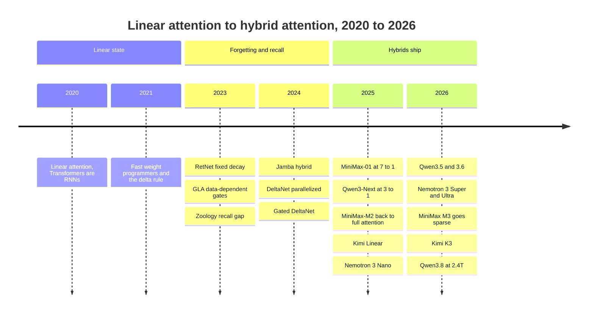
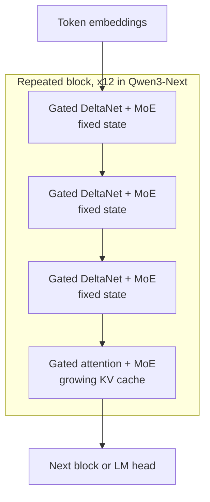
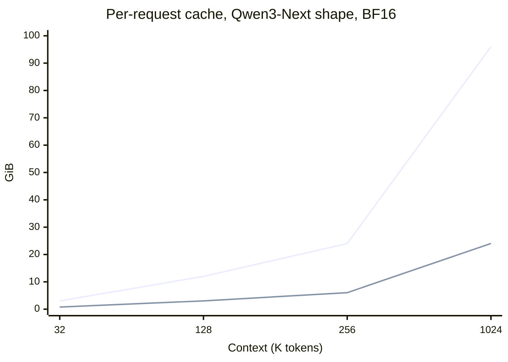

---
tags:
  - ai-ml
  - architectures
  - attention
  - linear-attention
  - long-context
  - inference
status: draft
sources:
  - https://arxiv.org/abs/2006.16236
  - https://arxiv.org/abs/2102.11174
  - https://arxiv.org/abs/2307.08621
  - https://arxiv.org/abs/2312.06635
  - https://arxiv.org/abs/2312.04927
  - https://arxiv.org/abs/2403.19887
  - https://arxiv.org/abs/2406.06484
  - https://arxiv.org/abs/2412.06464
  - https://arxiv.org/abs/2501.08313
  - https://arxiv.org/html/2501.08313
  - https://arxiv.org/abs/2504.03624
  - https://arxiv.org/abs/2507.06457
  - https://arxiv.org/abs/2510.04800
  - https://arxiv.org/abs/2510.26692
  - https://arxiv.org/html/2510.26692
  - https://arxiv.org/pdf/2605.22791
  - https://arxiv.org/html/2606.20097
  - https://huggingface.co/papers/2606.15007.md
  - https://www.alibabacloud.com/blog/qwen3-next-towards-ultimate-training-%26-inference-efficiency_602580
  - https://huggingface.co/Qwen/Qwen3-Next-80B-A3B-Instruct/blob/main/config.json
  - https://huggingface.co/blog/mlabonne/qwen35
  - https://huggingface.co/Qwen/Qwen3.8-2.4T-A95B
  - https://huggingface.co/blog/MiniMax-AI/why-did-m2-end-up-as-a-full-attention-model
  - https://www.minimax.io/news/why-did-m2-end-up-as-a-full-attention-model
  - https://minimax.io/blog/minimax-m3
  - https://www.kimi.com/blog/kimi-k3
  - https://research.nvidia.com/labs/nemotron/Nemotron-3
  - https://developer.nvidia.com/blog/introducing-nemotron-3-super-an-open-hybrid-mamba-transformer-moe-for-agentic-reasoning/
  - https://pytorch.org/blog/hybrid-models-as-first-class-citizens-in-vllm/
  - https://docs.vllm.ai/en/latest/design/hybrid_kv_cache_manager/
  - https://www.lmsys.org/blog/2026-08-11-unified-radix-cache
  - https://www.lmsys.org/blog/2026-08-12-qwen3-8-day0-support
  - https://github.com/fla-org/flash-linear-attention
  - https://sebastianraschka.com/llm-architecture-gallery/hybrid-attention/
  - https://sebastianraschka.com/llm-architecture-gallery/models/qwen3-next-80b-a3b/
  - https://sebastianraschka.com/llm-architecture-gallery/models/qwen3-6-35b-a3b/
  - https://sebastianraschka.com/llm-architecture-gallery/models/qwen3-6-27b/
  - https://sebastianraschka.com/llm-architecture-gallery/models/kimi-k3/
  - https://sebastianraschka.com/llm-architecture-gallery/models/minimax-m3-428b/
  - https://sebastianraschka.com/llm-architecture-gallery/models/nemotron-3-ultra-550b-a55b/
  - https://newsletter.semianalysis.com/p/kimi-k3-the-manos-the-mythos-the
created: 2026-11-26
updated: 2026-11-26
---

## Table Of Contents

---

- [[#TL;DR|TL;DR]]
- [[#The Problem|The Problem]]
- [[#Foundations|Foundations]]
    - [[#Softmax Attention and Its Growing Cache|Softmax Attention and Its Growing Cache]]
    - [[#Linear Attention Reorders the Product|Linear Attention Reorders the Product]]
    - [[#The Recurrent View|The Recurrent View]]
    - [[#Why Plain Linear Attention Falls Short|Why Plain Linear Attention Falls Short]]
- [[#How We Got Here|How We Got Here]]
- [[#How It Works|How It Works]]
    - [[#Three Ways to Update the State|Three Ways to Update the State]]
    - [[#The Gated Delta Rule|The Gated Delta Rule]]
    - [[#A Worked Example|A Worked Example]]
    - [[#Kimi Delta Attention|Kimi Delta Attention]]
    - [[#The Hybrid Layer Stack|The Hybrid Layer Stack]]
    - [[#Memory Arithmetic at 128K and 1M|Memory Arithmetic at 128K and 1M]]
    - [[#Training in Chunks|Training in Chunks]]
- [[#Where It Is Now|Where It Is Now]]
    - [[#Who Ships Hybrids|Who Ships Hybrids]]
    - [[#MiniMax Walks Back|MiniMax Walks Back]]
    - [[#Quality and Retrieval Evidence|Quality and Retrieval Evidence]]
    - [[#Kernels and Serving|Kernels and Serving]]
    - [[#The Design Space Is Still Moving|The Design Space Is Still Moving]]
- [[#Trade-offs & Open Problems|Trade-offs & Open Problems]]
- [[#Resources|Resources]]
- [[#Related Notes|Related Notes]]

## ***TL;DR***
---
*A hybrid-attention model replaces most of its softmax [[Attention]] layers with linear-attention or recurrent layers that keep a fixed-size memory, and keeps a few full-attention layers for exact lookup. In late 2026 this is the standard layout for long-context open models from Qwen, Moonshot (Kimi) and NVIDIA, usually at about three cheap layers per full one.*

- **What it is:** a layer stack such as "3 Gated DeltaNet layers, then 1 gated softmax-attention layer, repeated." The cheap layers cost the same per token at any context length; only the full layers keep a growing [[KV Cache]].
- **Why it works:** linear attention alone is fast but forgets badly and is weak at recalling a specific earlier token. A few full-attention layers restore that recall, while the cheap layers cut KV-cache memory and long-context compute roughly by the share of layers they replace ([Qwen, Sep 2025](https://www.alibabacloud.com/blog/qwen3-next-towards-ultimate-training-%26-inference-efficiency_602580)).
- **The key mechanism:** the gated delta rule, $S_t = \alpha_t (I - \beta_t k_t k_t^\top) S_{t-1} + \beta_t k_t v_t^\top$. It decays old memory, erases what was stored under the current key, and writes the new value, all inside a fixed-size matrix ([Yang, Kautz, Hatamizadeh, ICLR 2025](https://arxiv.org/abs/2412.06464)).
- **Where it is now (Nov 2026):** Qwen3.5, Qwen3.6 and the 2.4T-parameter Qwen3.8 (Aug 2026) all use a 3:1 Gated DeltaNet to gated-attention stack; Kimi K3 (Jul 2026) uses about 3:1 Kimi Delta Attention to MLA; Nemotron 3 uses Mamba-2 with about 4:1 to 5:1. MiniMax went the other way: hybrid in MiniMax-01, full attention in M2 for reliability, then sparse attention in M3.

## ***The Problem***
---
*Softmax attention compares every token with every earlier token and stores a key and value per token per layer. At 128K to 1M tokens that cache, not the weights, decides how many requests fit on a GPU and how fast each token decodes.*

Two costs grow with context length $n$ in a standard [[Transformer]]:

| Cost | Growth | When it hurts | What a hybrid does |
|---|---|---|---|
| KV-cache memory | Linear in $n$, per layer, per request | Decode at long context; batch size collapses | Only the full layers (about 1 in 4) keep a cache; the rest keep a constant-size state |
| Attention compute | Quadratic in $n$ for prefill, linear per decoded token | Long prompts (time to first token) and every decode step | Only the full layers do the $n^2$ score computation |

Agentic workloads make this worse: SemiAnalysis's agent traces have a median of 142K input tokens and 65 turns per session ([SemiAnalysis, Aug 2026](https://newsletter.semianalysis.com/p/kimi-k3-the-manos-the-mythos-the)). The obvious fix, dropping softmax entirely for a linear-time layer, has been tried since 2020 and loses quality, mainly on tasks that require pulling back one exact earlier fact. The hybrid is the compromise: keep enough full attention to recall, and make everything else cheap.

## ***Foundations***
---
*Four ideas make hybrids readable: what softmax attention costs, how linear attention turns it into a running sum, why that sum is a recurrent network with a matrix-shaped memory, and why that memory on its own is not good enough.*

#### **Softmax Attention and Its Growing Cache**

For a query $q_t$ at position $t$, causal attention is

$$
o_t = \sum_{i \le t} \frac{\exp(q_t^\top k_i / \sqrt{d})}{\sum_{j \le t} \exp(q_t^\top k_j / \sqrt{d})} \, v_i
$$

*In plain English: score the current token against every earlier key, turn the scores into weights that sum to one, and take the weighted average of the earlier values.* The softmax couples every key to the query, so you cannot precompute anything except the keys and values themselves. Generation therefore stores every $k_i, v_i$ (the [[KV Cache]]) and reads all of them for each new token. See [[7 - All About Transformer Inference (NOT DONE)]] for the full cost model.

#### **Linear Attention Reorders the Product**

Katharopoulos et al. replaced $\exp(q^\top k)$ with a dot product of feature maps, $\phi(q)^\top \phi(k)$ ([Katharopoulos et al., ICML 2020](https://arxiv.org/abs/2006.16236)). Once the similarity is a plain dot product, matrix multiplication is associative and the order can be changed:

$$
\underbrace{(Q K^\top)}_{n \times n} V \;\longrightarrow\; Q \underbrace{(K^\top V)}_{d \times d}
$$

*In plain English: instead of building the $n \times n$ table of who-attends-to-whom and then mixing values, first squash all keys and values into one $d \times d$ summary matrix, then let each query read from it. Cost drops from $O(n^2 d)$ to $O(n d^2)$.* The paper reports similar quality on its tasks and "up to 4000x faster" autoregressive prediction on very long sequences. Most modern variants drop $\phi$ and the normalizing denominator and use $q$ and $k$ directly (as in the equations below).

#### **The Recurrent View**

With a causal mask, the summary at step $t$ only includes tokens up to $t$, so it can be built one token at a time:

$$
S_t = S_{t-1} + k_t v_t^\top, \qquad o_t = S_t^\top q_t
$$

*In plain English: keep a $d_k \times d_v$ matrix $S$. Each new token adds the outer product of its key and value; to read, multiply by the query. The memory never grows, no matter how long the sequence.* This is why the paper is titled "Transformers are RNNs." Schlag, Irie and Schmidhuber then showed the same update is a 1990s "fast weight programmer": $S$ is a weight matrix that the network writes into at run time ([Schlag et al., 2021](https://arxiv.org/abs/2102.11174)). Reading $S^\top q$ is a key-value lookup: if $q$ matches a stored key, you get roughly that key's value back.

#### **Why Plain Linear Attention Falls Short**

- **No forgetting.** $S$ only accumulates. Old associations are never removed, so new ones pile on top and interfere. A $d_k$-dimensional key space holds at most $d_k$ orthogonal keys without overlap; past that, retrieval returns blends. Schlag et al. concluded that linearized attention has "limited memory capacity" ([2021](https://arxiv.org/abs/2102.11174)).
- **No overwrite.** Writing a new value for an existing key adds to the old one instead of replacing it (see [[#A Worked Example|the worked example]]).
- **Weak associative recall.** Zoology measured that gated-convolution and recurrent models trail attention by up to 2.1 perplexity on the Pile and that 82% of the gap comes from recall, e.g. a 70M attention model beat a 1.4B gated-convolution model at it ([Arora et al., Dec 2023](https://arxiv.org/abs/2312.04927)).

The rest of the history is about fixing the first two problems with better update rules, and the third by keeping some softmax layers.

## ***How We Got Here***
---
*The lineage runs from a pure additive state (2020), to a decaying state (RetNet, GLA, Mamba-2), to an overwriting state (DeltaNet), to both at once (Gated DeltaNet, then KDA). In parallel, labs learned that no recurrent layer fully replaces attention, and settled on mixing them, at about 3:1 by 2025.*

| Year | What changed | Problem it answered | Source |
|---|---|---|---|
| 2020 | Kernelized attention; reorder $(QK^\top)V$ into $Q(K^\top V)$; RNN form with a matrix state. | Quadratic cost of softmax attention. | [Katharopoulos et al.](https://arxiv.org/abs/2006.16236) |
| 2021 | Linear attention equals a fast weight programmer; replace additive writes with a delta-rule write that can correct the stored mapping. | Limited memory capacity, no overwrite. | [Schlag et al.](https://arxiv.org/abs/2102.11174) |
| 2023 | RetNet: retention with a decay and parallel, recurrent and chunkwise forms; "$O(1)$" inference per token. | No forgetting. | [Sun et al.](https://arxiv.org/abs/2307.08621) |
| 2023 | GLA: data-dependent gates, hardware-efficient chunked kernels faster than FlashAttention-2 even at 1K length. | Fixed decay too crude; slow training. | [Yang et al.](https://arxiv.org/abs/2312.06635) |
| 2023 | Most of the quality gap of efficient models is associative recall. | Why linear models lose despite similar perplexity on average. | [Arora et al.](https://arxiv.org/abs/2312.04927) |
| 2024 | Jamba interleaves Transformer and Mamba layers; 256K context on one 80GB GPU. | Pure SSMs miss recall; pure Transformers too memory hungry. | [Lieber et al.](https://arxiv.org/abs/2403.19887) |
| 2024 | DeltaNet parallelized over sequence length (Householder-product trick); 1.3B on 100B tokens beats Mamba and GLA; hybrids with sliding-window or 2 global attention layers beat Transformers. | Delta rule was too slow to train at scale. | [Yang et al.](https://arxiv.org/abs/2406.06484) |
| Dec 2024 | Gated DeltaNet: decay gate plus delta rule; beats Mamba2 and DeltaNet; hybrids with sliding-window attention or Mamba2. | Delta rule cannot clear memory quickly; decay alone cannot overwrite. | [Yang, Kautz, Hatamizadeh](https://arxiv.org/abs/2412.06464) |
| Jan 2025 | MiniMax-01: 80 layers, one softmax layer after every seven Lightning Attention layers; 456B total, 45.9B active; 1M training, 4M inference context. | First frontier-scale linear hybrid; lightning alone "demonstrates limited retrieval capabilities." | [MiniMax](https://arxiv.org/html/2501.08313) |
| Apr 2025 | Nemotron-H replaces "the majority of self-attention layers" with Mamba; up to 3x faster than similar Transformers. | Inference cost of reasoning traces. | [NVIDIA](https://arxiv.org/abs/2504.03624) |
| Sep 2025 | Qwen3-Next-80B-A3B: 3:1 Gated DeltaNet to gated attention; over 10x Qwen3-32B throughput beyond 32K. | Long-context cost in a production family. | [Qwen](https://www.alibabacloud.com/blog/qwen3-next-towards-ultimate-training-%26-inference-efficiency_602580) |
| Oct 2025 | MiniMax-M2 ships with full attention; hybrid had "clear deficits in complex, multi-hop reasoning" at scale. | Reliability for agents. | [MiniMax](https://huggingface.co/blog/MiniMax-AI/why-did-m2-end-up-as-a-full-attention-model) |
| Oct 2025 | Kimi Linear: Kimi Delta Attention (channel-wise decay) with MLA at 3:1; beats full MLA on a 1.4T-token comparison. | Can a hybrid beat full attention outright? | [Kimi Team](https://arxiv.org/html/2510.26692) |
| 2026 | Hybrids become flagships: Qwen3.5 (Feb), Nemotron 3 Super (Mar), Ultra (Jun), Kimi K3 (Jul), Qwen3.8 (Aug). | Scaling hybrids to trillions of parameters. | [[#Who Ships Hybrids\|below]] |

SSM history (S4, Mamba, Mamba-2) is a parallel branch that converged on the same idea; Mamba-2 is equivalent to a linear-attention variant with a scalar decay ([vLLM team, Nov 2025](https://pytorch.org/blog/hybrid-models-as-first-class-citizens-in-vllm/)). See [[State Space Models]].

## ***How It Works***
---
*Every modern linear layer is the same recurrence with a different rule for updating the state matrix $S$. The gated delta rule adds two knobs to plain linear attention: a decay that forgets everything a little, and an erase-then-write step that replaces the value stored under the current key. A hybrid then stacks these layers with periodic full attention.*

#### **Three Ways to Update the State**

All variants keep $S_t \in \mathbb{R}^{d_k \times d_v}$ per head and read $o_t = S_t^\top q_t$. They differ only in the write:

| Rule | Update | What it adds | Used by |
|---|---|---|---|
| Linear attention | $S_t = S_{t-1} + k_t v_t^\top$ | Nothing: pure accumulation | 2020 linear Transformers |
| Gated (decay) | $S_t = \alpha_t S_{t-1} + k_t v_t^\top$ | Forget a fraction $1-\alpha_t$ of everything each step | RetNet (fixed $\alpha$), GLA, Mamba-2 (data-dependent $\alpha_t$) |
| Delta rule | $S_t = (I - \beta_t k_t k_t^\top) S_{t-1} + \beta_t k_t v_t^\top$ | Erase the old value under key $k_t$, write the new one | DeltaNet |
| Gated delta rule | $S_t = \alpha_t (I - \beta_t k_t k_t^\top) S_{t-1} + \beta_t k_t v_t^\top$ | Both | Gated DeltaNet (Qwen3-Next, Qwen3.5 to 3.8) |

Equations as written in [Gated DeltaNet-2 (Hatamizadeh, Choi, Kautz, 2026)](https://arxiv.org/pdf/2605.22791); the original paper writes the transposed form $S_t = S_{t-1}(I - \beta_t k_t k_t^\top) + \beta_t v_t k_t^\top$ for DeltaNet ([Yang et al., 2024](https://arxiv.org/abs/2412.06464)).

#### **The Gated Delta Rule**

$$
S_t = \alpha_t \left(I - \beta_t k_t k_t^\top\right) S_{t-1} + \beta_t\, k_t v_t^\top, \qquad \alpha_t, \beta_t \in (0, 1)
$$

*In plain English: first, shrink the whole memory by $\alpha_t$ (forget a bit of everything). Second, look up what the memory currently returns for key $k_t$ and remove a fraction $\beta_t$ of it. Third, write a fraction $\beta_t$ of the new value $v_t$ under that key. Both $\alpha_t$ and $\beta_t$ are computed from the current token, so the model decides per token how much to forget and how hard to overwrite.*

The two gates have clean limits: $\alpha_t \to 0$ wipes the memory, $\alpha_t \to 1$ gives the pure delta rule ([Yang, Kautz, Hatamizadeh, 2024](https://arxiv.org/abs/2412.06464)).

**Why "delta":** ignoring the decay, the delta rule is one step of gradient descent on how badly the memory predicts the current value:

$$
\mathcal{L}(S) = \tfrac{1}{2}\lVert S^\top k_t - v_t \rVert^2, \qquad S_t = S_{t-1} - \beta_t \nabla_S \mathcal{L} = S_{t-1} - \beta_t k_t (k_t^\top S_{t-1} - v_t^\top)
$$

*In plain English: the memory predicts a value for key $k_t$, compares it with the true $v_t$, and moves toward it with learning rate $\beta_t$. Expanding the right side gives exactly $(I - \beta_t k_t k_t^\top)S_{t-1} + \beta_t k_t v_t^\top$.* Plain linear attention, by contrast, adds $k_t v_t^\top$ whether or not the memory already knew the answer.

#### **A Worked Example**

Take one head with $d_k = d_v = 2$ and unit-length keys. The memory currently stores two facts: key $a = [1, 0]$ maps to value $[2, 4]$, and key $b = [0, 1]$ maps to $[1, 1]$:

$$
S_{t-1} = \begin{bmatrix} 2 & 4 \\ 1 & 1 \end{bmatrix}
$$

(row 1 is what key $a$ reads back, row 2 is key $b$). A new token arrives with key $k_t = a = [1, 0]$ and a new value $v_t = [6, 0]$, i.e. the fact for $a$ has changed. Use $\beta_t = 0.5$, $\alpha_t = 0.9$.

| Step | Gated delta rule | Plain linear attention |
|---|---|---|
| Erase: $(I - 0.5\,k k^\top) = \mathrm{diag}(0.5, 1)$ times $S_{t-1}$ | $\begin{bmatrix} 1 & 2 \\ 1 & 1 \end{bmatrix}$ | (no erase) |
| Decay: times $\alpha = 0.9$ | $\begin{bmatrix} 0.9 & 1.8 \\ 0.9 & 0.9 \end{bmatrix}$ | (no decay) |
| Write: $+\,0.5 \cdot k v^\top = \begin{bmatrix} 3 & 0 \\ 0 & 0 \end{bmatrix}$ | $\begin{bmatrix} 3.9 & 1.8 \\ 0.9 & 0.9 \end{bmatrix}$ | $S_{t-1} + k v^\top = \begin{bmatrix} 8 & 4 \\ 1 & 1 \end{bmatrix}$ |
| Read key $a$: $S_t^\top [1, 0]$ | $[3.9,\ 1.8]$ | $[8,\ 4]$ |
| Read key $b$: $S_t^\top [0, 1]$ | $[0.9,\ 0.9]$ | $[1,\ 1]$ |

- **Delta rule, $\alpha = 1$:** key $a$ would read $[4, 2]$, exactly halfway from the old $[2, 4]$ to the new $[6, 0]$, because $\beta = 0.5$. With $\beta = 1$ it reads exactly $[6, 0]$: a clean overwrite. Key $b$ is untouched because its key is orthogonal to $a$.
- **Gated:** the decay also shrinks key $b$'s memory to $[0.9, 0.9]$. That is the price of forgetting: useful for dropping stale context, harmful if $b$ was needed later.
- **Plain linear attention:** key $a$ returns $[8, 4]$, the sum of old and new values, which is neither. Repeat this over thousands of tokens and every read becomes a blur. This is the failure the delta rule fixes.

#### **Kimi Delta Attention**

KDA keeps the delta rule but makes the decay a vector, one forgetting rate per key channel:

$$
S_t = \left(I - \beta_t k_t k_t^\top\right) \mathrm{Diag}(\alpha_t)\, S_{t-1} + \beta_t\, k_t v_t^\top, \qquad \alpha_t \in (0,1)^{d_k}
$$

*In plain English: instead of fading the whole memory at one rate, each feature dimension of the key fades at its own rate, so some channels can hold facts for a long time while others refresh quickly.* Gated DeltaNet's scalar gate is the special case where every entry of $\alpha_t$ is equal ([Kimi Team, Oct 2025](https://arxiv.org/html/2510.26692)).

#### **The Hybrid Layer Stack**

Design choices in the full-attention layers, as Qwen describes them for Qwen3-Next ([Qwen, Sep 2025](https://www.alibabacloud.com/blog/qwen3-next-towards-ultimate-training-%26-inference-efficiency_602580)):

- **Output gate:** a sigmoid gate on the attention output, which Qwen says reduces attention's low-rank problems (see [[Attention Sinks and Gated Attention]]).
- **Bigger heads, few KV heads:** head dimension 256 instead of 128, with 2 KV heads in grouped-query form ([config](https://huggingface.co/Qwen/Qwen3-Next-80B-A3B-Instruct/blob/main/config.json)).
- **Partial RoPE:** rotary encoding on only the first 25% of dimensions, for better extrapolation (see [[Positional Encoding]]). Kimi Linear goes further and uses no positional encoding (NoPE) in its MLA layers ([Kimi Team](https://arxiv.org/html/2510.26692)).

Qwen chose Gated DeltaNet over sliding-window attention and Mamba2 because it gave stronger in-context learning in their tests; the post does not explain why 3:1 specifically.

#### **Memory Arithmetic at 128K and 1M**

Use Qwen3-Next-80B-A3B's real config: 48 layers, `full_attention_interval` 4, full layers with 2 KV heads of dimension 256; Gated DeltaNet layers with 32 value heads and 16 key heads, both of dimension 128 ([config](https://huggingface.co/Qwen/Qwen3-Next-80B-A3B-Instruct/blob/main/config.json)). Compare it with a hypothetical version where all 48 layers are full attention. BF16 throughout.

| Quantity | Formula | All 48 layers full | 3:1 hybrid (12 full + 36 GDN) |
|---|---|---|---|
| KV cache per token | layers x 2 (K,V) x 2 heads x 256 x 2 bytes | 96 KiB | 24 KiB |
| GDN state per sequence | 36 x 32 heads x 128 x 128 x 2 bytes | 0 | 36 MiB (72 MiB if kept in FP32) |
| Conv state per sequence | 36 x 8192 channels x 3 x 2 bytes | 0 | about 1.7 MiB |
| Total at 128K tokens (131,072) | | 12 GiB | 3 GiB + 38 MiB |
| Total at 1M tokens (1,048,576) | | 96 GiB | 24 GiB + 38 MiB |

The 24 KiB per token matches the figure in [Raschka's gallery](https://sebastianraschka.com/llm-architecture-gallery/models/qwen3-next-80b-a3b/). Readings:

- **A 3:1 hybrid cuts the cache about 4x.** At long context the fixed state is a rounding error; the cache of the 12 remaining full layers dominates.
- **Break-even is tiny.** The 36 replaced layers would have cost 72 KiB per token as full attention, so their 36 MiB state pays for itself after $36\,\text{MiB} / 72\,\text{KiB} = 512$ tokens.
- **Per request, then times the batch.** At 128K, 16 concurrent requests need about 192 GiB of cache for the all-full version, more than one GPU's HBM, versus about 49 GiB for the hybrid.
- **Compute follows the same split.** The $n^2$ score computation runs in 12 of 48 layers; the GDN layers cost the same per token at 1K or 1M.

Upper line: all layers full attention. Lower line: 3:1 hybrid. Other designs shrink the same cache differently: MLA compresses each token's entry and [[Sparse Attention]] reads fewer of them; Kimi K3 combines MLA with the hybrid and lands at about 27 KiB per token for a 2.8T model ([Raschka gallery](https://sebastianraschka.com/llm-architecture-gallery/models/kimi-k3/)).

#### **Training in Chunks**

Training cannot run the recurrence token by token; that would leave the GPU idle. All these layers use a **chunkwise** form: split the sequence into blocks, compute attention-style (the $QK^\top$ order, with a causal mask) inside each block, and pass the state $S$ between blocks recurrently. MiniMax's Lightning Attention does exactly this, which it says avoids the slow cumulative sum of causal linear attention, at cost $O(nd^2 + nBd)$ for block size $B$ ([MiniMax, 2025](https://arxiv.org/html/2501.08313)). The delta rule is harder, because each step multiplies by a matrix $(I - \beta k k^\top)$; DeltaNet made it parallel with a memory-efficient representation of products of Householder matrices ([Yang et al., 2024](https://arxiv.org/abs/2406.06484)). Decoding then uses the plain recurrence: one state update per token, like an RNN.

## ***Where It Is Now***
---
*As of November 2026, hybrid attention is the default for long-context open models from Qwen, Moonshot and NVIDIA, at roughly 3:1 to 5:1, scaled up to 2.4T and 2.8T parameters. Serving engines now treat recurrent state as a first-class cache. The main holdout, MiniMax, chose sparse attention instead, a reminder that hybrids trade some reliability for efficiency.*

#### **Who Ships Hybrids**

| Model | Released | Cheap layer | Full layer | Count (cheap : full) | Source |
|---|---|---|---|---|---|
| Qwen3-Next-80B-A3B | Sep 2025 | Gated DeltaNet | Gated attention (GQA) | 36 : 12 | [Raschka](https://sebastianraschka.com/llm-architecture-gallery/models/qwen3-next-80b-a3b/) |
| Kimi Linear 48B-A3B | Oct 2025 | KDA | MLA (NoPE) | 3 : 1 | [Kimi Team](https://arxiv.org/html/2510.26692) |
| Nemotron 3 Nano 30B-A3B | Dec 2025 | Mamba-2 | Attention | 23 : 6 | [Raschka](https://sebastianraschka.com/llm-architecture-gallery/hybrid-attention/) |
| Qwen3.5-397B-A17B | Feb 16, 2026 | Gated DeltaNet | Gated attention | 3 : 1 (60 layers) | [Labonne](https://huggingface.co/blog/mlabonne/qwen35) |
| Nemotron 3 Super 120B-A12B | Mar 11, 2026 | Mamba-2 | Attention | 40 : 8 | [NVIDIA](https://developer.nvidia.com/blog/introducing-nemotron-3-super-an-open-hybrid-mamba-transformer-moe-for-agentic-reasoning/), [Raschka](https://sebastianraschka.com/llm-architecture-gallery/hybrid-attention/) |
| Qwen3.6-35B-A3B | Apr 15, 2026 | Gated DeltaNet | Gated attention | 30 : 10 | [Raschka](https://sebastianraschka.com/llm-architecture-gallery/models/qwen3-6-35b-a3b/) |
| Qwen3.6-27B (dense) | Apr 22, 2026 | Gated DeltaNet | Gated attention | 48 : 16 | [Raschka](https://sebastianraschka.com/llm-architecture-gallery/models/qwen3-6-27b/) |
| Nemotron 3 Ultra 550B-A55B | Jun 4, 2026 | Mamba-2 | GQA (NoPE) | 48 : 12 | [Raschka](https://sebastianraschka.com/llm-architecture-gallery/models/nemotron-3-ultra-550b-a55b/) |
| Kimi K3 (2.8T, 104B active) | Jul 27, 2026 | KDA | Gated MLA | 69 : 24 | [Kimi](https://www.kimi.com/blog/kimi-k3), [Raschka](https://sebastianraschka.com/llm-architecture-gallery/models/kimi-k3/) |
| Qwen3.8-2.4T-A95B | Aug 2026 | Gated DeltaNet | Gated attention (64 Q, 4 KV heads) | 69 : 23 | [Qwen](https://huggingface.co/Qwen/Qwen3.8-2.4T-A95B) |

Notes on the table:

- **3:1 won.** Qwen has kept the same 3:1 pattern from an 80B preview to a 2.4T flagship, all with 262,144-token native context extensible to about 1M ([Qwen3.8 card](https://huggingface.co/Qwen/Qwen3.8-2.4T-A95B)). Kimi moved from MLA-only Kimi K2.5 ([Labonne, Feb 2026](https://huggingface.co/blog/mlabonne/qwen35)) to a KDA hybrid in K3, which Moonshot describes as "built on Kimi Delta Attention."
- **NVIDIA uses more recurrent layers.** Nemotron 3 runs about 4:1 to 5:1 with Mamba-2. All three sizes target 1M context; Nano claims 3.3x the throughput of Qwen3-30B-A3B ([NVIDIA](https://research.nvidia.com/labs/nemotron/Nemotron-3)).
- **Others:** inclusionAI's Ling 2.5 1T pairs Lightning Attention with MLA at 7:1, and IBM's Granite 4.0 hybrids run in vLLM ([Raschka](https://sebastianraschka.com/llm-architecture-gallery/hybrid-attention/); [vLLM team](https://pytorch.org/blog/hybrid-models-as-first-class-citizens-in-vllm/)).

#### **MiniMax Walks Back**

MiniMax pioneered the frontier linear hybrid with MiniMax-01 (Jan 2025, 7:1), then shipped MiniMax-M2 with full attention. Their pre-training lead, Haohai Sun, explained why ([MiniMax, Oct 2025](https://www.minimax.io/news/why-did-m2-end-up-as-a-full-attention-model)):

- **Hidden quality gaps.** The hybrid matched full attention on common benchmarks, but at larger scale "the model had clear deficits in complex, multi-hop reasoning tasks." Measuring this reliably needs far more compute than standard evals.
- **Patterns set early.** Retrieval and induction heads "were already established early during pre-training," so continued pretraining "can hardly adjust those patterns afterwards." A hybrid cannot easily be repaired later.
- **Precision.** "Linear attention is currently far more sensitive to numerical precision than full attention," with serious problems during RL training in earlier work.
- **Serving gaps.** Prefix caching and speculative decoding were not yet worked out for linear backbones, and many linear kernels are memory-bound.
- **Their verdict:** "in a real-world, industrial-grade system... efficient attention still has some way to go before it can definitively beat full attention," though its benefits "will gradually emerge" as compute growth slows and contexts grow.

MiniMax-M2.5 kept full attention "for reliability purposes" ([Labonne, Feb 2026](https://huggingface.co/blog/mlabonne/qwen35)). MiniMax M3 (Jun 1, 2026) then moved to **sparse** attention instead: 57 MiniMax Sparse Attention layers plus 3 full GQA layers, with company-reported 9x faster prefill and 15x faster decoding at 1M tokens ([MiniMax](https://minimax.io/blog/minimax-m3); [Raschka](https://sebastianraschka.com/llm-architecture-gallery/models/minimax-m3-428b/)). Its cache is about 120 KiB per token, five times Qwen3-Next's; sparse attention saves compute by reading fewer cached tokens, not by caching fewer. See [[Sparse Attention]].

#### **Quality and Retrieval Evidence**

| Evidence | Result | Source |
|---|---|---|
| Kimi Linear vs full MLA vs GDN hybrid, same 1.4T tokens | MMLU-Pro 51.0 vs 47.2 vs 47.9; RULER at 128K 84.3 vs 81.3 vs 80.5; decode time per token at 1M 1.84 ms vs 11.48 ms for MLA (6.3x) | [Kimi Team, Oct 2025](https://arxiv.org/html/2510.26692) |
| Qwen3-Next vs Qwen3-32B | Under 10% of the training GPU hours; over 10x prefill and decode throughput beyond 32K (implementation-dependent) | [Qwen, Sep 2025](https://www.alibabacloud.com/blog/qwen3-next-towards-ultimate-training-%26-inference-efficiency_602580) |
| 72 hybrid models, 6 linear variants, 5 ratios | Language modeling stable across ratios; recall improves with more full layers, "especially below a 3:1 ratio"; recommend HGRN-2 or Gated DeltaNet at 3:1 to 6:1 | [Wang et al., v2 Jun 2026](https://arxiv.org/abs/2507.06457) |
| Nemotron 3 Ultra base, RULER | 95.30 at 64K, 92.49 at 128K, 86.22 at 256K, 76.83 at 1M; vendor-reported 1.6x throughput vs Qwen3.5-397B and 4.8x vs Kimi-K2.6 at 8K in / 64K out | [NVIDIA, Jun 2026](https://huggingface.co/papers/2606.15007.md) |
| MiniMax at scale | Hybrid fine on benchmarks, worse on multi-hop reasoning | [MiniMax, Oct 2025](https://huggingface.co/blog/MiniMax-AI/why-did-m2-end-up-as-a-full-attention-model) |

The pattern: at matched training, a well-designed 3:1 hybrid matches or beats full attention on standard and RULER-style retrieval benchmarks, and the full layers carry the recall. The open question, raised by MiniMax, is whether benchmarks catch the failures that matter for long agent runs.

#### **Kernels and Serving**

- **Kernels.** [flash-linear-attention](https://github.com/fla-org/flash-linear-attention) (Songlin Yang, Yu Zhang and contributors) is the reference Triton library for GLA, DeltaNet, Gated DeltaNet, KDA, Mamba2/3, RWKV7 and more; Gated DeltaNet was integrated into Qwen3-Next (Sep 2025), KDA added in Oct 2025, context parallelism for KDA and GDN in Mar 2026.
- **vLLM.** V1 made hybrids first-class in Nov 2025: one memory pool for KV blocks and recurrent state, with attention block sizes raised until a page holds a whole Mamba state (672-token blocks for Nemotron-Nano-12B-v2) ([vLLM team](https://pytorch.org/blog/hybrid-models-as-first-class-citizens-in-vllm/)). The hybrid KV cache manager caches the recurrent state at block boundaries for prefix reuse, supports exactly one full-attention group plus one other type, and still calls itself early-stage ([vLLM docs](https://docs.vllm.ai/en/latest/design/hybrid_kv_cache_manager/)). See [[PagedAttention]].
- **The prefix-caching catch.** A recurrent state exists only at the position it was saved, so reusing a prefix needs a checkpoint there. Saving one per token would make memory grow with length again, so Kimi K3 in vLLM checkpoints KDA state about every 32K tokens plus at prompt boundaries; in practice the state "do[es] not consume a constant amount of KV cache memory" ([SemiAnalysis, Aug 2026](https://newsletter.semianalysis.com/p/kimi-k3-the-manos-the-mythos-the)).
- **SGLang.** The Unified Radix Cache (Aug 2026) puts full-attention KV, sliding-window KV and recurrent-state checkpoints in one radix tree; with session-aware eviction, Qwen3.5-397B-A17B's device hit ratio rose from about 5% to 34% at batch 32 ([LMSYS](https://www.lmsys.org/blog/2026-08-11-unified-radix-cache)). For Qwen3.8, "ReplaySSM" handles [[Speculative Decoding]] by replaying the accepted tokens through the recurrence instead of snapshotting state at every draft position ([LMSYS](https://www.lmsys.org/blog/2026-08-12-qwen3-8-day0-support)). That directly answers one of MiniMax's 2025 objections.

#### **The Design Space Is Still Moving**

- **Gated DeltaNet-2 (NVIDIA, 2026)** splits $\beta_t$ into separate channel-wise erase and write gates; it reduces to KDA when both gates are equal and to Gated DeltaNet when the decay is also scalar. In a 31.6B hybrid MoE on 300B tokens it averaged 62.67 vs 61.25 for KDA and 60.14 for Mamba-2 ([Hatamizadeh, Choi, Kautz](https://arxiv.org/pdf/2605.22791)).
- **Head-level hybrids.** Alibaba's HydraHead finds only about 6.5% of Qwen3-1.7B's heads are critical for long-context retrieval and mixes full and linear attention per head; a 7:1 head-level mix stays within ±3% of a 3:1 layer-level hybrid on RULER from 16K to 256K ([Tan et al., 2026](https://arxiv.org/html/2606.20097)).
- **Systematic studies** of inter-layer vs intra-layer (parallel) fusion continue ([Bae et al., Meta, v3 Apr 2026](https://arxiv.org/abs/2510.04800)).

## ***Trade-offs & Open Problems***
---
*A hybrid buys a roughly 4x smaller cache and much faster long-context decoding with a fixed-size memory that can lose information. Whether a few full layers fully cover that loss on hard, long, multi-step tasks is not settled, and the serving stack is still catching up.*

| Trade-off or problem | Detail |
|---|---|
| Lossy memory | A $d_k \times d_v$ state per head cannot store an unbounded number of facts; decay throws some away by design. The full layers are the backstop for exact recall. |
| Benchmarks vs real tasks | Hybrids match or beat full attention on RULER-style tests ([Kimi Team](https://arxiv.org/html/2510.26692)), but MiniMax saw multi-hop deficits that standard evals missed ([MiniMax](https://huggingface.co/blog/MiniMax-AI/why-did-m2-end-up-as-a-full-attention-model)). |
| Which ratio | 3:1 is the industry default, NVIDIA runs 4:1 to 5:1, MiniMax-01 ran 7:1; studies suggest recall degrades past about 3:1 to 6:1 ([Wang et al.](https://arxiv.org/abs/2507.06457)). Head-level mixing may beat layer-level ([HydraHead](https://arxiv.org/html/2606.20097)). |
| Fixed at pretraining | Retrieval patterns form early, so a weak hybrid is hard to fix with continued training ([MiniMax](https://www.minimax.io/news/why-did-m2-end-up-as-a-full-attention-model)). |
| Numerical precision | Recurrent state is sensitive to low precision, which matters for RL and for FP8/FP4 serving (see [[Quantization]]). |
| Prefix caching | State exists only at checkpoints; frequent checkpoints cost memory, rare ones cost recomputation ([SemiAnalysis](https://newsletter.semianalysis.com/p/kimi-k3-the-manos-the-mythos-the)). |
| Speculative decoding | Rejected draft tokens must be rolled out of the state; solved in SGLang by replay ([LMSYS](https://www.lmsys.org/blog/2026-08-12-qwen3-8-day0-support)), still engine-specific. |
| Engine support | vLLM's manager handles one full group plus one other type; models mixing three types need newer designs ([vLLM docs](https://docs.vllm.ai/en/latest/design/hybrid_kv_cache_manager/); [LMSYS](https://www.lmsys.org/blog/2026-08-11-unified-radix-cache)). |
| Short-context benefit is small | Below a few thousand tokens the cache is small anyway; the win is at long context and large batch. |
| Competing route | Sparse attention (DeepSeek, MiniMax M3) keeps exact per-token memory and cuts reads instead; the two can be combined. |

## ***Resources***
---
*Read Katharopoulos for the core trick, Gated DeltaNet and Kimi Linear for the modern update rules, and the MiniMax M2 post for the strongest case against. The vLLM and LMSYS posts show what serving a hybrid actually takes.*

**Papers**
- [Transformers are RNNs: Fast Autoregressive Transformers with Linear Attention](https://arxiv.org/abs/2006.16236): Katharopoulos, Vyas, Pappas, Fleuret, Jun 2020 (ICML 2020). The reordering trick and the recurrent view.
- [Linear Transformers Are Secretly Fast Weight Programmers](https://arxiv.org/abs/2102.11174): Schlag, Irie, Schmidhuber, Feb 2021. Memory capacity limits and the delta rule.
- [Retentive Network](https://arxiv.org/abs/2307.08621): Sun et al., Jul 2023. Decay and the parallel / recurrent / chunkwise forms.
- [Gated Linear Attention Transformers with Hardware-Efficient Training](https://arxiv.org/abs/2312.06635): Yang et al., Dec 2023. Data-dependent gates and chunked kernels.
- [Zoology: Measuring and Improving Recall in Efficient Language Models](https://arxiv.org/abs/2312.04927): Arora et al., Dec 2023. Why recall is the gap.
- [Parallelizing Linear Transformers with the Delta Rule over Sequence Length](https://arxiv.org/abs/2406.06484): Yang et al., Jun 2024. Trainable DeltaNet and early hybrids.
- [Gated Delta Networks: Improving Mamba2 with Delta Rule](https://arxiv.org/abs/2412.06464): Yang, Kautz, Hatamizadeh, Dec 2024 (ICLR 2025). The layer Qwen ships.
- [MiniMax-01: Scaling Foundation Models with Lightning Attention](https://arxiv.org/abs/2501.08313): MiniMax, Jan 2025. First frontier-scale linear hybrid.
- [A Systematic Analysis of Hybrid Linear Attention](https://arxiv.org/abs/2507.06457): Wang et al., Jul 2025 (v2 Jun 2026). Ratios and which linear components matter.
- [Kimi Linear: An Expressive, Efficient Attention Architecture](https://arxiv.org/abs/2510.26692): Kimi Team, Oct 2025. KDA and a hybrid that beats full MLA.
- [Gated DeltaNet-2: Decoupling Erase and Write in Linear Attention](https://arxiv.org/pdf/2605.22791): Hatamizadeh, Choi, Kautz (NVIDIA), 2026. Next step after KDA.
- [Nemotron 3 Ultra](https://huggingface.co/papers/2606.15007.md): NVIDIA, Jun 2026. Mamba-2 hybrid at 550B with RULER to 1M.
- [HydraHead](https://arxiv.org/html/2606.20097): Tan et al. (Alibaba), 2026. Head-level hybridization.

**Lab posts and docs**
- [Qwen3-Next: Towards Ultimate Training & Inference Efficiency](https://www.alibabacloud.com/blog/qwen3-next-towards-ultimate-training-%26-inference-efficiency_602580): Qwen, Sep 2025. The 3:1 GDN layout and its rationale.
- [Why Did MiniMax M2 End Up as a Full Attention Model?](https://huggingface.co/blog/MiniMax-AI/why-did-m2-end-up-as-a-full-attention-model): MiniMax (Haohai Sun), Oct 2025. The case against, from people who shipped a hybrid.
- [Kimi K3: Open Frontier Intelligence](https://www.kimi.com/blog/kimi-k3): Moonshot AI, Jul 2026. KDA at 2.8T.
- [Hybrid Models as First-Class Citizens in vLLM](https://pytorch.org/blog/hybrid-models-as-first-class-citizens-in-vllm/): vLLM team at IBM, Nov 2025. How recurrent state fits a paged cache.
- [vLLM Hybrid KV Cache Manager](https://docs.vllm.ai/en/latest/design/hybrid_kv_cache_manager/): vLLM docs. Groups, page sizes, prefix caching.
- [Unified Radix Cache](https://www.lmsys.org/blog/2026-08-11-unified-radix-cache): LMSYS, Aug 2026. Prefix caching across full, sliding-window and recurrent state.
- [flash-linear-attention](https://github.com/fla-org/flash-linear-attention): fla-org. Reference kernels for every variant above.

**Analysis and explainers**
- [LLM Architecture Gallery: hybrid attention](https://sebastianraschka.com/llm-architecture-gallery/hybrid-attention/): Sebastian Raschka. Layer counts and cache sizes per model.
- [Qwen3.5: Nobody Agrees on Attention Anymore](https://huggingface.co/blog/mlabonne/qwen35): Maxime Labonne, Feb 2026. Hybrid vs MLA vs DSA vs MHA across 2026 flagships.
- [Kimi K3 serving analysis](https://newsletter.semianalysis.com/p/kimi-k3-the-manos-the-mythos-the): SemiAnalysis, Aug 2026. Serving economics and KDA state checkpointing.

## Related Notes

- [[Attention]] — The softmax operation that hybrids keep in a quarter of their layers.
- [[KV Cache]] — The growing per-token memory that the recurrent layers eliminate.
- [[State Space Models]] — Mamba and Mamba-2, the SSM branch that converged on the same recurrent state; used in Nemotron hybrids.
- [[Sparse Attention]] — The competing route: keep every token cached but read only some, as in MiniMax M3.
- [[Attention Sinks and Gated Attention]] — The output gate used in Qwen's full-attention layers.
- [[Long Context]] — Whether hybrids actually use 1M tokens well; RULER and multi-hop evidence.
- [[PagedAttention]] — How engines page a cache that mixes KV blocks and recurrent state.
- [[Transformer]] — The all-attention baseline that hybrids modify.
- [[Mixture of Experts]] — Every hybrid flagship listed here is also an MoE.
- [[Positional Encoding]] — Partial RoPE and NoPE in the full-attention layers of hybrids.
- [[FlashAttention]] — Kernels for the full layers; flash-linear-attention plays the same role for the recurrent ones.
- [[Speculative Decoding]] — Harder with a recurrent state that must roll back rejected tokens.
- [[Quantization]] — Recurrent state is more precision-sensitive than KV entries.
- [[LLM Serving]] — Prefix caching, disaggregation and batching for hybrid models.
- [[7 - All About Transformer Inference (NOT DONE)|7 - All About Transformer Inference (NOT DONE)]] — The memory-bound decode cost model that makes cache size decisive.
