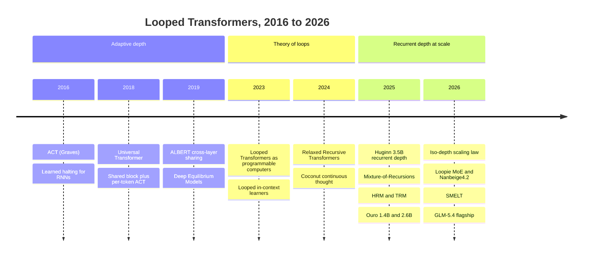
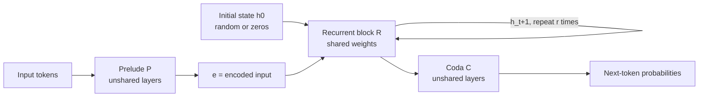
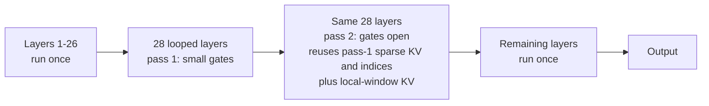

---
tags:
  - ai-ml
  - architectures
  - looped-transformers
  - recurrent-depth
  - test-time-compute
status: draft
sources:
  - https://arxiv.org/abs/1603.08983
  - https://lilianweng.github.io/posts/2020-04-07-the-transformer-family/
  - https://lilianweng.github.io/posts/2023-01-27-the-transformer-family-v2/
  - https://arxiv.org/abs/1807.03819
  - https://arxiv.org/abs/1909.11942
  - https://ar5iv.labs.arxiv.org/html/1909.11942
  - https://arxiv.org/abs/1909.01377
  - https://arxiv.org/abs/2301.13196
  - https://arxiv.org/abs/2311.12424
  - https://arxiv.org/abs/2410.20672
  - https://deepmind.google/research/publications/122290/
  - https://arxiv.org/abs/2412.06769
  - https://arxiv.org/abs/2502.05171
  - https://arxiv.org/html/2502.05171
  - https://huggingface.co/tomg-group-umd/huginn-0125
  - https://arxiv.org/abs/2502.17416
  - https://arxiv.org/abs/2506.21734
  - https://arxiv.org/abs/2507.10524
  - https://arxiv.org/html/2507.10524
  - https://arxiv.org/abs/2510.04871
  - https://arxiv.org/abs/2510.25741
  - https://ouro-llm.github.io
  - https://huggingface.co/collections/ByteDance/ouro-690236c52b831410cb291503
  - https://arxiv.org/html/2604.21106v3
  - https://arxiv.org/abs/2607.13491
  - https://arxiv.org/abs/2607.16051
  - https://arxiv.org/html/2607.16051v3
  - https://arxiv.org/abs/2607.22083
  - https://arxiv.org/abs/2609.01343
  - https://magazine.sebastianraschka.com/p/gpt-6-astra-looped-transformers-and
  - https://docs.z.ai/guides/llm/glm-5.4.md
  - https://z.ai/blog/glm-5.4
  - https://huggingface.co/zai-org/GLM-5/raw/main/README.md
  - https://huggingface.co/zai-org/GLM-5/raw/main/config.json
  - https://agentspulse.github.io/tutorials/glm-5-4-loop-transformer/
  - https://www.testingcatalog.com/z-ai-launches-glm-5-4-its-first-loop-transformer-model/
  - https://www.datacamp.com/blog/glm-5-4
created: 2026-11-26
updated: 2026-11-27
---

## Table Of Contents

---

- [[#TL;DR|TL;DR]]
- [[#The Problem|The Problem]]
- [[#Foundations|Foundations]]
    - [[#Depth vs Parameters|Depth vs Parameters]]
    - [[#Weight Tying Across Layers|Weight Tying Across Layers]]
    - [[#Adaptive Computation Time and Halting|Adaptive Computation Time and Halting]]
    - [[#The Fixed-Point View|The Fixed-Point View]]
    - [[#Latent Reasoning vs Chain of Thought|Latent Reasoning vs Chain of Thought]]
- [[#How We Got Here|How We Got Here]]
- [[#How It Works|How It Works]]
    - [[#The Recurrence|The Recurrence]]
    - [[#Prelude, Recurrent Block, Coda|Prelude, Recurrent Block, Coda]]
    - [[#Training a Loop|Training a Loop]]
    - [[#Deciding How Many Loops|Deciding How Many Loops]]
    - [[#A Worked Example|A Worked Example]]
    - [[#Where the KV Cache Goes|Where the KV Cache Goes]]
- [[#Where It Is Now|Where It Is Now]]
    - [[#GLM-5.4, Confirmed vs Secondhand|GLM-5.4, Confirmed vs Secondhand]]
    - [[#Other Models That Loop|Other Models That Loop]]
    - [[#Equal-FLOP and Equal-Parameter Results|Equal-FLOP and Equal-Parameter Results]]
    - [[#Serving a Looped Model|Serving a Looped Model]]
- [[#Trade-offs & Open Problems|Trade-offs & Open Problems]]
- [[#Resources|Resources]]
- [[#Related Notes|Related Notes]]

## ***TL;DR***
---
*A looped Transformer runs some or all of its layers more than once per token with the same weights. It buys more computation per token, and more effective depth, without storing more parameters. It is a second way to spend test-time compute: thinking longer inside the hidden state instead of writing more tokens.*

- **What it is:** a stack of $k$ unique layers applied $r$ times behaves like a $k \cdot r$ layer network for compute and latency, but stores only $k$ layers of weights. The idea dates to the Universal Transformer ([Dehghani et al., 2018](https://arxiv.org/abs/1807.03819)), which added per-token halting from Adaptive Computation Time ([Graves, 2016](https://arxiv.org/abs/1603.08983)).
- **Why it works, and its limit:** many reasoning problems need depth more than parameters ([Saunshi et al., 2025](https://arxiv.org/abs/2502.17416)). But a loop is not free capacity: a 2026 iso-depth scaling study finds each extra recurrence is worth about **0.46** of a unique block at equal FLOPs ([Schwethelm et al., 2026](https://arxiv.org/html/2604.21106v3)). Looping helps reasoning far more than stored knowledge.
- **The cost:** a looped model is as slow per token as the unrolled network it imitates, and by default each pass writes its own [[KV Cache]], so it saves weight memory, not compute or cache.
- **Where it is now (Nov 2026):** looping moved from research (Huginn 3.5B, Feb 2025; Ouro 1.4B/2.6B, Oct 2025) to products. Z.ai's GLM-5.4 (Nov 23, 2026) loops 28 layers of the 78-layer GLM-5 base twice, with gated updates and a second pass that reuses the first pass's sparse KV plus a local window ([Z.ai docs](https://docs.z.ai/guides/llm/glm-5.4.md)). Weights, a paper and benchmark scores for the full model are not yet public.

## ***The Problem***
---
*In a normal Transformer, every token gets the same fixed amount of computation, and the only way to get more is to add layers, which adds parameters. Looping separates the two, so compute per token can grow while the model's memory footprint does not.*

A standard decoder spends roughly $2N$ FLOPs per token, where $N$ is its parameter count, whether the token is "the" or the crux of a proof. That couples three things that need not move together:

| Want | Standard fix | Side effect |
|---|---|---|
| More computation on hard tokens | More layers | More parameters to store, train and move from memory every step |
| More sequential reasoning steps | Write a longer chain of thought ([[Reasoning Models]]) | Every step is a token: slow decoding, [[Long Context\|long contexts]], a growing [[KV Cache]] |
| Smaller deployed model | Fewer layers | Less depth, so worse at multi-step problems |

Theory says depth is the scarce resource for multi-step reasoning: a $k$-layer looped model run $L$ times nearly matches a $kL$-layer model on addition, multi-hop induction and math, and $T$ loops can simulate $T$ chain-of-thought steps without emitting a token ([Saunshi et al., 2025](https://arxiv.org/abs/2502.17416)). Looping asks whether that depth can come from reusing weights instead of adding them.

## ***Foundations***
---
*Five ideas explain looped models: why depth and parameter count are different budgets, what tying weights across layers does, how a model can decide when to stop, why a loop is a fixed-point iteration, and how "thinking in hidden state" differs from writing a chain of thought.*

#### **Depth vs Parameters**

A dense [[Transformer]] with $L$ layers of width $d$ has about $12Ld^2$ non-embedding parameters, and each token costs about 2 FLOPs per parameter in the forward pass ([[Scaling Laws]] derives $6ND$ from this). In a normal model three quantities are locked together:

- **Parameters** (what you store and what holds knowledge),
- **FLOPs per token** (what you pay),
- **Sequential depth** (how many transformations each token goes through, which sets latency and the length of the "reasoning chain" inside one forward pass).

Looping keeps FLOPs and depth tied to the *unrolled* layer count but makes parameters depend only on the *unique* layers. Controlled studies find the split matters: looping barely changes how much a model can memorize at fixed parameters but improves multi-step math (Virtual Logic Depth, Jun 2025, as summarized by [Raschka, Sep 2026](https://magazine.sebastianraschka.com/p/gpt-6-astra-looped-transformers-and)).

#### **Weight Tying Across Layers**

Weight tying means layer $i$ and layer $j$ use the same matrices. ALBERT (2019) shared all parameters across BERT's layers and factorized the embedding table, cutting parameters sharply while keeping the compute ([Lan et al.](https://ar5iv.labs.arxiv.org/html/1909.11942)):

| Model | Params | Layers | Hidden | Training speed vs BERT-large |
|---|---|---|---|---|
| BERT-large | 334M | 24 | 1024 | 1.0x |
| ALBERT-large | 18M | 24 | 1024 | 1.7x |
| ALBERT-xxlarge | 235M | 12 | 4096 | 0.3x |

The lesson that carries over: sharing shrinks memory, not FLOPs. ALBERT-xxlarge has fewer parameters than BERT-large but trains about 3x slower because it is wider. ALBERT also found that sharing made layer-to-layer transitions smoother.

#### **Adaptive Computation Time and Halting**

If a block can be applied any number of times, the model can decide per token how many times. Graves' Adaptive Computation Time (ACT) adds a sigmoid **halting unit** to a recurrent net ([Graves, 2016](https://arxiv.org/abs/1603.08983); formulas as given by [Weng, 2020](https://lilianweng.github.io/posts/2020-04-07-the-transformer-family/)):

$$
h_t^n = \sigma(W_h s_t^n + b_h), \qquad
N(t) = \min\Big(\min\{n' : \textstyle\sum_{n=1}^{n'} h_t^n \geq 1-\epsilon\},\ M\Big)
$$

*In plain English: after each step $n$, the model outputs a probability that it is done with input $t$. It keeps going until those probabilities add up to nearly 1 (with $\epsilon$ a small constant such as 0.01), or until it hits the cap $M$. The final state is the probability-weighted average of the intermediate states, and a "ponder cost" $N(t) + R(t)$ added to the loss, where $R(t)$ is the leftover probability, pushes the model to stop early.*

On synthetic tasks (parity, logic, addition, sorting) ACT improved results dramatically. On character-level language modeling it gave no big gains, but spent more steps on hard transitions such as spaces between words and ends of sentences ([Graves, 2016](https://arxiv.org/abs/1603.08983)). Later halting schemes (learned exit gates, routers, convergence tests) are all variations on this.

#### **The Fixed-Point View**

Write one pass of the shared block as $h \mapsto f_\theta(h, e)$. Looping is then **fixed-point iteration**: apply $f_\theta$ until $h$ stops changing, at a point $h^\star = f_\theta(h^\star, e)$. Deep Equilibrium Models (DEQ) took this literally: find $h^\star$ with a root-finder instead of unrolling, and backpropagate through it with implicit differentiation, so memory stays constant however "deep" the network is. On WikiText-103 they matched comparable models and cut memory by up to 88% ([Bai, Kolter, Koltun, 2019](https://arxiv.org/abs/1909.01377)).

Two caveats keep this a lens rather than a law:

- Shared-weight models need not converge. ALBERT's layer outputs kept "oscillating rather than converging" after 24 layers, unlike DEQ's equilibria ([Lan et al.](https://ar5iv.labs.arxiv.org/html/1909.11942)).
- The fixed-point view explains why **input injection** matters: if the input $e$ is fed into every pass, the point the loop settles on depends on the question, not only on where the loop started. Modern recurrent-depth models do this.

#### **Latent Reasoning vs Chain of Thought**

[[Reasoning Models]] scale test-time compute by writing tokens. Latent reasoning scales it inside the network:

| | Chain of thought | Looped depth | Continuous thought (Coconut) |
|---|---|---|---|
| Extra compute goes into | More tokens | More passes per token | Hidden states fed back as inputs |
| Each step costs | A full forward pass + a token in context | One more pass through the block | A forward pass, no token emitted |
| Readable by humans | Yes | No | No |

Coconut feeds the last hidden state back as the next input embedding instead of decoding it to a word; because a continuous state can hold several candidate next steps, it can explore them in parallel, like breadth-first search, and beat CoT on planning-heavy logic tasks ([Hao et al., 2024](https://arxiv.org/abs/2412.06769)). Recurrent depth also needs no special data: Huginn learned to use extra loops from plain pretraining ([Geiping et al., 2025](https://arxiv.org/abs/2502.05171)). Loops and continuous thoughts are complementary: the first deepens each token, the second chains states across positions. Both make reasoning harder to monitor, and OpenAI's chief scientist has called chain-of-thought monitoring "fragile" ([Raschka, Sep 2026](https://magazine.sebastianraschka.com/p/gpt-6-astra-looped-transformers-and)).

## ***How We Got Here***
---
*Looping started in 2016 to 2018 as "let the model decide how long to think", went quiet while scaling dense models paid better, came back in 2023 as theory of what loops can compute, and in 2025 to 2026 became a practical way to add test-time compute and then a flagship architecture.*

| Year | What changed | Problem it answered | Source |
|---|---|---|---|
| 2016 | ACT: a halting unit lets an RNN take a variable number of steps per input. | Fixed computation per input wastes effort on easy inputs and starves hard ones. | [Graves](https://arxiv.org/abs/1603.08983) |
| 2018 | Universal Transformer: one block applied repeatedly with shared weights, per-position ACT halting, and a timestep embedding; Turing-complete under assumptions; +0.9 BLEU on WMT14 En-De. | Transformers lacked the recurrent inductive bias that helps algorithmic tasks. | [Dehghani et al.](https://arxiv.org/abs/1807.03819), [Weng](https://lilianweng.github.io/posts/2023-01-27-the-transformer-family-v2/) |
| 2019 | ALBERT shares all layers; 18M-parameter ALBERT-large vs 334M BERT-large. DEQ solves for the infinite-depth fixed point directly. | Parameter and memory cost of deep models. | [Lan et al.](https://ar5iv.labs.arxiv.org/html/1909.11942), [Bai et al.](https://arxiv.org/abs/1909.01377) |
| 2023 | A looped 13-layer Transformer with hand-set weights emulates a small instruction-set computer. Trained looped Transformers match standard ones on in-context data fitting with under 10% of the parameters. | Can fixed-depth Transformers run iterative algorithms at all? | [Giannou et al.](https://arxiv.org/abs/2301.13196), [Yang et al.](https://arxiv.org/abs/2311.12424) |
| 2024 | Relaxed Recursive Transformers convert a pretrained LLM into a looped one, with per-depth LoRA to loosen strict tying. Coconut reasons in hidden-state space. | Training loops from scratch is expensive; CoT tokens are slow. | [Bae et al.](https://arxiv.org/abs/2410.20672), [Hao et al.](https://arxiv.org/abs/2412.06769) |
| 2025 | Huginn: a 3.5B recurrent-depth LM trained on 800B tokens improves on reasoning as loops grow, up to compute like a 50B model. Saunshi et al. prove loops can simulate CoT steps. | Test-time compute without longer outputs or special data. | [Geiping et al.](https://arxiv.org/abs/2502.05171), [Saunshi et al.](https://arxiv.org/abs/2502.17416) |
| 2025 | Mixture-of-Recursions routes each token to its own loop count; HRM (27M) and TRM (7M) show tiny recurrent nets solving puzzles; Ouro trains looped LMs on 7.7T tokens with a learned exit. | Uniform loop counts waste compute; does recurrence help at small scale and at LLM scale? | [Bae et al.](https://arxiv.org/abs/2507.10524), [Wang et al.](https://arxiv.org/abs/2506.21734), [Jolicoeur-Martineau](https://arxiv.org/abs/2510.04871), [Zhu et al.](https://arxiv.org/abs/2510.25741) |
| 2026 | Iso-depth scaling laws price a recurrence at about half a block; DeepLoop fixes residual scaling for revisited blocks; SMELT and Loopie show MoE looping can win at matched compute. | Is looping actually compute-efficient, and how do you train it stably at scale? | [Schwethelm et al.](https://arxiv.org/html/2604.21106v3), [Li et al.](https://arxiv.org/abs/2607.13491), [Wang et al.](https://arxiv.org/abs/2609.01343), [Gao et al.](https://arxiv.org/abs/2607.16051) |
| 2026 | GLM-5.4 loops 28 layers of a 750B-scale base twice: the first flagship built on loops. | Getting more reasoning out of an existing base without a larger model. | [Z.ai docs](https://docs.z.ai/guides/llm/glm-5.4.md) |

## ***How It Works***
---
*A looped model is a short stack of layers in a loop, usually with a few unshared layers before and after it and the input re-injected at every pass. The engineering is in training the loop so it is stable at any count, deciding how many passes each token gets, and keeping the KV cache from growing with every pass.*

#### **The Recurrence**

Strip any looped model down and it is one update applied repeatedly:

$$
h_{t+1} = f_\theta(h_t,\ e), \qquad t = 0, 1, \ldots, r-1
$$

*In plain English: $e$ is the encoded input (the tokens after the first few layers), $h_t$ is the model's current "scratchpad" state after $t$ passes, and $f_\theta$ is the shared block of Transformer layers with weights $\theta$. Each pass reads the scratchpad and the original input, and writes a refined scratchpad. The weights never change between passes, only the state does. After $r$ passes the state is decoded into next-token probabilities.*

Three choices define a design:

| Choice | Options | Example |
|---|---|---|
| What loops | The whole stack ("model loop") or each layer in place ("layer loop") | Ouro and Huginn loop the stack; Loopie loops each layer before moving on ([Gao et al., 2026](https://arxiv.org/html/2607.16051v3)) |
| How $e$ enters | Not at all (UT), added to the state, or concatenated and projected | Huginn concatenates $[h_t; e]$ and maps $2h \to h$ with an adapter, which "works best at scale" ([Geiping et al.](https://arxiv.org/html/2502.05171)) |
| How passes write to the residual stream | Plain residual add, or a learned gate per pass | GLM-5.4 uses per-token gates per iteration ([Z.ai docs](https://docs.z.ai/guides/llm/glm-5.4.md)); see [[Residual Stream and Normalization]] |

#### **Prelude, Recurrent Block, Coda**

Most 2025 to 2026 designs keep the first and last few layers unshared, because those layers do different jobs (turning tokens into features, and features back into a token distribution) that do not benefit from repetition. Mixture-of-Recursions found this "Middle-Cycle" sharing gave the lowest loss of the schemes it tried ([Bae et al., 2025](https://arxiv.org/html/2507.10524)).

Huginn, the clearest published example, uses $(l_P, l_R, l_C) = (2, 4, 2)$ layers at width 5280, so at $r = 32$ it runs $2 + 4 \cdot 32 + 2 = 132$ layers from about 3.5B parameters (1.5B prelude and head, 1.5B recurrent block, 0.5B tied embedding). Its starting state is random: $s_0 \sim \mathcal{N}(0, \sigma^2 I)$, with $e = P(x)$, $s_i = R(e, s_{i-1})$ and $p = C(s_r)$ ([Geiping et al., 2025](https://arxiv.org/html/2502.05171)).

#### **Training a Loop**

The model must work at whatever loop count it gets at inference, so training cannot use one fixed $r$.

- **Randomize the count.** Huginn samples $r$ per step from a log-normal Poisson with mean 32: most steps are shallow, with a heavy tail of very deep ones ([Geiping et al.](https://arxiv.org/html/2502.05171)).
- **Truncate backprop.** Gradients flow only through Huginn's last $k = 8$ passes, so memory and backward cost do not grow with $r$. The price: a 2026 scaling study finds truncation saves about 30% of training FLOPs but makes the loop less effective (its recurrence-worth exponent drops from 0.46 to 0.38) ([Schwethelm et al.](https://arxiv.org/html/2604.21106v3)).
- **Rescale residuals for revisits.** Standard residual scaling assumes each branch has its own weights. A shared block collects gradients from every visit, so DeepLoop sets DeepNorm's constants from the *unrolled* depth $N$: $\alpha = (2N)^{1/2}$, $\beta = (8N)^{-1/2}$, which improves loss once blocks are revisited ([Li et al., Jul 2026](https://arxiv.org/abs/2607.13491)).
- **Start from a trained model.** Relaxed Recursive Transformers initialize the loop from a pretrained model's layers and add small per-depth LoRA modules; a recursive Gemma 1B beat TinyLlama 1.1B, Pythia 1B and [[Distillation|distillation]] baselines and recovered most of Gemma 2B's quality ([Bae et al., 2024](https://arxiv.org/abs/2410.20672)). GLM-5.4 likewise came from continued training of the GLM-5 base ([Z.ai docs](https://docs.z.ai/guides/llm/glm-5.4.md)), while Nanbeige found training from scratch beat upcycling (per [Raschka](https://magazine.sebastianraschka.com/p/gpt-6-astra-looped-transformers-and)).

#### **Deciding How Many Loops**

| Strategy | How it decides | Used by |
|---|---|---|
| Fixed count | Always $r$ passes | Ouro in vLLM (all 4 loops) ([Ouro](https://ouro-llm.github.io)); GLM-5.4 (2 passes) |
| ACT-style halting | Cumulative halting probability passes $1-\epsilon$ | Universal Transformer |
| Learned exit gate | Per-loop exit probability; stop at cumulative threshold $q$ ("Q-exit") | Ouro: about 66% MMLU at 2.5 loops on average vs 67.35% at a fixed 4 ([Ouro](https://ouro-llm.github.io)) |
| Convergence test, zero-shot | Stop when successive outputs stop changing, e.g. KL divergence below 5e-4 | Huginn; not trained for it ([model card](https://huggingface.co/tomg-group-umd/huginn-0125)) |
| Router | A small network assigns each token a depth, or picks which tokens continue at each step | Mixture-of-Recursions ([Bae et al., 2025](https://arxiv.org/abs/2507.10524)) |

More loops help only up to a point. Huginn's ARC-Easy score went 49.07, 65.11, 69.49, 69.91 at 4, 8, 16, 32 passes ([Geiping et al.](https://arxiv.org/html/2502.05171)); its model card says gains continue to about 64 steps on tasks with enough context and that fewer than 4 gives "very coarse answers" ([HF](https://huggingface.co/tomg-group-umd/huginn-0125)). Ouro peaks at the trained 4 loops and degrades slightly at 5 to 8 ([Ouro](https://ouro-llm.github.io)). Loopie found the marginal benefit largest at $r = 2$ ([Gao et al.](https://arxiv.org/html/2607.16051v3)).

#### **A Worked Example**

Compare three models with the same layer shape. The shape is an assumed round-number 8B-class design for illustration: width 4096, 32 query heads, 8 KV heads of size 128 (GQA), a SwiGLU FFN of width 14,336, vocabulary 128,256, separate embedding and output matrices, BF16.

Per layer: attention $4096 \times 4096 \times 2 + 4096 \times 1024 \times 2 = 41.9\text{M}$, FFN $3 \times 4096 \times 14336 = 176.2\text{M}$, so **218.1M** per layer. Embedding and output head: $2 \times 128256 \times 4096 = 1.05\text{B}$.

| | Dense, 32 layers | Looped, 4 layers × 8 | Dense, 4 layers |
|---|---|---|---|
| Unique layers | 32 | 4 | 4 |
| Stored parameters | 6.98B + 1.05B = **8.03B** | 0.87B + 1.05B = **1.92B** | **1.92B** |
| Weights in BF16 | 16.1 GB | 3.8 GB | 3.8 GB |
| Layer passes per token | 32 | 32 | 4 |
| Forward matmul FLOPs per token, $2 \times$ params touched | $2(6.98 + 0.53)\text{B} \approx$ **15.0 GFLOPs** | **15.0 GFLOPs** | **2.8 GFLOPs** |
| Attention-score FLOPs per token at 8K context, $4 n_{ctx} d \times$ passes | 4.3 GFLOPs | 4.3 GFLOPs | 0.5 GFLOPs |
| KV cache per token, $2 \times \text{passes} \times 8 \times 128 \times 2$ B | 128 KiB | 128 KiB (one cache per pass) or 16 KiB (one pass's cache shared) | 16 KiB |
| KV cache for one 32K-token sequence | 4 GiB | 4 GiB or 512 MiB | 512 MiB |

What the table says:

- **Equal FLOPs, not equal parameters.** The looped model costs as much per token as the 32-layer one, to train and to run. It is not a cheaper model; it is a *smaller* one that thinks as long. Against the 4-layer model with the same parameters, it spends about 5x the compute.
- **Latency follows passes.** A decode step still runs 32 layers in sequence, so per-token latency matches the dense 32-layer model.
- **Weights shrink, bandwidth may not.** Decoding is memory-bandwidth bound ([[7 - All About Transformer Inference (NOT DONE)]]). The looped block's 1.7 GB of weights is re-read on every pass unless it fits in on-chip memory, so bytes moved per step stay close to the dense model's; the saving is capacity (fit on fewer chips, more room for cache).
- **The cache is the catch.** Each pass computes different keys and values, so a naive looped model caches as much as the dense model ([Raschka, Sep 2026](https://magazine.sebastianraschka.com/p/gpt-6-astra-looped-transformers-and)). The 8x cut in the last column needs a cache-sharing trick, next.

How much quality should you expect? The 2026 iso-depth law fits effective parameters as $N_{\text{eff}} = N_{\text{once}} + r^{\varphi} N_{\text{rec}}$ with $\varphi \approx 0.46$ ([Schwethelm et al.](https://arxiv.org/html/2604.21106v3)). Plugged in naively here (outside the study's sub-100M range, so only a rough illustration): $1.05 + 8^{0.46} \times 0.87 \approx 1.05 + 2.6 \approx 3.7\text{B}$ "dense-equivalent" parameters, bought at the FLOPs of an 8B model. The paper's own example: "a 410M looped model performs on par with a 580M non-looped model, but incurs the training cost of a 1B non-looped one."

#### **Where the KV Cache Goes**

For a model with $L_{\text{once}}$ unshared layers and $L_{\text{rec}}$ looped layers run $r$ times, the per-token cache (see [[KV Cache]]) is

$$
\text{KV bytes per token} = 2 \times \big(L_{\text{once}} + c \cdot L_{\text{rec}}\big) \times h_{kv} \times d_{head} \times b
$$

*In plain English: unshared layers cache once, as usual. Looped layers cache $c$ times, where $c = r$ if every pass keeps its own keys and values, and $c$ falls toward 1 if passes share a cache. Choosing $c$ is the main serving decision for a looped model.*

| Scheme | Memory | Quality evidence |
|---|---|---|
| Separate cache per pass ($c = r$) | Grows with loops | Baseline |
| Keep only the last pass's cache | $1/r$ of looped-layer cache | Ouro-1.4B: GSM8K 78.85 vs 78.92 full; MATH-500 80.40 vs 82.40. First-pass-only collapses to 18.73 on GSM8K ([Ouro](https://ouro-llm.github.io)) |
| Share the first recursion's KV (MoR) | KV memory $1/N_r$, but KV reads unchanged | Small loss (42.6% to 41.9% few-shot at 3 recursions) ([Bae et al., 2025](https://arxiv.org/html/2507.10524)) |
| Fixed-size cache overwritten by later passes | Constant, e.g. 16 slots | Huginn, zero-shot ([model card](https://huggingface.co/tomg-group-umd/huginn-0125)) |
| Share the cache across passes | Half the cache at $r = 2$ | Nanbeige4.2: worse than separate caches (per [Raschka](https://magazine.sebastianraschka.com/p/gpt-6-astra-looped-transformers-and)) |
| Reuse pass-1 sparse KV, new KV only in a local window | One window per extra loop | GLM-5.4 ([Z.ai docs](https://docs.z.ai/guides/llm/glm-5.4.md)) |

## ***Where It Is Now***
---
*As of November 2026, looping has its first flagship (GLM-5.4), a handful of open looped models, and the first scaling laws, which say a loop is worth roughly half a new block at equal compute. The case for looping is now reasoning per parameter and per byte of memory, not raw compute efficiency.*

#### **GLM-5.4, Confirmed vs Secondhand**

Z.ai launched GLM-5.4 on Nov 23, 2026 to GLM Coding Plan users, Z.ai Chat and ZCode ([TestingCatalog, Nov 23, 2026](https://www.testingcatalog.com/z-ai-launches-glm-5-4-its-first-loop-transformer-model/)). Z.ai's blog post is titled "Toward Generalized Coding with Our First Loop Transformer" ([Z.ai](https://z.ai/blog/glm-5.4)); its body did not render for this research, so the confirmed facts below come from Z.ai's developer docs page, and its chart numbers only from a secondary reading.

**Confirmed by Z.ai's own docs** ([docs.z.ai](https://docs.z.ai/guides/llm/glm-5.4.md)) and the GLM-5 model files:

- "The first built on the Loop Transformer architecture," with intelligence "comparable to 2T-3T parameter models" (no method given).
- Loops **28 layers of the GLM-5 base for two iterations**, adding depth without parameters. The GLM-5 base has **78 layers**, 744B total and 40B active parameters, MoE with 256 routed experts (8 per token), and DeepSeek Sparse Attention ([config](https://huggingface.co/zai-org/GLM-5/raw/main/config.json), [model card](https://huggingface.co/zai-org/GLM-5/raw/main/README.md)). The docs speak of "the 750B scale" and give no GLM-5.4 parameter count.
- **Gated progressive updates:** independent per-token gates per iteration; the first pass writes conservatively with small gates, the second opens them, and gates scale step size with token difficulty.
- **Hybrid KV cache:** the second loop reuses the sparse KV selected in the first pass and keeps its own KV only in a local sliding window, so the extra loop costs one window, not a second full-context cache. It also reuses the first loop's sparse-attention indexer indices, performing "nearly identically" to recomputing them.
- Validated at 1B, 4B, 30B and 750B. A 30B iso-parameter ablation used about **10% more total training compute** and showed the largest gains on math, scientific reasoning and long context, with average output length 10 to 14% shorter on GPQA-Diamond and MMLU-Pro, "mostly from shorter chains of thought."
- 1M context, 128K max output; a known failure mode of overly long "marathon thinking" loops. API after a security assessment; no weights or paper on the docs page. Next steps: adaptive compute, with harder tokens getting more iterations, and a larger model "ready soon."

**Reported only secondhand** ([AgentsPulse](https://agentspulse.github.io/tutorials/glm-5-4-loop-transformer/), reading Z.ai's blog figures):

- The looped block is **layers 27 to 54**, with 1 to 26 and 55 to 78 run once, giving 106 layer passes per token (AgentsPulse's own count from Z.ai's diagram).
- The 30B ablation table: AIME25 19.17 → 30.42, GPQA-Diamond 47.58 → 56.26, AA-LCR 40.33 → 47.67, MMLU-Pro 71.65 → 75.05, IFBench 50.20 → 53.47.
- A 128-token local window for the second pass's cache (in the vault's earlier summary of the same page).
- Coverage says open weights are planned after safety hardening, with no date ([TestingCatalog](https://www.testingcatalog.com/z-ai-launches-glm-5-4-its-first-loop-transformer-model/), [DataCamp](https://www.datacamp.com/blog/glm-5-4)). No benchmark scores for GLM-5.4 itself were published at launch.

*Layer ranges as reported secondhand; the 28-layer, two-pass design is confirmed.*

**The arithmetic.** 28 extra passes on 78 layers is $106 / 78 = 1.36$, about 36% more layer compute per token for zero new parameters. GLM-5's MLA caches $512 + 64 = 576$ numbers per token per layer, so in BF16: $78 \times 576 \times 2 = 89{,}856$ bytes per token, 87.75 GiB for a 1M-token context (ignoring the sparse-attention indexer's own small key cache). A full second cache for the 28 looped layers would add $28 \times 576 \times 2 = 32{,}256$ bytes per token, **+31.5 GiB** at 1M tokens. A 128-token window instead costs $28 \times 128 \times 576 \times 2 \approx 3.9$ MiB per sequence, whatever the context. That is why the hybrid cache is what makes looping viable at 1M context.

#### **Other Models That Loop**

| Model | Org | Date | Loop design | Status |
|---|---|---|---|---|
| Huginn-0125 | Geiping et al. | Feb 2025 | 2 + 4×r + 2 layers, r up to 64+, 3.5B params, 800B tokens | Open weights ([HF](https://huggingface.co/tomg-group-umd/huginn-0125)) |
| Ouro 1.4B / 2.6B (+ Thinking) | Released under ByteDance's HF org | Oct 2025 | 24 or 48 layers × 4 loops, exit gate, 7.7T tokens | Open, Apache-2.0 ([HF](https://huggingface.co/collections/ByteDance/ouro-690236c52b831410cb291503)) |
| Nanbeige4.2-3B | Nanbeige Lab | Jul 2026 | Looped stack, 3B non-embedding, 28T tokens from scratch; 22 blocks run twice per [Raschka](https://magazine.sebastianraschka.com/p/gpt-6-astra-looped-transformers-and) | Paper ([arXiv](https://arxiv.org/abs/2607.22083)) |
| Loopie 20B-A2B / 6B-A0.6B | IQuest Research | Jul to Oct 2026 | Qwen3-MoE base, each layer looped in place, r = 2, 27 stored layers in the 20B | Paper; billed as the strongest open-source looped model ([arXiv](https://arxiv.org/abs/2607.16051)) |
| GLM-5.4 | Z.ai | Nov 2026 | 28 of 78 layers × 2, gated, hybrid KV | Product; weights promised |
| GPT-6 Astra | OpenAI | Sep 2026 | *Unconfirmed.* The Information reported recurrent depth; OpenAI's Jakub Pachocki said only that the depth of the computation graph of its frontier models, Astra included, "is within a factor of two of GPT-4" | Closed ([Raschka, Sep 2026](https://magazine.sebastianraschka.com/p/gpt-6-astra-looped-transformers-and)) |

Small recurrent reasoners show the same idea outside language modeling: HRM (27M parameters, 1,000 training samples, a slow high-level and a fast low-level recurrent module) nearly solves hard Sudoku and large mazes ([Wang et al., 2025](https://arxiv.org/abs/2506.21734)), and the simpler TRM, a single 2-layer, 7M-parameter network applied recursively, reaches 45% on ARC-AGI-1 and 8% on ARC-AGI-2, above several LLMs with under 0.01% of their parameters ([Jolicoeur-Martineau, 2025](https://arxiv.org/abs/2510.04871)).

#### **Equal-FLOP and Equal-Parameter Results**

The fair comparison decides whether looping is a real gain. The evidence in late 2026:

| Comparison | Finding | Source |
|---|---|---|
| Equal or fewer parameters, more compute | Looping clearly wins, at the cost of more compute. Ouro 2.6B: MMLU 74.60 vs Qwen3-4B 73.19 and Gemma3-12B 72.14; MATH500 90.85 vs Gemma3-12B 83.20; but behind Qwen3-8B on GSM8K and HumanEval. Ouro-2.6B-Thinking trails Qwen3-8B on AIME25 (50.30 vs 66.70). | [Ouro](https://ouro-llm.github.io) |
| Equal parameters, existing base | GLM-5.4's 30B ablation: large reasoning gains for ~10% more training compute (numbers secondhand, above). | [Z.ai docs](https://docs.z.ai/guides/llm/glm-5.4.md) |
| Equal FLOPs, dense, iso-depth | Looping *loses* on validation loss: a recurrence is worth ~0.46 unique blocks (116 runs, up to $2.15 \times 10^{19}$ FLOPs). Hyperconnections raise it to 0.65. Knowledge tasks track loss; reading comprehension and compositional tasks close the gap. | [Schwethelm et al., Apr to May 2026](https://arxiv.org/html/2604.21106v3) |
| Equal FLOPs, router | MoR (2 recursions, 167M params) beats a 315M vanilla model at equal training FLOPs: NLL 2.7511 vs 2.7824, few-shot 43.1% vs 42.3%; vanilla wins at the smallest scale. | [Bae et al., 2025](https://arxiv.org/html/2507.10524), [Raschka](https://magazine.sebastianraschka.com/p/gpt-6-astra-looped-transformers-and) |
| Equal FLOPs, params *and* KV, MoE | SMELT (middle half looped twice) saves 6.8 to 18.0% of training FLOPs on the compute-optimal frontier, up to 54B non-embedding params; biggest edge on code; the second pass weakens the attention sink. | [Wang et al., Sep 2026](https://arxiv.org/abs/2609.01343) |
| Equal FLOPs, MoE, long training | Loopie-20B-A2B overtakes a compute-matched 30B-A3B baseline after ~600B tokens; its Thinking model scores AIME24 92.09 vs Qwen3-30B-A3B-Thinking 90.10, but trails on MMLU (81.28 vs 85.83). | [Gao et al., 2026](https://arxiv.org/html/2607.16051v3) |

Reading across: at equal parameters looping is a clear win for reasoning; at equal compute in dense models it is a loss on loss; with MoE, gating and careful matching it is starting to look like a small win. The gains concentrate in math, code and multi-step reasoning, not knowledge recall, consistent with [Saunshi et al.](https://arxiv.org/abs/2502.17416).

#### **Serving a Looped Model**

- **Latency per token grows with passes.** GLM-5.4's 36% more layer passes show up as per-token time; Z.ai quotes up to 200 tokens/s off-peak and 70 to 80 at peak ([Z.ai docs](https://docs.z.ai/guides/llm/glm-5.4.md)). Shorter reasoning traces (10 to 14% in the 30B ablation) partly pay it back.
- **The KV cache is the design constraint**, as in [[#Where the KV Cache Goes|the table above]]. Ouro and MoR study cache reuse across passes, and GLM-5.4 ships it.
- **Early exit fights batching.** Different tokens exiting at different depths leaves holes in a batch. Relaxed Recursive Transformers propose Continuous Depth-wise Batching, filling freed slots with tokens at other depths, with a *theoretical* 2 to 3x throughput gain ([Bae et al., 2024](https://arxiv.org/abs/2410.20672)); MoR measured up to 2.06x over vanilla at maximum batch size ([Bae et al., 2025](https://arxiv.org/html/2507.10524)). In practice, Ouro's vLLM path runs all 4 loops with no early exit ([Ouro](https://ouro-llm.github.io)). See [[LLM Serving]].
- **Free self-speculation.** A looped model can draft with few passes and verify with many, using the same weights; Huginn lists zero-shot self-speculative decoding among its inference features ([Geiping et al.](https://arxiv.org/abs/2502.05171)). See [[Speculative Decoding]].

## ***Trade-offs & Open Problems***
---
*Looping trades latency and compute for memory and reasoning depth, and the evidence that it beats simply adding parameters at equal compute is still thin and mostly small-scale. The open questions are how to train loops stably, how many passes to run, and what it means for monitoring a model's reasoning.*

| Gain | Cost |
|---|---|
| Far fewer stored parameters for a given depth | Same FLOPs and per-token latency as the unrolled model |
| Better multi-step reasoning per parameter | Little gain in stored knowledge; ~0.46 blocks of value per loop at equal FLOPs (dense) |
| Test-time compute knob without longer outputs | Reasoning happens in hidden state that humans cannot read |
| Shorter chains of thought (GLM-5.4 ablation, Huginn) | KV cache grows per pass unless shared, and sharing costs some quality |
| Adaptive per-token depth is possible | Variable depth breaks batching; most deployments run a fixed count |

- **Is it compute-efficient?** Dense iso-depth laws say no; MoE results (SMELT, Loopie) say slightly yes. Most controlled results stop well below frontier scale, and Raschka notes a 135M-parameter MoR result would have suggested the opposite conclusion from larger runs ([Raschka](https://magazine.sebastianraschka.com/p/gpt-6-astra-looped-transformers-and)).
- **Training stability.** Shared blocks receive gradients from every visit, which breaks standard residual scaling ([Li et al., 2026](https://arxiv.org/abs/2607.13491)); truncated backprop is cheap but weakens the loop ([Schwethelm et al.](https://arxiv.org/html/2604.21106v3)).
- **Deciding the loop count.** Learned exits work in papers (Ouro, MoR) but production systems run fixed counts; Z.ai lists adaptive per-token iterations as future work. Loops also extrapolate poorly beyond the trained count (Ouro dips past 4), and models can overthink (GLM-5.4's "marathon thinking").
- **Loops vs tokens.** It is unclear which mix of deeper passes and longer chains of thought is most efficient; GLM-5.4 and Huginn suggest loops shorten traces, but nobody has a joint scaling law yet.
- **Monitorability.** Reasoning moved into hidden state cannot be read. Whether looping caused Astra's monitorability regression is disputed; Raschka attributes it to shorter traces ([Raschka](https://magazine.sebastianraschka.com/p/gpt-6-astra-looped-transformers-and)). See [[Reasoning Models]] and [[Chain-of-Thought Faithfulness and Monitorability]], which covers an Oct 2026 study finding no systematic monitorability gap between looped and matched non-looped models.
- **Unverified flagship claims.** GLM-5.4's "2T-3T parameter" comparison has no method, and its ablation numbers are not yet in a paper.

## ***Resources***
---
*Start with Saunshi et al. for why depth matters, Geiping et al. for a full recurrent-depth LM, and Ouro for a carefully documented open looped model. Then read the iso-depth scaling paper for the sober equal-compute view, and Raschka's essay for the 2026 landscape.*

**Papers**
- [Adaptive Computation Time for Recurrent Neural Networks](https://arxiv.org/abs/1603.08983): Graves, Mar 2016. The halting mechanism every adaptive loop descends from.
- [Universal Transformers](https://arxiv.org/abs/1807.03819): Dehghani et al., Jul 2018. The first looped Transformer, with per-position ACT.
- [ALBERT: A Lite BERT](https://arxiv.org/abs/1909.11942): Lan et al., Sep 2019. Cross-layer sharing and what it does and does not save.
- [Deep Equilibrium Models](https://arxiv.org/abs/1909.01377): Bai, Kolter, Koltun, Sep 2019. The fixed-point view taken to infinite depth.
- [Looped Transformers as Programmable Computers](https://arxiv.org/abs/2301.13196): Giannou et al., Jan 2023. What a loop can compute in principle.
- [Looped Transformers are Better at Learning Learning Algorithms](https://arxiv.org/abs/2311.12424): Yang et al., Nov 2023. Looped in-context learners with under 10% of the parameters.
- [Relaxed Recursive Transformers](https://arxiv.org/abs/2410.20672): Bae et al. (a [Google DeepMind publication](https://deepmind.google/research/publications/122290/), ICLR 2025), Oct 2024. Converting pretrained LLMs to loops; depth-wise batching.
- [Training LLMs to Reason in a Continuous Latent Space (Coconut)](https://arxiv.org/abs/2412.06769): Hao et al., Dec 2024. The continuous-thought alternative to loops.
- [Scaling up Test-Time Compute with Latent Reasoning: A Recurrent Depth Approach](https://arxiv.org/abs/2502.05171): Geiping et al., Feb 2025. Huginn; the reference recurrent-depth LM.
- [Reasoning with Latent Thoughts: On the Power of Looped Transformers](https://arxiv.org/abs/2502.17416): Saunshi et al., Feb 2025. Theory and evidence that reasoning needs depth, not parameters.
- [Hierarchical Reasoning Model](https://arxiv.org/abs/2506.21734): Wang et al., Jun 2025. Two-speed recurrent reasoner, 27M parameters.
- [Mixture-of-Recursions](https://arxiv.org/abs/2507.10524): Bae et al., Jul 2025. Per-token loop counts and recursion-aware KV caching.
- [Less is More: Recursive Reasoning with Tiny Networks](https://arxiv.org/abs/2510.04871): Jolicoeur-Martineau, Oct 2025. TRM, 7M parameters on ARC-AGI.
- [Scaling Latent Reasoning via Looped Language Models](https://arxiv.org/abs/2510.25741): Zhu et al., Oct 2025. Ouro; open looped LMs with learned exits.
- [How Much Is One Recurrence Worth? Iso-Depth Scaling Laws for Looped Language Models](https://arxiv.org/html/2604.21106v3): Schwethelm, Rückert, Kaissis, Apr 2026. The $\varphi \approx 0.46$ result.
- [DeepLoop: Depth Scaling for Looped Transformers](https://arxiv.org/abs/2607.13491): Li et al., Jul 2026. Residual scaling for revisited blocks.
- [Loop the Loopies!](https://arxiv.org/abs/2607.16051): Gao et al. (IQuest Research), Jul 2026. Looped MoE models at 20B-A2B.
- [Nanbeige4.2-3B](https://arxiv.org/abs/2607.22083): Nanbeige Lab, Jul 2026. A small looped model trained on 28T tokens.
- [SMELT: Scaling Laws for Compute-Matched MoE Looped Transformers](https://arxiv.org/abs/2609.01343): Wang et al., Sep 2026. Looping that wins at matched FLOPs, params and KV.

**Lab docs and model cards**
- [GLM-5.4 developer guide](https://docs.z.ai/guides/llm/glm-5.4.md): Z.ai, Nov 2026. The primary source for GLM-5.4's loop design.
- [Toward Generalized Coding with Our First Loop Transformer](https://z.ai/blog/glm-5.4): Z.ai, Nov 2026. The launch post, with the ablation chart.
- [GLM-5 model card](https://huggingface.co/zai-org/GLM-5/raw/main/README.md) and [config](https://huggingface.co/zai-org/GLM-5/raw/main/config.json): Z.ai, 2026. The 78-layer base that GLM-5.4 loops.
- [Ouro project page](https://ouro-llm.github.io): Ouro team, 2025. Benchmarks, exit strategies and KV-sharing ablations.
- [Huginn-0125 model card](https://huggingface.co/tomg-group-umd/huginn-0125): Geiping et al., 2025. Exit criteria and cache-sharing options in practice.

**Posts and explainers**
- [The Transformer Family](https://lilianweng.github.io/posts/2020-04-07-the-transformer-family/) and [Version 2.0](https://lilianweng.github.io/posts/2023-01-27-the-transformer-family-v2/): Lilian Weng, 2020 and 2023. Clear derivations of ACT and the Universal Transformer.
- [GPT-6 Astra, Looped Transformers, and ...](https://magazine.sebastianraschka.com/p/gpt-6-astra-looped-transformers-and): Sebastian Raschka, Sep 2026. The best survey of 2025 to 2026 looped models and their serving costs.

**Secondary coverage of GLM-5.4**
- [GLM-5.4 Loop Transformer: Architecture, Benchmarks, Limits](https://agentspulse.github.io/tutorials/glm-5-4-loop-transformer/): AgentsPulse, Nov 2026. Reads off the layer ranges and ablation numbers from Z.ai's figures.
- [Z.ai launches GLM-5.4](https://www.testingcatalog.com/z-ai-launches-glm-5-4-its-first-loop-transformer-model/): TestingCatalog, Nov 23, 2026. Launch date and release status.
- [GLM-5.4: Z.ai's First Loop Transformer](https://www.datacamp.com/blog/glm-5-4): DataCamp, Nov 2026. Release status and what is still unpublished.

## Related Notes

- [[Transformer]] — The block being looped; its note has a short GLM-5.4 summary.
- [[Residual Stream and Normalization]] — Gates, DeepNorm scaling and hyperconnections decide whether a loop trains stably.
- [[KV Cache]] — Each pass writes its own cache unless shared; the main serving cost of looping.
- [[Reasoning Models]] — The token-based way to spend test-time compute that looping competes with and complements.
- [[Scaling Laws]] — Where $6ND$ and the iso-depth effective-parameter law come from.
- [[Mixture of Experts]] — The 2026 looped models that win at matched compute (SMELT, Loopie, GLM-5.4) are MoE.
- [[Sparse Attention]] — GLM-5.4's second pass reuses DeepSeek Sparse Attention indices from the first.
- [[Attention Sinks and Gated Attention]] — SMELT finds the second pass weakens the attention sink.
- [[Speculative Decoding]] — Looped models can self-speculate with few passes and verify with many.
- [[Chain-of-Thought Faithfulness and Monitorability]] — Why hidden-state reasoning worries oversight researchers, and what the evidence shows.
- [[LLM Serving]] — Early exit and depth-wise batching change how batches are scheduled.
- [[7 - All About Transformer Inference (NOT DONE)|7 - All About Transformer Inference (NOT DONE)]] — Why fewer weights do not mean fewer bytes moved per decode step.
