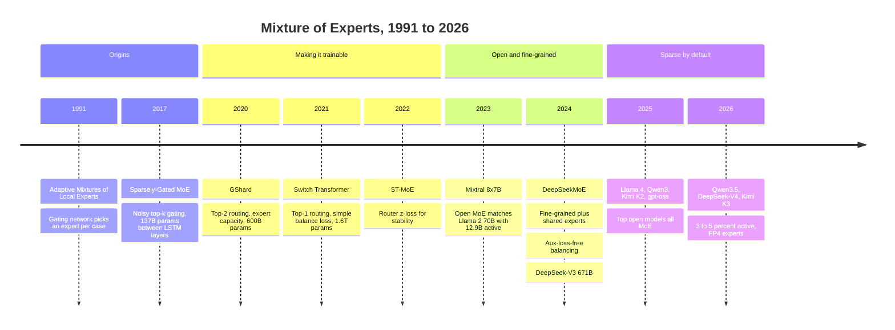
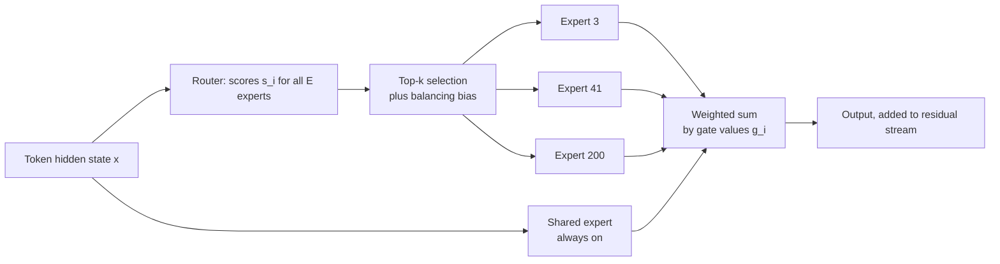
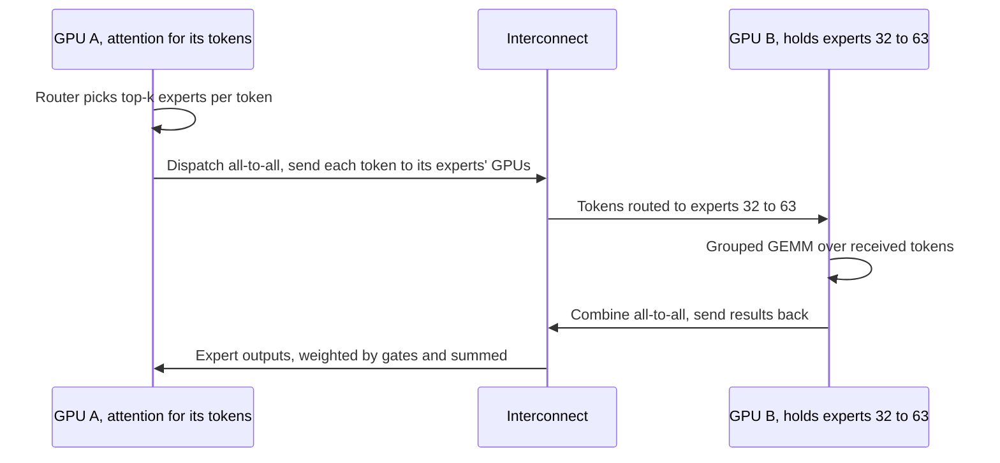
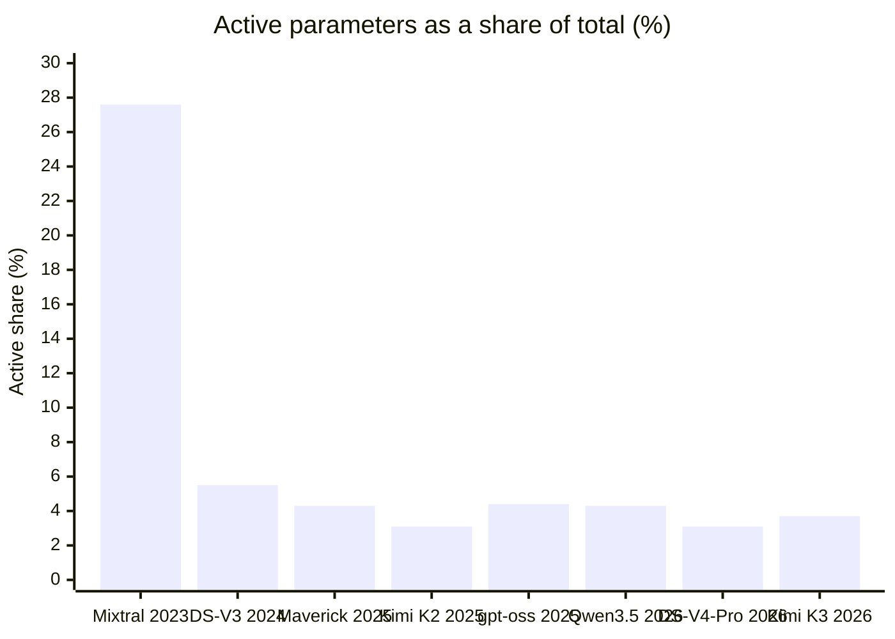

---
tags:
  - ai-ml
  - architectures
  - mixture-of-experts
  - sparsity
  - scaling
status: draft
sources:
  - https://www.cs.toronto.edu/~hinton/absps/jjnh91.html
  - https://arxiv.org/abs/1701.06538
  - https://arxiv.org/abs/2006.16668
  - https://arxiv.org/abs/2101.03961
  - https://arxiv.org/abs/2202.08906
  - https://mistral.ai/news/mixtral-of-experts/
  - https://arxiv.org/abs/2401.04088
  - https://arxiv.org/abs/2401.06066
  - https://arxiv.org/abs/2402.07871
  - https://arxiv.org/abs/2405.13997v3
  - https://arxiv.org/abs/2408.15664
  - https://arxiv.org/abs/2412.19437
  - https://huggingface.co/deepseek-ai/DeepSeek-V3/blob/main/config.json
  - https://arxiv.org/abs/2501.11873
  - https://arxiv.org/abs/2502.05172
  - https://arxiv.org/abs/2505.09388
  - https://arxiv.org/abs/2507.17702
  - https://arxiv.org/abs/2507.20534
  - https://arxiv.org/abs/2508.10925
  - https://arxiv.org/abs/2602.15763
  - https://arxiv.org/abs/2001.08361
  - https://ai.meta.com/blog/llama-4-multimodal-intelligence/
  - https://huggingface.co/Qwen/Qwen3.5-397B-A17B
  - https://huggingface.co/blog/mlabonne/qwen35
  - https://huggingface.co/blog/deepseekv4
  - https://huggingface.co/deepseek-ai/DeepSeek-V4-Pro/blob/main/config.json
  - https://raw.githubusercontent.com/MoonshotAI/Kimi-K3/main/README.md
  - https://inferencex.semianalysis.com/model/kimi-k3
  - https://developer.nvidia.com/blog/deploy-long-context-reasoning-and-agentic-workflows-with-minimax-m3-on-nvidia-accelerated-infrastructure/
  - https://huggingface.co/blog/moe
  - https://huggingface.co/blog/Doctor-Shotgun/llamacpp-moe-offload-guide
  - https://lmsys.org/blog/2025-05-05-large-scale-ep/
  - https://www.lmsys.org/blog/2026-10-24-dsv41-deepinfer
  - https://blogs.nvidia.com/blog/mixture-of-experts-frontier-models/
  - https://sebastianraschka.com/llm-architecture-gallery/models/qwen3-5-397b/
  - https://sebastianraschka.com/llm-architecture-gallery/models/deepseek-v4-pro/
  - https://sebastianraschka.com/llm-architecture-gallery/models/kimi-k3/
  - https://sebastianraschka.com/llm-architecture-gallery/active-parameter-ratio/
created: 2026-11-26
updated: 2026-11-28
---

## Table Of Contents

---

- [[#TL;DR|TL;DR]]
- [[#The Problem|The Problem]]
- [[#Foundations|Foundations]]
    - [[#The FFN Is Where the Parameters Live|The FFN Is Where the Parameters Live]]
    - [[#Conditional Computation|Conditional Computation]]
    - [[#Total vs Active Parameters|Total vs Active Parameters]]
    - [[#How a Hard Choice Still Gets Gradients|How a Hard Choice Still Gets Gradients]]
- [[#How We Got Here|How We Got Here]]
- [[#How It Works|How It Works]]
    - [[#Anatomy of an MoE Layer|Anatomy of an MoE Layer]]
    - [[#The Router and Its Gating Function|The Router and Its Gating Function]]
    - [[#Load Balancing|Load Balancing]]
    - [[#Shared and Fine-Grained Experts|Shared and Fine-Grained Experts]]
    - [[#A Worked Example with DeepSeek-V3|A Worked Example with DeepSeek-V3]]
    - [[#Expert Parallelism and All-to-All|Expert Parallelism and All-to-All]]
    - [[#MoE at Inference|MoE at Inference]]
- [[#Where It Is Now|Where It Is Now]]
    - [[#Nearly Every Frontier Model Is Sparse|Nearly Every Frontier Model Is Sparse]]
    - [[#The Open Frontier in Numbers|The Open Frontier in Numbers]]
    - [[#Sparser Every Generation|Sparser Every Generation]]
    - [[#What MoE Scaling Laws Say|What MoE Scaling Laws Say]]
    - [[#Serving Went Rack-Scale|Serving Went Rack-Scale]]
- [[#Trade-offs & Open Problems|Trade-offs & Open Problems]]
- [[#Resources|Resources]]
- [[#Related Notes|Related Notes]]

## ***TL;DR***
---
*A Mixture of Experts (MoE) layer replaces one big feed-forward block with many smaller "expert" blocks and a router that sends each token to only a few of them. That breaks the link between how many parameters a model has and how much compute each token costs, which is why almost every frontier model since 2025 is an MoE.*

- **What it is:** a [[Transformer]] whose FFN sub-layer is split into $E$ experts. A learned router scores the experts for each token and runs only the top $k$ (typically 4 to 16 out of 128 to 900). The output is a weighted sum of the chosen experts.
- **Why it matters:** compute per token follows the *active* parameters, while knowledge capacity follows the *total*. DeepSeek-V3 has 671B parameters but uses 37B per token, so it trains at roughly the cost of a 37B dense model ([DeepSeek-AI, Dec 2024](https://arxiv.org/abs/2412.19437)).
- **The hard part:** routers collapse onto a few favourite experts unless balanced, and the model must sit in memory in full even though most of it is idle per token. Load-balancing tricks, expert parallelism with all-to-all communication, and large serving batches exist to manage those two facts.
- **Where it is now (Nov 2026):** every leading open model is a fine-grained MoE: DeepSeek-V4-Pro (1.6T total, 49B active, Apr 2026), Qwen3.5-397B-A17B (Feb 2026), Kimi K3 (2.8T total, 104B active, 16 of 896 experts, Jul 2026). Active fractions have fallen from about 28% (Mixtral, 2023) to 3 to 5%, routers have converged on sigmoid-style scores with bias-based balancing, and expert weights now ship in 4-bit.

## ***The Problem***
---
*Bigger dense models are smarter but every parameter is paid for on every token, in training and in serving. MoE asks whether a model can hold far more parameters than it uses at once, and the answer turns a compute problem into a memory and communication problem.*

[[Scaling Laws]] say loss falls predictably as parameters $N$ and data $D$ grow, with training cost $C \approx 6ND$. In a dense model, $N$ is both the capacity and the per-token cost, so the two cannot be separated:

| Want | Dense model's answer | Cost |
|---|---|---|
| More knowledge and skill | More parameters | Every token pays for every parameter, in training ($6N$ FLOPs per token) and inference ($2N$ per token) |
| Cheaper inference | Fewer parameters | Lower quality |
| Both | Not possible | |

An MoE decouples them. Only the experts a token is routed to do any arithmetic, so a model can grow its total parameters 10x to 30x while its per-token FLOPs stay fixed. The bill moves elsewhere:

- **Memory:** all experts must be stored, even though most are idle for any one token. Mixtral 8x7B needs memory for 47B parameters but computes like a 13B model ([Hugging Face, Dec 2023](https://huggingface.co/blog/moe)).
- **Balance:** a learned router can send most tokens to a few experts, wasting the rest and overloading the chips that hold the favourites.
- **Communication:** with experts spread across many chips, every MoE layer must ship tokens to wherever their experts live and back.

The history of MoE is mostly the history of solving those three problems well enough that the compute saving wins.

## ***Foundations***
---
*Four ideas are enough to read the rest of the note: most of a Transformer's parameters sit in its feed-forward blocks, those blocks can be run conditionally, "parameters" now means two different numbers, and a hard top-k choice can still be trained by gradient descent.*

#### **The FFN Is Where the Parameters Live**

Each [[Transformer]] block has an [[Attention]] sub-layer that mixes information across tokens and a feed-forward network (FFN) that transforms each token on its own. With the classic FFN width $d_{ff} = 4d$, a block has about $4d^2$ attention weights and $8d^2$ FFN weights, which is where $N \approx 12 L d^2$ comes from ([Kaplan et al., 2020](https://arxiv.org/abs/2001.08361)). So roughly two-thirds of a dense model's non-embedding parameters are FFN weights, and they act per token with no interaction between tokens. That makes the FFN the natural place to add capacity that only some tokens use.

Modern FFNs are usually SwiGLU: three matrices (gate, up, down) of size $d \times d_{ff}$, so one FFN or one expert holds $3 d\, d_{ff}$ weights.

#### **Conditional Computation**

A dense network runs every weight for every input. *Conditional computation* runs only a subset chosen per input. The MoE version: keep $E$ separate FFNs ("experts") and a small router that picks which ones each token uses. The idea dates to 1991, when Jacobs, Jordan, Nowlan and Hinton trained "many separate networks, each of which learns to handle a subset of the complete set of training cases," with a gating network deciding which expert handles each case ([Jacobs et al., 1991](https://www.cs.toronto.edu/~hinton/absps/jjnh91.html)). In 1991 the goal was specialization; since 2017 the goal has been compute: a sparse choice means unused experts cost no FLOPs.

#### **Total vs Active Parameters**

MoE models are described by two numbers, often in the name: Qwen3-235B-A22B has 235B **total** parameters and 22B **active** ones ([Qwen, May 2025](https://arxiv.org/abs/2505.09388)).

| Quantity | What it counts | What it drives |
|---|---|---|
| Total parameters | Every weight, all experts included | Memory to store the model; knowledge capacity |
| Active parameters | Weights actually used for one token: attention, shared layers, router, and the $k$ chosen experts | FLOPs per token in training and inference |
| Sparsity / active ratio | Active ÷ total (or $k \div E$ for routed experts) | How much capacity you get per FLOP |

For compute, $N$ in $C \approx 6ND$ is the active count. For memory and for how many chips you need, it is the total.

#### **How a Hard Choice Still Gets Gradients**

Picking the top $k$ experts is a discrete operation with no gradient. The trick is that the chosen experts' outputs are *multiplied by the router's scores* before being summed. The loss therefore depends smoothly on those scores, so the router learns to raise the score of an expert that helped and lower one that did not. Experts that were not chosen get no gradient for that token, which is exactly why balance matters: an expert that is never chosen never improves, so it is never chosen. Shazeer et al. observed this self-reinforcing collapse in 2017, which is why every MoE since has some balancing mechanism ([Shazeer et al., 2017](https://arxiv.org/abs/1701.06538)).

## ***How We Got Here***
---
*MoE went from a 1991 idea about specialization to a 2017 trick for huge LSTMs, then through three Google papers that made it trainable at scale, to Mixtral and DeepSeek proving that open, fine-grained MoEs beat dense models. Each step fixed the problem the last one exposed: instability, imbalance, or wasted experts.*

| Year | What changed | Problem it answered | Source |
|---|---|---|---|
| 1991 | Several expert networks plus a gating network; each expert learns a subset of cases (a vowel task split into simple sub-tasks). | One network learning everything interferes with itself. | [Jacobs et al.](https://www.cs.toronto.edu/~hinton/absps/jjnh91.html) |
| 2017 | Sparsely-gated MoE layer with "up to thousands" of experts and noisy top-k gating; over 1000x more capacity at modest compute cost; up to 137B parameters between stacked LSTMs. | How to add huge capacity without paying for it on every token. | [Shazeer et al.](https://arxiv.org/abs/1701.06538) |
| 2020 | GShard: MoE in Transformers with top-2 gating, a per-expert capacity limit, and automatic sharding; a 600B-parameter translation model trained on 2048 TPU v3 in 4 days. | Spreading experts over thousands of chips. | [Lepikhin et al.](https://arxiv.org/abs/2006.16668) |
| 2021 | Switch Transformer: route each token to just one expert, a one-line balance loss, float32 router; up to 7x pretraining speedup over T5 at equal compute; 1.6T parameters, 2048 experts. | Top-2 routing was complex and costly; training was unstable. | [Fedus, Zoph, Shazeer](https://arxiv.org/abs/2101.03961) |
| 2022 | ST-MoE: router z-loss fixes instability; 269B sparse model at the cost of a 32B dense one reaches state of the art in transfer learning. | Sparse models diverged in training and fine-tuned poorly. | [Zoph et al.](https://arxiv.org/abs/2202.08906) |
| 2023 | Mixtral 8x7B: 8 experts, top-2, 46.7B total and 12.9B per token; matches or beats Llama 2 70B with 6x faster inference; Apache 2.0. | No strong open MoE existed. | [Mistral](https://mistral.ai/news/mixtral-of-experts/), [Jiang et al.](https://arxiv.org/abs/2401.04088) |
| 2024 | DeepSeekMoE: split experts into many small ones and add always-on shared experts; 16B model matches LLaMA2 7B with about 40% of the compute. | Big experts learn overlapping, unspecialized knowledge. | [Dai et al.](https://arxiv.org/abs/2401.06066) |
| 2024 | Auxiliary-loss-free balancing: a per-expert bias steers routing instead of a loss term. | Balance losses add "interference gradients" that hurt quality. | [Wang et al.](https://arxiv.org/abs/2408.15664) |
| 2024 | DeepSeek-V3: 671B total, 37B active, 256 routed + 1 shared expert, sigmoid gating, no token dropping, trained on 14.8T tokens for 2.788M H800 GPU-hours. | Frontier quality at a fraction of frontier cost. | [DeepSeek-AI](https://arxiv.org/abs/2412.19437) |
| 2025 to 2026 | MoE becomes the default for open models; experts get finer and sparser (384 to 896 experts), and expert weights go to 4-bit. | Serving cost dominates; more capacity per FLOP keeps paying. | [[#Where It Is Now|Where It Is Now]] |

## ***How It Works***
---
*An MoE layer is a router plus a bank of FFN experts. Everything interesting is in four choices: how the router scores experts, how load is kept balanced, how big and how many the experts are, and how the experts are laid out across chips for training and serving.*

#### **Anatomy of an MoE Layer**

For token representation $\mathbf{x}$, an MoE layer computes

$$
\mathbf{y} = \sum_{j=1}^{N_s} \text{FFN}^{(s)}_j(\mathbf{x}) \;+\; \sum_{i \in \text{TopK}(\mathbf{s},\,k)} g_i \,\text{FFN}_i(\mathbf{x})
$$

*In plain English: every token goes through the $N_s$ shared experts (often 0 or 1), then through the $k$ routed experts with the highest router scores, and each routed expert's output is scaled by its gate value $g_i$ before everything is added up. Experts outside the top $k$ are skipped entirely, which is where the compute saving comes from.*

The MoE layer replaces the FFN in most blocks; attention, norms and embeddings stay dense. Some designs keep the first few blocks dense (DeepSeek-V3: 3; Kimi K2: 1) or alternate dense and MoE blocks (Llama 4 Maverick) ([DeepSeek-AI](https://arxiv.org/abs/2412.19437), [Moonshot](https://arxiv.org/abs/2507.20534), [Meta](https://ai.meta.com/blog/llama-4-multimodal-intelligence/)).

#### **The Router and Its Gating Function**

The router is a single matrix $W_r \in \mathbb{R}^{E \times d}$ giving one logit per expert, $u_i = \mathbf{w}_i^\top \mathbf{x}$. What differs is how logits become gate values.

| Gating | Formula | Used by | Property |
|---|---|---|---|
| Noisy top-k softmax | $G = \text{Softmax}(\text{KeepTopK}(\mathbf{u} + \epsilon \cdot \text{Softplus}(W_{noise}\mathbf{x}), k))$ | Shazeer 2017 | Noise spreads load early in training |
| Softmax then top-k | $g_i = \text{softmax}(\mathbf{u})_i$ for $i$ in top-k | Switch (top-1) | Gates of chosen experts sum to less than 1 |
| Top-k then softmax | $g = \text{Softmax}(\text{TopK}(\mathbf{u}))$ | Mixtral, gpt-oss | Gates of chosen experts sum to 1 |
| Sigmoid, normalized | $s_i = \sigma(u_i)$, $g_i = s_i / \sum_{j \in \text{TopK}} s_j$ | DeepSeek-V3, Kimi K3 | Each score independent; no competition across all experts |

Sources: [Shazeer et al.](https://arxiv.org/abs/1701.06538), [Fedus et al.](https://arxiv.org/abs/2101.03961), [Jiang et al.](https://arxiv.org/abs/2401.04088), [OpenAI gpt-oss card](https://arxiv.org/abs/2508.10925), [DeepSeek-AI](https://arxiv.org/abs/2412.19437), [InferenceX on Kimi K3](https://inferencex.semianalysis.com/model/kimi-k3).

**Why sigmoid?** A softmax over all $E$ experts makes them compete: raising one expert's probability lowers every other's. With hundreds of experts that coupling gets noisy and each gate value becomes tiny. A sigmoid scores each expert on its own scale, and normalizing only over the chosen $k$ restores sensible magnitudes. Theory backs the switch: Nguyen, Ho and Rinaldo show sigmoid gating needs fewer samples than softmax to estimate experts, and argue softmax's forced competition can cause representation collapse ([Nguyen et al., 2024](https://arxiv.org/abs/2405.13997v3), NeurIPS 2024). DeepSeek-V4 goes one step further with a `sqrtsoftplus` score function ([V4-Pro config](https://huggingface.co/deepseek-ai/DeepSeek-V4-Pro/blob/main/config.json)).

**Router stability.** Router logits pass through exponentials, which amplify bfloat16 rounding error when logits get large. Switch kept the router in float32 ([Fedus et al.](https://arxiv.org/abs/2101.03961)); ST-MoE added a penalty on logit size:

$$
L_z = \frac{1}{B}\sum_{t=1}^{B}\Big(\log \sum_{i=1}^{E} e^{u_i^{(t)}}\Big)^2
$$

*In plain English: square the log-sum-exp of each token's router logits and average over the batch. This pushes logits toward small values where rounding errors don't distort the softmax. ST-MoE weights it by $c_z = 0.001$* ([Zoph et al., 2022](https://arxiv.org/abs/2202.08906)).

#### **Load Balancing**

If load is uneven, two things go wrong: favoured experts get all the learning (collapse), and the chips that hold them become the bottleneck while others idle. Three generations of fixes:

**1. Auxiliary balance loss (Switch, 2021).** Add to the training loss

$$
L_{\text{balance}} = \alpha \, E \sum_{i=1}^{E} f_i \, P_i
$$

*In plain English: $f_i$ is the fraction of tokens in the batch actually sent to expert $i$, and $P_i$ is the average router probability given to expert $i$. Their dot product is smallest when both are uniform ($1/E$ each), so the loss nudges the router to spread tokens evenly. $f_i$ has no gradient, so the push flows through $P_i$. Switch used $\alpha = 10^{-2}$* ([Fedus et al., 2021](https://arxiv.org/abs/2101.03961)).

The catch: this loss pulls against the language-modelling loss. Too large and quality drops; too small and balance fails. Qwen found a subtler issue: computing the loss per micro-batch (a few sequences) forces every *sequence* to use all experts evenly, blocking specialization; computing it over the global batch improved perplexity and expert specialization in models up to 42.8B ([Qiu et al., 2025](https://arxiv.org/abs/2501.11873)). Qwen3 uses the global-batch version ([Qwen, 2025](https://arxiv.org/abs/2505.09388)).

**2. Capacity factor and token dropping (GShard, Switch).** Static hardware wants fixed tensor shapes, so each expert gets a fixed buffer:

$$
\text{capacity} = \frac{\text{tokens per batch}}{E} \times \text{CF}
$$

Tokens beyond an expert's capacity are **dropped**: they skip the expert and pass to the next layer through the residual connection. Switch used CF from 1.0 to 2.0 and reports under 1% dropped ([Fedus et al.](https://arxiv.org/abs/2101.03961)); ST-MoE recommends top-2 with CF 1.25 in training and 2.0 at eval ([Zoph et al.](https://arxiv.org/abs/2202.08906)). Higher CF means fewer drops but more padding compute, memory and communication ([Hugging Face](https://huggingface.co/blog/moe)). Modern GPU kernels handle variable-size groups, and DeepSeek-V3 drops no tokens in training or inference ([DeepSeek-AI](https://arxiv.org/abs/2412.19437)).

**3. Auxiliary-loss-free bias balancing (DeepSeek, 2024).** Add a per-expert bias $b_i$ to the score *only when choosing* the top $k$:

$$
\text{TopK}\big(\{s_i + b_i\}\big) \ \text{selects experts}, \qquad g_i \propto s_i \ \text{(bias not used)}, \qquad b_i \leftarrow b_i \mp \gamma
$$

*In plain English: after each training step, lower the bias of every overloaded expert by $\gamma$ and raise the bias of every underloaded one. An overused expert becomes slightly less likely to make the cut next step, but the bias never changes how much a chosen expert's output counts, and it adds no gradient to fight the main loss.* DeepSeek-V3 used $\gamma = 0.001$ for the first 14.3T tokens and 0 for the last 500B, plus a tiny sequence-wise balance loss ($\alpha = 0.0001$) to stop extreme imbalance within single sequences ([DeepSeek-AI, 2024](https://arxiv.org/abs/2412.19437); method from [Wang et al., 2024](https://arxiv.org/abs/2408.15664)).

In DeepSeek's ablations the aux-loss-free model beat the aux-loss baseline on most benchmarks, for example at 228.7B total parameters: GSM8K 74.5 vs 70.7, HumanEval 46.3 vs 40.2, MATH 39.6 vs 37.2 (MMLU went the other way, 67.2 vs 68.3) ([DeepSeek-AI](https://arxiv.org/abs/2412.19437)). DeepSeek-V4 keeps the same `noaux_tc` top-k method ([V4-Pro config](https://huggingface.co/deepseek-ai/DeepSeek-V4-Pro/blob/main/config.json)).

#### **Shared and Fine-Grained Experts**

DeepSeekMoE made two changes that nearly every 2025 to 2026 model copied ([Dai et al., 2024](https://arxiv.org/abs/2401.06066)):

- **Fine-grained experts.** Split each FFN-sized expert into $m$ smaller ones and activate $m$ times as many. Compute per token stays the same, but the number of possible expert combinations explodes, so each expert can specialize more narrowly. Mixtral's 8 experts with top-2 give $\binom{8}{2} = 28$ combinations; DeepSeek-V3's 256 with top-8 give $\binom{256}{8} \approx 4.1 \times 10^{14}$ (my arithmetic).
- **Shared experts.** One or more experts that every token uses, holding common knowledge (syntax, frequent patterns) so routed experts don't each relearn it.

| Model | Experts per MoE layer | Routed active | Shared | Expert width |
|---|---|---|---|---|
| Mixtral 8x7B (2023) | 8 | 2 | 0 | Full FFN size |
| DeepSeek-V3 (2024) | 256 | 8 | 1 | 2048 (vs 18432 for its dense FFN) |
| Qwen3-235B-A22B (2025) | 128 | 8 | 0 | Fine-grained |
| Qwen3.5-397B-A17B (2026) | 512 | 10 | 1 | 1024 |
| Kimi K3 (2026) | 896 | 16 | 2 | Latent MoE |

Sources: [Mistral](https://mistral.ai/news/mixtral-of-experts/), [V3 config](https://huggingface.co/deepseek-ai/DeepSeek-V3/blob/main/config.json), [Qwen3 report](https://arxiv.org/abs/2505.09388), [Qwen3.5 card](https://huggingface.co/Qwen/Qwen3.5-397B-A17B), [Kimi K3 README](https://raw.githubusercontent.com/MoonshotAI/Kimi-K3/main/README.md). Shared experts are not universal: Qwen3 removed them ("Unlike Qwen2.5-MoE, the Qwen3-MoE design excludes shared experts"), and Qwen3.5 brought one back.

#### **A Worked Example with DeepSeek-V3**

Using the published config ([DeepSeek-V3 config.json](https://huggingface.co/deepseek-ai/DeepSeek-V3/blob/main/config.json)): hidden size $d = 7168$, 61 layers of which the first 3 are dense, 256 routed experts plus 1 shared, top-8, expert width 2048, dense FFN width 18432, vocabulary 129,280, MLA attention with 128 heads.

**Step 1: one expert.** A SwiGLU expert has three $d \times 2048$ matrices: $3 \times 7168 \times 2048 = 44.0\text{M}$ parameters.

**Step 2: count everything.**

| Component | Calculation | Parameters |
|---|---|---|
| Routed experts | 58 MoE layers × 256 × 44.0M | 653.9B |
| Shared experts | 58 × 1 × 44.0M | 2.55B |
| Routers | 58 × 256 × 7168 | 0.11B |
| Dense FFNs (first 3 layers) | 3 × 3 × 7168 × 18432 | 1.19B |
| MLA attention | 61 × ~187M | 11.41B |
| Embedding + output head | 2 × 129,280 × 7168 | 1.85B |
| **Total** | | **≈ 671.0B** |

**Step 3: count what one token touches.** Per MoE layer, 8 routed + 1 shared = 9 experts, so $58 \times 9 \times 44.0\text{M} = 23.0\text{B}$ of expert weights, plus attention (11.4B), dense FFNs (1.2B), routers and the output head (0.9B): **≈ 36.6B**, matching the paper's "37B activated" ([DeepSeek-AI](https://arxiv.org/abs/2412.19437)). The embedding table is a lookup, not a matmul, so it is not counted. Active ratio: 37 / 671 ≈ **5.5%**. Routed experts are 97% of the weights but only 3.1% of them (8 of 256) run per token.

**Step 4: training compute with $6ND$.** On $D = 14.8\text{T}$ tokens:

$$
C \approx 6 \times N_{\text{active}} \times D = 6 \times 37{\times}10^{9} \times 14.8{\times}10^{12} \approx 3.3 \times 10^{24} \ \text{FLOPs}
$$

*In plain English: use the active count, not the total. A dense 671B model on the same tokens would need $6.0 \times 10^{25}$ FLOPs, about 18x more.*

As a sanity check (my arithmetic, ignoring attention-score FLOPs): DeepSeek reports 2.664M H800 GPU-hours for pretraining, which implies about $3.3 \times 10^{24} / (2.664{\times}10^{6} \times 3600\,\text{s}) \approx 343$ TFLOP/s of useful work per GPU, a plausible fraction of an H800's FP8 peak.

**Step 5: memory.** Storage follows the *total*: 671B parameters are about 671 GB at FP8 or 1.34 TB at BF16, before any [[KV Cache]]. That is why V3 runs on multi-GPU nodes even though each token computes like a 37B model.

#### **Expert Parallelism and All-to-All**

A 671B model does not fit on one chip, so experts are spread across devices: **expert parallelism (EP)**. Each device holds a slice of the experts, and each MoE layer does two collective exchanges:

- **Cost:** two all-to-alls per MoE layer in the forward pass and two more in the backward pass. Every token's hidden vector crosses the network up to $k$ times, so fine-grained, high-$k$ designs are communication-heavy.
- **Limiting fan-out:** DeepSeek-V3 caps each token at experts on at most $M = 4$ nodes, so cross-node InfiniBand traffic stays bounded and the rest moves over faster NVLink ([DeepSeek-AI](https://arxiv.org/abs/2412.19437)).
- **Hiding it:** V3's DualPipe schedule overlaps forward and backward compute with communication so that "both all-to-all and PP communication can be fully hidden," dedicating 20 of the H800's 132 SMs to communication ([DeepSeek-AI](https://arxiv.org/abs/2412.19437)).
- **Shaping the model for the network:** GLM-5 cut its layer count to 80 "to minimize expert parallelism communication overhead" ([Zhipu, 2026](https://arxiv.org/abs/2602.15763)); Kimi K2 dropped DeepSeek's expert grouping ([Moonshot, 2025](https://arxiv.org/abs/2507.20534)).

The full picture of combining EP with data, tensor and pipeline parallelism is in [[Distributed Training]].

#### **MoE at Inference**

Decode (generating one token at a time) is memory-bandwidth bound: each step must stream the weights from memory, and the arithmetic per byte is tiny (see [[1 - All About Rooflines (NOT DONE)|Rooflines]] and [[7 - All About Transformer Inference (NOT DONE)|Transformer Inference]]). MoE changes this in two opposite ways:

- **At batch size 1, MoE is a big win.** Only the active weights are read: about 37 GB per token for DeepSeek-V3 at FP8 instead of 671 GB.
- **At realistic batch sizes, the win shrinks.** Different tokens pick different experts, so a batch touches most of them. With $E = 256$ and $k = 8$, a batch of $B$ tokens touches on average $256\,(1 - (1 - 8/256)^B)$ experts per layer: about 57 at $B=8$, 163 at $B=32$, and 222 (87%) at $B=64$ (my arithmetic, assuming uniform routing). Meanwhile each expert sees only $Bk/E = B/32$ tokens, so its matrix multiply is starved.

The consequence is that MoE serving wants **very large batches spread over many devices**, so each expert gets enough tokens to be efficient and the total weight memory is split many ways. DeepSeek served V3 with a minimum decode unit of 40 nodes (320 GPUs) using EP320, one expert per GPU, with 64 GPUs holding redundant and shared experts; prefill used 4 nodes with EP32 and 32 redundant experts ([DeepSeek-AI](https://arxiv.org/abs/2412.19437)). Redundant copies of hot experts are the inference-time version of load balancing. More on batching, disaggregation and schedulers in [[LLM Serving]]; the serving-side mechanics of EP (kernels, EPLB, attention-FFN disaggregation) are in [[Expert Parallelism and MoE Serving]].

At the other extreme, **expert offloading** runs big MoEs on small machines: keep the always-active weights (attention, dense and shared FFNs) and the KV cache on the GPU, and put routed experts in CPU RAM, since only a few are read per token. llama.cpp exposes this as `--cpu-moe` or `--n-cpu-moe N` ([Hugging Face community guide, Jan 2026](https://huggingface.co/blog/Doctor-Shotgun/llamacpp-moe-offload-guide)). It works for single-user decode; prompt processing still has to move expert weights over PCIe, which the same guide estimates at about 10 seconds per batch for 300 GB of CPU-side weights over PCIe 4.0 x16.

Because memory follows the total, MoE also pushes hard on [[Quantization]]: gpt-oss ships its MoE weights in MXFP4 (about 4.25 bits per parameter) so the 117B model fits one 80 GB GPU ([OpenAI, Aug 2025](https://arxiv.org/abs/2508.10925)), and DeepSeek-V4's instruct models store expert weights in FP4 with everything else in FP8 ([Hugging Face, Apr 2026](https://huggingface.co/blog/deepseekv4)).

## ***Where It Is Now***
---
*As of November 2026, MoE is the default architecture for frontier and open models alike. Experts are fine-grained and very sparse (3 to 5% of parameters active), routing has converged on DeepSeek-style designs, and serving has moved to rack-scale systems built around expert parallelism.*

#### **Nearly Every Frontier Model Is Sparse**

- NVIDIA wrote in December 2025 that "the top 10 most intelligent open-source models all use a mixture-of-experts architecture" (citing the Artificial Analysis leaderboard), that MoE was adopted by over 60% of open-source releases in 2025, and that "since early 2025, nearly all leading frontier models use MoE designs" ([NVIDIA, Dec 2025](https://blogs.nvidia.com/blog/mixture-of-experts-frontier-models/)). Closed labs rarely publish architectures, so the frontier-model claim is a vendor's statement, not a disclosed fact.
- Sebastian Raschka's architecture gallery, updated through 20 November 2026, labels about 78 of its 90 recent open architectures as MoE or hybrid MoE (my count from its table) ([Raschka, Nov 2026](https://sebastianraschka.com/llm-architecture-gallery/active-parameter-ratio/)).
- The holdouts are mostly small models, where all weights fit easily and a dense model is simpler to serve.

#### **The Open Frontier in Numbers**

| Model | Released | Total | Active | Active % | Experts (routed / active / shared) | Notes | Source |
|---|---|---|---|---|---|---|---|
| DeepSeek-V3 | Dec 2024 | 671B | 37B | 5.5% | 256 / 8 / 1 | Sigmoid, aux-loss-free | [paper](https://arxiv.org/abs/2412.19437) |
| Llama 4 Maverick | Apr 2025 | 400B | 17B | 4.3% | 128 / 1 / 1 | Alternating dense and MoE layers; Scout is 109B, 16 experts | [Meta](https://ai.meta.com/blog/llama-4-multimodal-intelligence/) |
| Qwen3-235B-A22B | Apr 2025 | 235B | 22B | 9.4% | 128 / 8 / 0 | Global-batch balance loss | [report](https://arxiv.org/abs/2505.09388) |
| Kimi K2 | Jul 2025 | 1.04T | 32.6B | 3.1% | 384 / 8 / 1 | 64 heads, 1 dense layer | [report](https://arxiv.org/abs/2507.20534) |
| gpt-oss-120b | Aug 2025 | 116.8B | 5.1B | 4.4% | 128 / 4 / 0 | Softmax over chosen experts, MXFP4 | [card](https://arxiv.org/abs/2508.10925) |
| Qwen3.5-397B-A17B | Feb 2026 | 397B | 17B | 4.3% | 512 / 10 / 1 | 3:1 Gated DeltaNet hybrid | [card](https://huggingface.co/Qwen/Qwen3.5-397B-A17B) |
| GLM-5 | Feb 2026 | 744B | 40B | 5.4% | 256 / not stated | DeepSeek Sparse Attention | [report](https://arxiv.org/abs/2602.15763) |
| DeepSeek-V4-Pro | Apr 2026 | 1.6T | 49B | 3.1% | 384 / 6 / 1 | `sqrtsoftplus` scores, 3 hash-routed layers, FP4 experts | [HF](https://huggingface.co/blog/deepseekv4), [config](https://huggingface.co/deepseek-ai/DeepSeek-V4-Pro/blob/main/config.json) |
| DeepSeek-V4-Flash | Apr 2026 | 284B | 13B | 4.6% | 256 / 6 / 1 | Same recipe, smaller | [HF](https://huggingface.co/blog/deepseekv4) |
| MiniMax M3 | Jun 2026 | 428B | 22B | 5.1% | 128 / 4 / not stated | MiniMax Sparse Attention, 1M context | [NVIDIA](https://developer.nvidia.com/blog/deploy-long-context-reasoning-and-agentic-workflows-with-minimax-m3-on-nvidia-accelerated-infrastructure/) |
| Kimi K3 | Jul 2026 | 2.8T | 104B | 3.7% | 896 / 16 / 2 | Sigmoid router, "Stable LatentMoE," MXFP4 weights via QAT | [README](https://raw.githubusercontent.com/MoonshotAI/Kimi-K3/main/README.md) |

Common threads in 2026: (1) DeepSeek's recipe (fine-grained experts, a shared expert, bias balancing, non-softmax scores) is the template; (2) MoE is combined with cheaper attention, either linear-attention hybrids (Qwen3.5, Kimi K3: see [[Hybrid Attention]]) or compressed and sparse attention (DeepSeek-V4, GLM-5, MiniMax M3: see [[Sparse Attention]]); (3) experts are trained or post-trained for 4-bit storage. DeepSeek-V4 also sets `num_hash_layers: 3`, meaning three layers use fixed hash-based routing instead of a learned router ([config](https://huggingface.co/deepseek-ai/DeepSeek-V4-Pro/blob/main/config.json), [Raschka](https://sebastianraschka.com/llm-architecture-gallery/models/deepseek-v4-pro/)). Kimi K3's README lists a "Latent MoE Dimension" of 3584 but does not describe the mechanism, and its release date is reported as July 16 or July 27, 2026 depending on the source ([InferenceX](https://inferencex.semianalysis.com/model/kimi-k3)).

#### **Sparser Every Generation**

Computed from the totals and actives in the table above. The routed-expert ratio $k/E$ fell even faster: 25% for Mixtral (2 of 8), 3.1% for DeepSeek-V3 (8 of 256), 2.0% for Qwen3.5 (10 of 512), 1.8% for Kimi K3 (16 of 896), 1.6% for DeepSeek-V4-Pro (6 of 384). The lowest active ratios in Raschka's November 2026 table are about 2.9% (DeepSeek V4.1-Flash) ([Raschka](https://sebastianraschka.com/llm-architecture-gallery/active-parameter-ratio/)). The floor seems to be set less by quality than by memory and communication: every halving of the active ratio doubles the weights that must be stored and moved for the same compute.

#### **What MoE Scaling Laws Say**

| Finding | Detail | Source |
|---|---|---|
| Expert size should not equal FFN size | Granularity is its own hyperparameter; FFN-sized experts are suboptimal at almost any budget; the MoE-over-dense gap widens with scale. | [Krajewski et al., Feb 2024](https://arxiv.org/abs/2402.07871) |
| MoE can win at fixed memory, not just fixed compute | Joint laws over active params, data and expert count from 280+ runs; with the right configuration MoE beats dense even when total parameters are capped. | [Ludziejewski et al., Feb 2025](https://arxiv.org/abs/2502.05172) (ICML 2025) |
| Efficiency leverage | 300+ models up to 28B: the compute advantage over dense follows power laws in the activation ratio and compute budget, with an optimal granularity range. A 0.85B-active model matched a 6.1B dense model on 1T tokens, over 7x less compute. | [Ant Group Ling team, Jul 2025](https://arxiv.org/abs/2507.17702) |
| More sparsity keeps paying | At equal validation loss, sparsity 48 (384 experts, 8 active) needed 1.69x, 1.39x and 1.15x fewer FLOPs than sparsity 8, 16 and 32. Moonshot stopped at 48 for infrastructure cost. | [Kimi K2, Jul 2025](https://arxiv.org/abs/2507.20534) |

The pattern: returns from sparsity are real but diminishing (1.69x, then 1.39x, then 1.15x), and the stopping point is set by serving infrastructure. See [[Scaling Laws]] for how these fit with dense laws.

#### **Serving Went Rack-Scale**

- **Wide EP is standard.** SGLang served DeepSeek on 96 H100s with prefill-decode disaggregation and large-scale EP at 52.3k input and 22.3k output tokens per second per node; its expert load balancer (EPLB) with redundant experts gave 1.49x on prefill and 2.54x on decode ([LMSYS, May 2025](https://lmsys.org/blog/2025-05-05-large-scale-ep/)).
- **By late 2026, decode runs at EP64 on one rack.** LMSYS's October 2026 benchmark of DeepSeek-V4.1-Flash uses EP4 for prefill and EP64 for decode across 64 GB300 GPUs, with 64 redundant experts on top of 384, and a fused "MegaMoE" kernel that does dispatch, expert GEMMs and combine in one kernel ([LMSYS, Oct 2026](https://www.lmsys.org/blog/2026-10-24-dsv41-deepinfer)).
- **Hardware is sold on MoE.** NVIDIA argues that spreading experts over 72 NVLink-connected GPUs cuts experts per GPU and speeds the all-to-all, and claims a 10x gain for Kimi K2 Thinking on GB200 NVL72 vs HGX H200 (a vendor claim) ([NVIDIA, Dec 2025](https://blogs.nvidia.com/blog/mixture-of-experts-frontier-models/)). Kimi K3 is recommended for "supernode configurations with 64 or more accelerators" ([InferenceX](https://inferencex.semianalysis.com/model/kimi-k3)). See [[AI Accelerators]].

## ***Trade-offs & Open Problems***
---
*MoE trades compute for memory and communication, and trades a simple model for a routing system with its own failure modes. The open questions are how sparse is too sparse, how to keep routing balanced without hurting quality, and how to serve trillion-parameter models economically.*

| Trade-off | What you gain | What you pay | State in 2026 |
|---|---|---|---|
| Sparsity | More capacity per FLOP | Memory and network traffic grow with total params | Active ratios of 3 to 5%; floor set by infrastructure ([Kimi K2](https://arxiv.org/abs/2507.20534)) |
| Load balancing | Experts all learn; no hot chips | Aux losses fight the main loss; strict per-sequence balance blocks specialization | Bias balancing plus global-batch or tiny sequence losses ([DeepSeek-AI](https://arxiv.org/abs/2412.19437), [Qiu et al.](https://arxiv.org/abs/2501.11873)) |
| Capacity factor | Static shapes, bounded memory | Dropped tokens or padding waste | Dropless training is common on GPUs |
| Fine granularity | Sharper specialization, more combinations | Smaller, less efficient GEMMs; more routing traffic | 128 to 896 experts; grouped and fused kernels ([[Grouped GEMM and Ragged Batches]]) |
| Expert parallelism | Fits huge models; spreads bandwidth load | Two all-to-alls per layer; network-sensitive | Rack-scale NVLink domains, node-limited routing |
| Serving | Cheap per-token compute | Needs large batches and many GPUs to be efficient; small deployments waste most of the saving | Wide EP for providers; CPU offloading for local use |

- **Router behaviour is still poorly understood.** ST-MoE found clear specialization in encoder experts but little in decoder experts ([Zoph et al.](https://arxiv.org/abs/2202.08906)). Whether fine-grained experts specialize by meaning or by surface features is mostly studied in small models.
- **Training instability.** Router logits and expert imbalance remain a source of loss spikes; z-loss, float32 routers and new names like Kimi K3's "Stable LatentMoE" signal that stability work is ongoing.
- **Fine-tuning.** MoEs have historically overfit more in fine-tuning than dense models ([Hugging Face](https://huggingface.co/blog/moe)); post-training recipes for very sparse models are less public than pretraining ones.
- **Memory-optimal vs compute-optimal.** Classic MoE laws assume compute is the constraint. For on-device or single-node serving, memory is, and the best design can flip toward denser models ([Ludziejewski et al.](https://arxiv.org/abs/2502.05172)).
- **Interaction with other sparsity.** MoE now sits beside sparse and linear attention, [[Speculative Decoding]] and 4-bit [[Quantization]]. How these compound, for example whether FP4 hurts rarely-used experts more, is open.

## ***Resources***
---
*Start with the Hugging Face explainer, then read Switch for the clean basic recipe and DeepSeek-V3 for the modern one. Kimi K2's report is the best public account of choosing a sparsity level.*

**Papers**
- [Adaptive Mixtures of Local Experts](https://www.cs.toronto.edu/~hinton/absps/jjnh91.html): Jacobs, Jordan, Nowlan, Hinton, 1991. The original idea.
- [Outrageously Large Neural Networks: The Sparsely-Gated Mixture-of-Experts Layer](https://arxiv.org/abs/1701.06538): Shazeer et al. (Google), Jan 2017. Noisy top-k gating; the modern starting point.
- [GShard](https://arxiv.org/abs/2006.16668): Lepikhin et al. (Google), Jun 2020. Top-2 routing, capacity, sharding over 2048 TPUs.
- [Switch Transformers](https://arxiv.org/abs/2101.03961): Fedus, Zoph, Shazeer (Google), Jan 2021 (JMLR 2022). Top-1 routing and the standard balance loss.
- [ST-MoE: Designing Stable and Transferable Sparse Expert Models](https://arxiv.org/abs/2202.08906): Zoph et al. (Google), Feb 2022. Router z-loss and practical design advice.
- [Mixtral of Experts](https://arxiv.org/abs/2401.04088): Jiang et al. (Mistral), Jan 2024.
- [DeepSeekMoE](https://arxiv.org/abs/2401.06066): Dai et al. (DeepSeek), Jan 2024. Fine-grained and shared experts.
- [Scaling Laws for Fine-Grained Mixture of Experts](https://arxiv.org/abs/2402.07871): Krajewski et al., Feb 2024. Granularity as a hyperparameter.
- [Sigmoid Gating is More Sample Efficient than Softmax Gating in Mixture of Experts](https://arxiv.org/abs/2405.13997v3): Nguyen, Ho, Rinaldo, May 2024 (NeurIPS 2024). Theory for the sigmoid switch.
- [Auxiliary-Loss-Free Load Balancing Strategy for Mixture-of-Experts](https://arxiv.org/abs/2408.15664): Wang et al. (DeepSeek), Aug 2024.
- [DeepSeek-V3 Technical Report](https://arxiv.org/abs/2412.19437): DeepSeek-AI, Dec 2024. The reference modern MoE, including training and serving systems.
- [Demons in the Detail: On Implementing Load Balancing Loss](https://arxiv.org/abs/2501.11873): Qiu et al. (Qwen), Jan 2025. Global-batch balance loss.
- [Joint MoE Scaling Laws: Mixture of Experts Can Be Memory Efficient](https://arxiv.org/abs/2502.05172): Ludziejewski et al., Feb 2025 (ICML 2025).
- [Qwen3 Technical Report](https://arxiv.org/abs/2505.09388): Qwen, May 2025.
- [Towards Greater Leverage: Scaling Laws for Efficient MoE Language Models](https://arxiv.org/abs/2507.17702): Ling Team (Ant Group), Jul 2025.
- [Kimi K2: Open Agentic Intelligence](https://arxiv.org/abs/2507.20534): Moonshot AI, Jul 2025. Sparsity scaling law and the 384-expert choice.
- [gpt-oss-120b & gpt-oss-20b Model Card](https://arxiv.org/abs/2508.10925): OpenAI, Aug 2025.
- [GLM-5: from Vibe Coding to Agentic Engineering](https://arxiv.org/abs/2602.15763): Zhipu AI, Feb 2026.

**Lab posts and model cards**
- [Mixtral of experts](https://mistral.ai/news/mixtral-of-experts/): Mistral, Dec 2023.
- [The Llama 4 herd](https://ai.meta.com/blog/llama-4-multimodal-intelligence/): Meta, Apr 2025.
- [Qwen3.5-397B-A17B model card](https://huggingface.co/Qwen/Qwen3.5-397B-A17B): Qwen, Feb 2026. Expert counts and hybrid layout.
- [DeepSeek-V4 on Hugging Face](https://huggingface.co/blog/deepseekv4): Hugging Face, Apr 2026. V4-Pro and V4-Flash sizes, FP4 experts.
- [Kimi K3 README](https://raw.githubusercontent.com/MoonshotAI/Kimi-K3/main/README.md): Moonshot AI, Jul 2026.
- [Deploying DeepSeek with PD Disaggregation and Large-Scale EP on 96 H100s](https://lmsys.org/blog/2025-05-05-large-scale-ep/): LMSYS, May 2025. DeepEP, EPLB, two-batch overlap.
- [DeepSeek-V4.1 serving benchmark](https://www.lmsys.org/blog/2026-10-24-dsv41-deepinfer): LMSYS, Oct 2026. EP64 decode on GB300.
- [Mixture of Experts Powers the Most Intelligent Frontier AI Models](https://blogs.nvidia.com/blog/mixture-of-experts-frontier-models/): NVIDIA, Dec 2025. Adoption claims and the NVL72 case (vendor).

**Explainers and analysis**
- [Mixture of Experts Explained](https://huggingface.co/blog/moe): Hugging Face, Dec 2023 (revised Feb 2026). Best single introduction.
- [LLM Architecture Gallery](https://sebastianraschka.com/llm-architecture-gallery/active-parameter-ratio/): Sebastian Raschka, updated Nov 2026. Side-by-side specs and active ratios for current models.
- [Performant local MoE inference with llama.cpp](https://huggingface.co/blog/Doctor-Shotgun/llamacpp-moe-offload-guide): community post on Hugging Face, Jan 2026. Expert offloading in practice.

## Related Notes

- [[Transformer]] — The architecture whose FFN sub-layer MoE replaces.
- [[Scaling Laws]] — Why $N$ in $6ND$ is the active count, and how MoE laws extend dense ones.
- [[Distributed Training]] — Expert parallelism, all-to-all and how EP combines with data, tensor and pipeline parallelism.
- [[LLM Serving]] — Wide-EP decode, prefill-decode disaggregation and batching for sparse models.
- [[Quantization]] — FP4 and MXFP4 expert weights, which cut MoE's memory bill.
- [[KV Cache]] — The other big memory consumer at serving time, competing with expert weights for HBM.
- [[Hybrid Attention]] — Linear-attention hybrids paired with MoE in Qwen3.5 and Kimi K3.
- [[Sparse Attention]] — The attention-side sparsity that DeepSeek-V4, GLM-5 and MiniMax M3 pair with expert sparsity.
- [[AI Accelerators]] — Rack-scale NVLink systems designed around MoE all-to-all traffic.
- [[Speculative Decoding]] — Used on top of wide-EP MoE serving to emit several tokens per step.
- [[Low-Precision Training]] — Experts are trained in FP4 first (DeepSeek-V4, Inkling 2 Small) because they hold most parameters.
- [[Multi-Token Prediction]] — Most MoEs now train an MTP module (often itself an MoE block) as an auxiliary loss and built-in drafter.
- [[1 - All About Rooflines (NOT DONE)|1 - All About Rooflines (NOT DONE)]] — Why decode is memory-bound and why experts need large batches.
- [[7 - All About Transformer Inference (NOT DONE)|7 - All About Transformer Inference (NOT DONE)]] — Inference cost model that MoE changes.
- [[Expert Parallelism and MoE Serving]] — How MoE models are served: DP attention plus wide EP, all-to-all kernels, redundant experts.
- [[Prefill-Decode Disaggregation]] — Separate prefill and decode pools, each with its own EP width.
