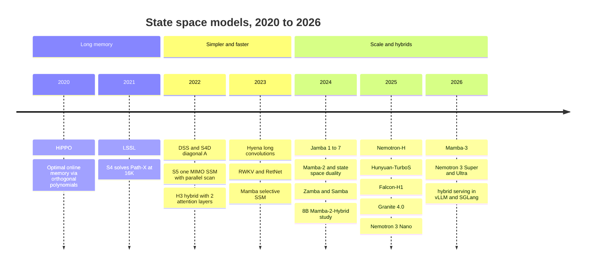
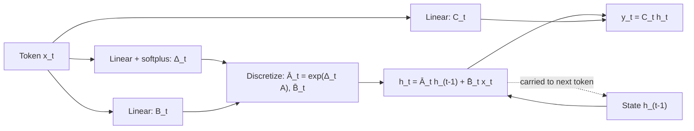

---
tags:
  - ai-ml
  - architectures
  - state-space-models
  - mamba
  - long-context
  - inference
status: draft
sources:
  - https://arxiv.org/abs/2008.07669
  - https://arxiv.org/abs/2110.13985
  - https://arxiv.org/abs/2111.00396
  - https://arxiv.org/abs/2206.11893
  - https://arxiv.org/abs/2208.04933
  - https://arxiv.org/abs/2212.14052
  - https://arxiv.org/abs/2302.10866
  - https://arxiv.org/abs/2305.13048
  - https://arxiv.org/abs/2307.08621
  - https://arxiv.org/abs/2312.00752
  - https://arxiv.org/pdf/2312.00752
  - https://arxiv.org/abs/2312.04927
  - https://arxiv.org/abs/2402.01032
  - https://arxiv.org/abs/2403.19887
  - https://arxiv.org/abs/2405.16712
  - https://arxiv.org/abs/2405.21060
  - https://arxiv.org/abs/2406.07522
  - https://arxiv.org/abs/2406.07887
  - https://arxiv.org/abs/2504.03624
  - https://arxiv.org/abs/2505.15431
  - https://arxiv.org/abs/2507.22448
  - https://arxiv.org/abs/2512.20856
  - https://arxiv.org/abs/2603.15569
  - https://iclr.cc/virtual/2026/oral/10010353
  - https://huggingface.co/papers/2606.15007
  - https://tridao.me/blog/2024/mamba2-part1-model
  - https://tridao.me/blog/2024/mamba2-part3-algorithm/
  - https://research.nvidia.com/labs/nemotron/Nemotron-3
  - https://developer.nvidia.com/blog/introducing-nemotron-3-super-an-open-hybrid-mamba-transformer-moe-for-agentic-reasoning
  - https://www.ibm.com/new/announcements/ibm-granite-4-0-hyper-efficient-high-performance-hybrid-models
  - https://www.ibm.com/think/news/hybrid-thinking-inside-architecture-granite-4-0
  - https://pytorch.org/blog/hybrid-models-as-first-class-citizens-in-vllm/
  - https://pytorch.org/blog/hybrid-models-meet-sglang-more-than-full-attention/
  - https://vllm.ai/blog/hybrid-ssm-disagg
  - https://magazine.sebastianraschka.com/p/llm-research-papers-2026-part1
created: 2026-11-26
updated: 2026-11-28
---

## Table Of Contents

---

- [[#TL;DR|TL;DR]]
- [[#The Problem|The Problem]]
- [[#Foundations|Foundations]]
    - [[#The Continuous-Time State Space Model|The Continuous-Time State Space Model]]
    - [[#Discretization with a Zero-Order Hold|Discretization with a Zero-Order Hold]]
    - [[#Two Views of One Model|Two Views of One Model]]
    - [[#HiPPO and What the State Remembers|HiPPO and What the State Remembers]]
- [[#How We Got Here|How We Got Here]]
- [[#How It Works|How It Works]]
    - [[#From Time-Invariant to Selective|From Time-Invariant to Selective]]
    - [[#The Selective Scan Equations|The Selective Scan Equations]]
    - [[#A Tiny Numeric Example|A Tiny Numeric Example]]
    - [[#The Hardware-Aware Scan|The Hardware-Aware Scan]]
    - [[#Mamba-2 and State Space Duality|Mamba-2 and State Space Duality]]
    - [[#Mamba-3|Mamba-3]]
    - [[#Constant State vs a Growing KV Cache|Constant State vs a Growing KV Cache]]
- [[#Where It Is Now|Where It Is Now]]
    - [[#Hybrids Won|Hybrids Won]]
    - [[#Why Pure SSMs Struggle With Recall|Why Pure SSMs Struggle With Recall]]
    - [[#How Hybrids Fix It|How Hybrids Fix It]]
    - [[#Kernels and Serving|Kernels and Serving]]
- [[#Trade-offs & Open Problems|Trade-offs & Open Problems]]
- [[#Resources|Resources]]
- [[#Related Notes|Related Notes]]

## ***TL;DR***
---
*A state space model (SSM) processes a sequence by updating a fixed-size hidden state one token at a time, like an RNN, but is built so that training can still run in parallel across the whole sequence. Mamba made the state update depend on the input, which finally let SSMs compete with [[Transformer]]s on language, and today they mostly live inside hybrid models next to a few attention layers.*

- **What it is:** a linear recurrence $h_t = \bar{A} h_{t-1} + \bar{B} x_t$, $y_t = C h_t$, derived from a continuous-time system from control theory. Memory and compute per generated token are constant, no matter how long the context is.
- **The key step:** early SSMs (S4 and relatives) had fixed dynamics, which made them fast convolutions but bad at language. Mamba (Dec 2023) made $B$, $C$ and the step size $\Delta$ functions of the current token, so the model can choose what to store and what to forget, and replaced the convolution with a GPU-friendly parallel scan ([Gu & Dao, 2023](https://arxiv.org/abs/2312.00752)).
- **The catch:** a fixed-size state cannot hold an arbitrary amount of context, so pure SSMs are measurably worse than [[Attention]] at copying and retrieving exact facts from a long prompt ([Jelassi et al., 2024](https://arxiv.org/abs/2402.01032)).
- **Where it is now (Nov 2026):** hybrids dominate. Most of a model's sequence-mixing layers are Mamba-2 (or a linear-attention cousin) and a small fraction are full attention: Jamba used 1 attention layer per 8, IBM Granite 4.0 uses 9 Mamba-2 blocks per transformer block, and NVIDIA's Nemotron 3 family (Nano Dec 2025, Super Mar 2026, Ultra 550B Jun 2026) is a Mamba-Transformer [[Mixture of Experts]] with 1M-token context. Mamba-3 (Mar 2026) is the newest pure-SSM layer; vLLM and SGLang treat hybrids as first-class.

## ***The Problem***
---
*Attention gives every token direct access to every earlier token, which is why it is so good, but that access costs quadratic compute in training and a [[KV Cache]] that grows with every token at inference. RNNs had the opposite profile: a constant-size state, but training that cannot be parallelized across the sequence. SSMs try to get both good halves.*

| | Training cost for length $L$ | Inference memory per sequence | Inference work per new token | Parallel training? |
|---|---|---|---|---|
| Full attention | $O(L^2)$ score matrix | KV cache, grows as $O(L)$ | Reads the whole cache: $O(L)$ | Yes |
| Classic RNN (LSTM, GRU) | $O(L)$ | Fixed-size state | $O(1)$ | No: step $t$ waits for step $t-1$ |
| SSM (S4, Mamba) | $O(L)$ or $O(L \log L)$ | Fixed-size state | $O(1)$ | Yes: convolution or parallel scan |

Two concrete pains drive the interest:

- **The KV cache.** Every attention layer stores a key and a value per token. For a Llama-3-70B-shaped model that is about 320 KiB per token, or 40 GiB for one 128K-token conversation (see [[KV Cache]]). Prefill time also grows quadratically with prompt length ([vLLM team, Nov 2025](https://pytorch.org/blog/hybrid-models-as-first-class-citizens-in-vllm/)). Agents, retrieval and long reasoning traces all push contexts up, so this cost keeps rising (see [[Long Context]]).
- **RNNs never scaled.** RNNs are linear in length at inference but historically lagged Transformers in quality and could not be trained in parallel ([Peng et al., 2023](https://arxiv.org/abs/2305.13048)). On a GPU, a loop over 100K sequential steps leaves almost all the hardware idle.

The SSM bet: if the recurrence is **linear** in the state, it can be unrolled into either a convolution or an associative scan, both of which run in parallel during training, while inference still uses the cheap step-by-step recurrence.

## ***Foundations***
---
*Four ideas carry the whole field: a continuous-time linear system, the rule that turns it into a discrete recurrence, the fact that a linear time-invariant recurrence is also a convolution, and HiPPO, which says how to pick the state matrix so the state actually remembers the past.*

#### **The Continuous-Time State Space Model**

The control-theory form maps an input signal $u(t)$ to an output $y(t)$ through an $N$-dimensional hidden state $x(t)$:

$$
x'(t) = A\,x(t) + B\,u(t), \qquad y(t) = C\,x(t) + D\,u(t)
$$

*In plain English: the state changes at a rate set by two things, its own current value (through $A$, which mostly makes old information decay or rotate) and the incoming signal (through $B$, which writes the input into the state). The output is a readout of the state ($C$) plus a direct skip from input to output ($D$).*

| Symbol | Shape (one channel) | Role |
|---|---|---|
| $A$ | $N \times N$ | State dynamics: how memory evolves and fades |
| $B$ | $N \times 1$ | How the input is written into the state |
| $C$ | $1 \times N$ | How the state is read out |
| $D$ | scalar | Skip connection, usually treated as a residual |

**Notation warning:** the deep-learning papers (S4, Mamba) rename things: the state is $h$ and the input is $x$, so the same system is written $h'(t) = Ah(t) + Bx(t)$, $y(t) = Ch(t)$ ([Gu & Dao, 2023](https://arxiv.org/abs/2312.00752)). The rest of this note uses that convention. A model applies one such SSM per channel of the hidden vector, so a layer of width $D$ holds $D \cdot N$ state numbers.

#### **Discretization with a Zero-Order Hold**

Tokens are discrete, so the system is sampled with a step size $\Delta$. The zero-order hold (ZOH) assumes the input is constant across each step and solves the ODE exactly over that interval, giving

$$
\bar{A} = \exp(\Delta A), \qquad \bar{B} = (\Delta A)^{-1}\big(\exp(\Delta A) - I\big)\,\Delta B
$$

$$
h_t = \bar{A}\,h_{t-1} + \bar{B}\,x_t, \qquad y_t = C\,h_t
$$

*In plain English: $\bar{A}$ is how much of the old state survives one step, and $\bar{B}$ is how strongly the new token is written in. A small $\Delta$ means "little time passed": the state barely decays and the input barely registers. A large $\Delta$ means "a lot of time passed": the old state decays away and the new input dominates* ([Gu & Dao, 2023](https://arxiv.org/abs/2312.00752)).

With $A$ negative (a decaying system), $\exp(\Delta A)$ stays between 0 and 1, so the recurrence is stable by construction. That is a big practical advantage over a free-form RNN matrix, whose powers can explode.

#### **Two Views of One Model**

If $\bar{A}$, $\bar{B}$, $C$ are the same at every step (linear time-invariant, LTI), unrolling the recurrence from $h_0 = 0$ gives

$$
y_t = \sum_{k=0}^{t} C \bar{A}^{k} \bar{B}\, x_{t-k}
\quad\Longrightarrow\quad
y = x * \bar{K}, \qquad \bar{K} = \big(C\bar{B},\ C\bar{A}\bar{B},\ C\bar{A}^2\bar{B},\ \dots\big)
$$

*In plain English: the output is the input convolved with a fixed kernel whose $k$-th entry says how much a token $k$ steps ago still affects the present. Compute that kernel once, and the whole sequence can be processed in parallel with an FFT in $O(L \log L)$.*

| View | Used for | Cost |
|---|---|---|
| Recurrent: $h_t = \bar{A}h_{t-1} + \bar{B}x_t$ | Generating one token at a time | $O(1)$ per token, fixed memory |
| Convolutional: $y = x * \bar{K}$ | Training on full sequences | $O(L \log L)$ with FFT, fully parallel |

This duality is why LTI SSMs train like CNNs and generate like RNNs. H3's FlashConv, for example, used a fused block FFT for sequences up to 8K ([Fu et al., 2022](https://arxiv.org/abs/2212.14052)). The duality breaks once the parameters depend on the input, which is exactly the problem Mamba had to solve.

#### **HiPPO and What the State Remembers**

A random $A$ forgets fast, and long-range memory is the whole point. HiPPO (2020) asks: if a state of size $N$ must summarize the entire input history online, what is the best $A$? Its answer is to keep the coefficients of the history's projection onto orthogonal polynomials (for example Legendre polynomials), updated as each new input arrives. The HiPPO-LegS variant "scales through time to remember all history" without assuming a timescale in advance ([Gu, Dao et al., 2020](https://arxiv.org/abs/2008.07669)).

- **What it bought:** 98.3% on permuted MNIST, then a state of the art, from an RNN whose state is a principled compression of the past.
- **Why it matters later:** S4 initializes $A$ from HiPPO. S4D showed initialization is critical, and that a diagonal restriction of the HiPPO matrix recovers S4's kernel in the limit of a large state ([Gu, Gupta et al., 2022](https://arxiv.org/abs/2206.11893)).

## ***How We Got Here***
---
*SSMs went from a control-theory curiosity to a language-model backbone in about four years. Each step fixed one concrete problem: first make long memory possible, then make it cheap, then make it work on language by letting the input steer the state, then make it fast on GPUs and pair it with attention.*

| Year | What changed | Problem it answered | Source |
|---|---|---|---|
| 2020 | HiPPO: the state stores projection coefficients of the whole history onto a polynomial basis. | RNNs forget; what $A$ gives provable long memory? | [Gu, Dao et al.](https://arxiv.org/abs/2008.07669) |
| 2021 | LSSL: deep stacks of discretized linear state space layers, linking RNNs, convolutions and neural ODEs. | A single model family with all three strengths. | [Gu, Johnson et al.](https://arxiv.org/abs/2110.13985) |
| 2021 | S4: structured $A$ (HiPPO plus a low-rank correction) makes the kernel cheap to compute; first model to solve Path-X (length 16K); 91% on sequential CIFAR; generation about 60x faster than Transformers. | LSSL's direct approach had "prohibitive computation and memory requirements". | [Gu, Goel, Ré](https://arxiv.org/abs/2111.00396) |
| 2022 | DSS, then S4D: a purely diagonal $A$ matches S4; S4D's kernel is about two lines of code; 85% average on Long Range Arena. | S4's structured matrix was hard to implement. | [Gu, Gupta et al.](https://arxiv.org/abs/2206.11893) |
| 2022 | S5: one multi-input, multi-output SSM computed with a parallel scan instead of many single-channel convolutions; 87.4% LRA average, 98.5% on Path-X. | Showed the scan, not the FFT, could carry SSM training. | [Smith, Warrington, Linderman](https://arxiv.org/abs/2208.04933) |
| 2022 | H3: diagnosed that SSMs fail at recalling and comparing earlier tokens; a 125M hybrid with two attention layers beat Transformers on OpenWebText by 1.0 PPL. | Why SSMs lagged on language. | [Fu, Dao et al.](https://arxiv.org/abs/2212.14052) |
| 2023 | Hyena: implicit long convolutions plus data-controlled gating; Transformer quality with about 20% less compute at 2K; about 100x faster than optimized attention at 64K. | Drop attention entirely. | [Poli et al.](https://arxiv.org/abs/2302.10866) |
| 2023 | RWKV (14B) and RetNet: linear-attention recurrences with parallel training and $O(1)$ inference; RetNet adds a chunkwise mode. | Same goal from the attention side. | [Peng et al.](https://arxiv.org/abs/2305.13048), [Sun et al.](https://arxiv.org/abs/2307.08621) |
| 2023 | Mamba: input-dependent $B$, $C$, $\Delta$ (selection) plus a hardware-aware scan; Mamba-3B matches Transformers twice its size; 5x inference throughput. | LTI models cannot do content-based selection. | [Gu & Dao](https://arxiv.org/abs/2312.00752) |
| 2024 | Mamba-2 / SSD: scalar-times-identity $A$ makes the layer a masked form of linear attention computable with matmuls; core layer 2 to 8x faster; state size 64 to 256. | Mamba-1's scan could not use tensor cores, capping the state near 16. | [Dao & Gu](https://arxiv.org/abs/2405.21060) |
| 2024 | Recall studies: 82% of the convolution-attention perplexity gap is associative recall; fixed-state models provably cannot copy long strings; 8B pure SSMs lag on 5-shot MMLU and Phonebook. | Why pure SSMs still lose some tasks. | [Arora et al.](https://arxiv.org/abs/2312.04927), [Jelassi et al.](https://arxiv.org/abs/2402.01032), [Waleffe et al.](https://arxiv.org/abs/2406.07887) |
| 2024 to 2026 | Production hybrids: Jamba, Zamba, Samba, Nemotron-H, Hunyuan-TurboS, Falcon-H1, Granite 4.0, Nemotron 3. | Keep most layers cheap, keep a few attention layers for exact recall. | See [[#Hybrids Won|Hybrids Won]] |
| 2026 | Mamba-3: trapezoidal discretization, complex-valued state, MIMO update; Mamba-2 perplexity at half the state size. | Better quality and state tracking per byte of state; idle hardware at decode. | [Lahoti et al.](https://arxiv.org/abs/2603.15569) |

## ***How It Works***
---
*Mamba's layer is the discretized SSM above with one change: $B$, $C$ and $\Delta$ are computed from the current token. That makes the model a content-aware, gated RNN; it kills the convolution trick, so training uses a parallel scan fused into one GPU kernel. Mamba-2 then reshapes the same idea so it runs on matrix-multiply hardware.*

#### **From Time-Invariant to Selective**

An LTI model applies the same decay and the same write strength to every token. That is fine for audio, where the signal is smooth, but language needs decisions that depend on content: store this name, skip this filler word, reset at this document boundary. Mamba's synthetic tests make the point. Plain copying needs only time-awareness, which a fixed kernel has. **Selective copying**, where the tokens to copy are at random positions among noise tokens, needs content-awareness, and a static convolution kernel cannot model the varying spacing ([Gu & Dao, 2023](https://arxiv.org/abs/2312.00752)).

#### **The Selective Scan Equations**

For each channel, with a learned diagonal $A$ (shared across time):

$$
\Delta_t = \operatorname{softplus}\!\big(\theta_\Delta + s_\Delta(x_t)\big), \qquad B_t = W_B\, x_t, \qquad C_t = W_C\, x_t
$$

$$
\bar{A}_t = \exp(\Delta_t A), \qquad \bar{B}_t = (\Delta_t A)^{-1}\big(\exp(\Delta_t A) - I\big)\Delta_t B_t
$$

$$
h_t = \bar{A}_t\, h_{t-1} + \bar{B}_t\, x_t, \qquad y_t = C_t\, h_t
$$

*In plain English: each token decides three things for itself. $\Delta_t$ is a gate on time: a large value resets the state and focuses on the current token, a small value keeps the state and mostly ignores the token. $B_t$ decides which direction in the state the token is written to, and $C_t$ decides which part of the state the output reads. The recurrence itself is still linear in $h$, which is what keeps it parallelizable.*

Details from the paper ([Gu & Dao, 2023](https://arxiv.org/abs/2312.00752)):

- $s_\Delta$ is a rank-1 projection broadcast to all $D$ channels, and softplus keeps $\Delta$ positive. $B$, $C$ have shape (batch, $L$, $N$), $\Delta$ has shape (batch, $L$, $D$), and the discretized $\bar{A}$, $\bar{B}$ have shape (batch, $L$, $D$, $N$), which is far too big to write to memory.
- The paper connects the role of $\Delta$ to the gates of classic RNNs such as the LSTM and GRU: it decides, per token, how much to forget and how much to write.
- The full Mamba block expands the width by $E = 2$, runs a short causal convolution and the selective SSM on one branch, multiplies by a gating branch, and projects back down; it replaces both the attention and the MLP block of a Transformer. Benchmarks use state size $N = 16$.

#### **A Tiny Numeric Example**

One channel, state size 1, $A = -1$, $B = 1$, $C = 1$. First the time-invariant case with fixed $\Delta = 0.5$:

- $\bar{A} = e^{-0.5} = 0.607$, and $\bar{B} = (e^{-0.5} - 1)/(-1) = 0.393$.
- Input $x = [1, 0, 0, 2]$, starting from $h_0 = 0$:

| Step $t$ | $x_t$ | $h_t = 0.607\,h_{t-1} + 0.393\,x_t$ | $y_t$ |
|---|---|---|---|
| 1 | 1 | $0.393$ | 0.393 |
| 2 | 0 | $0.607 \times 0.393 = 0.239$ | 0.239 |
| 3 | 0 | $0.607 \times 0.239 = 0.145$ | 0.145 |
| 4 | 2 | $0.607 \times 0.145 + 0.393 \times 2 = 0.875$ | 0.875 |

**Same answer as a convolution:** the kernel is $\bar{K} = (0.393, 0.239, 0.145, 0.088)$, and $y_4 = 0.393 \times 2 + 0.239 \times 0 + 0.145 \times 0 + 0.088 \times 1 = 0.875$. The first token's influence has decayed to 0.088 after three steps.

**Now make it selective** and let token 4 choose its own $\Delta$ (starting from the same $h_3 = 0.145$):

| Token 4 picks | $\bar{A}_4$ | $\bar{B}_4$ | $h_4$ | Behaviour |
|---|---|---|---|---|
| $\Delta = 5$ | 0.007 | 0.993 | **1.987** | Wipes the past, stores the new token |
| $\Delta = 0.5$ | 0.607 | 0.393 | 0.875 | Blends past and present |
| $\Delta = 0.01$ | 0.990 | 0.010 | **0.163** | Keeps the past, nearly ignores the token |

That single knob, chosen per token from the token's content, is the "selection". There is no longer one fixed kernel, so the FFT shortcut is gone.

#### **The Hardware-Aware Scan**

Without a fixed kernel, training needs another way to compute all $h_t$ in parallel. The recurrence $h_t = a_t h_{t-1} + b_t$ composes associatively: applying step $(a_1, b_1)$ then $(a_2, b_2)$ equals one step $(a_1 a_2,\ a_2 b_1 + b_2)$. Any associative operator can be evaluated with a parallel prefix scan in $O(\log L)$ depth, the trick S5 had already used ([Smith et al., 2022](https://arxiv.org/abs/2208.04933)).

The second problem is memory traffic: the expanded state is $D \times N$ per token. Mamba's kernel, written in the style of [[FlashAttention]] ([Gu & Dao, 2023](https://arxiv.org/abs/2312.00752)):

1. Loads $\Delta$, $A$, $B$, $C$ from slow GPU HBM into fast on-chip SRAM.
2. Discretizes and runs the scan in SRAM.
3. Writes only the outputs, shape (batch, $L$, $D$), back to HBM; the expanded state is never materialized.
4. Recomputes the intermediate states in the backward pass instead of storing them, keeping memory comparable to an optimized FlashAttention Transformer.

Result: 20 to 40x faster than a standard PyTorch scan, faster than FlashAttention-2 beyond 2K tokens, and 4 to 5x higher inference throughput than a Transformer of similar size. On induction heads, a model trained at length 256 generalized to about 1M tokens, 4000x its training length.

#### **Mamba-2 and State Space Duality**

Mamba-1's scan runs on the GPU's general-purpose units, not its tensor cores. An H100 does 989 TFLOPS of BF16 matmul against 67 of FP32 non-matmul work, so this capped the practical state size near $N = 16$ ([Dao, 2024](https://tridao.me/blog/2024/mamba2-part3-algorithm/)). Mamba-2 restricts $A$ further, to a scalar times the identity per head ($A_t = a_t$), and shows that the whole layer can then be written as one matrix acting on the sequence ([Dao, 2024](https://tridao.me/blog/2024/mamba2-part1-model)):

$$
y = M x, \qquad M = L \circ (C B^{\top}), \qquad L_{ij} = a_i a_{i-1} \cdots a_{j+1} \ \ (i \ge j), \quad 0 \text{ otherwise}
$$

*In plain English: this is attention without softmax. $C$ plays the query, $B$ the key, $x$ the value, and the mask $L$ multiplies each query-key score by the product of the decay factors between the two positions, a learned, input-dependent "discount" for distance. Set every $a_t = 1$ and $L$ becomes the plain causal mask: the layer is exactly causal linear attention.*

This is **state space duality (SSD)**: the same layer has a linear recurrent form (for inference) and a quadratic attention-like form (for parallel work). The training algorithm mixes them ([Dao, 2024](https://tridao.me/blog/2024/mamba2-part3-algorithm/)):

- Split the sequence into chunks (64 tokens in the reference code).
- Inside each chunk, use the quadratic matmul form, which runs on tensor cores.
- Between chunks, pass only the chunk-final states with a short recurrence over $L / 64$ steps.

Other Mamba-2 changes: multi-head structure with head dimension $P = 64$ or $128$ (Mamba-1 is effectively $P = 1$), state size $N = 64$ to $256$, and $A$, $B$, $C$ produced in parallel with $x$, which simplifies tensor parallelism. The SSD core layer is 2 to 8x faster than Mamba-1's ([Dao & Gu, 2024](https://arxiv.org/abs/2405.21060)). Because Mamba-2 is a gated linear attention, it sits in the same family as Gated DeltaNet and Lightning Attention; the comparison is in [[Hybrid Attention]].

#### **Mamba-3**

Mamba-3 (Mar 2026, accepted at [ICLR 2026](https://iclr.cc/virtual/2026/oral/10010353)) goes back to SSM theory to get more out of each byte of state ([Lahoti et al., 2026](https://arxiv.org/abs/2603.15569)):

| Change | What it does | Why |
|---|---|---|
| Exponential-trapezoidal discretization | Mixes the previous and current input ($B_{t-1}x_{t-1}$ and $B_t x_t$) in each step; Mamba-1/2's rule turns out to be the simpler "exponential-Euler" case | More expressive recurrence; with $B$, $C$ biases it replaces the short causal convolution |
| Complex-valued state | Equivalent to a data-dependent rotary embedding | State tracking: on synthetic arithmetic tasks Mamba-3 nearly solves what Mamba-2 does at chance |
| MIMO update | Matrix-multiply state update instead of an outer product | Decode is memory-bound, so extra FLOPs (up to 4x) are nearly free in wall-clock time |

At 1.5B parameters the MIMO variant beats Transformers by 2.2 points of average downstream accuracy, Mamba-2 by 1.9 and Gated DeltaNet by 1.8, and Mamba-3 with state size 64 matches Mamba-2's perplexity at state size 128. Kernels are released in the state-spaces/mamba repository.

#### **Constant State vs a Growing KV Cache**

An illustrative comparison at the same depth and width as Llama 3 70B (80 layers, $d_{\text{model}} = 8192$); this is not a real released model.

- **Attention (GQA, 8 KV heads, 128-dim, BF16):** $2 \times 80 \times 8 \times 128 \times 2$ bytes $= 320$ KiB **per token** (from [[KV Cache]]).
- **Mamba-2 layer:** expansion 2 gives width 16,384; with head dimension 64 that is 256 heads; state size $N = 128$. State per layer $= 256 \times 64 \times 128 = 2{,}097{,}152$ numbers. SSM states are commonly kept in FP32 (vLLM's example SSM state is FP32 ([vLLM, Apr 2026](https://vllm.ai/blog/hybrid-ssm-disagg))), so 8 MiB per layer, or 640 MiB for 80 layers, **fixed per sequence**. The short-convolution state adds a few MiB.
- **Hybrid:** 10 attention layers (1 in 8) and 70 Mamba-2 layers: 40 KiB per token plus 560 MiB fixed.

| Context | Pure attention | Pure Mamba-2 | Hybrid 1:7 |
|---|---|---|---|
| 1K tokens | 0.31 GiB | 0.63 GiB | 0.59 GiB |
| 2K tokens | 0.63 GiB | 0.63 GiB | 0.63 GiB |
| 32K tokens | 10 GiB | 0.63 GiB | 1.8 GiB |
| 128K tokens | 40 GiB | 0.63 GiB | 5.5 GiB |
| 1M tokens | 320 GiB | 0.63 GiB | 40.5 GiB |

**Reading it:** the crossover is at $640\text{ MiB} / 320\text{ KiB} = 2{,}048$ tokens. Below it the SSM state is actually *bigger* than the KV cache; above it the SSM wins by a factor that grows linearly with context, 64x at 128K. The hybrid keeps about 7x of that saving at 128K. Real numbers agree in direction: Jamba's KV cache at 256K context is 4GB against 32GB for Mixtral and 128GB for a 7B Llama-2 ([Lieber et al., 2024](https://arxiv.org/abs/2403.19887)), and the vLLM team notes a 128K-token KV cache can be nearly 200x larger than a Mamba state ([vLLM team, Nov 2025](https://pytorch.org/blog/hybrid-models-as-first-class-citizens-in-vllm/)). Decode work follows the same shape: a Mamba layer touches its fixed state each step, while attention re-reads the whole cache (see [[7 - All About Transformer Inference (NOT DONE)|7 - All About Transformer Inference (NOT DONE)]]).

## ***Where It Is Now***
---
*As of November 2026, pure SSM language models are a research line, and production models are hybrids: mostly Mamba-2 (or linear-attention) layers for cheap long-context processing, with a small number of full-attention layers kept for exact retrieval. NVIDIA, IBM, AI21, TII, Tencent and others ship them, and the main serving engines support them natively.*

#### **Hybrids Won**

| Model | Date | Org | Design | Notable numbers | Source |
|---|---|---|---|---|---|
| Jamba | Mar 2024 | AI21 | 1 attention per 7 Mamba layers in each 8-layer block, plus MoE | 52B total, 12B active; fits one 80GB GPU; 256K context | [Lieber et al.](https://arxiv.org/abs/2403.19887) |
| Zamba | May 2024 | Zyphra | Mamba backbone plus a single shared attention module | 7B, 1T tokens | [Glorioso et al.](https://arxiv.org/abs/2405.16712) |
| Samba | Jun 2024 | Microsoft | Mamba interleaved with sliding-window attention | 3.8B, 3.2T tokens; trained at 4K, perfect passkey at 256K after finetuning; 3.73x throughput vs GQA Transformer at 128K | [Ren et al.](https://arxiv.org/abs/2406.07522) |
| Mamba-2-Hybrid 8B | Jun 2024 | NVIDIA | 43% Mamba-2, 7% attention, 50% MLP layers | +2.65 points over an 8B Transformer on 12 tasks; up to 8x faster generation predicted | [Waleffe et al.](https://arxiv.org/abs/2406.07887) |
| Nemotron-H | Apr 2025 | NVIDIA | Most attention layers replaced by Mamba | 8B and 56B (47B pruned); up to 3x faster than Qwen-2.5 and Llama-3.1 peers | [NVIDIA](https://arxiv.org/abs/2504.03624) |
| Hunyuan-TurboS | May 2025 | Tencent | 128 layers of Mamba2, GQA attention and MoE FFN blocks in an "AMF/MF" pattern | 560B total, 56B active; 256K context; Chatbot Arena 1356 at release | [Tencent](https://arxiv.org/abs/2505.15431) |
| Falcon-H1 | Jul 2025 | TII | Parallel hybrid: attention and SSM side by side | 0.5B to 34B; 256K context; 34B claimed to match ~70B models | [Zuo et al.](https://arxiv.org/abs/2507.22448) |
| Granite 4.0 | Oct 2025 | IBM | 9 Mamba-2 blocks per transformer block; no positional encoding | H-Small 32B/9B active, H-Tiny 7B/1B, H-Micro 3B; over 70% less RAM for long inputs and concurrent batches | [IBM](https://www.ibm.com/new/announcements/ibm-granite-4-0-hyper-efficient-high-performance-hybrid-models) |
| Nemotron 3 Nano | Dec 2025 | NVIDIA | Mamba-2 and MoE layers with a few GQA attention layers (2 KV heads) | 31.6B total, 3.2B active; 1M context; 3.3x throughput of Qwen3-30B-A3B | [NVIDIA](https://arxiv.org/abs/2512.20856) |
| Nemotron 3 Super | Mar 2026 | NVIDIA | Repeating 6-layer blocks: Mamba-2, LatentMoE, Mamba-2, attention, Mamba-2, LatentMoE; MTP; NVFP4 training | 120B total, 12B active; 1M context; over 5x the throughput of the previous Nemotron Super | [NVIDIA](https://developer.nvidia.com/blog/introducing-nemotron-3-super-an-open-hybrid-mamba-transformer-moe-for-agentic-reasoning) |
| Nemotron 3 Ultra | Jun 2026 | NVIDIA | Hybrid Mamba-attention with LatentMoE and MTP | 550B total, 55B active; 20T tokens; 1M context; up to ~6x throughput vs open peers | [NVIDIA](https://huggingface.co/papers/2606.15007) |

Two trends stand out:

- **The attention share keeps falling:** from 1 in 8 layers (Jamba, 2024) to about 1 in 10 (Granite 4.0) to one attention layer per six-layer block that also contains three Mamba-2 and two MoE layers (Nemotron 3 Super). The remaining attention layers are made as cheap as possible, for example GQA with only 2 KV heads in Nemotron 3 ([NVIDIA, Dec 2025](https://arxiv.org/abs/2512.20856)).
- **Mamba-2 now competes with linear attention for the "cheap" slot.** Qwen3-Next, Kimi Linear and the Qwen3.6 series use Gated DeltaNet-style layers instead of Mamba-2 ([Raschka, 2026](https://magazine.sebastianraschka.com/p/llm-research-papers-2026-part1)). Since SSD shows Mamba-2 is itself a gated linear attention, this is a choice within one family; ratios like 3:1 and the DeltaNet details are covered in [[Hybrid Attention]]. Distilling attention models into Mamba-style ones is an active 2026 thread as well.

#### **Why Pure SSMs Struggle With Recall**

A state of fixed size $S$ bytes cannot store more than $S$ bytes about an arbitrary prompt. When a task needs one exact detail from 100K tokens back (a phone number, a variable name, a quote), the SSM had to decide to keep it when it went past, without knowing the question. Attention defers that decision: it keeps everything and looks things up when asked.

The evidence:

- **Theory:** a two-layer Transformer can copy strings of length exponential in its size, while fixed-state "generalized SSMs" are fundamentally limited by the state; pretrained Transformers greatly outperform SSMs at copying and retrieving from context ([Jelassi et al., Feb 2024](https://arxiv.org/abs/2402.01032)).
- **Where the perplexity gap comes from:** across 17 models, about 82% of the gap between gated-convolution models and attention on the Pile is associative recall; a 70M attention model beats a 1.4B gated-convolution model on multi-query associative recall ([Arora et al., Dec 2023](https://arxiv.org/abs/2312.04927)).
- **At 8B scale on 3.5T tokens:** pure Mamba and Mamba-2 match or beat Transformers on many tasks but fall behind on 5-shot MMLU, Phonebook lookup and long-context reasoning ([Waleffe et al., Jun 2024](https://arxiv.org/abs/2406.07887)).

Selection helps (Mamba solves selective copying and induction heads where LTI models fail), and Mamba-3 improves retrieval further, but no fixed-size state escapes the counting argument.

#### **How Hybrids Fix It**

A handful of attention layers is enough to restore exact lookup, because retrieval does not need to happen at every layer:

- NVIDIA's 8B hybrid with only 7% attention layers beat the pure Transformer on all 12 standard tasks and matched or beat it on 23 long-context tasks out to 128K ([Waleffe et al., 2024](https://arxiv.org/abs/2406.07887)).
- H3 had already shown two attention layers were enough for a 125M model to beat a Transformer ([Fu et al., 2022](https://arxiv.org/abs/2212.14052)), and in Zoology, hybrids with input-dependent sparse attention closed 97.4% of the recall gap ([Arora et al., 2023](https://arxiv.org/abs/2312.04927)).
- The division of labour, in NVIDIA's words for Nemotron 3: attention layers handle high-fidelity routing across all tokens, Mamba-2 layers do sequence modeling with fixed memory, MoE layers add parameters cheaply ([NVIDIA, Dec 2025](https://arxiv.org/abs/2512.20856)).
- **A side effect on position:** the SSM layers already know token order, so IBM dropped positional encoding from Granite 4.0 entirely; it was trained on sequences over 500K tokens and validated to 128K ([IBM, Oct 2025](https://www.ibm.com/think/news/hybrid-thinking-inside-architecture-granite-4-0)). See [[Positional Encoding]].

#### **Kernels and Serving**

- **Kernels:** the reference implementations live in the state-spaces/mamba repository: the fused selective-scan CUDA kernel from Mamba-1, the chunked SSD kernels for Mamba-2 and, since March 2026, Mamba-3's kernels ([Lahoti et al., 2026](https://arxiv.org/abs/2603.15569)). vLLM runs Mamba and linear-attention layers with Triton kernels, whose CPU launch overhead hurt low-latency decode until full CUDA graphs were added for decode batches ([vLLM team, Nov 2025](https://pytorch.org/blog/hybrid-models-as-first-class-citizens-in-vllm/)).
- **vLLM (Nov 2025):** hybrids became first-class in V1 with one allocator for both KV blocks and Mamba state. Each sequence's Mamba state is one large fixed page updated in place, so attention block sizes are grown until pages match (672-token attention blocks for Nemotron-Nano-12B-v2). With full CUDA graphs, granite-4.0-h-tiny gained up to 91% throughput over the older V0 engine ([vLLM team](https://pytorch.org/blog/hybrid-models-as-first-class-citizens-in-vllm/)). In April 2026 vLLM extended prefill/decode disaggregation so a decode server can pull both KV blocks and Mamba state over RDMA, benchmarked on Nemotron 3 Super ([vLLM, Apr 2026](https://vllm.ai/blog/hybrid-ssm-disagg)). See [[PagedAttention]] and [[LLM Serving]].
- **SGLang (Dec 2025):** separate Mamba and KV pools with an elastic split, and **MambaRadixCache** for prefix caching. The hard part is that SSM state updates in place, so it cannot be rolled back to represent a shorter prefix, and is orders of magnitude bigger than one token's KV; SGLang checkpoints states at tree nodes (see [[Prefix Caching for Hybrid Models]]). The same in-place update breaks [[Speculative Decoding]], since rejected draft tokens cannot be undone; SGLang gives each draft token its own state slot ([SGLang team](https://pytorch.org/blog/hybrid-models-meet-sglang-more-than-full-attention/)).

## ***Trade-offs & Open Problems***
---
*SSMs trade exact recall for constant memory. Hybrids buy most of the recall back, but the field still lacks a principled rule for how many attention layers are enough, and the serving stack was built around KV caches, not recurrent states.*

| Issue | Why it matters | Status (Nov 2026) |
|---|---|---|
| Fixed state vs exact recall | Copying, needle retrieval and many-shot prompting need exact access to old tokens | Provable limit for pure SSMs ([Jelassi et al.](https://arxiv.org/abs/2402.01032)); hybrids are the working answer |
| How much attention to keep | Each attention layer brings back a KV cache | Shipped models use from 7 (Jamba) to 9 (Granite 4.0) or more Mamba layers per attention layer; chosen by ablation, not theory |
| Short contexts gain little | Below roughly 2K tokens the SSM state can be larger than the KV cache it replaces (see the worked comparison) | Gains concentrate in long-context, high-concurrency serving |
| State size vs quality | Bigger $N$ means better memory but more bytes per sequence and slower decode | Mamba-2 raised $N$ to 64 to 256; Mamba-3 gets Mamba-2 quality at half the state |
| State tracking | Mamba-2 performs at chance on synthetic arithmetic state-tracking tasks | Mamba-3's complex-valued state nearly solves them ([Lahoti et al.](https://arxiv.org/abs/2603.15569)) |
| Serving features | Prefix caching, speculative decoding and disaggregation assumed per-token KV blocks | Supported in vLLM and SGLang with workarounds; Mamba prefix caching still described as experimental in vLLM (Nov 2025) |
| Kernel maturity | Attention has years of tuned kernels, and serving engines were built around it | Mamba layers in vLLM run on Triton kernels whose launch overhead needed full CUDA graphs to fix; how well SSM kernels carry over to other [[AI Accelerators]] is an open question |
| Mamba-2 vs linear attention | Gated DeltaNet-style layers compete for the same slot | No settled winner; see [[Hybrid Attention]] |

## ***Resources***
---
*Read the Mamba paper for the core idea and Tri Dao's four-part Mamba-2 series for the cleanest explanation of the attention connection. Waleffe et al. is the single best study of why hybrids beat pure SSMs, and the vLLM and SGLang posts show what serving them involves.*

**Papers**
- [HiPPO: Recurrent Memory with Optimal Polynomial Projections](https://arxiv.org/abs/2008.07669): Gu, Dao, Ermon, Rudra, Ré, Aug 2020. Where the state matrix comes from.
- [Combining Recurrent, Convolutional, and Continuous-time Models with Linear State-Space Layers](https://arxiv.org/abs/2110.13985): Gu et al., Oct 2021. LSSL, the first deep SSM.
- [Efficiently Modeling Long Sequences with Structured State Spaces](https://arxiv.org/abs/2111.00396): Gu, Goel, Ré, Oct 2021 (ICLR 2022). S4.
- [On the Parameterization and Initialization of Diagonal State Space Models](https://arxiv.org/abs/2206.11893): Gu, Gupta, Goel, Ré, Jun 2022. S4D and why diagonal works.
- [Simplified State Space Layers for Sequence Modeling](https://arxiv.org/abs/2208.04933): Smith, Warrington, Linderman, Aug 2022. S5 and the parallel scan.
- [Hungry Hungry Hippos](https://arxiv.org/abs/2212.14052): Fu, Dao et al., Dec 2022 (ICLR 2023). H3, recall diagnosis and early hybrids.
- [Hyena Hierarchy](https://arxiv.org/abs/2302.10866): Poli et al., Feb 2023. Long convolutions with gating.
- [RWKV: Reinventing RNNs for the Transformer Era](https://arxiv.org/abs/2305.13048): Peng et al., May 2023.
- [Retentive Network](https://arxiv.org/abs/2307.08621): Sun et al., Jul 2023. RetNet.
- [Mamba: Linear-Time Sequence Modeling with Selective State Spaces](https://arxiv.org/abs/2312.00752): Gu & Dao, Dec 2023. The selective SSM and hardware-aware scan.
- [Zoology: Measuring and Improving Recall in Efficient Language Models](https://arxiv.org/abs/2312.04927): Arora et al., Dec 2023. Associative recall explains the gap.
- [Repeat After Me: Transformers are Better than State Space Models at Copying](https://arxiv.org/abs/2402.01032): Jelassi et al., Feb 2024. The fixed-state limit.
- [Jamba: A Hybrid Transformer-Mamba Language Model](https://arxiv.org/abs/2403.19887): Lieber et al. (AI21), Mar 2024.
- [Transformers are SSMs (Mamba-2)](https://arxiv.org/abs/2405.21060): Dao & Gu, May 2024 (ICML 2024). State space duality.
- [An Empirical Study of Mamba-based Language Models](https://arxiv.org/abs/2406.07887): Waleffe et al. (NVIDIA), Jun 2024. Pure SSM vs hybrid at 8B.
- [Samba](https://arxiv.org/abs/2406.07522): Ren et al., Jun 2024 (ICLR 2025). Mamba plus sliding-window attention.
- [Nemotron-H](https://arxiv.org/abs/2504.03624): NVIDIA, Apr 2025.
- [Hunyuan-TurboS](https://arxiv.org/abs/2505.15431): Tencent, May 2025.
- [Falcon-H1](https://arxiv.org/abs/2507.22448): Zuo et al. (TII), Jul 2025.
- [NVIDIA Nemotron 3: Efficient and Open Intelligence](https://arxiv.org/abs/2512.20856): NVIDIA, Dec 2025.
- [Mamba-3: Improved Sequence Modeling using State Space Principles](https://arxiv.org/abs/2603.15569): Lahoti, Li, Chen, Wang, Bick, Kolter, Dao, Gu, Mar 2026 (ICLR 2026).
- [Nemotron 3 Ultra](https://huggingface.co/papers/2606.15007): NVIDIA, Jun 2026.

**Posts and explainers**
- [State Space Duality (Mamba-2) Part I: The Model](https://tridao.me/blog/2024/mamba2-part1-model): Tri Dao, 2024. SSD and the linear-attention connection; Parts II to IV cover theory, algorithm and systems.
- [State Space Duality (Mamba-2) Part III: The Algorithm](https://tridao.me/blog/2024/mamba2-part3-algorithm/): Tri Dao, 2024. The chunked algorithm and why matmuls matter.
- [Hybrid Models as First-Class Citizens in vLLM](https://pytorch.org/blog/hybrid-models-as-first-class-citizens-in-vllm/): vLLM team (IBM), Nov 2025. Unified KV and Mamba-state allocation.
- [Hybrid Models Meet SGLang: More than Full Attention](https://pytorch.org/blog/hybrid-models-meet-sglang-more-than-full-attention/): SGLang team, Dec 2025. Prefix caching and speculative decoding with SSM state.
- [Disaggregated Serving for Hybrid SSM Models in vLLM](https://vllm.ai/blog/hybrid-ssm-disagg): vLLM, Apr 2026.
- [Introducing Nemotron 3 Super](https://developer.nvidia.com/blog/introducing-nemotron-3-super-an-open-hybrid-mamba-transformer-moe-for-agentic-reasoning): NVIDIA, Mar 2026. Layer pattern of a frontier-scale hybrid.
- [NVIDIA Nemotron 3 Family of Models](https://research.nvidia.com/labs/nemotron/Nemotron-3): NVIDIA Research, Dec 2025.
- [IBM Granite 4.0](https://www.ibm.com/new/announcements/ibm-granite-4-0-hyper-efficient-high-performance-hybrid-models): IBM, Oct 2025, and [Hybrid thinking: inside Granite 4.0](https://www.ibm.com/think/news/hybrid-thinking-inside-architecture-granite-4-0), Oct 2025.

**Analysis**
- [LLM Research Papers: The 2026 List (January to May)](https://magazine.sebastianraschka.com/p/llm-research-papers-2026-part1): Sebastian Raschka, 2026. Where Mamba-3, Nemotron 3 Super and Gated DeltaNet hybrids sit in the year's research.

## Related Notes

- [[Hybrid Attention]] — The broader family of attention-plus-cheap-layer models; linear attention, Gated DeltaNet and layer ratios.
- [[Attention]] — What SSMs replace, and what Mamba-2 turns out to be a masked, softmax-free version of.
- [[Transformer]] — The architecture whose attention and MLP blocks the Mamba block replaces.
- [[KV Cache]] — The growing per-token memory that a constant SSM state avoids.
- [[Long Context]] — The workloads where SSM and hybrid savings matter most.
- [[Mixture of Experts]] — Paired with Mamba layers in Jamba, Hunyuan-TurboS, Granite 4.0 and Nemotron 3.
- [[FlashAttention]] — The IO-aware kernel style Mamba's fused scan borrows.
- [[PagedAttention]] — The block allocator vLLM had to extend for fixed-size Mamba state.
- [[LLM Serving]] — Prefix caching, disaggregation and batching with recurrent state.
- [[Prefix Caching for Hybrid Models]] — Checkpoint placement and eviction for Mamba state in prefix caches.
- [[Speculative Decoding]] — Harder with SSMs because in-place state updates cannot be rolled back.
- [[Positional Encoding]] — Hybrids like Granite 4.0 drop it because SSM layers already encode order.
- [[Sparse Attention]] — The other route to cheaper long-context attention.
- [[7 - All About Transformer Inference (NOT DONE)|7 - All About Transformer Inference (NOT DONE)]] — Why decode is memory-bound, the reason constant state helps.
