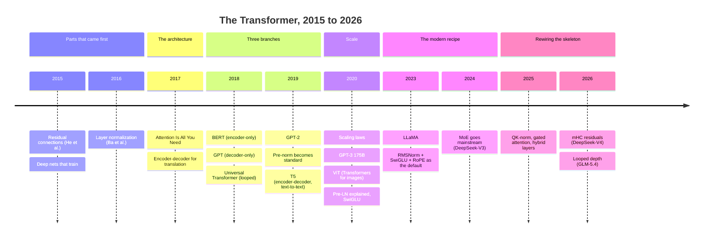
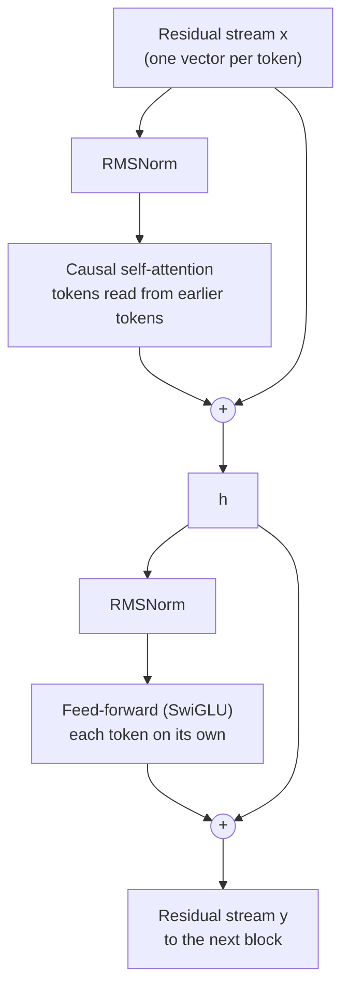

---
tags:
  - ai-ml
  - architectures
  - transformer
status: draft
sources:
  - https://arxiv.org/abs/1706.03762
  - https://arxiv.org/abs/1512.03385
  - https://arxiv.org/abs/1607.06450
  - https://arxiv.org/abs/1807.03819
  - https://arxiv.org/abs/1810.04805
  - https://cdn.openai.com/better-language-models/language_models_are_unsupervised_multitask_learners.pdf
  - https://arxiv.org/abs/1910.07467
  - https://arxiv.org/abs/1910.10683
  - https://arxiv.org/abs/2001.08361
  - https://arxiv.org/abs/2002.04745
  - https://arxiv.org/abs/2002.05202
  - https://arxiv.org/abs/2005.14165
  - https://arxiv.org/abs/2010.11929
  - https://arxiv.org/abs/2104.09864
  - https://arxiv.org/abs/2302.13971
  - https://arxiv.org/abs/2512.24880
  - https://transformer-circuits.pub/2021/framework/index.html
  - https://magazine.sebastianraschka.com/p/the-big-llm-architecture-comparison
  - https://magazine.sebastianraschka.com/p/a-dream-of-spring-for-open-weight
  - https://sebastianraschka.com/blog/2026/gemma-4-release-notes.html
  - https://huggingface.co/blog/deepseekv4
  - https://agentspulse.github.io/tutorials/glm-5-4-loop-transformer/
  - https://jalammar.github.io/illustrated-transformer/
  - https://nlp.seas.harvard.edu/annotated-transformer/
created: 2026-11-25
updated: 2026-11-25
---

## Table Of Contents

---

- [[#TL;DR|TL;DR]]
- [[#The Problem|The Problem]]
- [[#Foundations|Foundations]]
    - [[#Embeddings and the Residual Stream|Embeddings and the Residual Stream]]
    - [[#Residual Connections|Residual Connections]]
    - [[#Layer Normalization|Layer Normalization]]
    - [[#Feed-Forward Networks|Feed-Forward Networks]]
- [[#How We Got Here|How We Got Here]]
- [[#How It Works|How It Works]]
    - [[#The Original Encoder-Decoder|The Original Encoder-Decoder]]
    - [[#One Block, Step by Step|One Block, Step by Step]]
    - [[#The Block as an Equation|The Block as an Equation]]
    - [[#Encoder-Only, Decoder-Only, Encoder-Decoder|Encoder-Only, Decoder-Only, Encoder-Decoder]]
    - [[#Where the Parameters and FLOPs Go|Where the Parameters and FLOPs Go]]
    - [[#How It Is Trained|How It Is Trained]]
- [[#Where It Is Now|Where It Is Now]]
    - [[#The 2017 Block vs the 2026 Block|The 2017 Block vs the 2026 Block]]
    - [[#Feed-Forward Becomes Mixture of Experts|Feed-Forward Becomes Mixture of Experts]]
    - [[#Rewiring the Residual Stream|Rewiring the Residual Stream]]
    - [[#Reusing Depth (Looped Transformers)|Reusing Depth (Looped Transformers)]]
    - [[#Model Snapshot, Late 2026|Model Snapshot, Late 2026]]
- [[#Trade-offs & Open Problems|Trade-offs & Open Problems]]
- [[#Resources|Resources]]
- [[#Related Notes|Related Notes]]

## ***TL;DR***
---
*A Transformer is a stack of identical blocks, each one an [[Attention]] layer (tokens read from each other) followed by a feed-forward layer (each token thinks on its own), wrapped in residual connections and normalization. Nearly every frontier language, vision and audio model in 2026 is still this design with upgraded parts.*

- **What it is:** a neural network that turns a sequence of token vectors into a sequence of better token vectors, one block at a time. The last layer predicts the next token.
- **The block:** $h = x + \text{Attn}(\text{Norm}(x))$, then $y = h + \text{FFN}(\text{Norm}(h))$. Attention mixes information *across* positions; the FFN transforms each position *independently*; the "$x +$" residual keeps a running sum that every layer reads from and adds to.
- **Why it won:** no recurrence, so a whole sequence trains in parallel on GPUs, and any token reaches any other in one step. It beat the best translation systems in 2017 at a fraction of their training cost ([Vaswani et al., 2017](https://arxiv.org/abs/1706.03762)), then scaled predictably with more data and compute ([Kaplan et al., 2020](https://arxiv.org/abs/2001.08361)).
- **Where it is now (Nov 2026):** the skeleton is unchanged since GPT-2 ([Raschka, 2025 to 2026](https://magazine.sebastianraschka.com/p/the-big-llm-architecture-comparison)). What changed: RMSNorm placed before (and sometimes after) each sub-layer, SwiGLU feed-forwards, RoPE positions, cheaper [[Attention]], and the FFN replaced by [[Mixture of Experts]]. The newest experiments touch the skeleton itself: DeepSeek-V4 widened the [[Residual Stream and Normalization|residual stream]] (mHC) and Z.ai's GLM-5.4 runs part of its stack twice (a [[Looped Transformers|looped Transformer]]).

## ***The Problem***
---
*By 2017 the best sequence models were recurrent networks with attention bolted on, and recurrence meant they could not use GPU parallelism or learn long-range links easily. The Transformer asked whether attention alone, plus a few simple parts, was enough.*

[[Attention]] had already fixed the information bottleneck of encoder-decoder RNNs. But the RNN underneath remained, and with it two costs:

| Limitation of RNN + attention | Why it hurt | What the Transformer did |
|---|---|---|
| Sequential computation | Token $t$ waits for token $t-1$, so a GPU sits mostly idle during training. | Self-attention computes every position at once; training is a handful of large matrix multiplies. |
| Long paths between tokens | Signals between distant words pass through many recurrent steps and fade. | Every token is one attention step from every other. |
| Training cost | Top 2016 to 2017 translation systems needed large ensembles and weeks of compute. | The big Transformer reached a new state of the art in 3.5 days on 8 GPUs ([Vaswani et al., 2017](https://arxiv.org/abs/1706.03762)). |

But attention alone is not a model. It only takes weighted averages, which are linear in the values, and it has no idea of word order. The Transformer had to add parts that supply non-linearity, order, depth and stable training. Those parts are what this note is about; attention itself is covered in [[Attention]].

## ***Foundations***
---
*Four ingredients besides attention make a Transformer work: embeddings put tokens into vectors, residual connections let a deep stack train, normalization keeps numbers in range, and a feed-forward network adds per-token computation. Each one predates the Transformer.*

#### **Embeddings and the Residual Stream**
Text is split into tokens (word pieces), and each token ID is looked up in an embedding table to get a vector of width $d_{model}$ (512 in the original, 4,096 to 8,192 in large 2026 models). Attention has no notion of order, so position information is added, originally with fixed sine waves and today usually with rotary embeddings that rotate queries and keys (see [[Positional Encoding]]) ([Su et al., 2021](https://arxiv.org/abs/2104.09864)).

From there on, each token's vector is best pictured as a **residual stream**: a running scratchpad that every layer reads from and writes back into by addition. Anthropic's interpretability team popularized this view; it explains why layers can be added, removed or analyzed somewhat independently ([Elhage et al., 2021](https://transformer-circuits.pub/2021/framework/index.html)).

#### **Residual Connections**
A residual (skip) connection computes $y = x + F(x)$ instead of $y = F(x)$. The layer only has to learn a *change* to its input. If a layer is useless it can learn $F(x) \approx 0$ and pass $x$ through untouched, and gradients flow straight back through the "$x +$" path. ResNets introduced this in 2015 to train image networks over 100 layers deep ([He et al., 2015](https://arxiv.org/abs/1512.03385)). Without it, a 60 to 100 layer Transformer would not train.

#### **Layer Normalization**
As vectors pass through many layers their scale drifts, which destabilizes training. LayerNorm rescales each token's vector to mean 0 and variance 1, then applies a learned gain and bias ([Ba et al., 2016](https://arxiv.org/abs/1607.06450)):

$$
\text{LayerNorm}(x) = \gamma \odot \frac{x - \mu}{\sqrt{\sigma^2 + \epsilon}} + \beta
\qquad
\text{RMSNorm}(x) = \gamma \odot \frac{x}{\sqrt{\tfrac{1}{d}\sum_i x_i^2 + \epsilon}}
$$

*In plain English: LayerNorm subtracts the vector's average and divides by its spread. RMSNorm skips the subtraction and the bias and just divides by the root-mean-square size. It is cheaper and works as well, which is why nearly every 2026 model uses it* ([Zhang & Sennrich, 2019](https://arxiv.org/abs/1910.07467)).

Example: $x = [3, 4]$. RMS $= \sqrt{(9+16)/2} \approx 3.54$, so RMSNorm gives $\approx [0.85, 1.13]$ (before the gain $\gamma$).

#### **Feed-Forward Networks**
A feed-forward network (FFN, also "MLP") is two linear layers with a non-linearity between them, applied to each token separately. The original used a ReLU and an inner width 4x the model width ([Vaswani et al., 2017](https://arxiv.org/abs/1706.03762)):

$$
\text{FFN}(x) = \max(0,\, xW_1 + b_1)\,W_2 + b_2
\qquad
\text{SwiGLU}(x) = \big(\text{Swish}(xW_1) \odot xV\big)\,W_2
$$

*In plain English: blow the vector up to a wider space, switch off the parts that don't fire, and project back down. SwiGLU adds a second projection $xV$ that acts as a learned gate, multiplying each hidden unit by how much it should pass through. It trains to lower loss at the same compute* ([Shazeer, 2020](https://arxiv.org/abs/2002.05202)).

Attention moves information between tokens; the FFN is where most of the parameters, and most of the stored "knowledge", live (two-thirds of a standard block's weights; see [[#Where the Parameters and FLOPs Go|below]]).

## ***How We Got Here***
---
*The Transformer appeared in 2017 as a translation model, split into encoder-only (BERT) and decoder-only (GPT) branches in 2018, and the decoder-only branch won once [[Scaling Laws|scaling laws]] showed bigger was predictably better. Since 2020 the work has been swapping better parts into the same skeleton.*

| Year | Step | What it fixed or enabled | Source |
|---|---|---|---|
| 2017 | Transformer: attention + FFN blocks, residuals, post-norm, sinusoidal positions, encoder-decoder. | Parallel training; state of the art in translation. | [Vaswani et al.](https://arxiv.org/abs/1706.03762) |
| 2018 | BERT: encoder only, trained to fill in masked words, then fine-tuned. | One pre-trained model for many understanding tasks. | [Devlin et al.](https://arxiv.org/abs/1810.04805) |
| 2018 | Universal Transformer: the same block applied repeatedly with shared weights. | Depth without extra parameters; the ancestor of looped models. | [Dehghani et al.](https://arxiv.org/abs/1807.03819) |
| 2019 | GPT-2: decoder only, next-token prediction, LayerNorm moved to the input of each sub-block (pre-norm). | Zero-shot ability from scale alone; stable deep stacks. | [Radford et al.](https://cdn.openai.com/better-language-models/language_models_are_unsupervised_multitask_learners.pdf) |
| 2019 | T5: every task as text-to-text with an encoder-decoder. | A clean comparison of architectures and objectives. | [Raffel et al.](https://arxiv.org/abs/1910.10683) |
| 2020 | Scaling laws: loss falls as a power law in parameters, data and compute. | A reason to build much bigger models (see [[Scaling Laws]]). | [Kaplan et al.](https://arxiv.org/abs/2001.08361) |
| 2020 | GPT-3: 175B parameters, in-context learning. | Prompting instead of fine-tuning. | [Brown et al.](https://arxiv.org/abs/2005.14165) |
| 2020 | Pre-LN analysis: post-norm puts large gradients near the output, so it needs warmup; pre-norm doesn't. | Explained why pre-norm trains more easily. | [Xiong et al.](https://arxiv.org/abs/2002.04745) |
| 2020 | ViT: cut an image into patches and treat them as tokens. | Transformers took over vision too. | [Dosovitskiy et al.](https://arxiv.org/abs/2010.11929) |
| 2023 | LLaMA: pre-norm RMSNorm, SwiGLU, RoPE. | The recipe nearly every open model copied. | [Touvron et al.](https://arxiv.org/abs/2302.13971) |
| 2024 to 2026 | MoE FFNs, GQA/MLA/sparse attention, QK-norm, new residual wiring, looping. | Cheaper serving and more capacity per FLOP (see [[#Where It Is Now\|Where It Is Now]]). | [Raschka](https://magazine.sebastianraschka.com/p/the-big-llm-architecture-comparison) |

Why decoder-only won for language models: one stack, one objective (predict the next token), every token in every document is a training signal, and the same model can both read a prompt and write a continuation. Encoders still win where you need a fixed embedding of a whole input (search, classification), and encoder-decoders survive in translation and some speech and multimodal systems.

## ***How It Works***
---
*A Transformer embeds tokens, pushes them through $L$ identical blocks that each add an attention update and an FFN update to the residual stream, then reads out a probability for every possible next token. Everything else is a variation on where blocks are placed and what they can see.*

#### **The Original Encoder-Decoder**
The 2017 model had two stacks of $N = 6$ blocks ([Vaswani et al., 2017](https://arxiv.org/abs/1706.03762)):

- **Encoder:** reads the source sentence. Each block is self-attention (every word sees every word) then an FFN.
- **Decoder:** writes the translation one token at a time. Each block is *causal* self-attention (a word sees only earlier words), then cross-attention (it reads the encoder's output), then an FFN.

| | Base model | Big model |
|---|---|---|
| Layers per stack | 6 | 6 |
| $d_{model}$ / FFN width / heads | 512 / 2,048 / 8 | 1,024 / 4,096 / 16 |
| Parameters | 65M | 213M |
| Training | 12 hours on 8 P100s | 3.5 days on 8 P100s |
| WMT14 English-German BLEU | 27.3 | 28.4 (best ever at the time, by over 2 BLEU) |
| WMT14 English-French BLEU | 38.1 | 41.8 |

*Source: Tables 2 and 3 of [Vaswani et al., 2017](https://arxiv.org/abs/1706.03762).*

#### **One Block, Step by Step**
A modern decoder-only block (the GPT-2 and LLaMA shape) looks like this:

The full model:

1. **Embed:** token IDs → vectors of width $d_{model}$.
2. **Repeat $L$ times:** the block above. Each block keeps the shape: $n$ tokens in, $n$ tokens out.
3. **Final norm and unembed:** a last RMSNorm, then multiply by a $d_{model} \times V$ matrix to get one score (logit) per vocabulary word. The original shared this matrix with the input embedding (weight tying) ([Vaswani et al., 2017](https://arxiv.org/abs/1706.03762)).
4. **Softmax:** logits → probability of each possible next token.

#### **The Block as an Equation**
The 2017 paper normalized *after* adding the residual (post-norm). Since GPT-2, most models normalize the sub-layer's *input* (pre-norm):

$$
\underbrace{x_{l+1} = \text{Norm}\big(x_l + F(x_l)\big)}_{\text{post-norm (2017)}}
\qquad\qquad
\underbrace{x_{l+1} = x_l + F\big(\text{Norm}(x_l)\big)}_{\text{pre-norm (GPT-2 onward)}}
$$

*In plain English: post-norm squashes the running sum after every layer, so the clean "$x +$" highway is interrupted. Pre-norm only normalizes a copy that goes into the layer; the residual stream itself is a pure sum of every layer's output. That keeps gradients well behaved at the start of training, so pre-norm models can skip the learning-rate warmup post-norm needs* ([Xiong et al., 2020](https://arxiv.org/abs/2002.04745)).

Unrolling pre-norm over all layers shows the residual-stream picture directly:

$$
x_L = x_0 + \sum_{l=0}^{L-1} F_l\big(\text{Norm}(x_l)\big)
$$

*The final vector is the embedding plus every layer's contribution added up.*

#### **Encoder-Only, Decoder-Only, Encoder-Decoder**

| Type | Attention mask | Trained to | Good at | Examples |
|---|---|---|---|---|
| Encoder-only | None (bidirectional) | Fill in masked tokens | Embeddings, classification, retrieval | BERT |
| Decoder-only | Causal | Predict the next token | Generation, chat, reasoning, code | GPT series, LLaMA, Qwen, DeepSeek, Gemma |
| Encoder-decoder | Encoder bidirectional; decoder causal + cross-attention | Map input text to output text | Translation, some speech and multimodal | Original Transformer, T5 |

*Sources: [Devlin et al.](https://arxiv.org/abs/1810.04805), [Radford et al.](https://cdn.openai.com/better-language-models/language_models_are_unsupervised_multitask_learners.pdf), [Raffel et al.](https://arxiv.org/abs/1910.10683).*

#### **Where the Parameters and FLOPs Go**
For a classic block with width $d$ and FFN width $4d$:

| Part | Weight matrices | Parameters |
|---|---|---|
| Attention | $W^Q, W^K, W^V, W^O$, each $d \times d$ | $4d^2$ |
| FFN | $W_1$ ($d \times 4d$), $W_2$ ($4d \times d$) | $8d^2$ |
| Norms, biases | vectors | $\approx 0$ |
| **Per block** | | $\approx 12d^2$ |

$$
N_{\text{non-embedding}} \approx 12\, L\, d^2
\qquad\qquad
\text{training FLOPs} \approx 6\, N\, D
$$

*In plain English: parameters grow with depth times width squared, and training costs about 6 floating-point operations per parameter per training token $D$ (2 for the forward pass, 4 for the backward pass), ignoring the attention-score term, which matters only at [[Long Context|long context]]. See [[Scaling Laws]] for how budgets are split between $N$ and $D$* ([Kaplan et al., 2020](https://arxiv.org/abs/2001.08361)).

**Worked example (GPT-2 small):** $L = 12$, $d = 768$, vocabulary 50,257.
- Blocks: $12 \times 12 \times 768^2 \approx 85\text{M}$.
- Embedding table: $50{,}257 \times 768 \approx 39\text{M}$.
- Total $\approx 124\text{M}$, matching the released size.

The same formula gives GPT-3 ($L = 96$, $d = 12{,}288$): $12 \times 96 \times 12{,}288^2 \approx 174\text{B}$, close to its stated 175B ([Brown et al., 2020](https://arxiv.org/abs/2005.14165)). Two-thirds of the weights are FFN, which is why the FFN was the first thing replaced when models needed more capacity (see [[#Feed-Forward Becomes Mixture of Experts|Mixture of Experts]]).

During generation the cost profile flips: each new token reuses cached keys and values, and speed is limited by reading weights and the [[KV Cache]] from memory, not by arithmetic (see [[7 - All About Transformer Inference (NOT DONE)|Transformer Inference]] and [[1 - All About Rooflines (NOT DONE)|Rooflines]]).

#### **How It Is Trained**
A decoder-only Transformer is trained on next-token prediction: for every position, the loss is the negative log-probability it assigned to the token that actually came next. The causal mask lets one forward pass produce a prediction at every position at once, so a 4,096-token document gives 4,096 training examples in a single parallel step.

Training details from the original that still matter ([Vaswani et al., 2017](https://arxiv.org/abs/1706.03762)):
- **Adam** [[Optimizers|optimizer]] ($\beta_2 = 0.98$) with a learning rate that rises linearly for 4,000 warmup steps, then decays.
- **Dropout** 0.1 and **label smoothing** 0.1 (frontier pre-training today usually drops dropout, since it sees each token about once).
- **Embeddings scaled** by $\sqrt{d_{model}}$ and **tied** with the output layer.

Spreading training over thousands of chips is its own subject (see [[Distributed Training]]).

## ***Where It Is Now***
---
*As of November 2026 the Transformer is still the backbone of every frontier model, and its block has changed less than the release pace suggests. The real changes are part swaps (norms, FFN, attention, positions) and, newest, rewiring the residual stream and reusing layers.*

Sebastian Raschka, comparing dozens of open models from GPT-2 through 2026, concludes they are "still variants of the original GPT design" and that output quality now depends more on data and training recipes than on block design ([Raschka, Jan to Feb 2026 models](https://magazine.sebastianraschka.com/p/a-dream-of-spring-for-open-weight)). Closed labs don't publish architectures, so everything below is from open-weight models.

#### **The 2017 Block vs the 2026 Block**

| Part | 2017 Transformer | Typical 2026 open model | Why it changed |
|---|---|---|---|
| Layout | Encoder-decoder | Decoder-only | One objective, generation and reading in one model |
| Norm type | LayerNorm | RMSNorm | Cheaper, same quality ([Zhang & Sennrich](https://arxiv.org/abs/1910.07467)) |
| Norm placement | Post-norm | Pre-norm; Gemma 3 and 4 use pre *and* post; OLMo 2 went back to a post-norm variant | Training stability ([Xiong et al.](https://arxiv.org/abs/2002.04745), [Raschka](https://magazine.sebastianraschka.com/p/the-big-llm-architecture-comparison)) |
| Query/key norm | None | QK-Norm (RMSNorm on queries and keys) in OLMo 2, Gemma 3/4, Qwen3, Arcee Trinity | Stops attention logits blowing up |
| Positions | Sinusoidal, added once | RoPE in attention; some layers NoPE (none); partial RoPE | Better length handling (see [[Positional Encoding]]) |
| Attention | Full multi-head | GQA, MLA, sliding window, sparse, or linear hybrids | KV cache and long-context cost (see [[Attention]]) |
| FFN | ReLU, dense | SwiGLU, usually [[Mixture of Experts]] | More capacity per FLOP ([Shazeer](https://arxiv.org/abs/2002.05202)) |
| Output | One next token | Often multi-token prediction heads | Better training signal, faster decoding (see [[Speculative Decoding]]) |

*Sources: [Raschka, The Big LLM Architecture Comparison (updated Apr 2026)](https://magazine.sebastianraschka.com/p/the-big-llm-architecture-comparison), [Raschka, Jan to Feb 2026 models](https://magazine.sebastianraschka.com/p/a-dream-of-spring-for-open-weight), [Gemma 4 notes](https://sebastianraschka.com/blog/2026/gemma-4-release-notes.html).*

#### **Feed-Forward Becomes Mixture of Experts**
Since the FFN holds two-thirds of the weights, the biggest 2024 to 2026 change was replacing it with many smaller FFNs ("experts") and a router that sends each token to a few of them. Total parameters grow; parameters used per token don't.

| Model | Date | Total / active parameters | Experts |
|---|---|---|---|
| Gemma 4 26B-A4B | Apr 2026 | 25.2B / 3.8B | 8 of 128 routed + 1 shared |
| Qwen3.5-397B-A17B | Feb 2026 | 397B / 17B | not given in source |
| GLM-5 | Feb 2026 | 744B / 40B | 256 |
| DeepSeek-V4-Pro | Apr 2026 | 1.6T / 49B | DeepSeekMoE |
| DeepSeek-V4-Flash | Apr 2026 | 284B / 13B | DeepSeekMoE |

*Sources: [Gemma 4 notes](https://sebastianraschka.com/blog/2026/gemma-4-release-notes.html), [Raschka, Jan to Feb 2026](https://magazine.sebastianraschka.com/p/a-dream-of-spring-for-open-weight), [DeepSeek-V4 on Hugging Face](https://huggingface.co/blog/deepseekv4). Routing, load balancing and expert parallelism belong in [[Mixture of Experts]].*

Dense models still exist where simplicity and memory matter (Gemma 4 31B, small 3B models).

#### **Rewiring the Residual Stream**
For eight years the "$x +$" path was untouched. Two 2026 changes modify it:

- **Manifold-constrained hyper-connections (mHC), DeepSeek, Dec 2025; used in DeepSeek-V4 (Apr 2026).** Hyper-connections widen the residual stream from one vector to $n$ parallel streams ($n = 4$) with learned matrices that mix them between layers. Unconstrained, that mixing amplified signals up to ~3,000x across depth and caused loss spikes at 27B scale. mHC forces the mixing matrix to be doubly stochastic (non-negative, rows and columns summing to 1, enforced with Sinkhorn-Knopp iterations), which cannot amplify. Result: max gain ~1.6, lower loss than the baseline at 3B, 9B and 27B, for 6.7% extra training time ([Xie et al., arXiv 2512.24880](https://arxiv.org/abs/2512.24880)). DeepSeek-V4 replaces standard residuals with mHC ([Hugging Face, Apr 2026](https://huggingface.co/blog/deepseekv4)).
- **Parallel blocks.** Cohere's Tiny Aya (Feb 2026) computes attention and FFN from the same normalized input and adds both at once, instead of one after the other ([Raschka](https://magazine.sebastianraschka.com/p/a-dream-of-spring-for-open-weight)).

#### **Reusing Depth (Looped Transformers)**
A looped Transformer runs some of its blocks more than once per token with the same weights, buying more computation without more parameters. The idea goes back to the Universal Transformer ([Dehghani et al., 2018](https://arxiv.org/abs/1807.03819)).

On Nov 23, 2026, Z.ai announced **GLM-5.4**, which it calls its first loop-Transformer flagship. As reported from Z.ai's announcement ([AgentsPulse summary, Nov 2026](https://agentspulse.github.io/tutorials/glm-5-4-loop-transformer/)):
- Built by continued training of the GLM-5 base (78 layers, ~750B parameters), not from scratch.
- Layers 1 to 26 run once, layers 27 to 54 run **twice**, layers 55 to 78 run once: 106 layer passes per token, zero added parameters.
- Gates control how much each pass writes to the residual stream; the second pass reuses the first pass's sparse-attention indices and KV cache plus a 128-token window.
- In a 30B same-size ablation, looping raised AIME25 from 19.2 to 30.4 and GPQA-Diamond from 47.6 to 56.3 for ~10% more training compute.
- Weights and the public API were not yet released, and the claim of matching 2T to 3T parameter models has no stated method.

*This is one day old and comes from a secondary summary of Z.ai's post; treat the numbers as Z.ai's claims until the weights or a paper are out.*

#### **Model Snapshot, Late 2026**

| Model | Date | Block changes beyond the LLaMA recipe |
|---|---|---|
| Qwen3.5-397B-A17B | Feb 2026 | 3:1 Gated DeltaNet : [[Attention Sinks and Gated Attention\|gated attention]] hybrid, MoE, multimodal |
| GLM-5 | Feb 2026 | MLA + DeepSeek [[Sparse Attention]]; layers cut 92 → 78 for latency |
| Cohere Tiny Aya | Feb 2026 | Parallel attention + FFN, no QK-Norm, dense 3.35B |
| Gemma 4 31B / 26B-A4B | Apr 2026 | 5:1 sliding-window : global, pre+post RMSNorm, QK-Norm, 256K context, MTP drafter |
| DeepSeek-V4-Pro / Flash | Apr 2026 | CSA/HCA compressed attention, mHC residuals, MoE, 1M context |
| GLM-5.4 | Nov 2026 | Looped middle 28 layers (reported) |

*Sources: [Raschka, Jan to Feb 2026](https://magazine.sebastianraschka.com/p/a-dream-of-spring-for-open-weight), [Gemma 4 notes](https://sebastianraschka.com/blog/2026/gemma-4-release-notes.html), [DeepSeek-V4](https://huggingface.co/blog/deepseekv4), [AgentsPulse on GLM-5.4](https://agentspulse.github.io/tutorials/glm-5-4-loop-transformer/). Attention designs per model are in [[Attention#Who Uses What|Attention]].*

## ***Trade-offs & Open Problems***
---
*The Transformer's strengths (full pairwise attention, parallel training, simple repeated blocks) come with costs that grow with context length and model size. Most open problems are about paying less for those strengths without losing them.*

| Design choice | What it buys | What it costs |
|---|---|---|
| Full attention in every block | Exact recall of any earlier token | $O(n^2)$ prefill, a [[KV Cache]] that grows per token |
| Pre-norm | Stable training, no warmup needed | Later layers' contributions can shrink relative to the growing stream; models add post-norms or gain scaling to compensate |
| Dense FFN | Simple, every parameter used | Capacity tied to per-token compute |
| MoE FFN | More capacity at the same per-token compute | Memory for all experts, routing imbalance, harder [[Distributed Training]] |
| Deep stacks | Better quality per parameter (Qwen3 went deep) | Higher latency; GLM-5 cut layers for speed |
| Looping | More compute per token, no new weights | More latency per token; benefits still largely self-reported |

Open problems worth tracking:
- **Is the Transformer the endgame?** Linear-time layers ([[State Space Models]], Gated DeltaNet) now fill most layers of some models, but every 2026 frontier hybrid still keeps some full attention layers (see [[Hybrid Attention]]).
- **Residual stream design.** mHC is the first residual change adopted at frontier scale; whether others follow is open ([Xie et al.](https://arxiv.org/abs/2512.24880)).
- **Compute per token.** Looping and [[Reasoning Models]] both spend more compute per answer; it is not yet clear which mix of deeper passes and longer reasoning is most efficient.
- **What architecture still matters.** If data and recipes dominate, as Raschka argues, block changes will mostly be judged by serving cost rather than quality ([Raschka](https://magazine.sebastianraschka.com/p/a-dream-of-spring-for-open-weight)).

## ***Resources***
---
*Papers for facts, explainers for intuition. Read Alammar first, then the Annotated Transformer alongside the original paper, then Raschka for what changed since.*

**Primary papers**
- [Attention Is All You Need](https://arxiv.org/abs/1706.03762): Vaswani et al., Jun 2017. The architecture.
- [Deep Residual Learning](https://arxiv.org/abs/1512.03385): He et al., Dec 2015. Residual connections.
- [Layer Normalization](https://arxiv.org/abs/1607.06450): Ba, Kiros, Hinton, Jul 2016.
- [Universal Transformers](https://arxiv.org/abs/1807.03819): Dehghani et al., Jul 2018. Weight-shared, looped depth.
- [BERT](https://arxiv.org/abs/1810.04805): Devlin et al., Oct 2018.
- [Language Models are Unsupervised Multitask Learners (GPT-2)](https://cdn.openai.com/better-language-models/language_models_are_unsupervised_multitask_learners.pdf): Radford et al., Feb 2019.
- [Root Mean Square Layer Normalization](https://arxiv.org/abs/1910.07467): Zhang & Sennrich, Oct 2019.
- [T5](https://arxiv.org/abs/1910.10683): Raffel et al., Oct 2019.
- [Scaling Laws for Neural Language Models](https://arxiv.org/abs/2001.08361): Kaplan et al., Jan 2020.
- [On Layer Normalization in the Transformer Architecture](https://arxiv.org/abs/2002.04745): Xiong et al., Feb 2020. Pre-norm vs post-norm.
- [GLU Variants Improve Transformer](https://arxiv.org/abs/2002.05202): Shazeer, Feb 2020. SwiGLU.
- [GPT-3](https://arxiv.org/abs/2005.14165): Brown et al., May 2020.
- [An Image is Worth 16x16 Words (ViT)](https://arxiv.org/abs/2010.11929): Dosovitskiy et al., Oct 2020.
- [RoFormer (RoPE)](https://arxiv.org/abs/2104.09864): Su et al., Apr 2021.
- [LLaMA](https://arxiv.org/abs/2302.13971): Touvron et al., Feb 2023.
- [mHC: Manifold-Constrained Hyper-Connections](https://arxiv.org/abs/2512.24880): DeepSeek-AI, Dec 2025.
- [DeepSeek-V4 explainer](https://huggingface.co/blog/deepseekv4): Hugging Face, Apr 2026.

**Explainers and analysis**
- [The Illustrated Transformer](https://jalammar.github.io/illustrated-transformer/): Jay Alammar. Best visual first read.
- [The Annotated Transformer](https://nlp.seas.harvard.edu/annotated-transformer/): Harvard NLP. The paper, line by line, as runnable code.
- [A Mathematical Framework for Transformer Circuits](https://transformer-circuits.pub/2021/framework/index.html): Elhage et al. (Anthropic), Dec 2021. The residual stream view.
- [The Big LLM Architecture Comparison](https://magazine.sebastianraschka.com/p/the-big-llm-architecture-comparison): Sebastian Raschka, updated Apr 2026.
- [A Dream of Spring for Open-Weight LLMs](https://magazine.sebastianraschka.com/p/a-dream-of-spring-for-open-weight): Raschka, 2026. Ten Jan to Feb 2026 architectures.
- [Gemma 4 Architecture and Benchmark Notes](https://sebastianraschka.com/blog/2026/gemma-4-release-notes.html): Raschka, Apr 2026.
- [GLM-5.4 Loop Transformer: Architecture, Benchmarks, Limits](https://agentspulse.github.io/tutorials/glm-5-4-loop-transformer/): AgentsPulse, Nov 2026. Secondary summary of Z.ai's announcement.

## Related Notes

- [[Attention]] — The operation at the heart of every block; covers scaled dot-product, multi-head, and the 2026 attention variants.
- [[Positional Encoding]] — How a Transformer knows token order: sinusoidal, RoPE, and context extension.
- [[KV Cache]] — Why causal decoding can reuse past keys and values, and what that costs.
- [[FlashAttention]] — The kernel that makes attention inside each block fast on real GPUs.
- [[Mixture of Experts]] — What replaced the dense feed-forward layer in most 2026 frontier models.
- [[Scaling Laws]] — Why bigger Transformers became predictably better, and the $6ND$ compute rule.
- [[Hybrid Attention]] — Models that keep the Transformer skeleton but swap most attention layers for linear-time ones.
- [[State Space Models]] — The main non-attention alternative for sequence mixing.
- [[Distributed Training]] — How Transformers are split across thousands of chips.
- [[7 - All About Transformer Inference (NOT DONE)|7 - All About Transformer Inference (NOT DONE)]] — Prefill vs generation for a Transformer, from How to Scale Your Model.
- [[1 - All About Rooflines (NOT DONE)|1 - All About Rooflines (NOT DONE)]] — Why Transformer decoding is memory-bound.
