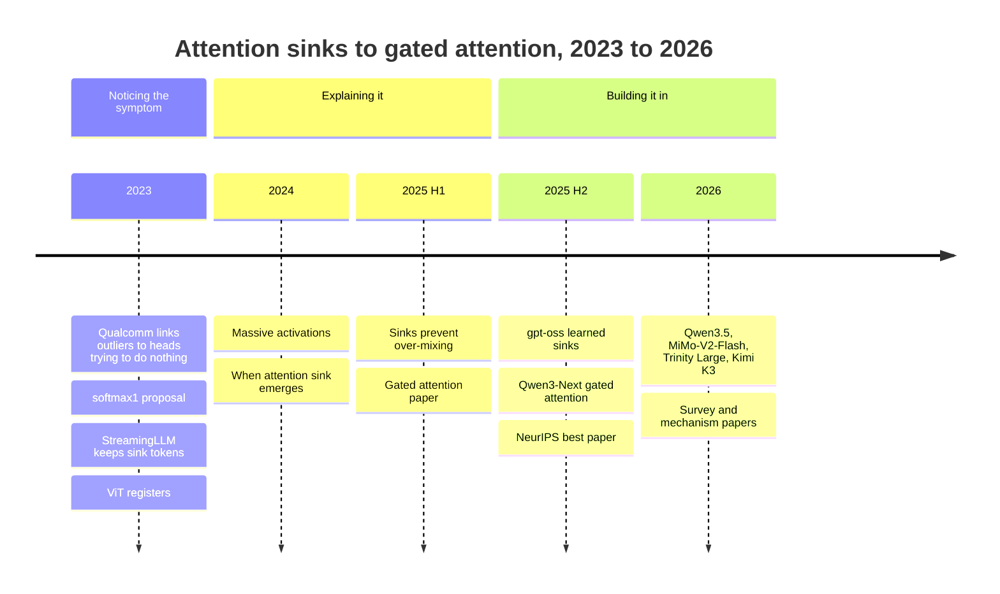
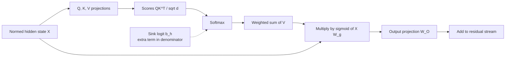

---
tags:
  - ai-ml
  - foundations
  - attention
  - attention-sinks
  - gated-attention
status: draft
sources:
  - https://arxiv.org/abs/2306.12929
  - https://www.evanmiller.org/attention-is-off-by-one.html
  - https://arxiv.org/abs/2309.17453
  - https://arxiv.org/html/2309.17453
  - https://hanlab.mit.edu/blog/streamingllm
  - https://arxiv.org/abs/2309.16588
  - https://arxiv.org/abs/2402.17762
  - https://arxiv.org/abs/2410.10781
  - https://arxiv.org/abs/2504.02732
  - https://arxiv.org/html/2504.02732v4
  - https://arxiv.org/abs/2504.20966
  - https://arxiv.org/abs/2505.06708
  - https://arxiv.org/html/2505.06708
  - https://proceedings.neurips.cc/paper_files/paper/2025/hash/904e89bb4e632e75fb47f093b620b257-Abstract-Conference.html
  - https://www.alibabacloud.com/blog/alibaba-qwen-wins-%E2%80%9Cneurips-2025-best-paper-award%E2%80%9D-for-breakthrough-in-attention-mechanisms_602708
  - https://github.com/qiuzh20/gated_attention
  - https://finisky.github.io/en/gated-attention/
  - https://arxiviq.substack.com/p/neurips-2025-gated-attention-for
  - https://arxiv.org/abs/2508.10925
  - https://www.alibabacloud.com/blog/qwen3-next-towards-ultimate-training-%26-inference-efficiency_602580
  - https://huggingface.co/blog/mlabonne/qwen35
  - https://sebastianraschka.com/llm-architecture-gallery/gated-attention/
  - https://arxiv.org/abs/2601.02780
  - https://arxiv.org/abs/2602.17004
  - https://sebastianraschka.com/blog/2026/kimi-k3-architecture-notes.html
  - https://sebastianraschka.com/llm-architecture-gallery/models/kimi-k3/
  - https://sandai-org.github.io/MagiAttention/blog/ffa_with_sink
  - https://arxiv.org/abs/2606.06521
  - https://arxiv.org/abs/2602.01203
  - https://arxiv.org/abs/2603.05498
  - https://arxiv.org/abs/2604.10098
  - https://arxiv.org/abs/2609.08574
  - https://arxiv.org/abs/2611.20403
created: 2026-11-26
updated: 2026-11-26
---

## Table Of Contents

---

- [[#TL;DR|TL;DR]]
- [[#The Problem|The Problem]]
- [[#Foundations|Foundations]]
    - [[#Softmax Must Spend All Its Weight|Softmax Must Spend All Its Weight]]
    - [[#What Doing Nothing Means for a Head|What Doing Nothing Means for a Head]]
    - [[#Why the First Token|Why the First Token]]
    - [[#Massive Activations|Massive Activations]]
- [[#How We Got Here|How We Got Here]]
- [[#How It Works|How It Works]]
    - [[#The Vanilla Sink|The Vanilla Sink]]
    - [[#The Sink Logit|The Sink Logit]]
    - [[#A Worked Example|A Worked Example]]
    - [[#The Output Gate|The Output Gate]]
    - [[#Why the Gate Does More Than Remove Sinks|Why the Gate Does More Than Remove Sinks]]
    - [[#Putting a Sink in a Kernel|Putting a Sink in a Kernel]]
- [[#Where It Is Now|Where It Is Now]]
    - [[#Who Ships What|Who Ships What]]
    - [[#Consequences for Serving|Consequences for Serving]]
    - [[#2026 Research|2026 Research]]
- [[#Trade-offs & Open Problems|Trade-offs & Open Problems]]
- [[#Resources|Resources]]
- [[#Related Notes|Related Notes]]

## ***TL;DR***
---
*Softmax forces every [[Attention]] head to hand out exactly 100% of its weight, even when nothing in the context is worth reading. Trained models solve this by dumping the spare weight on one token, usually the first, which becomes an "attention sink". Since 2025 frontier models stop fighting this with a learned escape hatch: an extra sink logit in the softmax, or a sigmoid gate on the attention output.*

- **What it is:** an attention sink is a token (almost always the first one, or BOS) that draws a large share of attention whatever its content. In Llama 3.1 405B almost 80% of attention on a typical prompt lands on BOS ([Barbero et al., 2025](https://arxiv.org/abs/2504.02732)).
- **Why it matters:** sinks come with huge outlier activations that break [[Quantization]], and evicting the sink from the [[KV Cache]] makes sliding-window decoding collapse ([Xiao et al., 2023](https://arxiv.org/abs/2309.17453)).
- **The two fixes:** a **sink logit** adds one learned number per head to the softmax denominator so weights can sum to less than 1 (gpt-oss); an **output gate** multiplies the attention output by $\sigma(XW_g)$ so a head can switch itself off. The gate cut first-token attention from 46.7% to 4.8% and won a NeurIPS 2025 best paper ([Qiu et al., 2025](https://arxiv.org/abs/2505.06708)).
- **Where it is now (Nov 2026):** learned sinks ship in gpt-oss and Xiaomi's MiMo-V2-Flash; output-gated attention ships in Qwen3-Next, Qwen3.5, Arcee Trinity Large and Kimi K3's gated MLA layers. 2026 papers argue over whether sinks are a bug or a feature, and whether gating's effect holds at small scale.

## ***The Problem***
---
*A head that has nothing to add should output roughly zero. Plain softmax attention cannot do that directly, so the model fakes it, and the fake has costs that show up in serving, quantization and long context.*

Each attention head outputs a weighted average of value vectors. Softmax makes the weights non-negative and forces them to sum to 1. So the head **must** average something. If the current token needs nothing from this head (an "apostrophe detector" head reading a sentence with no apostrophes, say), the model has to find an average that is harmless.

The trick models learn is to point the head at a token whose value vector is close to zero and park the weight there. That token is the sink. It works, but:

| Cost | What goes wrong | Evidence |
|---|---|---|
| Streaming breaks | Drop the first tokens from a sliding-window cache and perplexity explodes, because the parking spot is gone | [Xiao et al., 2023](https://arxiv.org/abs/2309.17453) |
| Outliers | Pushing almost all weight onto one token needs very large logits, which grow huge activations that ruin INT8 activation quantization | [Bondarenko et al., 2023](https://arxiv.org/abs/2306.12929) |
| Wasted heads | Many heads spend most of their time parked; in Llama 3.1 405B about 80% of heads form strong sinks | [Barbero et al., 2025](https://arxiv.org/html/2504.02732v4) |
| Training instability | Massive activations and loss spikes; gating the output "nearly" eliminates the spikes | [Qiu et al., 2025](https://arxiv.org/html/2505.06708) |

## ***Foundations***
---
*Four ideas explain sinks: softmax must spend all its weight, a head "does nothing" by adding zero to the residual stream, causal masking makes the first token the one place every query can park, and parking needs huge activations.*

#### **Softmax Must Spend All Its Weight**

For one query, attention turns scores $s_1, \dots, s_n$ into weights

$$
a_j = \frac{e^{s_j}}{\sum_{k=1}^{n} e^{s_k}}, \qquad \sum_j a_j = 1, \quad a_j > 0
$$

*In plain English: every weight is positive and they always add up to exactly one. There is no option to give out less than 100%, and no weight can be exactly zero unless its score is minus infinity.*

To make one weight near 1 and the rest near 0, its score has to beat the others by a wide margin (a gap of about 4.6 nats for 99% against one rival). That is the root of the outlier problem below.

#### **What Doing Nothing Means for a Head**

In a [[Transformer]], each attention layer **adds** its output to the residual stream (see [[Residual Stream and Normalization]]). A head that should not change the token's representation must therefore output a vector near zero. With softmax, the only ways to output near zero are:

1. average value vectors that cancel out, which is fragile; or
2. put almost all the weight on a token whose value vector is tiny.

Models pick option 2. In Gemma 7B, the BOS token's value vector has the smallest norm, so a head attending to BOS "updates the token embeddings as little as possible by default" ([Barbero et al., 2025](https://arxiv.org/html/2504.02732v4)). Gu et al. describe the sink as acting like a "key bias": it stores extra attention that does not contribute to the value computation ([Gu et al., 2024](https://arxiv.org/abs/2410.10781)).

#### **Why the First Token**

Under a causal mask, token $i$ sees only tokens $1..i$. The first token is the only one that **every** query can see, so it is the one dependable parking spot. Xiao et al. make the same point: "initial tokens are visible to all subsequent tokens". Experiments confirm position, not content, decides. On Llama-2-13B with a 1,024-token cache, a pure sliding window scores perplexity 5158.07, keeping the first 4 tokens gives 5.40, and replacing those 4 tokens with line breaks still gives 5.60 ([Xiao et al., 2023](https://arxiv.org/html/2309.17453)). Likewise, in 120M-parameter models trained with BOS always at position one, the sink metric is 90.84% with BOS present and 0.05% when BOS is removed at inference, while loss jumps from 2.69 to 7.56 ([Barbero et al., 2025](https://arxiv.org/html/2504.02732v4)). Without a fixed BOS, whatever token sits first becomes the sink.

The same thing happens in vision. ViTs have no "first token" that matters, so they repurpose low-information background patches as high-norm scratch tokens; adding a few extra "register" tokens gives them a proper place for this and cleans up attention maps ([Darcet et al., 2023](https://arxiv.org/abs/2309.16588)).

#### **Massive Activations**

A very small number of hidden-state activations in LLMs are far larger than the rest, up to 100,000 times, are nearly constant across inputs, act as bias terms, and concentrate attention on the tokens that carry them ([Sun et al., 2024](https://arxiv.org/abs/2402.17762)). They are the mechanism behind the sink: a huge, fixed vector on the sink token makes its key line up with almost every query, giving it the large logit that soaks up weight. A 2026 analysis argues the pairing of massive activations and sinks is mostly an artifact of pre-norm placement, and the two decouple when it is ablated ([Sun, Canziani, LeCun & Zhu, 2026](https://arxiv.org/abs/2603.05498)).

## ***How We Got Here***
---
*Three groups hit the same wall from different directions in 2023: quantization (outliers), streaming (cache eviction) and vision (artifact tokens). 2024 explained when and why sinks form. 2025 turned the explanation into architecture: a learned sink logit and an output gate, both now in shipping models.*

| Year | What changed | Problem it answered | Source |
|---|---|---|---|
| Jun 2023 | Outliers come from heads trying to make no update; **clipped softmax** and **gated attention** let heads output exactly zero, enabling full INT8 activation quantization of BERT, OPT and ViTs. | Why are transformers so hard to quantize? | [Bondarenko et al.](https://arxiv.org/abs/2306.12929) |
| Jul 2023 | Proposes $\text{softmax}_1$: add 1 to the denominator so a head can "pass". Untested blog post. | Same outlier problem, framed as an off-by-one in attention. | [Miller](https://www.evanmiller.org/attention-is-off-by-one.html) |
| Sep 2023 | Keeping the first 4 tokens plus a sliding window gives stable decoding to 4M+ tokens, up to 22.2x faster than window recompute; one dedicated sink token in pretraining is enough. | Window attention collapses once the first tokens leave the cache. | [Xiao et al.](https://arxiv.org/abs/2309.17453), [Han Lab](https://hanlab.mit.edu/blog/streamingllm) |
| Sep 2023 | Extra register tokens absorb the high-norm artifact tokens in ViTs. | Noisy feature and attention maps in vision models. | [Darcet et al.](https://arxiv.org/abs/2309.16588) |
| Feb 2024 | A few activations are up to 100,000x larger than the rest and act as fixed biases that focus attention. | What physically creates the sink. | [Sun et al.](https://arxiv.org/abs/2402.17762) |
| Oct 2024 | Sinks emerge in pretraining after effective optimization on enough data; they stem from softmax normalization; unnormalized sigmoid attention has no sinks up to 1B parameters. | When and why do sinks form? | [Gu et al.](https://arxiv.org/abs/2410.10781) (ICLR 2025) |
| Apr 2025 | Sinks are useful: they let heads avoid over-mixing token representations; they grow with training context length and model size. | Should we remove sinks at all? | [Barbero et al.](https://arxiv.org/abs/2504.02732) |
| May 2025 | Head-specific sigmoid gate after SDPA, tested on 30 variants (15B MoE, 1.7B dense, up to 3.5T tokens): better loss, stabler training, larger learning rates, no sink. | A cheap architectural fix that also improves quality. | [Qiu et al.](https://arxiv.org/abs/2505.06708) |
| Aug 2025 | gpt-oss ships "a learned bias in the denominator of the softmax" per head. | First major open-weight release with sinks built in. | [OpenAI model card](https://arxiv.org/abs/2508.10925) |
| Sep 2025 | Qwen3-Next-80B-A3B ships gated attention in its full-attention layers. | Stability for a sparse [[Hybrid Attention]] model. | [Qwen README](https://github.com/qiuzh20/gated_attention) |
| Dec 2025 | Gated attention paper wins a NeurIPS 2025 Best Paper Award. | | [Alibaba Cloud](https://www.alibabacloud.com/blog/alibaba-qwen-wins-%E2%80%9Cneurips-2025-best-paper-award%E2%80%9D-for-breakthrough-in-attention-mechanisms_602708) |

## ***How It Works***
---
*There are three ways for a head to "attend to nothing": park on a real token (the vanilla sink), add a virtual token with zero value (the sink logit), or let softmax spend its 100% and then scale the result down (the output gate). The first costs outliers, the second costs one parameter per head, the third a small projection.*

The sink logit acts inside the softmax; the gate acts after the weighted sum and before $W_O$. Vanilla attention has neither, so its only option is to park weight on token 1.

#### **The Vanilla Sink**

Say a head wants to output nothing and the first token's value $v_1 \approx 0$. It must give token 1 a score far above the rest. With $n - 1$ other tokens all at score 0 and token 1 at score $s$:

$$
a_1 = \frac{e^{s}}{e^{s} + (n-1)}
$$

*In plain English: the more tokens in the context, the bigger the sink score must be to keep the same share. To hold 95% of the weight against 999 other tokens, $s$ must be about $\ln(0.95 \times 999 / 0.05) \approx 9.8$; against 99,999 tokens, about 14.5.*

Producing scores that large means very large query or key components, which is where the massive activations come from, and why longer training contexts produce stronger sinks: in 120M-parameter models there is "essentially no sink formation at a context length of 128" ([Barbero et al., 2025](https://arxiv.org/html/2504.02732v4)).

#### **The Sink Logit**

Add one learned scalar $b_h$ per head to the softmax denominator:

$$
a_{ij} = \frac{e^{s_{ij}}}{e^{b_h} + \sum_{k \le i} e^{s_{ik}}},
\qquad
\sum_j a_{ij} = 1 - \frac{e^{b_h}}{e^{b_h} + \sum_{k \le i} e^{s_{ik}}} < 1
$$

*In plain English: it is as if every sequence had an invisible extra token with fixed score $b_h$ and a value vector of exactly zero. Weight given to it vanishes. When real tokens score well above $b_h$, the head behaves normally; when nothing scores well, the invisible token takes most of the weight and the head's output shrinks toward zero.*

- **Miller's $\text{softmax}_1$** is the special case $b_h = 0$ for every head ([Miller, 2023](https://www.evanmiller.org/attention-is-off-by-one.html)).
- **gpt-oss** learns $b_h$ per head ([OpenAI, 2025](https://arxiv.org/abs/2508.10925)). **MiMo-V2-Flash** writes the same thing with the running max for numerical safety: $s_{ij} = \exp(a_{ij} - m_i) / (\exp(\text{sink} - m_i) + \sum_{j'} \exp(a_{ij'} - m_i))$ ([Xiaomi, 2026](https://arxiv.org/abs/2601.02780)).
- **Compared with a sink token** (StreamingLLM's pretrained placeholder or ViT registers): a token has a learned key, so its score depends on the query, and a learned value, so it can add a constant. The sink logit is query-independent and always adds zero. It is also a parameter, not a position, so there is nothing in the cache to evict.

#### **A Worked Example**

One head, three content tokens. Compare plain softmax, $\text{softmax}_1$ ($b = 0$) and a learned sink $b = 2$ ($e^2 = 7.389$).

**Case 1: nothing is relevant** (all scores 0):

| | Weight per token | Total weight on real tokens | Weight that vanishes |
|---|---|---|---|
| Softmax | 1/3 = 0.333 | **1.000** | 0 |
| $\text{softmax}_1$, $b = 0$ | 1/4 = 0.250 | 0.750 | 0.250 |
| Sink logit $b = 2$ | 1/10.389 = 0.096 | **0.289** | 0.711 |
| Sink logit $b = 4$ ($e^4 = 54.6$) | 1/57.6 = 0.017 | 0.052 | 0.948 |

**Case 2: one token is relevant** (scores 5, 0, 0; $e^5 = 148.4$), sink $b = 2$:

$$
a_1 = \frac{148.4}{7.389 + 148.4 + 1 + 1} = \frac{148.4}{157.8} \approx 0.941
$$

The two others get 0.006 each, so the head still spends 95.3% of its weight, almost all on the right token. Plain softmax would give 0.987. The sink costs little when there is signal and absorbs most of the weight when there is none.

**What vanilla attention must do instead** for Case 1: give BOS a score of 4 against three zeros, so BOS takes $54.6 / 57.6 = 0.948$. Since $v_{\text{BOS}} \approx 0$, the output is the same as the $b = 4$ sink, but now a real token carries an outsized key, and that score has to keep growing as the context grows ([[#The Vanilla Sink|above]]).

#### **The Output Gate**

Qiu et al. keep softmax as is and gate its output ([Qiu et al., 2025](https://arxiv.org/html/2505.06708)):

$$
o = \Big( \sigma(X W_g) \odot \text{SDPA}(Q, K, V) \Big) W_O
$$

*In plain English: compute attention normally, then for each head (or each channel) multiply the result by a number between 0 and 1 that is computed from the current token's own hidden state $X$ (the same normalized input that produced the query). If this token does not need the head, the gate goes to near 0 and the head contributes nothing, no parking required.*

| Choice | Options tested | Winner |
|---|---|---|
| Position | After SDPA (G1), after V (G2), after K (G3), after Q (G4), after $W_O$ (G5) | **G1, after SDPA** |
| Granularity | One scalar per head, or one per channel | Elementwise best; headwise nearly as good and far cheaper |
| Function | Sigmoid, SiLU, additive, identity, RMSNorm | **Multiplicative sigmoid** |
| Cost (15B MoE) | Headwise about 1.6M parameters; elementwise about 201M | Under 2% wall-time latency |

Small numeric example, elementwise gate on a 2-dimensional head output:

| | Channel 1 | Channel 2 |
|---|---|---|
| SDPA output | 0.80 | -0.40 |
| Gate logit $XW_g$ | -3 | 2 |
| $\sigma(\cdot)$ | 0.047 | 0.881 |
| Gated output | **0.038** | **-0.352** |

Channel 1 is effectively switched off for this token; channel 2 passes through. A headwise gate with logit -4 would scale the whole head by 0.018.

Measured effects ([Qiu et al., 2025](https://arxiv.org/html/2505.06708); [summary](https://finisky.github.io/en/gated-attention/)):

| Metric | Baseline | Gated (SDPA, elementwise) |
|---|---|---|
| Attention on first token, averaged over layers | 46.7% | **4.8%** |
| Attention on first token, layer 21 | 83% | 4% |
| 15B MoE (400B tokens) avg perplexity | 6.026 | 5.761 |
| 15B MoE MMLU | 58.79 | 60.82 |
| 1.7B dense, 48 layers, 1T tokens, LR 8e-3 | diverged | PPL 7.078 |
| RULER after context extension | | "gain of over 10 points" |

Most gate values sit near 0 with a few near 1, so the gate makes head outputs sparse and query-dependent.

#### **Why the Gate Does More Than Remove Sinks**

The paper credits two effects ([Qiu et al., 2025](https://arxiv.org/abs/2505.06708)):

- **Non-linearity.** Without the gate, $W_V$ and $W_O$ are two linear maps in a row, so per head they collapse into one low-rank linear map. A sigmoid between them adds expressiveness for almost no cost. A non-linearity alone (RMSNorm or SiLU after SDPA) helps too, but less than the sigmoid gate (PPL 5.847 and 5.975 vs 5.761).
- **Query-dependent sparsity.** The gate is computed from the current token, not from keys, so it can silence a head for this query only. This is the part that removes the sink: a head no longer needs a parking spot, so first-token attention and massive activations fall.

A sink logit gives a head the right to attend to nothing but adds no non-linearity, which is one reason the gate also improves loss rather than only cleaning up attention maps.

#### **Putting a Sink in a Kernel**

Fused kernels like [[FlashAttention]] never materialize the softmax; they keep a running log-sum-exp $\text{LSE}$ per query. A sink is added afterwards ([MagiAttention](https://sandai-org.github.io/MagiAttention/blog/ffa_with_sink)):

$$
\widetilde{\text{LSE}} = \log\!\big(e^{\text{LSE}} + e^{b_h}\big),
\qquad
\tilde{O} = O \cdot e^{\text{LSE} - \widetilde{\text{LSE}}}
$$

*In plain English: run normal attention, then shrink each output row by the fraction of total mass that real tokens kept. The sink's gradient is a simple sum over queries of the sink's probability times a row term, computed before the backward kernel.* An output gate needs no kernel change at all: it is an elementwise multiply after SDPA.

## ***Where It Is Now***
---
*As of November 2026, every major lab that publishes its architecture uses one of the two fixes in new long-context models: sink logits travel with sliding-window layers, output gates travel with linear-attention hybrids. Research has moved from "how do we remove sinks" to "what are they for, and does gating really remove them".*

#### **Who Ships What**

| Model | Date | Fix | Attention context |
|---|---|---|---|
| gpt-oss-120b / 20b | Aug 2025 | Learned sink bias per head | Alternating 128-token banded window and dense layers, GQA with 8 KV heads ([model card](https://arxiv.org/abs/2508.10925)) |
| Qwen3-Next-80B-A3B | Sep 2025 | Output gate on full-attention layers | 3:1 Gated DeltaNet to gated attention; Qwen says gating "helps eliminate issues like Attention Sink" and massive activations; 262,144-token native context ([Qwen](https://www.alibabacloud.com/blog/qwen3-next-towards-ultimate-training-%26-inference-efficiency_602580)) |
| MiMo-V2-Flash (309B, 15B active) | Jan 2026 | Learnable sink bias | 39 sliding-window layers with a 128-token window, 9 global layers ([Xiaomi](https://arxiv.org/abs/2601.02780)) |
| Qwen3.5-397B-A17B | Feb 16, 2026 | Output gate | Roughly 3:1 Gated DeltaNet to gated attention ([Labonne, HF](https://huggingface.co/blog/mlabonne/qwen35)) |
| Arcee Trinity Large (400B) | Feb 2026 | Gated attention | Interleaved local and global attention, depth-scaled sandwich norm ([Arcee](https://arxiv.org/abs/2602.17004)) |
| Kimi K3 (2.8T) | Jul 27, 2026 | Gated MLA | 69 Kimi Delta Attention layers and 24 gated MLA layers ([Raschka](https://sebastianraschka.com/blog/2026/kimi-k3-architecture-notes.html)) |

Raschka's architecture gallery also lists Tencent's Hy4-preview among gated-attention models ([gallery](https://sebastianraschka.com/llm-architecture-gallery/gated-attention/)).

The pairing is not an accident. A 128-token window has very few tokens to park on, so a sink is close to mandatory: in Xiaomi's 32B ablation, a 128-window hybrid without a sink fell to 54.9 MMLU against 57.3 for all-global attention, and adding the sink lifted it to 58.3 ([Xiaomi, 2026](https://arxiv.org/abs/2601.02780)). In linear-attention hybrids, the few full-attention layers carry all exact retrieval, so their stability matters most, and the gate is the stabilizer Qwen chose.

#### **Consequences for Serving**

- **[[KV Cache]] eviction and streaming.** Any policy that drops old tokens must keep the sink tokens of a vanilla model. StreamingLLM keeps the first 4; a model pretrained with a dedicated sink token needs only 1 ([Han Lab, 2025](https://hanlab.mit.edu/blog/streamingllm)). The method went into Hugging Face Transformers (Dec 2023) and TensorRT-LLM (Jan 2024). The same rule applies to sliding-window and token-dropping [[Sparse Attention]]. A learned sink logit removes the problem because the sink lives in the weights, not the cache.
- **[[Quantization]].** Sink-driven outliers are the classic reason activation quantization fails. Letting heads output zero, by clipped softmax or gating, removes them and allows full INT8 activations ([Bondarenko et al., 2023](https://arxiv.org/abs/2306.12929)). A rectified softmax (softpick) cut hidden-state kurtosis from 33,510.81 to 340.96 at 340M parameters and beat softmax under 2-bit HQQ quantization ([Zuhri et al., 2025](https://arxiv.org/abs/2504.20966)).
- **[[Low-Precision Attention]].** A strong sink also hurts FP8 attention kernels: when KV blocks are processed in forward order, many non-sink probabilities underflow to zero after the FP8 cast. Reverse block order plus a static scale of 256 avoids it; both are in FlashAttention-3/4 ([Lau, Jun 2026](https://arxiv.org/abs/2606.06521)).
- **[[Long Context]].** Vanilla sinks need ever larger logits as context grows. Gated models degrade less when extended from 32K to 128K with YaRN ([ArXivIQ summary](https://arxiviq.substack.com/p/neurips-2025-gated-attention-for)), and Qwen validated Qwen3-Next up to 1M tokens ([Qwen](https://www.alibabacloud.com/blog/qwen3-next-towards-ultimate-training-%26-inference-efficiency_602580)).

#### **2026 Research**

| Date | Paper | Claim |
|---|---|---|
| Feb 2026 | [Fu et al.](https://arxiv.org/abs/2602.01203) | Vanilla and sink attention behave like a mixture of experts inside the layer, which explains "head collapse" (a fixed subset of heads does the work); an auxiliary load-balancing loss helps vanilla, sink and gated attention. |
| Mar 2026 | [Sun, Canziani, LeCun & Zhu](https://arxiv.org/abs/2603.05498) | Massive activations (global, act like parameters) and sinks (local, push heads toward short-range dependencies) are distinct; pre-norm is what makes them co-occur. |
| Apr 2026 | [Su et al.](https://arxiv.org/abs/2604.10098) | First survey of attention sinks, organized as utilization, interpretation and mitigation. |
| Sep 2026 | [Rizwan et al.](https://arxiv.org/abs/2609.08574) | On four small models, the training objective, not the architecture, produced the sink; gating "did not reproduce its published effect" at their scale; sink mass, massive activations and position bias moved independently. |
| Nov 2026 | [Kim, Shin & Park](https://arxiv.org/abs/2611.20403) (NeurIPS 2026) | Models sinks as low-rank spectral spikes; post-SDPA gating contracts that mode, damps first-token value gradients and raises effective rank. |

## ***Trade-offs & Open Problems***
---
*Each fix trades a different thing. The open questions are whether sinks are a defect or a useful default, and whether gating's benefits hold across scales and objectives.*

| Approach | What it buys | What it costs or leaves open |
|---|---|---|
| Keep sink tokens (StreamingLLM) | Works on any trained model with no retraining | Occupies cache slots; outliers remain |
| Dedicated sink or register token | One clean parking spot; cleaner ViT maps | Must be trained in; still a cached token with a value vector |
| Sink logit (gpt-oss, MiMo) | One scalar per head; nothing to evict | Needs kernel support; no added non-linearity; softmax heads still compete (head collapse, [Fu et al.](https://arxiv.org/abs/2602.01203)) |
| Output gate (Qwen) | Removes sink, better loss, stabler at high learning rate | About 1.6M to 201M extra parameters on a 15B MoE; studied when trained in from the start; does not shrink the KV cache or the quadratic cost |
| Replace softmax (sigmoid, softpick) | No sink by construction ([Gu et al.](https://arxiv.org/abs/2410.10781)) | Softpick underperformed softmax at 1.8B and on passkey retrieval ([Zuhri et al.](https://arxiv.org/abs/2504.20966)) |

- **Bug or feature?** Barbero et al. argue sinks protect against over-mixing and that removing BOS from a model trained with it is catastrophic. The fixes do not remove the need to do nothing; they give it a cleaner outlet.
- **Does gating always remove the sink?** The headline 46.7% to 4.8% comes from Qwen's own models; a small-scale 2026 replication did not see it ([Rizwan et al.](https://arxiv.org/abs/2609.08574)).
- **Sink logit or gate?** No public paper found here compares them head to head at frontier scale. Labs choose by context: sinks with sliding windows, gates with hybrids.
- **Interaction with normalization.** If pre-norm couples massive activations and sinks ([Sun et al., 2026](https://arxiv.org/abs/2603.05498)), norm placement may matter as much as attention changes.

## ***Resources***
---
*Start with Xiao et al. and Miller for the intuition, Gu and Barbero for why sinks form, then Qiu et al. for the gate. The gpt-oss and MiMo reports show the sink logit in production.*

**Papers**
- [Quantizable Transformers: Removing Outliers by Helping Attention Heads Do Nothing](https://arxiv.org/abs/2306.12929): Bondarenko, Nagel, Blankevoort (Qualcomm), Jun 2023. Original clipped softmax and gated attention for outliers.
- [Efficient Streaming Language Models with Attention Sinks](https://arxiv.org/abs/2309.17453): Xiao et al., Sep 2023 (ICLR 2024). Names the attention sink; StreamingLLM.
- [Vision Transformers Need Registers](https://arxiv.org/abs/2309.16588): Darcet et al., Sep 2023. The vision version of the same phenomenon.
- [Massive Activations in Large Language Models](https://arxiv.org/abs/2402.17762): Sun et al., Feb 2024. The outliers behind sinks.
- [When Attention Sink Emerges in Language Models](https://arxiv.org/abs/2410.10781): Gu et al., Oct 2024 (ICLR 2025). Conditions for emergence; sigmoid attention.
- [Why do LLMs attend to the first token?](https://arxiv.org/abs/2504.02732): Barbero et al., Apr 2025. Over-mixing view; scale and packing experiments.
- [Softpick](https://arxiv.org/abs/2504.20966): Zuhri, Fuadi, Aji, Apr 2025. Rectified softmax; quantization gains and limits.
- [Gated Attention for Large Language Models](https://arxiv.org/abs/2505.06708): Qiu et al. (Qwen), May 2025 (NeurIPS 2025 Best Paper). The output gate.
- [gpt-oss-120b & gpt-oss-20b Model Card](https://arxiv.org/abs/2508.10925): OpenAI, Aug 2025. Learned sink bias.
- [MiMo-V2-Flash Technical Report](https://arxiv.org/abs/2601.02780): Xiaomi, Jan 2026. Sink bias ablation with 128-token windows.
- [Attention Sink in Transformers: A Survey](https://arxiv.org/abs/2604.10098): Su et al., Apr 2026.
- [The Spike, the Sparse and the Sink](https://arxiv.org/abs/2603.05498): Sun, Canziani, LeCun, Zhu, Mar 2026.

**Posts and explainers**
- [Attention Is Off By One](https://www.evanmiller.org/attention-is-off-by-one.html): Evan Miller, Jul 2023. The clearest statement of the softmax problem.
- [StreamingLLM retrospective](https://hanlab.mit.edu/blog/streamingllm): Guangxuan Xiao (MIT Han Lab), Aug 2025. Adoption history through gpt-oss.
- [Qwen3-Next](https://www.alibabacloud.com/blog/qwen3-next-towards-ultimate-training-%26-inference-efficiency_602580): Qwen, 2025. Gated attention in a production hybrid.
- [Gated attention, LLM Architecture Gallery](https://sebastianraschka.com/llm-architecture-gallery/gated-attention/): Sebastian Raschka. Formula and which models use it.
- [FFA with Attention Sink](https://sandai-org.github.io/MagiAttention/blog/ffa_with_sink): SandAI, 2025. How to add a sink to a FlashAttention-style kernel.

**Analysis**
- [Qwen3.5: Nobody Agrees on Attention Anymore](https://huggingface.co/blog/mlabonne/qwen35): Maxime Labonne (Hugging Face), Feb 2026. Where gated attention sits among 2026 designs.

## Related Notes

- [[Attention]] — The parent note; softmax attention and the families of fixes.
- [[Hybrid Attention]] — Gated attention is the full-attention layer in Qwen3-Next and Qwen3.5 hybrids.
- [[Sparse Attention]] — Sliding-window and token-dropping schemes must keep sinks or use a sink logit.
- [[KV Cache]] — StreamingLLM's rule: never evict the sink tokens.
- [[Quantization]] — Sink outliers are why activation quantization is hard.
- [[Low-Precision Attention]] — Strong sinks cause underflow in FP8 attention kernels.
- [[Long Context]] — Sink strength grows with context; gating helps extrapolation.
- [[Residual Stream and Normalization]] — A head "does nothing" by adding zero; pre-norm couples sinks and massive activations.
- [[FlashAttention]] — Where the sink logit has to be folded into the log-sum-exp.
- [[Transformer]] — The architecture all of this lives in.
