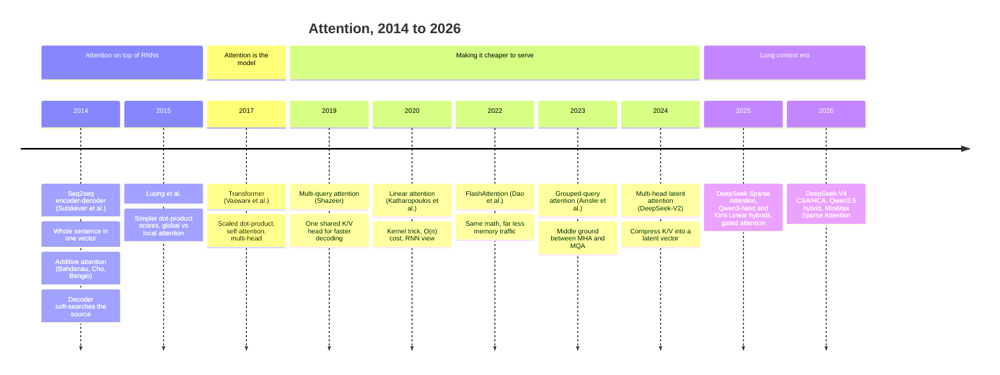
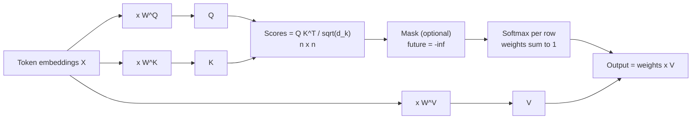
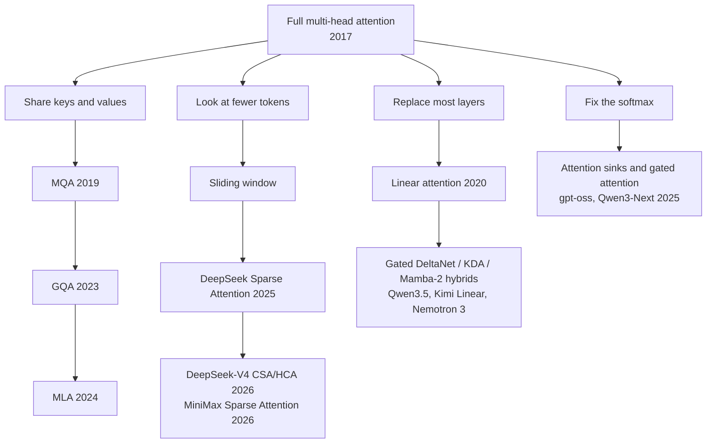

---
tags:
  - ai-ml
  - foundations
  - attention
status: draft
sources:
  - https://arxiv.org/abs/1409.3215
  - https://arxiv.org/abs/1409.0473
  - https://arxiv.org/abs/1508.04025
  - https://arxiv.org/abs/1706.03762
  - https://arxiv.org/abs/1911.02150
  - https://arxiv.org/abs/2006.16236
  - https://arxiv.org/abs/2205.14135
  - https://arxiv.org/abs/2305.13245
  - https://arxiv.org/abs/2405.04434
  - https://arxiv.org/abs/2508.10925
  - https://proceedings.neurips.cc/paper_files/paper/2025/hash/904e89bb4e632e75fb47f093b620b257-Abstract-Conference.html
  - https://huggingface.co/blog/deepseekv4
  - https://huggingface.co/papers/2606.19348
  - https://arxiv.org/abs/2606.13392
  - https://huggingface.co/blog/mlabonne/qwen35
  - https://magazine.sebastianraschka.com/p/beyond-standard-llms
  - https://sebastianraschka.com/llm-architecture-gallery/hybrid-attention/
  - https://lilianweng.github.io/posts/2018-06-24-attention/
created: 2026-11-25
updated: 2026-11-25
---

## Table Of Contents

---

- [[#TL;DR|TL;DR]]
- [[#The Problem|The Problem]]
- [[#Foundations|Foundations]]
    - [[#Vectors, Dot Products and Similarity|Vectors, Dot Products and Similarity]]
    - [[#Softmax|Softmax]]
    - [[#Queries, Keys and Values|Queries, Keys and Values]]
- [[#How We Got Here|How We Got Here]]
- [[#How It Works|How It Works]]
    - [[#Scaled Dot-Product Attention|Scaled Dot-Product Attention]]
    - [[#A Worked Example|A Worked Example]]
    - [[#Why Divide By the Square Root of d_k|Why Divide By the Square Root of d_k]]
    - [[#Self-Attention, Cross-Attention and Causal Masking|Self-Attention, Cross-Attention and Causal Masking]]
    - [[#Multi-Head Attention|Multi-Head Attention]]
    - [[#What It Costs|What It Costs]]
- [[#Where It Is Now|Where It Is Now]]
    - [[#Sharing Keys and Values (MQA, GQA, MLA)|Sharing Keys and Values (MQA, GQA, MLA)]]
    - [[#Looking at Fewer Tokens (Sliding Window and Sparse)|Looking at Fewer Tokens (Sliding Window and Sparse)]]
    - [[#Replacing Most Layers (Linear Attention Hybrids)|Replacing Most Layers (Linear Attention Hybrids)]]
    - [[#Fixing the Softmax Itself (Gates and Sinks)|Fixing the Softmax Itself (Gates and Sinks)]]
    - [[#Who Uses What|Who Uses What]]
- [[#Trade-offs & Open Problems|Trade-offs & Open Problems]]
- [[#Resources|Resources]]
- [[#Related Notes|Related Notes]]

## ***TL;DR***
---
*Attention lets every token build its representation as a weighted average of other tokens, where the weights come from how well they match. It is the core operation of the [[Transformer]], and most current architecture work is about making it cheaper at long context.*

- **What it does:** each position asks a question (query), every position advertises what it holds (key) and what it would hand over (value). Matching queries to keys gives weights; the output is the weighted sum of values.
- **The equation:** $\text{softmax}(QK^\top/\sqrt{d_k})\,V$. One matrix multiply to score, a softmax to turn scores into weights, a second matrix multiply to mix.
- **Why it won:** any token can reach any other token in one step, and the whole sequence is processed in parallel, unlike an RNN that walks it one token at a time ([Vaswani et al., 2017](https://arxiv.org/abs/1706.03762)).
- **What it costs:** compute and memory grow with the square of sequence length during training and prefill, and the [[KV Cache]] grows linearly with every generated token.
- **Where it is now (Nov 2026):** almost no frontier model runs plain multi-head attention on every layer. They share keys and values (GQA, MLA), compress or sparsify what each query looks at (DeepSeek-V4's CSA/HCA, MiniMax Sparse Attention), or replace most layers with linear-time layers and keep a few full attention layers (Qwen3.5, Kimi Linear, Nemotron 3).

## ***The Problem***
---
*Before attention, sequence models squeezed a whole input into one fixed-size vector, and quality collapsed on long inputs. Attention removes that bottleneck by letting the model look back at every input position whenever it needs to.*

The 2014 encoder-decoder models read a sentence with one recurrent network and wrote the translation with another. Everything the decoder knew about the source had to fit in the encoder's final hidden state ([Sutskever et al., 2014](https://arxiv.org/abs/1409.3215)).

That causes three problems:

| Problem | What goes wrong | How attention fixes it |
|---|---|---|
| Fixed-size bottleneck | A 50-word sentence and a 5-word sentence get the same size vector, so long inputs lose detail. | The decoder reads a different mix of all encoder states at every step. |
| Long paths | Information from word 1 must survive dozens of recurrent steps to reach word 50. | Any two positions are one step apart. |
| Sequential compute | An RNN must finish token $t$ before starting token $t+1$, so training can't use the GPU's parallelism. | Self-attention processes all positions at once (one matrix multiply). |

Sutskever et al. noticed the long-path problem directly: simply reversing the source sentence improved translation because it moved related words closer together ([Sutskever et al., 2014](https://arxiv.org/abs/1409.3215)). Attention solves it properly instead of by a trick.

## ***Foundations***
---
*Attention is built from three ideas you already know: a dot product measures similarity, a softmax turns scores into probabilities, and a lookup table returns values by key. Attention is a "soft" lookup table built from those parts.*

#### **Vectors, Dot Products and Similarity**
Every token is represented as a vector of numbers (an embedding). The dot product of two vectors $a \cdot b = \sum_i a_i b_i$ is large when they point the same way and small or negative when they don't. So a dot product is a cheap similarity score.

#### **Softmax**
Softmax turns any list of scores into positive weights that sum to 1:

$$
\text{softmax}(s)_i = \frac{e^{s_i}}{\sum_j e^{s_j}}
$$

*In plain English: exponentiate every score so it's positive, then divide by the total so they add up to 1. Big scores win by a lot; equal scores split evenly.*

Example: scores $[1, 3, 1]$ become weights of about $[0.11, 0.79, 0.11]$.

#### **Queries, Keys and Values**
Think of a Python dictionary. You look up a **key** and get back its **value**, but only if the key matches exactly. Attention makes the match soft:

| Part | Role | Analogy |
|---|---|---|
| Query $q$ | What this position is looking for | The search you type |
| Key $k$ | What each position offers to be matched on | A library card's subject heading |
| Value $v$ | What each position hands over if matched | The book itself |

Instead of returning one value, attention returns a blend of every value, weighted by how well each key matches the query. In a [[Transformer]], $q$, $k$ and $v$ are all produced from the same token embeddings by three learned matrices, $W^Q$, $W^K$ and $W^V$. The model learns what to ask and what to advertise.

## ***How We Got Here***
---
*Attention started as a fix bolted onto RNN translators in 2014, became the whole model in 2017, and since then has been reshaped mostly by the cost of serving it. Every step below answered a concrete bottleneck of the step before.*

| Year | Step | Bottleneck it answered | Source |
|---|---|---|---|
| 2014 | Additive ("Bahdanau") attention: the decoder scores every encoder state with a small neural network and takes a weighted average. | Fixed-length vector limited long sentences. | [Bahdanau et al.](https://arxiv.org/abs/1409.0473) |
| 2015 | Dot-product scoring, plus "global" (all source words) vs "local" (a window) attention. | Additive scoring was slower; full attention was wasteful. | [Luong et al.](https://arxiv.org/abs/1508.04025) |
| 2017 | Drop the RNN entirely. Scaled dot-product self-attention, multi-head, causal masking. | Recurrence prevented parallel training and kept paths long. | [Vaswani et al.](https://arxiv.org/abs/1706.03762) |
| 2019 | Multi-query attention: all heads share one key and one value head. | Decoding is limited by reading the K/V cache from memory, not by math. | [Shazeer](https://arxiv.org/abs/1911.02150) |
| 2020 | Linear attention: rewrite softmax with a kernel so cost is $O(n)$ and generation looks like an RNN. | $O(n^2)$ cost at long sequence lengths. | [Katharopoulos et al.](https://arxiv.org/abs/2006.16236) |
| 2022 | [[FlashAttention]]: exact attention, tiled so the $n \times n$ score matrix never goes to slow GPU memory. | Attention was memory-bandwidth bound (see [[1 - All About Rooflines (NOT DONE)\|Rooflines]]). | [Dao et al.](https://arxiv.org/abs/2205.14135) |
| 2023 | Grouped-query attention: groups of query heads share a K/V head. | MQA lost quality; MHA was slow to decode. | [Ainslie et al.](https://arxiv.org/abs/2305.13245) |
| 2024 | Multi-head latent attention: cache a small compressed latent instead of full K/V. | K/V cache size at long context. | [DeepSeek-V2](https://arxiv.org/abs/2405.04434) |
| 2025 to 2026 | Sparse, compressed and hybrid attention (details below). | Million-token context and agent workloads. | See [[#Where It Is Now\|Where It Is Now]] |

The thread to notice: after 2017 the math of attention barely changed. What changed is **what gets stored and what gets read**, because generation speed is set by memory traffic (see [[KV Cache]] and [[7 - All About Transformer Inference (NOT DONE)|Transformer Inference]]).

## ***How It Works***
---
*Attention is two matrix multiplies with a softmax between them. Self-attention, causal masking and multi-head attention are all the same operation with different inputs, a mask, or run several times in parallel.*

#### **Scaled Dot-Product Attention**
For $n$ tokens, stack the queries, keys and values into matrices $Q \in \mathbb{R}^{n \times d_k}$, $K \in \mathbb{R}^{n \times d_k}$, $V \in \mathbb{R}^{n \times d_v}$ ([Vaswani et al., 2017](https://arxiv.org/abs/1706.03762)):

$$
\text{Attention}(Q, K, V) = \text{softmax}\!\left(\frac{QK^\top}{\sqrt{d_k}}\right) V
$$

*In plain English: score every query against every key ($QK^\top$, an $n \times n$ table), shrink the scores by $\sqrt{d_k}$ so they stay in a sensible range, turn each row into weights with softmax, then use each row of weights to average the value vectors. Each output row is "what this token gathered from the others."*

#### **A Worked Example**
Three tokens, "the cat sat", with tiny 2-dimensional vectors ($d_k = 2$). We compute the output for the query from "sat".

| Token | Key $k$ | Value $v$ |
|---|---|---|
| the | $[0, 1]$ | $[1, 0]$ |
| cat | $[2, 1]$ | $[0, 1]$ |
| sat | $[1, 0]$ | $[1, 1]$ |

Query for "sat": $q = [1, 1]$.

1. **Score:** $q \cdot k$ = $[1, 3, 1]$. "cat" matches best.
2. **Scale:** divide by $\sqrt{2} \approx 1.414$ → $[0.71, 2.12, 0.71]$.
3. **Softmax:** → weights $[0.16, 0.67, 0.16]$.
4. **Mix values:** $0.16 \cdot [1,0] + 0.67 \cdot [0,1] + 0.16 \cdot [1,1] = [0.33, 0.84]$.

The new vector for "sat" is mostly "cat"'s value, with a little of the others. Note the scaling also softened the result: without it, softmax of $[1,3,1]$ gives "cat" 0.79 instead of 0.67.

#### **Why Divide By the Square Root of d_k**
If the entries of $q$ and $k$ are independent with mean 0 and variance 1, their dot product has mean 0 and variance $d_k$. With $d_k = 64$ or $128$, raw scores get large, softmax saturates onto one token, and its gradients become tiny. Dividing by $\sqrt{d_k}$ brings the variance back to 1 ([Vaswani et al., 2017](https://arxiv.org/abs/1706.03762), Section 3.2.1).

> [!Important] Rule of thumb
> Scaling keeps the softmax "soft" at initialization so the model can learn which tokens to focus on, instead of starting out locked onto one.

#### **Self-Attention, Cross-Attention and Causal Masking**
The same operation shows up in three places, differing only in where $Q$, $K$, $V$ come from and whether a mask is applied ([Vaswani et al., 2017](https://arxiv.org/abs/1706.03762)):

| Kind | Queries from | Keys and values from | Mask | Used in |
|---|---|---|---|---|
| Self-attention (bidirectional) | The sequence itself | The same sequence | None: every token sees every token | Encoders (BERT-style) |
| Causal (masked) self-attention | The sequence itself | The same sequence | Future positions set to $-\infty$ before softmax | Decoder-only LLMs (GPT-style) |
| Cross-attention | The decoder | The encoder output | None | Translation, multimodal models |

The causal mask is what makes generation possible: token $t$ can only use tokens $\le t$, so the model can be trained on every position in parallel and still generate one token at a time. It is also why a [[KV Cache]] works: the keys and values of past tokens never change, so they can be stored and reused.

#### **Multi-Head Attention**
One attention operation produces one set of weights per token, so it can only focus in one "way" at a time. Multi-head attention runs $h$ smaller attentions in parallel, each with its own projections, and concatenates the results:

$$
\text{head}_i = \text{Attention}(XW_i^Q,\; XW_i^K,\; XW_i^V), \qquad \text{MHA}(X) = \text{Concat}(\text{head}_1, \dots, \text{head}_h)\, W^O
$$

*In plain English: split the model's width into $h$ slices, let each slice learn its own notion of "relevant" (one head might track the previous word, another the subject of the sentence), then glue the slices back together and mix them with one more matrix.*

The original base model used $h = 8$ heads, $d_{model} = 512$, so each head has $d_k = d_v = 512/8 = 64$. Because each head is narrower, total compute is about the same as one full-width head ([Vaswani et al., 2017](https://arxiv.org/abs/1706.03762)).

#### **What It Costs**
For sequence length $n$ and width $d$:

| | Self-attention | Recurrent (RNN) | Convolution |
|---|---|---|---|
| Compute per layer | $O(n^2 \cdot d)$ | $O(n \cdot d^2)$ | $O(k \cdot n \cdot d^2)$ |
| Sequential steps | $O(1)$ | $O(n)$ | $O(1)$ |
| Longest path between two tokens | $O(1)$ | $O(n)$ | $O(\log_k n)$ |

*Source: Table 1 of [Vaswani et al., 2017](https://arxiv.org/abs/1706.03762).*

In 2017 sentences were short ($n < d$), so attention was cheaper than recurrence. Today $n$ is 128K to 1M tokens, so the $n^2$ term dominates training and prefill.

During generation the cost is different. Each new token reads every cached key and value, so per-token cost is $O(n)$ but it is **memory-bound**: the GPU spends its time moving the cache, not multiplying. The cache size per token is:

$$
\text{KV bytes per token} = 2 \times L \times h_{kv} \times d_{head} \times \text{bytes per number}
$$

*In plain English: for every layer $L$, store one key and one value (the 2) for every K/V head, each $d_{head}$ numbers long.*

Example with an illustrative 80-layer model, head size 128, BF16 (2 bytes):

| Layout | K/V heads | Per token | At 128K tokens |
|---|---|---|---|
| Multi-head (64 heads) | 64 | 2.5 MiB | 320 GiB |
| Grouped-query (8 groups) | 8 | 320 KiB | 40 GiB |
| Multi-query | 1 | 40 KiB | 5 GiB |

This table is why almost every change since 2019 targets $h_{kv}$, the number of cached tokens, or the bytes per number. Deeper treatment belongs in [[KV Cache]] and [[FlashAttention]].

## ***Where It Is Now***
---
*As of November 2026, the attention equation is unchanged but how it is deployed has split into four families: share K/V, look at fewer tokens, replace most layers with linear-time layers, and fix the softmax with gates. Labs disagree on which wins, and frontier models mix them.*

#### **Sharing Keys and Values (MQA, GQA, MLA)**
- **Multi-query attention (2019):** every query head shares one K/V head. Much faster decoding, small quality loss ([Shazeer](https://arxiv.org/abs/1911.02150)).
- **Grouped-query attention (2023):** a few K/V heads, each shared by a group of query heads. Quality close to multi-head, speed close to MQA, and an existing multi-head model can be converted with about 5% of its original pre-training compute ([Ainslie et al.](https://arxiv.org/abs/2305.13245)). This is the default in most open models; gpt-oss uses 64 query heads and 8 K/V heads ([OpenAI model card, Aug 2025](https://arxiv.org/abs/2508.10925)).
- **Multi-head latent attention (2024):** store one small compressed latent per token and expand it into keys and values on the fly. DeepSeek-V2 reported a 93.3% smaller KV cache and 5.76x higher maximum generation throughput than DeepSeek 67B ([DeepSeek-V2](https://arxiv.org/abs/2405.04434)). In 2026 MLA is used by Kimi K2.5 and GLM-5 ([Labonne, Feb 2026](https://huggingface.co/blog/mlabonne/qwen35)).

#### **Looking at Fewer Tokens (Sliding Window and Sparse)**
- **Sliding window:** a layer only sees the last $w$ tokens. gpt-oss alternates 128-token windowed layers with full dense layers ([OpenAI model card](https://arxiv.org/abs/2508.10925)).
- **DeepSeek Sparse Attention (V3.2, Sept 2025):** a cheap "lightning indexer" picks which past tokens each query attends to, making cost subquadratic ([Raschka, Nov 2025](https://magazine.sebastianraschka.com/p/beyond-standard-llms)). GLM-5 adopted it ([Labonne](https://huggingface.co/blog/mlabonne/qwen35)).
- **DeepSeek-V4 (April 2026; tech report June 2026):** interleaves two layer types. **Compressed Sparse Attention** merges every 4 tokens into one K/V entry, then the indexer picks the top-k entries (512 for Flash, 1,024 for Pro), plus a small sliding window for recent detail. **Heavily Compressed Attention** merges every 128 tokens and attends to all of them densely. At 1M tokens, V4-Pro needs about 27% of V3.2's per-token FLOPs and 10% of its KV cache; against standard 8-head GQA in BF16 the cache is about 2% the size ([HF blog](https://huggingface.co/blog/deepseekv4), [tech report](https://huggingface.co/papers/2606.19348)).
- **MiniMax Sparse Attention (June 2026):** block-sparse attention built on GQA; an index branch picks the top-k key/value blocks per GQA group, and exact softmax runs only on those. On a 109B MoE trained on 3T tokens it matched GQA on benchmarks while cutting per-token attention compute 28.4x at 1M context, with 14.2x faster prefill and 7.6x faster decoding on H800s. It ships in MiniMax-M3 ([Lai et al.](https://arxiv.org/abs/2606.13392)).

#### **Replacing Most Layers (Linear Attention Hybrids)**
Linear attention rewrites attention so a fixed-size state is updated per token, giving $O(n)$ cost and an RNN-like decoder ([Katharopoulos et al., 2020](https://arxiv.org/abs/2006.16236)). Pure linear models lose recall, so 2025 to 2026 models **mix**: most layers are linear-time, a minority keep full softmax attention.

- **Qwen3-Next (Aug 2025) and Qwen3.5 (Feb 2026):** three Gated DeltaNet layers, then one gated full attention layer, repeated (Qwen3.5-397B: 60 layers, 15 groups) ([Raschka gallery](https://sebastianraschka.com/llm-architecture-gallery/hybrid-attention/), [Labonne](https://huggingface.co/blog/mlabonne/qwen35)).
- **Kimi Linear (Oct 2025):** Kimi Delta Attention plus MLA layers, about 3:1; 75% smaller KV cache and up to 6x decoding throughput vs full attention ([Raschka, Nov 2025](https://magazine.sebastianraschka.com/p/beyond-standard-llms)).
- **NVIDIA Nemotron 3 and Ling 2.5:** Mamba-2 or Lightning Attention layers with a few attention layers (see [[State Space Models]]) ([Raschka gallery](https://sebastianraschka.com/llm-architecture-gallery/hybrid-attention/)).
- **The counterexample:** MiniMax used linear attention in M1 but went back to full attention for M2, saying linear attention hurt reasoning and multi-turn accuracy in production ([Raschka, Nov 2025](https://magazine.sebastianraschka.com/p/beyond-standard-llms)). MiniMax-M2.5 was still full multi-head attention in Feb 2026 ([Labonne](https://huggingface.co/blog/mlabonne/qwen35)), and MiniMax's 2026 answer to long context was sparse softmax rather than linear layers ([Lai et al.](https://arxiv.org/abs/2606.13392)).

#### **Fixing the Softmax Itself (Gates and Sinks)**
Softmax weights must sum to 1, so a head with nothing useful to read still has to put its weight somewhere. Models learn to dump it on the first token ("attention sink"), which causes huge activations and instability.

- **Learned sink:** gpt-oss adds a learned bias to each head's softmax denominator so a head can attend to nothing ([OpenAI model card](https://arxiv.org/abs/2508.10925)).
- **Gated attention:** a head-specific sigmoid gate on the attention output. Tested on 30+ variants (15B MoE and 1.7B dense models, 3.5T tokens), it improved quality, training stability and long-context extrapolation and removed attention sinks. NeurIPS 2025; used in Qwen3-Next and Qwen3.5 ([Qiu et al.](https://proceedings.neurips.cc/paper_files/paper/2025/hash/904e89bb4e632e75fb47f093b620b257-Abstract-Conference.html)).

#### **Who Uses What**
*Open-weight models only; closed labs don't publish their attention design.*

| Model | Date | Attention design |
|---|---|---|
| gpt-oss-120b / 20b | Aug 2025 | GQA (8 K/V heads), alternating 128-token sliding window and dense, learned sinks |
| Qwen3.5-397B-A17B | Feb 2026 | 3:1 Gated DeltaNet : gated full attention |
| Kimi K2.5 | by Feb 2026 | MLA |
| GLM-5 | by Feb 2026 | MLA + DeepSeek Sparse Attention |
| MiniMax-M2.5 | by Feb 2026 | Full multi-head attention |
| DeepSeek-V4-Pro / Flash | Apr 2026 | Interleaved CSA and HCA, 1M context |
| MiniMax-M3 | Jun 2026 | MiniMax Sparse Attention on GQA |
| Nemotron 3 Super | not stated | Mamba-2 hybrid, 8 attention layers out of 48 mixer layers |

*Sources: model card, [Labonne](https://huggingface.co/blog/mlabonne/qwen35), [DeepSeek](https://huggingface.co/blog/deepseekv4), [MiniMax](https://arxiv.org/abs/2606.13392), [Raschka gallery](https://sebastianraschka.com/llm-architecture-gallery/hybrid-attention/). Dates are as reported by those sources; "by Feb 2026" means the model was out when Labonne compared it.*

## ***Trade-offs & Open Problems***
---
*Every cheaper attention trades away some of full attention's ability to recall any exact token from anywhere in the context. The open question is how much of that ability long-context reasoning and agents really need.*

| Approach | Saves | Risks |
|---|---|---|
| GQA / MQA | K/V cache size, decode bandwidth | Some quality loss as K/V heads shrink (MQA most) |
| MLA | Cache size, beyond GQA | Extra compute to decompress; more complex kernels and position handling |
| Sliding window | Compute and cache on windowed layers | Windowed layers can't see far back; needs full layers mixed in |
| Sparse / compressed (DSA, CSA/HCA, MSA) | Most compute and cache at 1M tokens | Indexer can miss the token that matters; custom kernels per GPU type |
| Linear hybrids | Cache becomes fixed-size on most layers | Exact recall and multi-turn reasoning; MiniMax backed away for this reason |
| Gated attention / sinks | Stability, no sink artifacts | Small extra parameters; mostly settled as a net win |

Open problems worth tracking:
- **Recall vs cost at 1M tokens.** No consensus design: in Feb 2026 the top open models used four different attention types ([Labonne](https://huggingface.co/blog/mlabonne/qwen35)).
- **Hardware fit.** Sparse and compressed attention need custom kernels; MiniMax picked a block-sparse design partly so it would run across more GPU types ([Lai et al.](https://arxiv.org/abs/2606.13392)). See [[FlashAttention]] and [[AI Accelerators]].
- **Evaluation.** Benchmarks at short context don't show what sparse or linear layers lose; long-context and agentic evaluations are where differences appear ([Raschka, Nov 2025](https://magazine.sebastianraschka.com/p/beyond-standard-llms)).

## ***Resources***
---
*Papers for the facts, explainers for building intuition. Start with Weng for the history, then read the Transformer paper's Section 3.2.*

**Primary papers**
- [Sequence to Sequence Learning with Neural Networks](https://arxiv.org/abs/1409.3215): Sutskever, Vinyals, Le, Sep 2014. The bottleneck attention fixed.
- [Neural Machine Translation by Jointly Learning to Align and Translate](https://arxiv.org/abs/1409.0473): Bahdanau, Cho, Bengio, Sep 2014. The first attention.
- [Effective Approaches to Attention-based NMT](https://arxiv.org/abs/1508.04025): Luong, Pham, Manning, Aug 2015.
- [Attention Is All You Need](https://arxiv.org/abs/1706.03762): Vaswani et al., Jun 2017. Section 3.2 is the core of this note.
- [Fast Transformer Decoding: One Write-Head is All You Need](https://arxiv.org/abs/1911.02150): Shazeer, Nov 2019 (MQA).
- [Transformers are RNNs](https://arxiv.org/abs/2006.16236): Katharopoulos et al., Jun 2020 (linear attention).
- [FlashAttention](https://arxiv.org/abs/2205.14135): Dao et al., May 2022.
- [GQA](https://arxiv.org/abs/2305.13245): Ainslie et al., May 2023.
- [DeepSeek-V2](https://arxiv.org/abs/2405.04434): DeepSeek-AI, May 2024 (MLA).
- [gpt-oss model card](https://arxiv.org/abs/2508.10925): OpenAI, Aug 2025.
- [Gated Attention for LLMs](https://proceedings.neurips.cc/paper_files/paper/2025/hash/904e89bb4e632e75fb47f093b620b257-Abstract-Conference.html): Qiu et al., NeurIPS 2025.
- [DeepSeek-V4 tech report](https://huggingface.co/papers/2606.19348): DeepSeek-AI, Jun 2026, and the [Hugging Face explainer](https://huggingface.co/blog/deepseekv4), Apr 2026.
- [MiniMax Sparse Attention](https://arxiv.org/abs/2606.13392): Lai et al., Jun 2026.

**Explainers and analysis**
- [Attention? Attention!](https://lilianweng.github.io/posts/2018-06-24-attention/): Lilian Weng, 2018. Best single history of the pre-Transformer variants.
- [Beyond Standard LLMs](https://magazine.sebastianraschka.com/p/beyond-standard-llms): Sebastian Raschka, Nov 2025. Linear and sparse hybrids.
- [LLM Architecture Gallery: hybrid attention](https://sebastianraschka.com/llm-architecture-gallery/hybrid-attention/): Raschka, 2026. Layer layouts by model.
- [Qwen3.5: Nobody Agrees on Attention Anymore](https://huggingface.co/blog/mlabonne/qwen35): Maxime Labonne, Feb 2026.

## Related Notes

- [[Transformer]] — The architecture built around attention; covers how attention sits with feed-forward layers, residuals and normalization.
- [[KV Cache]] — Why causal attention lets past keys and values be stored, and what that memory costs at long context.
- [[FlashAttention]] — Computes this exact attention while avoiding the slow GPU memory traffic of the $n \times n$ score matrix.
- [[State Space Models]] — The Mamba family used as the linear-time layers in hybrid models.
- [[Mixture of Experts]] — The other half of most 2026 frontier designs; nearly every model in the table above is MoE.
- [[7 - All About Transformer Inference (NOT DONE)|7 - All About Transformer Inference (NOT DONE)]] — Prefill vs generation and the KV cache, from How to Scale Your Model.
- [[1 - All About Rooflines (NOT DONE)|1 - All About Rooflines (NOT DONE)]] — Explains why decoding attention is memory-bandwidth bound.
