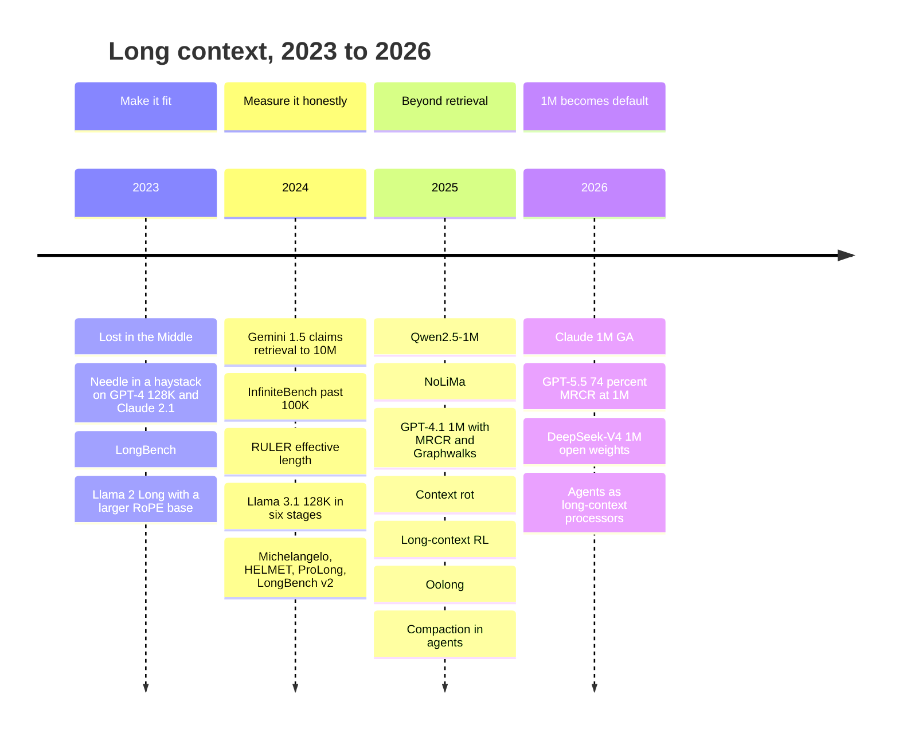
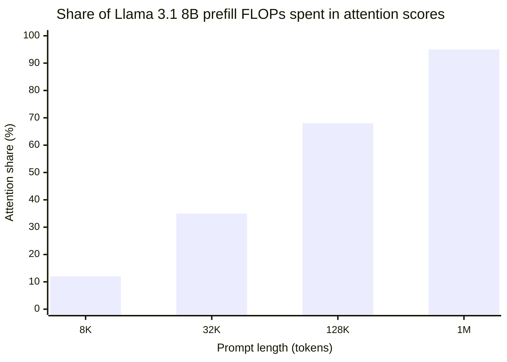
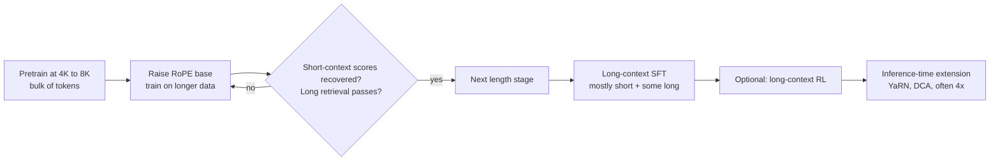

---
tags:
  - ai-ml
  - foundations
  - long-context
  - evaluation
  - training
status: draft
sources:
  - https://arxiv.org/abs/2307.03172
  - https://github.com/gkamradt/LLMTest_NeedleInAHaystack
  - https://arxiv.org/abs/2308.14508
  - https://arxiv.org/abs/2309.16039
  - https://arxiv.org/abs/2310.01889
  - https://arxiv.org/abs/2402.13718
  - https://arxiv.org/abs/2403.05530
  - https://arxiv.org/abs/2404.06654
  - https://arxiv.org/abs/2406.19292
  - https://arxiv.org/abs/2407.21783
  - https://arxiv.org/abs/2409.12640
  - https://arxiv.org/abs/2410.02660
  - https://arxiv.org/abs/2410.02694
  - https://arxiv.org/abs/2410.23771
  - https://arxiv.org/abs/2412.15204
  - https://arxiv.org/abs/2412.19437
  - https://arxiv.org/abs/2501.15383
  - https://arxiv.org/abs/2502.05167
  - https://arxiv.org/abs/2505.09388
  - https://arxiv.org/abs/2505.17667
  - https://arxiv.org/abs/2511.02817
  - https://arxiv.org/abs/2603.20432
  - https://openai.com/index/gpt-4-1/
  - https://openai.com/index/introducing-gpt-5-4/
  - https://openai.com/index/introducing-gpt-5-5/
  - https://openai.com/index/gpt-5-1-codex-max/
  - https://developers.openai.com/api/docs/guides/compaction
  - https://www.trychroma.com/research/context-rot
  - https://epoch.ai/benchmarks/fictionlivebench
  - https://www.anthropic.com/engineering/effective-context-engineering-for-ai-agents
  - https://www.anthropic.com/news/claude-opus-4-6
  - https://claude.com/blog/1m-context-ga
  - https://platform.claude.com/docs/en/models/opus-5/overview
  - https://deepmind.google/models/model-cards/gemini-3-1-pro/
  - https://deepmind.google/models/model-cards/gemini-3-5-flash/
  - https://huggingface.co/blog/deepseekv4
  - https://huggingface.co/blog/llama4-release
created: 2026-11-26
updated: 2026-11-26
---

## Table Of Contents

---

- [[#TL;DR|TL;DR]]
- [[#The Problem|The Problem]]
- [[#Foundations|Foundations]]
    - [[#What a Context Window Is|What a Context Window Is]]
    - [[#Advertised vs Effective Context|Advertised vs Effective Context]]
    - [[#Why Cost Grows with Length|Why Cost Grows with Length]]
    - [[#Lost in the Middle|Lost in the Middle]]
- [[#How We Got Here|How We Got Here]]
- [[#How It Works|How It Works]]
    - [[#What Each Eval Actually Tests|What Each Eval Actually Tests]]
    - [[#Defining Effective Length|Defining Effective Length]]
    - [[#The Cost Equation|The Cost Equation]]
    - [[#A Worked Example|A Worked Example]]
    - [[#The Staged Extension Recipe|The Staged Extension Recipe]]
    - [[#Data Mixture|Data Mixture]]
    - [[#Synthetic Data, SFT and RL|Synthetic Data, SFT and RL]]
    - [[#Context Parallelism|Context Parallelism]]
- [[#Where It Is Now|Where It Is Now]]
    - [[#Advertised Windows|Advertised Windows]]
    - [[#Measured Effective Length|Measured Effective Length]]
    - [[#Evals in 2026|Evals in 2026]]
    - [[#Compaction and Memory in Agents|Compaction and Memory in Agents]]
- [[#Trade-offs & Open Problems|Trade-offs & Open Problems]]
- [[#Resources|Resources]]
- [[#Related Notes|Related Notes]]

## ***TL;DR***
---
*Long context is a model's ability to take in, and actually use, hundreds of thousands to millions of tokens in one prompt. Getting a model to accept a long input is the easy part; getting it to reason over every part of that input is the hard part, and the history of the field is a history of evals exposing the gap.*

- **What it is:** the context window is the maximum number of tokens a model reads at once. Windows grew from 128K (GPT-4 Turbo) and 200K (Claude 3) in early 2024 ([Gemini Team, 2024](https://arxiv.org/abs/2403.05530)) to 1M as the 2026 default for frontier models, with 10M on Llama 4 Scout.
- **The core finding:** advertised length is not usable length. RULER found only half of models claiming 32K or more held up at 32K ([Hsieh et al., 2024](https://arxiv.org/abs/2404.06654)), and every harder eval since (NoLiMa, Michelangelo, MRCR, Oolong) has found degradation starting well before the advertised limit.
- **How it is trained:** pretrain short, then extend in stages with a larger RoPE base and a mix of long documents (code repos, books) plus high-quality short data; finish with SFT that includes some long data. Long sequences are left to the end because attention cost grows with the square of length.
- **Where it is now (Nov 2026):** 1M tokens is standard across Anthropic, OpenAI, Google and DeepSeek flagships. On OpenAI's MRCR v2 8-needle at 512K to 1M, GPT-5.5 scored 74.0% in April 2026, up from 36.6% for GPT-5.4 a month earlier, while Google's cards report about 26% at 1M. Agents increasingly sidestep the limit with compaction, notes and sub-agents.

## ***The Problem***
---
*Many useful tasks don't fit in a short prompt: a whole codebase, a contract bundle, a long agent trajectory, a book. Long context promises to put all of it in front of the model, but it costs quadratic compute and linear memory, and models quietly get worse as the input grows.*

Three separate problems hide behind "long context":

| Problem | What goes wrong | Where it's handled |
|---|---|---|
| **Can the model accept the input?** | Position signals outside the trained range break attention; output turns to noise past the training length | Position schemes and their extension tricks: [[Positional Encoding]] |
| **Can we afford it?** | Prefill compute grows with $T^2$; the [[KV Cache]] grows with $T$ and must be read on every decoded token | [[FlashAttention]], [[Sparse Attention]], [[Hybrid Attention]], [[State Space Models]], [[LLM Serving]] |
| **Does the model use it?** | Retrieval and reasoning accuracy fall as context grows, often long before the advertised limit | Evaluation and training recipes: **this note** |

This note is about the third row: how we measure whether a model uses its context, and how labs train it to. The first two rows matter here only as constraints on what is affordable to train and evaluate.

## ***Foundations***
---
*Four ideas carry the rest of the note: what the window is, why the advertised number overstates usable length, why longer inputs cost so much more, and the first well-known evidence that models ignore the middle of their input.*

#### **What a Context Window Is**

A [[Transformer]] reads a sequence of tokens and every layer lets each token attend to all earlier tokens ([[Attention]]). The **context window** is the longest sequence the model was trained, or extended, to handle: prompt plus generated output. Tokens beyond it are simply not seen. Everything a chat model "remembers" within a conversation lives in this window; nothing persists between calls unless it is put back in.

Windows are counted in tokens, not words, so the same document costs different amounts in different tokenizers (see [[Tokenization and Embeddings]]). As a rough sense of scale, LongBench v2's contexts run from 8K to 2M *words* ([Bai et al., 2024](https://arxiv.org/abs/2412.15204)).

#### **Advertised vs Effective Context**

- **Advertised (claimed) context:** the largest input the API or model card says it accepts. It means the model doesn't crash or emit noise at that length.
- **Effective context:** the longest input at which the model still performs a task well, by some stated threshold. It depends on the task: a model can find one planted fact at 1M tokens and still fail to count events across 128K.

The gap is large and has been measured repeatedly. In RULER, GPT-4 (claimed 128K) had an effective length of 64K, Llama 3.1 70B (128K) 64K, and Yi-34B (200K) 32K; only Gemini 1.5 Pro stayed above threshold at the longest length tested, 128K ([Hsieh et al., 2024](https://arxiv.org/abs/2404.06654)).

#### **Why Cost Grows with Length**

Two costs, with different growth rates:

- **Compute (prefill).** Reading the prompt runs every token through the model's weights, which is linear in length $T$. But attention compares every token with every earlier one, which is quadratic in $T$. At short lengths the weights dominate; at long lengths attention does. Meta held long sequences back to the end of Llama 3 pretraining for exactly this reason: "the compute in self-attention layers grows quadratically in the sequence length" ([Llama 3 paper](https://arxiv.org/abs/2407.21783)).
- **Memory (decode).** Generation stores each token's keys and values so they aren't recomputed: the [[KV Cache]]. It grows linearly with $T$, and *all of it is read for every new token*, so long contexts make decoding memory-bandwidth-bound and shrink how many requests fit on a GPU.

The [[#A Worked Example|worked example]] puts real numbers on both.

#### **Lost in the Middle**

The first widely cited evidence that long context isn't uniform came from Liu et al. (2023). On multi-document QA and key-value retrieval, accuracy was highest when the relevant passage sat at the start or end of the input and dropped sharply in the middle, even for models marketed as long-context ([Liu et al., 2023](https://arxiv.org/abs/2307.03172), TACL).

| GPT-3.5-Turbo, 20 documents | Accuracy |
|---|---|
| Answer in document 1 | 75.8% |
| Answer in document 10 (middle) | 53.8% |
| Answer in document 20 (last) | 63.2% |
| **No documents at all (closed-book)** | **56.1%** |

With the answer in the middle, the model did worse than with no documents. The U-shape matters because it means "the answer was in the prompt" is not the same as "the model used it", which is the theme of every eval below.

## ***How We Got Here***
---
*Evaluation drove the field. Each new benchmark appeared because models had saturated the last one without getting better at the real task: perplexity was gamed by local tokens, needles by keyword matching, RULER by retrieval-only skill. Training recipes followed the evals, from simple RoPE-base changes to staged curricula and careful data mixtures.*

| Year | What changed | Problem it answered | Source |
|---|---|---|---|
| 2023 | Perplexity on long documents used as the main signal for context extension. | Cheap check that a stretched model still predicts text. | (critiqued in [Fang et al.](https://arxiv.org/abs/2410.23771)) |
| 2023 | Accuracy is U-shaped in where the answer sits; the middle can fall below closed-book. | Long-context models looked fine on averages but missed mid-context facts. | [Liu et al.](https://arxiv.org/abs/2307.03172) |
| 2023 | LongBench: 21 datasets, 6 categories, English and Chinese, average 6,711 words (EN). | No standard multi-task long-context benchmark. | [Bai et al.](https://arxiv.org/abs/2308.14508) |
| Nov 2023 | Needle in a haystack: plant one fact in Paul Graham essays, sweep length and depth; first run on GPT-4 128K (Nov 8) and Claude 2.1 (Nov 21). | Perplexity says nothing about finding a specific fact. | [Kamradt](https://github.com/gkamradt/LLMTest_NeedleInAHaystack) |
| 2023 | Continued pretraining of Llama 2 on longer sequences to 32,768 tokens; long-text abundance in pretraining "not the key"; continual pretraining as effective as from-scratch long training. | How to get long context without paying for it during all of pretraining. | [Xiong et al.](https://arxiv.org/abs/2309.16039) |
| Feb 2024 | InfiniteBench: first benchmark with average length over 100K tokens, English and Chinese. | LongBench inputs were too short for 128K models. | [Zhang et al.](https://arxiv.org/abs/2402.13718) |
| Mar 2024 | Gemini 1.5 reports near-perfect (>99%) retrieval to at least 10M tokens. | NIAH became a marketing number, and soon saturated. | [Gemini Team](https://arxiv.org/abs/2403.05530) |
| Apr 2024 | RULER: 13 synthetic tasks (retrieval, multi-hop tracing, aggregation, QA) with configurable length; defines effective length. | NIAH was saturated and measured only retrieval. | [Hsieh et al.](https://arxiv.org/abs/2404.06654) |
| Jul 2024 | Llama 3: six-stage extension from 8K to 128K on about 800B tokens; 0.1% synthetic long data in SFT. | A documented production recipe. | [Meta](https://arxiv.org/abs/2407.21783) |
| Sep 2024 | Michelangelo: Latent Structure Queries (Latent List, MRCR, IDK); scores often drop by 32K. | Synthetic retrieval can be solved without understanding. | [Vodrahalli et al.](https://arxiv.org/abs/2409.12640) |
| Oct 2024 | HELMET: 7 application categories, 59 models, to 128K; NIAH doesn't predict downstream skill. ProLong: perplexity and NIAH mislead data choices. LongPPL: score only the tokens that need long context. | Which cheap signal should a lab trust while training? | [Yen et al.](https://arxiv.org/abs/2410.02694), [Gao et al.](https://arxiv.org/abs/2410.02660), [Fang et al.](https://arxiv.org/abs/2410.23771) |
| Dec 2024 | LongBench v2: 503 hard multiple-choice questions, 8K to 2M words; experts 53.7% in 15 minutes. | Realistic tasks needing reasoning, not lookup. | [Bai et al.](https://arxiv.org/abs/2412.15204) |
| Jan 2025 | Qwen2.5-1M: five-stage curriculum to 262K, then training-free extension to 1M. | Open recipe for 1M. | [Qwen](https://arxiv.org/abs/2501.15383) |
| Feb 2025 | NoLiMa: needles with minimal word overlap with the question; 11 of 13 models fall below half their short-context score at 32K. | NIAH rewards keyword matching. | [Modarressi et al.](https://arxiv.org/abs/2502.05167) |
| Apr 2025 | GPT-4.1 ships 1M tokens with OpenAI-MRCR and Graphwalks. | Labs needed hard, reproducible 1M evals for model cards. | [OpenAI](https://openai.com/index/gpt-4-1/) |
| Jul 2025 | Context rot: 18 models degrade with length even on trivial tasks; coherent haystacks hurt more than shuffled ones. | Benchmarks understate real-world decay. | [Chroma](https://www.trychroma.com/research/context-rot) |
| 2025 | Long-context RL (QwenLong-L1); Oolong aggregation benchmark; compaction trained into agents. | Reasoning models were trained on short inputs; agent trajectories outgrow any window. | [Wan et al.](https://arxiv.org/abs/2505.17667), [Bertsch et al.](https://arxiv.org/abs/2511.02817), [OpenAI](https://openai.com/index/gpt-5-1-codex-max/) |
| 2026 | 1M is the flagship default; MRCR v2 8-needle at 1M becomes the headline number; agents with file tools beat direct long-context reading on some tasks. | Making 1M actually useful, or routing around it. | [OpenAI](https://openai.com/index/introducing-gpt-5-5/), [Cao et al.](https://arxiv.org/abs/2603.20432) |

## ***How It Works***
---
*Long-context capability is built in two halves: evals that separate "accepts the input" from "uses the input", and a training recipe that extends a short-context model in stages with the right data. The cost equation explains why the recipe is shaped the way it is.*

#### **What Each Eval Actually Tests**

Each generation of eval closes a loophole the previous one left open.

| Eval (year) | Task | What it catches | Loophole it leaves |
|---|---|---|---|
| Long-document perplexity | Next-token loss on long texts | Models broken past their trained length | Averaged over all tokens, most of which only need local context ([Fang et al.](https://arxiv.org/abs/2410.23771)) |
| Needle in a haystack (2023) | Find one planted sentence at varying depth | Position-dependent blind spots | One fact, literal keyword match; saturated by 2024 |
| LongBench / InfiniteBench (2023 to 2024) | Real QA, summarization, code over long inputs | Real-task failures | Short (LongBench) or noisy metrics; data contamination |
| RULER (2024) | 13 synthetic tasks: multi-key/value/query needles, variable tracking, common/frequent word counting, QA with distractors | Multi-item retrieval, tracing, aggregation | Still synthetic; lexical cues remain |
| Michelangelo (2024) | Track a Python list through operations; reproduce the $k$-th of several similar earlier outputs; say "I don't know" when absent | Synthesis of latent structure across the context | Synthetic |
| HELMET (2024) | 7 categories incl. RAG, re-ranking, citation generation, long-document QA, summarization, ICL | Whether proxies predict real use; categories correlate weakly with each other | Stops at 128K |
| LongBench v2 (2024) | 503 expert-written multiple-choice questions, 8K to 2M words | Deep reasoning over realistic inputs | Multiple choice; humans themselves score 53.7% |
| NoLiMa (2025) | Needle shares almost no words with the question; requires a latent link | Keyword matching masquerading as retrieval | Single-hop |
| OpenAI-MRCR (2025) | 2, 4 or 8 identical requests hidden in a long chat; return the response to a specific one | Telling near-duplicates apart by order | Synthetic chat |
| Graphwalks (2025) | Context full of a directed graph of hex hashes; run BFS or find parents | Multi-hop reasoning spread over the whole context | Synthetic |
| Fiction.LiveBench (2025) | 36 questions on 30 stories at several lengths: character theory of mind, chronology, implicit facts | Narrative comprehension | Small question set ([Epoch AI](https://epoch.ai/benchmarks/fictionlivebench)) |
| Context rot (2025) | Controlled needles, distractors, haystack structure, LongMemEval, repeated-word copying | Decay even on trivial tasks; distractor sensitivity | A report, not a maintained leaderboard |
| Oolong (2025) | Classify and count many items across the context, then aggregate | Tasks where every chunk matters, not a few | |

The pattern: as soon as an eval can be solved by locating a few tokens that literally match the query, models saturate it. The evals that still discriminate in 2026 (MRCR at 8 needles, Graphwalks, Oolong) require using information spread across the whole input.

#### **Defining Effective Length**

RULER made "effective length" a number by fixing a threshold: the average score of Llama 2 7B at 4K tokens across the 13 tasks, which is 85.6% ([Hsieh et al., 2024](https://arxiv.org/abs/2404.06654)).

$$
L_{\text{eff}} = \max \{\, L \in \{4\text{K}, 8\text{K}, \dots, 128\text{K}\} \;:\; \bar{S}(L) > 85.6 \,\}
$$

*In plain English: test the model at a ladder of lengths, average its score over all tasks at each rung, and report the longest rung where it still beats what a small, old model managed at short length. Anything past that is context the model accepts but can't be trusted with.*

| Model | Claimed | Effective | 4K | 32K | 64K | 128K |
|---|---|---|---|---|---|---|
| Gemini 1.5 Pro | 1M | >128K | 96.7 | 95.9 | 95.9 | 94.4 |
| GPT-4 | 128K | 64K | 96.6 | 93.2 | 87.0 | 81.2 |
| Llama 3.1 70B | 128K | 64K | 96.5 | 94.8 | 88.4 | 66.6 |
| Yi-34B | 200K | 32K | 93.3 | 87.5 | 83.2 | 77.3 |
| Mixtral-8x22B | 64K | 32K | 95.6 | 90.9 | 84.7 | 31.7 |

The threshold is arbitrary but fixed, which is the point: it lets claims be compared. Later evals use the same logic with different yardsticks; NoLiMa, for example, reports the length at which a model keeps 85% of its own short-context score ([Modarressi et al., 2025](https://arxiv.org/abs/2502.05167)).

#### **The Cost Equation**

For a dense decoder with $N$ parameters, $L$ layers and attention width $d$ (query heads times head size), reading a $T$-token prompt costs about

$$
C_{\text{prefill}}(T) \approx \underbrace{2NT}_{\text{weights}} \;+\; \underbrace{2\,L\,d\,T^{2}}_{\text{attention scores}}
$$

*In plain English: every token does about two FLOPs per weight (a multiply and an add), which grows in a straight line with length. On top of that, every layer computes a score between each token and every earlier token ($QK^\top$) and mixes the values ($AV$), each about $2T^2d$ FLOPs, halved because a causal model only looks backward. Double the prompt and the first term doubles while the second quadruples.*

The two terms are equal when $T = N/(Ld)$. Past that length, attention dominates, and that crossover is why training at full length from the start is wasteful.

The KV cache, from the [[KV Cache]] note, is $2 \times L \times h_{kv} \times d_{head} \times b$ bytes per token, linear in $T$.

#### **A Worked Example**

Take Llama 3.1 8B: 32 layers, model width 4,096 (32 query heads of size 128), 8 key/value heads (GQA), advertised 128K context ([Llama 3 paper](https://arxiv.org/abs/2407.21783)). Cache in BF16 ($b = 2$), $N \approx 8 \times 10^9$.

- **KV cache per token:** $2 \times 32 \times 8 \times 128 \times 2 = 131{,}072$ bytes = **128 KiB**.
- **Crossover length:** $N/(Ld) = 8 \times 10^9 / (32 \times 4096) \approx 61{,}000$ tokens. Beyond about 61K tokens, attention costs more than all the weights combined.

| Prompt length | KV cache (one sequence) | Weights FLOPs $2NT$ | Attention FLOPs $2LdT^2$ | Total prefill | Attention share | Cost vs 8K |
|---|---|---|---|---|---|---|
| 8K (8,192) | 1 GiB | $1.31 \times 10^{14}$ | $1.76 \times 10^{13}$ | $1.49 \times 10^{14}$ | 12% | 1x |
| 32K (32,768) | 4 GiB | $5.24 \times 10^{14}$ | $2.81 \times 10^{14}$ | $8.06 \times 10^{14}$ | 35% | 5x |
| 128K (131,072) | 16 GiB | $2.10 \times 10^{15}$ | $4.50 \times 10^{15}$ | $6.60 \times 10^{15}$ | 68% | 44x |
| 1M (1,048,576), hypothetical | 128 GiB | $1.68 \times 10^{16}$ | $2.88 \times 10^{17}$ | $3.05 \times 10^{17}$ | 95% | 2,052x |

Readings:

- **128x the input costs about 2,000x the compute.** At an assumed sustained 500 TFLOP/s on one [[AI Accelerators|accelerator]] (a round number for illustration), prefill takes about 0.3 s at 8K, 13 s at 128K and 10 minutes at 1M.
- **The cache outgrows the model.** The 8B model's BF16 weights are about 16 GB; one 128K conversation's cache is the same size, and a 1M conversation's cache is eight times it. Every decoded token must read the whole cache, so at 1M each generated token streams 128 GiB from memory.
- **This is why architecture matters at 1M.** DeepSeek-V4-Pro, a 1.6T-parameter MoE, reports needing 27% of DeepSeek-V3.2's per-token FLOPs and 10% of its KV cache at 1M tokens, and about 2% of an 8-head GQA BF16 cache, by compressing and sparsifying attention ([Hugging Face, Apr 2026](https://huggingface.co/blog/deepseekv4)). See [[Sparse Attention]] and [[Hybrid Attention]].

[[FlashAttention]] doesn't change these FLOP counts; it removes the $T^2$ *memory* for the score matrix and makes the FLOPs run near peak. The quadratic compute remains.

#### **The Staged Extension Recipe**

Every published frontier recipe follows the same shape: pretrain almost all tokens at a short length, then extend in one or more stages, raising the RoPE base each time so positional rotations stay distinguishable at the new length (mechanics in [[Positional Encoding]]).

| Model | Stages | RoPE base | Tokens in extension | Gate to advance | Source |
|---|---|---|---|---|---|
| Llama 2 Long (2023) | Continued pretraining to 32,768 | See paper | Not stated in abstract | n/a | [Xiong et al.](https://arxiv.org/abs/2309.16039) |
| Llama 3 / 3.1 (2024) | 6 stages, 8K → 128K | 500,000 | ~800B | Short-context performance fully recovered and NIAH solved perfectly at that length | [Meta](https://arxiv.org/abs/2407.21783) |
| DeepSeek-V3 (Dec 2024) | 2 stages: to 32K, then to 128K, with YaRN | (YaRN scaling) | 119K H800 GPU hours for extension | n/a | [DeepSeek](https://arxiv.org/abs/2412.19437) |
| Qwen2.5-1M (Jan 2025) | 4K → 32K → 65K → 131K → 262K | 10,000 → 1M → 1M → 5M → 10M | Later stages 75% at max length, 25% shorter | RULER improves at each stage (14B: 37.6 → 87.6 at 128K) | [Qwen](https://arxiv.org/abs/2501.15383) |
| Qwen3 (May 2025) | One long stage at 32,768, then YaRN + DCA for 4x at inference | 10,000 → 1,000,000 (ABF) | "Hundreds of billions"; 75% of data 16K to 32K | n/a | [Qwen](https://arxiv.org/abs/2505.09388) |
| ProLong-8B (Oct 2024) | 64K (20B tokens) → 512K (20B tokens) | 8×10⁶ then 1.28×10⁸ | 40B total | Downstream suite after SFT | [Gao et al.](https://arxiv.org/abs/2410.02660) |
| DeepSeek-V4 (Apr 2026) | 4K → 16K → 64K → 1M during pretraining, no YaRN | Partial RoPE | See note | n/a | [[Positional Encoding]] |

Two design points are shared:

- **Gate on short-context quality.** Long training can erode short-task skill, so Meta only advanced a stage once short benchmarks recovered ([Meta, 2024](https://arxiv.org/abs/2407.21783)).
- **Train longer than you evaluate.** ProLong found training at 512K improved scores *at 64K* over continuing at 64K, on every metric: recall 98.5 vs 95.0, re-ranking 32.9 vs 28.0 ([Gao et al., 2024](https://arxiv.org/abs/2410.02660)).

#### **Data Mixture**

ProLong (Gao, Wettig, Yen, Chen) is the most thorough public study of what to train on during extension. Its lessons, each found by evaluating *after SFT* on HELMET-style tasks rather than by perplexity:

| Finding | Evidence |
|---|---|
| Perplexity misleads data choice | More long data keeps lowering perplexity, but 100% long data significantly hurts downstream long-context scores |
| NIAH misleads too | A reproduced long-context model scored 100 on NIAH but 52.1 on RAG and 23.1 on re-ranking |
| Best long sources: code repositories and books | Long, naturally coherent documents with real long-range dependencies |
| Mix with high-quality short data | Final mix: 30% code repos, 30% books, 3% textbooks, 37% "ShortMix" (FineWeb-Edu, FineWeb, Wikipedia, StackExchange, Tulu-v2, OpenWebMath, ArXiv) |
| Short SFT is enough in their setting | 1B tokens of UltraChat; adding synthetic long instruction data did not help |

The result, ProLong-8B from Llama-3-8B-Instruct with 40B extension tokens, beat Llama-3.1-8B-Instruct on most long-context tasks at 128K using about 5% as many long-context training tokens, and handles 512K ([Gao et al., 2024](https://arxiv.org/abs/2410.02660)). This echoes Meta's 2023 finding that the *quality* of long data, not its sheer abundance in pretraining, is what matters ([Xiong et al., 2023](https://arxiv.org/abs/2309.16039)). See also [[Pretraining Data]].

#### **Synthetic Data, SFT and RL**

Natural documents with genuine 100K-token dependencies are scarce, so labs manufacture them:

- **Synthetic pretraining tasks.** Qwen2.5-1M added fill-in-the-middle with gaps at varying positions, keyword- and position-based paragraph retrieval, and paragraph reordering to force long-range attention ([Qwen, 2025](https://arxiv.org/abs/2501.15383)).
- **Synthetic retrieval fine-tuning.** Fine-tuning on purely numerical key-value retrieval improved GPT-3.5 Turbo by 10.5% on 20-document multi-document QA, and Mistral 7B lost nothing on TriviaQA, while other long-context augmentation data cost 2.33% to 6.19% ([Xiong, Papageorgiou, Lee, Papailiopoulos, 2024](https://arxiv.org/abs/2406.19292)).
- **Long-context SFT.** Meta found its short-only SFT recipe caused "significant regressions" in long-context ability; mixing in 0.1% synthetic long data (multi-turn QA over long documents, long-document summarization, reasoning over code repositories) restored it without hurting short tasks ([Meta, 2024](https://arxiv.org/abs/2407.21783)). Qwen2.5-1M ran SFT in two stages, short only (to 32K) then a balanced short and long mix (to 262K) to avoid forgetting ([Qwen, 2025](https://arxiv.org/abs/2501.15383)). Note the disagreement with ProLong's short-SFT-is-enough result: it likely depends on how strong the long-context base already is.
- **Long-context RL.** Reasoning models trained by [[RL for Reasoning]] mostly saw short prompts. QwenLong-L1 adapts them with a warm-up SFT, then RL phases at progressively longer inputs, plus difficulty-aware resampling; its 32B model beat o3-mini and Qwen3-235B-A22B on seven long-document QA benchmarks and matched Claude-3.7-Sonnet-Thinking ([Wan et al., May 2025](https://arxiv.org/abs/2505.17667)).

#### **Context Parallelism**

A single 1M-token sequence's activations don't fit on one GPU, so the sequence itself is split across devices. This is **context (sequence) parallelism**, one axis of [[Distributed Training]].

- **Ring Attention** splits the sequence into blocks across devices; each device keeps its queries and passes key/value blocks around a ring while computing, overlapping communication with attention. Maximum length scales with the number of devices ([Liu, Zaharia, Abbeel, 2023](https://arxiv.org/abs/2310.01889)).
- **Llama 3's variant** splits the input into $2 \times CP$ chunks so each rank gets two (balancing the causal mask's uneven work), and simply **all-gathers** keys and values instead of a ring. Meta chose this because it handles document masks more flexibly, and with GQA the K/V tensors are small enough that the all-gather (which grows as $O(S)$) is negligible next to attention compute ($O(S^2)$) ([Meta, 2024](https://arxiv.org/abs/2407.21783)).

## ***Where It Is Now***
---
*As of November 2026, 1M tokens is the standard flagship window and 10M exists in the open. Measured use has improved fast on the hardest public evals, but scores at 1M still range from about a quarter to three quarters depending on model and eval, and agents increasingly manage context instead of filling it.*

#### **Advertised Windows**

| Model (date) | Window | Notes | Source |
|---|---|---|---|
| Llama 4 Scout (Apr 2025) | 10M | Trained at 256K; iRoPE layout | [Hugging Face](https://huggingface.co/blog/llama4-release); see [[Positional Encoding]] |
| GPT-4.1 (Apr 14, 2025) | 1M | Up from 128K for GPT-4o | [OpenAI](https://openai.com/index/gpt-4-1/) |
| Claude Opus 4.6 (Feb 5, 2026) | 1M (beta), GA Mar 13, 2026 | GA removed the long-context price premium; images/PDF pages per request 100 → 600 | [Anthropic](https://www.anthropic.com/news/claude-opus-4-6), [Claude blog](https://claude.com/blog/1m-context-ga) |
| Gemini 3.1 Pro (Feb 19, 2026) | 1M in, 64K out | | [Google DeepMind](https://deepmind.google/models/model-cards/gemini-3-1-pro/) |
| GPT-5.4 (Mar 5, 2026) | 272K standard, 1M in API and Codex | Past 272K billed at 2x usage | [OpenAI](https://openai.com/index/introducing-gpt-5-4/) |
| GPT-5.5 (Apr 23, 2026) | 1M in API, 400K in Codex | | [OpenAI](https://openai.com/index/introducing-gpt-5-5/) |
| DeepSeek-V4 Pro / Flash (Apr 24, 2026) | 1M, open weights | 1.6T/49B active and 284B/13B active MoE | [Hugging Face](https://huggingface.co/blog/deepseekv4) |
| Gemini 3.5 Flash (May 19, 2026) | 1M in, 64K out | | [Google DeepMind](https://deepmind.google/models/model-cards/gemini-3-5-flash/) |
| Claude Opus 5 (Jul 24, 2026) | 1M, 128K out | Since superseded by Anthropic's top Claude model | [Anthropic docs](https://platform.claude.com/docs/en/models/opus-5/overview) |

Open models such as Qwen3.5 (262K native, about 1M with YaRN) and MiniMax-M3 (1M) are covered in [[Positional Encoding]].

#### **Measured Effective Length**

The headline eval in 2026 model cards is OpenAI's **MRCR v2, 8-needle**: eight near-identical requests hidden in a long conversation, and the model must return the response to a specific one. Lab-reported numbers (not independently reproduced, and Google's "pointwise" 1M setting differs from OpenAI's length bins, so compare within a card):

| Model | ~128K | 512K to 1M | Reported by |
|---|---|---|---|
| GPT-4.1 (2-needle, easier) | 57.2% | 46.3% at 1M | [OpenAI, Apr 2025](https://openai.com/index/gpt-4-1/) |
| Claude Sonnet 4.5 | | 18.5% at 1M | [Anthropic, Feb 2026](https://www.anthropic.com/news/claude-opus-4-6) |
| Claude Opus 4.6 | 84.0% (128K avg) | 76% at 1M; 78.3% in the GA post | [Anthropic](https://www.anthropic.com/news/claude-opus-4-6), [Google](https://deepmind.google/models/model-cards/gemini-3-1-pro/) |
| Gemini 3.1 Pro | 84.9% | 26.3% at 1M | [Google, Feb 2026](https://deepmind.google/models/model-cards/gemini-3-1-pro/) |
| GPT-5.4 | 79.3% (128K to 256K) | 36.6% | [OpenAI, Mar 2026](https://openai.com/index/introducing-gpt-5-4/) |
| GPT-5.5 | 87.5% (128K to 256K) | 74.0% | [OpenAI, Apr 2026](https://openai.com/index/introducing-gpt-5-5/) |
| Claude Opus 4.7 (as reported by OpenAI) | 59.2% (128K to 256K) | 32.2% | [OpenAI, Apr 2026](https://openai.com/index/introducing-gpt-5-5/) |
| DeepSeek-V4-Pro-Max | above 82% through 256K | 59% at 1M | [Hugging Face, Apr 2026](https://huggingface.co/blog/deepseekv4) |
| Gemini 3.5 Flash | 77.3% | 26.6% at 1M | [Google, May 2026](https://deepmind.google/models/model-cards/gemini-3-5-flash/) |

On **Graphwalks** (multi-hop over a graph filling the context), GPT-5.5 scored 45.4% on BFS at 1M vs 9.4% for GPT-5.4, and 58.5% on parents at 1M; OpenAI's table lists Claude Opus 4.6 at 41.2% and 72.0% on the same two 1M tasks ([OpenAI, Apr 2026](https://openai.com/index/introducing-gpt-5-5/)).

What this says, read carefully:

- **The gap narrowed a lot in 2026.** In March 2026 GPT-5.4 kept about 37% at 512K to 1M; a month later GPT-5.5 kept 74%. Anthropic went from 18.5% (Sonnet 4.5) to 76% (Opus 4.6) at 1M.
- **The curve still bends.** Every model's MRCR score falls from the high 90s at 4K to 8K to well below that at 1M; no published model is flat across its window.
- **Retrieval-like evals overstate use.** On aggregation (Oolong) GPT-5, Claude Sonnet 4 and Gemini 2.5 Pro all scored under 50% at 128K ([Bertsch et al., 2025](https://arxiv.org/abs/2511.02817)).

#### **Evals in 2026**

- **MRCR v2 8-needle and Graphwalks** are now standard rows in OpenAI, Google and Anthropic launch tables, typically reported at 128K/256K and 1M (cards above).
- **Oolong** (COLM 2026; v2 Oct 5, 2026) tests chunk-level classification and counting aggregated across the whole input, on synthetic and real conversational splits ([Bertsch et al.](https://arxiv.org/abs/2511.02817)).
- **Agentic long-context.** "Coding Agents are Effective Long-Context Processors" (Mar 2026) put corpora in a file system and let Codex (GPT-5) and Claude Code (Sonnet 4.5) search them with tools. On 200-example subsets: BrowseComp-Plus (about 750M tokens) 88.5 vs 20.0 for GPT-5 reading the full context; Oolong-Synthetic 71.75 vs 59.22; LongBench v2 about equal (61.5 vs 61.0); an average gain of 17.3% over prior state of the art ([Cao et al., 2026](https://arxiv.org/abs/2603.20432)). The eval question is shifting from "how long can it read" to "how well does the whole system handle a corpus".

#### **Compaction and Memory in Agents**

Long agent runs (coding, research, browsing) produce more tokens than any window. The 2025 to 2026 answer is to manage context rather than enlarge it:

| Technique | What it does | Who ships it |
|---|---|---|
| **Compaction** | When the window nears a threshold, summarize the history and continue in a fresh window | OpenAI: GPT-5.1-Codex-Max (Nov 19, 2025), "first model natively trained to operate across multiple context windows", observed working over 24 hours internally ([OpenAI](https://openai.com/index/gpt-5-1-codex-max/)); Responses API server-side compaction and `/responses/compact`, producing an encrypted, opaque compaction item ([OpenAI docs](https://developers.openai.com/api/docs/guides/compaction)). Anthropic: context compaction (beta) with Opus 4.6, used with triggers at 50K tokens for evals totalling up to 3M and 10M tokens ([Anthropic, Feb 2026](https://www.anthropic.com/news/claude-opus-4-6)) |
| **Structured notes** | Agent writes notes to memory outside the window and reloads them when needed | Described as a core technique by Anthropic ([Sep 29, 2025](https://www.anthropic.com/engineering/effective-context-engineering-for-ai-agents)) |
| **Sub-agents** | Focused sub-agents work in clean windows and return condensed summaries | Same source |
| **File-system and tool access** | Keep the corpus outside the prompt; read only what's needed | Coding agents as long-context processors ([Cao et al., 2026](https://arxiv.org/abs/2603.20432)) |

Anthropic frames the reason as an "attention budget": with $n^2$ pairwise relationships for $n$ tokens, the model's ability to use each one "gets stretched thin", so every token added should earn its place ([Anthropic, 2025](https://www.anthropic.com/engineering/effective-context-engineering-for-ai-agents)). Better long context and compaction compound: one customer of Claude's 1M GA reported 15% fewer compaction events ([Claude blog, Mar 2026](https://claude.com/blog/1m-context-ga)).

## ***Trade-offs & Open Problems***
---
*Long context trades compute and memory for convenience, and the evals that justify it are still mostly synthetic. The open questions are whether 1M windows will be used well enough to beat retrieval and agents, and how to measure that honestly.*

| Choice | Gains | Costs |
|---|---|---|
| Put everything in context | Simple; no retrieval errors; model sees cross-document links | Quadratic prefill, linear cache, decay with length, distractor sensitivity |
| Retrieval (RAG) | Cheap; scales to any corpus | Misses what the retriever misses; no global view |
| Agentic search / compaction | Unbounded effective input; beats full-context reading on some tasks | Summaries lose detail irrecoverably; more latency and tool calls |
| Efficient attention ([[Sparse Attention]], [[Hybrid Attention]], [[State Space Models]]) | 1M affordable (DeepSeek-V4: ~10% of V3.2's cache) | Recurrent state and compression can drop exact recall; hard to evaluate fairly |
| Long-heavy training mixture | Better long scores | Short-task regression unless short data is mixed and gated |

Open problems:

- **Evals vs reality.** Most discriminating evals (MRCR, Graphwalks, RULER, Oolong-synth) are synthetic. HELMET found categories correlate weakly with each other, so a single number misleads ([Yen et al., 2024](https://arxiv.org/abs/2410.02694)). Context rot found coherent text is *harder* than shuffled text, which synthetic haystacks don't capture ([Chroma, 2025](https://www.trychroma.com/research/context-rot)).
- **Lab-reported numbers.** 2026 effective-length figures come from launch posts with different settings (bins vs pointwise, thinking effort). Independent reproduction at 1M is expensive and rare.
- **Aggregation is unsolved.** Tasks where every chunk matters (counting, classification across a corpus) stay below 50% at 128K for 2025 frontier models ([Bertsch et al., 2025](https://arxiv.org/abs/2511.02817)).
- **Abstention vs hallucination.** Under distractors Claude models abstained more and GPT models hallucinated more in Chroma's tests; scoring abstention as failure punishes the safer behavior ([Chroma, 2025](https://www.trychroma.com/research/context-rot)).
- **Where long-context skill comes from.** Recipes disagree on whether long SFT data is needed (Meta, Qwen: yes; ProLong: not in their setting), and long-context RL is young.
- **Position vs use.** Fixing positions ([[Positional Encoding]]) and sinks ([[Attention Sinks and Gated Attention]]) gets a model to *accept* 1M tokens; why accuracy still decays inside the trained range is not well understood.

## ***Resources***
---
*Start with Lost in the Middle and RULER to see the gap, ProLong for how to train, and the 2026 OpenAI and Google model cards for where frontier numbers stand. Anthropic's context engineering post explains why agents manage context instead of filling it.*

**Evaluation papers**
- [Lost in the Middle: How Language Models Use Long Contexts](https://arxiv.org/abs/2307.03172): Liu et al., Jul 2023 (TACL). The U-shaped position curve.
- [LongBench](https://arxiv.org/abs/2308.14508): Bai et al., Aug 2023. First bilingual multi-task long-context benchmark.
- [Needle In A Haystack test](https://github.com/gkamradt/LLMTest_NeedleInAHaystack): Greg Kamradt, Nov 2023. The original harness and results.
- [∞Bench: Extending Long Context Evaluation Beyond 100K Tokens](https://arxiv.org/abs/2402.13718): Zhang et al., Feb 2024.
- [RULER: What's the Real Context Size of Your Long-Context Language Models?](https://arxiv.org/abs/2404.06654): Hsieh et al. (NVIDIA), Apr 2024. Defines effective length.
- [Michelangelo: Long Context Evaluations Beyond Haystacks via Latent Structure Queries](https://arxiv.org/abs/2409.12640): Vodrahalli et al. (Google DeepMind), Sep 2024.
- [HELMET: How to Evaluate Long-Context Language Models Effectively and Thoroughly](https://arxiv.org/abs/2410.02694): Yen et al. (Princeton), Oct 2024 (ICLR 2025).
- [What is Wrong with Perplexity for Long-context Language Modeling?](https://arxiv.org/abs/2410.23771): Fang et al., Oct 2024. LongPPL.
- [LongBench v2](https://arxiv.org/abs/2412.15204): Bai et al., Dec 2024. Hard realistic multiple choice to 2M words.
- [NoLiMa: Long-Context Evaluation Beyond Literal Matching](https://arxiv.org/abs/2502.05167): Modarressi et al. (Adobe Research), Feb 2025 (ICML 2025).
- [Oolong: Evaluating Long Context Reasoning and Aggregation Capabilities](https://arxiv.org/abs/2511.02817): Bertsch et al., Nov 2025 (COLM 2026).
- [Coding Agents are Effective Long-Context Processors](https://arxiv.org/abs/2603.20432): Cao, Yin, Dhingra, Zhou, Mar 2026.

**Training papers**
- [Effective Long-Context Scaling of Foundation Models](https://arxiv.org/abs/2309.16039): Xiong et al. (Meta), Sep 2023. Continued pretraining to 32K.
- [Ring Attention with Blockwise Transformers](https://arxiv.org/abs/2310.01889): Liu, Zaharia, Abbeel, Oct 2023. Context parallelism.
- [Gemini 1.5](https://arxiv.org/abs/2403.05530): Gemini Team (Google), Mar 2024. Retrieval to 10M.
- [From Artificial Needles to Real Haystacks](https://arxiv.org/abs/2406.19292): Xiong et al., Jun 2024. Synthetic retrieval fine-tuning.
- [The Llama 3 Herd of Models](https://arxiv.org/abs/2407.21783): Meta, Jul 2024. Six-stage extension, long SFT, context parallelism.
- [How to Train Long-Context Language Models (Effectively)](https://arxiv.org/abs/2410.02660): Gao, Wettig, Yen, Chen, Oct 2024. ProLong; the best data-mixture study.
- [DeepSeek-V3 Technical Report](https://arxiv.org/abs/2412.19437): DeepSeek, Dec 2024. Two-stage YaRN extension.
- [Qwen2.5-1M Technical Report](https://arxiv.org/abs/2501.15383): Qwen, Jan 2025. Five-stage curriculum, synthetic tasks, DCA to 1M.
- [Qwen3 Technical Report](https://arxiv.org/abs/2505.09388): Qwen, May 2025.
- [QwenLong-L1](https://arxiv.org/abs/2505.17667): Wan et al., May 2025. RL for long-context reasoning.

**Lab posts and model cards**
- [Introducing GPT-4.1 in the API](https://openai.com/index/gpt-4-1/): OpenAI, Apr 2025. MRCR and Graphwalks introduced.
- [Introducing GPT-5.4](https://openai.com/index/introducing-gpt-5-4/) and [Introducing GPT-5.5](https://openai.com/index/introducing-gpt-5-5/): OpenAI, Mar and Apr 2026. MRCR v2 by length bin.
- [Building more with GPT-5.1-Codex-Max](https://openai.com/index/gpt-5-1-codex-max/): OpenAI, Nov 2025. Trained compaction.
- [Compaction guide](https://developers.openai.com/api/docs/guides/compaction): OpenAI docs. How API compaction works.
- [Claude Opus 4.6](https://www.anthropic.com/news/claude-opus-4-6): Anthropic, Feb 2026. 1M beta, compaction, context rot.
- [1M context is now generally available](https://claude.com/blog/1m-context-ga): Anthropic, Mar 2026.
- [Effective context engineering for AI agents](https://www.anthropic.com/engineering/effective-context-engineering-for-ai-agents): Anthropic, Sep 2025. Attention budget, compaction, notes, sub-agents.
- [Gemini 3.1 Pro model card](https://deepmind.google/models/model-cards/gemini-3-1-pro/) and [Gemini 3.5 Flash model card](https://deepmind.google/models/model-cards/gemini-3-5-flash/): Google DeepMind, Feb and May 2026.
- [DeepSeek-V4: a million-token context that agents can actually use](https://huggingface.co/blog/deepseekv4): Hugging Face, Apr 2026.

**Analysis**
- [Context Rot](https://www.trychroma.com/research/context-rot): Hong, Troynikov, Huber (Chroma), Jul 2025. Controlled study of decay across 18 models.
- [Fiction.LiveBench](https://epoch.ai/benchmarks/fictionlivebench): Epoch AI benchmark hub. Narrative comprehension across lengths.

## Related Notes

- [[Positional Encoding]] — RoPE, base changes, YaRN, DCA and DroPE: the mechanics that let a model accept long inputs.
- [[KV Cache]] — The memory that grows linearly with context and dominates long-context decoding.
- [[Attention]] — The all-pairs operation whose $T^2$ cost sets the price of long context.
- [[FlashAttention]] — Removes the $T^2$ memory of attention so long prefill fits, without changing FLOPs.
- [[Sparse Attention]] — Attends to a subset of tokens to make 1M affordable (DeepSeek's CSA/HCA).
- [[Hybrid Attention]] — Mixes full attention with linear or local layers to cut long-context cost.
- [[State Space Models]] — Fixed-size recurrent state as an alternative to a growing cache.
- [[Attention Sinks and Gated Attention]] — How attention behaves at long range and why sinks matter for streaming.
- [[Distributed Training]] — Context parallelism is the axis that splits one long sequence across GPUs.
- [[LLM Serving]] — Prefix caching, chunked prefill and pricing of long prompts in production.
- [[Pretraining Data]] — Where long documents (code repos, books) come from.
- [[RL for Reasoning]] — Long-context RL extends reasoning training to long inputs.
- [[Reasoning Models]] — Long chains of thought consume the same window.
- [[7 - All About Transformer Inference (NOT DONE)|7 - All About Transformer Inference (NOT DONE)]] — The FLOPs and bandwidth arithmetic behind the worked example.
