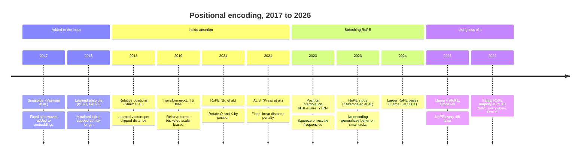
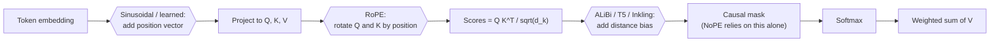

---
tags:
  - ai-ml
  - foundations
  - positional-encoding
  - long-context
status: draft
sources:
  - https://arxiv.org/abs/1706.03762
  - https://arxiv.org/abs/1803.02155
  - https://arxiv.org/abs/1901.02860
  - https://arxiv.org/abs/1910.10683
  - https://arxiv.org/abs/2104.09864
  - https://arxiv.org/abs/2108.12409
  - https://arxiv.org/abs/2305.19466
  - https://arxiv.org/abs/2306.15595
  - https://arxiv.org/abs/2309.00071
  - https://arxiv.org/abs/2405.04434
  - https://arxiv.org/abs/2410.02660
  - https://arxiv.org/abs/2410.06205
  - https://arxiv.org/abs/2508.10925
  - https://arxiv.org/abs/2512.12167
  - https://arxiv.org/abs/2605.27980
  - https://huggingface.co/blog/llama4-release
  - https://huggingface.co/papers/2606.19348
  - https://docs.vllm.ai/projects/recipes/en/latest/Qwen/Qwen3.5.html
  - https://magazine.sebastianraschka.com/p/understanding-positional-embeddings
  - https://sebastianraschka.com/llms-from-scratch/ch04/13_nope/
  - https://sebastianraschka.com/blog/2026/kimi-k3-architecture-notes.html
  - https://sebastianraschka.com/blog/2026/inkling-architecture-benchmark-notes.html
created: 2026-11-25
updated: 2026-11-25
---

## Table Of Contents

---

- [[#TL;DR|TL;DR]]
- [[#The Problem|The Problem]]
- [[#Foundations|Foundations]]
    - [[#Why Attention Is Blind to Order|Why Attention Is Blind to Order]]
    - [[#Absolute vs Relative Position|Absolute vs Relative Position]]
    - [[#Rotations and Frequencies|Rotations and Frequencies]]
- [[#How We Got Here|How We Got Here]]
- [[#How It Works|How It Works]]
    - [[#Sinusoidal Encoding|Sinusoidal Encoding]]
    - [[#Rotary Position Embedding (RoPE)|Rotary Position Embedding (RoPE)]]
    - [[#A Worked Example|A Worked Example]]
    - [[#Wavelengths and the RoPE Base|Wavelengths and the RoPE Base]]
    - [[#ALiBi and Learned Biases|ALiBi and Learned Biases]]
    - [[#NoPE|NoPE]]
    - [[#Context Extension (PI, NTK, YaRN)|Context Extension (PI, NTK, YaRN)]]
- [[#Where It Is Now|Where It Is Now]]
    - [[#Partial RoPE Became the Default|Partial RoPE Became the Default]]
    - [[#RoPE Locally, NoPE Globally|RoPE Locally, NoPE Globally]]
    - [[#NoPE Everywhere|NoPE Everywhere]]
    - [[#Who Uses What|Who Uses What]]
- [[#Trade-offs & Open Problems|Trade-offs & Open Problems]]
- [[#Resources|Resources]]
- [[#Related Notes|Related Notes]]

## ***TL;DR***
---
*[[Attention]] treats its input as a bag of tokens, so a model has to be told where each token sits. How you tell it decides how far the model can read, which is why positional encoding is now mostly a long-context question.*

- **The problem:** without position information, "dog bites man" and "man bites dog" look identical to a self-attention layer.
- **The old answer (2017 to 2020):** add a position vector to each token embedding, either fixed sine waves ([Vaswani et al., 2017](https://arxiv.org/abs/1706.03762)) or a learned table (GPT-2, BERT).
- **The standard answer (2021 to now):** RoPE rotates each query and key by an angle proportional to its position, so the attention score depends only on the *distance* between two tokens ([Su et al., 2021](https://arxiv.org/abs/2104.09864)).
- **Stretching context:** a RoPE model trained at 4K or 256K tokens can be extended by squeezing positions back into the trained range (Position Interpolation), raising the rotation base, or YaRN, which treats fast and slow frequencies differently ([Peng et al., 2023](https://arxiv.org/abs/2309.00071)).
- **Where it is now (Nov 2026):** RoPE is still the most common choice, but on fewer layers and fewer dimensions. Partial RoPE (only some features rotated) is now the majority among RoPE models, many models drop positions entirely in their global layers (NoPE), and Kimi K3 uses no positional encoding at all ([Raschka, Nov 2026](https://magazine.sebastianraschka.com/p/understanding-positional-embeddings); [Raschka, Jul 2026](https://sebastianraschka.com/blog/2026/kimi-k3-architecture-notes.html)).

## ***The Problem***
---
*Self-attention computes the same result if you shuffle its inputs, so on its own it cannot use word order. Any fix has to inject position without breaking parallel training, and ideally without capping how long an input can be.*

A recurrent network reads tokens one at a time, so order is built in. The [[Transformer]] threw recurrence away to train in parallel, and lost order with it ([Vaswani et al., 2017](https://arxiv.org/abs/1706.03762)). A good position scheme has to satisfy several demands at once, and they pull against each other:

| Demand | Why it matters | What fails it |
|---|---|---|
| Tell tokens apart by position | Grammar, code and arithmetic all depend on order. | Nothing at all (pure attention without a causal mask). |
| Care about *relative* distance | "The word two to my left" matters more than "the word at index 7,345". | Absolute schemes make the model learn the same pattern at every index separately. |
| Work past the training length | Users send longer prompts than most of pretraining saw. | Learned tables have no row for position 1,025 if they stopped at 1,024. |
| Cost almost nothing | Position code runs in every layer, for every token. | Large learned bias tables, extra matrix multiplies. |
| Play well with the [[KV Cache]] | Cached keys must stay valid as new tokens arrive. | Schemes that change a past key's encoding when the sequence grows. |

## ***Foundations***
---
*Three ideas carry the whole topic: attention is order-blind, position can be absolute or relative, and a rotation turns "difference in position" into "difference in angle". RoPE is just those three ideas put together.*

#### **Why Attention Is Blind to Order**
In [[Attention]], each output is a weighted average of value vectors, with weights from query-key dot products. If you swap two input tokens, their queries, keys and values swap too, and every output just swaps places. Mathematically, self-attention is *permutation-equivariant*. Nothing in the formula $\text{softmax}(QK^\top/\sqrt{d_k})V$ mentions an index.

The causal mask in decoder-only models breaks this symmetry a little: token 5 can see 5 tokens and token 500 can see 500. That is enough for a model to *infer* position, which is the basis of [[#NoPE|NoPE]] ([Kazemnejad et al., 2023](https://arxiv.org/abs/2305.19466)).

#### **Absolute vs Relative Position**

| Kind | What the model is told | Example | Weakness |
|---|---|---|---|
| Absolute | "This token is at index 42." | Sinusoidal, learned tables (GPT-2) | The pattern "adjective before noun" must be learned at every index; no rows past the max length for learned tables. |
| Relative | "That token is 3 to the left of this one." | Shaw et al. 2018, T5 bias, ALiBi, RoPE | Needs to act inside attention (on each query-key pair), not on the input. |

Language mostly cares about relative position, so the field moved from absolute to relative.

#### **Rotations and Frequencies**
Take a 2D vector and rotate it by angle $\alpha$. Rotate a second vector by $\beta$. Their dot product depends only on $\alpha - \beta$, because rotating both by the same extra amount changes nothing about the angle between them.

So if a token at position $m$ is rotated by $m\theta$ and one at $n$ by $n\theta$, their dot product depends only on $(m - n)\theta$: the relative distance. The catch is that angles wrap around every $2\pi$. One rotation speed can't tell distance 1 from distance $1 + 2\pi/\theta$. The fix, like a clock with second, minute and hour hands, is to use many rotation speeds at once: fast ones resolve nearby tokens, slow ones tell far-apart tokens apart.

## ***How We Got Here***
---
*Position went from something added to the input, to a bias inside attention, to a rotation of queries and keys. Since 2023 the work has been about stretching RoPE to longer contexts, and since 2025 about using it in fewer places.*

| Year | Step | Bottleneck it answered | Source |
|---|---|---|---|
| 2017 | Sinusoidal encoding added to embeddings. | Attention had no order at all. | [Vaswani et al.](https://arxiv.org/abs/1706.03762) |
| 2018 | Relative position representations: learned vectors for each clipped distance, added inside attention. | Absolute positions made relative patterns hard to learn. | [Shaw et al.](https://arxiv.org/abs/1803.02155) |
| 2019 | Transformer-XL relative encoding, so cached segments from earlier windows stay usable. | Absolute indices broke when reusing past segments. | [Dai et al.](https://arxiv.org/abs/1901.02860) |
| 2019 | T5: one learned scalar bias per distance bucket per head, added to attention scores. | Shaw's vectors cost memory; a scalar is enough. | [Raffel et al.](https://arxiv.org/abs/1910.10683) |
| 2021 | RoPE: rotate queries and keys; score depends on $m - n$. No extra parameters. | Relative position without a bias table, compatible with efficient kernels. | [Su et al.](https://arxiv.org/abs/2104.09864) |
| 2021 | ALiBi: subtract a fixed penalty proportional to distance. Trained at 1,024, works at 2,048. | Sinusoidal models fail past their training length. | [Press et al.](https://arxiv.org/abs/2108.12409) |
| 2023 | Position Interpolation: shrink positions to fit the trained range; LLaMA 7B to 65B reach 32,768 tokens in about 1,000 steps. | RoPE extrapolates badly past its training length. | [Chen et al.](https://arxiv.org/abs/2306.15595) |
| 2023 | YaRN: interpolate only the slow frequencies, plus an attention temperature; 10x fewer tokens and 2.5x fewer steps than prior methods. | PI blurs the fast frequencies that resolve nearby tokens. | [Peng et al.](https://arxiv.org/abs/2309.00071) |
| 2023 | NoPE: decoder-only models with *no* encoding generalize to longer inputs better than ALiBi, RoPE or absolute on reasoning tasks. | Explicit schemes overfit to trained lengths. | [Kazemnejad et al.](https://arxiv.org/abs/2305.19466) |
| 2024 | MLA "decoupled RoPE": a small separate rotated part of each key, so the compressed cache stays compressible. | RoPE conflicts with low-rank KV compression. | [DeepSeek-V2](https://arxiv.org/abs/2405.04434) |
| 2025 to 2026 | Interleaving NoPE layers, partial RoPE, removing RoPE after training (details below). | Million-token context. | See [[#Where It Is Now\|Where It Is Now]] |

## ***How It Works***
---
*Every scheme answers one question: where does position enter attention? Sinusoidal and learned tables add it to the input, RoPE rotates queries and keys, ALiBi and T5 add a bias to scores, and NoPE leaves it out and lets the causal mask carry it.*

#### **Sinusoidal Encoding**
Each position $pos$ gets a vector the same width as the embedding, $d_{model}$, built from sines and cosines at geometrically spaced frequencies ([Vaswani et al., 2017](https://arxiv.org/abs/1706.03762), Section 3.5):

$$
PE_{(pos,\,2i)} = \sin\!\left(\frac{pos}{10000^{2i/d_{model}}}\right), \qquad PE_{(pos,\,2i+1)} = \cos\!\left(\frac{pos}{10000^{2i/d_{model}}}\right)
$$

*In plain English: pair up the dimensions. Pair $i$ is a clock hand that turns at its own speed; early pairs spin fast, late pairs barely move. The position vector is the reading of every hand, and it is added to the token embedding once, before the first layer.*

Example with $d_{model} = 4$ at position 1: the two frequencies are $1$ and $1/100$, so $PE = [\sin 1, \cos 1, \sin 0.01, \cos 0.01] \approx [0.84, 0.54, 0.01, 1.00]$.

The authors chose it because a shift by $k$ positions is a fixed linear map of the vector, which should make relative offsets learnable. In practice the position signal gets mixed into the content and diluted as it passes through layers, and models trained this way degrade past their training length ([Press et al., 2021](https://arxiv.org/abs/2108.12409)).

#### **Rotary Position Embedding (RoPE)**
RoPE skips the input entirely. Inside every attention layer, after the query and key projections, it splits each head's $d$ features into $d/2$ pairs and rotates pair $i$ of the vector at position $m$ by angle $m\theta_i$ ([Su et al., 2021](https://arxiv.org/abs/2104.09864)):

$$
\begin{pmatrix} q'_{2i} \\ q'_{2i+1} \end{pmatrix} =
\begin{pmatrix} \cos m\theta_i & -\sin m\theta_i \\ \sin m\theta_i & \cos m\theta_i \end{pmatrix}
\begin{pmatrix} q_{2i} \\ q_{2i+1} \end{pmatrix},
\qquad \theta_i = b^{-2i/d},\; b = 10{,}000
$$

*In plain English: spin each two-number slice of the query (and the key) by an angle equal to "position times that slice's speed". Values are never rotated. Because both sides are rotated, the score $q'_m \cdot k'_n$ only sees the angle between them, which is $(m-n)\theta_i$: the relative distance.*

Formally, the rotated dot product is $q_m^\top R_{n-m}\, k_n$, a function of the content and $m - n$ only. Three properties made RoPE the default:

| Property | Why it matters |
|---|---|
| Relative by construction | Patterns learned at one place in the text work at every place. |
| No parameters, no bias matrix | Fits fused kernels like [[FlashAttention]], which never build the full score matrix. |
| Applied per token, once | A cached key is rotated by its own position when written and never changes, so the [[KV Cache]] stays valid. |

#### **A Worked Example**
One 2D pair with speed $\theta = 30°$ per token. Query content $q = [1, 0]$, key content $k = [1, 0]$ (identical, so the unrotated score is 1).

| Query position $m$ | Key position $n$ | Query angle | Key angle | Score $= \cos(\text{difference})$ |
|---|---|---|---|---|
| 3 | 1 | 90° | 30° | $\cos 60° = 0.50$ |
| 13 | 11 | 390° (= 30°) | 330° (= −30°) | $\cos 60° = 0.50$ |
| 3 | 3 | 90° | 90° | $\cos 0° = 1.00$ |

Same distance, same score, wherever it happens in the text. And the score falls as the tokens move apart, until the angle wraps around at distance $360°/30° = 12$, which is exactly why real models use many speeds.

#### **Wavelengths and the RoPE Base**
Pair $i$ completes a full turn every $2\pi/\theta_i$ tokens, its *wavelength*. With head dimension 128:

| Base $b$ | Fastest pair | Pair 16 | Pair 32 | Slowest pair (63) |
|---|---|---|---|---|
| 10,000 (RoFormer, Llama 2) | 6 tokens | 63 | 628 | ~54,000 |
| 500,000 (Llama 3) | 6 | 167 | ~4,400 | ~2.6 million |
| 10,000,000 (Qwen3.5 era) | 6 | 353 | ~20,000 | ~49 million |

*Computed from $\theta_i = b^{-2i/d}$; Llama 3's base from [Gao et al., 2024](https://arxiv.org/abs/2410.02660), Qwen3.5's from its [serving config](https://docs.vllm.ai/projects/recipes/en/latest/Qwen/Qwen3.5.html).*

The fast pairs act like a fine ruler for nearby tokens. The slow pairs barely rotate within the context, so they behave almost like no position at all and are free to carry meaning. A study of Gemma 7B found exactly that split: the highest frequencies build sharp positional patterns (attend to the previous token, for example), while the lowest frequencies are used mostly for semantic matching ([Barbero et al., 2024](https://arxiv.org/abs/2410.06205)).

This is why the base matters for long context. If the slowest wavelength is shorter than the context, far-apart tokens wrap around and look close. Raising the base before long-context training helped a lot: at 64K, Llama-3-8B's original base of 500K scored 29.1 on a long-context average, versus 54.6 with a base of 8 million ([Gao et al., 2024](https://arxiv.org/abs/2410.02660)).

#### **ALiBi and Learned Biases**
ALiBi adds no position to queries or keys. It subtracts a penalty from each attention score, growing linearly with distance ([Press et al., 2021](https://arxiv.org/abs/2108.12409)):

$$
\text{scores}_i = q_i K^\top + m \cdot [-(i-1), \dots, -2, -1, 0]
$$

*In plain English: the farther back a token is, the more its score is docked. Each head gets its own fixed slope $m$ (for 8 heads: $1/2, 1/4, \dots, 1/256$), so some heads look only locally and some look far.*

ALiBi trained at 1,024 tokens matched a sinusoidal model trained at 2,048, while training 11% faster with 11% less memory. Its downside is a built-in recency bias: far tokens are always penalized, which can hurt retrieval of a fact from deep in a long document. T5's learned bucket biases ([Raffel et al., 2019](https://arxiv.org/abs/1910.10683)) work the same way but learn the penalty. Thinking Machines' Inkling (Jul 2026) revived this family: no RoPE, and a learned bias computed from the query and key states that covers 512 tokens in local layers and 1,024 in global ones ([Raschka, Jul 2026](https://sebastianraschka.com/blog/2026/inkling-architecture-benchmark-notes.html)).

#### **NoPE**
NoPE means no positional encoding at all. In a decoder-only model the causal mask is still there: token $t$ attends over exactly $t$ tokens. A layer can, for example, put equal weight on everything it sees and read off "how many tokens is that", which recovers absolute position. Kazemnejad et al. proved NoPE can represent both absolute and relative position, found that trained models learn patterns resembling T5's relative bias, and showed NoPE generalized to longer sequences better than ALiBi, RoPE or absolute encodings on their reasoning and math tasks ([Kazemnejad et al., 2023](https://arxiv.org/abs/2305.19466)).

> [!Important] NoPE only works with a causal mask
> An encoder (bidirectional attention, like BERT) with no position information really is order-blind. NoPE is a decoder-only trick.

#### **Context Extension (PI, NTK, YaRN)**
A RoPE model trained at length $L$ has never seen rotation angles beyond $L\theta_i$. Feed it longer text and the slow pairs reach angles it never learned, and quality falls apart. Three fixes, each building on the last, with scale factor $s = L'/L$ (new length over trained length):

| Method | What it changes | Plain English | Catch |
|---|---|---|---|
| Position Interpolation ([Chen et al., 2023](https://arxiv.org/abs/2306.15595)) | Position $m \to m/s$ | Squeeze 16K positions into the 4K range the model knows. Position 12,000 is treated as 3,000. | Neighbors are now a quarter-step apart, so fast pairs lose resolution; needs fine-tuning. |
| NTK-aware (community, 2023; described in [Peng et al.](https://arxiv.org/abs/2309.00071)) | Base $b \to b \cdot s^{d/(d-2)}$ | Raise the base so slow pairs stretch a lot and fast pairs barely change. | Some slow dimensions still end up slightly out of range. |
| YaRN ([Peng et al., 2023](https://arxiv.org/abs/2309.00071)) | Per-pair blend, plus a softmax temperature | Leave fast pairs alone, fully interpolate slow ones, blend in between; then sharpen attention a little. | A fixed factor slightly hurts short inputs. |

YaRN's per-pair rule uses $r_i = L / \lambda_i$, how many full turns pair $i$ makes inside the trained length:

$$
\theta_i' = \big(1 - \gamma(r_i)\big)\frac{\theta_i}{s} + \gamma(r_i)\,\theta_i, \qquad
\gamma(r) = \begin{cases} 0 & r < \alpha \\ 1 & r > \beta \\ \frac{r-\alpha}{\beta-\alpha} & \text{otherwise} \end{cases}
$$

*In plain English: if a pair turns many times inside the trained window ($r > \beta$, a fast pair), keep its speed. If it doesn't complete even one turn ($r < \alpha$, a slow pair), slow it down by $s$ like PI. In between, mix the two.* For Llama, $\alpha = 1$ and $\beta = 32$: at $L = 4{,}096$, pairs with wavelengths under 128 tokens are untouched and pairs with wavelengths over 4,096 tokens are fully interpolated.

The temperature part scales queries and keys by $\sqrt{1/t} = 0.1\ln s + 1$. For a 16x extension that is $1.28$, which keeps attention from going flat when it is spread over many more tokens. YaRN took Llama 2 from 4K to 128K with about 400 fine-tuning steps ([Peng et al., 2023](https://arxiv.org/abs/2309.00071)).

YaRN is still the standard tool in late 2026: gpt-oss extends its dense layers to 131,072 tokens with it ([OpenAI, 2025](https://arxiv.org/abs/2508.10925)), and Qwen3.5 goes from a native 262,144 tokens to about 1 million with a YaRN factor of 4 ([vLLM recipe](https://docs.vllm.ai/projects/recipes/en/latest/Qwen/Qwen3.5.html)). Qwen's own guidance notes the catch: the factor is static, so turn it on only when you need long contexts ([Alibaba Cloud, Aug 2026](https://www.alibabacloud.com/blog/qwen3-8-27b-practical-guide-control-reasoning-depth-and-extend-context-to-1m-tokens_603509)).

## ***Where It Is Now***
---
*As of November 2026, RoPE is still the most common scheme, but it is applied to fewer dimensions and fewer layers each year. The new consensus is that explicit position helps locally and gets in the way globally, especially at a million tokens.*

Raschka's survey of his architecture gallery (Nov 15, 2026) sums up the direction: full RoPE on every softmax attention layer is still the most common choice but its share fell from 2025 to 2026; partial RoPE went from a minority of RoPE models in 2025 to a majority in 2026; and every NoPE-only model in the gallery was a recurrent hybrid ([Raschka, Nov 2026](https://magazine.sebastianraschka.com/p/understanding-positional-embeddings)).

#### **Partial RoPE Became the Default**
Rotate only some of each head's features and leave the rest position-free for content matching. That follows directly from the Gemma finding above: the slow, nearly unrotated pairs were being used for meaning anyway.

- **MiniMax-M3:** rotates 64 of 128 features per head (32 pairs), applies QK-Norm before RoPE, and serves 1M tokens ([Raschka, Nov 2026](https://magazine.sebastianraschka.com/p/understanding-positional-embeddings)).
- **Qwen3.5:** rotates a quarter of each head (`partial_rotary_factor: 0.25`) with base 10 million, interleaved multimodal RoPE ([vLLM recipe](https://docs.vllm.ai/projects/recipes/en/latest/Qwen/Qwen3.5.html)).
- **DeepSeek-V4:** applies RoPE only to the last 64 dimensions of each query and cached entry in its compressed attention, and rotates attention *outputs* back by their own position so the shared key-value entries carry relative position. Compressed blocks use learned positional biases instead. Context grows from 4K to 16K, 64K and 1M during pretraining, with no YaRN step ([DeepSeek-V4 report](https://huggingface.co/papers/2606.19348)).
- A study of 1B to 8B models ("Fractional Rotation, Full Potential?") found rotating about 10% of features often matched full RoPE, though full RoPE still won some evaluations (cited in [Raschka, Nov 2026](https://magazine.sebastianraschka.com/p/understanding-positional-embeddings)).

#### **RoPE Locally, NoPE Globally**
The most common pattern pairs short-range layers that use RoPE with full-range layers that use no position at all. Local layers never see far positions, so they never extrapolate; global layers have no position to extrapolate.

| Model | Layout | Source |
|---|---|---|
| Llama 4 (Apr 2025) | "iRoPE": every 4th layer NoPE with full attention and an inference-time softmax temperature; other 3 use RoPE on 8,192-token chunks. Trained at 256K, Scout served at 10M. | [Hugging Face](https://huggingface.co/blog/llama4-release) |
| SmolLM3 (2025) | RoPE in 3 layers, NoPE in the 4th, repeating across 36 layers; improved long context. | [Raschka](https://magazine.sebastianraschka.com/p/understanding-positional-embeddings) |
| Tiny Aya, Arcee Trinity | RoPE on sliding-window layers, NoPE on global layers. | [Raschka](https://sebastianraschka.com/llms-from-scratch/ch04/13_nope/) |
| gpt-oss (Aug 2025) | RoPE everywhere, alternating 128-token banded and dense layers; YaRN to 131K. | [OpenAI](https://arxiv.org/abs/2508.10925) |
| Periodic RoPE (May 2026, research) | Position index taken modulo the sliding window, so local layers never leave the trained range; NoPE global layers. Small-scale only so far. | [Huo, 2026](https://arxiv.org/abs/2605.27980) |

#### **NoPE Everywhere**
- **Kimi K3 (2026)** dropped RoPE from every layer, the first frontier-level model to do so as far as Raschka knows. It inherits the choice from Kimi Linear: 69 of its 93 layers are Kimi Delta Attention, a recurrent linear-attention layer that processes tokens in order, so the stack already knows sequence order without an explicit encoding ([Raschka, Jul 2026](https://sebastianraschka.com/blog/2026/kimi-k3-architecture-notes.html); see [[Hybrid Attention]]).
- **DroPE (ICLR 2026, Sakana AI):** pretrain with RoPE because it speeds up convergence, then delete it from every layer and recalibrate on under 5B tokens (about 0.8% of pretraining). The argument: PI, NTK and YaRN keep the fast positional frequencies but compress the slow semantic ones, so long-range retrieval fails. On SmolLM, DroPE scored 30.5 on LongBench versus 19.9 for YaRN, and on needle-in-a-haystack at 8x the training length 52.2 versus 12.2 ([Gelberg et al., 2025](https://arxiv.org/abs/2512.12167)).

#### **Who Uses What**

| Model (release) | Position scheme | Context |
|---|---|---|
| GPT-2 (2019) | Learned absolute, 1,024 rows | 1,024 |
| Llama 2 / Llama 3 | Full RoPE, base 10K / 500K | 4K / 8K (128K in Llama 3.1) |
| gpt-oss (Aug 2025) | Full RoPE + YaRN | 131K |
| Llama 4 (Apr 2025) | iRoPE: 3 RoPE chunked : 1 NoPE global | 1M to 10M |
| Qwen3.5 (Feb 2026) | Partial RoPE (25%), base 10M, YaRN optional | 262K native, ~1M with YaRN |
| DeepSeek-V4 (Apr 2026) | Partial RoPE (64 dims) + learned biases in compressed blocks | 1M |
| Inkling (Jul 2026) | No RoPE; learned input-dependent relative bias | 1M |
| Kimi K3 (2026) | NoPE everywhere (recurrent KDA layers carry order) | Not stated in source |
| MiniMax-M3 (2026) | Partial RoPE (50%) after QK-Norm | 1M |

## ***Trade-offs & Open Problems***
---
*Position schemes trade sharp local order against reach. Nobody has a scheme that is precise up close, unbiased far away and safe past the training length all at once, which is why models now mix schemes by layer.*

| Choice | Gains | Costs |
|---|---|---|
| Full RoPE | Precise relative order; zero parameters; kernel-friendly. | Fails past trained length without PI/YaRN; wastes slow pairs on position. |
| Partial RoPE | Frees features for content; smaller cos/sin tables. | Weaker positional signal; best fraction is still tuned by hand. |
| ALiBi / learned bias | Extrapolates by design; simple. | Built-in recency bias hurts long-range retrieval. |
| NoPE | Nothing to extrapolate; strong length generalization in studies. | Slower convergence; position must be inferred, which is fuzzy over long distances in pure attention stacks. |
| YaRN on top | Cheap extension, ~0.1% of pretraining data. | Static factor hurts short prompts; compresses semantic frequencies (DroPE's critique). |

Open problems:
- **Is RoPE a training aid rather than a feature?** DroPE suggests models may not need it after pretraining. Whether that holds at frontier scale is untested in public.
- **How much position does a hybrid need?** When recurrent layers ([[State Space Models]], linear attention) supply order, explicit encoding may be pure overhead, as in Kimi K3. The right ratio for pure-attention models is still an empirical guess (3:1, 5:1).
- **Effective vs advertised context.** A model that accepts 1M tokens because its positions don't break is not the same as one that uses 1M tokens well. Position schemes fix the first; retrieval quality deep in context is still measured case by case.
- **Interaction with sinks and normalization.** QK-Norm before RoPE (MiniMax-M3) and attention sinks change how scores behave at long range (see [[Attention Sinks and Gated Attention]] and [[Residual Stream and Normalization]]).

## ***Resources***
---
*Raschka's November 2026 article is the best single walk-through with code; read RoFormer Section 3 and the YaRN paper for the math. Barbero et al. is the paper that explains why partial RoPE works.*

**Primary papers**
- [Attention Is All You Need](https://arxiv.org/abs/1706.03762): Vaswani et al., Jun 2017. Section 3.5, sinusoidal encoding.
- [Self-Attention with Relative Position Representations](https://arxiv.org/abs/1803.02155): Shaw, Uszkoreit, Vaswani, Mar 2018.
- [Transformer-XL](https://arxiv.org/abs/1901.02860): Dai et al., Jan 2019.
- [Exploring the Limits of Transfer Learning (T5)](https://arxiv.org/abs/1910.10683): Raffel et al., Oct 2019. Bucketed relative biases.
- [RoFormer: Enhanced Transformer with Rotary Position Embedding](https://arxiv.org/abs/2104.09864): Su et al., Apr 2021.
- [Train Short, Test Long (ALiBi)](https://arxiv.org/abs/2108.12409): Press, Smith, Lewis, Aug 2021.
- [The Impact of Positional Encoding on Length Generalization](https://arxiv.org/abs/2305.19466): Kazemnejad et al., NeurIPS 2023 (NoPE).
- [Extending Context Window via Positional Interpolation](https://arxiv.org/abs/2306.15595): Chen et al., Jun 2023.
- [YaRN: Efficient Context Window Extension](https://arxiv.org/abs/2309.00071): Peng et al., Sep 2023 (ICLR 2024).
- [DeepSeek-V2](https://arxiv.org/abs/2405.04434): DeepSeek-AI, May 2024 (decoupled RoPE in MLA).
- [How to Train Long-Context Language Models (Effectively)](https://arxiv.org/abs/2410.02660): Gao, Wettig, Yen, Chen, Oct 2024. RoPE base ablations.
- [Round and Round We Go! What Makes Rotary Positional Encodings Useful?](https://arxiv.org/abs/2410.06205): Barbero et al., Oct 2024.
- [gpt-oss model card](https://arxiv.org/abs/2508.10925): OpenAI, Aug 2025.
- [Extending the Context of Pretrained LLMs by Dropping Their Positional Embeddings (DroPE)](https://arxiv.org/abs/2512.12167): Gelberg et al., Dec 2025, ICLR 2026.
- [DeepSeek-V4 tech report](https://huggingface.co/papers/2606.19348): DeepSeek-AI, Jun 2026.
- [Periodic RoPE for Infinite Context LLMs](https://arxiv.org/abs/2605.27980): Huo, May 2026.

**Explainers and analysis**
- [Understanding Positional Embeddings in Modern LLMs](https://magazine.sebastianraschka.com/p/understanding-positional-embeddings): Sebastian Raschka, Nov 2026. From GPT-2 tables to partial RoPE and NoPE, with 2026 gallery statistics.
- [NoPE (LLMs from Scratch, ch. 4)](https://sebastianraschka.com/llms-from-scratch/ch04/13_nope/): Raschka. Code and the models that use it.
- [Kimi K3 architecture notes](https://sebastianraschka.com/blog/2026/kimi-k3-architecture-notes.html) and [Inkling architecture notes](https://sebastianraschka.com/blog/2026/inkling-architecture-benchmark-notes.html): Raschka, Jul 2026.
- [Welcome Llama 4 Maverick & Scout](https://huggingface.co/blog/llama4-release): Hugging Face, Apr 2025. iRoPE details.
- [Qwen3.5 vLLM recipe](https://docs.vllm.ai/projects/recipes/en/latest/Qwen/Qwen3.5.html): config for YaRN to ~1M tokens.

## Related Notes

- [[Attention]] — The order-blind operation that positional encoding feeds; RoPE and ALiBi act directly on its scores.
- [[Transformer]] — Where position enters the architecture, and how the recipe moved from sinusoidal to RoPE.
- [[KV Cache]] — RoPE is applied once when a key is written, so cached keys never need re-encoding.
- [[FlashAttention]] — Fused attention kernels; RoPE fits them because it adds no bias matrix.
- [[Hybrid Attention]] — Recurrent layers that carry order themselves, which is why Kimi K3 can drop RoPE entirely.
- [[Sparse Attention]] — Sliding-window and compressed attention, where "RoPE local, NoPE global" layouts live.
- [[Attention Sinks and Gated Attention]] — Another fix to softmax behavior at long range.
- [[Residual Stream and Normalization]] — QK-Norm, now often applied right before RoPE.
- [[Tokenization and Embeddings]] — The embeddings that sinusoidal and learned positions were added to.
- [[State Space Models]] — Order-aware by construction, so hybrids with them often need no explicit positions.
