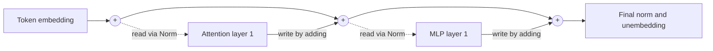
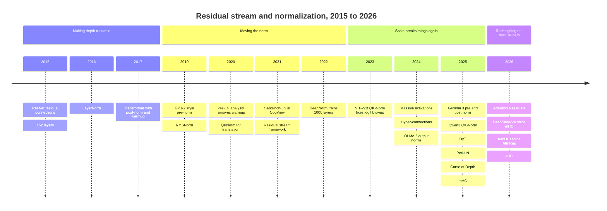
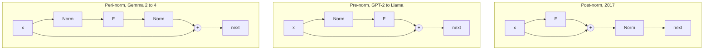
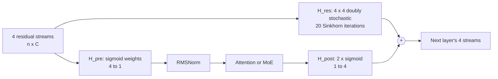

---
tags:
  - ai-ml
  - foundations
  - architecture
  - normalization
  - residual-connections
  - training-stability
status: draft
sources:
  - https://arxiv.org/abs/1512.03385
  - https://arxiv.org/abs/1607.06450
  - https://arxiv.org/abs/1910.07467
  - https://arxiv.org/abs/2002.04745
  - https://arxiv.org/abs/2010.04245
  - https://arxiv.org/abs/2105.13290
  - https://transformer-circuits.pub/2021/framework/index.html
  - https://arxiv.org/abs/2203.00555
  - https://arxiv.org/abs/2302.05442
  - https://arxiv.org/abs/2402.17762
  - https://arxiv.org/abs/2409.19606
  - https://arxiv.org/abs/2501.00656
  - https://arxiv.org/abs/2502.02732
  - https://icml.cc/virtual/2025/poster/44675
  - https://arxiv.org/abs/2502.05795
  - https://arxiv.org/abs/2503.10622
  - https://arxiv.org/abs/2503.19786
  - https://arxiv.org/abs/2505.09388
  - https://arxiv.org/abs/2512.24880
  - https://arxiv.org/abs/2603.15031
  - https://arxiv.org/abs/2606.19348
  - https://arxiv.org/abs/2607.14530
  - https://huggingface.co/papers/2607.02770
  - https://arxiv.org/abs/2609.31098
  - https://api-docs.deepseek.com/news/news260424
  - https://deepseek.com/en/news/v4-preview/
  - https://huggingface.co/Qwen/Qwen3.6-27B/blob/main/config.json
  - https://www.lmsys.org/blog/2026-07-27-kimi-k3-day0-support
  - https://magazine.sebastianraschka.com/p/the-big-llm-architecture-comparison
  - https://sebastianraschka.com/llm-architecture-gallery/
  - https://sebastianraschka.com/llm-architecture-gallery/qk-norm/
  - https://sebastianraschka.com/llm-architecture-gallery/mhc/
  - https://sebastianraschka.com/llm-architecture-gallery/attention-residuals/
  - https://sebastianraschka.com/blog/2026/gemma-4-release-notes.html
  - https://sebastianraschka.com/blog/2026/kimi-k3-architecture-notes.html
  - https://jianyuh.github.io/llm/2026/04/26/DeepSeek-V4-Arch-Train.html
created: 2026-11-26
updated: 2026-11-26
---

## Table Of Contents

---

- [[#TL;DR|TL;DR]]
- [[#The Problem|The Problem]]
- [[#Foundations|Foundations]]
    - [[#Vanishing and Exploding Gradients|Vanishing and Exploding Gradients]]
    - [[#Residual Connections|Residual Connections]]
    - [[#The Residual Stream View|The Residual Stream View]]
    - [[#Normalization Layers Compared|Normalization Layers Compared]]
- [[#How We Got Here|How We Got Here]]
- [[#How It Works|How It Works]]
    - [[#LayerNorm and RMSNorm|LayerNorm and RMSNorm]]
    - [[#A Worked Example on Four Numbers|A Worked Example on Four Numbers]]
    - [[#Where the Norm Goes|Where the Norm Goes]]
    - [[#Why Pre-Norm Trains Easily but Wastes Depth|Why Pre-Norm Trains Easily but Wastes Depth]]
    - [[#QK-Norm and Attention Logit Growth|QK-Norm and Attention Logit Growth]]
    - [[#Massive Activations|Massive Activations]]
    - [[#Hyper-Connections and mHC|Hyper-Connections and mHC]]
    - [[#Removing the Norm with DyT|Removing the Norm with DyT]]
- [[#Where It Is Now|Where It Is Now]]
    - [[#The Default Block in Late 2026|The Default Block in Late 2026]]
    - [[#QK-Norm Is Near Universal|QK-Norm Is Near Universal]]
    - [[#The Residual Path Is Being Redesigned|The Residual Path Is Being Redesigned]]
- [[#Trade-offs & Open Problems|Trade-offs & Open Problems]]
- [[#Resources|Resources]]
- [[#Related Notes|Related Notes]]

## ***TL;DR***
---
*Two small pieces make a 100-layer [[Transformer]] trainable: a residual connection that adds each layer's output to a running vector instead of replacing it, and a normalization layer that keeps the size of that vector's inputs under control. Where the norm sits, and what the residual path looks like, is still being redesigned in 2026.*

- **What it is:** every layer reads a normalized copy of a shared vector (the **residual stream**), computes something, and adds the result back. The identity path gives gradients a highway through depth; normalization keeps activations and attention scores in a range where training is stable.
- **The lineage:** the original Transformer normalized *after* the residual add (post-norm) and needed careful learning-rate warmup. Moving the norm *before* each sublayer (pre-norm) fixed that ([Xiong et al., 2020](https://arxiv.org/abs/2002.04745)), and LLaMA-style models swapped LayerNorm for the cheaper RMSNorm ([Zhang & Sennrich, 2019](https://arxiv.org/abs/1910.07467)).
- **The new problems:** pre-norm lets the residual stream grow with depth, which dilutes deep layers ("curse of depth") and produces massive activations, while attention logits can blow up. The answers were QK-Norm, extra norms after each sublayer (Gemma, OLMo 2), and rethinking the residual sum itself.
- **Where it is now (Nov 2026):** the default open-model block is RMSNorm, pre-norm, plus QK-Norm, often with a second RMSNorm on each sublayer's output. The residual path has become a design surface: DeepSeek-V4 (Apr 2026) widens it into four streams with mHC, and Kimi K3 (Jul 2026) replaces the fixed sum with Attention Residuals.

## ***The Problem***
---
*Deep networks are only useful if a gradient computed at the loss can reach the first layer intact, and if activations stay in a numeric range the hardware can represent. Stacking 60 to 100 layers breaks both by default.*

A plain deep network computes $x_{L} = f_L(f_{L-1}(\cdots f_1(x_0)))$. Two things go wrong as $L$ grows:

| Failure | What happens | Real example |
|---|---|---|
| Optimization gets harder with depth | Deeper plain networks reach *worse* training error than shallower ones, even though they could in principle copy the shallow solution | The motivation for ResNet: "Deeper neural networks are more difficult to train" ([He et al., 2015](https://arxiv.org/abs/1512.03385)) |
| Activations or scores explode | Values grow until softmax saturates or numbers overflow, and the loss diverges | ViT-22B: attention logits grew past 50,000 and training diverged at around 8B parameters ([Dehghani et al., 2023](https://arxiv.org/abs/2302.05442)); a 4B pre-LN text-to-image Transformer hit NaN loss within 1,000 iterations in FP16 ([Ding et al., 2021](https://arxiv.org/abs/2105.13290)) |
| Training needs fragile tricks | Post-norm Transformers need a learning-rate warmup or they become unstable; warmup adds hyperparameters and slows training | [Xiong et al., 2020](https://arxiv.org/abs/2002.04745) |

Residual connections answer the first row; normalization, and where it is placed, answers the other two. Getting them wrong costs a loss spike or a diverged run at full scale, which is why every frontier report spends pages on them.

## ***Foundations***
---
*Four ideas: why gradients vanish or explode through many layers, how an identity shortcut fixes that, the "residual stream" picture of what a Transformer is doing, and what normalization layers compute.*

#### **Vanishing and Exploding Gradients**

Backpropagation multiplies one Jacobian per layer:

$$
\frac{\partial \mathcal{L}}{\partial x_0} = \frac{\partial \mathcal{L}}{\partial x_L} \prod_{l=1}^{L} \frac{\partial x_l}{\partial x_{l-1}}
$$

*In plain English: the signal that tells the first layer how to change is the product of how much every later layer amplifies or shrinks it. If each factor is a bit below 1, the product vanishes; if a bit above 1, it explodes.*

**Example:** if each of 50 layers scales the gradient by 0.5, the first layer receives $0.5^{50} \approx 8.9 \times 10^{-16}$ of it, which is nothing in BF16 or even FP32 terms. Scale by 1.5 instead and it grows by about $6 \times 10^{8}$. Careful initialization helps at step 0, but nothing keeps the factors near 1 once weights start moving.

#### **Residual Connections**

He et al. made each block learn a *residual* $F(x)$ on top of its input rather than a whole new function ([He et al., 2015](https://arxiv.org/abs/1512.03385)):

$$
x_{l+1} = x_l + F_l(x_l)
\quad\Rightarrow\quad
\frac{\partial x_{l+1}}{\partial x_l} = I + \frac{\partial F_l}{\partial x_l}
$$

*In plain English: the output is the input plus a correction. The Jacobian now always contains the identity matrix $I$, so even if a block's own contribution to the gradient is tiny, the gradient still passes straight through it unchanged.*

Unrolling over many blocks, $x_L = x_l + \sum_{i=l}^{L-1} F_i(x_i)$: the final state is the early state plus a *sum* of corrections, and the gradient to $x_l$ always contains a direct copy of the gradient at $x_L$. With this, ResNets reached 152 layers, 8x deeper than VGG, and won ILSVRC 2015 with 3.57% top-5 test error ([He et al., 2015](https://arxiv.org/abs/1512.03385)). A block that has nothing useful to add can learn $F \approx 0$ and become a no-op, which is why depth stopped hurting.

#### **The Residual Stream View**

Anthropic's interpretability team reframed the Transformer around that running sum ([Elhage et al., Dec 2021](https://transformer-circuits.pub/2021/framework/index.html)):

- The **residual stream** is the vector $x$ that flows from the embedding to the unembedding. It is "the sum of the output of all the previous layers and the original embedding."
- Every attention head and MLP **reads** from it with a linear projection and **writes** back by adding. Nothing overwrites; "once added, information persists in a subspace unless another layer actively deletes it."
- They call the stream "a communication channel": layers talk to later layers by writing into subspaces that those layers read. Its width $d_{\text{model}}$ is the channel's bandwidth, and because far more features are written than there are dimensions, the model communicates "in superposition."
- Some heads and neurons act as memory management, "clearing residual stream dimensions set by other layers" by writing the negative of what they read.

This picture explains most of what follows. Normalization controls the scale of what each layer *reads*; the residual add controls how writes *accumulate*; and once you think of the stream as shared memory, widening it (hyper-connections) or letting layers choose which past writes to read (Attention Residuals) are natural next steps.

#### **Normalization Layers Compared**

A normalization layer rescales a vector so its statistics are fixed, then applies a learned per-channel gain (and sometimes bias). The variants differ in *which numbers the statistics are computed over*:

| Norm | Statistics computed over | Why it fits or doesn't fit Transformers | Source |
|---|---|---|---|
| BatchNorm | Each feature, across the examples in a mini-batch | Depends on batch size, behaves differently at train and test time, awkward for variable-length sequences and recurrence | [Ba et al., 2016](https://arxiv.org/abs/1607.06450) |
| LayerNorm | All features of one token, one example at a time | Same computation at train and test, no batch dependence; the original Transformer's choice | [Ba et al., 2016](https://arxiv.org/abs/1607.06450) |
| RMSNorm | All features of one token, but only rescales: no mean subtraction | Re-centering is "dispensable"; 7% to 64% faster than LayerNorm in the paper's tests with comparable quality | [Zhang & Sennrich, 2019](https://arxiv.org/abs/1910.07467) |

The key property all three share is **scale invariance**: multiply the input by 10 and the output does not change. That is exactly what stops a growing residual stream from feeding ever-larger inputs into the next layer.

## ***How We Got Here***
---
*The pieces arrived in order of the problems they solved: residuals for depth, LayerNorm for sequences, pre-norm for warmup-free training, RMSNorm for speed, then QK-Norm and output norms once models got big enough for logits and activations to blow up. Since 2024 the residual sum itself has been up for redesign.*

| Year | What changed | Problem it answered | Source |
|---|---|---|---|
| 2015 | Learn residual $F(x)$ added to an identity shortcut | Deeper plain nets trained worse than shallow ones | [He et al.](https://arxiv.org/abs/1512.03385) |
| 2016 | LayerNorm: statistics per example over features | BatchNorm's batch dependence and poor fit to RNNs | [Ba et al.](https://arxiv.org/abs/1607.06450) |
| 2017 | Transformer uses post-norm: $\text{Norm}(x + F(x))$ | Stable training for a 6-layer encoder-decoder | [Raschka, 2025](https://magazine.sebastianraschka.com/p/the-big-llm-architecture-comparison) |
| 2019 | Pre-norm $x + F(\text{Norm}(x))$ in GPT-2 and most later LLMs; RMSNorm drops mean-centering | Post-norm instability in deeper models; LayerNorm's cost | [Raschka, 2025](https://magazine.sebastianraschka.com/p/the-big-llm-architecture-comparison), [Zhang & Sennrich](https://arxiv.org/abs/1910.07467) |
| 2020 | Mean-field analysis: post-LN has large gradients near the output at init; pre-LN is well-behaved and needs no warmup | Why warmup was needed, and how to drop it | [Xiong et al.](https://arxiv.org/abs/2002.04745) (ICML 2020) |
| 2020 | QKNorm: $\ell_2$-normalize queries and keys, learnable scale instead of $1/\sqrt{d}$ | Softmax saturation | [Henry et al.](https://arxiv.org/abs/2010.04245) |
| 2021 | Sandwich-LN: an extra LayerNorm at the end of each residual branch | Value explosion and FP16 NaNs in a 4B model | [Ding et al.](https://arxiv.org/abs/2105.13290) |
| 2022 | DeepNorm: $\text{LN}(\alpha x + G(x))$ with $\alpha > 1$ and down-scaled init; 1,000 layers | Post-LN's exploding updates; keep post-LN quality with pre-LN stability | [Wang et al.](https://arxiv.org/abs/2203.00555) |
| 2023 | LayerNorm on $Q$ and $K$ before the dot product at 22B scale | Attention logits over 50,000, one-hot attention, divergence at about 8B | [Dehghani et al.](https://arxiv.org/abs/2302.05442) |
| 2024 | A handful of activations about 10,000x the median, acting as fixed biases and attention sinks | Explains outliers in the residual stream | [Sun et al.](https://arxiv.org/abs/2402.17762) |
| 2024 | Hyper-connections: $n$ parallel residual streams with learned mixing | Trade-off between gradient vanishing (post-norm) and representation collapse (pre-norm) | [Zhu et al.](https://arxiv.org/abs/2409.19606) (ICLR 2025) |
| Dec 2024 | OLMo 2: RMSNorm moved to sublayer *outputs*, QK-Norm, z-loss | Loss spikes in the earlier OLMo recipe | [OLMo et al.](https://arxiv.org/abs/2501.00656) |
| 2025 | Peri-LN analysis; Curse of Depth; DyT replaces norms with $\tanh(\alpha x)$ | Pre-LN variance growth; deep layers near identity; is the norm needed at all? | [Kim et al.](https://arxiv.org/abs/2502.02732), [Sun et al.](https://arxiv.org/abs/2502.05795), [Zhu et al.](https://arxiv.org/abs/2503.10622) |
| Dec 2025 | mHC: residual mixing matrix constrained to be doubly stochastic | Hyper-connections broke the identity property and were unstable at scale | [Xie et al.](https://arxiv.org/abs/2512.24880) |
| 2026 | Attention Residuals (Mar); DeepSeek-V4 with mHC (Apr); Kimi K3 with AttnRes (Jul); xHC to 16 streams (Jul) | Fixed unit-weight residual sums dilute deep layers | [Kimi Team](https://arxiv.org/abs/2603.15031), [DeepSeek](https://arxiv.org/abs/2606.19348), [Zhang et al.](https://arxiv.org/abs/2607.14530) |

## ***How It Works***
---
*The mechanics: the two norm formulas, where they sit in the block and what each placement does to gradients and activations, how QK-Norm bounds attention scores, and how hyper-connections and mHC widen the residual stream without losing the identity path.*

#### **LayerNorm and RMSNorm**

For one token's hidden vector $x \in \mathbb{R}^d$ with learned gain $\gamma$ and bias $\beta$:

$$
\text{LayerNorm}(x) = \gamma \odot \frac{x - \mu}{\sqrt{\sigma^2 + \epsilon}} + \beta,
\qquad
\mu = \frac{1}{d}\sum_{i=1}^{d} x_i,
\quad
\sigma^2 = \frac{1}{d}\sum_{i=1}^{d} (x_i - \mu)^2
$$

*In plain English: subtract the vector's average, divide by its spread, then let the model stretch and shift each channel back with $\gamma$ and $\beta$. Every token comes out with mean 0 and variance 1 before the learned rescale.*

$$
\text{RMSNorm}(x) = \gamma \odot \frac{x}{\text{RMS}(x)},
\qquad
\text{RMS}(x) = \sqrt{\frac{1}{d}\sum_{i=1}^{d} x_i^2 + \epsilon}
$$

*In plain English: skip the mean subtraction and the bias. Just divide by the root-mean-square size of the vector so it comes out with RMS 1, then apply the per-channel gain. One fewer reduction over $d$, and no bias parameters* ([Zhang & Sennrich, 2019](https://arxiv.org/abs/1910.07467)).

$\epsilon$ (typically $10^{-6}$, as in the [Qwen3.6-27B config](https://huggingface.co/Qwen/Qwen3.6-27B/blob/main/config.json)) only prevents division by zero.

#### **A Worked Example on Four Numbers**

Take $x = [1, 3, 5, 7]$, with $\gamma = 1$, $\beta = 0$ and $\epsilon$ ignored.

| Step | LayerNorm | RMSNorm |
|---|---|---|
| Statistic | $\mu = 4$; deviations $[-3, -1, 1, 3]$; $\sigma^2 = (9+1+1+9)/4 = 5$; $\sigma = 2.236$ | mean of squares $= (1+9+25+49)/4 = 21$; RMS $= 4.583$ |
| Output | $[-1.342, -0.447, 0.447, 1.342]$ | $[0.218, 0.655, 1.091, 1.528]$ |
| Output mean / RMS | mean 0, RMS 1 | mean 0.873, RMS 1 |
| Input $\times 10$: $[10, 30, 50, 70]$ | same output | same output |

Two lessons. First, both outputs ignore the input's overall scale: a layer reading through either norm sees the same thing whether the residual stream has magnitude 5 or 500. Second, RMSNorm keeps the vector's *direction* relative to the origin (all entries stay positive), while LayerNorm also removes the shared offset. Empirically that offset removal buys little, so RMSNorm's savings won.

#### **Where the Norm Goes**

With $F$ the attention or MLP sublayer:

$$
\begin{aligned}
\text{Post-norm:}\quad & x_{l+1} = \text{Norm}\big(x_l + F(x_l)\big) \\
\text{Pre-norm:}\quad & x_{l+1} = x_l + F\big(\text{Norm}(x_l)\big) \\
\text{Peri-norm (sandwich):}\quad & x_{l+1} = x_l + \text{Norm}_{\text{out}}\Big(F\big(\text{Norm}_{\text{in}}(x_l)\big)\Big) \\
\text{OLMo 2 (output only):}\quad & x_{l+1} = x_l + \text{Norm}\big(F(x_l)\big)
\end{aligned}
$$

*In plain English: post-norm normalizes the stream itself after each add, so the stream never grows but the identity path is interrupted by a norm at every layer. Pre-norm only normalizes what the sublayer reads, so the identity path is clean but the stream can grow without limit. Peri-norm keeps the clean path and also normalizes what each sublayer writes, so no single write can be huge.*

| Placement | Gradient path | Stream magnitude | Known issue | Used by |
|---|---|---|---|---|
| Post-norm | Passes through a norm every layer | Fixed | Large gradients near the output at init, needs warmup ([Xiong et al.](https://arxiv.org/abs/2002.04745)); exploding updates ([Wang et al.](https://arxiv.org/abs/2203.00555)) | Original Transformer |
| Pre-norm | Clean identity highway | Grows with depth | Deep layers diluted; massive activations; FP16 overflow ([Kim et al.](https://arxiv.org/abs/2502.02732)) | GPT-2, Llama 3, Qwen3, DeepSeek |
| Peri / sandwich | Clean highway | Growth bounded per write | One extra norm per sublayer | CogView (2021), Gemma 2/3/4 |
| Output-only | Clean highway | Growth bounded per write | Sublayer input unnormalized | OLMo 2, with QK-Norm ([OLMo et al.](https://arxiv.org/abs/2501.00656)) |
| DeepNorm | Post-norm with up-weighted residual $\alpha x$ and down-scaled init, $\alpha = (2M)^{1/4}$ for an $M$-layer decoder | Fixed | Needs depth-specific constants | DeepNet, 1,000 layers ([Wang et al.](https://arxiv.org/abs/2203.00555)) |

#### **Why Pre-Norm Trains Easily but Wastes Depth**

In pre-norm, each sublayer writes an output of roughly fixed size (its input was normalized), and the stream is the sum of all writes. If writes were independent with unit variance, the stream's variance after $L$ writes would be about $L + 1$, so one layer's share of the stream shrinks like $1/\sqrt{L}$. In a 64-layer, 128-sublayer model that share is under 9% by the end (an illustrative calculation, not a measurement). Real training is worse:

- **Variance growth.** Peri-LN's analysis finds pre-LN hidden-state variance grows roughly linearly with depth at initialization and *exponentially* during training; in a 3.2B model, pre-LN activations exceeded the FP16 maximum after as few as 0.5B training tokens, while peri-LN stayed steadier with fewer gradient spikes ([Kim et al., 2025](https://arxiv.org/abs/2502.02732), ICML 2025).
- **Curse of depth.** "Nearly half" the layers of Llama, Mistral, DeepSeek and Qwen models are less effective than expected; growing variance makes deep pre-LN blocks' Jacobians close to identity, so they contribute little. Scaling each norm's output by $1/\sqrt{l}$ (LayerNorm Scaling) recovered performance from 130M to 7B ([Sun et al., 2025](https://arxiv.org/abs/2502.05795), NeurIPS 2025).
- **The caveat.** An ACML 2026 study measuring "effective depth" in sixteen models finds the residual stream's layer-to-layer similarity is largely explained by correlated updates, not idle layers, and treats pre-norm as one compounding factor rather than the cause ([Gahtan et al., 2026](https://arxiv.org/abs/2609.31098)).

Post-norm avoids the growth but puts a norm on the gradient highway. The peri-norm and output-norm revivals are attempts to get both: a clean identity path and bounded writes.

#### **QK-Norm and Attention Logit Growth**

[[Attention]] scores are $q \cdot k / \sqrt{d_h}$. Nothing bounds $\lVert q \rVert$ or $\lVert k \rVert$, so as weights grow, logits grow quadratically and softmax collapses to one-hot. QK-Norm normalizes queries and keys per head before the dot product (and, in RoPE models, before the rotation; see [[Positional Encoding]]):

$$
\text{score}(i, j) = \frac{\text{RMSNorm}(q_i) \cdot \text{RMSNorm}(k_j)}{\sqrt{d_h}}
$$

*In plain English: rescale every query and key to a fixed size before comparing them, so the score depends only on the angle between them and the learned gains, not on how large the weights have drifted.*

**Example:** with $\gamma = 1$, each normalized vector has length $\sqrt{d_h}$, so by Cauchy-Schwarz $|q \cdot k| \le d_h$ and the score is at most $\sqrt{d_h}$. For a head dimension of 128 that is $\sqrt{128} \approx 11.3$, against the 50,000+ logits ViT-22B saw without it ([Dehghani et al., 2023](https://arxiv.org/abs/2302.05442)). The learned gains can raise the ceiling, but only gradually and on purpose. ViT-22B used LayerNorm on $Q$ and $K$ and could keep its learning rate at $10^{-3}$ at larger scale instead of lowering it. The idea was first published for low-resource translation with $\ell_2$ normalization and a learned temperature ([Henry et al., 2020](https://arxiv.org/abs/2010.04245)).

QK-Norm replaced older patches: Gemma 3 says "we replace the soft-capping of Gemma 2 with QK-norm" ([Gemma Team, Mar 2025](https://arxiv.org/abs/2503.19786)); OLMo 2 replaced QKV clipping, saying it "avoids attention logits being too large, which can lead to training loss divergence" ([OLMo et al.](https://arxiv.org/abs/2501.00656)); and Qwen3 removed Qwen2's QKV-bias and added QK-Norm "to ensure stable training" ([Qwen, May 2025](https://arxiv.org/abs/2505.09388)).

#### **Massive Activations**

The residual stream is not evenly filled. In LLaMA2-7B, about four activations out of tens of thousands per hidden state reach around 2,600, roughly 10,000x the median of about 0.2. They sit in fixed dimensions (1415 and 2533), appear on the starting token and the first period or newline, arise abruptly in layer 2, stay nearly constant through about layer 30, and fade at the end. LLaMA2-70B's can exceed 15,000 ([Sun et al., 2024](https://arxiv.org/abs/2402.17762)).

They matter for three reasons:

- **They are functional.** Their values barely depend on the input; the authors call them "indispensable bias terms." Tokens carrying them get slightly positive attention logits while others get negative ones, so softmax routes attention to them: they *create* the attention sink. See [[Attention Sinks and Gated Attention]].
- **They are a pre-norm symptom.** The unnormalized residual highway is what lets one write reach that size; Peri-LN ties exponential variance growth to massive activations ([Kim et al., 2025](https://arxiv.org/abs/2502.02732)).
- **They are a numerics problem.** Outliers that large make low-precision formats and activation [[Quantization]] hard; Gemma 4 adds a scalar scale per block "to bound the activation ranges to fit fp16" ([Gemma Team, 2026](https://huggingface.co/papers/2607.02770)).

#### **Hyper-Connections and mHC**

Hyper-connections (HC) keep $n$ copies of the residual stream, an $n \times C$ matrix instead of a $C$-vector, and learn how layers read from, write to and mix them ([Zhu et al., 2024](https://arxiv.org/abs/2409.19606); notation from [Xie et al., 2025](https://arxiv.org/abs/2512.24880)):

$$
\mathbf{x}_{l+1} = \mathcal{H}^{\text{res}}_l\, \mathbf{x}_l + \mathcal{H}^{\text{post}\,\top}_l\, F\big(\mathcal{H}^{\text{pre}}_l\, \mathbf{x}_l\big)
$$

*In plain English: $\mathcal{H}^{\text{pre}}$ ($1 \times n$) blends the $n$ streams into one input for the sublayer; $\mathcal{H}^{\text{post}}$ ($1 \times n$) spreads the sublayer's output back over the streams; $\mathcal{H}^{\text{res}}$ ($n \times n$) mixes the streams with each other. A normal residual connection is the special case $n = 1$ with every $\mathcal{H}$ equal to 1.*

ByteDance's results: gains peaked at $n = 4$; on OLMoE-1B-7B, HC converged 1.8x faster and lifted ARC-Challenge from 41.8 to 47.8 ([Zhu et al.](https://arxiv.org/abs/2409.19606), ICLR 2025). The problem is that a learned, unconstrained $\mathcal{H}^{\text{res}}$ no longer preserves the identity path. Across many layers the product $\prod_l \mathcal{H}^{\text{res}}_l$ can amplify: DeepSeek measured a composite gain peaking near **3,000** and a loss surge around step 12k in HC training ([Xie et al., Dec 2025](https://arxiv.org/abs/2512.24880)).

**mHC** constrains $\mathcal{H}^{\text{res}}_l$ to the **Birkhoff polytope**, the set of doubly stochastic matrices (non-negative, every row and column sums to 1), using 20 Sinkhorn-Knopp iterations (exponentiate, then alternately normalize rows and columns). $\mathcal{H}^{\text{pre}} = \sigma(\cdot)$ and $\mathcal{H}^{\text{post}} = 2\sigma(\cdot)$ are kept non-negative so reads and writes cannot cancel.

Why that works: a doubly stochastic matrix has spectral norm at most 1, and a product of doubly stochastic matrices is still doubly stochastic. So however many layers you stack, the mixing can only *average* streams, never amplify them, which is the identity property in a wider form. In the paper, mHC's composite gain stayed around **1.6** versus HC's 3,000.

| 27B MoE (4.14B active, 262B tokens) | Baseline | HC | mHC |
|---|---|---|---|
| BBH (EM) | 43.8 | 48.9 | 51.0 |
| DROP (F1) | 47.0 | 51.6 | 53.9 |
| GSM8K (EM) | 46.7 | 53.2 | 53.8 |
| MMLU | 59.0 | 63.0 | 63.4 |

Cost: 6.7% extra training time at $n = 4$ with DeepSeek's fused kernels and recomputation ([Xie et al.](https://arxiv.org/abs/2512.24880)). FLOPs understate it, since a 4x wider residual state means 4x the residual memory traffic ([Raschka gallery: mHC](https://sebastianraschka.com/llm-architecture-gallery/mhc/)).

#### **Removing the Norm with DyT**

Zhu, Chen, He, LeCun and Liu noticed that trained LayerNorms mostly act linearly but squash extreme values into an S-shaped, tanh-like curve, and replaced them with an elementwise function ([Zhu et al., Mar 2025](https://arxiv.org/abs/2503.10622)):

$$
\text{DyT}(x) = \gamma \odot \tanh(\alpha x) + \beta
$$

*In plain English: instead of computing a statistic over the vector, squash each number independently with a tanh whose steepness $\alpha$ is learned. Small values pass almost linearly; outliers are capped.*

On LLaMA models from 7B to 70B, DyT matched RMSNorm's training loss within 0.01 (for example 1.45 vs 1.45 at 70B) and the same average over 15 zero-shot tasks. It removes a reduction over $d$, but LLMs needed $\alpha_0$ tuned to model width. As of late 2026, no major open model in the sources reviewed here ships DyT; it is evidence that what normalization buys is mostly outlier control.

## ***Where It Is Now***
---
*As of November 2026 the normalization recipe has largely converged: RMSNorm, pre-norm, QK-Norm, often with output norms. The open question has moved to the residual path itself, where DeepSeek, Moonshot and others are shipping wider or learned alternatives to the plain sum.*

#### **The Default Block in Late 2026**

| Model (release) | Norm and placement | Attention-score control | Residual path | Source |
|---|---|---|---|---|
| Llama 3 (Apr 2024) | RMSNorm, pre-norm | none | plain sum | [Raschka](https://magazine.sebastianraschka.com/p/the-big-llm-architecture-comparison) |
| OLMo 2 (Dec 2024) | RMSNorm on sublayer outputs | QK-Norm, z-loss $10^{-5}$ | plain sum | [OLMo et al.](https://arxiv.org/abs/2501.00656) |
| Gemma 3 (Mar 2025) | RMSNorm, pre and post | QK-Norm (replaced soft-capping) | plain sum | [Gemma Team](https://arxiv.org/abs/2503.19786) |
| Qwen3 (May 2025) | RMSNorm, pre-norm | QK-Norm (replaced QKV-bias) | plain sum | [Qwen](https://arxiv.org/abs/2505.09388) |
| Qwen3-Next (Sep 2025), Qwen3.6-27B (Apr 2026) | RMSNorm | zero-centered RMSNorm as QK-Norm; output gate (`attn_output_gate: true`) | plain sum | [Raschka](https://magazine.sebastianraschka.com/p/the-big-llm-architecture-comparison), [config](https://huggingface.co/Qwen/Qwen3.6-27B/blob/main/config.json) |
| Gemma 4 (Apr 2026) | RMSNorm, pre and post | QK-Norm | plain sum, per-block scalar for fp16 range | [Raschka](https://sebastianraschka.com/blog/2026/gemma-4-release-notes.html), [Gemma Team](https://huggingface.co/papers/2607.02770) |
| DeepSeek-V4-Pro and -Flash (Apr 24, 2026) | RMSNorm after the mHC pre-mix | RMSNorm on each query head and the compressed KV head; learnable sink logits | mHC, 4 streams | [DeepSeek](https://arxiv.org/abs/2606.19348), [news](https://api-docs.deepseek.com/news/news260424) |
| Kimi K3 (Jul 27, 2026), K3.1 Pro (Nov 4, 2026) | RMSNorm (fused with the residual add in SGLang) | not stated in sources read | Attention Residuals, per block | [LMSYS](https://www.lmsys.org/blog/2026-07-27-kimi-k3-day0-support), [Raschka](https://sebastianraschka.com/blog/2026/kimi-k3-architecture-notes.html) |

#### **QK-Norm Is Near Universal**

- **Why it spread:** it is one more RMSNorm per head, cheap, and removes a whole failure mode. Raschka calls it a "relatively negligible architecture change" that has become popular for stabilizing training ([Raschka gallery: QK-Norm](https://sebastianraschka.com/llm-architecture-gallery/qk-norm/)).
- **It interacts with the optimizer.** DeepSeek-V4 trains with Muon but does "not employ the QK-Clip technique," because RMSNorm on queries and KV already "avoids exploding attention logits"; the norm gains themselves are trained with AdamW rather than Muon ([DeepSeek, Apr 2026](https://arxiv.org/abs/2606.19348)). See [[Optimizers]].
- **Variants:** MiniMax-M2 normalizes the full Q and K projections before splitting into heads; Qwen3-Next uses a zero-centered RMSNorm; Cohere's Tiny Aya reportedly dropped QK-Norm over long-context concerns ([Raschka gallery: QK-Norm](https://sebastianraschka.com/llm-architecture-gallery/qk-norm/)). See [[Long Context]].
- **Late 2026 releases:** Raschka's gallery lists QK-Norm on, among others, MiniMax M3.1-Flash (Oct 19, 2026) and ERNIE 5.5 Flash Base (Nov 5, 2026), and sandwich RMSNorm on several October 2026 releases such as LFM3 and Kolibri-1 ([LLM Architecture Gallery, Nov 2026](https://sebastianraschka.com/llm-architecture-gallery/)).

#### **The Residual Path Is Being Redesigned**

Ten years after ResNet, the unit-weight sum $x + F(x)$ is no longer taken for granted:

- **mHC in production.** DeepSeek-V4-Pro (1.6T total, 49B active) and V4-Flash (284B, 13B active) use four parallel residual streams of 7,168 and 4,096 entries per token, with 20 Sinkhorn iterations and a separate four-to-one head before the final RMSNorm. The paper reports mHC wall-time overhead of 6.7% of a pipeline stage ([DeepSeek, Apr 2026](https://arxiv.org/abs/2606.19348); [Raschka gallery: mHC](https://sebastianraschka.com/llm-architecture-gallery/mhc/)). V4.1-Flash uses a "Single-Pass mHC" that fuses the mixing into one pass over the residual state ([Raschka gallery: mHC](https://sebastianraschka.com/llm-architecture-gallery/mhc/)).
- **Spreading beyond DeepSeek.** The gallery lists four-stream mHC in ERNIE 5.5 Flash Base (Nov 5, 2026) and four-stream identity hyper-connections in Tencent Hy4 (Nov 20, 2026) ([LLM Architecture Gallery](https://sebastianraschka.com/llm-architecture-gallery/)).
- **Attention Residuals.** Moonshot replaced the fixed sum with softmax attention over earlier layers' outputs: RMS-normalized past outputs are keys, a learned per-layer pseudo-query picks which to read. Block AttnRes keeps ordinary adds inside about eight blocks to cut memory from $O(Ld)$ to $O(Nd)$. The paper reports more uniform output magnitudes and gradients across depth, about 4% extra training and 2% extra inference cost ([Kimi Team, Mar 2026](https://arxiv.org/abs/2603.15031); [Raschka gallery](https://sebastianraschka.com/llm-architecture-gallery/attention-residuals/)). Kimi K3, 2.8T parameters, shipped it on Jul 27, 2026; it forced K3-specific code paths in SGLang because the attention-residual bank crosses pipeline stages ([LMSYS, Jul 2026](https://www.lmsys.org/blog/2026-07-27-kimi-k3-day0-support)).
- **Wider still.** xHC argues HC-family methods stall at $n = 4$ and uses 16 streams with only 4 updated per sublayer; at 18B MoE it raised average downstream score from 44.8 (mHC) to 48.8 for about 4.1% extra FLOPs over the vanilla baseline, and estimates mHC needs 1.19x xHC's compute for the same loss ([Zhang et al., Jul 2026](https://arxiv.org/abs/2607.14530)). This is one group's result, not yet in a shipped model in the sources read.

## ***Trade-offs & Open Problems***
---
*Each fix trades stability against something: a clean gradient path against bounded activations, a wider stream against memory traffic, learned depth mixing against simple kernels and parallelism. Whether the 2026 residual redesigns are worth their systems cost at every scale is not settled.*

| Choice | Buys | Costs | Open question |
|---|---|---|---|
| Post-norm | Bounded stream, uses depth fully | Warmup sensitivity, unstable at depth | DeepNorm and OLMo-style reorderings recover some of it; is plain post-norm ever worth it again? |
| Pre-norm | Easy, warmup-free training | Stream growth, curse of depth, massive activations | Is LayerNorm Scaling or peri-norm the cleaner fix? ([Sun et al.](https://arxiv.org/abs/2502.05795), [Kim et al.](https://arxiv.org/abs/2502.02732)) |
| Peri / sandwich norm | Bounded writes plus clean path | One extra norm per sublayer | OLMo 2's stability plot mixes reordering with QK-Norm, so the separate effect is hard to isolate ([Raschka](https://magazine.sebastianraschka.com/p/the-big-llm-architecture-comparison)) |
| QK-Norm | Bounded logits, no clipping hacks | Caps attention sharpness unless gains grow | Reported long-context interactions (Tiny Aya dropped it) |
| DyT | No reductions, simple elementwise op | Width-dependent $\alpha_0$ tuning for LLMs | Unproven at frontier scale and in long RL runs |
| mHC / HC | Richer depth connectivity, better benchmarks | 4x residual state and memory traffic; Sinkhorn per layer; harder pipeline parallelism | Does it scale past $n = 4$ (xHC says yes, with sparsity)? |
| Attention Residuals | Layers choose what to read from depth | Stored per-block states cross pipeline stages; custom serving paths | How it combines with [[Looped Transformers]] and [[Hybrid Attention]] stacks |

- **Massive activations are both a feature and a bug.** They implement attention sinks and biases, yet make [[Quantization]] and [[Low-Precision Training|low-precision training]] harder. Whether to remove them (with gated attention or sink logits) or accommodate them is still debated; see [[Attention Sinks and Gated Attention]].
- **Interpretability depends on the stream.** The clean "read, add, persist" picture of [Elhage et al.](https://transformer-circuits.pub/2021/framework/index.html) assumes one linear stream. With four mixed streams or attention over depth, circuits analysis has to be redone.
- **Diagnosis is hard.** Whether deep layers are "wasted" depends on the measure: the curse-of-depth view and the effective-depth view read similar evidence differently ([Gahtan et al., 2026](https://arxiv.org/abs/2609.31098)).

## ***Resources***
---
*Start with ResNet and the residual-stream framework for intuition, Xiong et al. for why pre-norm won, then the OLMo 2 and Gemma 3 reports for the modern recipe. The mHC and Attention Residuals papers are the current frontier.*

**Papers**
- [Deep Residual Learning for Image Recognition](https://arxiv.org/abs/1512.03385): He, Zhang, Ren, Sun, Dec 2015. The residual connection.
- [Layer Normalization](https://arxiv.org/abs/1607.06450): Ba, Kiros, Hinton, Jul 2016. LayerNorm and the comparison with BatchNorm.
- [Root Mean Square Layer Normalization](https://arxiv.org/abs/1910.07467): Zhang & Sennrich, Oct 2019. RMSNorm.
- [On Layer Normalization in the Transformer Architecture](https://arxiv.org/abs/2002.04745): Xiong et al., Feb 2020 (ICML 2020). Why post-norm needs warmup and pre-norm doesn't.
- [Query-Key Normalization for Transformers](https://arxiv.org/abs/2010.04245): Henry et al., Oct 2020. The first QKNorm.
- [CogView](https://arxiv.org/abs/2105.13290): Ding et al., May 2021. Sandwich-LN and PB-relax for FP16 stability.
- [DeepNet: Scaling Transformers to 1,000 Layers](https://arxiv.org/abs/2203.00555): Wang et al., Mar 2022. DeepNorm.
- [Scaling Vision Transformers to 22 Billion Parameters](https://arxiv.org/abs/2302.05442): Dehghani et al., Feb 2023. QK-Norm for attention logit growth.
- [Massive Activations in Large Language Models](https://arxiv.org/abs/2402.17762): Sun, Chen, Kolter, Liu, Feb 2024. Outliers in the residual stream and their link to sinks.
- [Hyper-Connections](https://arxiv.org/abs/2409.19606): Zhu et al. (ByteDance Seed), Sep 2024 (ICLR 2025).
- [2 OLMo 2 Furious](https://arxiv.org/abs/2501.00656): Team OLMo, Dec 2024. Output norms, QK-Norm, z-loss, with ablations.
- [Peri-LN: Revisiting Normalization Layer in the Transformer Architecture](https://arxiv.org/abs/2502.02732): Kim et al., Feb 2025 ([ICML 2025](https://icml.cc/virtual/2025/poster/44675)). Variance growth under each placement.
- [The Curse of Depth in Large Language Models](https://arxiv.org/abs/2502.05795): Sun et al., Feb 2025 (NeurIPS 2025). LayerNorm Scaling.
- [Transformers without Normalization](https://arxiv.org/abs/2503.10622): Zhu, Chen, He, LeCun, Liu, Mar 2025. DyT.
- [Gemma 3 Technical Report](https://arxiv.org/abs/2503.19786): Gemma Team (Google DeepMind), Mar 2025.
- [Qwen3 Technical Report](https://arxiv.org/abs/2505.09388): Qwen Team, May 2025.
- [mHC: Manifold-Constrained Hyper-Connections](https://arxiv.org/abs/2512.24880): Xie et al. (DeepSeek), Dec 2025.
- [Attention Residuals](https://arxiv.org/abs/2603.15031): Kimi Team (Moonshot AI), Mar 2026.
- [DeepSeek-V4: Towards Highly Efficient Million-Token Context Intelligence](https://arxiv.org/abs/2606.19348): DeepSeek, Apr 2026. mHC and QK RMSNorm in production.
- [xHC: Expanded Hyper-Connections](https://arxiv.org/abs/2607.14530): Zhang et al., Jul 2026. Sparse 16-stream hyper-connections.
- [Gemma 4 Technical Report](https://huggingface.co/papers/2607.02770): Gemma Team (Google DeepMind), 2026.
- [The Residual Stream's Effective Depth](https://arxiv.org/abs/2609.31098): Gahtan, Galil, Bronstein, 2026 (ACML 2026). A measure of how much depth the stream uses.

**Posts and explainers**
- [A Mathematical Framework for Transformer Circuits](https://transformer-circuits.pub/2021/framework/index.html): Elhage et al. (Anthropic), Dec 2021. The residual stream as a communication channel.
- [The Big LLM Architecture Comparison](https://magazine.sebastianraschka.com/p/the-big-llm-architecture-comparison): Sebastian Raschka, Jul 2025, updated through 2026. Norm placement and QK-Norm across open models.
- [LLM Architecture Gallery](https://sebastianraschka.com/llm-architecture-gallery/): Sebastian Raschka, updated Nov 2026. Per-model fact sheets and concept pages for [QK-Norm](https://sebastianraschka.com/llm-architecture-gallery/qk-norm/), [mHC](https://sebastianraschka.com/llm-architecture-gallery/mhc/) and [Attention Residuals](https://sebastianraschka.com/llm-architecture-gallery/attention-residuals/).
- [Gemma 4 Architecture and Benchmark Notes](https://sebastianraschka.com/blog/2026/gemma-4-release-notes.html): Raschka, Apr 2026.
- [Kimi K3 Architecture Notes](https://sebastianraschka.com/blog/2026/kimi-k3-architecture-notes.html): Raschka, Jul 2026. Attention Residuals vs mHC.
- [DeepSeek V4 Arch Train](https://jianyuh.github.io/llm/2026/04/26/DeepSeek-V4-Arch-Train.html): Jianyu Huang, Apr 2026. Walkthrough of V4's mHC and QK RMSNorm.

**Lab and systems posts**
- [DeepSeek V4 Preview Release](https://api-docs.deepseek.com/news/news260424): DeepSeek, Apr 24, 2026. Model sizes and release.
- [Kimi K3 Day-0 Support](https://www.lmsys.org/blog/2026-07-27-kimi-k3-day0-support): LMSYS, Jul 2026. What Attention Residuals require from a serving engine.

## Related Notes

- [[Transformer]] — The architecture whose blocks these norms and residual paths sit inside.
- [[Attention]] — Where QK-Norm acts, bounding the logits of the score matrix.
- [[Attention Sinks and Gated Attention]] — Massive activations in the residual stream create attention sinks; gating and sink logits are the alternatives.
- [[Optimizers]] — Muon, QK-Clip and warmup all interact with norm placement and QK-Norm.
- [[Quantization]] — Massive activations and stream growth are why activation outliers make low-bit formats hard.
- [[Looped Transformers]] — Reusing a block many times over one residual stream makes the stability of the residual path even more central.
- [[Positional Encoding]] — QK-Norm is applied before RoPE in most current models.
- [[Mixture of Experts]] — DeepSeek-V4's mHC mixes streams around MoE sublayers; MoE outliers drive its loss spikes.
- [[Hybrid Attention]] — Qwen3.6 (3:1 Gated DeltaNet to gated attention) and Kimi Linear mix linear and full attention on one normalized residual stream.
- [[Long Context]] — Reported interactions between QK-Norm and long-context behavior.
- [[Low-Precision Attention]] — FP16 and FP8 overflow is one of the failures normalization guards against.
- [[Distributed Training]] — Wider residual streams and Attention Residual banks change pipeline-parallel communication.
- [[Scaling Laws]] — mHC, xHC and Attention Residuals all report gains as shifted scaling curves.
