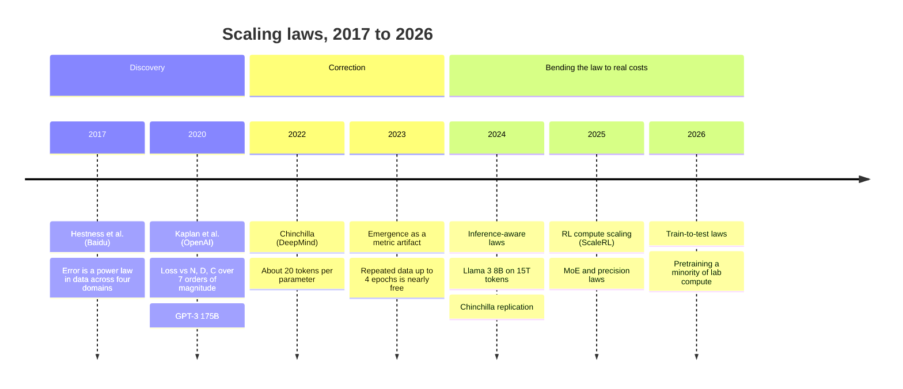
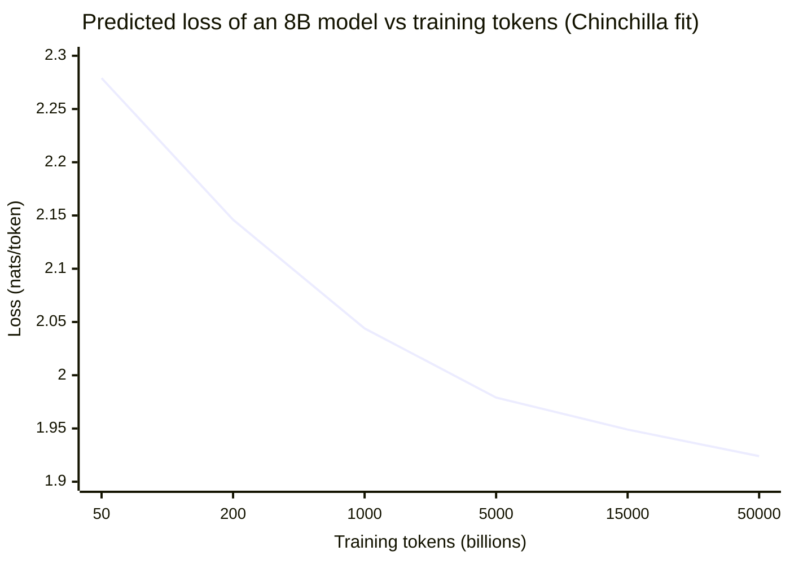
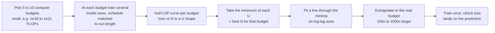

---
tags:
  - ai-ml
  - foundations
  - scaling
  - training
  - compute
status: draft
sources:
  - https://arxiv.org/abs/1712.00409
  - https://arxiv.org/abs/2001.08361
  - https://arxiv.org/abs/2203.15556
  - https://arxiv.org/abs/2404.10102
  - https://arxiv.org/abs/2406.12907
  - https://arxiv.org/abs/2304.15004
  - https://arxiv.org/abs/2305.16264
  - https://arxiv.org/abs/2401.00448
  - https://ai.meta.com/blog/meta-llama-3/
  - https://qwenlm.github.io/blog/qwen3/
  - https://arxiv.org/abs/2403.05812
  - https://arxiv.org/abs/2408.03314
  - https://arxiv.org/abs/2411.04330
  - https://arxiv.org/abs/2502.05172
  - https://arxiv.org/abs/2510.13786
  - https://arxiv.org/abs/2604.01411
  - https://arxiv.org/abs/2607.25271
  - https://epoch.ai/trends
  - https://epoch.ai/publications/model-counts-compute-thresholds
  - https://newsletter.semianalysis.com/p/long-live-the-short-king-why-4-hi
  - https://officechai.com/ai/while-share-of-inference-has-held-steady-over-the-last-2-years-pre-training-compute-has-moved-to-post-training-semi-analysis/
created: 2026-11-26
updated: 2026-11-26
---

## Table Of Contents

---

- [[#TL;DR|TL;DR]]
- [[#The Problem|The Problem]]
- [[#Foundations|Foundations]]
    - [[#Loss Is the Thing Being Predicted|Loss Is the Thing Being Predicted]]
    - [[#Power Laws and Log-Log Plots|Power Laws and Log-Log Plots]]
    - [[#Counting Compute with 6ND|Counting Compute with 6ND]]
    - [[#Reducible and Irreducible Loss|Reducible and Irreducible Loss]]
- [[#How We Got Here|How We Got Here]]
- [[#How It Works|How It Works]]
    - [[#Kaplan's Laws (2020)|Kaplan's Laws (2020)]]
    - [[#The Chinchilla Law (2022)|The Chinchilla Law (2022)]]
    - [[#Finding the Compute-Optimal Split|Finding the Compute-Optimal Split]]
    - [[#A Worked Example|A Worked Example]]
    - [[#Why Kaplan and Chinchilla Disagreed|Why Kaplan and Chinchilla Disagreed]]
    - [[#How Labs Actually Fit a Scaling Law|How Labs Actually Fit a Scaling Law]]
- [[#Where It Is Now|Where It Is Now]]
    - [[#Overtraining Is the Default|Overtraining Is the Default]]
    - [[#Running Low on Fresh Data|Running Low on Fresh Data]]
    - [[#Scaling Moved Past Pretraining|Scaling Moved Past Pretraining]]
    - [[#Scaling Laws for Everything Else|Scaling Laws for Everything Else]]
    - [[#How Fast the Inputs Are Growing|How Fast the Inputs Are Growing]]
- [[#Trade-offs & Open Problems|Trade-offs & Open Problems]]
- [[#Resources|Resources]]
- [[#Related Notes|Related Notes]]

## ***TL;DR***
---
*A scaling law is a fitted curve that predicts a model's loss from how big it is, how much data it sees and how much compute it uses. They are why labs could bet billions on bigger [[Transformer]]s with confidence, and the argument over their exact shape decides how every training budget is split.*

- **What it is:** an empirical rule, not a theorem. Train many small models, measure their loss, fit a power law, and extrapolate to the big model you can only afford to train once.
- **The core finding:** loss falls smoothly and predictably as a power law in parameters $N$, training tokens $D$ and compute $C \approx 6ND$, across many orders of magnitude ([Kaplan et al., 2020](https://arxiv.org/abs/2001.08361)).
- **The big correction:** Kaplan said grow the model much faster than the data. Chinchilla (2022) showed that with properly tuned training runs you should grow both about equally, roughly **20 tokens per parameter**. A 70B model on 1.4T tokens beat the 280B Gopher on the same compute ([Hoffmann et al., 2022](https://arxiv.org/abs/2203.15556)).
- **Where it is now (Nov 2026):** nobody trains at the Chinchilla point any more. Chinchilla minimizes *training* cost, but a model is served billions of times, so labs train smaller models far longer (Llama 3 8B saw about 1,875 tokens per parameter). Fresh text is running short, and since late 2025 more of the frontier labs' compute goes into reinforcement learning and inference than into pretraining, each with scaling curves of its own.

## ***The Problem***
---
*A frontier training run costs months and hundreds of millions of dollars, so you get one try. Scaling laws answer the two questions you must settle before you start: how good will the model be, and how should a fixed compute budget be split between a bigger model and more data?*

Before 2017 to 2020, choosing a model size was mostly habit and intuition. That has two failure modes:

| Mistake | What happens | Real example |
|---|---|---|
| Model too big for its data | Parameters are paid for but undertrained; the same compute in a smaller model on more data would score better | Gopher (280B, 300B tokens) lost to Chinchilla (70B, 1.4T tokens) at the same compute ([Hoffmann et al., 2022](https://arxiv.org/abs/2203.15556)) |
| Model too small for its data | Extra tokens give less and less; the model hits its capacity | The flat right end of the curve in [[#A Worked Example|the worked example]] |

The question is a constrained optimization: for a compute budget $C$, choose $N$ and $D$ with $6ND = C$ to minimize loss. You cannot answer it by trying, because every trial at full scale costs the whole budget. You need a model of how loss depends on $N$ and $D$ that you can fit cheaply and trust at 1,000x the scale. That model is a scaling law.

## ***Foundations***
---
*Four ideas make scaling laws readable: what "loss" measures, why power laws look like straight lines on log-log plots, how training compute is counted, and why loss can never reach zero.*

#### **Loss Is the Thing Being Predicted**

Scaling laws predict **pretraining loss**: the average cross-entropy, in nats per token, of the model's next-token predictions on held-out text. If the model gives the true next token probability $p$, the loss on that token is $-\ln p$. A loss of 2.0 nats means the model's average probability on the correct token is about $e^{-2} \approx 0.14$, in a geometric-mean sense.

Loss is used because it is smooth and continuous. Benchmark accuracy is not: it is a threshold on top of loss, which is why abilities sometimes seem to "appear" suddenly. Schaeffer et al. showed that many such jumps vanish when the same models are scored with a continuous metric ([Schaeffer et al., 2023](https://arxiv.org/abs/2304.15004)).

#### **Power Laws and Log-Log Plots**

A power law is $y = a x^{-k}$. Take logs of both sides: $\log y = \log a - k \log x$. On a plot with both axes logarithmic, it is a **straight line with slope $-k$**.

- **What the exponent means:** multiplying $x$ by 10 multiplies $y$ by $10^{-k}$. With Kaplan's $k = 0.076$ for parameters, 10x the parameters cuts loss by a factor of $10^{-0.076} \approx 0.84$, about 16%.
- **Why it matters:** a straight line is easy to extrapolate. Fit it on models from 10M to 1B parameters and you can read off a prediction for 100B. Whether that is safe is the open question at the bottom of this note.
- **Diminishing returns are built in:** every 10x buys the same *percentage* improvement, so each fixed drop in loss costs ten times more than the last.

#### **Counting Compute with 6ND**

Training a dense [[Transformer]] with $N$ parameters on $D$ tokens costs about

$$
C \approx 6ND \ \text{FLOPs}
$$

*In plain English: every token does 2 FLOPs per parameter in the forward pass (one multiply, one add) and about 4 in the backward pass (gradients for activations and for weights). The attention-score term is left out; it matters only at [[Long Context|long context]]* ([Kaplan et al., 2020](https://arxiv.org/abs/2001.08361)).

**Example:** Chinchilla, 70B parameters on 1.4T tokens: $6 \times 7{\times}10^{10} \times 1.4{\times}10^{12} \approx 5.9 \times 10^{23}$ FLOPs, matching the paper's $5.76 \times 10^{23}$. For a [[Mixture of Experts]] model, $N$ is the *active* parameters per token, not the total.

#### **Reducible and Irreducible Loss**

Text has genuine uncertainty: no model can know which of several reasonable next words a writer chose. That floor is the **irreducible loss** $E$, the entropy of the text itself. Everything above it is **reducible loss**, caused by a model that is too small or has seen too little data. Scaling laws describe how the reducible part shrinks; the floor never moves. Kaplan's laws have no explicit floor; Chinchilla's do.

## ***How We Got Here***
---
*Power-law learning curves were measured in 2017, Kaplan turned them into a recipe for language models in 2020, and Chinchilla corrected the recipe in 2022. Since then the field has bent the law around real costs: inference, scarce data, and compute spent after pretraining.*

| Year | What changed | Problem it answered | Source |
|---|---|---|---|
| 2017 | Generalization error falls as a power law in training-set size for translation, language modeling, vision and speech; better models shift the curve but keep its slope. | Is more data worth collecting, and how much? | [Hestness et al.](https://arxiv.org/abs/1712.00409) |
| 2020 | Language-model loss is a power law in $N$, $D$ and $C$; shape (depth vs width) barely matters; bigger models are more sample-efficient. Recipe: $N \propto C^{0.73}$. | How to spend a compute budget; justified GPT-3. | [Kaplan et al.](https://arxiv.org/abs/2001.08361) |
| 2022 | Over 400 models (70M to 16B) with learning-rate schedules matched to each run's length. Three methods agree: $N \propto C^{0.5}$, $D \propto C^{0.5}$. | Kaplan's recipe left large models undertrained. | [Hoffmann et al.](https://arxiv.org/abs/2203.15556) |
| 2023 | Sudden "emergent" abilities mostly come from thresholded metrics, not from the model. | Can downstream skills be predicted from loss? | [Schaeffer et al.](https://arxiv.org/abs/2304.15004) |
| 2023 | Up to about 4 epochs of repeated data is nearly as good as fresh data; beyond that its value decays toward zero. | What to do when unique text runs out. | [Muennighoff et al.](https://arxiv.org/abs/2305.16264) |
| 2023 to 2024 | Count inference in the budget and the optimum becomes a smaller model trained longer; quality still improves at 10,000 tokens per parameter. | Chinchilla ignores the cost of serving. | [Sardana et al.](https://arxiv.org/abs/2401.00448) |
| 2024 | Independent refit of Chinchilla's parametric fit finds errors in it; the corrected fit agrees with 20 tokens per parameter. Separately, Kaplan's gap is explained by counting non-embedding parameters at small scale. | Which of the published numbers to trust. | [Besiroglu et al.](https://arxiv.org/abs/2404.10102), [Pearce & Song](https://arxiv.org/abs/2406.12907) |
| 2024 | Spending compute at inference (search, revision) can beat a 14x larger model on FLOPs-matched reasoning problems. | A second axis to scale besides pretraining. | [Snell et al.](https://arxiv.org/abs/2408.03314) |
| 2025 | RL compute follows a predictable sigmoid curve; recipes can be compared from early training. | Making RL post-training plannable like pretraining. | [Khatri et al.](https://arxiv.org/abs/2510.13786) |
| 2026 | Jointly optimizing pretraining and test-time sampling pushes the optimum deep into overtraining. | Reasoning models are served with many samples each. | [Roberts et al.](https://arxiv.org/abs/2604.01411) |

## ***How It Works***
---
*Both classic laws model loss as a power law in model size and data. The difference is in the form and the fitted exponents, and that difference flips the answer to "bigger model or more data?". The optimum falls out of one line of calculus.*

#### **Kaplan's Laws (2020)**

Kaplan et al. fit each factor separately, with the other two not limiting:

| Law | Form | Fitted exponent | Reading |
|---|---|---|---|
| Model size | $L(N) = (N_c / N)^{\alpha_N}$ | $\alpha_N \approx 0.076$ | 10x params → loss x 0.84 |
| Data (early stopped) | $L(D) = (D_c / D)^{\alpha_D}$ | $\alpha_D \approx 0.095$ | 10x tokens → loss x 0.80 |
| Compute (optimal allocation) | $L(C) = (C_c / C)^{\alpha_C}$ | $\alpha_C \approx 0.050$ | 10x compute → loss x 0.89 |

$N$ here counts **non-embedding** parameters only, which gave cleaner fits. The constants $N_c$, $D_c$, $C_c$ depend on the tokenizer and dataset, so they have no deeper meaning; the exponents are the result. Their compute-optimal recipe was $N \propto C^{0.73}$ and $D \propto C^{0.27}$: put most new compute into parameters, stop training well before convergence ([Kaplan et al., 2020](https://arxiv.org/abs/2001.08361)).

#### **The Chinchilla Law (2022)**

Hoffmann et al. fit one joint formula with an explicit floor:

$$
L(N, D) = E + \frac{A}{N^{\alpha}} + \frac{B}{D^{\beta}}
$$

*In plain English: loss is the text's own entropy $E$, plus a penalty for having too few parameters that shrinks as $N$ grows, plus a penalty for having seen too little data that shrinks as $D$ grows. The two penalties are independent, so you can trade one off against the other.*

| Constant | Hoffmann et al. (as published) | Epoch replication (2024) |
|---|---|---|
| $E$ (floor, nats) | 1.69 | 1.82 |
| $A$ | 406.4 | 482.0 |
| $B$ | 410.7 | 2085.4 |
| $\alpha$ (params) | 0.34 | 0.35 |
| $\beta$ (data) | 0.28 | 0.37 |

All values are for DeepMind's MassiveText data and tokenizer; they do not transfer to another dataset ([Hoffmann et al., 2022](https://arxiv.org/abs/2203.15556); [Besiroglu et al., 2024](https://arxiv.org/abs/2404.10102)).

#### **Finding the Compute-Optimal Split**

Minimize $L(N, D)$ subject to $6ND = C$. Substituting $D = C / 6N$ and setting the derivative to zero gives

$$
N_{\text{opt}} = G \left(\frac{C}{6}\right)^{\frac{\beta}{\alpha+\beta}},
\qquad
D_{\text{opt}} = G^{-1} \left(\frac{C}{6}\right)^{\frac{\alpha}{\alpha+\beta}},
\qquad
G = \left(\frac{\alpha A}{\beta B}\right)^{\frac{1}{\alpha+\beta}}
$$

*In plain English: when the two exponents are similar ($\alpha \approx \beta$), each exponent is about one half, so a 100x bigger budget means a 10x bigger model on 10x more data. Whichever penalty shrinks more slowly gets more of the new compute.*

The three Chinchilla methods gave:

| Method | $a$ in $N_{\text{opt}} \propto C^{a}$ | $b$ in $D_{\text{opt}} \propto C^{b}$ |
|---|---|---|
| 1. Lowest loss across training curves | 0.50 | 0.50 |
| 2. IsoFLOP profiles | 0.49 | 0.51 |
| 3. Fit the formula above | 0.46 | 0.54 |
| Kaplan et al. (2020) | 0.73 | 0.27 |

Equal exponents mean a constant ratio of tokens to parameters, and the ratio that came out was about **20**. Since $C = 6N \cdot 20N = 120N^2$, the rule of thumb is

$$
N_{\text{opt}} \approx \sqrt{C / 120}, \qquad D_{\text{opt}} \approx 20\, N_{\text{opt}}
$$

**Example:** a $10^{24}$ FLOP budget gives $N \approx \sqrt{8.3 \times 10^{21}} \approx 91\text{B}$ parameters on about 1.8T tokens. Chinchilla's own table gives 1T parameters needing about 21T tokens and $1.3 \times 10^{26}$ FLOPs.

#### **A Worked Example**

Plug Gopher and Chinchilla, which used about the same compute, into the published Chinchilla formula:

| | Gopher | Chinchilla |
|---|---|---|
| $N$, $D$ | 280B, 300B tokens | 70B, 1.4T tokens |
| Tokens per parameter | 1.1 | 20 |
| Parameter penalty $A/N^{\alpha}$ | 0.052 | 0.083 |
| Data penalty $B/D^{\beta}$ | 0.251 | 0.163 |
| Predicted loss $E + \ldots$ | **1.993** | **1.937** |
| Measured MMLU (5-shot) | 60.0% | 67.6% |

Gopher's extra parameters saved only 0.03 nats; its missing data cost 0.09. Moving compute from parameters to data was a straight win, and the benchmarks agreed ([Hoffmann et al., 2022](https://arxiv.org/abs/2203.15556)).

The same formula shows diminishing returns from data for a fixed 8B model (illustrative: MassiveText constants, not Llama's data):

Going from 200B tokens (the Chinchilla point for 8B) to 15T tokens buys about 0.2 nats, at 75x the training compute. Whether that is worth it depends on what the model costs to *serve*, which is the subject of [[#Overtraining Is the Default|Where It Is Now]].

#### **Why Kaplan and Chinchilla Disagreed**

Two independent explanations, both now accepted:

- **Learning-rate schedules.** Kaplan used one cosine schedule length for all runs and read losses off partway through. A cosine schedule only reaches its best loss at its end, so short runs looked worse than they were, which made data look less valuable than it is. Chinchilla set each run's schedule to its own length ([Hoffmann et al., 2022](https://arxiv.org/abs/2203.15556)).
- **What counts as a parameter, and scale.** Kaplan counted non-embedding parameters and fit on small models, where the embedding table is a large share of the total. Simulating Chinchilla's analysis under those conditions reproduces Kaplan's biased exponent ([Pearce & Song, 2024](https://arxiv.org/abs/2406.12907)).

One more twist: Chinchilla's own Method 3 was flawed. Epoch AI reconstructed the data from the paper's figures and found the published fit was cut short by the [[Optimizers|optimizer]], that rounding $\beta$ to 0.28 biases predictions, and that the reported confidence intervals were implausibly narrow. Their corrected fit implies about 20 tokens per parameter, agreeing with Methods 1 and 2 rather than the roughly 70 that the published Method 3 fit implies ([Besiroglu et al., 2024](https://arxiv.org/abs/2404.10102)).

#### **How Labs Actually Fit a Scaling Law**

This is Chinchilla's Method 2 ([Hoffmann et al., 2022](https://arxiv.org/abs/2203.15556)). The last step matters: a big run landing on the line fitted from small runs is the evidence that the recipe is stable, and a miss means something in the recipe does not scale.

## ***Where It Is Now***
---
*As of November 2026 the Chinchilla ratio is a reference point, not a target. Models are trained far past it to be cheap to serve, fresh data is the binding constraint, and the scaling effort has moved into reinforcement learning and inference, which now take most frontier-lab compute.*

#### **Overtraining Is the Default**

Chinchilla minimizes training compute. But a deployed model runs inference on trillions of tokens, and inference cost scales with $N$. A smaller model trained longer reaches nearly the same loss and is much cheaper to serve.

- **Theory:** with expected demand around a billion requests, the optimum moves to smaller models on more data; quality keeps improving out to 10,000 tokens per parameter, though fits made at normal ratios overestimate the gains there ([Sardana et al., 2024](https://arxiv.org/abs/2401.00448)).
- **Practice:** Meta said the Chinchilla-optimal data for Llama 3 8B was about 200B tokens, yet both the 8B and 70B models "continued to improve log-linearly" up to 15T tokens, about 1,875 tokens per parameter for the 8B ([Meta, Apr 2024](https://ai.meta.com/blog/meta-llama-3/)). Qwen3, a family from 0.6B to 235B parameters, was pretrained on about 36T tokens; the post gives no per-size counts ([Qwen, Apr 2025](https://qwenlm.github.io/blog/qwen3/)).
- **Test-time sampling pushes further:** reasoning models are often run with many samples per question. Train-to-Test scaling laws, which pick model size, tokens and samples together, put the optimum "radically into the overtraining regime"; in small-scale tests the overtrained models beat Chinchilla-optimal ones on all eight tasks, and the effect shrinks but survives post-training ([Roberts et al., Apr 2026](https://arxiv.org/abs/2604.01411)).

Using the Chinchilla fit on Llama 3 8B's budget ($7.2 \times 10^{23}$ FLOPs): the compute-optimal model would be about 77B parameters on 1.5T tokens with predicted loss 1.93, against 1.95 for 8B on 15T. That is 0.02 nats worse for a model roughly 10x cheaper per token to run.

#### **Running Low on Fresh Data**

Overtraining needs tokens, and high-quality text grows far more slowly than compute. The 2023 finding that about 4 epochs of repetition is nearly free ([Muennighoff et al.](https://arxiv.org/abs/2305.16264)) is being refined: a July 2026 study models how much a repeated or paraphrased token is worth relative to a fresh one, finds that worth falls faster for larger models and higher token ratios, and concludes the classic compute-optimal split is suboptimal across most of the practical range. It recommends fewer epochs as models and data budgets grow; its fits stop at 600M parameters, so the large-scale advice is extrapolated ([Qin, Hamidieh & Alvarez-Melis, 2026](https://arxiv.org/abs/2607.25271)).

#### **Scaling Moved Past Pretraining**

- **Test-time compute:** spending inference FLOPs on search or revision can beat a 14x larger model on reasoning problems the base model sometimes solves ([Snell et al., 2024](https://arxiv.org/abs/2408.03314)). See [[Reasoning Models]].
- **RL compute:** RL post-training follows a sigmoid in compute, not a power law: $R_C - R_0 = (A - R_0) / (1 + (C_{\text{mid}}/C)^{B})$, where $A$ is the ceiling and $B$, $C_{\text{mid}}$ set how fast you approach it. Over 400,000 GB200 GPU-hours of experiments, loss type and batch size moved the ceiling, while most other recipe choices only changed the speed; stable recipes can be extrapolated from early training ([Khatri et al., Oct 2025](https://arxiv.org/abs/2510.13786)). See [[RL for Reasoning]].
- **Where the compute goes:** SemiAnalysis wrote in September 2026 that "the share of compute allocated to pre-training has shrunk significantly as end token demand has increased" ([SemiAnalysis, Sep 2026](https://newsletter.semianalysis.com/p/long-live-the-short-king-why-4-hi)). Secondary coverage of their model reports pretraining falling from about two-thirds of Anthropic and OpenAI compute in early 2024 to under a quarter in early 2026, with RL post-training the largest share ([OfficeChai, Oct 2026](https://officechai.com/ai/while-share-of-inference-has-held-steady-over-the-last-2-years-pre-training-compute-has-moved-to-post-training-semi-analysis/)); treat those figures as one firm's estimates.

#### **Scaling Laws for Everything Else**

Once a quantity can be swept, someone fits a law to it. The ones that change design decisions:

| Law | Finding | Source |
|---|---|---|
| Precision | Training in lower precision acts like having fewer parameters. Post-training [[Quantization]] hurts more the more data a model saw, so past some point extra [[Pretraining Data\|pretraining data]] makes the quantized model *worse*. | [Kumar et al., 2024](https://arxiv.org/abs/2411.04330) (ICLR 2025) |
| [[Mixture of Experts]] | Joint laws over active parameters, data and expert count; with the right configuration, MoE can beat dense models at a fixed *memory* budget, not only a fixed compute budget. | [Ludziejewski et al., 2025](https://arxiv.org/abs/2502.05172) (ICML 2025) |
| RL post-training | Sigmoid in compute; ceiling vs efficiency separated. | [Khatri et al., 2025](https://arxiv.org/abs/2510.13786) |
| Pretraining + test-time | Joint optimum is heavily overtrained. | [Roberts et al., 2026](https://arxiv.org/abs/2604.01411) |
| Data repetition and paraphrase | Derived tokens lose value faster at larger scale. | [Qin et al., 2026](https://arxiv.org/abs/2607.25271) |

#### **How Fast the Inputs Are Growing**

| Input | Trend | Source |
|---|---|---|
| Frontier training compute | About 5x per year since 2020 (doubling every 5.2 months) | [Epoch AI, updated Nov 2026](https://epoch.ai/trends) |
| Largest runs | Grok-3 (Feb 2025) was the first model Epoch estimated above $10^{26}$ FLOP; it projected about 10 such models by 2026 | [Epoch AI, May 2025](https://epoch.ai/publications/model-counts-compute-thresholds) |
| Algorithmic efficiency | Compute needed for a fixed language-model performance halved about every 8 months (95% CI 5 to 14) over 2012 to 2023 | [Ho et al., 2024](https://arxiv.org/abs/2403.05812) |

Algorithmic progress is why scaling-law constants go stale: a better architecture or data mix shifts the whole curve down, as Hestness saw in 2017, so each lab refits on its own current recipe.

## ***Trade-offs & Open Problems***
---
*Scaling laws are fits, not physics: they hold for one data mix, one tokenizer and one recipe, and they predict loss rather than the abilities people care about. The live questions are how far to trust extrapolation, how to predict downstream skills, and what to scale once fresh data runs out.*

- **Extrapolation risk.** A law fitted at $10^{21}$ FLOPs is used at $10^{26}$. Small fitting errors compound: Chinchilla's own parametric fit was off in its implied ratio by more than 3x ([Besiroglu et al., 2024](https://arxiv.org/abs/2404.10102)). The 2026 train-to-test fits also tended to overestimate performance out of range ([Roberts et al., 2026](https://arxiv.org/abs/2604.01411)).
- **Loss is not capability.** Laws predict cross-entropy. Benchmark scores are thresholds on top of it and can look jumpy ([Schaeffer et al., 2023](https://arxiv.org/abs/2304.15004)); predicting which skills a model will have from its loss is still unreliable.
- **Constants don't transfer.** $E$, $A$, $B$ and even the exponents depend on the data, tokenizer and architecture. Quoting "20 tokens per parameter" for a different setup is a rough guide at best.
- **What "optimal" means depends on the bill.** Training-optimal, inference-aware, memory-optimal and train-to-test laws give very different answers for the same budget. There is no single right model size without knowing how it will be served.
- **The data wall.** If high-quality text stops growing, $D$ can only grow through repetition, synthetic data or paraphrase, whose worth per token is still being measured ([Qin et al., 2026](https://arxiv.org/abs/2607.25271)).
- **Post-training laws are young.** RL laws are sigmoids with a ceiling that depends on the recipe; whether ceilings can be raised predictably, and how RL interacts with pretraining scale, is open ([Khatri et al., 2025](https://arxiv.org/abs/2510.13786)).

## ***Resources***
---
*Read Kaplan for the idea and Chinchilla for the method and the correction, then Epoch's replication to see how fragile the fitted numbers are. Sardana and Roberts explain why real models ignore the Chinchilla ratio.*

**Primary papers**
- [Deep Learning Scaling is Predictable, Empirically](https://arxiv.org/abs/1712.00409): Hestness et al. (Baidu), Dec 2017.
- [Scaling Laws for Neural Language Models](https://arxiv.org/abs/2001.08361): Kaplan et al. (OpenAI), Jan 2020.
- [Training Compute-Optimal Large Language Models](https://arxiv.org/abs/2203.15556): Hoffmann et al. (DeepMind), Mar 2022. The Chinchilla paper.
- [Are Emergent Abilities of Large Language Models a Mirage?](https://arxiv.org/abs/2304.15004): Schaeffer, Miranda, Koyejo, Apr 2023 (NeurIPS 2023).
- [Scaling Data-Constrained Language Models](https://arxiv.org/abs/2305.16264): Muennighoff et al., May 2023.
- [Beyond Chinchilla-Optimal: Accounting for Inference in Language Model Scaling Laws](https://arxiv.org/abs/2401.00448): Sardana, Portes, Doubov, Frankle, Dec 2023 (ICML 2024).
- [Chinchilla Scaling: A Replication Attempt](https://arxiv.org/abs/2404.10102): Besiroglu, Erdil, Barnett, You (Epoch AI), Apr 2024.
- [Reconciling Kaplan and Chinchilla Scaling Laws](https://arxiv.org/abs/2406.12907): Pearce & Song, Jun 2024.
- [Algorithmic Progress in Language Models](https://arxiv.org/abs/2403.05812): Ho et al. (Epoch AI), Mar 2024 (NeurIPS 2024).
- [Scaling LLM Test-Time Compute Optimally can be More Effective than Scaling Model Parameters](https://arxiv.org/abs/2408.03314): Snell, Lee, Xu, Kumar, Aug 2024 (ICLR 2025).
- [Scaling Laws for Precision](https://arxiv.org/abs/2411.04330): Kumar et al., Nov 2024 (ICLR 2025).
- [Joint MoE Scaling Laws: Mixture of Experts Can Be Memory Efficient](https://arxiv.org/abs/2502.05172): Ludziejewski et al., Feb 2025 (ICML 2025).
- [The Art of Scaling Reinforcement Learning Compute for LLMs](https://arxiv.org/abs/2510.13786): Khatri et al. (Meta), Oct 2025 (ICLR 2026).
- [Test-Time Scaling Makes Overtraining Compute-Optimal](https://arxiv.org/abs/2604.01411): Roberts et al., Apr 2026.
- [Bridging Compute- and Data-Optimal Pretraining](https://arxiv.org/abs/2607.25271): Qin, Hamidieh, Alvarez-Melis, Jul 2026.

**Lab posts**
- [Introducing Meta Llama 3](https://ai.meta.com/blog/meta-llama-3/): Meta, Apr 2024. The 15T-token, past-Chinchilla training note.
- [Qwen3: Think Deeper, Act Faster](https://qwenlm.github.io/blog/qwen3/): Qwen, Apr 2025. 36T tokens of pretraining.

**Analysis**
- [Epoch AI trends](https://epoch.ai/trends): compute, hardware and investment trends, updated Nov 2026.
- [How many AI models will exceed compute thresholds?](https://epoch.ai/publications/model-counts-compute-thresholds): Epoch AI, May 2025.
- [Long Live the Short King: Why 4-hi HBM Wins](https://newsletter.semianalysis.com/p/long-live-the-short-king-why-4-hi): SemiAnalysis, Sep 2026. Shift of compute from pretraining to RL and inference.

## Related Notes

- [[Transformer]] — The architecture these laws were measured on; where $N \approx 12Ld^2$ and $6ND$ come from.
- [[Mixture of Experts]] — Decouples active from total parameters, so $N$ in $6ND$ means active parameters.
- [[Quantization]] — Precision scaling laws: low-bit training and the cost of quantizing overtrained models.
- [[Reasoning Models]] — Test-time compute as a second scaling axis.
- [[RL for Reasoning]] — RL post-training and its sigmoid scaling curves.
- [[Distributed Training]] — How a $10^{26}$ FLOP run is actually spread across thousands of chips.
- [[AI Accelerators]] — The hardware whose growth feeds the compute trend.
- [[Tokenization and Embeddings]] — Why loss constants depend on the tokenizer, and why counting embedding parameters changed Kaplan's answer.
- [[KV Cache]] — Part of why inference cost pushes labs toward smaller, overtrained models.
- [[1 - All About Rooflines (NOT DONE)|1 - All About Rooflines (NOT DONE)]] — The FLOPs and bandwidth arithmetic behind counting compute.
