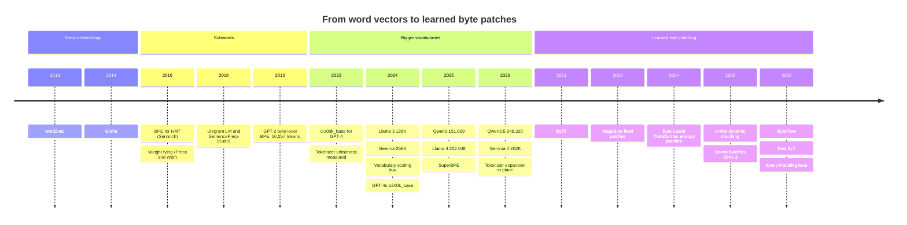
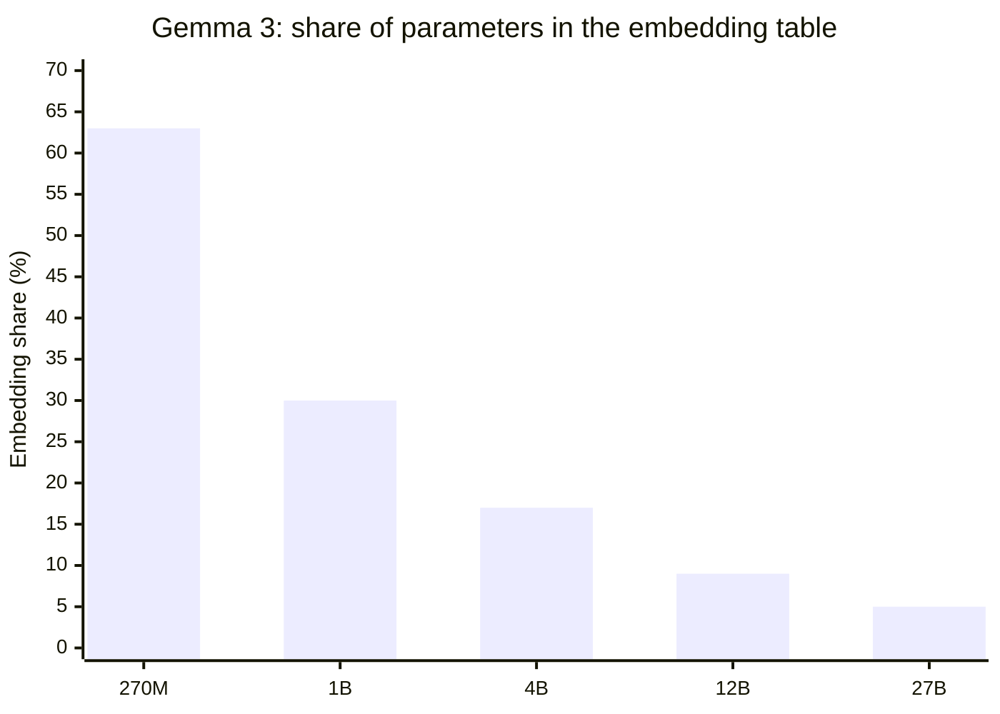
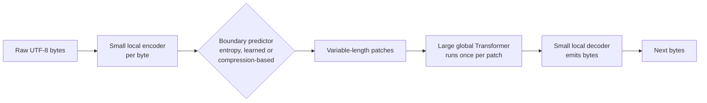

---
tags:
  - ai-ml
  - foundations
  - tokenization
  - embeddings
  - vocabulary
status: draft
sources:
  - https://arxiv.org/abs/1301.3781
  - https://arxiv.org/abs/1706.03762
  - https://arxiv.org/abs/2412.19437
  - https://nlp.stanford.edu/projects/glove/
  - https://arxiv.org/abs/1508.07909v2
  - https://arxiv.org/abs/1608.05859v3
  - https://arxiv.org/abs/1804.10959v1
  - https://huggingface.co/openai-community/gpt2-large
  - https://arxiv.org/abs/2105.13626
  - https://arxiv.org/abs/2305.07185
  - https://arxiv.org/abs/2305.15425v1
  - https://arxiv.org/abs/2402.14903
  - https://arxiv.org/html/2403.08295v1
  - https://arxiv.org/abs/2405.05417
  - https://ar5iv.labs.arxiv.org/html/2407.21783
  - https://arxiv.org/abs/2407.13623
  - https://arxiv.org/html/2412.09871v1
  - https://arxiv.org/html/2503.19786
  - https://arxiv.org/abs/2503.13423
  - https://arxiv.org/html/2505.09388v1
  - https://arxiv.org/abs/2507.07955
  - https://arxiv.org/abs/2603.03583
  - https://arxiv.org/html/2605.08044v1
  - https://arxiv.org/html/2607.02770v1
  - https://arxiv.org/abs/2607.15232
  - https://arxiv.org/html/2610.05978v1
  - https://arxiv.org/abs/2406.12907
  - https://huggingface.co/papers/2606.19348.md
  - https://huggingface.co/deepseek-ai/DeepSeek-V3/blob/main/config.json
  - https://huggingface.co/docs/transformers/model_doc/qwen3_5
  - https://huggingface.co/docs/transformers/model_doc/llama4
  - https://developers.googleblog.com/en/introducing-gemma-3-270m/
  - https://developers.openai.com/cookbook/examples/how_to_count_tokens_with_tiktoken
  - https://modal.com/blog/what-is-o200k-harmony
  - https://allenai.org/blog/bolmo
created: 2026-11-26
updated: 2026-11-26
---

## Table Of Contents

---

- [[#TL;DR|TL;DR]]
- [[#The Problem|The Problem]]
- [[#Foundations|Foundations]]
    - [[#Characters, Words or Subwords|Characters, Words or Subwords]]
    - [[#UTF-8 Bytes as the Universal Alphabet|UTF-8 Bytes as the Universal Alphabet]]
    - [[#Embedding Lookup Is Selecting a Row|Embedding Lookup Is Selecting a Row]]
    - [[#The Unembedding and the Softmax|The Unembedding and the Softmax]]
- [[#How We Got Here|How We Got Here]]
- [[#How It Works|How It Works]]
    - [[#The Pipeline End to End|The Pipeline End to End]]
    - [[#The BPE Merge Algorithm|The BPE Merge Algorithm]]
    - [[#A Worked BPE Example|A Worked BPE Example]]
    - [[#Unigram LM and SentencePiece|Unigram LM and SentencePiece]]
    - [[#Choosing the Vocabulary Size|Choosing the Vocabulary Size]]
    - [[#How Much of the Model Is Embeddings|How Much of the Model Is Embeddings]]
    - [[#Tied and Untied Embeddings|Tied and Untied Embeddings]]
    - [[#Tokenizer Quirks|Tokenizer Quirks]]
- [[#Where It Is Now|Where It Is Now]]
    - [[#Vocabularies of Current Open Models|Vocabularies of Current Open Models]]
    - [[#Recent Tokenizer Changes|Recent Tokenizer Changes]]
    - [[#Byte-Level and Dynamic Tokenization|Byte-Level and Dynamic Tokenization]]
    - [[#MTP Heads and Cheaper Softmax|MTP Heads and Cheaper Softmax]]
- [[#Trade-offs & Open Problems|Trade-offs & Open Problems]]
- [[#Resources|Resources]]
- [[#Related Notes|Related Notes]]

## ***TL;DR***
---
*A language model never sees text. A tokenizer cuts text into pieces from a fixed vocabulary, each piece becomes a row of a learned embedding matrix at the input of the [[Transformer]], and at the output a second matrix (often the same one) turns the final hidden state into one score per vocabulary entry, which a softmax turns into next-token probabilities.*

- **What it is:** a learned, lossless compression of text into integer IDs (usually byte-level BPE or SentencePiece), plus two $V \times d$ matrices that map IDs to vectors and vectors back to IDs.
- **Why subwords won:** words leave an open-vocabulary problem (unseen words), characters and bytes make sequences 3 to 5 times longer. Subwords from BPE ([Sennrich et al., 2016](https://arxiv.org/abs/1508.07909v2)) give common words one token and spell rare words from pieces, so nothing is ever unknown.
- **The key design knob:** vocabulary size $V$. Bigger $V$ means shorter sequences but a bigger embedding table and a more expensive output softmax. Vocabularies grew from 32K (Llama 2) to 128K (Llama 3), about 152K to 248K (Qwen3 to Qwen3.5) and 262K (Gemma), and a 2024 scaling law says most models were still too small ([Tao et al., 2024](https://arxiv.org/abs/2407.13623)).
- **Where it is now (Nov 2026):** every major open model checked here still ships a subword tokenizer, with vocabularies of 128K to 262K. Byte-level models with learned, dynamic patching (BLT, H-Net, Ai2's Bolmo, ByteFlow) now match subword models at up to 8B parameters and are far better at character-level tasks, but remain slower to decode and unused in frontier releases. On the output side, multi-token prediction heads that share the embedding and output head are standard for [[Speculative Decoding]].

## ***The Problem***
---
*A neural network needs a fixed set of inputs and outputs, but text is an unbounded sequence over more than a million Unicode characters in every language and in code. Tokenization has to choose units that keep sequences short, never hit an unknown symbol, and split the world's languages fairly, and every choice it makes is baked into the model forever.*

The model's input and output layers are tables indexed by token ID, so the vocabulary has to be fixed before training starts. That creates three competing pressures:

| Pressure | Pulls toward | Cost of ignoring it |
|---|---|---|
| Short sequences | Big units (whole words, multi-word chunks) | [[Attention]] cost and [[KV Cache]] memory grow with sequence length; a fixed [[Long Context]] window holds less text |
| Open vocabulary | Small units (characters, bytes) | Words outside the vocabulary become an `<unk>` symbol and their meaning is lost; translation is "an open-vocabulary problem" ([Sennrich et al., 2016](https://arxiv.org/abs/1508.07909v2)) |
| Small, well-trained tables | Few entries | Each extra entry adds $d$ parameters to the input table and to the output projection, and rare entries get too few gradient updates to learn (the glitch tokens in [[#Tokenizer Quirks|Tokenizer Quirks]]) |

A tokenizer is also trained once on a sample of text and then frozen, so whatever languages and domains were thin in that sample get split into more tokens, which means more cost and less context for their users ([Petrov et al., 2023](https://arxiv.org/abs/2305.15425v1)).

## ***Foundations***
---
*Four ideas are enough to follow the rest: why subwords sit between words and characters, why modern tokenizers start from UTF-8 bytes, why an embedding lookup is just picking a row of a matrix, and how the output layer turns a vector back into a probability over every token.*

#### **Characters, Words or Subwords**

| Unit | Vocabulary size | Sequence length | Unknown words? | Example: "unhappiness" |
|---|---|---|---|---|
| Word | Hundreds of thousands to millions | Shortest | Yes, anything not in the list | 1 token, or `<unk>` if never seen |
| Character | About 100 for English, far more for all scripts | Longest | Only unseen characters | 11 tokens |
| Byte | Exactly 256 | Longer than characters for non-Latin scripts | Never | 11 tokens |
| Subword | 30K to 260K in practice | In between | Never (with byte fallback) | e.g. `un` + `happiness` |

Word-level vocabularies have to stop somewhere, and the long tail of names, numbers, typos and morphology never ends. Character and byte models avoid that but spend far more positions per sentence. Subwords give frequent strings their own token and build rare ones from pieces, which is why every mainstream LLM since about 2018 uses them.

#### **UTF-8 Bytes as the Universal Alphabet**

UTF-8 encodes every Unicode character as 1 to 4 bytes: ASCII letters take 1, accented Latin letters 2, most Indic and CJK characters 3, emoji 4. Starting a tokenizer from the 256 possible byte values means *any* string, in any script or binary-ish format, can be encoded with no unknown symbol. GPT-2 introduced this "byte-level BPE", with a vocabulary of 50,257 ([GPT-2 model card](https://huggingface.co/openai-community/gpt2-large)). SentencePiece-based tokenizers get the same guarantee through **byte fallback**: characters not in the vocabulary are encoded as their raw bytes, as in Gemma ([Gemma Team, 2024](https://arxiv.org/html/2403.08295v1)). The flip side is that scripts needing 3 bytes per character start at a 3x disadvantage before any merges happen.

#### **Embedding Lookup Is Selecting a Row**

The embedding matrix $E \in \mathbb{R}^{V \times d}$ has one row per token. Token ID $i$ becomes

$$
x_i = \mathrm{onehot}(i)^\top E = E[i,:]
$$

*In plain English: multiplying a one-hot vector by a matrix just picks out one row, so the "embedding layer" is a lookup table whose rows are learned by gradient descent like any other weight. Nothing is computed; only the rows for tokens in the batch receive gradient.*

These vectors are where meaning starts. word2vec showed in 2013 that useful word vectors could be learned from 1.6 billion words "in less than a day" ([Mikolov et al., 2013](https://arxiv.org/abs/1301.3781)), and GloVe fit vectors to a global word-word co-occurrence matrix ([Stanford NLP](https://nlp.stanford.edu/projects/glove/)). Those were **static** embeddings: one vector per word regardless of context ("bank" of a river and "bank" for money share it). In a Transformer the input embedding is still static, but it is only the first write into the [[Residual Stream and Normalization|residual stream]]; the layers above make each position's vector contextual. Position information is added separately (see [[Positional Encoding]]).

#### **The Unembedding and the Softmax**

After the last layer, the model has a hidden vector $h \in \mathbb{R}^d$ for each position. The **unembedding** (also called the LM head or output projection) $W_U \in \mathbb{R}^{V \times d}$ turns it into one logit per token, and a softmax turns logits into probabilities:

$$
p(\text{next} = t \mid h) = \frac{\exp(W_U[t] \cdot h)}{\sum_{j=1}^{V} \exp(W_U[j] \cdot h)}
$$

*In plain English: each vocabulary entry has an output vector, the model scores every token by its dot product with the current hidden state, and the softmax normalizes the $V$ scores into a probability distribution. Training loss is $-\ln p$ of the true next token, the same cross-entropy that [[Scaling Laws]] predict.*

The cost is a $d \times V$ matrix-vector product per token: $2dV$ FLOPs. At $d = 4096$ and $V = 128{,}000$ that is about 1 GFLOP per token, and the normalizing sum touches all $V$ entries. This is why vocabulary size shows up in serving cost, not just in parameter counts.

## ***How We Got Here***
---
*Static word vectors came first, then neural translation forced the open-vocabulary problem into the open, and BPE solved it. Byte-level BPE and SentencePiece made tokenizers language-agnostic, vocabularies have grown about 8x since 2019, and since late 2024 learned byte-level patching has been closing the gap with tokenizers altogether.*

| Year | What changed | Problem it answered | Source |
|---|---|---|---|
| 2013 to 2014 | word2vec and GloVe learn one dense vector per word from co-occurrence. | Sparse one-hot words share no information. | [Mikolov et al.](https://arxiv.org/abs/1301.3781), [GloVe](https://nlp.stanford.edu/projects/glove/) |
| 2015 to 2016 | BPE, borrowed from data compression, builds a subword vocabulary by merging frequent pairs; rare words become sequences of subwords. +1.1 and +1.3 BLEU on WMT15 En-De and En-Ru over a dictionary back-off baseline. | Word-level NMT could not translate unseen words. | [Sennrich et al.](https://arxiv.org/abs/1508.07909v2) |
| 2016 to 2017 | Tie the input embedding to the output embedding; lowers perplexity and can cut NMT models "to less than half of their original size". | Two $V \times d$ matrices are a large share of a small model. | [Press & Wolf](https://arxiv.org/abs/1608.05859v3) |
| 2018 | Unigram LM segmentation and subword regularization (sample several segmentations in training); SentencePiece trains directly on raw text. | BPE gives one deterministic split; whitespace-based pre-splitting fails for languages without spaces. | [Kudo](https://arxiv.org/abs/1804.10959v1) |
| 2019 | GPT-2 runs BPE on UTF-8 bytes, 50,257 tokens. | Any string encodable, no `<unk>`, no language-specific preprocessing. | [GPT-2 card](https://huggingface.co/openai-community/gpt2-large) |
| 2021 to 2023 | ByT5 and MegaByte model raw bytes; MegaByte groups bytes into fixed patches with a global and a local model. | Tokenizers are brittle to noise and spelling; byte sequences are too long for plain attention. | [Xue et al.](https://arxiv.org/abs/2105.13626), [Yu et al.](https://arxiv.org/abs/2305.07185) |
| 2023 | Same text can take up to 15x more tokens in one language than another, across 17 tokenizers. | Measuring the cost of a tokenizer trained mostly on English. | [Petrov et al.](https://arxiv.org/abs/2305.15425v1) |
| 2024 | Llama 3 moves from 32K to 128K tokens (100K from tiktoken plus 28K for other languages); English compression 3.17 to 3.94 characters per token. | Shorter sequences and better multilingual coverage. | [Llama 3 paper](https://ar5iv.labs.arxiv.org/html/2407.21783) |
| 2024 | Optimal vocabulary grows with compute; Llama 2 70B "should have been at least 216K". | Vocabulary size had been chosen by habit. | [Tao et al.](https://arxiv.org/abs/2407.13623) |
| 2024 | BLT: bytes grouped into patches by next-byte entropy; parity with Llama 3 at up to 8B parameters, up to 50% fewer inference FLOPs. | Fixed patches waste compute on easy bytes; tokens are a fixed, unlearned compression. | [Pagnoni et al.](https://arxiv.org/html/2412.09871v1) |
| 2025 | H-Net learns its segmentation end to end ("dynamic chunking"); beats a compute-matched BPE Transformer. | Remove the tokenizer as a separate, frozen preprocessing step. | [Hwang, Wang & Gu](https://arxiv.org/abs/2507.07955) |
| 2025 to 2026 | Bigger vocabularies (Qwen3.5 248,320; Gemma 4 262K) and in-place tokenizer expansion of trained models. | Multilingual users pay more per character and get less context. | [HF Qwen3.5 docs](https://huggingface.co/docs/transformers/model_doc/qwen3_5), [Smith et al.](https://arxiv.org/abs/2607.15232) |

## ***How It Works***
---
*A tokenizer is trained once on a text sample by greedily merging the most frequent adjacent pair, and encoding replays those merges in order. The vocabulary size it ends at sets the trade-off between sequence length and the size and cost of the embedding and output matrices, which can be most of a small model.*

#### **The Pipeline End to End**

The IDs in the diagram are illustrative. Pre-tokenization rules (a regex in GPT-style tokenizers, whitespace handling in SentencePiece) decide which strings are never merged across, for example keeping digits apart or keeping a word and its leading space together.

#### **The BPE Merge Algorithm**

Training, given a corpus of pre-tokenized words with counts:

1. Start with each word split into base symbols (characters, or bytes), plus an end-of-word marker in the original formulation.
2. Count every adjacent symbol pair, weighted by word frequency.
3. Merge the most frequent pair everywhere into one new symbol and record the merge.
4. Repeat until the vocabulary reaches the target size $V$ (base symbols plus merges plus special tokens).

$$
(a, b)^{*} = \arg\max_{(a,b)} \sum_{w \in \text{corpus}} \mathrm{count}(w) \cdot \#\{(a,b) \text{ adjacent in } w\}
$$

*In plain English: at each step, glue together the two neighbouring symbols that appear side by side most often in the training text. Each merge adds one vocabulary entry, so the number of merges is the vocabulary size minus the base alphabet.*

Encoding new text replays the recorded merges in the same order. BPE is greedy and deterministic: a word always gets the same split, which is what Kudo's unigram method relaxes.

#### **A Worked BPE Example**

Toy corpus (the example from [Sennrich et al., 2016](https://arxiv.org/abs/1508.07909v2)): `low` x5, `lower` x2, `newest` x6, `widest` x3. Characters plus `</w>` (end of word) give 95 symbols in total.

| Merge | Best pair (count) | Corpus after merge | Total symbols |
|---|---|---|---|
| start | | `l o w </w>`, `l o w e r </w>`, `n e w e s t </w>`, `w i d e s t </w>` | 95 |
| 1 | `e` + `s` (9) | `n e w es t </w>`, `w i d es t </w>` | 86 |
| 2 | `es` + `t` (9) | `n e w est </w>`, `w i d est </w>` | 77 |
| 3 | `est` + `</w>` (9) | `n e w est</w>`, `w i d est</w>` | 68 |
| 4 | `l` + `o` (7) | `lo w </w>`, `lo w e r </w>` | 61 |
| 5 | `lo` + `w` (7) | `low </w>`, `low e r </w>` | 54 |
| 6 | `n` + `e` (6) | `ne w est</w>` | 48 |

Merge 1 was a three-way tie (`e s`, `s t`, `t </w>` all at 9); implementations break ties by a fixed rule, here first seen. Six merges halved the symbol count.

Now encode **`lowest`**, which never appeared in the corpus. Start `l o w e s t </w>` and replay the merges in order: merge 1 gives `l o w es t </w>`, merge 2 `l o w est </w>`, merge 3 `l o w est</w>`, merges 4 and 5 `low est</w>`. Result: two tokens, `low` + `est</w>`, a sensible split of a word the tokenizer never saw. That is the open-vocabulary property: the worst case is falling back to single characters or bytes, never `<unk>`.

#### **Unigram LM and SentencePiece**

BPE builds up from characters. Kudo's **unigram language model** goes the other way: start from a large candidate vocabulary, give each piece a probability, segment each word into its most probable split under those probabilities, and repeatedly prune the pieces whose removal hurts likelihood least. Because a word has many possible splits with known probabilities, training can **sample** segmentations ("subword regularization"), which gave "consistent improvements especially on low resource and out-of-domain settings" ([Kudo, 2018](https://arxiv.org/abs/1804.10959v1)).

**SentencePiece** is the library that packages BPE and unigram so they train on raw sentences, treating the space as an ordinary symbol, which removes language-specific word splitting. Gemma's tokenizers are SentencePiece with "split digits, preserved whitespace, and byte-level encodings" ([Gemma 3 report](https://arxiv.org/html/2503.19786)). GPT-family, Llama 3 and Qwen tokenizers are byte-level BPE in the tiktoken style ([Llama 3](https://ar5iv.labs.arxiv.org/html/2407.21783), [Qwen3](https://arxiv.org/html/2505.09388v1)).

#### **Choosing the Vocabulary Size**

Raising $V$ shortens sequences with diminishing returns, while the embedding table and softmax grow linearly:

| Effect of a larger $V$ | Direction | Why |
|---|---|---|
| Tokens per text | Down, sub-linearly | Later merges cover rarer strings |
| Attention and [[KV Cache]] per document | Down | Fewer positions |
| Embedding and unembedding parameters | Up, linearly | $V \times d$ each |
| Output-layer FLOPs per token | Up, linearly | $2dV$ |
| Training signal per token | Down for rare tokens | Each rare row is updated less often |

**Worked example, Llama 2 to Llama 3.** Llama 3 went from 32K to 128K tokens and from 3.17 to 3.94 characters per token on English ([Llama 3 paper](https://ar5iv.labs.arxiv.org/html/2407.21783)). The same English text now needs $3.17 / 3.94 \approx 0.80$ as many tokens, about 20% fewer. At the 8B model's $d = 4096$, one embedding matrix grows from $32{,}000 \times 4096 \approx 131$M to $128{,}000 \times 4096 \approx 524$M parameters, and the output projection from about 0.26 to 1.05 GFLOPs per token. Against roughly $2N \approx 16$ GFLOPs per token for the whole 8B forward pass, the output layer goes from about 1.6% to 6.5% of compute (my arithmetic from the published dimensions). Paying about 5 points of per-token compute for 20% fewer tokens, plus much better non-English coverage, was a clear win.

**The vocabulary scaling law.** Tao et al. trained models from 33M to 3B parameters on up to 500B characters and fit the optimal $V$ three ways (IsoFLOPs, derivative estimation, parametric loss fit); all agree that the optimal vocabulary grows with compute and that most LLMs use vocabularies that are too small. At $2.3 \times 10^{21}$ FLOPs, going from 32K to 43K raised ARC-Challenge from 29.1 to 32.0, and they estimate Llama 2 70B's optimum at "at least 216K", about 7x its actual 32K ([Tao et al., 2024](https://arxiv.org/abs/2407.13623), NeurIPS 2024). Note that loss per token depends on what a token is, so per-token losses of models with different tokenizers are not comparable, one reason [[Scaling Laws]] constants never transfer across tokenizers.

#### **How Much of the Model Is Embeddings**

$$
\text{embedding share} = \frac{k \cdot V \cdot d}{N_{\text{total}}}, \qquad k = 1 \text{ if tied}, \; k = 2 \text{ if untied}
$$

*In plain English: the embedding table costs $V \times d$ parameters, twice that if the output projection is a separate matrix. Since $V$ is fixed while the rest of the model grows roughly with $d^2$ times depth, the share is large for small models and small for big ones.*

Gemma 3 publishes the split directly (vision encoder excluded, tied embeddings counted once):

| Model | Embedding params | Non-embedding params | Embedding share |
|---|---|---|---|
| Gemma 3 270M | 170M | 100M | 63% |
| Gemma 3 1B | 302M | 698M | 30% |
| Gemma 3 4B | 675M | 3,209M | 17% |
| Gemma 3 12B | 1,012M | 10,759M | 9% |
| Gemma 3 27B | 1,416M | 25,600M | 5% |

Sources: [Gemma 3 report, Table 1](https://arxiv.org/html/2503.19786); [Google, Aug 2025](https://developers.googleblog.com/en/introducing-gemma-3-270m/) for the 270M. The 1B row checks out: $262{,}144 \times 1152 \approx 302$M.

The 270M model is mostly vocabulary: Google chose the 256K vocabulary so it "can handle specific and rare tokens" as a base for fine-tuning ([Google, Aug 2025](https://developers.googleblog.com/en/introducing-gemma-3-270m/)). This is also the root of one Kaplan vs Chinchilla discrepancy: Kaplan counted only non-embedding parameters and fit on small models, where embeddings are a big share, which biased the exponent ([Pearce & Song, 2024](https://arxiv.org/abs/2406.12907); see [[Scaling Laws]]).

#### **Tied and Untied Embeddings**

Tying sets $W_U = E$: the same vector represents token $t$ when it is read and when it is predicted. The original [[Transformer]] did this ([Vaswani et al., 2017](https://arxiv.org/abs/1706.03762)). Press & Wolf found that a tied embedding "evolves in a more similar way to the output embedding" than an untied input embedding does, recommended tying, and showed it lowers perplexity and can more than halve translation models ([Press & Wolf, 2017](https://arxiv.org/abs/1608.05859v3)). The intuition: the softmax gradient touches every output row at every step, while an input row is updated only when its token appears in the batch.

| Model | Tied? | Source |
|---|---|---|
| Gemma (2024) | Yes: "share embeddings across our inputs and outputs to reduce model size" | [Gemma Team](https://arxiv.org/html/2403.08295v1) |
| Qwen3 0.6B, 1.7B, 4B | Yes | [Qwen3 report, Table 1](https://arxiv.org/html/2505.09388v1) |
| Qwen3 8B, 14B, 32B | No | same |
| Qwen3.5 | Config default untied | [HF docs](https://huggingface.co/docs/transformers/model_doc/qwen3_5) |
| Llama 4 | Config default untied | [HF docs](https://huggingface.co/docs/transformers/model_doc/llama4) |

The pattern: tie where the table is a big share of parameters (small and on-device models), untie at scale where the extra matrix is a few percent and a separate output space adds flexibility.

#### **Tokenizer Quirks**

- **Numbers.** GPT-3.5 and GPT-4 have separate tokens for every 1-, 2- and 3-digit number, chunked left to right, so "12345" splits as "123" + "45", misaligned with place value. Forcing right-to-left chunking with commas "leads to largely improved performance" on arithmetic, though the gap shrinks with scale ([Singh & Strouse, 2024](https://arxiv.org/abs/2402.14903)). Gemma sidesteps this by splitting every digit ([Gemma Team, 2024](https://arxiv.org/html/2403.08295v1)).
- **Whitespace and code.** Whether runs of spaces and indentation become single tokens is a tokenizer design choice; Gemma's tokenizer explicitly preserves whitespace ([Gemma 3 report](https://arxiv.org/html/2503.19786)). Pre-tokenization that never merges across spaces also caps how much a vocabulary can compress; SuperBPE lifts that rule in a second training stage to learn multi-word "superword" tokens, using up to 33% fewer tokens at a 200K vocabulary, and its 8B model averaged +4.0% over a BPE baseline across 30 tasks with 27% less inference compute ([Liu et al., 2025](https://arxiv.org/abs/2503.13423)).
- **Multilingual fertility and cost fairness.** "Fertility" is tokens per word or character. The same text can take up to 15x more tokens in one language than another, across 17 tokenizers, and even byte-level models see over 4x gaps because of UTF-8 lengths ([Petrov et al., 2023](https://arxiv.org/abs/2305.15425v1)). Users of high-fertility languages pay more per character on per-token APIs, wait longer, and fit less text into the context window.
- **Glitch tokens.** A token that made it into the vocabulary but almost never appears in training keeps a near-random embedding, and prompting with it can make a model behave erratically. The best-known is `SolidGoldMagikarp`, found in models using the GPT-2 tokenizer such as GPT-J 6B and Phi-2. Land & Bartolo detect such tokens from the weights (cosine distance of output rows to the mean of known-unused rows when embeddings are tied, input-embedding norm when untied); across 24 models, typically 0.1% to 1% of the vocabulary is under-trained ([Land & Bartolo, 2024](https://arxiv.org/abs/2405.05417), EMNLP 2024). The cause is training the tokenizer on different data from the model.
- **Character blindness.** A model sees `strawberry` as a few opaque IDs, not letters, so spelling and counting characters is hard. Byte models are much better here (see [[#Byte-Level and Dynamic Tokenization|below]]).

## ***Where It Is Now***
---
*As of November 2026, open models use subword tokenizers with 128K to 262K entries, and vocabularies are still drifting upward, mostly for multilingual efficiency. Learned byte-level patching has gone from research curiosity to fully open 7B models that match subword ones, but decoding speed keeps it out of frontier releases so far.*

#### **Vocabularies of Current Open Models**

| Model (release) | Tokenizer | Vocabulary | Source |
|---|---|---|---|
| GPT-4, GPT-3.5 | cl100k_base (byte-level BPE) | about 100K | [OpenAI cookbook](https://developers.openai.com/cookbook/examples/how_to_count_tokens_with_tiktoken) |
| GPT-4o, GPT-4o mini | o200k_base | about 200K | same |
| gpt-oss (Aug 2025) | o200k_harmony, adds chat and role special tokens | 201,088 | [Modal, Aug 2025](https://modal.com/blog/what-is-o200k-harmony) |
| Llama 3 (2024) | tiktoken-based BPE | 128K | [Llama 3 paper](https://ar5iv.labs.arxiv.org/html/2407.21783) |
| Llama 4 (2025) | BPE | 202,048 (config default) | [HF docs](https://huggingface.co/docs/transformers/model_doc/llama4) |
| DeepSeek-V3 (Dec 2024) | BPE | 129,280 | [config.json](https://huggingface.co/deepseek-ai/DeepSeek-V3/blob/main/config.json) |
| DeepSeek-V4 (Jun 2026) | V3 tokenizer plus special tokens | "128K" | [DeepSeek-V4 report](https://huggingface.co/papers/2606.19348.md) |
| Qwen3 (2025) | byte-level BPE | 151,669 | [Qwen3 report](https://arxiv.org/html/2505.09388v1) |
| Qwen3.5 (in Transformers Feb 2026) | byte-level BPE | 248,320 (config default) | [HF docs](https://huggingface.co/docs/transformers/model_doc/qwen3_5) |
| Gemma 3 (Mar 2025) | SentencePiece, same as Gemini 2.0 | 262K | [Gemma 3 report](https://arxiv.org/html/2503.19786) |
| Gemma 4 (Jul 2026 report) | SentencePiece, same as Gemini family | 262K | [Gemma 4 report](https://arxiv.org/html/2607.02770v1) |
| LFM2.5-8B-A1B (Jul 2026) | BPE expanded in place | 128K | [Smith et al.](https://arxiv.org/abs/2607.15232) |

Config defaults are the size of the embedding table, which is often padded above the number of tokens the tokenizer actually produces (Qwen3's tokenizer has 151,669 entries).

#### **Recent Tokenizer Changes**

- **Qwen3 to Qwen3.5 (early 2026):** the vocabulary grew from 151,669 to 248,320 entries, about 64% larger ([Qwen3](https://arxiv.org/html/2505.09388v1), [HF Qwen3.5 docs](https://huggingface.co/docs/transformers/model_doc/qwen3_5)). At $d = 4096$ that one table is about 1.0B parameters.
- **DeepSeek-V4 (Jun 2026)** kept the V3 tokenizer at 128K, adding only special tokens ([DeepSeek-V4 report](https://huggingface.co/papers/2606.19348.md)). **Gemma 4 (Jul 2026)** kept the 262K Gemini tokenizer, with control tokens for thinking toggles, turn markers and tool calls ([Gemma 4 report](https://arxiv.org/html/2607.02770v1)). Changing a tokenizer orphans every trained embedding row, so most labs only add special tokens between generations.
- **Upgrading a trained model's tokenizer (Jul 2026).** Liquid AI's recipe continues the existing BPE merges on multilingual text so every new token decomposes exactly into old ones, initializes each new row as the mean of its sub-token embeddings, trains embeddings first and then the whole model. Applied to an 8B MoE to make LFM2.5-8B-A1B with 128K tokens: Hindi needs about 2.4x fewer tokens, Vietnamese 2.6x, Thai up to 4.0x, for an estimated 2.2 to 3.7x per-character decode speedup in those languages ([Smith et al., 2026](https://arxiv.org/abs/2607.15232)).
- **Per-layer embeddings.** Gemma 4's on-device E2B and E4B add large per-layer embedding tables (2,340M and 2,820M parameters on top of 400M and 670M main embedders); they count as 2.3B and 4.5B "effective" parameters out of 5B and 8B total ([Gemma 4 report](https://arxiv.org/html/2607.02770v1)). Embedding tables are becoming a place to store capacity cheaply, not just an input layer.

#### **Byte-Level and Dynamic Tokenization**

The idea: drop the frozen tokenizer, read raw bytes, and let a small local network group bytes into patches that a large global [[Transformer]] processes, so compute goes where the text is hard to predict.

| System | Date | Boundary rule | Headline result |
|---|---|---|---|
| BLT (Meta FAIR) | Dec 2024, ICML 2025 | Next-byte entropy from a small byte LM crosses a threshold | FLOP-controlled parity with Llama 3 up to 8B parameters and 4T training bytes; up to 50% fewer inference FLOPs; average patch 4.5 bytes in the large run vs Llama 3's 4.4 bytes per token ([Pagnoni et al.](https://arxiv.org/html/2412.09871v1)) |
| H-Net | Jul 2025 | Learned end to end ("dynamic chunking") | One-stage byte H-Net beats a compute- and data-matched BPE Transformer; multi-stage matches a token model twice its size; nearly 4x data efficiency on DNA; bigger gains for Chinese and code ([Hwang, Wang & Gu](https://arxiv.org/abs/2507.07955)) |
| Bolmo (Ai2) | Dec 2025 | Non-causal boundary predictor with one byte of lookahead | "Byteifies" the Olmo 3 7B backbone with about 49B tokens of extra training; close to subword Olmo 3 7B overall, nearly 20 points better on character benchmarks; decodes about 125 vs 150 bytes per second ([Ai2](https://allenai.org/blog/bolmo)) |
| ByteFlow | Mar 2026, ICLR 2026 | Coding rate of latent representations, Top-K for a static graph | Beats BPE Transformers and earlier byte models (no numbers in abstract) ([Deng et al.](https://arxiv.org/abs/2603.03583)) |
| Fast BLT (Meta FAIR) | May 2026 | BLT patching; faster byte decoder | Byte-by-byte decoding is memory-bound; diffusion block decoding and self-speculation cut estimated memory-bandwidth cost by over 50%, up to 77% with no task loss (BLT-S) ([Kallini et al.](https://arxiv.org/html/2605.08044v1)) |

The October 2026 scaling study (East China Normal and Fudan, 200M to 3B) gives the clearest picture so far: at equal training compute, subword models are *always* better, but byte models reach lower bits-per-byte at equal parameter count, prefer smaller models with up to 3.2x more bytes per parameter, and lead on fine-grained tasks at every scale (CUTE 99.93 vs 80.83 at 3B). Byte drafts gave 3.4x more accepted tokens in speculative decoding than subword drafts ([Wang et al., Oct 2026](https://arxiv.org/html/2610.05978v1)).

**Adoption (Nov 2026):** in the releases checked for this note (Llama 4, Qwen3.5, DeepSeek-V4, Gemma 4, gpt-oss), every model still uses a subword tokenizer. Byte-level models now exist openly at 7B (Bolmo is the first fully open family, and Ai2 compares it with BLT 7B, TFree-Hat 7B and EvaByte 6.5B), but no frontier lab has announced shipping one. The blockers are decoding speed, specialized training, and the cost of abandoning existing pretrained checkpoints, which Bolmo's "byteify an existing model" recipe directly attacks.

#### **MTP Heads and Cheaper Softmax**

- **[[Multi-Token Prediction|Multi-token prediction]] (MTP).** Extra heads predict tokens 2, 3, and so on ahead from the same trunk. In DeepSeek-V3 the MTP module shares the main embedding and output head ([DeepSeek-V3 report](https://arxiv.org/abs/2412.19437)), and DeepSeek-V4 keeps an MTP depth of 1 with loss weight 0.3, dropped to 0.1 during learning-rate decay ([DeepSeek-V4 report](https://huggingface.co/papers/2606.19348.md)). The heads double as drafters for [[Speculative Decoding]], which covers acceptance rates and speedups.
- **Shrinking the vocabulary projection.** Gemma 4's MTP drafter for E2B and E4B replaces the full $d \times 262{,}000$ output projection with a top-k over token clusters, a $d \times 4096$ product, "while preserving a similar acceptance rate" ([Gemma 4 report](https://arxiv.org/html/2607.02770v1)). With 262K-entry vocabularies on small models, the softmax is now worth optimizing on its own.

## ***Trade-offs & Open Problems***
---
*Tokenization is the one part of an LLM that is neither learned end to end nor easy to change later. The open questions are how big vocabularies should get, how to make tokens fair across languages, and whether learned byte patching can become fast enough to remove the tokenizer entirely.*

| Trade-off or problem | Tension | Current state |
|---|---|---|
| Vocabulary size | Shorter sequences vs larger tables, softmax cost and rarely trained rows | Optimum grows with compute ([Tao et al.](https://arxiv.org/abs/2407.13623)); open models at 128K to 262K |
| Tie or untie | Half the embedding parameters vs separate input and output spaces | Tied for small and on-device models, untied at scale |
| Fairness across languages | A tokenizer fit to an English-heavy sample taxes other scripts | Up to 15x gaps measured ([Petrov et al.](https://arxiv.org/abs/2305.15425v1)); bigger vocabularies and in-place expansion ([Smith et al.](https://arxiv.org/abs/2607.15232)) help but do not close it |
| Frozen after training | New domains, languages or special tokens need retraining embeddings | Expansion recipes recover quality for added tokens; removing or re-splitting tokens is unsolved |
| Glitch tokens | Tokenizer and model trained on different data | Detectable from weights; 0.1% to 1% of vocabularies affected ([Land & Bartolo](https://arxiv.org/abs/2405.05417)) |
| Numbers and characters | Merges ignore place value and spelling | Digit splitting, right-to-left chunking, or byte models |
| Byte-level models | Better robustness and character skills vs lower compute efficiency and slow decoding | Parity at up to 8B; subword still wins at equal compute ([Wang et al.](https://arxiv.org/html/2610.05978v1)); decode speedups in progress ([Kallini et al.](https://arxiv.org/html/2605.08044v1)) |
| Comparing models | Per-token loss and pricing depend on the tokenizer | Use bits per byte or per character for fair comparison |

## ***Resources***
---
*Read Sennrich for why subwords exist, Kudo for the unigram alternative, Press & Wolf for tying, and Tao et al. for how vocabulary size should scale. BLT, H-Net and Bolmo are the three papers to read on replacing the tokenizer.*

**Papers**
- [Efficient Estimation of Word Representations in Vector Space](https://arxiv.org/abs/1301.3781): Mikolov et al. (Google), Jan 2013. word2vec, static embeddings.
- [Neural Machine Translation of Rare Words with Subword Units](https://arxiv.org/abs/1508.07909v2): Sennrich, Haddow, Birch, 2015 (ACL 2016). BPE for NMT and the toy merge example.
- [Using the Output Embedding to Improve Language Models](https://arxiv.org/abs/1608.05859v3): Press & Wolf, 2016 (EACL 2017). Weight tying.
- [Subword Regularization](https://arxiv.org/abs/1804.10959v1): Kudo, Apr 2018 (ACL 2018). Unigram LM tokenization and sampled segmentations.
- [ByT5: Towards a Token-Free Future](https://arxiv.org/abs/2105.13626): Xue et al. (Google), May 2021. Byte-level T5 and its trade-offs.
- [MEGABYTE](https://arxiv.org/abs/2305.07185): Yu et al. (Meta), May 2023. Fixed byte patches with global and local models.
- [Language Model Tokenizers Introduce Unfairness Between Languages](https://arxiv.org/abs/2305.15425v1): Petrov et al. (Oxford), May 2023 (NeurIPS 2023). The 15x gap.
- [Tokenization Counts: the Impact of Tokenization on Arithmetic](https://arxiv.org/abs/2402.14903): Singh & Strouse, Feb 2024. Number chunking direction.
- [Fishing for Magikarp](https://arxiv.org/abs/2405.05417): Land & Bartolo (Cohere), May 2024 (EMNLP 2024). Detecting glitch tokens.
- [Scaling Laws with Vocabulary](https://arxiv.org/abs/2407.13623): Tao et al., Jul 2024 (NeurIPS 2024). Larger models want larger vocabularies.
- [Byte Latent Transformer: Patches Scale Better Than Tokens](https://arxiv.org/html/2412.09871v1): Pagnoni et al. (Meta FAIR), Dec 2024 (ICML 2025).
- [SuperBPE: Space Travel for Language Models](https://arxiv.org/abs/2503.13423): Liu et al., Mar 2025. Tokens that cross spaces.
- [Dynamic Chunking for End-to-End Hierarchical Sequence Modeling](https://arxiv.org/abs/2507.07955): Hwang, Wang, Gu, Jul 2025. H-Net.
- [ByteFlow](https://arxiv.org/abs/2603.03583): Deng et al., Mar 2026 (ICLR 2026). Compression-driven byte segmentation.
- [Fast Byte Latent Transformer](https://arxiv.org/html/2605.08044v1): Kallini et al. (Meta FAIR, Stanford, UW), May 2026. Faster byte decoding.
- [In-Place Tokenizer Expansion for Pre-trained LLMs](https://arxiv.org/abs/2607.15232): Smith et al., Jul 2026. Growing a trained model's vocabulary.
- [Byte Language Models: Scaling, Emergent Abstractions, and Information Allocation](https://arxiv.org/html/2610.05978v1): Wang et al., Oct 2026. Byte vs subword scaling laws.

**Model reports and docs**
- [The Llama 3 Herd of Models](https://ar5iv.labs.arxiv.org/html/2407.21783): Meta, Jul 2024. 128K tokenizer and compression numbers.
- [Gemma](https://arxiv.org/html/2403.08295v1), [Gemma 3](https://arxiv.org/html/2503.19786) and [Gemma 4](https://arxiv.org/html/2607.02770v1) technical reports: Google DeepMind, 2024 to 2026. 256K/262K vocabularies, tying, embedding parameter tables, per-layer embeddings.
- [Qwen3 Technical Report](https://arxiv.org/html/2505.09388v1): Qwen, May 2025. 151,669-token byte-level BPE and which sizes tie.
- [DeepSeek-V4 preview report](https://huggingface.co/papers/2606.19348.md): DeepSeek, Jun 2026. Tokenizer and MTP settings.
- [Introducing Gemma 3 270M](https://developers.googleblog.com/en/introducing-gemma-3-270m/): Google, Aug 2025. A model that is mostly embedding table.
- [How to count tokens with tiktoken](https://developers.openai.com/cookbook/examples/how_to_count_tokens_with_tiktoken): OpenAI. Which encoding each OpenAI model uses.
- [Bolmo](https://allenai.org/blog/bolmo): Ai2, Dec 2025. Fully open byte-level 1B and 7B models.

**Explainers**
- [What is o200k_harmony?](https://modal.com/blog/what-is-o200k-harmony): Modal, Aug 2025. The gpt-oss tokenizer.

## Related Notes

- [[Transformer]] — The architecture whose input embedding and output head this note describes.
- [[Scaling Laws]] — Why loss constants depend on the tokenizer, and why counting embedding parameters skewed Kaplan's exponents.
- [[Positional Encoding]] — Position information added to or rotated into the token embeddings.
- [[Long Context]] — Better compression means more text per context window.
- [[Pretraining Data]] — The tokenizer is trained on a data sample; mismatches cause glitch tokens and language unfairness.
- [[Speculative Decoding]] — MTP heads share the embedding and output head and serve as drafters.
- [[Residual Stream and Normalization]] — The embedding is the first write into the residual stream.
- [[Attention]] — Its cost grows with sequence length, which is what larger vocabularies shrink.
- [[KV Cache]] — Fewer tokens per document means a smaller cache.
- [[Mixture of Experts]] — DeepSeek-V3 config used here for its 129,280-entry vocabulary; MoE models still pay full embedding cost.
