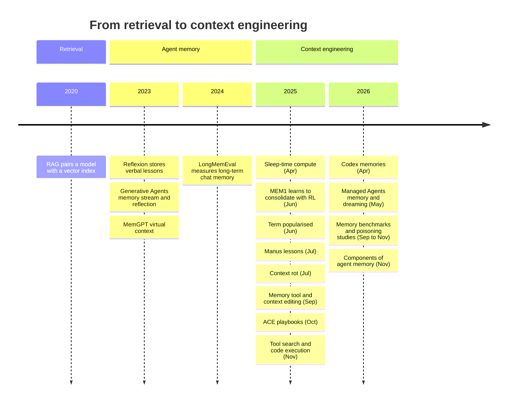
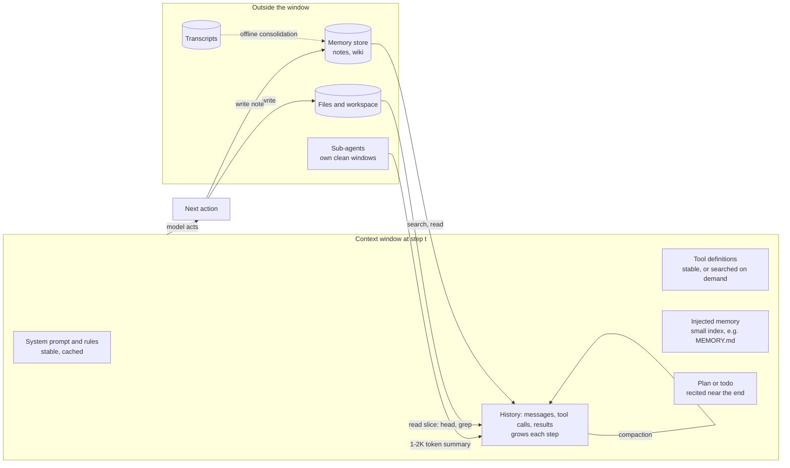

---
tags:
  - ai-ml
  - frontier
  - agents
  - context-engineering
  - memory
  - long-context
status: draft
sources:
  - https://simonwillison.net/2025/jun/27/context-engineering/
  - https://www.anthropic.com/engineering/effective-context-engineering-for-ai-agents
  - https://claude.com/resources/articles/context-management
  - https://platform.claude.com/docs/en/agents-and-tools/tool-use/memory-tool
  - https://www.anthropic.com/engineering/code-execution-with-mcp
  - https://www.anthropic.com/engineering/advanced-tool-use
  - https://www.anthropic.com/research/components-of-agent-memory
  - https://platform.claude.com/docs/en/managed-agents/dreams
  - https://claude.com/resources/articles/new-in-claude-managed-agents
  - https://manus.im/blog/Context-Engineering-for-AI-Agents-Lessons-from-Building-Manus
  - https://learn.chatgpt.com/docs/customization/memories?surface=app
  - https://developers.openai.com/api/docs/guides/compaction
  - https://www.trychroma.com/research/context-rot
  - https://arxiv.org/abs/2005.11401
  - https://arxiv.org/abs/2304.03442
  - https://arxiv.org/abs/2303.11366
  - https://arxiv.org/abs/2310.08560
  - https://arxiv.org/abs/2410.10813
  - https://arxiv.org/abs/2504.13171
  - https://arxiv.org/abs/2506.15841
  - https://arxiv.org/abs/2510.04618
  - https://arxiv.org/abs/2512.13564
  - https://arxiv.org/abs/2602.19320
  - https://arxiv.org/abs/2609.24259
  - https://arxiv.org/abs/2611.09721
  - https://mem0.ai/blog/state-of-ai-agent-memory-2026
created: 2026-11-28
updated: 2026-11-28
---

## Table Of Contents

---

- [[#TL;DR|TL;DR]]
- [[#The Problem|The Problem]]
- [[#Foundations|Foundations]]
    - [[#The Context Window Is Working Memory|The Context Window Is Working Memory]]
    - [[#Context Rot and the Attention Budget|Context Rot and the Attention Budget]]
    - [[#Retrieval as External Memory|Retrieval as External Memory]]
    - [[#Memory Streams, Reflection and Verbal Learning|Memory Streams, Reflection and Verbal Learning]]
    - [[#Virtual Context, the Operating System View|Virtual Context, the Operating System View]]
    - [[#A Vocabulary for Agent Memory|A Vocabulary for Agent Memory]]
- [[#How We Got Here|How We Got Here]]
- [[#How It Works|How It Works]]
    - [[#What Goes Into the Window|What Goes Into the Window]]
    - [[#Write, Select, Compress, Isolate|Write, Select, Compress, Isolate]]
    - [[#Keeping the Prefix Cacheable|Keeping the Prefix Cacheable]]
    - [[#Scoring What to Remember|Scoring What to Remember]]
    - [[#A Worked Example|A Worked Example]]
    - [[#The Cost Arithmetic|The Cost Arithmetic]]
- [[#Where It Is Now|Where It Is Now]]
    - [[#What the Platforms Ship|What the Platforms Ship]]
    - [[#Consolidation, or Dreaming|Consolidation, or Dreaming]]
    - [[#Models Are Learning to Use Memory|Models Are Learning to Use Memory]]
    - [[#Benchmarks, Dated|Benchmarks, Dated]]
    - [[#Memory as an Attack Surface|Memory as an Attack Surface]]
- [[#Trade-offs & Open Problems|Trade-offs & Open Problems]]
- [[#Resources|Resources]]
- [[#Related Notes|Related Notes]]

## ***TL;DR***
---
*Context engineering is the work of deciding which tokens an agent sees at each step; agent memory is the part of that work that carries knowledge across steps and sessions. Both exist because a model only knows what is in its window, the window is finite, and models get worse as it fills.*

- **What it is:** "the delicate art and science of filling the context window with just the right information for the next step" ([Karpathy, via Willison, Jun 2025](https://simonwillison.net/2025/jun/27/context-engineering/)). It covers the system prompt, tools, examples, retrieved documents, tool results and history, not only the instruction wording that "prompt engineering" meant ([Anthropic, Sep 2025](https://www.anthropic.com/engineering/effective-context-engineering-for-ai-agents)).
- **The core finding:** a bigger window is not a substitute for a curated one. Every one of 18 models tested did better on a ~300-token focused version of a LongMemEval prompt than on the full ~113K-token one ([Chroma, Jul 2025](https://www.trychroma.com/research/context-rot)), and LongMemEval itself found about a 30% accuracy drop for commercial assistants and long-context models over sustained chats ([Wu et al., Oct 2024](https://arxiv.org/abs/2410.10813)).
- **The toolkit:** *write* things outside the window (notes, memory files), *select* what comes back in (just-in-time retrieval, tool search), *compress* what stays (compaction, clearing old tool results), and *isolate* work in sub-agents with clean windows. Keep the prefix stable so the [[KV Cache]] can be reused.
- **Where it is now (Nov 2026):** memory is a product layer. Anthropic ships a client-side memory tool, compaction and context editing, Managed Agents memory (public beta) and offline consolidation ("dreaming", research preview); OpenAI ships server-side compaction and Codex memories. The research front is consolidation, learning *when* to use memory (RL-trained memory policies), honest benchmarks, and memory poisoning.

## ***The Problem***
---
*An agent runs for dozens to thousands of steps, and every step it can only act on what is in its context window. Stuffing everything in is expensive and makes the model worse; leaving things out makes it forget. The problem is choosing.*

A [[Transformer]] has no memory between calls: each request starts from its weights plus the tokens you send. A chat model gets away with this because a conversation is short. An agent does not. A typical Manus task takes about 50 tool calls, and its input runs about 100 tokens for every token it outputs ([Manus, Jul 2025](https://manus.im/blog/Context-Engineering-for-AI-Agents-Lessons-from-Building-Manus)). Coding and research agents now run for hours across several windows.

| Naive approach | What happens |
|---|---|
| Keep the whole history in the window | Hits the limit; cost grows with every step; accuracy decays well before the limit ([[Long Context]]) |
| Load every tool definition up front | A five-server MCP setup (58 tools) spends about 55K tokens before the user says anything ([Anthropic, Nov 2025](https://www.anthropic.com/engineering/advanced-tool-use)) |
| Pipe every tool result through the model | One meeting transcript adds about 50K tokens, copied again when passed to the next tool ([Anthropic, Nov 2025](https://www.anthropic.com/engineering/code-execution-with-mcp)) |
| Summarize aggressively | Details are lost for good; repeated rewrites "collapse" a playbook of 18,282 tokens to 122 ([Zhang et al., 2025](https://arxiv.org/html/2510.04618v3)) |
| Start each session blank | The agent re-explores the same codebase and repeats the same mistakes |

The question: **what is the smallest set of tokens that makes the next step likely to succeed, and where does everything else live until it is needed?**

## ***Foundations***
---
*Six ideas underpin the field: the window as working memory, why more tokens can hurt, retrieval as an external store, memory streams with reflection, the operating-system analogy of paging memory in and out, and a vocabulary that keeps these straight.*

#### **The Context Window Is Working Memory**

The weights are what the model learned in training (parametric memory). The context window is what it can see right now. Anything an agent learns during a task, a file path, a failed command, a user's preference, exists only as tokens in the window unless something writes it elsewhere. The window size is set by the model ([[Long Context]], [[Positional Encoding]]); what fills it is set by the application. Context engineering is everything on the application side.

#### **Context Rot and the Attention Budget**

Accuracy falls as input grows, even on easy tasks. Chroma tested 18 models and found that a single topically related distractor lowers accuracy, four lower it more, and the damage grows with length; oddly, models did better on shuffled haystacks than on coherent ones ([Chroma, Jul 2025](https://www.trychroma.com/research/context-rot)). Anthropic's framing: [[Attention]] relates every token to every other, $n^2$ pairs for $n$ tokens, and models see few very long sequences in training, so each added token draws down a finite "attention budget". The decline is gradual, not a cliff ([Anthropic, Sep 2025](https://www.anthropic.com/engineering/effective-context-engineering-for-ai-agents)). The benchmark history behind this is in [[Long Context]].

#### **Retrieval as External Memory**

Retrieval-augmented generation (RAG) paired a seq2seq model's parametric memory with a non-parametric one, a dense vector index of Wikipedia searched by a neural retriever, and set the state of the art on three open-domain QA tasks ([Lewis et al., May 2020](https://arxiv.org/abs/2005.11401)). Embeddings ([[Tokenization and Embeddings]]) turn text into vectors; nearest-neighbour search finds the closest chunks; those chunks go into the prompt. Most agent memory systems are still retrieval underneath. The difference is that the agent itself decides what to write and when to search.

#### **Memory Streams, Reflection and Verbal Learning**

*Generative Agents* gave each simulated character a **memory stream**: a log of observations in natural language, ranked for retrieval by recency, importance and relevance (the formula is in [[#Scoring What to Remember|Scoring What to Remember]]). When the summed importance of recent events passed 150, the agent wrote **reflections**, higher-level conclusions stored back in the stream; in practice two or three a day ([Park et al., UIST 2023](https://arxiv.org/abs/2304.03442)). *Reflexion* applied the same idea to tasks: after a failure the agent writes a verbal lesson into an episodic buffer and reads it on the next try, reaching 91% pass@1 on HumanEval against GPT-4's 80%, with no weight updates ([Shinn et al., Mar 2023](https://arxiv.org/abs/2303.11366)). Both showed that "learning" can live in text the agent writes for itself.

#### **Virtual Context, the Operating System View**

MemGPT borrowed from operating systems, which page data between fast RAM and slow disk. It treats the window as main memory and external stores as disk, and gives the model function calls to move information between tiers, with interrupts to manage control flow. It handled documents larger than the window and multi-session chat ([Packer et al., Oct 2023](https://arxiv.org/abs/2310.08560)). The authors went on to found Letta. Every modern memory tool (read, write, search, delete files outside the window) is a descendant of this design.

#### **A Vocabulary for Agent Memory**

The terms are used loosely, so a December 2025 survey proposes three lenses ([Hu et al.](https://arxiv.org/abs/2512.13564)):

| Lens | Categories | Example |
|---|---|---|
| **Form** (where it lives) | Token-level (text), parametric (weights), latent (hidden states) | A `NOTES.md` file; a fine-tune; a compressed state vector |
| **Function** (what it is for) | Factual, experiential, working | "User prefers metric units"; "this test is flaky, rerun once"; the current plan |
| **Dynamics** (how it changes) | Formation, evolution, retrieval | Write on observation; merge and correct offline; search on demand |

Anthropic draws the boundary narrowly: agent memory is knowledge gained from experience and kept *between* sessions, which excludes weight changes, in-context learning and compaction ([Martin, Nov 2026](https://www.anthropic.com/research/components-of-agent-memory)). This note uses **context engineering** for managing the window within a task and **agent memory** for what persists across tasks.

## ***How We Got Here***
---
*Retrieval came first, as a way to give models facts they were not trained on. Agents then needed memory of their own experience, which produced memory streams and the OS analogy. Once agents ran for hours, the problem widened from "what to remember" to "what to show at each step", and the name changed to context engineering.*

| Date | What changed | Why it mattered | Source |
|---|---|---|---|
| May 2020 | RAG: parametric model plus a dense Wikipedia index | Facts no longer had to live in the weights | [Lewis et al.](https://arxiv.org/abs/2005.11401) |
| Mar 2023 | Reflexion: lessons from failures stored as text | An agent can improve across attempts without training | [Shinn et al.](https://arxiv.org/abs/2303.11366) |
| Apr 2023 | Generative Agents: memory stream, scored retrieval, reflection | First full architecture for an agent's own experiences | [Park et al.](https://arxiv.org/abs/2304.03442) |
| Oct 2023 | MemGPT: memory tiers and paging functions | The window became something the model manages | [Packer et al.](https://arxiv.org/abs/2310.08560) |
| Oct 2024 | LongMemEval: 500 questions on five memory abilities | Showed a ~30% drop for real assistants over long chats | [Wu et al.](https://arxiv.org/abs/2410.10813) |
| Apr 2025 | Sleep-time compute: think about a context *before* the question | ~5x less test-time compute for the same accuracy | [Lin et al.](https://arxiv.org/abs/2504.13171) |
| Jun 2025 | "Context engineering" popularised by Lutke and Karpathy | Named the shift from wording prompts to curating tokens | [Willison](https://simonwillison.net/2025/jun/27/context-engineering/) |
| Jun 2025 | MEM1: RL teaches an agent to rewrite its own state each turn | Constant memory over long tasks, learned rather than hand-built | [Zhou et al.](https://arxiv.org/abs/2506.15841) |
| Jul 2025 | Manus: KV-cache hit rate, file system as context, recitation | Production lessons from an agent at scale | [Ji](https://manus.im/blog/Context-Engineering-for-AI-Agents-Lessons-from-Building-Manus) |
| Sep 2025 | Claude memory tool and context editing | Memory became an API primitive; 84% fewer tokens on a 100-turn eval | [Anthropic](https://claude.com/resources/articles/context-management) |
| Oct 2025 | ACE: contexts as evolving playbooks with delta updates | Fixed "context collapse" from repeated rewriting | [Zhang et al.](https://arxiv.org/abs/2510.04618) |
| Nov 2025 | Tool search, programmatic tool calling, code execution with MCP | Attacked the two biggest token sinks: tool definitions and tool results | [Anthropic](https://www.anthropic.com/engineering/advanced-tool-use) |
| Apr to May 2026 | Codex memories (preview); Managed Agents memory and dreaming | Cross-session memory shipped by both big labs | [OpenAI docs](https://learn.chatgpt.com/docs/customization/memories?surface=app), [Anthropic](https://claude.com/resources/articles/new-in-claude-managed-agents) |
| Nov 2026 | Anthropic publishes measured results on memory and consolidation | First lab-scale data on which memory components help | [Martin](https://www.anthropic.com/research/components-of-agent-memory) |

## ***How It Works***
---
*Assemble a small, stable prefix, pull in everything else only when needed, keep large data outside the model, shrink the history when it grows, and persist what must survive in files the agent maintains. Retrieval from memory is a ranking problem, and cost is dominated by how much of the prefix the cache can reuse.*

#### **What Goes Into the Window**

Each part has its own rules ([Anthropic, Sep 2025](https://www.anthropic.com/engineering/effective-context-engineering-for-ai-agents)):

| Part | Good practice | Failure mode |
|---|---|---|
| System prompt | The "right altitude": clear sections, start minimal, add rules only for failures you observe | Brittle if-else logic, or vague guidance that assumes shared context |
| Tools | Few, non-overlapping, token-efficient outputs; 1 to 5 usage examples per tool raised complex-parameter accuracy from 72% to 90% ([Anthropic, Nov 2025](https://www.anthropic.com/engineering/advanced-tool-use)) | "If a human engineer can't definitively say which tool should be used", neither can the agent |
| Examples | A few diverse, canonical examples | A laundry list of edge cases; or near-identical action-observation pairs that the model imitates into a rut ([Manus](https://manus.im/blog/Context-Engineering-for-AI-Agents-Lessons-from-Building-Manus)) |
| Data | Keep identifiers (paths, queries, URLs) and load slices just in time | Pasting whole files or datasets "in case" |
| Errors | Leave failed actions and stack traces in the history so the model updates ([Manus](https://manus.im/blog/Context-Engineering-for-AI-Agents-Lessons-from-Building-Manus)) | Hiding errors, so the agent retries the same thing |

#### **Write, Select, Compress, Isolate**

Almost every technique does one of four things:

| Move | Technique | How it works | Evidence |
|---|---|---|---|
| **Write** | Structured notes, memory files | Agent writes progress, decisions and lessons to files outside the window and reads them after a reset | Claude Plays Pokémon tracked goals across thousands of steps this way ([Anthropic](https://www.anthropic.com/engineering/effective-context-engineering-for-ai-agents)) |
| **Write** | Recitation | Rewrite a `todo.md` each step so the goal sits at the end of the context, where attention is strongest | Manus, ~50-call tasks ([Ji](https://manus.im/blog/Context-Engineering-for-AI-Agents-Lessons-from-Building-Manus)) |
| **Select** | Just-in-time retrieval | Hold lightweight references; fetch with tools (glob, grep, SQL, `head`) at run time. Claude Code loads `CLAUDE.md` up front and the rest on demand | [Anthropic](https://www.anthropic.com/engineering/effective-context-engineering-for-ai-agents) |
| **Select** | Tool search | Keep tool definitions out of the window; the model searches for the few it needs | ~77K to ~8.7K tokens of overhead; MCP eval accuracy 49% to 74% (Opus 4), 79.5% to 88.1% (Opus 4.5) ([Anthropic](https://www.anthropic.com/engineering/advanced-tool-use)) |
| **Select** | Code execution over tools | Expose tools as code APIs; the agent filters data in a sandbox and returns only the result | One workflow: 150,000 to 2,000 tokens, 98.7% less ([Anthropic](https://www.anthropic.com/engineering/code-execution-with-mcp)); programmatic tool calling cut average research-task tokens 37% ([Anthropic](https://www.anthropic.com/engineering/advanced-tool-use)) |
| **Compress** | Context editing | Clear stale tool calls and results as the window fills | Completed 100-turn web-search workflows that otherwise failed; 84% fewer tokens ([Anthropic](https://claude.com/resources/articles/context-management)) |
| **Compress** | Compaction | Summarize the history near the limit and continue in a fresh window; Claude Code keeps decisions, open bugs and the five most recently used files | [Anthropic](https://www.anthropic.com/engineering/effective-context-engineering-for-ai-agents); [OpenAI](https://developers.openai.com/api/docs/guides/compaction) |
| **Isolate** | Sub-agents | A sub-agent spends tens of thousands of tokens exploring and returns a 1,000 to 2,000-token summary to the lead | Beat single agents on complex research ([Anthropic](https://www.anthropic.com/engineering/effective-context-engineering-for-ai-agents)) |

Compression should be **restorable** where possible: drop a page's body but keep its URL, drop a file's contents but keep its path, so nothing is lost for good ([Manus](https://manus.im/blog/Context-Engineering-for-AI-Agents-Lessons-from-Building-Manus)). Memory and compaction work together: compaction keeps the active window small, memory preserves what must survive the summary ([Claude docs](https://platform.claude.com/docs/en/agents-and-tools/tool-use/memory-tool)). Anthropic's internal agentic search eval scored 39% above baseline with memory plus context editing, and 29% with context editing alone ([Anthropic, Sep 2025](https://claude.com/resources/articles/context-management)).

#### **Keeping the Prefix Cacheable**

Serving engines reuse the [[KV Cache]] for any prefix they have already seen ([[LLM Serving]], [[PagedAttention]]). An agent's context is mostly a prefix it re-sends every step, so the cache hit rate drives cost and latency. Manus calls it "the single most important metric" for a production agent ([Ji, Jul 2025](https://manus.im/blog/Context-Engineering-for-AI-Agents-Lessons-from-Building-Manus)). The rules that follow from how caches match:

- **Stable prefix:** no timestamps or per-request IDs at the top of the system prompt; one changed token invalidates everything after it.
- **Append-only history:** never edit earlier turns; use deterministic serialization (stable key order in JSON).
- **Mask, don't remove, tools:** changing the tool list mid-task invalidates the cache, so Manus keeps definitions fixed and masks token logits to forbid actions, with name prefixes such as `browser_` and `shell_` so whole groups can be masked at once.

Compaction and context editing break the cache by design, so they are triggered near the limit rather than every step. On [[Hybrid Attention]] and [[State Space Models]], prefix reuse needs saved recurrent states rather than KV blocks; see [[Prefix Caching for Hybrid Models]].

#### **Scoring What to Remember**

When memory is a pile of entries, retrieval is a ranking problem. Generative Agents scored each memory $m$ against a query $q$ as ([Park et al., 2023](https://arxiv.org/abs/2304.03442)):

$$
\text{score}(m, q) = \alpha_{\text{rec}}\,\widehat{\text{rec}}(m) + \alpha_{\text{imp}}\,\widehat{\text{imp}}(m) + \alpha_{\text{rel}}\,\widehat{\text{rel}}(m, q),
\qquad \text{rec}(m) = 0.995^{\,h(m)}
$$

*In plain English: a memory ranks high if it was used recently, if it was important when written, and if it is about the same thing as the question. $h(m)$ is the hours since the memory was last retrieved, so recency decays by 0.5% per hour. Importance is a 1 to 10 rating the model gave the memory when it wrote it. Relevance is the cosine similarity between the memory's embedding and the query's. Each of the three is min-max scaled to [0, 1] across the candidates (the hats), the paper set all three weights $\alpha$ to 1, and the top-scoring memories that fit in the window go into the prompt.*

Modern systems swap the parts (hybrid keyword plus vector search, entity graphs, a wiki of linked pages), but the shape is the same: several cheap signals combined into one rank, then a budget cut.

#### **A Worked Example**

An agent has three memories and the query "what should I prepare for Friday's review?" (illustrative numbers):

| Memory | Hours since used | Importance (1-10) | Cosine to query |
|---|---|---|---|
| A: "Reviewer wants latency numbers in the deck" | 2 | 6 | 0.82 |
| B: "Ate lunch at the usual place" | 1 | 2 | 0.30 |
| C: "Review moved from Thursday to Friday" | 40 | 8 | 0.75 |

1. **Recency:** $0.995^2 = 0.990$, $0.995^1 = 0.995$, $0.995^{40} = 0.818$. Scaled: A 0.97, B 1.00, C 0.00.
2. **Importance:** scaled between 2 and 8: A 0.67, B 0.00, C 1.00.
3. **Relevance:** scaled between 0.30 and 0.82: A 1.00, B 0.00, C 0.87.
4. **Sum:** A $= 2.64$, C $= 1.87$, B $= 1.00$. With room for two, the agent loads A and C.

Two things to notice. Min-max scaling over only three candidates exaggerates small gaps: B is "maximally recent" though it is only an hour fresher than A. And C, the fact that most changes the plan, only beats B because its importance was rated high when written. If the writer had rated it 3, B would tie it. This is why salience at write time matters, and why newer systems re-check notes against the source afterwards (see [[#Consolidation, or Dreaming|Consolidation, or Dreaming]]).

#### **The Cost Arithmetic**

Take a 50-step agent whose context grows from 10K to 60K tokens, about 1K new tokens a step (illustrative). It re-reads the whole context each step, so total input is about $50 \times 35\text{K} = 1.75\text{M}$ tokens, while output might be 20K.

| Pricing (Claude Sonnet input, as quoted by Manus) | Cost of input |
|---|---|
| No cache hits: 1.75M × $3/MTok | ≈ $5.25 |
| Prefix cached, only new tokens uncached: 1.70M × $0.30 + 0.05M × $3 | ≈ $0.66 |

*In plain English: because input outweighs output roughly 100 to 1 in agents ([Manus](https://manus.im/blog/Context-Engineering-for-AI-Agents-Lessons-from-Building-Manus)), a 10x cache discount on input cuts the whole bill by close to 8x here. One edit near the top of the prompt each step throws that away.* This ignores cache-write surcharges and compaction, which resets the prefix once and then lets it warm up again.

## ***Where It Is Now***
---
*As of November 2026, context management and memory are API features at both big labs, memory consolidation is in preview, and the newest models use memory far better than models from a year earlier. Benchmarks are contested, and memory has become a security surface.*

#### **What the Platforms Ship**

| Vendor | Feature | Status (Nov 2026) | Notes |
|---|---|---|---|
| Anthropic | Memory tool (`memory_20250818`) | Available on Claude 4 and later, no beta header | Client-side: the app stores `/memories` files; the docs require path-traversal checks on every call ([docs](https://platform.claude.com/docs/en/agents-and-tools/tool-use/memory-tool)) |
| Anthropic | Context editing; compaction | Shipping | Clears old tool results; server-side summary near the limit ([docs](https://platform.claude.com/docs/en/agents-and-tools/tool-use/memory-tool)) |
| Anthropic | Tool search, programmatic tool calling | Shipping since Nov 2025 | ([Anthropic](https://www.anthropic.com/engineering/advanced-tool-use)) |
| Anthropic | Managed Agents memory | Public beta (May 2026) | Memory stores shared across sessions and agents ([Claude](https://claude.com/resources/articles/new-in-claude-managed-agents)) |
| Anthropic | Dreams (consolidation) | Research preview, by request | 1 to 100 transcripts plus a memory store in, a *new* store out; input never modified ([docs](https://platform.claude.com/docs/en/managed-agents/dreams)) |
| OpenAI | Responses API compaction | Shipping | Encrypted, opaque compaction item ([docs](https://developers.openai.com/api/docs/guides/compaction)) |
| OpenAI | Codex memories | Off by default; preview launched Apr 2026 | Background extraction of idle chats, secret redaction, then consolidation into local files; OpenAI calls it a "recall layer", not the place for rules that must always apply ([docs](https://learn.chatgpt.com/docs/customization/memories?surface=app)) |

The two labs converged on the same shape: per-session extraction, a separate consolidation pass, and a small file injected into every session (Codex's `MEMORY.md` and `memory_summary.md`; Claude Code loads the first 200 lines or 25 KB of its `MEMORY.md` ([Martin, Nov 2026](https://www.anthropic.com/research/components-of-agent-memory))). Third-party layers (Mem0, Zep, Letta) sell the same function as a service.

#### **Consolidation, or Dreaming**

Agents write memory incrementally, so stores fill with duplicates, contradictions and stale entries. **Consolidation** is an offline pass that re-reads transcripts and the store, fixes wrong notes, merges duplicates and reorganizes, by analogy with replay during sleep. It descends from Generative Agents' reflection and from sleep-time compute, which precomputes useful inferences about a context before any question arrives and needed ~5x less test-time compute for the same accuracy on stateful math tasks ([Lin et al., Apr 2025](https://arxiv.org/abs/2504.13171)).

Anthropic's November 2026 write-up gives the first lab-scale numbers ([Martin, Nov 2026](https://www.anthropic.com/research/components-of-agent-memory)):

| Experiment | Result |
|---|---|
| Wiki built by dreaming, 25 questions over ~350K files (~420M tokens) | Wiki alone: 13% to 48% of graded criteria as dreaming scaled from 2 to 128 sessions. Search alone: 53%. Wiki plus search: 54% to 61%, about 20K fewer tokens per question |
| Pokémon Red, corrected vs uncorrected memory | Corrected run reached Cerulean City by action 1,935; the uncorrected run fell back onto the same route three times and never got there |
| Contract facts | 72% (41 of 57) to 100% after changing how the wiki was built (one agent per contract page, quoting terms verbatim) |
| Wiki size | A 115 KB corpus produced a 203 KB wiki: a memory can outgrow its source |

Customers reported large gains (Harvey about 6x completion rates with dreaming), but those are vendor-quoted figures without published methodology ([Claude, May 2026](https://claude.com/resources/articles/new-in-claude-managed-agents)).

#### **Models Are Learning to Use Memory**

The same tools give very different results by model. On a database task (CL-Bench), adding memory took Opus 5.5 from 0.655 to 0.838 and Opus 4.7 from 0.383 to 0.700, but Sonnet 4.6 only from 0.330 to 0.364, because it read its memory less than half the time; Sonnet 5 read it 9 times out of 10. Telling models to "record only failures" *reduced* the gain (−0.234 for Opus 5). Stronger models also kept tidier memories: playing Pokémon, Sonnet 3.7 made 413 files in 225 folders and won one badge, Fable 5 made 10 files and won four ([Martin, Nov 2026](https://www.anthropic.com/research/components-of-agent-memory)). Anthropic's conclusion is that newer models do better when left to judge salience than when given fixed rules.

Research is moving from hand-built memory policies to learned ones:

- **MEM1** trains a 7B agent with PPO to rewrite a compact internal state each turn and drop the rest; on a 16-objective multi-hop QA task it scored 3.5x better than Qwen2.5-14B-Instruct with 3.7x less memory ([Zhou et al., 2025](https://arxiv.org/abs/2506.15841); ICLR 2026).
- **ACE** treats a context as a playbook of itemized bullets with helpful/harmful counters, updated by small merged deltas instead of full rewrites. On AppWorld with DeepSeek-V3.1 it lifted a ReAct agent from 42.4 to 59.4 and cut adaptation latency 86.9% ([Zhang et al., ICLR 2026](https://arxiv.org/abs/2510.04618)).
- **MemCalib** finds frontier models both over-use and under-use memories put in front of them, and that GRPO and on-policy self-distillation fix one direction while worsening the other; its own RL method balances both on Qwen3 and Qwen3.5 models ([Cao et al., Sep 2026](https://arxiv.org/abs/2609.24259)). Early, single-group evidence.

This is the [[RL for Reasoning]] recipe applied to memory: the reward is task success, and good memory behaviour is whatever earns it.

#### **Benchmarks, Dated**

| Benchmark | What it tests | Caveat |
|---|---|---|
| LongMemEval (Oct 2024) | 500 questions: extraction, multi-session reasoning, temporal reasoning, knowledge updates, abstention ([Wu et al.](https://arxiv.org/abs/2410.10813)) | The standard set; the M variant (over 1M tokens) is the one that truly needs external memory |
| LoCoMo | Multi-session conversational recall, ~1,540 questions | About 20K tokens of history: fits in a modern window ([Jiang et al., 2026](https://arxiv.org/abs/2602.19320)) |
| BEAM | Memory at 1M and 10M tokens | Newer; few independent results |
| CL-Bench, wiki evals | Task gains from memory (Anthropic internal) | Lab-run, not public leaderboards |

Vendor leaderboards are not comparable. Mem0 reports 92.5 on LoCoMo and 94.4 on LongMemEval for its own April 2026 algorithm, and 64.1 dropping to 48.6 on BEAM from 1M to 10M tokens; its competitor numbers (Zep, Letta, OpenAI) are compiled by Mem0 and it notes results vary with dataset version, model, retrieval depth and judge ([Mem0, Apr 2026](https://mem0.ai/blog/state-of-ai-agent-memory-2026)). An independent analysis found that most memory benchmarks fit inside today's windows, so a system can score well without needing memory at all; that F1 and LLM-judge rankings disagree; and that swapping the backbone from gpt-4o-mini to Qwen-2.5-3B dropped one system's score from 0.781 to 0.447 through silently malformed memory writes ([Jiang et al., May 2026](https://arxiv.org/abs/2602.19320)).

#### **Memory as an Attack Surface**

Anything an agent reads can end up in memory, and memory is read back in later sessions with the authority of the agent's own notes. MemoryDojo (Nov 2026) traces poisoned information through 155 multi-session trajectories across five memory systems and finds all five susceptible, with large differences in downstream effect ([Yang et al.](https://arxiv.org/abs/2611.09721)). The practical defences are the boring ones: treat stored text as data rather than instructions, record provenance, validate memory-tool paths so `../` cannot escape the store, and cap and expire entries ([Claude docs](https://platform.claude.com/docs/en/agents-and-tools/tool-use/memory-tool)). Codex lets users keep chats that used MCP tools or web search out of memory generation for the same reason ([OpenAI docs](https://learn.chatgpt.com/docs/customization/memories?surface=app)).

## ***Trade-offs & Open Problems***
---
*Every technique trades tokens for risk: compress too much and facts vanish, retrieve too little and the agent acts blind, remember too much and stale or poisoned notes steer it wrong. The hardest open question is knowing in advance what a future step will need.*

| Issue | What goes wrong | State in late 2026 |
|---|---|---|
| Salience | No model knows what a future turn will need; fixed rules ("record only failures") underperform model judgement | Stronger models given latitude do best ([Martin](https://www.anthropic.com/research/components-of-agent-memory)) |
| Staleness | Notes are wrong from the start or drift as the world changes; checking every memory costs compute | Consolidation passes; focusing re-checks on facts likely to change is proposed, not solved |
| Lossy compression | Summaries drop detail (brevity bias); repeated rewrites collapse a context | Restorable compression, delta updates ([ACE](https://arxiv.org/abs/2510.04618)), keep files and URLs |
| Representations vs search | Wikis add structure but accumulate errors and can outgrow their source (1.77x) | Wiki plus transcript search beat either alone; search may be the more reliable base |
| Timing | Writing memory mid-task pulls attention from the task; offline consolidation is not available until it runs | Both used together |
| Cache vs freshness | Editing history to keep it clean breaks the prefix cache | Append-only by default; compaction only near the limit |
| Over- and under-use | Models ignore relevant memories or lean on irrelevant ones | RL for calibrated use is early ([MemCalib](https://arxiv.org/abs/2609.24259)) |
| Evaluation | Benchmarks fit in the window; scores vary with judge, backbone and dataset version | No independent, shared leaderboard |
| Security and privacy | Poisoned notes persist across sessions; memories may capture secrets | Redaction, provenance, isolation of tool-assisted chats; poisoning defences unsolved |
| Will long context make this obsolete? | 1M-token windows are standard ([[Long Context]]) | No: context rot and cost still favour a curated window, and better long context mainly means fewer compactions |

## ***Resources***
---
*Read Anthropic's context-engineering post and the Manus post for the practice, MemGPT and Generative Agents for the ideas underneath, then Anthropic's November 2026 memory write-up for the current evidence.*

**Practice**
- [Effective context engineering for AI agents](https://www.anthropic.com/engineering/effective-context-engineering-for-ai-agents): Anthropic, Sep 2025. The definition, attention budget, just-in-time retrieval, compaction, notes, sub-agents.
- [Context Engineering for AI Agents: Lessons from Building Manus](https://manus.im/blog/Context-Engineering-for-AI-Agents-Lessons-from-Building-Manus): Yichao Ji, Jul 2025. KV-cache hit rate, tool masking, file system as context, recitation.
- [Managing context on the Claude Developer Platform](https://claude.com/resources/articles/context-management): Anthropic, Sep 2025. Memory tool and context editing results.
- [Code execution with MCP](https://www.anthropic.com/engineering/code-execution-with-mcp) and [Advanced tool use](https://www.anthropic.com/engineering/advanced-tool-use): Anthropic, Nov 2025. Cutting tool-definition and tool-result tokens.
- [Context engineering](https://simonwillison.net/2025/jun/27/context-engineering/): Simon Willison, Jun 2025. Where the term came from.

**Memory**
- [The components of agent memory](https://www.anthropic.com/research/components-of-agent-memory): Lance Martin (Anthropic), Nov 2026. Transcripts, notes, wikis, salience, retrieval and dreaming, with measurements.
- [Memory tool docs](https://platform.claude.com/docs/en/agents-and-tools/tool-use/memory-tool) and [Dreams docs](https://platform.claude.com/docs/en/managed-agents/dreams): Anthropic, current Nov 2026.
- [Codex memories](https://learn.chatgpt.com/docs/customization/memories?surface=app): OpenAI, current Nov 2026.

**Papers**
- [Retrieval-Augmented Generation for Knowledge-Intensive NLP Tasks](https://arxiv.org/abs/2005.11401): Lewis et al. (Facebook AI Research), May 2020 (NeurIPS 2020).
- [Reflexion](https://arxiv.org/abs/2303.11366): Shinn et al., Mar 2023. Verbal lessons in an episodic buffer.
- [Generative Agents](https://arxiv.org/abs/2304.03442): Park et al. (Stanford, Google), Apr 2023 (UIST 2023). Memory stream, scored retrieval, reflection.
- [MemGPT: Towards LLMs as Operating Systems](https://arxiv.org/abs/2310.08560): Packer et al. (UC Berkeley), Oct 2023. Virtual context management.
- [LongMemEval](https://arxiv.org/abs/2410.10813): Wu et al., Oct 2024. The standard long-term memory benchmark.
- [Sleep-time Compute](https://arxiv.org/abs/2504.13171): Lin et al. (Letta, UC Berkeley), Apr 2025.
- [MEM1](https://arxiv.org/abs/2506.15841): Zhou et al. (MIT, NUS, SMART), Jun 2025. RL-learned memory consolidation.
- [Agentic Context Engineering](https://arxiv.org/abs/2510.04618): Zhang et al. (Stanford, SambaNova and others), Oct 2025 (ICLR 2026).
- [Memory in the Age of AI Agents](https://arxiv.org/abs/2512.13564): Hu et al., Dec 2025. Survey and taxonomy.
- [Anatomy of Agentic Memory](https://arxiv.org/abs/2602.19320): Jiang et al., 2026. Independent look at benchmarks and system costs.
- [MemCalib](https://arxiv.org/abs/2609.24259): Cao et al., Sep 2026. Over- and under-use of memory.
- [MemoryDojo](https://arxiv.org/abs/2611.09721): Yang et al., Nov 2026. Memory poisoning.

**Analysis**
- [Context Rot](https://www.trychroma.com/research/context-rot): Chroma Research, Jul 2025. 18 models degrading with input length.
- [State of AI Agent Memory 2026](https://mem0.ai/blog/state-of-ai-agent-memory-2026): Mem0, Apr 2026 (updated Oct 2026). Useful benchmark map; self-reported numbers.

## Related Notes

- [[Long Context]] — How far the window stretches and why models degrade inside it; compaction from the model side.
- [[KV Cache]] — Why a stable, append-only prefix makes agents cheap; prompt caching.
- [[Prefix Caching for Hybrid Models]] — Prefix reuse when part of the model is recurrent.
- [[PagedAttention]] — How serving engines share cached prefixes across requests.
- [[LLM Serving]] — The engines whose prefix caching agent costs depend on.
- [[Reasoning Models]] — Thinking tokens consume the same window that context engineering manages.
- [[RL for Reasoning]] — The training recipe now being used to learn memory policies (MEM1, MemCalib).
- [[RL Environments and Verifiers]] — The multi-turn tool environments where agents' context and memory are trained and tested.
- [[Chain-of-Thought Faithfulness and Monitorability]] — Notes and memories are another readable trace of what an agent is doing.
- [[Attention]] — The $n^2$ pairwise relationships behind the "attention budget".
- [[Tokenization and Embeddings]] — Embeddings power the similarity search under most memory retrieval.
- [[Transformer]] — Stateless per call: the reason agents need external memory at all.
