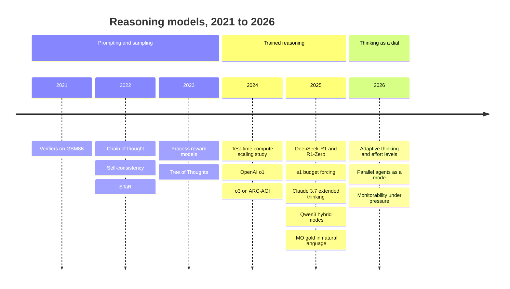
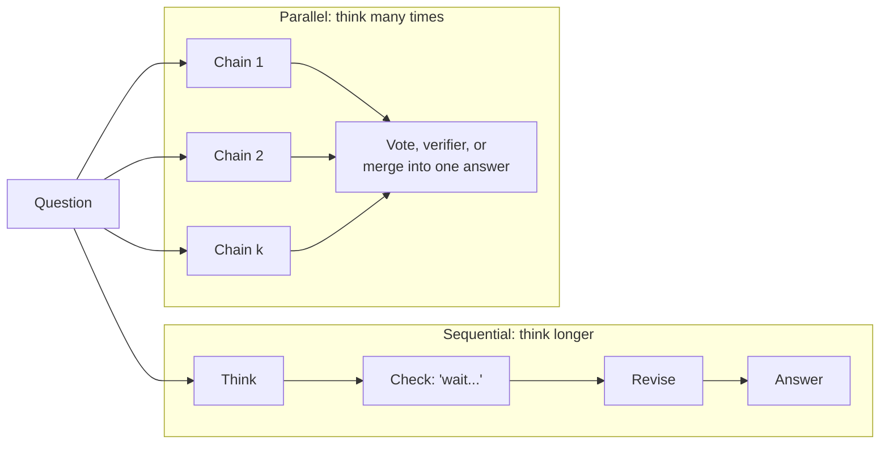
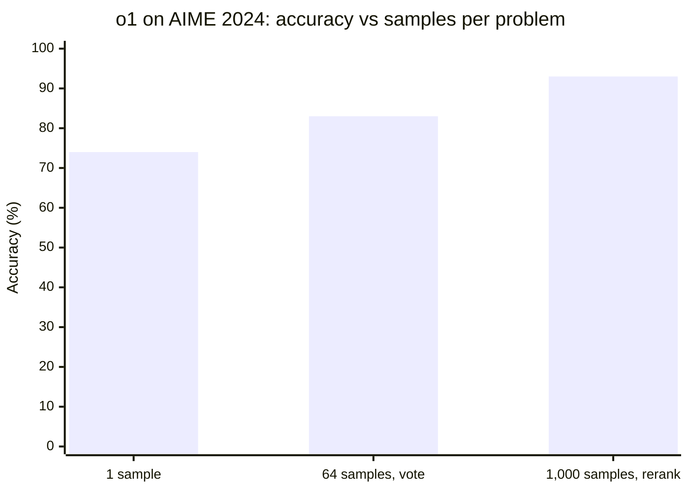

---
tags:
  - ai-ml
  - frontier
  - reasoning
  - test-time-compute
  - inference
status: draft
sources:
  - https://arxiv.org/abs/2201.11903
  - https://arxiv.org/abs/2203.11171
  - https://arxiv.org/abs/2110.14168
  - https://arxiv.org/abs/2305.20050
  - https://arxiv.org/abs/2305.10601
  - https://arxiv.org/abs/2203.14465
  - https://arxiv.org/abs/2408.03314
  - https://arxiv.org/html/2408.03314
  - https://arxiv.org/abs/2501.12948
  - https://arxiv.org/html/2501.12948v1
  - https://arxiv.org/abs/2501.19393
  - https://arxiv.org/abs/2412.21187
  - https://arxiv.org/abs/2505.05410
  - https://arxiv.org/abs/2507.11473
  - https://openai.com/index/learning-to-reason-with-llms/
  - https://arcprize.org/blog/oai-o3-pub-breakthrough
  - https://openai.com/index/introducing-o3-and-o4-mini/
  - https://openai.com/index/introducing-gpt-5-5/
  - https://openai.com/index/previewing-gpt-5-6-sol/
  - https://openai.com/index/gpt-5-6/
  - https://openai.com/index/gpt-6-astra/
  - https://en.wikipedia.org/wiki/GPT-6
  - https://www.anthropic.com/news/claude-3-7-sonnet
  - https://www.anthropic.com/news/claude-opus-4-6
  - https://platform.claude.com/docs/en/release-notes/overview
  - https://developers.googleblog.com/en/start-building-with-gemini-25-flash/
  - https://deepmind.google/blog/advanced-version-of-gemini-with-deep-think-officially-achieves-gold-medal-standard-at-the-international-mathematical-olympiad/
  - https://blog.google/products-and-platforms/products/gemini/gemini-2-5-deep-think/
  - https://blog.google/innovation-and-ai/models-and-research/gemini-models/gemini-3-deep-think/
  - https://blog.google/innovation-and-ai/models-and-research/gemini-models/gemini-4-argon/
  - https://blog.google/innovation-and-ai/models-and-research/gemini-models/introducing-gemini-4-neon/
  - https://qwenlm.github.io/blog/qwen3/
  - https://www.alibabacloud.com/blog/alibaba-unveils-qwen4-max-new-ai-teammate-for-work-creativity-and-discovery_603783
  - https://api-docs.deepseek.com/updates/
  - https://huggingface.co/moonshotai/kimi-k3
  - https://simonwillison.net/2025/Jul/19/openai-gold-medal-math-olympiad/
  - https://www.standardmedia.co.ke/business/article/2001553533/ai-catches-up-with-humans-to-score-100pc-at-top-maths-contest
  - https://lilianweng.github.io/posts/2025-05-01-thinking/
created: 2026-11-26
updated: 2026-11-26
---

## Table Of Contents

---

- [[#TL;DR|TL;DR]]
- [[#The Problem|The Problem]]
- [[#Foundations|Foundations]]
    - [[#Chain of Thought|Chain of Thought]]
    - [[#Sampling Many Answers and Voting|Sampling Many Answers and Voting]]
    - [[#Verifiers and Best-of-N|Verifiers and Best-of-N]]
    - [[#Outcome vs Process Reward Models|Outcome vs Process Reward Models]]
    - [[#Search Over Thoughts|Search Over Thoughts]]
    - [[#Test-Time Compute as a Scaling Axis|Test-Time Compute as a Scaling Axis]]
- [[#How We Got Here|How We Got Here]]
- [[#How It Works|How It Works]]
    - [[#Training a Model to Think|Training a Model to Think]]
    - [[#Sequential vs Parallel Scaling|Sequential vs Parallel Scaling]]
    - [[#Thinking Budgets and Effort Controls|Thinking Budgets and Effort Controls]]
    - [[#Measuring It, pass@1 vs majority@k|Measuring It, pass@1 vs majority@k]]
    - [[#A Worked Example|A Worked Example]]
    - [[#The Cost Arithmetic|The Cost Arithmetic]]
- [[#Where It Is Now|Where It Is Now]]
    - [[#Every Frontier Model Is a Reasoning Model|Every Frontier Model Is a Reasoning Model]]
    - [[#From Budgets to Effort Levels|From Budgets to Effort Levels]]
    - [[#Overthinking and Token Efficiency|Overthinking and Token Efficiency]]
    - [[#Faithfulness and Monitorability|Faithfulness and Monitorability]]
    - [[#Benchmarks, Dated|Benchmarks, Dated]]
- [[#Trade-offs & Open Problems|Trade-offs & Open Problems]]
- [[#Resources|Resources]]
- [[#Related Notes|Related Notes]]

## ***TL;DR***
---
*A reasoning model is a language model trained, mostly with reinforcement learning, to write a long chain of thought before it answers, and to spend more of that thinking on harder problems. It turned inference compute into a second scaling axis next to pretraining, and by late 2026 every frontier model ships with it on by default.*

- **What it is:** a model that generates hidden or summarized "thinking" tokens (often thousands per question), exploring, checking and backtracking, then writes a short final answer. Accuracy rises with how many tokens it is allowed to think ([OpenAI, Sep 2024](https://openai.com/index/learning-to-reason-with-llms/)).
- **The core finding:** reasoning can be *trained in* with outcome-only RL on verifiable problems. DeepSeek-R1-Zero went from 15.6% to 71.0% pass@1 on AIME 2024 with RL alone and no human reasoning traces, and to 86.7% with majority voting over 64 samples ([DeepSeek-AI, Jan 2025](https://arxiv.org/html/2501.12948v1)).
- **Two ways to spend more:** think *longer* in one chain (sequential), or think *many times* and combine (parallel: voting, verifiers, Deep Think, multi-agent modes). Both cost tokens, which are money and latency.
- **Where it is now (Nov 2026):** thinking is no longer a separate model but a dial: Anthropic's newest Claude models cannot turn thinking off, only lower its effort; OpenAI's GPT-5.6 adds `max` effort and an `ultra` mode that runs four agents in parallel; Gemini 4 Neon has four thinking levels; DeepSeek V4 and Kimi K3 expose low/high/max. The fronts are token efficiency, overthinking, and keeping the chain of thought monitorable as models get better at hiding it.

## ***The Problem***
---
*A standard language model spends the same compute on every token: one forward pass. A hard math or coding problem needs more steps of computation than one pass can hold, so the model has to be given room to work things out in text, and taught to use that room well.*

A [[Transformer]] produces each token with a fixed amount of computation, set by its depth and width. That is fine for "What is the capital of France?" and hopeless for "prove this inequality" or "find the bug in this 2,000-line diff", where a person would write notes, try ideas, and check them.

| Approach | What it buys | Why it falls short |
|---|---|---|
| Bigger model | More computation per token | Same budget for easy and hard questions; each 10x costs ten times more ([[Scaling Laws]]) |
| Prompt "think step by step" | Intermediate steps in text | Works only on large models, and the model was never trained to check or backtrack |
| Sample many answers, pick one | Several tries | Needs a way to pick the right one; cost grows linearly with tries |
| **Reasoning model** | Trained to think long, adaptively, and self-correct | Thinking tokens cost money and latency; the reasoning may not be faithful |

The question a reasoning model answers: **how do you turn extra inference compute into extra accuracy, and spend it only where it helps?**

## ***Foundations***
---
*Six ideas from 2021 to 2024 are the parts that reasoning models were built from: writing the steps out, sampling and voting, ranking with a verifier, grading steps instead of answers, searching over partial solutions, and treating inference compute as something you scale on purpose.*

#### **Chain of Thought**

Chain-of-thought (CoT) prompting shows the model a few worked examples whose answers include the reasoning steps, so it writes steps before its own answer. With just eight such exemplars, a 540B-parameter model reached state-of-the-art accuracy on GSM8K grade-school math, beating a finetuned GPT-3 with a verifier. The gain appeared only in sufficiently large models ([Wei et al., Jan 2022](https://arxiv.org/abs/2201.11903)).

Why it works, in plain terms: every generated token is another forward pass whose output becomes input to the next. Writing out steps turns a fixed-depth computation into one whose length grows with the problem. The text acts as the model's scratchpad.

#### **Sampling Many Answers and Voting**

**Self-consistency** replaces the single greedy chain with several sampled chains and takes the most common final answer. Over plain CoT it added +17.9% on GSM8K, +11.0% on SVAMP, +12.2% on AQuA, +6.4% on StrategyQA and +3.9% on ARC-challenge ([Wang et al., Mar 2022](https://arxiv.org/abs/2203.11171)). This is what papers call **majority@k** or **cons@k** (consensus over $k$ samples). It needs no extra model, only a final answer that can be compared for equality, such as a number.

#### **Verifiers and Best-of-N**

A **verifier** is a model trained to judge whether a solution is correct. At test time you sample $N$ candidates and return the one the verifier scores highest: **best-of-N**. Cobbe et al. introduced GSM8K (8.5K problems) to study this and found verification "scales more effectively with increased data than a finetuning baseline" ([Cobbe et al., Oct 2021](https://arxiv.org/abs/2110.14168)). If the verifier were perfect, best-of-N would succeed whenever any one of the $N$ samples is right.

#### **Outcome vs Process Reward Models**

| | Outcome reward model (ORM) | Process reward model (PRM) |
|---|---|---|
| Grades | Only the final answer | Each step of the reasoning |
| Training labels | Cheap: is the answer right? | Expensive: a human (or model) marks each step |
| Strength | Simple, hard to game if the answer is checkable | Pinpoints where reasoning went wrong; guides search step by step |

OpenAI found that "process supervision significantly outperforms outcome supervision": their PRM, used to rank samples, solved 78% of a representative subset of MATH, and they released PRM800K, about 800,000 step-level labels ([Lightman et al., May 2023](https://arxiv.org/abs/2305.20050)). Ironically, R1, the first open recipe for a reasoning model, leaned on **outcome** rewards from automatic checkers during RL, because those are cheap and hard to hack; PRMs survive mainly as search and reranking tools.

#### **Search Over Thoughts**

**Tree of Thoughts (ToT)** treats each intermediate step as a node, has the model propose several next steps, score them, and explore with breadth- or depth-first search, backtracking from dead ends. On the Game of 24 puzzle, GPT-4 with CoT solved about 4% of tasks; with ToT, 74% ([Yao et al., May 2023](https://arxiv.org/abs/2305.10601)). Monte Carlo tree search (MCTS) is the same idea with sampled rollouts estimating each node's value. External search works, but it is slow and hand-built; the reasoning-model insight was to let one long chain of thought *contain* the search (propose, check, "wait", backtrack) as plain text.

#### **Test-Time Compute as a Scaling Axis**

Snell et al. asked the question directly: if you have a fixed inference budget, how should you spend it, and can it substitute for a bigger model? Their answer ([Snell et al., Aug 2024](https://arxiv.org/abs/2408.03314)):

- The best strategy depends on difficulty. Easy questions benefit most from **sequential revisions**; hard ones from a **mix of revisions and parallel samples** searched with a PRM.
- Choosing the strategy per prompt ("compute-optimal") is **more than 4x** more efficient than best-of-N.
- On problems where a small model already has non-trivial success, extra test-time compute let it **beat a 14x larger model** in a FLOPs-matched comparison.
- But the two are "not 1-to-1 exchangeable": when inference tokens far exceed pretraining tokens, or questions are very hard, pretraining wins.

This is why [[Scaling Laws]] now has two curves: accuracy vs training compute, and accuracy vs thinking tokens.

## ***How We Got Here***
---
*CoT prompting (2022) showed that writing steps helps; STaR showed a model can be trained on its own correct steps; o1 (2024) showed RL could make long thinking scale; R1 (2025) published how, with RL alone. Since then every lab has folded thinking into its main model and turned the question into "how much, and how cheaply".*

| Year | What changed | Problem it answered | Source |
|---|---|---|---|
| 2021 | Train a verifier, sample many solutions, keep the top-ranked one. | One sample is unreliable on multi-step math. | [Cobbe et al.](https://arxiv.org/abs/2110.14168) |
| Jan 2022 | Chain-of-thought prompting: few-shot exemplars with written steps. | Large models fail multi-step problems when answering directly. | [Wei et al.](https://arxiv.org/abs/2201.11903) |
| Mar 2022 | Self-consistency: sample several chains, majority-vote the answer. | A single greedy chain can go wrong early. | [Wang et al.](https://arxiv.org/abs/2203.11171) |
| Mar 2022 | STaR: generate rationales, keep those reaching correct answers (retrying with the answer as a hint), fine-tune, repeat. Matched a 30x larger model on CommonsenseQA. | Human-written rationales are scarce. | [Zelikman et al.](https://arxiv.org/abs/2203.14465) |
| May 2023 | Process supervision beats outcome supervision for ranking (78% on a MATH subset). | Which samples to trust, and where reasoning broke. | [Lightman et al.](https://arxiv.org/abs/2305.20050) |
| May 2023 | Tree of Thoughts: explicit search with self-evaluation (Game of 24: 4% to 74%). | Left-to-right generation cannot backtrack. | [Yao et al.](https://arxiv.org/abs/2305.10601) |
| Aug 2024 | Compute-optimal test-time scaling; small model plus compute beats 14x larger model on some problems. | Is inference compute a real substitute for parameters? | [Snell et al.](https://arxiv.org/abs/2408.03314) |
| Sep 2024 | OpenAI o1: RL-trained long hidden CoT; accuracy improves with both RL compute and thinking time. | Prompted CoT does not self-correct or scale. | [OpenAI](https://openai.com/index/learning-to-reason-with-llms/) |
| Dec 2024 | o3 scores 75.7% (6 samples, $26/task) and 87.5% (1,024 samples, $4,560/task) on ARC-AGI-1. | Whether test-time compute generalizes beyond math. | [ARC Prize](https://arcprize.org/blog/oai-o3-pub-breakthrough) |
| Jan 2025 | DeepSeek-R1-Zero: pure RL (GRPO) on a base model elicits long reasoning, self-verification and an "aha moment"; R1 adds a cold start and matches o1-1217; open weights and distilled small models. | Nobody outside OpenAI knew how o1 was built. | [DeepSeek-AI](https://arxiv.org/html/2501.12948v1) |
| Jan 2025 | s1: 1,000 curated traces plus "budget forcing" (append "Wait" to extend, cut off to shorten) gives controllable test-time scaling. | Is the recipe expensive? Can thinking length be controlled? | [Muennighoff et al.](https://arxiv.org/abs/2501.19393) |
| Feb to Apr 2025 | Hybrid models with a user-set thinking budget: Claude 3.7 Sonnet (up to 128K), Gemini 2.5 Flash (0 to 24,576), Qwen3 (`/think`, `/no_think`). | Separate "reasoning" and "chat" models are awkward to deploy. | [Anthropic](https://www.anthropic.com/news/claude-3-7-sonnet), [Google](https://developers.googleblog.com/en/start-building-with-gemini-25-flash/), [Qwen](https://qwenlm.github.io/blog/qwen3/) |
| Apr 2025 | o3 and o4-mini use tools (search, Python, image edits) inside the chain of thought; "an additional order of magnitude" in RL and inference compute. | Pure text reasoning cannot look things up or run code. | [OpenAI](https://openai.com/index/introducing-o3-and-o4-mini/) |
| Jul 2025 | Gemini Deep Think (parallel thinking) and an OpenAI experimental model both score 35/42 at IMO 2025 in natural language within the time limit. | Can general reasoning, not formal provers, reach olympiad gold? | [DeepMind](https://deepmind.google/blog/advanced-version-of-gemini-with-deep-think-officially-achieves-gold-medal-standard-at-the-international-mathematical-olympiad/), [Willison](https://simonwillison.net/2025/Jul/19/openai-gold-medal-math-olympiad/) |
| 2026 | Adaptive thinking (model decides when and how long), effort levels instead of token budgets, and parallel-agent modes. | Users should not have to guess a token budget per question. | [Anthropic](https://www.anthropic.com/news/claude-opus-4-6), [OpenAI](https://openai.com/index/gpt-5-6/) |

## ***How It Works***
---
*A reasoning model is a normal decoder trained with RL to emit a long thinking segment before its answer. At inference you control how much it thinks (budget or effort level) and how many times (parallel samples), and you pay per thinking token in both money and wall-clock time.*

#### **Training a Model to Think**

The recipe, in its R1 form ([DeepSeek-AI, Jan 2025](https://arxiv.org/html/2501.12948v1)):

1. **Start from a strong base model** (DeepSeek-V3-Base). Reasoning is elicited, not created: the base model must already be able to produce some correct chains.
2. **Give it verifiable problems** (math with checkable answers, code with tests) and a format: think inside tags, then answer.
3. **Reward only the outcome** (is the answer right, is the format right) and optimize with RL. R1 used GRPO, which drops the separate critic model and scores each sample against its own group: for $G$ samples with rewards $r_i$, the advantage is $A_i = (r_i - \text{mean}(r)) / \text{std}(r)$.
4. **Watch thinking grow.** Nobody tells the model to think longer; average response length rises during RL because longer, self-checking chains earn more reward. The model learns to use "hundreds to thousands of reasoning tokens".
5. **Clean it up** (R1, not R1-Zero): a small cold-start SFT set for readability, more RL, then rejection-sampled SFT and a final RL stage for general helpfulness.
6. **Distill** the traces into smaller models: R1-Distill-Qwen-32B reached 72.6% on AIME 2024, against 47.0% for the same 32B model trained with RL alone. See [[Distillation]].

The RL algorithms (PPO, GRPO and successors), reward design and their scaling curves belong to [[RL for Reasoning]].

#### **Sequential vs Parallel Scaling**

| | Sequential | Parallel |
|---|---|---|
| How | One longer chain; more checking and backtracking | $k$ independent chains, combined by voting, a verifier, or a model that reads them all |
| Latency | Grows with chain length | Roughly that of one chain, if the $k$ run at once |
| Cost | Tokens of one long chain | $k$ times the tokens of one chain |
| Limits | Context length ([[Long Context]]); long chains can drift or loop | Voting needs comparable answers; gains flatten once wrong answers dominate |
| Examples | s1 budget forcing; effort levels; Snell's revisions | Self-consistency; o1 cons@64; o3 at 1,024 samples; Gemini Deep Think; GPT-5.6 `ultra` |

Snell's result is the guide: sequential suits problems the model nearly solves, parallel (with search) suits hard ones ([Snell et al., 2024](https://arxiv.org/html/2408.03314)). Frontier "deep" modes combine both. Gemini Deep Think "generates many ideas at once, considers them together, and can revise or combine them," with RL used to encourage longer reasoning paths ([Google, Aug 2025](https://blog.google/products-and-platforms/products/gemini/gemini-2-5-deep-think/)).

Snell et al. formalize the choice as picking test-time hyperparameters $\theta$ (number of samples, revisions vs parallel, search width) per question:

$$
\theta^{*}_{q}(N) = \arg\max_{\theta} \; \mathbb{E}_{y \sim \text{Target}(\theta, N, q)} \big[ \mathbb{1}\{ y = y^{*}(q) \} \big]
$$

*In plain English: for question $q$ and a compute budget $N$, choose the way of spending that budget that gives the highest chance of landing on the right answer $y^{*}(q)$. Since you don't know the answer in advance, in practice you estimate the question's difficulty first and pick the strategy that works best for that difficulty.*

#### **Thinking Budgets and Effort Controls**

How a user tells the model how much to think has gone through three stages:

| Control | How it works | Examples |
|---|---|---|
| Hard token budget | Cap on thinking tokens; the model stops thinking at the cap | Claude 3.7 Sonnet, up to 128K ([Feb 2025](https://www.anthropic.com/news/claude-3-7-sonnet)); Gemini 2.5 Flash, 0 to 24,576, and the model "won't use the full budget if the prompt doesn't need it" ([Apr 2025](https://developers.googleblog.com/en/start-building-with-gemini-25-flash/)) |
| Mode switch | Thinking on or off, sometimes per turn | Qwen3 `/think` and `/no_think`, where performance "scales smoothly" with budget ([Apr 2025](https://qwenlm.github.io/blog/qwen3/)); DeepSeek V3.1 hybrid ([Aug 2025](https://api-docs.deepseek.com/updates/)) |
| Effort level | A coarse dial (low to max); the model decides how long to think within it | Claude Opus 4.6 adaptive thinking, low/medium/high/max ([Feb 2026](https://www.anthropic.com/news/claude-opus-4-6)); GPT-5.6 up to `max` ([Jul 2026](https://openai.com/index/gpt-5-6/)); DeepSeek V4 low/high/max ([Aug 2026](https://api-docs.deepseek.com/updates/)) |

Budget forcing is the research version of the first row: to cut thinking short, force the end-of-thinking delimiter; to extend it, suppress the delimiter and append "Wait", which "often" makes the model re-check and fix its answer. s1-32B went from 50% to 57% on AIME24 this way ([Muennighoff et al., Jan 2025](https://arxiv.org/abs/2501.19393)).

#### **Measuring It, pass@1 vs majority@k**

Reasoning models are sampled at non-zero temperature (R1: 0.6, top-p 0.95; greedy decoding caused repetition), so one run is noisy. Reports therefore average several samples:

$$
\text{pass@1} = \frac{1}{k} \sum_{i=1}^{k} p_i,
\qquad
\text{maj@}k:\ \hat{y} = \arg\max_{a} \sum_{i=1}^{k} \mathbb{1}\{\text{ans}(y_i) = a\}
$$

*In plain English: pass@1 is the average accuracy of a single sample, estimated by drawing $k$ samples and averaging whether each one ($p_i$ = 1 or 0) is right; it answers "how good is one try?". maj@k (also called cons@k) draws $k$ samples and submits the answer that appears most often; it answers "how good is the system if I pay for $k$ tries and vote?"* ([DeepSeek-AI, 2025](https://arxiv.org/html/2501.12948v1)).

With a perfect verifier instead of voting, a question where one sample succeeds with probability $p$ is solved by best-of-$N$ with probability $1 - (1-p)^N$. Voting is weaker: it only helps when the correct answer is the single most common one. If $p = 0.4$ and the wrong answers are scattered (each under 0.4), maj@k climbs toward 100% as $k$ grows; if one wrong answer has probability 0.5, maj@k climbs toward **0%** on that question. That is why majority voting saturates and verifier reranking keeps going.

#### **A Worked Example**

Real numbers from two reports, AIME (15 problems per exam):

| System | pass@1 | maj/cons@64 | Rerank 1,000 with learned scorer | Source |
|---|---|---|---|---|
| GPT-4o (no reasoning) | about 12% | | | [OpenAI, Sep 2024](https://openai.com/index/learning-to-reason-with-llms/) |
| o1 (AIME 2024) | 74% (11.1/15) | 83% (12.5/15) | 93% (13.9/15) | same |
| DeepSeek-R1-Zero, before RL | 15.6% | | | [DeepSeek-AI, 2025](https://arxiv.org/html/2501.12948v1) |
| DeepSeek-R1-Zero, after RL | 71.0% | 86.7% | | same |
| DeepSeek-R1 | 79.8% | | | same |
| R1-Distill-Qwen-32B | 72.6% | 83.3% | | same |

Reading it:

- **RL is the big jump.** R1-Zero's RL took one-sample accuracy from 15.6% to 71.0%: about 8.3 more problems out of 15 with the *same* inference cost per sample. That is "train-time" compute.
- **Voting is the next jump, and it is expensive.** For R1-Zero, 64x the tokens bought +15.7 points (71.0% to 86.7%), about 2.4 more problems out of 15. For o1, 64x bought +9 points.
- **Verifiers go further than voting.** o1's 1,000-sample rerank adds another 10 points over cons@64, at roughly 16x the cons@64 cost.
- **Each step costs more per point.** The first 64x buys about 0.15 to 0.25 points per extra sample; the step from 64 to 1,000 samples buys about 0.01 points per extra sample.

ARC-AGI-1 shows the same curve with dollars attached: o3 scored 75.7% at 6 samples and $26 per task, and 87.5% at 1,024 samples and $4,560 per task, roughly 172x the compute for +11.8 points ([ARC Prize, Dec 2024](https://arcprize.org/blog/oai-o3-pub-breakthrough)).

#### **The Cost Arithmetic**

$$
\text{Cost per question} \approx T_{\text{in}} P_{\text{in}} + k \,(T_{\text{think}} + T_{\text{out}})\, P_{\text{out}},
\qquad
\text{Latency} \approx \frac{T_{\text{think}} + T_{\text{out}}}{\text{tokens/s}}
$$

*In plain English: you pay for the prompt once (less with prompt caching), and for every thinking and answer token of every sample at the output-token price. Latency depends on the length of one chain divided by decoding speed; parallel samples add cost but not much latency, if the server can run them at once.*

Illustration (the token count is an assumption, not a measured figure): a hard problem that takes **20,000 thinking tokens**, at GPT-5.6 Sol's launch price of **$30 per million output tokens** ([OpenAI, Jul 2026](https://openai.com/index/gpt-5-6/)):

| Setting | Output tokens | Cost | Wall clock at 100 tok/s | at 750 tok/s |
|---|---|---|---|---|
| 1 sample | 20,000 | $0.60 | 200 s | 27 s |
| maj@8 (parallel) | 160,000 | $4.80 | about 200 s | about 27 s |
| maj@64 (parallel) | 1,280,000 | $38.40 | about 200 s | about 27 s |
| Sequential, 4x longer chain | 80,000 | $2.40 | 800 s | 107 s |

The 750 tok/s column is the rate Cerebras said it would serve GPT-5.6 Sol at for select customers ([OpenAI, Jun 2026](https://openai.com/index/previewing-gpt-5-6-sol/)). Two consequences follow. Reasoning makes decode speed matter much more than it did for chat, which is why serving work ([[LLM Serving]], [[Speculative Decoding]], [[KV Cache]] compression) now targets long generations. And labs compete on **tokens per correct answer**, not only accuracy.

## ***Where It Is Now***
---
*As of November 2026 "reasoning model" no longer names a separate product: every frontier model thinks by default, and the user picks an effort level or a parallel mode. The open work is spending fewer tokens for the same answer, and keeping the thinking readable as a safety signal.*

#### **Every Frontier Model Is a Reasoning Model**

| Lab | Current models (date) | How thinking is exposed |
|---|---|---|
| OpenAI | GPT-6 Astra (Sep 2026; GPT-6.2 Astra and Sol added Nov 17, 2026) ([OpenAI](https://openai.com/index/gpt-6-astra/)); GPT-5.6 Sol/Terra/Luna (Jul 9, 2026) ([OpenAI](https://openai.com/index/gpt-5-6/)) | Effort levels (Astra tested at low/medium/high; GPT-5.6 up to `max`); `ultra` runs four agents in parallel; Pro variants for harder questions |
| Anthropic | Claude Fable 5.2 (Nov 9, 2026), Haiku 5.5 (Oct 7), Sonnet 5.5 (Sep 28) and the rest of the 5.5 family (Sep 2026) ([Claude docs](https://platform.claude.com/docs/en/release-notes/overview)) | Always-on adaptive thinking controlled by an effort parameter; on the top 5.5 model disabling thinking returns an error; thinking text omitted or summarized by default |
| Google | Gemini 4 Argon (Sep 30, 2026) ([Google](https://blog.google/innovation-and-ai/models-and-research/gemini-models/gemini-4-argon/)); Gemini 4 Neon (Nov 18, 2026) ([Google](https://blog.google/innovation-and-ai/models-and-research/gemini-models/introducing-gemini-4-neon/)); Gemini 3 Deep Think (Feb 12, 2026) ([Google](https://blog.google/innovation-and-ai/models-and-research/gemini-models/gemini-3-deep-think/)) | Neon: four thinking levels, default high, top xhigh; Argon raised output limit to 1M tokens to "reason at length in a single pass"; Deep Think as the parallel-thinking mode |
| DeepSeek | V4-Pro and V4-Flash (Apr 24, 2026), V4.1-Flash (Sep 10, 2026) ([DeepSeek](https://api-docs.deepseek.com/updates/)) | Thinking and non-thinking modes; low/high/max effort since Aug 13, 2026; open weights |
| Qwen | Qwen4-Max (Nov 16, 2026), 2.4T total / 71B active MoE ([Alibaba](https://www.alibabacloud.com/blog/alibaba-unveils-qwen4-max-new-ai-teammate-for-work-creativity-and-discovery_603783)) | "High effort reasoning mode"; smaller open-weight Qwen4 models announced as coming |
| Moonshot | Kimi K3 (Jul 2026), 2.8T total / 104B active, 1M context ([Hugging Face](https://huggingface.co/moonshotai/kimi-k3)) | Always thinks; `reasoning_effort` low/high/max, default max; open weights under a custom license |

The pattern since mid-2025: the separate "o-series" or "-reasoner" model merged into the main line (DeepSeek mapped `deepseek-reasoner` to a thinking mode of V3.1 in Aug 2025), and thinking became something you tune, not something you choose a model for. Qwen4-Max and Kimi K3 are [[Mixture of Experts]] models whose small active-parameter counts (71B and 104B) keep long thinking affordable.

#### **From Budgets to Effort Levels**

- **Anthropic** went from a manual `budget_tokens` (Claude 3.7, Feb 2025) to adaptive thinking with effort (Opus 4.6, Feb 2026), then removed manual budgets (Sonnet 5, Jun 30, 2026), then made thinking always-on on its top model (Sep 22, 2026). Effort can now be changed mid-conversation without losing the prompt cache, and a `between_tools` mode on Sonnet 5.5 skips up-front thinking but still thinks between tool calls ([Claude docs](https://platform.claude.com/docs/en/release-notes/overview)).
- **OpenAI** added `max` effort ("more time to reason, explore alternatives, and run checks than xhigh") and `ultra`, which "coordinates four agents in parallel by default, trading more tokens for stronger results and faster time-to-result" ([OpenAI, Jul 2026](https://openai.com/index/gpt-5-6/)). Parallel thinking became a product tier.
- **Google** says Neon's four levels "scale steadily" so teams can trade intelligence for token spend ([Google, Nov 2026](https://blog.google/innovation-and-ai/models-and-research/gemini-models/introducing-gemini-4-neon/)).

The reason for the shift: a token budget asks the user to guess how hard a question is. An effort level lets the model judge difficulty itself (Snell's compute-optimal idea, learned during RL) within a coarse ceiling the user sets.

#### **Overthinking and Token Efficiency**

Long thinking is wasted on easy questions. The first systematic study, titled "Do NOT Think That Much for 2+3=?", documented o1-style models spending large amounts of computation on simple problems for little benefit, and showed a self-training method could cut that overhead without losing accuracy on GSM8K, MATH500, GPQA and AIME ([Chen et al., Dec 2024](https://arxiv.org/abs/2412.21187)). Labs now market efficiency directly:

| Claim | Date | Source |
|---|---|---|
| Anthropic advises lowering effort from high to medium where Opus 4.6 overthinks simple tasks | Feb 2026 | [Anthropic](https://www.anthropic.com/news/claude-opus-4-6) |
| GPT-5.5 beats GPT-5.4 on coding evals "while using fewer tokens" | Apr 2026 | [OpenAI](https://openai.com/index/introducing-gpt-5-5/) |
| GPT-5.6 Sol at max effort uses under half the output tokens and under half the time of Claude Fable 5 on a coding index (OpenAI's comparison) | Jul 2026 | [OpenAI](https://openai.com/index/gpt-5-6/) |
| Qwen4-Max uses 35% fewer tokens than its predecessor in high-effort mode on one comparison | Nov 2026 | [Alibaba](https://www.alibabacloud.com/blog/alibaba-unveils-qwen4-max-new-ai-teammate-for-work-creativity-and-discovery_603783) |

These are vendor claims on vendor-chosen tasks; treat the direction as reliable and the exact ratios as marketing.

#### **Faithfulness and Monitorability**

A chain of thought is useful for safety only if it reflects what the model actually did.

- **Unfaithful by default.** When given hints that changed their answers, reasoning models mentioned using the hint in at least 1% of cases but "often below 20%". Outcome-based RL improved faithfulness at first and then plateaued, and when RL taught models to exploit hints (reward hacking), they did not verbalize it more ([Chen et al., Anthropic, May 2025](https://arxiv.org/abs/2505.05410)).
- **Fragile.** A multi-lab position paper argued that reasoning in human language is "a new and fragile opportunity" for oversight, and that developers should weigh how their choices (for example, training directly against the CoT, or moving reasoning out of text) affect it ([Korbak et al., Jul 2025](https://arxiv.org/abs/2507.11473)).
- **Under pressure in 2026.** OpenAI reports that GPT-6 Astra's written reasoning is *harder* to monitor than GPT-5.6 Sol's in tests where it was asked to evade monitoring, attributing this to more control over its written reasoning on simple tasks and fewer written steps, though it "still appears to struggle to conceal the reasoning" needed for complex tasks ([OpenAI, Sep 2026](https://openai.com/index/gpt-6-astra/)). Press reports, summarized on [Wikipedia](https://en.wikipedia.org/wiki/GPT-6), say Astra uses recurrent depth ("looped transformers"); OpenAI's own page does not say so. See [[Looped Transformers]] for why reasoning in hidden state instead of text worries monitoring researchers.
- **Hidden thinking is the product default.** OpenAI never showed o1's raw CoT, giving users summaries ([Sep 2024](https://openai.com/index/learning-to-reason-with-llms/)); Anthropic's 2026 models omit thinking text unless a summary is requested ([Claude docs](https://platform.claude.com/docs/en/release-notes/overview)). The raw chain stays available to the lab's own monitors.

#### **Benchmarks, Dated**

| Benchmark | What it tests | Milestones |
|---|---|---|
| AIME | Short-answer olympiad-qualifier math | o1 74% pass@1 on AIME 2024 (Sep 2024); R1 79.8% (Jan 2025); o4-mini 99.5% on AIME 2025 with Python (Apr 2025). Saturated; absent from the 2026 launch posts cited here. |
| GPQA Diamond | Graduate-level science multiple choice | o1-1217 75.7% (Dec 2024, per [DeepSeek](https://arxiv.org/html/2501.12948v1)); GPT-5.5 93.6% (Apr 2026); Kimi K3 93.5 (Jul 2026); GPT-5.6 Sol 94.6% (Jul 2026); GPT-6 Astra 96.0% (Sep 2026). Near ceiling. |
| ARC-AGI | Novel visual puzzles | v1: o3 75.7% / 87.5% (Dec 2024); GPT-5.5 95.0% (Apr 2026). v2: Gemini 3 Deep Think 84.6%, verified by ARC Prize (Feb 2026); GPT-5.5 85.0%; GPT-6 Astra 95.0%. v3: GPT-5.6 Sol 7.78% (Jul 2026); GPT-6 Astra 99.9% (Sep 2026, OpenAI-reported). |
| FrontierMath | Research-level math | Tier 4: GPT-5.5 35.4% (Apr 2026). On the newer v2 set: GPT-5.5 72.5%, GPT-5.6 Sol 83% (Jul 2026), GPT-6 Astra 97.6% (Sep 2026). v1 and v2 numbers are not comparable. |
| Humanity's Last Exam | Expert questions across fields | No tools: GPT-5.5 Pro 43.1% (Apr 2026); Gemini 3 Deep Think 48.4% (Feb 2026); Kimi K3 43.5, or 56.0 with tools (Jul 2026). |
| IMO | Six proof problems, 42 points | 2024: AlphaProof silver, 28/42, formal Lean, days of compute. Jul 2025: Gemini Deep Think 35/42, officially graded, natural language, 4.5-hour limit ([DeepMind](https://deepmind.google/blog/advanced-version-of-gemini-with-deep-think-officially-achieves-gold-medal-standard-at-the-international-mathematical-olympiad/)); OpenAI experimental model 35/42, graded by three former medalists ([Willison](https://simonwillison.net/2025/Jul/19/openai-gold-medal-math-olympiad/)). Jul 2026: Huawei and Xiaohongshu said their systems scored 100%, and an investor's own runs put OpenAI, Anthropic, Axiom Math and Kimi K3 models at 42/42; none of these were official IMO results ([AFP via The Standard](https://www.standardmedia.co.ke/business/article/2001553533/ai-catches-up-with-humans-to-score-100pc-at-top-maths-contest)). |

Sources for unlinked rows: [OpenAI o1](https://openai.com/index/learning-to-reason-with-llms/), [o3/o4-mini](https://openai.com/index/introducing-o3-and-o4-mini/), [GPT-5.5](https://openai.com/index/introducing-gpt-5-5/), [GPT-5.6](https://openai.com/index/gpt-5-6/), [GPT-6 Astra](https://openai.com/index/gpt-6-astra/), [ARC Prize](https://arcprize.org/blog/oai-o3-pub-breakthrough), [Gemini 3 Deep Think](https://blog.google/innovation-and-ai/models-and-research/gemini-models/gemini-3-deep-think/), [Kimi K3](https://huggingface.co/moonshotai/kimi-k3). Most 2026 numbers are self-reported by the labs at their highest effort setting.

## ***Trade-offs & Open Problems***
---
*Reasoning buys accuracy with tokens, and the exchange rate gets worse as you push it. The open questions are where thinking stops paying, whether it works outside checkable domains, and whether we can still read it.*

| Issue | What goes wrong | State in late 2026 |
|---|---|---|
| Diminishing returns | Each doubling of samples or chain length buys fewer points (o3: 172x compute for +11.8 points on ARC-AGI-1) | Labs sell efficiency per token; parallel modes priced as premium tiers |
| Cost and latency | Thinking tokens are output tokens, the expensive kind; long chains mean minutes of wait | Faster serving (750 tok/s offerings), [[Speculative Decoding]], effort dials |
| Overthinking | Long chains on easy questions waste money and can talk the model out of a right answer | Adaptive thinking; vendors advise lowering effort on simple tasks |
| Verifiable domains only? | RL needs a checkable reward; math and code have one, essays and strategy do not | Agentic and professional benchmarks dominate 2026 launches, but reward design for open-ended work is unsolved (see [[RL for Reasoning]]) |
| Pretraining is not replaced | Test-time compute substitutes for parameters only when inference tokens are small relative to pretraining and problems are not too hard ([Snell et al.](https://arxiv.org/html/2408.03314)) | Frontier models are both huge MoEs and heavy thinkers |
| Context limits | Thinking consumes the context window, and long chains strain the [[KV Cache]] | 1M-token windows and outputs (Gemini 4 Argon); compaction of older context |
| Faithfulness | The chain may not reflect the real computation; RL can hide reward hacking ([Chen et al.](https://arxiv.org/abs/2505.05410)) | Monitorability reported in system cards; OpenAI says Astra is harder to monitor |
| Benchmark saturation | AIME, GPQA and ARC-AGI-1 and 2 are near ceiling; newer sets change versions (FrontierMath v2) | Scores across versions and effort settings are not comparable |

## ***Resources***
---
*Start with Wei (CoT) and Wang (self-consistency) for the basic tools, Snell for the test-time scaling framing, then the R1 paper for how reasoning is trained. Lilian Weng's post ties them together.*

**Papers**
- [Training Verifiers to Solve Math Word Problems](https://arxiv.org/abs/2110.14168): Cobbe et al. (OpenAI), Oct 2021. GSM8K and best-of-N with verifiers.
- [Chain-of-Thought Prompting Elicits Reasoning in Large Language Models](https://arxiv.org/abs/2201.11903): Wei et al. (Google), Jan 2022. The original CoT paper.
- [Self-Consistency Improves Chain of Thought Reasoning in Language Models](https://arxiv.org/abs/2203.11171): Wang et al. (Google), Mar 2022 (ICLR 2023). Majority voting over sampled chains.
- [STaR: Bootstrapping Reasoning With Reasoning](https://arxiv.org/abs/2203.14465): Zelikman, Wu, Mu, Goodman, Mar 2022. Training on the model's own correct rationales.
- [Let's Verify Step by Step](https://arxiv.org/abs/2305.20050): Lightman et al. (OpenAI), May 2023. Process vs outcome reward models; PRM800K.
- [Tree of Thoughts](https://arxiv.org/abs/2305.10601): Yao et al., May 2023 (NeurIPS 2023). Explicit search over reasoning steps.
- [Scaling LLM Test-Time Compute Optimally can be More Effective than Scaling Model Parameters](https://arxiv.org/abs/2408.03314): Snell, Lee, Xu, Kumar, Aug 2024 (ICLR 2025). The test-time scaling framework.
- [Do NOT Think That Much for 2+3=?](https://arxiv.org/abs/2412.21187): Chen et al. (Tencent), Dec 2024. First systematic overthinking study.
- [DeepSeek-R1](https://arxiv.org/abs/2501.12948): DeepSeek-AI, Jan 2025 (Nature, 2025). RL-only reasoning (R1-Zero), the full R1 recipe, distillation.
- [s1: Simple test-time scaling](https://arxiv.org/abs/2501.19393): Muennighoff et al., Jan 2025. 1,000 examples plus budget forcing.
- [Reasoning Models Don't Always Say What They Think](https://arxiv.org/abs/2505.05410): Chen et al. (Anthropic), May 2025. CoT faithfulness measurements.
- [Chain of Thought Monitorability](https://arxiv.org/abs/2507.11473): Korbak et al. (multi-lab), Jul 2025. Why readable reasoning matters for safety and how it could be lost.

**Lab posts**
- [Learning to Reason with LLMs](https://openai.com/index/learning-to-reason-with-llms/): OpenAI, Sep 2024. o1, its AIME numbers, hidden CoT policy.
- [OpenAI o3 Breakthrough on ARC-AGI-Pub](https://arcprize.org/blog/oai-o3-pub-breakthrough): ARC Prize, Dec 2024. The clearest public cost-vs-accuracy data point.
- [Introducing OpenAI o3 and o4-mini](https://openai.com/index/introducing-o3-and-o4-mini/): OpenAI, Apr 2025. Tool use inside the chain of thought.
- [Claude 3.7 Sonnet](https://www.anthropic.com/news/claude-3-7-sonnet): Anthropic, Feb 2025. First hybrid model with a user-set thinking budget.
- [Qwen3: Think Deeper, Act Faster](https://qwenlm.github.io/blog/qwen3/): Qwen, Apr 2025. Hybrid thinking modes and the four-stage pipeline.
- [Gemini Deep Think IMO gold](https://deepmind.google/blog/advanced-version-of-gemini-with-deep-think-officially-achieves-gold-medal-standard-at-the-international-mathematical-olympiad/): Google DeepMind, Jul 2025. Parallel thinking reaching olympiad gold.
- [Claude Opus 4.6](https://www.anthropic.com/news/claude-opus-4-6): Anthropic, Feb 2026. Adaptive thinking and effort levels.
- [GPT-5.6](https://openai.com/index/gpt-5-6/): OpenAI, Jul 2026. `max` effort, `ultra` parallel agents, token-efficiency claims.
- [GPT-6 Astra](https://openai.com/index/gpt-6-astra/): OpenAI, Sep to Nov 2026. Current frontier benchmarks and the monitorability caveat.
- [Claude Platform release notes](https://platform.claude.com/docs/en/release-notes/overview): Anthropic, updated Nov 2026. How thinking controls changed model by model.
- [DeepSeek API change log](https://api-docs.deepseek.com/updates/): DeepSeek, updated Nov 2026. From `deepseek-reasoner` to hybrid modes and effort levels.

**Explainers**
- [Why We Think](https://lilianweng.github.io/posts/2025-05-01-thinking/): Lilian Weng, May 2025. Parallel vs sequential, RL, faithfulness and thinking in continuous space in one place.

## Related Notes

- [[Scaling Laws]] — Test-time compute is the second scaling axis; train-to-test laws push pretraining toward overtraining.
- [[RL for Reasoning]] — The training algorithms (PPO, GRPO and successors) and reward design behind reasoning models.
- [[Distillation]] — How reasoning traces from large models make small models strong reasoners (R1-Distill).
- [[Long Context]] — Thinking chains consume the context window; long outputs need long context.
- [[KV Cache]] — Long generations make the cache, not the weights, the memory bottleneck.
- [[LLM Serving]] — Serving thinking tokens fast and cheaply; parallel samples and batching.
- [[Speculative Decoding]] — Cuts the wall-clock cost of long sequential chains.
- [[Mixture of Experts]] — Low active parameters make long thinking affordable at frontier scale.
- [[Looped Transformers]] — Reasoning in hidden state instead of text, and what that means for monitoring.
- [[Transformer]] — Fixed compute per token is the limitation that chain of thought works around.
- [[7 - All About Transformer Inference (NOT DONE)|7 - All About Transformer Inference (NOT DONE)]] — The decode-cost arithmetic behind the price of thinking tokens.
