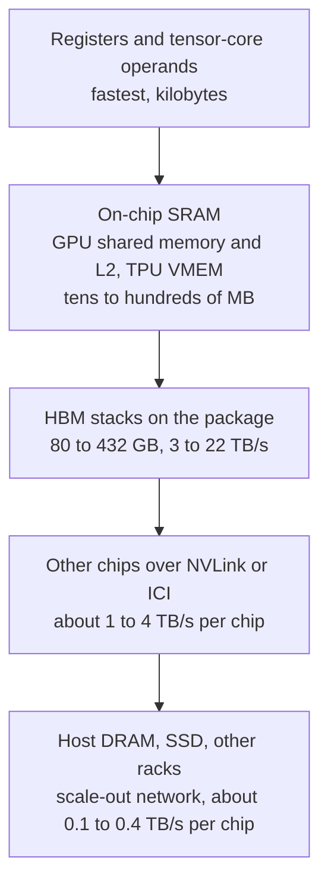
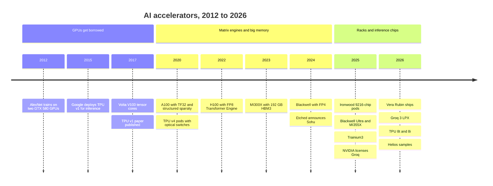
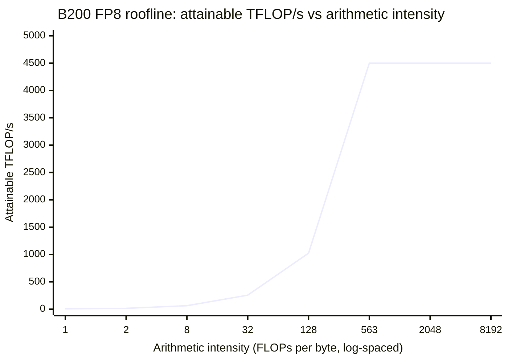

---
tags:
  - ai-ml
  - inference
  - systems
  - hardware
  - accelerators
status: draft
sources:
  - https://proceedings.neurips.cc/paper_files/paper/2012/file/c399862d3b9d6b76c8436e924a68c45b-Paper.pdf
  - https://arxiv.org/abs/1704.04760
  - https://arxiv.org/abs/2304.01433
  - https://arxiv.org/abs/2001.08361
  - https://arxiv.org/abs/2407.21783
  - https://people.eecs.berkeley.edu/~kubitron/cs252/handouts/papers/RooflineVyNoYellow.pdf
  - https://jax-ml.github.io/scaling-book/roofline
  - https://jax-ml.github.io/scaling-book/tpus
  - https://horace.io/brrr_intro.html
  - https://developer.nvidia.com/blog/programming-tensor-cores-cuda-9
  - https://developer.nvidia.com/blog/nvidia-ampere-architecture-in-depth
  - https://developer.nvidia.com/blog/nvidia-hopper-architecture-in-depth/
  - https://www.nvidia.com/en-us/data-center/h100.html
  - https://www.nvidia.com/en-gb/data-center/dgx-b200.md
  - https://developer.nvidia.com/blog/inside-nvidia-blackwell-ultra-the-chip-powering-the-ai-factory-era
  - https://www.nvidia.com/en-us/data-center/gb300-nvl72.md
  - https://www.nvidia.com/en-us/data-center/vera-rubin-nvl72.md
  - https://investor.nvidia.com/news/press-release-details/2026/NVIDIA-Announces-Financial-Results-for-Third-Quarter-Fiscal-2027/
  - https://www.tomshardware.com/pc-components/gpus/nvidias-kyber-rack-for-rubin-ultra-slips-to-2028
  - https://groq.com/newsroom/groq-and-nvidia-enter-non-exclusive-inference-technology-licensing-agreement-to-accelerate-ai-inference-at-global-scale
  - https://techcrunch.com/2025/12/24/nvidia-acquires-ai-chip-challenger-groq-for-20b-report-says/
  - https://developer.nvidia.com/blog/inside-nvidia-groq-3-lpx-the-low-latency-inference-accelerator-for-the-nvidia-vera-rubin-platform
  - https://www.theregister.com/2026/03/19/nvidia_lpx_deep_dive/
  - https://blogs.nvidia.com/blog/vera-rubin-lpx-spectrum-x-nvlink-fusion/
  - https://www.amd.com/en/products/accelerators/instinct/mi300/mi300x.html
  - https://www.amd.com/en/products/accelerators/instinct/mi350/mi355x.html
  - https://www.amd.com/en/products/rackscale-solutions/helios.html
  - https://thenextweb.com/news/amd-helios-mi455x-72-gpu-rack-nvidia-rival
  - https://ir.amd.com/news-events/press-releases/detail/1260/amd-and-openai-announce-strategic-partnership-to-deploy-6-gigawatts-of-amd-gpus
  - https://docs.cloud.google.com/tpu/docs/tpu7x
  - https://blog.google/products/google-cloud/ironwood-tpu-age-of-inference/
  - https://cloud.google.com/blog/products/compute/ironwood-tpus-and-new-axion-based-vms-for-your-ai-workloads/
  - https://cloud.google.com/blog/products/compute/tpu-8t-and-tpu-8i-technical-deep-dive
  - https://blog.google/innovation-and-ai/infrastructure-and-cloud/google-cloud/eighth-generation-tpu-agentic-era/
  - https://blog.google/innovation-and-ai/infrastructure-and-cloud/global-network/tpu-8i-max-and-8tx/
  - https://newsletter.semianalysis.com/p/tpuv7-google-takes-a-swing-at-the
  - https://thenextweb.com/news/google-tpu-compute-internal-researchers-anthropic
  - https://aws.amazon.com/about-aws/whats-new/2025/12/amazon-ec2-trn3-ultraservers
  - https://aws.amazon.com/ec2/instance-types/trn3/
  - https://developer.nvidia.com/blog/aws-integrates-ai-infrastructure-with-nvidia-nvlink-fusion-for-trainium4-deployment
  - https://newsletter.semianalysis.com/p/cerebras-faster-tokens-please
  - https://www.cerebras.ai/blog/openai-partners-with-cerebras-to-bring-high-speed-inference-to-the-mainstream
  - https://gwern.net/doc/www/www.etched.com/de827f3f96e99801324672b5ad20de1f492133fc.html
  - https://tenstorrent.com/newsroom/tenstorrent-enables-ai-at-scale-with-industry-leading-performance
  - https://sambanova.ai/press/sambanova-unveils-fastest-chip-for-agentic-ai-collaborates-with-intel-and-raises-350m
  - https://epoch.ai/data-insights/ai-chip-supply-chain-constraints
  - https://newsletter.semianalysis.com/p/the-great-ai-silicon-shortage
created: 2026-11-26
updated: 2026-11-28
---

## Table Of Contents

---

- [[#TL;DR|TL;DR]]
- [[#The Problem|The Problem]]
- [[#Foundations|Foundations]]
    - [[#The Four Numbers That Describe a Chip|The Four Numbers That Describe a Chip]]
    - [[#Arithmetic Intensity|Arithmetic Intensity]]
    - [[#Systolic Arrays and Tensor Cores|Systolic Arrays and Tensor Cores]]
    - [[#The Memory Hierarchy, SRAM and HBM|The Memory Hierarchy, SRAM and HBM]]
    - [[#Number Formats and Sparsity Footnotes|Number Formats and Sparsity Footnotes]]
    - [[#Scale-Up and Scale-Out Networks|Scale-Up and Scale-Out Networks]]
- [[#How We Got Here|How We Got Here]]
- [[#How It Works|How It Works]]
    - [[#The Roofline Equation|The Roofline Equation]]
    - [[#Worked Example, Decoding a 70B Model|Worked Example, Decoding a 70B Model]]
    - [[#Worked Example, Batching and Prefill|Worked Example, Batching and Prefill]]
    - [[#Comparison of Current Chips|Comparison of Current Chips]]
    - [[#Four Design Bets|Four Design Bets]]
- [[#Where It Is Now|Where It Is Now]]
    - [[#NVIDIA Ships Vera Rubin and Adds Groq|NVIDIA Ships Vera Rubin and Adds Groq]]
    - [[#Google Sells TPUs Outside Google|Google Sells TPUs Outside Google]]
    - [[#AMD and AWS|AMD and AWS]]
    - [[#Inference Specialists|Inference Specialists]]
    - [[#Supply Is Silicon, Memory and Power|Supply Is Silicon, Memory and Power]]
- [[#Trade-offs & Open Problems|Trade-offs & Open Problems]]
- [[#Resources|Resources]]
- [[#Related Notes|Related Notes]]

## ***TL;DR***
---
*An AI accelerator is a chip built to do huge numbers of matrix multiplies and to feed them with data fast enough. Which chip wins a workload depends less on its headline FLOPs than on whether that workload is limited by math, by memory bandwidth, by memory capacity or by the network between chips.*

- **What it is:** a processor dominated by matrix engines (NVIDIA tensor cores, Google's systolic MXUs, AMD's matrix cores), surrounded by fast on-package memory (HBM) and a dedicated chip-to-chip network. GPUs, TPUs, Trainium and the SRAM-heavy inference chips are all variations on that recipe.
- **The core idea:** the roofline. A chip delivers $\min(\text{peak FLOPs},\ \text{bandwidth} \times \text{arithmetic intensity})$. Training and prompt processing do hundreds to thousands of FLOPs per byte and hit the compute roof; generating tokens one at a time does about 1 to 2 FLOPs per byte and is starved by memory ([Williams et al., 2009](https://people.eecs.berkeley.edu/~kubitron/cs252/handouts/papers/RooflineVyNoYellow.pdf); [Scaling Book](https://jax-ml.github.io/scaling-book/roofline)).
- **Why chips differ:** every generation adds math faster than memory bandwidth, so vendors fight the bandwidth wall with lower-precision formats (FP8, then FP4), more and faster HBM, bigger scale-up domains (72-GPU NVLink racks, 9,216-chip TPU pods), or by putting the whole working set in on-chip SRAM (Groq, Cerebras).
- **Where it is now (Nov 2026):** NVIDIA's Vera Rubin NVL72 began shipping in its fiscal Q3 2027 (results released 17 Nov 2026), with Groq-derived LPX racks beside it for fast decode. Google split its eighth-generation TPU into a training chip (8t) and an inference chip (8i) and now sells TPUs to outside labs (Anthropic, Meta). AMD's 72-GPU Helios rack is sampling, and chip supply is limited by TSMC 3nm wafers, HBM and power rather than demand.

## ***The Problem***
---
*Neural networks are mostly matrix multiplication, and a general-purpose CPU spends most of its transistors and energy on things other than multiplying. The problem is to build chips that multiply at enormous rates and still keep those multipliers busy, because data movement, not arithmetic, is what usually runs out first.*

A forward pass of a dense [[Transformer]] costs about $2N$ FLOPs per token for $N$ parameters, and training costs about $6N$ per token ([Kaplan et al., 2020](https://arxiv.org/abs/2001.08361)). A 70B-parameter model therefore needs $1.4 \times 10^{11}$ FLOPs for every token it generates. Two things make that hard:

| Constraint | Why it bites | Example |
|---|---|---|
| Raw math | Frontier training runs reach $10^{26}$ FLOPs; only massively parallel matrix units deliver that in months | Kaplan's $6ND$ (see [[Scaling Laws]]) |
| Feeding the math | Every weight must travel from memory to the multipliers. If each byte is used only once or twice, the multipliers idle | TPU v1 would have run about 3x faster with GDDR5 instead of DDR3 ([Jouppi et al., 2017](https://arxiv.org/abs/1704.04760)) |
| Fitting the model | Weights, activations and the [[KV Cache]] must sit in fast memory | 70B in BF16 is 140 GB, more than one 80 GB H100 holds (see [[Quantization]]) |
| Talking between chips | Large models are split across many chips that exchange activations and gradients every step | Why NVLink, TPU ICI and NeuronLink exist (see [[Distributed Training]]) |

Horace He's summary of the same problem from the software side: time on a GPU goes to compute, to memory bandwidth, or to overhead, and "operator fusion" (keeping data on-chip between operations) is "the most important optimization in deep learning compilers" ([He, 2022](https://horace.io/brrr_intro.html)). [[FlashAttention]] is the best-known example.

## ***Foundations***
---
*Six ideas explain every spec sheet: the four numbers that bound a chip, arithmetic intensity, how matrix engines work, the SRAM-versus-HBM memory hierarchy, number formats (and the sparsity footnote that doubles quoted FLOPs), and the difference between scale-up and scale-out networks.*

#### **The Four Numbers That Describe a Chip**

| Number | Unit | What it limits | Typical 2026 value |
|---|---|---|---|
| Peak FLOPs | FLOP/s, per number format | How fast compute-heavy work (training, prefill) can go | 5 PFLOP/s dense FP8 (Blackwell Ultra) |
| Memory bandwidth | bytes/s from HBM | How fast memory-heavy work (decode) can go | 8 TB/s (Blackwell Ultra), 22 TB/s (Rubin) |
| Memory capacity | GB of HBM per chip | How big a model, batch and KV cache fit before you must split across chips | 288 GB (Blackwell Ultra, Rubin, MI355X) |
| Interconnect | bytes/s between chips | How well a model split over many chips scales | 1.8 TB/s per GPU NVLink (Blackwell), 3.6 TB/s (Rubin) |

Sources for the values: [NVIDIA Blackwell Ultra](https://developer.nvidia.com/blog/inside-nvidia-blackwell-ultra-the-chip-powering-the-ai-factory-era), [Vera Rubin NVL72](https://www.nvidia.com/en-us/data-center/vera-rubin-nvl72.md), [AMD MI355X](https://www.amd.com/en/products/accelerators/instinct/mi350/mi355x.html).

#### **Arithmetic Intensity**

Arithmetic intensity is "the ratio of the total FLOPs it performs to the number of bytes it needs to communicate" ([Scaling Book](https://jax-ml.github.io/scaling-book/roofline)). A chip has its own **critical intensity**, peak FLOPs divided by bandwidth: the FLOPs it can do in the time it takes to fetch one byte. Work above that ratio is compute-bound; work below it is memory-bound (more in [[Roofline Model and Arithmetic Intensity]]).

- **Matrix-matrix multiply** of a weight matrix by a batch of $B$ tokens reuses each weight $B$ times, so intensity grows with $B$. In BF16 a TPU v5e needs $B > 240$ tokens to be compute-bound; an H100's ratio is about 295 ([Scaling Book](https://jax-ml.github.io/scaling-book/roofline)).
- **Matrix-vector multiply** (one token at a time) uses each 2-byte weight for one multiply and one add: about 1 FLOP per byte. That is two orders of magnitude below any modern chip's critical intensity.

#### **Systolic Arrays and Tensor Cores**

Both are hardware that does a small matrix multiply per clock instead of one scalar multiply, so far more of the chip's area does useful math.

- **Systolic array (TPU MXU):** a grid of multiply-add cells. Weights are loaded and held in place, activations stream in from one side, and partial sums flow through the grid, so each value fetched from memory is used many times without going back to memory. TPU v1's matrix unit had 65,536 8-bit multiply-accumulate units for 92 TOPS ([Jouppi et al., 2017](https://arxiv.org/abs/1704.04760)); current MXUs are 256x256 (128x128 before TPU v6e), and weight matrices should be padded to multiples of 256 to fill them ([Scaling Book, TPUs](https://jax-ml.github.io/scaling-book/tpus)).
- **Tensor core (NVIDIA):** a unit inside each GPU streaming multiprocessor that computes $D = A \times B + C$ on small tiles. Volta's version multiplied 4x4 FP16 matrices with FP16 or FP32 accumulation, 64 multiply-adds per clock; the V100 had 640 of them for up to 125 Tensor TFLOPS ([NVIDIA, Oct 2017](https://developer.nvidia.com/blog/programming-tensor-cores-cuda-9)). Blackwell Ultra has 640 fifth-generation tensor cores across 160 SMs ([NVIDIA](https://developer.nvidia.com/blog/inside-nvidia-blackwell-ultra-the-chip-powering-the-ai-factory-era)).

The practical difference: a GPU keeps thousands of general programmable threads around its tensor cores, which makes it flexible; a TPU spends more area on a few huge matrix units and relies on the XLA compiler to schedule them.

#### **The Memory Hierarchy, SRAM and HBM**

- **SRAM** is on the compute die: very fast but expensive in area. On TPU7x the programmer-managed VMEM is 128 MiB with roughly 7x the bandwidth of HBM ([Scaling Book, TPUs](https://jax-ml.github.io/scaling-book/tpus)). Kernels like [[FlashAttention]] are designed to keep tiles in SRAM and touch HBM as little as possible. The GPU's levels in detail are in [[GPU Memory Hierarchy]].
- **HBM** (high-bandwidth memory) is stacked DRAM placed beside the compute die on a silicon interposer (TSMC's CoWoS packaging). It is where weights and the [[KV Cache]] live. Capacity and bandwidth per chip have grown from 80 GB at 3.35 TB/s (H100) to 288 GB at 22 TB/s (Rubin).
- **SRAM-only designs** skip HBM: Groq's LPU keeps the working set in 500 MB of on-chip SRAM per chip at 150 TB/s ([NVIDIA, Mar 2026](https://developer.nvidia.com/blog/inside-nvidia-groq-3-lpx-the-low-latency-inference-accelerator-for-the-nvidia-vera-rubin-platform)); Cerebras' wafer-scale WSE-3 has 44 GB of SRAM at about 21 PB/s ([SemiAnalysis, May 2026](https://newsletter.semianalysis.com/p/cerebras-faster-tokens-please)). Huge bandwidth, small capacity, so a big model must be spread over many chips or wafers.

#### **Number Formats and Sparsity Footnotes**

- **Each halving of bits roughly doubles peak FLOPs and halves bytes moved.** H100 added FP8 through its Transformer Engine, which picks FP8 or 16-bit math layer by layer ([NVIDIA, 2022](https://developer.nvidia.com/blog/nvidia-hopper-architecture-in-depth/)). Blackwell added FP4 (NVFP4); AMD's MI355X and Trainium3 support MXFP4; TPU 8t added native FP4, which Google says "doubles MXU throughput" ([Google Cloud, Apr 2026](https://cloud.google.com/blog/products/compute/tpu-8t-and-tpu-8i-technical-deep-dive)). See [[Quantization]] and [[Low-Precision Attention]].
- **The sparsity footnote.** Since Ampere, NVIDIA (and AMD) quote "with sparsity" figures for 2:4 structured sparsity, where two of every four weights are zero; it doubles tensor-core throughput only if the model is actually pruned that way ([NVIDIA, May 2020](https://developer.nvidia.com/blog/nvidia-ampere-architecture-in-depth)). The H100 page lists 1,979 TFLOPS BF16 "with sparsity", i.e. 989 dense ([NVIDIA](https://www.nvidia.com/en-us/data-center/h100.html)). Always compare dense to dense; this note does.

#### **Scale-Up and Scale-Out Networks**

A model too big or too slow for one chip is split across many (tensor, pipeline, expert and data parallelism, see [[Distributed Training]]). Two network tiers carry the traffic:

| Tier | What it is | Bandwidth per chip | Domain size |
|---|---|---|---|
| Scale-up | Direct chip-to-chip links that let a group act like one big accelerator: NVLink, TPU ICI, AWS NeuronLink, AMD UALink over Ethernet | Rubin 3.6 TB/s NVLink; Ironwood 1.2 TB/s ICI; Trainium3 2 TB/s | 72 GPUs (NVL72), 144 Trainium3, 9,216 TPUs |
| Scale-out | Ethernet or InfiniBand between scale-up domains, through NICs | Rubin 0.4 TB/s; Ironwood 100 Gbps DCN | Hundreds of thousands of chips |

Sources: [Vera Rubin NVL72](https://www.nvidia.com/en-us/data-center/vera-rubin-nvl72.md), [TPU7x docs](https://docs.cloud.google.com/tpu/docs/tpu7x), [AWS Trn3](https://aws.amazon.com/ec2/instance-types/trn3/).

The order-of-magnitude gap (3.6 vs 0.4 TB/s on Rubin) is why the most communication-heavy parallelism, tensor and expert parallelism for [[Mixture of Experts]], is kept inside one scale-up domain ([[Expert Parallelism and MoE Serving]] works through the numbers). GPUs build that domain with switches, which approximate all-to-all connections; TPUs use nearest-neighbor links in a 3D torus, which is cheaper to scale but needs more hops between distant chips ([Scaling Book, TPUs](https://jax-ml.github.io/scaling-book/tpus)).

## ***How We Got Here***
---
*Deep learning borrowed gaming GPUs in 2012, Google built the first dedicated inference ASIC by 2015, and NVIDIA answered with tensor cores in 2017. Since then each generation has chased the same moving targets: lower precision, more HBM, bigger scale-up domains, and from 2025 on, chips specialized for inference rather than training.*

| Year | What changed | Problem it answered | Source |
|---|---|---|---|
| 2012 | AlexNet won ILSVRC-2012 with 15.3% top-5 error vs 26.2% for second place, trained in five to six days on "two GTX 580 3GB GPUs". | CPUs were too slow to train large convolutional networks. | [Krizhevsky et al.](https://proceedings.neurips.cc/paper_files/paper/2012/file/c399862d3b9d6b76c8436e924a68c45b-Paper.pdf) |
| 2015 to 2017 | TPU v1 in Google datacenters from 2015: a 65,536-MAC 8-bit systolic array, 28 MiB of on-chip memory, 15x to 30x faster and 30x to 80x better TOPS/W than contemporary CPUs and GPUs on inference. | Neural-network inference demand was outgrowing datacenter CPUs. | [Jouppi et al.](https://arxiv.org/abs/1704.04760) |
| 2017 | Volta V100: 640 tensor cores, 125 Tensor TFLOPS of mixed precision. | GPUs spent most of their area on scalar FP32 units. | [NVIDIA](https://developer.nvidia.com/blog/programming-tensor-cores-cuda-9) |
| 2020 | A100: 312 TFLOPS dense BF16, TF32 for drop-in FP32 training, 2:4 sparsity, 40 GB HBM2 at 1,555 GB/s, 600 GB/s NVLink. TPU v4: 4,096-chip pods with optical circuit switches, 1.2x to 1.7x faster than A100 per Google. | Bigger models needed both more math and multi-thousand-chip training. | [NVIDIA](https://developer.nvidia.com/blog/nvidia-ampere-architecture-in-depth), [Jouppi et al., 2023](https://arxiv.org/abs/2304.01433) |
| 2022 | H100: FP8 Transformer Engine, about 1,000 TFLOPS dense BF16, HBM3 over 3 TB/s, NVLink 4 at 900 GB/s. | Transformer training dominated, and 8-bit math doubles throughput. | [NVIDIA](https://developer.nvidia.com/blog/nvidia-hopper-architecture-in-depth/) |
| 2023 | AMD MI300X: 192 GB HBM3 at 5.3 TB/s, 1.3 PFLOPS dense BF16. | LLM serving is capacity- and bandwidth-bound; more HBM per chip means fewer chips per model. | [AMD](https://www.amd.com/en/products/accelerators/instinct/mi300/mi300x.html) |
| 2024 to 2025 | Blackwell: two dies per GPU, 208B transistors, FP4, 8 TB/s; sold as 8-GPU HGX and 72-GPU NVL72 racks. Blackwell Ultra: 288 GB, 15 PFLOPS dense NVFP4. | Inference of [[Reasoning Models\|reasoning models]] and [[Mixture of Experts]] needed bigger NVLink domains and cheaper tokens. | [NVIDIA](https://developer.nvidia.com/blog/inside-nvidia-blackwell-ultra-the-chip-powering-the-ai-factory-era), [DGX B200](https://www.nvidia.com/en-gb/data-center/dgx-b200.md) |
| 2024 | Etched announced Sohu, a chip that hard-wires the transformer and cannot run CNNs, RNNs or SSMs, claiming over 500,000 tokens/s on Llama 70B per 8-chip server (company claim, never independently benchmarked). | GPUs devote only a small share of transistors to matrix math. | [Etched](https://gwern.net/doc/www/www.etched.com/de827f3f96e99801324672b5ad20de1f492133fc.html) |
| 2025 | Ironwood (TPU7x), "the first TPU designed specifically for inference": 192 GB HBM, 7.37 TB/s, 9,216-chip pods at 42.5 exaflops FP8 peak. | Serving "thinking" models at Google scale. | [Google, Apr 2025](https://blog.google/products/google-cloud/ironwood-tpu-age-of-inference/) |
| 2025 | NVIDIA licenses Groq's inference technology (24 Dec); Groq's founder and president join NVIDIA. | GPUs with HBM cannot match SRAM chips on per-user decode speed. | [Groq](https://groq.com/newsroom/groq-and-nvidia-enter-non-exclusive-inference-technology-licensing-agreement-to-accelerate-ai-inference-at-global-scale) |
| 2026 | Vera Rubin (HBM4, 22 TB/s, 3.6 TB/s NVLink) ships; Google splits TPUs into 8t (training) and 8i (inference, 384 MB SRAM). | Training, RL sampling and low-latency serving have diverged. | [NVIDIA, Nov 2026](https://investor.nvidia.com/news/press-release-details/2026/NVIDIA-Announces-Financial-Results-for-Third-Quarter-Fiscal-2027/), [Google, Apr 2026](https://cloud.google.com/blog/products/compute/tpu-8t-and-tpu-8i-technical-deep-dive) |

The thread through the table: TPU v1's own paper already found the chip bandwidth-limited, and every later generation has had to push memory and interconnect as hard as math.

## ***How It Works***
---
*The roofline turns a spec sheet into a prediction: divide the work's FLOPs by its bytes, compare with the chip's ratio, and you know which resource sets the speed. Applied to an LLM, it explains why decoding one user's tokens wastes over 99% of a GPU's math, why batching and low precision help, and why the chip families made such different bets.*

#### **The Roofline Equation**

$$
P_{\text{attainable}} = \min\left(P_{\text{peak}},\ \beta \times I\right), \qquad I = \frac{\text{FLOPs}}{\text{bytes moved}}, \qquad I^{*} = \frac{P_{\text{peak}}}{\beta}
$$

*In plain English: a chip can never go faster than its math units allow ($P_{\text{peak}}$), and it can never go faster than memory can deliver data times how much math you do per byte ($\beta \times I$). Plotted against $I$ on log axes, the limit is a sloped line (memory-bound) that flattens into a roof (compute-bound) at the critical intensity $I^{*}$. If your work's intensity is below $I^{*}$, buying more FLOPs does nothing; only bandwidth helps* ([Williams, Waterman & Patterson, 2009](https://people.eecs.berkeley.edu/~kubitron/cs252/handouts/papers/RooflineVyNoYellow.pdf); [Scaling Book](https://jax-ml.github.io/scaling-book/roofline)).

The same idea as a time bound, used below: a step takes at least $\max(T_{\text{math}}, T_{\text{memory}})$, where $T_{\text{math}} = \text{FLOPs}/P_{\text{peak}}$ and $T_{\text{memory}} = \text{bytes}/\beta$.

Critical intensities from vendor dense specs (FLOPs per byte of HBM or SRAM traffic; computed here from the table below):

| Chip and format | $P_{\text{peak}}$ | $\beta$ | $I^{*}$ |
|---|---|---|---|
| A100, BF16 | 312 TFLOP/s | 1.555 TB/s | 201 |
| H100, BF16 / FP8 | 989 / 1,979 TFLOP/s | 3.35 TB/s | 295 / 591 |
| B200, FP8 / FP4 | 4.5 / 9 PFLOP/s | 8 TB/s | 563 / 1,125 |
| Rubin, FP8 / FP4 (dense training) | 17.5 / 35 PFLOP/s | 22 TB/s | 795 / 1,591 |
| Ironwood, FP8 | 4.61 PFLOP/s | 7.37 TB/s | 625 |
| MI355X, FP8 | 5 PFLOP/s | 8 TB/s | 625 |
| Groq 3 LPU, FP8 (SRAM) | about 1.2 PFLOP/s | 150 TB/s | about 8 |

Two readings. First, $I^{*}$ keeps climbing on HBM chips: math has grown faster than bandwidth, so ever more work falls on the memory-bound side. Second, an SRAM chip sits almost two orders of magnitude lower, which is why it can run low-intensity work near peak.

A roofline for one B200 in FP8 (x-axis log-spaced; values are $\min(4500,\ 8 \times I)$):

Batch-1 decode lands at $I \approx 2$, batched decode at tens, prefill in the thousands (worked out next).

#### **Worked Example, Decoding a 70B Model**

Take a Llama-3-70B-shaped model: 80 layers, 8 KV heads, head size 128 ([Llama 3 paper](https://arxiv.org/abs/2407.21783), Table 3), so the BF16 [[KV Cache]] is about 320 KiB per token, 1.34 GB for a 4,096-token context. One user, one new token:

- **FLOPs:** $2N = 2 \times 70 \times 10^9 = 1.4 \times 10^{11}$.
- **Bytes:** all weights plus that user's cache. With FP8 weights, $70 + 1.34 \approx 71.3$ GB.
- **Intensity:** $1.4 \times 10^{11} / 7.13 \times 10^{10} \approx 2$ FLOPs per byte.

| Chip, weight format | Bytes per token | $T_{\text{memory}}$ | $T_{\text{math}}$ | Ceiling, tokens/s for one user | Share of peak FLOPs used |
|---|---|---|---|---|---|
| H100, FP8 (70 GB fits in 80 GB) | 71.3 GB | 21.3 ms | 0.07 ms | about 47 | about 0.3% |
| B200, FP8 | 71.3 GB | 8.9 ms | 0.03 ms | about 112 | about 0.4% |
| B200, FP4 | 36.3 GB | 4.5 ms | 0.02 ms | about 220 | about 0.2% |
| Rubin, FP4 | 36.3 GB | 1.65 ms | under 0.01 ms | about 600 | about 0.2% |

*In plain English: generating one token means streaming the entire model out of HBM to do a sliver of math, so speed is set almost entirely by bandwidth and by how many bytes each weight takes. FLOPs barely matter.* These are upper bounds; real kernels, attention and communication overheads land lower. The table also shows the two levers that work: fewer bytes ([[Quantization]]: FP8 to FP4 halves the time) and more bandwidth (Rubin's 22 TB/s). [[Speculative Decoding]] is a third: verifying several draft tokens per pass raises intensity.

The SRAM alternative: 70 GB of FP8 weights spread over 500 MB LPUs takes about 140 chips, whose combined SRAM bandwidth is about 21 PB/s, so reading the weights is no longer the bottleneck; chip-to-chip latency and the chip count are. That is the Groq and Cerebras trade in one line.

#### **Worked Example, Batching and Prefill**

**Batching decode.** Serve $B$ users at once and every weight byte is reused $B$ times, but each user still brings their own KV cache, which is not shared. On a B200 with FP8 weights, 180 GB of HBM leaves about 110 GB after weights, room for about 80 users at 4,096 tokens of context:

- FLOPs per step: $2 \times 70 \times 10^9 \times 80 = 1.12 \times 10^{13}$.
- Bytes per step: $70 + 80 \times 1.34 \approx 177$ GB, so $I \approx 63$, still far below $I^{*} = 563$.
- $T_{\text{memory}} \approx 22$ ms per step: about 45 tokens/s per user, about 3,600 tokens/s total, 32x the batch-1 throughput.

To reach the compute roof you would need roughly 300 concurrent sequences with short contexts, and the KV cache for that does not fit. *In plain English: during decode, HBM capacity caps the batch before compute ever becomes the limit, which is why capacity (288 GB, 432 GB) is a headline spec and why [[LLM Serving]] systems fight to shrink and page the cache (see [[PagedAttention]]).*

**Prefill.** Processing a 4,000-token prompt on the same B200 does $2 \times 70 \times 10^9 \times 4000 = 5.6 \times 10^{14}$ FLOPs while reading the weights once (about 71 GB), so $I \approx 7{,}900$: deep in compute-bound territory. $T_{\text{math}} \approx 124$ ms at full FP8 peak vs $T_{\text{memory}} \approx 9$ ms. Prefill wants FLOPs; decode wants bandwidth and capacity. That split is why serving stacks now run prefill and decode on separate pools, and why NVIDIA pairs Rubin GPUs with SRAM-based LPUs (below).

#### **Comparison of Current Chips**

Dense peak figures per chip from vendor pages; "n/l" means the vendor does not list it. Dates are availability as reported.

| Chip | Status | BF16 | FP8 | FP4 | Memory | Bandwidth | Scale-up domain | Source |
|---|---|---|---|---|---|---|---|---|
| NVIDIA H100 SXM | 2022 | 989 TF | 1,979 TF | none | 80 GB HBM3 | 3.35 TB/s | NVLink 900 GB/s per GPU | [NVIDIA](https://www.nvidia.com/en-us/data-center/h100.html) |
| NVIDIA B200 (HGX/DGX) | 2024 to 2025 | n/l | 4.5 PF | 9 PF | 180 GB HBM3e | 8 TB/s | 8 GPUs, 1.8 TB/s each | [DGX B200](https://www.nvidia.com/en-gb/data-center/dgx-b200.md) |
| NVIDIA Blackwell Ultra (GB300 NVL72) | 2025 | 2.5 PF¹ | 5 PF | 15 PF | 288 GB HBM3e | 8 TB/s | 72 GPUs, 130 TB/s rack | [NVIDIA](https://developer.nvidia.com/blog/inside-nvidia-blackwell-ultra-the-chip-powering-the-ai-factory-era), [GB300](https://www.nvidia.com/en-us/data-center/gb300-nvl72.md) |
| NVIDIA Rubin (Vera Rubin NVL72) | shipping, Nov 2026 | 4 PF | 17.5 PF | 35 PF (50 inference²) | 288 GB HBM4 | 22 TB/s | 72 GPUs, 3.6 TB/s each, 260 TB/s rack | [NVIDIA](https://www.nvidia.com/en-us/data-center/vera-rubin-nvl72.md) |
| AMD MI355X | 2025 | 2.5 PF | 5 PF | 10.1 PF | 288 GB HBM3E | 8 TB/s | 7 Infinity Fabric links, 144 GB/s each | [AMD](https://www.amd.com/en/products/accelerators/instinct/mi350/mi355x.html) |
| AMD MI455X (Helios) | samples 2H 2026, volume Q2 2027 | n/l | about 19 PF³ | 40 PF (AMD peak) | 432 GB HBM4 | 19.6 TB/s | 72 GPUs, 260 TB/s rack (UALink over Ethernet) | [AMD](https://www.amd.com/en/products/rackscale-solutions/helios.html), [TNW](https://thenextweb.com/news/amd-helios-mi455x-72-gpu-rack-nvidia-rival) |
| Google TPU v6e (Trillium) | in service | 918 TF | 918 TF | none | 32 GB | 1.64 TB/s | 256-chip pod | [Google Cloud](https://docs.cloud.google.com/tpu/docs/tpu7x) |
| Google TPU7x (Ironwood) | GA late 2025 | 2.31 PF | 4.61 PF | none | 192 GiB | 7.37 TB/s | 9,216-chip pod, ICI 1.2 TB/s per chip | [Google Cloud](https://docs.cloud.google.com/tpu/docs/tpu7x) |
| Google TPU 8t | announced Apr 2026 | n/l | n/l | 12.6 PF | 216 GB | 6.53 TB/s | 9,600-chip superpod (3D torus) | [Google Cloud](https://cloud.google.com/blog/products/compute/tpu-8t-and-tpu-8i-technical-deep-dive) |
| Google TPU 8i | announced Apr 2026 | n/l | n/l | 10.1 PF | 288 GB + 384 MB SRAM | 8.6 TB/s | up to 1,024 active chips (Boardfly) | [Google Cloud](https://cloud.google.com/blog/products/compute/tpu-8t-and-tpu-8i-technical-deep-dive) |
| AWS Trainium3 | GA Dec 2025 | n/l | 2.52 PF | n/l (MXFP4 supported) | 144 GB HBM3e | 4.9 TB/s | 144 chips per UltraServer, 2 TB/s each | [AWS](https://aws.amazon.com/about-aws/whats-new/2025/12/amazon-ec2-trn3-ultraservers) |
| NVIDIA Groq 3 LPU (LP30) | full production, Aug 2026 | n/l | about 1.2 PF | none until LP35 | 500 MB SRAM, no HBM | 150 TB/s (SRAM) | 256 per LPX rack, 640 TB/s | [NVIDIA](https://developer.nvidia.com/blog/inside-nvidia-groq-3-lpx-the-low-latency-inference-accelerator-for-the-nvidia-vera-rubin-platform), [The Register](https://www.theregister.com/2026/03/19/nvidia_lpx_deep_dive/) |
| Cerebras WSE-3 | in service | about 15.6 PF FP16⁴ | n/l | n/l | 44 GB SRAM | about 21 PB/s | one wafer; about 150 GB/s off-wafer | [SemiAnalysis](https://newsletter.semianalysis.com/p/cerebras-faster-tokens-please) |

¹ GB300 rack figure (360 PFLOPS, quoted with sparsity) divided by 72 and by 2. ² NVIDIA lists 50 PFLOPS "NVFP4 inference" and 35 PFLOPS "NVFP4 training (dense)". ³ AMD's 1.4 exaFLOPS FP8 per rack divided by 72. ⁴ SemiAnalysis' estimate from Cerebras' sparse 125 PFLOPS figure, assuming 8:1 sparsity.

#### **Four Design Bets**

| Bet | Chips | What it optimizes | What it gives up |
|---|---|---|---|
| Programmable GPU + HBM + switched scale-up | NVIDIA Hopper to Rubin, AMD Instinct | Flexibility: any model, any kernel, mature CUDA or ROCm software; strong at training and prefill | Batch-1 decode is bandwidth-bound; power and cost per rack climb (1,400 W per Blackwell Ultra or MI355X package) |
| Systolic ASIC + HBM + torus or custom fabric | Google TPU, AWS Trainium | Cost and power per FLOP at huge scale; Ironwood's TCO per chip estimated about 44% below a GB200 server at Google's cost ([SemiAnalysis, Nov 2025](https://newsletter.semianalysis.com/p/tpuv7-google-takes-a-swing-at-the)) | Tied to one vendor's cloud and compiler (XLA, Neuron); fewer kernel authors |
| SRAM-first dataflow | Groq LPU, Cerebras WSE, TPU 8i (partly), SambaNova (three-tier memory), Tenstorrent | Per-user tokens/s: bandwidth in PB/s, deterministic latency | Capacity: hundreds of chips (or several wafers) per large model; KV cache must live elsewhere for [[Long Context\|long contexts]] |
| Hard-wired architecture | Etched Sohu | Maximum utilization for one model family (Etched claims over 90% FLOPS utilization vs about 30% for GPUs) | Useless if the architecture changes; Etched itself says Sohu cannot run SSMs or CNNs ([Etched](https://gwern.net/doc/www/www.etched.com/de827f3f96e99801324672b5ad20de1f492133fc.html)) |

## ***Where It Is Now***
---
*As of November 2026 the frontier is rack-scale: 72-GPU NVLink racks, 9,600-chip TPU superpods and 144-chip Trainium UltraServers, built from HBM4-class memory. Inference has become the main design target, so every major vendor now pairs a throughput chip with a low-latency SRAM-heavy one, and supply of 3nm wafers, HBM and power, not demand, sets how many get built.*

#### **NVIDIA Ships Vera Rubin and Adds Groq**

- **Vera Rubin is shipping.** NVIDIA's results for the quarter ended 25 Oct 2026 say Vera Rubin NVL72 "has shipped", in "the fastest product ramp in the company's history", with racks running at CoreWeave, Google Cloud, Microsoft Azure, Oracle Cloud and Nebius; data-center revenue was $107.6B, up 110% year on year ([NVIDIA, 17 Nov 2026](https://investor.nvidia.com/news/press-release-details/2026/NVIDIA-Announces-Financial-Results-for-Third-Quarter-Fiscal-2027/)). Per rack: 3,600 PFLOPS NVFP4 inference, 20.7 TB HBM4 at 1,580 TB/s, 260 TB/s NVLink ([NVIDIA](https://www.nvidia.com/en-us/data-center/vera-rubin-nvl72.md)).
- **The bigger rack slipped.** Kyber NVL144 (144 Rubin Ultra packages in one rack) reportedly will not ship until 2028 because of problems building its copper midplane, and an eight-rack NVL576 with co-packaged optics will likely slip too; NVIDIA says "Our roadmap is intact" ([Tom's Hardware citing SemiAnalysis, 6 Jul 2026](https://www.tomshardware.com/pc-components/gpus/nvidias-kyber-rack-for-rubin-ultra-slips-to-2028)).
- **Groq became part of the NVIDIA rack.** After the non-exclusive licensing deal of 24 Dec 2025 (Groq stays independent and keeps running GroqCloud; press reports put the price near $20B, and NVIDIA's November filing shows a $2.9B payment to Groq, Inc. so far) ([Groq](https://groq.com/newsroom/groq-and-nvidia-enter-non-exclusive-inference-technology-licensing-agreement-to-accelerate-ai-inference-at-global-scale); [TechCrunch](https://techcrunch.com/2025/12/24/nvidia-acquires-ai-chip-challenger-groq-for-20b-report-says/); [NVIDIA, Nov 2026](https://investor.nvidia.com/news/press-release-details/2026/NVIDIA-Announces-Financial-Results-for-Third-Quarter-Fiscal-2027/)), NVIDIA announced the Groq 3 LPX rack at GTC on 16 Mar 2026: 256 LPUs, 128 GB of SRAM at 40 PB/s, 315 PFLOPS FP8. In a Vera Rubin plus LPX system, GPUs do prefill and decode attention over the KV cache, and LPUs run the bandwidth-bound expert feed-forward layers, passing activations back and forth every token under NVIDIA Dynamo ([NVIDIA, Mar 2026](https://developer.nvidia.com/blog/inside-nvidia-groq-3-lpx-the-low-latency-inference-accelerator-for-the-nvidia-vera-rubin-platform)). LPX entered full production on 24 Aug 2026, with Nebius the first cloud to adopt it ([NVIDIA, Aug 2026](https://blogs.nvidia.com/blog/vera-rubin-lpx-spectrum-x-nvlink-fusion/)).

#### **Google Sells TPUs Outside Google**

- **Ironwood went GA** in late 2025: Google's 6 Nov 2025 post said "in the coming weeks", and noted Anthropic plans to access up to 1 million TPUs ([Google Cloud](https://cloud.google.com/blog/products/compute/ironwood-tpus-and-new-axion-based-vms-for-your-ai-workloads/)). SemiAnalysis reported that about 400k of those Ironwood chips are sold to Anthropic as finished racks through Broadcom and the other about 600k rented through Google Cloud, and estimated Ironwood's cost per effective FLOP for Anthropic at about half of GB300 NVL72 at 40% utilization ([SemiAnalysis, 28 Nov 2025](https://newsletter.semianalysis.com/p/tpuv7-google-takes-a-swing-at-the); estimates).
- **The deals grew in 2026.** Bloomberg reported in May 2026 a Google commitment of five gigawatts of TPU capacity to Anthropic over five years, plus a separate Broadcom supply line, and that Meta signed its own TPU deal earlier in 2026 ([TNW citing Bloomberg, 18 May 2026](https://thenextweb.com/news/google-tpu-compute-internal-researchers-anthropic)).
- **Eighth generation, four systems.** TPU 8t (training: 12.6 PFLOPS FP4, 216 GB, 9,600-chip superpods, up to 2.7x performance per dollar vs Ironwood) and TPU 8i (inference: 288 GB HBM, 384 MB SRAM to hold more KV cache on-chip, a low-diameter "Boardfly" topology for MoE all-to-all traffic) were announced on 22 Apr 2026 ([Google Cloud](https://cloud.google.com/blog/products/compute/tpu-8t-and-tpu-8i-technical-deep-dive)). On 9 Nov 2026 Google added TPU 8tx (confidential inference) and TPU 8i Max (two 8i dies per package), said TPUs have "nearly 100 customers", and that customers can now deploy TPUs in their own data centers ([Google, Nov 2026](https://blog.google/innovation-and-ai/infrastructure-and-cloud/global-network/tpu-8i-max-and-8tx/)). Neither post gives a GA date for the eighth generation.

#### **AMD and AWS**

- **AMD:** MI355X (288 GB, 8 TB/s, 10.1 PFLOPS MXFP4, 1,400 W) is the current part ([AMD](https://www.amd.com/en/products/accelerators/instinct/mi350/mi355x.html)). OpenAI agreed on 6 Oct 2025 to deploy 6 GW of AMD GPUs, starting with 1 GW of MI450 in the second half of 2026, in exchange for warrants on up to 160M AMD shares ([AMD](https://ir.amd.com/news-events/press-releases/detail/1260/amd-and-openai-announce-strategic-partnership-to-deploy-6-gigawatts-of-amd-gpus)). Helios, AMD's 72-GPU MI455X rack with 31 TB of HBM4 and UALink-over-Ethernet scale-up, is a reference design that partners build; engineering samples ship in 2H 2026 and mass production starts in Q2 2027 ([AMD](https://www.amd.com/en/products/rackscale-solutions/helios.html); [TNW, 20 Jul 2026](https://thenextweb.com/news/amd-helios-mi455x-72-gpu-rack-nvidia-rival)).
- **AWS:** Trainium3 (3nm, 2.52 PFLOPS FP8, 144 GB, 4.9 TB/s) went GA on 2 Dec 2025 in 144-chip UltraServers that AWS says deliver up to 4.4x the performance of Trn2 UltraServers ([AWS](https://aws.amazon.com/about-aws/whats-new/2025/12/amazon-ec2-trn3-ultraservers)). Trainium4 will use NVIDIA's NVLink Fusion chiplet to join a 72-chip NVLink 6 domain at 3.6 TB/s per chip, the same switch tray as Vera Rubin ([NVIDIA, Dec 2025](https://developer.nvidia.com/blog/aws-integrates-ai-infrastructure-with-nvidia-nvlink-fusion-for-trainium4-deployment)). A custom chip adopting NVIDIA's scale-up fabric shows how much the network now matters.

#### **Inference Specialists**

All speed figures below are vendor-reported or vendor-cited unless noted; they are measured on different models and settings and are not directly comparable.

| Company, chip | Approach | Reported speed | Status | Source |
|---|---|---|---|---|
| NVIDIA Groq 3 LPX | SRAM LPUs beside Rubin GPUs | 3,400 output tokens/s on Gemma 4 31B at 100K context (Artificial Analysis run, NVIDIA-reported) | Full production, Aug 2026 | [NVIDIA](https://blogs.nvidia.com/blog/vera-rubin-lpx-spectrum-x-nvlink-fusion/) |
| Cerebras WSE-3 / CS-3 | Wafer-scale SRAM | GPT-5.3-Codex-Spark reportedly up to 2,000 tokens/s per user; largest production model GPT-OSS 120B | OpenAI deal for 750 MW over 2026 to 2028 (option to 2 GW) | [SemiAnalysis, May 2026](https://newsletter.semianalysis.com/p/cerebras-faster-tokens-please), [Cerebras, Jan 2026](https://www.cerebras.ai/blog/openai-partners-with-cerebras-to-bring-high-speed-inference-to-the-mainstream) |
| SambaNova SN50 | Reconfigurable dataflow unit, three-tier memory, up to 256 chips | 895 tokens/s per user on Llama 3.3 70B FP8 vs 184 on B200 (citing SemiAnalysis InferenceX) | Shipping "later this year" (2026); Intel strategic investment | [SambaNova, Feb 2026](https://sambanova.ai/press/sambanova-unveils-fastest-chip-for-agentic-ai-collaborates-with-intel-and-raises-350m) |
| Tenstorrent Galaxy Blackhole | 32 chips per server, 6.2 GB SRAM plus 1 TB DRAM, Ethernet scale-out | DeepSeek-R1-0528 at 350+ tokens/s per user | GA, Apr 2026, from $110,000 per server | [Tenstorrent, Apr 2026](https://tenstorrent.com/newsroom/tenstorrent-enables-ai-at-scale-with-industry-leading-performance) |
| Etched Sohu | Transformer hard-wired in silicon | Claimed 500,000+ tokens/s throughput on Llama 3 70B per 8-chip server (2024 claim) | Not independently benchmarked; 2026 status not confirmed from primary sources | [Etched](https://gwern.net/doc/www/www.etched.com/de827f3f96e99801324672b5ad20de1f492133fc.html) |

The limits SemiAnalysis lists for Cerebras apply to the whole SRAM camp: 44 GB per wafer is about 6.5x less than one 288 GB GPU package, low off-wafer bandwidth forces pipelining across wafers (adding latency per step), SRAM density has stalled past 5nm, and each wafer draws about 25 kW ([SemiAnalysis, May 2026](https://newsletter.semianalysis.com/p/cerebras-faster-tokens-please)).

#### **Supply Is Silicon, Memory and Power**

- **2025 was CoWoS and HBM.** Epoch AI found AI chip output in 2025 was "primarily bottlenecked by CoWoS and HBM manufacturing"; NVIDIA, Google, AMD and Amazon took over 90% of CoWoS and HBM supply by value but only about 12% of advanced logic, with NVIDIA alone at about 60% of CoWoS and 69% of HBM ([Epoch AI, 12 Mar 2026](https://epoch.ai/data-insights/ai-chip-supply-chain-constraints)).
- **2026 is 3nm wafers, with HBM next.** SemiAnalysis argues the binding constraint has moved to TSMC N3 logic wafers (effective utilization above 100% in 2H 2026, AI at about 60% of 2026 N3 output and 86% modeled for 2027), with CoWoS "tight but easing". HBM uses about 3x the wafer area per bit of ordinary DRAM, approaching 4x with HBM4, while HBM per accelerator keeps rising ([SemiAnalysis, 12 Mar 2026](https://newsletter.semianalysis.com/p/the-great-ai-silicon-shortage)). The two analyses differ mostly in the year they look at.
- **Power.** SemiAnalysis' TPU analysis names power as Google's "main bottleneck" ([Nov 2025](https://newsletter.semianalysis.com/p/tpuv7-google-takes-a-swing-at-the)), and deals are now sized in gigawatts rather than chips (OpenAI's 6 GW with AMD and 750 MW with Cerebras, Anthropic's multi-GW TPU commitments).

## ***Trade-offs & Open Problems***
---
*No chip is best at everything, because training, prefill and decode sit at different points on the roofline. The open questions are whether specialization pays off before model architectures change, whether anyone can break NVIDIA's software lead, and whether memory and power can keep up with math.*

| Trade-off | Tension | Current state |
|---|---|---|
| FLOPs vs bandwidth | Critical intensity keeps rising (201 on A100 BF16 to about 1,600 on Rubin FP4), so more workloads are memory-bound | HBM4, FP4 weights, speculative decoding, SRAM co-processors (LPX, TPU 8i) |
| Capacity vs speed | SRAM gives PB/s but megabytes; HBM gives hundreds of GB at TB/s | Hybrid systems: HBM chips hold the KV cache, SRAM chips run the weights-bound layers |
| General vs specialized | Hard-wired chips win only while the architecture stays fixed; [[State Space Models]], [[Hybrid Attention]] and [[Mixture of Experts]] keep changing the workload | GPUs and TPUs stay programmable; Etched's bet remains unproven publicly |
| Precision vs quality | FP4 doubles throughput but risks accuracy, especially for training | Vendors now ship FP4 training paths (Rubin's 35 PFLOPS "training" figure, TPU 8t) |
| Scale-up size vs manufacturability | Bigger NVLink or ICI domains help MoE and long context, but copper midplanes and optics are hard to build | Kyber NVL144 reported slipped to 2028; TPUs use optical circuit switches |
| Vendor lock-in vs cost | TPUs and Trainium are cheaper per FLOP by analysts' estimates but tie you to XLA or Neuron | Anthropic and Meta buy TPUs; Trainium4 adopts NVLink; AMD pushes open UALink and ROCm |
| Peak vs delivered | Spec sheets quote peaks (and sometimes sparse peaks); utilization depends on kernels and model shape | Independent benchmarks (MLPerf, SemiAnalysis InferenceX, Artificial Analysis) matter more than spec sheets |

Open questions: how far FP4 (and below) can go for pretraining without loss; whether SRAM density stagnation caps the SRAM-first camp; whether HBM supply can match rising HBM per chip; and whether power availability, not chips, sets the pace of AI scaling from 2027 on.

## ***Resources***
---
*Start with the Scaling Book's roofline chapter and Horace He's post for the mental model, then the TPU v1 paper for why ASICs exist. Vendor deep dives give the specs; Epoch and SemiAnalysis give supply and economics.*

**Papers**
- [Roofline: An Insightful Visual Performance Model for Multicore Architectures](https://people.eecs.berkeley.edu/~kubitron/cs252/handouts/papers/RooflineVyNoYellow.pdf): Williams, Waterman, Patterson (Berkeley), CACM 2009. The original roofline model.
- [ImageNet Classification with Deep Convolutional Neural Networks](https://proceedings.neurips.cc/paper_files/paper/2012/file/c399862d3b9d6b76c8436e924a68c45b-Paper.pdf): Krizhevsky, Sutskever, Hinton, NeurIPS 2012. AlexNet; GPUs enter deep learning.
- [In-Datacenter Performance Analysis of a Tensor Processing Unit](https://arxiv.org/abs/1704.04760): Jouppi et al. (Google), Apr 2017 (ISCA 2017). TPU v1, systolic arrays, and why it was memory-bound.
- [TPU v4: An Optically Reconfigurable Supercomputer for Machine Learning](https://arxiv.org/abs/2304.01433): Jouppi et al. (Google), Apr 2023 (ISCA 2023). Optical circuit switches and SparseCores.

**Posts and explainers**
- [All About Rooflines](https://jax-ml.github.io/scaling-book/roofline) and [How to Think About TPUs](https://jax-ml.github.io/scaling-book/tpus): Google DeepMind "How to Scale Your Model" book. Arithmetic intensity, critical batch size, MXU and ICI details.
- [Making Deep Learning Go Brrrr From First Principles](https://horace.io/brrr_intro.html): Horace He, 2022. Compute vs bandwidth vs overhead, and operator fusion.
- [Programming Tensor Cores in CUDA 9](https://developer.nvidia.com/blog/programming-tensor-cores-cuda-9): NVIDIA, Oct 2017. What a Volta tensor core computes.
- [NVIDIA Ampere Architecture In-Depth](https://developer.nvidia.com/blog/nvidia-ampere-architecture-in-depth), [Hopper In-Depth](https://developer.nvidia.com/blog/nvidia-hopper-architecture-in-depth/), [Inside Blackwell Ultra](https://developer.nvidia.com/blog/inside-nvidia-blackwell-ultra-the-chip-powering-the-ai-factory-era): NVIDIA, 2020 to 2025. Generation-by-generation spec tables.
- [Inside NVIDIA Groq 3 LPX](https://developer.nvidia.com/blog/inside-nvidia-groq-3-lpx-the-low-latency-inference-accelerator-for-the-nvidia-vera-rubin-platform): NVIDIA, Mar 2026. How SRAM LPUs and GPUs split decode.
- [Inside the eighth-generation TPU](https://cloud.google.com/blog/products/compute/tpu-8t-and-tpu-8i-technical-deep-dive): Google Cloud, Apr 2026. Why Google split training and inference chips; Boardfly topology.
- [TPU7x (Ironwood) documentation](https://docs.cloud.google.com/tpu/docs/tpu7x): Google Cloud. Per-chip specs for v5p, v6e and Ironwood side by side.

**Analysis**
- [TPUv7: Google Takes a Swing at the King](https://newsletter.semianalysis.com/p/tpuv7-google-takes-a-swing-at-the): SemiAnalysis, Nov 2025. External TPU sales and TCO vs GB200/GB300.
- [Cerebras: Faster Tokens Please](https://newsletter.semianalysis.com/p/cerebras-faster-tokens-please): SemiAnalysis, May 2026. Wafer-scale strengths and limits.
- [The Great AI Silicon Shortage](https://newsletter.semianalysis.com/p/the-great-ai-silicon-shortage): SemiAnalysis, Mar 2026. N3, CoWoS and HBM constraints for 2026 and 2027.
- [AI chip supply chain constraints](https://epoch.ai/data-insights/ai-chip-supply-chain-constraints): Epoch AI, Mar 2026. Who consumes CoWoS and HBM, and why they bound 2025 output.

## Related Notes

- [[1 - All About Rooflines (NOT DONE)|1 - All About Rooflines (NOT DONE)]] — The roofline chapter this note's equation and intensity numbers come from.
- [[2 - How To Think About TPUs (NOT DONE)|2 - How To Think About TPUs (NOT DONE)]] — Deeper treatment of MXUs, VMEM, ICI and TPU pod topology.
- [[7 - All About Transformer Inference (NOT DONE)|7 - All About Transformer Inference (NOT DONE)]] — Prefill vs decode on real hardware, the subject of the worked examples.
- [[Quantization]] — FP8, FP4 and MX formats: how fewer bytes per weight move the decode roofline.
- [[Low-Precision Attention]] — Running attention itself in FP8 or FP4 on the new tensor cores.
- [[Distributed Training]] — Tensor, pipeline, expert and data parallelism mapped onto scale-up and scale-out networks.
- [[LLM Serving]] — Batching, prefill/decode disaggregation and scheduling on top of these chips.
- [[KV Cache]] — The per-user memory that caps batch size and drives HBM capacity.
- [[PagedAttention]] — Managing KV cache memory so more sequences fit per accelerator.
- [[FlashAttention]] — The canonical SRAM-aware kernel: tiling attention to avoid HBM traffic.
- [[Speculative Decoding]] — Raises decode arithmetic intensity; LPX can host the draft model.
- [[Mixture of Experts]] — All-to-all expert traffic is why scale-up domain size and topology matter.
- [[Scaling Laws]] — The compute trend these chips supply, and the $6ND$ and $2N$ FLOP counts used here.
- [[Low-Precision Training]] — How FP8 and NVFP4 training recipes turn these chips' low-precision peaks into real speedups.
- [[Blackwell Architecture]] — NVIDIA's Blackwell generation in depth.
- [[Expert Parallelism and MoE Serving]] — Why MoE serving wants large NVLink domains: the per-layer all-to-all.
