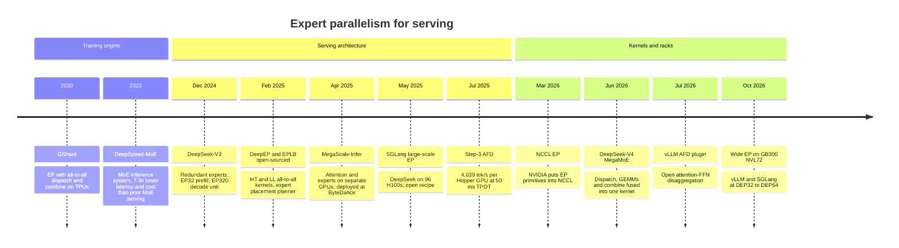
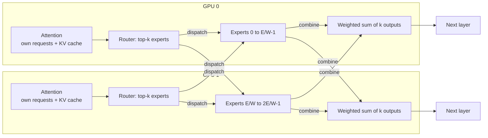
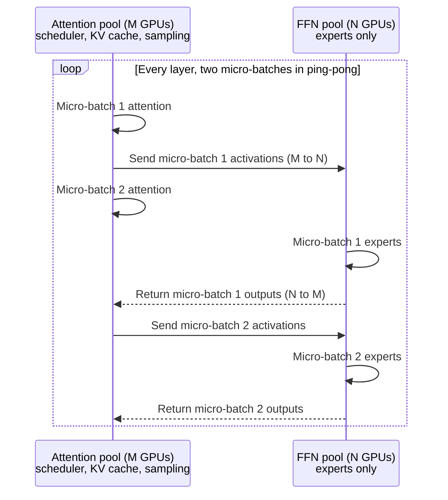

---
tags:
  - ai-ml
  - inference
  - serving
  - mixture-of-experts
  - expert-parallelism
  - all-to-all
status: draft
sources:
  - https://arxiv.org/abs/2006.16668
  - https://arxiv.org/abs/2201.05596
  - https://arxiv.org/abs/2412.19437
  - https://huggingface.co/deepseek-ai/DeepSeek-V3/blob/main/config.json
  - https://github.com/deepseek-ai/open-infra-index/blob/main/202502OpenSourceWeek/day_6_one_more_thing_deepseekV3R1_inference_system_overview.md
  - https://github.com/deepseek-ai/DeepEP
  - https://github.com/deepseek-ai/EPLB
  - https://lmsys.org/blog/2025-05-05-large-scale-ep/
  - https://arxiv.org/abs/2504.02263
  - https://arxiv.org/abs/2507.19427
  - https://arxiv.org/abs/2602.09721
  - https://arxiv.org/abs/2603.13606
  - https://arxiv.org/abs/2605.28302
  - https://arxiv.org/abs/2606.19348
  - https://vllm.ai/blog/2026-07-23-vllm-afd-plugin
  - https://arxiv.org/abs/2609.36070
  - https://arxiv.org/abs/2602.21140
  - https://vllm.ai/blog/2026-10-23-deepseek-v41-flash-pd-wide-ep
  - https://www.lmsys.org/blog/2026-10-24-dsv41-deepinfer
  - https://inferencex.semianalysis.com/blog/inferencex-v2-nvidia-blackwell-vs-amd-vs-hopper
created: 2026-11-28
updated: 2026-11-28
---

## Table Of Contents

---

- [[#TL;DR|TL;DR]]
- [[#The Problem|The Problem]]
- [[#Foundations|Foundations]]
    - [[#Four Ways to Split an MoE Layer|Four Ways to Split an MoE Layer]]
    - [[#Tokens per Expert Is the Number That Matters|Tokens per Expert Is the Number That Matters]]
    - [[#Dispatch and Combine|Dispatch and Combine]]
    - [[#Two Communication Regimes|Two Communication Regimes]]
- [[#How We Got Here|How We Got Here]]
- [[#How It Works|How It Works]]
    - [[#The DEP Layout|The DEP Layout]]
    - [[#The Equation|The Equation]]
    - [[#A Worked Example with DeepSeek-V3|A Worked Example with DeepSeek-V3]]
    - [[#What the All-to-All Costs|What the All-to-All Costs]]
    - [[#Hiding the Communication|Hiding the Communication]]
    - [[#Balancing Experts with EPLB|Balancing Experts with EPLB]]
    - [[#Balancing the Attention Ranks|Balancing the Attention Ranks]]
    - [[#Attention-FFN Disaggregation|Attention-FFN Disaggregation]]
- [[#Where It Is Now|Where It Is Now]]
    - [[#The Communication Libraries|The Communication Libraries]]
    - [[#Production Layouts|Production Layouts]]
    - [[#Diminishing Returns and the Rack|Diminishing Returns and the Rack]]
    - [[#AFD Is Real but Conditional|AFD Is Real but Conditional]]
- [[#Trade-offs & Open Problems|Trade-offs & Open Problems]]
- [[#Resources|Resources]]
- [[#Related Notes|Related Notes]]

## ***TL;DR***
---
*Expert parallelism (EP) serves a [[Mixture of Experts]] model by giving each GPU a few whole experts instead of a slice of every one, and gathering tokens from many GPUs so each expert sees a real batch. It is how every large open MoE model is served in late 2026, and almost all of its engineering is about the two network exchanges per layer and keeping hundreds of GPUs evenly loaded.*

- **Why it exists:** an MoE token uses only a few experts (DeepSeek-V3: 8 of 256), so at normal batch sizes each expert sees a handful of tokens and decode reads gigabytes of weights to do almost no math. Spreading experts over many GPUs and pooling every GPU's batch raises tokens per expert by the EP size.
- **The layout:** attention runs data-parallel (each GPU has its own requests and [[KV Cache]]), experts run expert-parallel (each GPU owns $E/W$ of them). Vendors call this **DEP** (DP attention + EP). DeepSeek decoded V3/R1 at EP144, about 2 routed experts per GPU ([DeepSeek, Feb 2025](https://github.com/deepseek-ai/open-infra-index/blob/main/202502OpenSourceWeek/day_6_one_more_thing_deepseekV3R1_inference_system_overview.md)); SGLang now decodes DeepSeek-V4.1-Flash at DEP64 on GB300 ([LMSYS, Oct 2026](https://www.lmsys.org/blog/2026-10-24-dsv41-deepinfer)).
- **The costs:** every MoE layer needs an all-to-all **dispatch** and **combine**; hot experts and uneven requests stall the whole group; one slow GPU stalls every layer. The fixes are specialized kernels (DeepEP, NCCL EP, fused MegaMoE), redundant copies of hot experts (EPLB), micro-batch overlap, and large NVLink domains.
- **Where it is now (Nov 2026):** wide EP plus [[Prefill-Decode Disaggregation]] is the production default ([SemiAnalysis, Feb 2026](https://inferencex.semianalysis.com/blog/inferencex-v2-nvidia-blackwell-vs-amd-vs-hopper)). Communication is being fused into the expert GEMMs (DeepSeek's MegaMoE, 1.50 to 1.96x over unfused ([DeepSeek-V4](https://arxiv.org/abs/2606.19348))), and splitting attention and experts onto separate GPUs (**attention-FFN disaggregation**, AFD) is in production at ByteDance and StepFun but only pays off on some model and hardware pairs ([Liu et al., Feb 2026](https://arxiv.org/abs/2602.09721)).

## ***The Problem***
---
*A sparse model is cheap per token in FLOPs but not in bytes: all of its experts must sit in fast memory, and each one is read every decode step whether it gets 2 tokens or 200. Serving it well means getting enough tokens to each expert without making the network the new bottleneck.*

Three facts collide when you serve a large MoE model:

1. **The whole model must be resident.** DeepSeek-V3 has 671B parameters but activates 37B per token ([DeepSeek-V3](https://arxiv.org/abs/2412.19437)). The idle 94% still has to live in HBM, so the model spans many GPUs no matter how small the batch.
2. **Experts starve at normal batch sizes.** Decode reads each expert's weights once per step and does 2 FLOPs per weight per token routed to it. With $k$ of $E$ experts per token, a batch of $B$ tokens gives each expert about $Bk/E$ tokens. For V3 ($k/E = 1/32$) and a batch of 64, that is 2 tokens per expert, so the weight read is almost pure waste ([[LLM Serving#Wide Expert Parallelism for MoE|LLM Serving]] makes the same point).
3. **Slicing experts makes it worse.** Tensor parallelism, the usual way to spread a dense layer, cuts every expert into $t$ thin slices. Each GPU then reads $1/t$ of every expert and still sees the same 2 tokens: smaller, less efficient matrix multiplies with no gain in tokens per expert. DeepSeek trained V3 with no TP at all and served it with EP plus DP ([DeepSeek-V3](https://arxiv.org/abs/2412.19437)); for fine-grained MoE the expert all-to-all, not TP, is what needs the fast links ([[Distributed Training]]).

Expert parallelism fixes the second and third by pooling the batch of $W$ GPUs onto each expert. It creates two new problems: a network exchange inside every MoE layer, and a synchronization point where the slowest GPU sets everyone's pace.

## ***Foundations***
---
*An MoE layer is a router plus many independent feed-forward experts, so it can be split four ways. Inference cares about one number, tokens per expert per step, and about two collective operations, dispatch and combine, that move tokens to and from their experts.*

#### **Four Ways to Split an MoE Layer**
| Split | What each GPU holds | What it costs | Used for |
|---|---|---|---|
| Tensor parallel (TP) | A slice of every expert and of attention | All-reduce per layer; thin GEMMs; no gain in tokens per expert | Small MoE on one node; low-latency single-user decode |
| Data parallel (DP) | A full copy of the layer | Weight memory times $W$ | Attention in MoE serving (cheap, request-local) |
| Expert parallel (EP) | Whole experts, $E/W$ of them | Two all-to-alls per layer; load imbalance | Routed experts in every large deployment |
| Pipeline parallel (PP) | Whole layers | Bubbles; latency adds up across stages | Rare in decode; some prefill and training |

Production stacks mix them: DP for attention, EP for routed experts, and sometimes TP or DP for the shared expert. The training-side versions of these splits are in [[Distributed Training]].

#### **Tokens per Expert Is the Number That Matters**
Decode of an expert layer is a matrix multiply whose weight matrix is read from HBM once per step. Its arithmetic intensity (FLOPs per byte read, see [[1 - All About Rooflines (NOT DONE)|All About Rooflines]]) grows linearly with the number of tokens that use it. Below the chip's ridge point the step is memory-bound and the GPU's math units idle. Every technique in this note is a way to raise tokens per expert, or to keep the exchanges that raise it from costing more than they save.

#### **Dispatch and Combine**
Each MoE layer under EP does two **all-to-all** exchanges ([GShard, 2020](https://arxiv.org/abs/2006.16668)):

- **Dispatch:** after the router picks $k$ experts for each token, send that token's hidden vector to every GPU that holds one of its experts.
- **Combine:** after the experts run, send each output back to the token's home GPU, where the $k$ outputs are weighted by the router's gates and summed.

It is "all-to-all" because every GPU sends a different slice of its tokens to every other GPU. Traffic is irregular: how many tokens go where depends on the router's choices, which change every step.

#### **Two Communication Regimes**
Prefill and decode need different all-to-all kernels, and every library ships both ([NCCL EP, Mar 2026](https://arxiv.org/abs/2603.13606); [DeepEP](https://github.com/deepseek-ai/DeepEP)):

| Mode | Tokens per batch | Goal | Technique |
|---|---|---|---|
| High-throughput (HT) | Thousands (NCCL EP targets 4,096+) | Bandwidth | Gather tokens inside the NVLink domain first, then send one aggregated message per remote node over RDMA |
| Low-latency (LL) | 1 to 128 | Microseconds | Every GPU writes directly to every other GPU over a full RDMA + NVLink mesh, double-buffered so dispatch and combine overlap |

HT is used for training and prefill, LL for decode.

## ***How We Got Here***
---
*Expert parallelism was invented for training sparse models at Google in 2020, adapted for inference by Microsoft in 2022, and turned into a full serving architecture by DeepSeek in late 2024 and early 2025. Since then the work has moved down into kernels and out into splitting attention and experts onto separate machines.*

| Year | Development | What it fixed | Source |
|---|---|---|---|
| 2020 | GShard shards experts across TPU devices and moves tokens with all-to-all. | Sparse models too large for one device. | [Lepikhin et al.](https://arxiv.org/abs/2006.16668) |
| 2022 | DeepSpeed-MoE builds a dedicated MoE inference system: 7.3x better latency and cost than existing MoE inference, and up to 4.5x faster and 9x cheaper than quality-equivalent dense models. | MoE inference was slower than its FLOPs suggested. | [Rajbhandari et al.](https://arxiv.org/abs/2201.05596) |
| Dec 2024 | DeepSeek-V3 serves with EP32 prefill and a 40-node, EP320 decode unit, with redundant copies of hot experts. | Starved experts in decode; hot experts. | [DeepSeek-V3](https://arxiv.org/abs/2412.19437) |
| Feb 2025 | DeepSeek publishes its production layout (prefill EP32 on 4 nodes, decode EP144 on 18 nodes), DeepEP kernels and the EPLB planner. | No open recipe for wide EP. | [DeepSeek](https://github.com/deepseek-ai/open-infra-index/blob/main/202502OpenSourceWeek/day_6_one_more_thing_deepseekV3R1_inference_system_overview.md), [DeepEP](https://github.com/deepseek-ai/DeepEP), [EPLB](https://github.com/deepseek-ai/EPLB) |
| Apr 2025 | MegaScale-Infer puts attention and experts on separate GPUs with a ping-pong micro-batch pipeline: up to 1.90x decode throughput per GPU; cut ByteDance's serving cost 1.5 to 2.0x. | Attention and experts want different hardware and scaling. | [Zhu et al.](https://arxiv.org/abs/2504.02263) |
| May 2025 | SGLang reproduces DeepSeek's design on 96 H100s with P/D disaggregation; EPLB gives 1.49x prefill and 2.54x decode. | Open-source wide EP. | [LMSYS](https://lmsys.org/blog/2025-05-05-large-scale-ep/) |
| Jul 2025 | StepFun's Step-3 co-designs the model for AFD: 4,039 tokens/s per Hopper GPU at 50 ms TPOT (4K context, FP8, no MTP), against 2,324 for DeepSeek-V3 in the same setup. | Decode cost of a large model. | [StepFun](https://arxiv.org/abs/2507.19427) |
| Mar 2026 | NCCL EP: dispatch and combine as NCCL primitives with LL and HT modes, integrated with vLLM. | Every engine carrying its own EP kernels. | [Goldman et al.](https://arxiv.org/abs/2603.13606) |
| Jun 2026 | DeepSeek-V4's MegaMoE fuses dispatch, both expert GEMMs and combine into one pipelined kernel. | Communication left exposed between kernels. | [DeepSeek-V4, §3.1](https://arxiv.org/abs/2606.19348) |

## ***How It Works***
---
*Attention runs data-parallel on every GPU, routed experts are spread across all of them, and each MoE layer exchanges tokens twice. Around that core sit overlap tricks that hide the exchange, a planner that copies hot experts, and balancers that keep the attention side even.*

#### **The DEP Layout**

Each GPU runs attention for its own requests only, so the [[KV Cache]] never crosses the network. The router decides where each token goes; dispatch sends it; the expert GPUs run grouped GEMMs over everything they received; combine sends results home. Shared experts (always active) are small and are usually replicated on every GPU like attention, which is why DeepSeek's tables count "routed + 1 shared" per GPU ([DeepSeek, Feb 2025](https://github.com/deepseek-ai/open-infra-index/blob/main/202502OpenSourceWeek/day_6_one_more_thing_deepseekV3R1_inference_system_overview.md)).

#### **The Equation**
With $W$ GPUs in the EP group, $b$ tokens per GPU per step, $E$ routed experts and top-$k$ routing:

$$
n_{\text{expert}} = \frac{W \cdot b \cdot k}{E}, \qquad \text{experts per GPU} = \frac{E + R}{W}
$$

where $R$ is the number of redundant (duplicated) experts.

**In plain words:** each expert sees the whole group's batch times the fraction of experts each token uses. Doubling the EP group doubles the tokens each expert gets per step and halves the expert weights each GPU must read, while every GPU keeps the same number of requests. That is the whole reason wide EP works.

#### **A Worked Example with DeepSeek-V3**
DeepSeek-V3 has $E = 256$ routed experts, $k = 8$, hidden size 7,168 and expert width 2,048 ([config](https://huggingface.co/deepseek-ai/DeepSeek-V3/blob/main/config.json)). One expert is three $7168 \times 2048$ matrices, about 44M parameters, or 44 MB in FP8. Hold $b = 64$ decode tokens per GPU:

| Layout | Tokens per expert per step | Routed experts per GPU | Expert weight read per GPU per MoE layer |
|---|---|---|---|
| One 8-GPU node, EP8 | $8 \cdot 64 \cdot 8 / 256 = 16$ | 32 | ~1.4 GB |
| DeepSeek's decode, EP144 (+32 redundant) | $144 \cdot 64 \cdot 8 / 256 = 288$ | 2 | ~88 MB |

The same 64 requests per GPU get 18x more tokens per expert and read 16x fewer expert bytes per step. The work is identical; only who holds which weights changed.

#### **What the All-to-All Costs**
Each token's hidden vector crosses the network up to $k$ times each way. Per token per MoE layer, with FP8 dispatch and BF16 combine (the format DeepEP benchmarks with ([DeepEP](https://github.com/deepseek-ai/DeepEP))):

$$
\text{bytes} \approx k \cdot d \cdot (1 + 2) = 8 \times 7168 \times 3 \approx 172\ \text{KB}
$$

**In plain words:** one byte per number going out, two coming back, for each of the token's experts. For V3 at $b = 64$ that is about 11 MB per GPU per MoE layer, or about 640 MB per decode step across its 58 MoE layers. This is an upper bound, since tokens whose expert is local never leave the GPU.

| Link (DeepEP V2's measured logical bandwidth) | Time for 640 MB per step |
|---|---|
| NVLink, 8 Blackwell GPUs, 726 GB/s dispatch | ~0.9 ms |
| RDMA over 400G InfiniBand (CX7), 2 nodes, 90 GB/s dispatch | ~7 ms |

At RDMA speeds the exchange alone would rival a whole decode step, which is why rack-scale NVLink domains matter so much for MoE and why the exchange must overlap with compute ([[AI Accelerators]]).

#### **Hiding the Communication**
Three generations of overlap, each finer-grained than the last:

- **Two-batch overlap (TBO).** Split the step's batch into two micro-batches; while one runs attention or experts, the other's dispatch or combine is in flight. DeepSeek runs two alternating micro-batches in prefill and, in decode, splits attention into two steps for a 5-stage overlap pipeline ([DeepSeek, Feb 2025](https://github.com/deepseek-ai/open-infra-index/blob/main/202502OpenSourceWeek/day_6_one_more_thing_deepseekV3R1_inference_system_overview.md)); SGLang and vLLM support the same idea. vLLM's AFD plugin requires exactly two micro-batches ([vLLM, Jul 2026](https://vllm.ai/blog/2026-07-23-vllm-afd-plugin)).
- **Communication kernels that use few or no SMs.** DeepEP's kernels run with a handful of streaming multiprocessors so the rest keep computing; V2 claims up to 1.3x V1's peak while using up to 4x fewer SMs ([DeepEP](https://github.com/deepseek-ai/DeepEP)).
- **One fused kernel.** DeepSeek-V4's MegaMoE splits experts into "waves": a wave's GEMMs start as soon as its tokens arrive, while the next wave's tokens are still moving and the previous wave's results are already being sent back. Dispatch is pull-based (each GPU reads activations from its peers). Against unfused baselines this is 1.50 to 1.73x faster for general inference and up to 1.96x for latency-sensitive work like RL rollouts and agents, on both NVIDIA GPUs and Huawei Ascend NPUs ([DeepSeek-V4, §3.1](https://arxiv.org/abs/2606.19348)). Cursor's Mixture-of-Kittens does the same for training on GB300 NVL72: a persistent megakernel that pulls on dispatch and pushes on combine, 1.41x tokens per second per GPU over its previous DeepEP-based stack ([Sul et al., Sep 2026](https://arxiv.org/abs/2609.36070)).

#### **Balancing Experts with EPLB**
Routers are trained to balance load on average, but real traffic is lumpy: a coding-heavy hour heats up different experts than a chat-heavy one. Because all GPUs wait for each other at every layer, the busiest GPU sets the step time.

DeepSeek's **EPLB** (expert-parallel load balancer) answers with **redundant experts**: duplicate the hottest experts and pack the copies so every GPU gets about the same load ([EPLB](https://github.com/deepseek-ai/EPLB)). It has two policies:

- **Hierarchical**, used when the node count divides the number of expert groups (typically prefill, smaller EP): pack expert groups onto nodes first, then replicate within each node, so tokens rarely leave their node.
- **Global**, used otherwise (typically decode, large EP): replicate across the whole system, ignoring groups.

Load estimates come from recent history, so the plan is refreshed periodically. vLLM rearranges experts "every 3,000 steps, based on the load of the previous 1,000 steps," raising balancedness (mean load over max load) from 0.35 to 0.94 for DeepSeek-V4.1-Flash and from 0.21 to 0.89 for its draft model ([vLLM, Oct 2026](https://vllm.ai/blog/2026-10-23-deepseek-v41-flash-pd-wide-ep)). With [[Speculative Decoding]] the draft model has its own experts (128, top-3) and is balanced separately.

#### **Balancing the Attention Ranks**
The attention side has its own imbalance. With DP attention, a GPU that drew longer prompts or more requests finishes its attention later, and the whole EP group waits for it at the next dispatch. vLLM measured that when ranks fall out of step, a 2-GPU prefill group loses 5.9% of throughput and a 4-GPU group 13.6%, which is why its prefill uses small DEP2 groups ([vLLM, Oct 2026](https://vllm.ai/blog/2026-10-23-deepseek-v41-flash-pd-wide-ep)). In decode, step time varies little with context length, so vLLM balances by request count per rank. CPU overhead also grows with world size: an unoptimized DEP32 step took 17.57 ms against 13.84 ms for DEP16, though its GPU work was 1.1 ms faster.

#### **Attention-FFN Disaggregation**
DEP still makes every GPU do both jobs. **Attention-FFN disaggregation (AFD)** goes one step further: attention GPUs hold requests and caches, FFN GPUs hold experts and nothing else, and activations shuttle between them every layer.

The case for it: attention is memory-bound and scales with cache size, experts are compute-bound once batched, so each pool can be sized and even bought separately. MegaScale-Infer puts attention on GPUs with cheap memory bandwidth and experts on GPUs with cheap compute, for up to 1.86x throughput per dollar on heterogeneous clusters, with an M-to-N communication library that beat NCCL's throughput by 4.2x ([Zhu et al.](https://arxiv.org/abs/2504.02263)). The vLLM plugin keeps scheduler, cache and sampling on the attention side; the FFN side "has no scheduler or KV cache" ([vLLM, Jul 2026](https://vllm.ai/blog/2026-07-23-vllm-afd-plugin)).

The catch is that every layer's activations now always cross the network, and the two pools must be sized right. See [[#AFD Is Real but Conditional|AFD Is Real but Conditional]].

## ***Where It Is Now***
---
*As of November 2026, wide EP across a rack-scale NVLink domain, paired with [[Prefill-Decode Disaggregation]], is how large MoE models are served. The kernels are converging on fused, few-SM designs, balancing is automatic, and attention-FFN disaggregation has moved from papers into an open vLLM plugin but wins only in specific setups.*

#### **The Communication Libraries**
| Library | From | What it is (late 2026) | Source |
|---|---|---|---|
| DeepEP V2 | DeepSeek | Single `ElasticBuffer` API for HT and LL; moved from NVSHMEM to NCCL's Gin backend; EP up to 2048. 726 GB/s dispatch over NVLink on 8 Blackwell GPUs, 90 GB/s over RDMA across 2 nodes. Dropped the zero-SM RDMA low-latency mode. | [DeepEP](https://github.com/deepseek-ai/DeepEP) |
| NCCL EP | NVIDIA | Dispatch and combine on NCCL's device API with LL (1 to 128 tokens) and HT (4,096+) modes; "competitive" LL performance on H100; vLLM integration. | [Goldman et al., Mar 2026](https://arxiv.org/abs/2603.13606) |
| MegaMoE | DeepSeek (in DeepGEMM) | Dispatch, expert GEMMs and combine in one kernel; 1.50 to 1.96x over unfused. Used by vLLM and SGLang for DeepSeek-V4.1-Flash. | [DeepSeek-V4](https://arxiv.org/abs/2606.19348), [LMSYS](https://www.lmsys.org/blog/2026-10-24-dsv41-deepinfer) |
| Mixture-of-Kittens | Cursor, Stanford | Training megakernel for NVL72; up to 2.37x per MoE layer over the best baseline (incl. DeepEP and HybridEP). | [Sul et al., Sep 2026](https://arxiv.org/abs/2609.36070) |

The trend: the all-to-all is no longer a separate collective called between kernels but a step inside the expert computation itself.

#### **Production Layouts**
| Deployment | Prefill | Decode | Source |
|---|---|---|---|
| DeepSeek V3/R1 service, H800 (Feb 2025) | EP32 on 4 nodes; 9 routed + 1 shared expert per GPU | EP144 on 18 nodes; 2 routed + 1 shared per GPU | [DeepSeek](https://github.com/deepseek-ai/open-infra-index/blob/main/202502OpenSourceWeek/day_6_one_more_thing_deepseekV3R1_inference_system_overview.md) |
| SGLang, DeepSeek-V4.1-Flash on GB300 (Oct 2026) | DEP4, 32 redundant experts, EPLB off | DEP64 on 16 nodes, 384 routed + 64 redundant experts | [LMSYS](https://www.lmsys.org/blog/2026-10-24-dsv41-deepinfer) |
| vLLM, same model on GB300 NVL72 (Oct 2026) | DEP2 instances (DEP4 gave 83% of DEP2's per-GPU throughput) | One DEP16 or DEP32 instance | [vLLM](https://vllm.ai/blog/2026-10-23-deepseek-v41-flash-pd-wide-ep) |

The shape is the same everywhere: small prefill groups (prefill already has big batches, and small groups suffer less imbalance) and one wide decode group (decode needs the pooled batch). vLLM's GB300 setup reached 954K tokens/s per GPU at 196 tokens/s per user on SemiAnalysis's agentic benchmark ([vLLM](https://vllm.ai/blog/2026-10-23-deepseek-v41-flash-pd-wide-ep)); throughput figures are in [[LLM Serving#Reported Throughput at Scale|LLM Serving]].

#### **Diminishing Returns and the Rack**
Wide EP shrinks only the MoE part of the step. From DEP4 to DEP32 at 128K context and 64 requests per GPU, vLLM's MoE time fell from 13.4 to 6.0 ms while everything else stayed near 10 ms; at DEP4 MoE was 62% of the step, and by DEP32 the draft model's communication began to cancel the gains ([vLLM, Oct 2026](https://vllm.ai/blog/2026-10-23-deepseek-v41-flash-pd-wide-ep)). In SemiAnalysis's tests, "large scale up domains ... absolutely dominate in total throughput per GPU" for disaggregated wide EP, and AMD MI355X lagged because the optimizations did not yet compose well ([InferenceX v2, Feb 2026](https://inferencex.semianalysis.com/blog/inferencex-v2-nvidia-blackwell-vs-amd-vs-hopper)). Models are being shaped for this hardware too: Kimi K3 is recommended for supernodes of 64 or more accelerators ([[Mixture of Experts#Serving Went Rack-Scale|Mixture of Experts]]).

#### **AFD Is Real but Conditional**
| Evidence | Finding | Source |
|---|---|---|
| ByteDance production | MegaScale-Infer cut serving cost 1.5 to 2.0x. | [Zhu et al.](https://arxiv.org/abs/2504.02263) |
| StepFun production model | 4,039 vs 2,324 tokens/s per GPU (Step-3 vs DeepSeek-V3), model co-designed for AFD. | [StepFun, Jul 2025](https://arxiv.org/abs/2507.19427) |
| vLLM AFD plugin, DeepSeek-V3.2 on Ascend 910C, decode | 64 attention + 16 FFN dies: +11.3% (16K input) and +9.0% (32K) over EP64; 48 + 16: −5.3% and −10.0%. Balanced routing was forced; not production results. | [vLLM, Jul 2026](https://vllm.ai/blog/2026-07-23-vllm-afd-plugin) |
| Roofline analysis | On standard clusters, adding FFN instances does not raise utilization (scale-out bandwidth caps it, a "dead zone"); AFD's node-level scaling also has worse imbalance than EP. Helps on superpods and with coarser, less sparse experts. | [Liu et al., Feb 2026](https://arxiv.org/abs/2602.09721) |
| Design-space search, 128 B200 (simulated) | Aggregated chunked prefill wins most throughput comparisons; AFD owns the highest-interactivity end and was the only feasible design under the tightest SLOs. Best DeepSeek-V3.2 agentic config: 2 attention GPUs, 126 FFN GPUs. | [Wu et al., May 2026](https://arxiv.org/abs/2605.28302) |

So AFD is a tool for the tight-latency end of the curve and for models built for it, not a replacement for DEP. The extreme 2:126 split in the last row comes from DeepSeek-V3.2's compressed, [[Sparse Attention|sparse]] cache, which makes attention nearly free.

## ***Trade-offs & Open Problems***
---
*Expert parallelism trades memory and math efficiency for network traffic and synchronization. Most open problems come from that synchronization: one slow GPU, one hot expert or one failed node now affects hundreds of GPUs at once.*

| Choice | Gains | Costs |
|---|---|---|
| Wider EP | More tokens per expert; fewer weight bytes per GPU | All-to-all grows; imbalance and CPU overhead grow; diminishing returns once MoE is no longer the bottleneck |
| TP for experts | Lowest single-request latency on one node | Thin GEMMs; tokens per expert unchanged |
| Redundant experts (EPLB) | Even load; 2.54x decode in SGLang's 2025 test | HBM for copies; weights moved during rebalance; plan lags traffic shifts |
| Fused all-to-all + GEMM | 1.5 to 2x MoE layer speed | Kernels tied to one model's shapes and one vendor's hardware |
| AFD | Separate scaling and hardware per pool; best interactivity | Activations cross the network every layer; pool ratio must be right or it loses |

Open problems:
- **Failure blast radius.** A wide EP group is one synchronous unit, so a single failed GPU takes down every request it serves. Recovering quickly without restarting the whole group is an active research topic in 2026 (e.g. [ReviveMoE](https://arxiv.org/abs/2602.21140)).
- **Balancing that keeps up.** EPLB's plan is built from the last thousand steps; agentic and RL traffic shifts faster, and rebalancing itself moves gigabytes of weights.
- **Composability across vendors.** Fused EP kernels are written per architecture (Hopper, Blackwell, Ascend, AMD). SemiAnalysis found AMD's stack lagged mainly because optimizations did not combine ([InferenceX v2](https://inferencex.semianalysis.com/blog/inferencex-v2-nvidia-blackwell-vs-amd-vs-hopper)).
- **When AFD wins.** The 2026 studies disagree in emphasis; most AFD evidence is either vendor-internal or simulated, and the open plugin is still experimental.
- **Models shaped by the network.** Expert counts, $k$, group-limited routing and even layer counts are now chosen for the serving fabric ([[Mixture of Experts#Expert Parallelism and All-to-All|Mixture of Experts]]), which ties model design to one generation of hardware.

## ***Resources***
**Primary sources**
- [DeepSeek-V3/R1 Inference System Overview](https://github.com/deepseek-ai/open-infra-index/blob/main/202502OpenSourceWeek/day_6_one_more_thing_deepseekV3R1_inference_system_overview.md): DeepSeek, Feb 2025. The reference wide-EP deployment.
- [DeepEP](https://github.com/deepseek-ai/DeepEP) and [EPLB](https://github.com/deepseek-ai/EPLB): DeepSeek. All-to-all kernels and the expert placement planner.
- [DeepSeek-V4 report, §3.1](https://arxiv.org/abs/2606.19348): DeepSeek, Jun 2026. MegaMoE fused kernel.
- [NCCL EP](https://arxiv.org/abs/2603.13606): NVIDIA, Mar 2026.
- [MegaScale-Infer](https://arxiv.org/abs/2504.02263): ByteDance Seed and Peking University, 2025. Disaggregated expert parallelism.
- [Step-3](https://arxiv.org/abs/2507.19427): StepFun, Jul 2025. Model-system co-design for AFD.
- [Mixture-of-Kittens](https://arxiv.org/abs/2609.36070): Cursor Research and Stanford, Sep 2026.
- [GShard](https://arxiv.org/abs/2006.16668) and [DeepSpeed-MoE](https://arxiv.org/abs/2201.05596): the origins of EP and of MoE inference systems.

**Engines and analysis**
- [vLLM: DeepSeek-V4.1-Flash with P/D and Wide-EP on GB300 NVL72](https://vllm.ai/blog/2026-10-23-deepseek-v41-flash-pd-wide-ep): vLLM, Oct 2026. EPLB, DP imbalance and scaling measurements.
- [SGLang vs DeepInfer on DeepSeek-V4.1-Flash](https://www.lmsys.org/blog/2026-10-24-dsv41-deepinfer): LMSYS, Oct 2026.
- [Large-scale EP on 96 H100s](https://lmsys.org/blog/2025-05-05-large-scale-ep/): LMSYS, May 2025.
- [vLLM AFD plugin](https://vllm.ai/blog/2026-07-23-vllm-afd-plugin): Jul 2026.
- [Revealing the Challenges of AFD](https://arxiv.org/abs/2602.09721) and [How Far Can Disaggregation Go?](https://arxiv.org/abs/2605.28302): 2026 studies of when AFD helps.
- [InferenceX v2](https://inferencex.semianalysis.com/blog/inferencex-v2-nvidia-blackwell-vs-amd-vs-hopper): SemiAnalysis, Feb 2026.

## Related Notes

- [[Mixture of Experts]] — The architecture this note serves: routing, load-balancing losses, fine-grained and shared experts.
- [[Prefill-Decode Disaggregation]] — The companion technique: separate prefill and decode pools, each with its own EP width.
- [[LLM Serving]] — Batching, scheduling and the full serving stack that wide EP plugs into.
- [[Distributed Training]] — The same parallelism dimensions in training, and how EP maps onto the network.
- [[KV Cache]] — Stays local under DP attention; the reason attention is data-parallel.
- [[AI Accelerators]] — NVLink domain size and HBM bandwidth decide how wide EP can go.
- [[Speculative Decoding]] — Draft models with their own experts that EPLB must balance too.
- [[Sparse Attention]] — Compressed sparse attention makes the attention side so cheap that AFD's pool ratios become extreme.
- [[Quantization]] — FP8 and FP4 experts and FP8 dispatch cut both weight reads and all-to-all bytes.
- [[1 - All About Rooflines (NOT DONE)|1 - All About Rooflines (NOT DONE)]] — Why tokens per expert decides whether decode is memory- or compute-bound.
