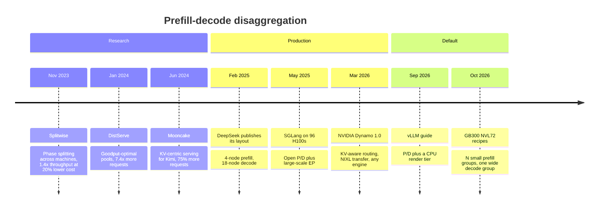
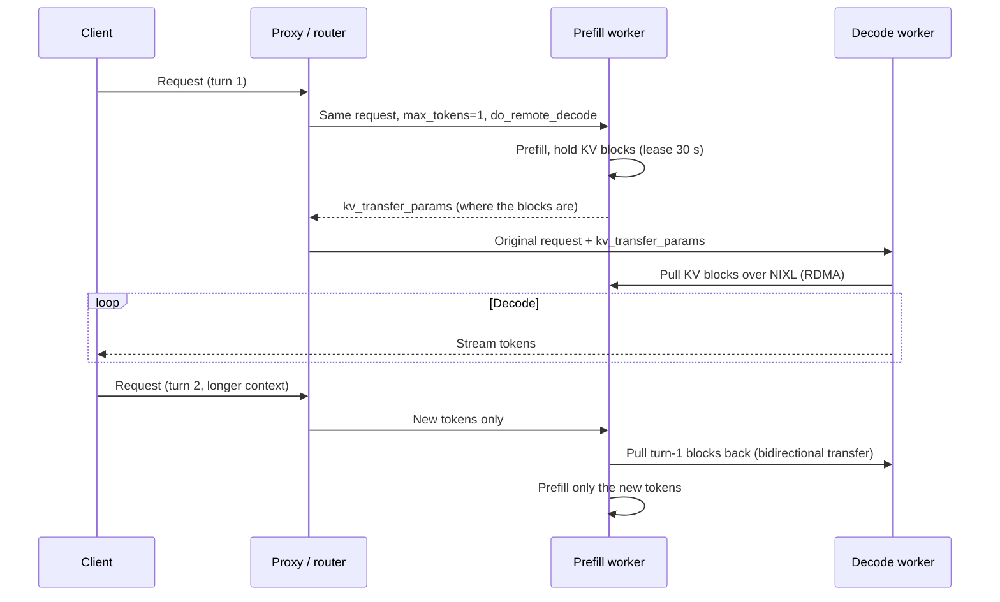
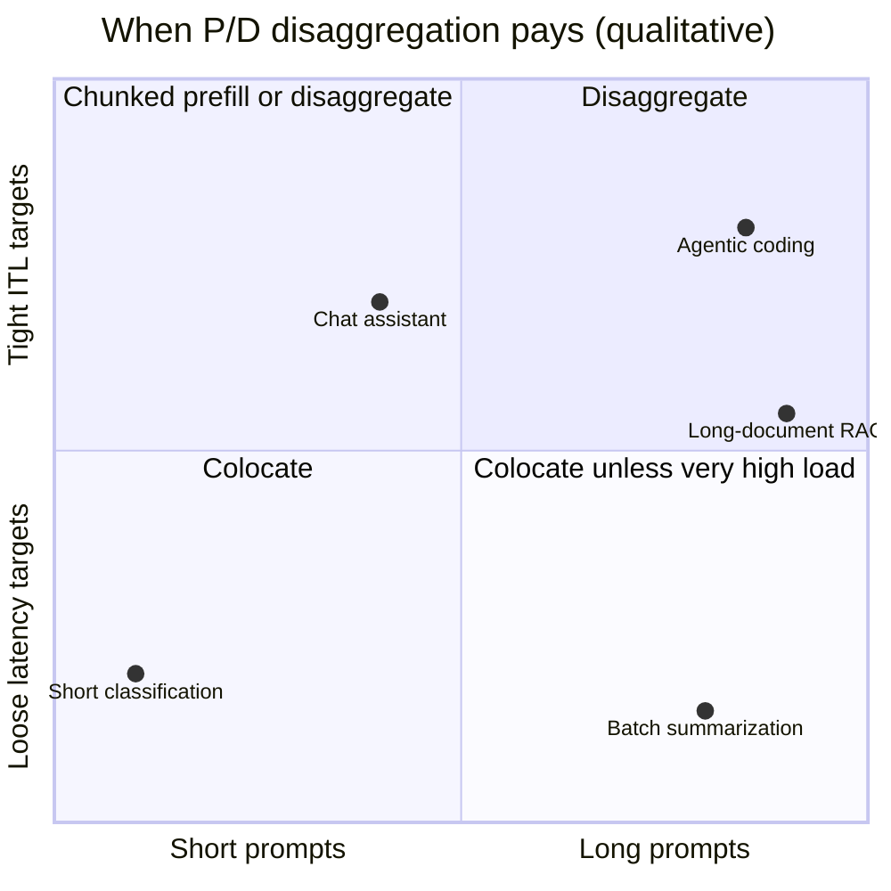

---
tags:
  - ai-ml
  - inference
  - serving
  - disaggregation
  - kv-cache
status: draft
sources:
  - https://arxiv.org/abs/2311.18677
  - https://arxiv.org/abs/2401.09670
  - https://arxiv.org/abs/2403.02310
  - https://arxiv.org/abs/2407.00079
  - https://github.com/deepseek-ai/open-infra-index/blob/main/202502OpenSourceWeek/day_6_one_more_thing_deepseekV3R1_inference_system_overview.md
  - https://lmsys.org/blog/2025-05-05-large-scale-ep/
  - https://docs.nvidia.com/dynamo/latest/design-docs/disaggregated-serving
  - https://developer.nvidia.com/blog/nvidia-dynamo-1-production-ready/
  - https://vllm.ai/blog/2026-09-29-disaggregated-serving-guide
  - https://vllm.ai/blog/2026-10-23-deepseek-v41-flash-pd-wide-ep
  - https://www.lmsys.org/blog/2026-10-24-dsv41-deepinfer
  - https://inferencex.semianalysis.com/blog/inferencex-v2-nvidia-blackwell-vs-amd-vs-hopper
  - https://arxiv.org/abs/2605.28302
created: 2026-11-28
updated: 2026-11-28
---

## Table Of Contents

---

- [[#TL;DR|TL;DR]]
- [[#The Problem|The Problem]]
- [[#Foundations|Foundations]]
    - [[#Two Phases With Opposite Needs|Two Phases With Opposite Needs]]
    - [[#Goodput, Not Throughput|Goodput, Not Throughput]]
    - [[#The KV Cache Is the Handoff|The KV Cache Is the Handoff]]
- [[#How We Got Here|How We Got Here]]
- [[#How It Works|How It Works]]
    - [[#The Request Flow|The Request Flow]]
    - [[#Sizing the Two Pools|Sizing the Two Pools]]
    - [[#What the Transfer Costs|What the Transfer Costs]]
    - [[#Moving the Bytes|Moving the Bytes]]
    - [[#Multi-Turn and Agent Traffic|Multi-Turn and Agent Traffic]]
    - [[#When It Helps and When It Hurts|When It Helps and When It Hurts]]
- [[#Where It Is Now|Where It Is Now]]
    - [[#The Default for Large Models|The Default for Large Models]]
    - [[#Measured Results|Measured Results]]
    - [[#Beyond Two Pools|Beyond Two Pools]]
- [[#Trade-offs & Open Problems|Trade-offs & Open Problems]]
- [[#Resources|Resources]]
- [[#Related Notes|Related Notes]]

## ***TL;DR***
---
*Prefill-decode (P/D) disaggregation runs the two phases of every request on separate GPU pools and ships the [[KV Cache]] between them. It stops long prompts from freezing other users' token streams and lets each phase use its own parallelism, at the price of a network transfer on every request and a more complex system.*

- **The idea:** prefill (process the prompt) is compute-bound and sets time to first token (TTFT); decode (generate tokens) is memory-bandwidth-bound and sets the gap between tokens (TPOT or ITL). On one GPU they interfere. On separate pools each is tuned for its own latency target ([DistServe, 2024](https://arxiv.org/abs/2401.09670); [Splitwise, 2023](https://arxiv.org/abs/2311.18677)).
- **The cost:** the prompt's KV cache must cross the network before decode starts. For a Llama-3.1-70B-shaped model that is 320 KiB per token, about 3 GB for a 10K-token prompt, roughly 65 ms at 400 Gb/s ([vLLM, Sep 2026](https://vllm.ai/blog/2026-09-29-disaggregated-serving-guide)). Compressed caches like MLA cut it 4x or more.
- **The metric it optimizes is goodput:** requests per second served while meeting both TTFT and TPOT targets. DistServe reported 7.4x more requests or 12.6x tighter SLOs than colocated systems.
- **Where it is now (Nov 2026):** paired with [[Expert Parallelism and MoE Serving|wide expert parallelism]], it is the production default for large models at frontier labs and API providers, per SemiAnalysis ([InferenceX v2, Feb 2026](https://inferencex.semianalysis.com/blog/inferencex-v2-nvidia-blackwell-vs-amd-vs-hopper)). vLLM, SGLang, TensorRT-LLM, NVIDIA Dynamo and llm-d all ship it, with NIXL, Mooncake or MoRI moving the bytes. For small models, short prompts or bursty low traffic, colocated serving with chunked prefill is still better.

## ***The Problem***
---
*On a shared GPU, a single long prompt stalls every other user's stream for as long as its prefill takes, and the batch size that suits one phase is wrong for the other. Chunked prefill softens this but cannot remove it.*

A serving engine batches many requests per forward pass ([[LLM Serving]]). When a new 8K-token prompt arrives, its prefill joins the batch, and every in-flight decode waits for that big step to finish. The users already streaming see a stutter. vLLM measured it on two L40S GPUs serving Qwen2.5-7B with 8K-token prompts: colocated p99 inter-token latency rose from 23 ms to 169 ms at just 0.4 requests per second and hit 263 ms at 2 requests per second ([vLLM, Sep 2026](https://vllm.ai/blog/2026-09-29-disaggregated-serving-guide)).

**Chunked prefill** ([Sarathi-Serve, 2024](https://arxiv.org/abs/2403.02310)) splits a long prompt into pieces mixed into decode steps, so no single step is huge. It bounds the stall but still makes each phase pay for the other, and both phases must share one parallelism layout, one batch size and one GPU type. Disaggregation separates them completely.

## ***Foundations***
---
*Prefill and decode do the same math on different shapes, so they hit different hardware limits. That difference, the latency targets each one controls, and the KV cache that links them are all you need to reason about disaggregation.*

#### **Two Phases With Opposite Needs**
| | Prefill | Decode |
|---|---|---|
| Work per request | All prompt tokens in one pass | One token per step, many steps |
| Bottleneck | Compute (big matrix multiplies) | Memory bandwidth (weights and cache read every step) |
| Latency it sets | TTFT | TPOT / ITL |
| Wants | Moderate batches, more tensor parallelism for big prompts | Huge batches, memory for many caches |
| Splitwise's view | Power-hungry, uses compute well | "Underutilizes compute even with state-of-the-art batching" |

Splitwise drew the hardware conclusion: run the phases on separate machines, possibly of different types, optimized for throughput, cost or power ([Patel et al.](https://arxiv.org/abs/2311.18677)). NVIDIA's Dynamo docs give the parallelism version: larger tensor parallelism for memory-bound decode, smaller for compute-bound prefill ([Dynamo](https://docs.nvidia.com/dynamo/latest/design-docs/disaggregated-serving)).

#### **Goodput, Not Throughput**
Raw tokens per second is the wrong target, because a server can always raise it by letting latency slip. **Goodput** is the request rate a system sustains while meeting both a TTFT and a TPOT target, per GPU. DistServe chooses each pool's size and parallelism to maximize it, and placed the pools according to cluster bandwidth ([Zhong et al.](https://arxiv.org/abs/2401.09670)). vLLM's 2026 guide states the goal the same way: goodput, "not peak tokens per second" ([vLLM, Sep 2026](https://vllm.ai/blog/2026-09-29-disaggregated-serving-guide)).

#### **The KV Cache Is the Handoff**
Prefill's only output that decode needs is the prompt's [[KV Cache]] (plus the first token). Disaggregation is therefore a cache-transfer problem: how big the cache is, how fast it moves and who holds it while it moves. That is also why the technique grew alongside [[PagedAttention|paged cache blocks]] and prefix caching: once the cache is a set of addressable blocks, moving it between machines, or keeping it in a shared store, becomes natural.

## ***How We Got Here***
---
*The idea appeared in three research systems within seven months of each other in 2023 and 2024, went into production at Moonshot and DeepSeek, and became standard open-source infrastructure in 2025 and 2026 as NVIDIA and the engine teams built the transfer layers.*

| Date | System | Contribution | Source |
|---|---|---|---|
| Nov 2023 | Splitwise (Patel et al.) | Run phases on separate machines with state transfer over the GPU interconnect; 1.4x throughput at 20% lower cost, or 2.35x throughput at the same cost and power. | [arXiv 2311.18677](https://arxiv.org/abs/2311.18677) |
| Jan 2024 | DistServe (Zhong et al.) | Co-optimize each phase's resources and parallelism for TTFT and TPOT targets; 7.4x more requests or 12.6x tighter SLO, >90% of requests within targets. | [arXiv 2401.09670](https://arxiv.org/abs/2401.09670) |
| Jun 2024 | Mooncake (Qin et al., Moonshot AI) | Separate prefill and decode clusters plus a disaggregated KV cache pooled from the cluster's spare CPU, DRAM and SSD; prediction-based early rejection under overload. Kimi handled 75% more requests; up to 525% more throughput in simulation. | [arXiv 2407.00079](https://arxiv.org/abs/2407.00079) |
| Feb 2025 | DeepSeek V3/R1 service | Prefill units of 4 nodes, decode units of 18 nodes, each with its own expert-parallel width and its own load balancer. | [DeepSeek](https://github.com/deepseek-ai/open-infra-index/blob/main/202502OpenSourceWeek/day_6_one_more_thing_deepseekV3R1_inference_system_overview.md) |
| May 2025 | SGLang | Open P/D with large-scale EP for DeepSeek on 96 H100s. | [LMSYS](https://lmsys.org/blog/2025-05-05-large-scale-ep/) |
| Mar 2026 | NVIDIA Dynamo 1.0 | Orchestration over vLLM, SGLang or TensorRT-LLM with NIXL transfer, KV-aware router and tiered KV block manager. | [NVIDIA](https://developer.nvidia.com/blog/nvidia-dynamo-1-production-ready/) |

Mooncake's paper was still being revised in October 2026 (v5), a sign of how long-lived the design has been.

## ***How It Works***
---
*A router sends the prompt to a prefill worker, the worker builds the KV cache and hands back a pointer to it, and a decode worker pulls (or is pushed) the cache before it starts generating. Everything else is about sizing the pools, making the transfer fast, and reusing caches across turns.*

#### **The Request Flow**
vLLM's flow, which other engines follow closely ([vLLM, Sep 2026](https://vllm.ai/blog/2026-09-29-disaggregated-serving-guide)):

The prefill worker holds its blocks under a lease (default 30 s) until decode collects them; if a load fails, the default policy is to fail the request. In production the proxy is replaced by a router such as llm-d or Dynamo, which picks the prefill worker by cached-prefix overlap and load ([Dynamo](https://docs.nvidia.com/dynamo/latest/design-docs/disaggregated-serving)).

#### **Sizing the Two Pools**
With request rate $\lambda$, mean prompt length $L_{in}$, mean output length $L_{out}$, and per-instance rates $P$ (prefill tokens/s at the TTFT target) and $D$ (decode tokens/s at the TPOT target), the pools need

$$
x \ge \frac{\lambda \, L_{in}}{P}, \qquad y \ge \frac{\lambda \, L_{out}}{D}
$$

prefill and decode instances.

**In plain words:** each pool must keep up with the token flow it receives, measured at the speed it can sustain while still meeting its own latency target. The ratio of the two pools follows the workload's input-to-output ratio, not a fixed rule.

**Example (illustrative numbers):** 10 requests/s, 8,000-token prompts, 500-token answers. If one prefill instance does 40,000 tokens/s within the TTFT target and one decode instance does 2,000 tokens/s within the TPOT target, you need $x = 10 \cdot 8000 / 40000 = 2$ prefill and $y = 10 \cdot 500 / 2000 = 2.5$, so 3 decode instances. Double the prompt length and prefill doubles while decode stays put. This is why real deployments are written **xPyD** (x prefill, y decode workers) and why Dynamo lets workers join and leave at runtime ([Dynamo](https://docs.nvidia.com/dynamo/latest/design-docs/disaggregated-serving)). Agentic traffic, with long contexts and short outputs, pushes toward many prefill workers per decode worker: vLLM ran 7P1D and 8P1D on GB300 NVL72 ([vLLM, Oct 2026](https://vllm.ai/blog/2026-10-23-deepseek-v41-flash-pd-wide-ep)).

#### **What the Transfer Costs**
$$
T_{\text{transfer}} = \frac{L_{in} \times s_{kv}}{\text{bandwidth}}
$$

where $s_{kv}$ is the cache size per token ([[KV Cache#How Big Is the Cache|KV Cache]] derives it).

**In plain words:** decode cannot start until the prompt's whole cache has arrived, so this time is added to every request's TTFT unless it overlaps with prefill.

| Model shape | Cache per token | 10K-token prompt | At 400 Gb/s (50 GB/s) |
|---|---|---|---|
| Llama-3.1-70B, GQA, BF16 | 320 KiB | ~3.3 GB | ~65 ms |
| DeepSeek-V3, MLA, BF16 | ~70 KB | ~0.7 GB | ~14 ms |

The first row is vLLM's own figure ([vLLM, Sep 2026](https://vllm.ai/blog/2026-09-29-disaggregated-serving-guide)); the second uses the MLA size from [[KV Cache]]. Compressed caches ([[Sparse Attention]], latent attention, FP8 or FP4 caches from [[Quantization]]) make disaggregation cheaper by the same factor. A bad link erases the benefit: on PCIe L40S GPUs without peer-to-peer access, an 8K prompt's ~470 MB took about 1.3 s to reach decode, and P/D's median TTFT at 0.2 requests/s was 2.2 s against 0.7 s colocated ([vLLM, Sep 2026](https://vllm.ai/blog/2026-09-29-disaggregated-serving-guide)).

#### **Moving the Bytes**
| Layer | Examples | Notes |
|---|---|---|
| Transfer library | NVIDIA NIXL; Mooncake Transfer Engine; AMD MoRI-IO; LMCache; FlexKV | NIXL is used by vLLM, SGLang, TensorRT-LLM and llm-d ([NVIDIA](https://developer.nvidia.com/blog/nvidia-dynamo-1-production-ready/)); SGLang lets you pick Mooncake, NIXL or MoRI ([LMSYS](https://www.lmsys.org/blog/2026-10-24-dsv41-deepinfer)). |
| Path | GPU memory to GPU memory over RDMA or NVLink | "Non-blocking, allowing GPU forward passes to continue serving other requests during the transfer" ([Dynamo](https://docs.nvidia.com/dynamo/latest/design-docs/disaggregated-serving)). |
| Pull or push | vLLM's default: decode pulls. vLLM's GB300 recipe: prefill pushes. | Packing KV rows into one NIXL region with UCX scatter-gather push raised vLLM's 8P1D throughput from 141K to 440K tokens/s per GPU ([vLLM, Oct 2026](https://vllm.ai/blog/2026-10-23-deepseek-v41-flash-pd-wide-ep)). |
| Overlap | SGLang runs prefill as a background task so decode can begin while the transfer proceeds; vLLM and TensorRT-LLM wait for prefill to finish. | Per [Dynamo's backend notes](https://docs.nvidia.com/dynamo/latest/design-docs/disaggregated-serving). |

When the two pools use different parallelism (say TP8 prefill, TP2 decode), the cache's heads are sharded differently on each side, so the transfer layer must remap blocks between layouts, one more reason the transfer is a dedicated library rather than a plain copy.

#### **Multi-Turn and Agent Traffic**
In a chat or agent loop, turn 2's prompt is turn 1's prompt plus turn 1's answer plus new input. The answer's cache lives on the decode worker. vLLM's `bidirectional_kv_xfer` lets prefill pull those blocks back so only the new tokens are computed. One trap: if a reasoning model's chat template strips the thinking trace from the next prompt, prefill's prompt no longer matches the blocks decode holds, which can produce wrong output ([vLLM, Sep 2026](https://vllm.ai/blog/2026-09-29-disaggregated-serving-guide)). Mooncake's answer to the same problem is a shared KV store, so any worker can fetch any prefix ([Qin et al.](https://arxiv.org/abs/2407.00079)).

#### **When It Helps and When It Hurts**

| Disaggregate when | Stay colocated when |
|---|---|
| p99 inter-token latency misses its target under load (the main use case) | TTFT is the binding constraint, since the transfer adds to every first token |
| Prompts are long and concurrency is high, and the transfer is fast | The interconnect is slow (no RDMA, no GPU peer-to-peer) |
| Multi-turn or agent sessions over a growing context, with bidirectional transfer or a shared cache | Traffic is low, bursty or latency-insensitive |
| You want different parallelism or hardware per phase | You cannot afford running three or four services and a new failure mode |

The table condenses vLLM's own guidance ([vLLM, Sep 2026](https://vllm.ai/blog/2026-09-29-disaggregated-serving-guide)); the quadrant positions are illustrative.

## ***Where It Is Now***
---
*As of November 2026, disaggregation is standard for large models at scale, is built into every major engine, and is usually deployed together with wide expert parallelism on rack-scale systems. The frontier has moved to agent traffic, cache sharing across turns, and splitting the model itself (attention vs experts) as well as the request.*

#### **The Default for Large Models**
SemiAnalysis states that disaggregated prefill with wide EP "is what is deployed in production at Frontier AI Labs like OpenAI, Anthropic, xAI, Google Deepmind, DeepSeek" and at API providers such as Together AI, Baseten and Fireworks ([InferenceX v2, Feb 2026](https://inferencex.semianalysis.com/blog/inferencex-v2-nvidia-blackwell-vs-amd-vs-hopper)); closed labs don't publish their stacks, so treat that as the analyst's claim. In its benchmarks, multi-node disaggregated serving beat single-node colocated serving on throughput per GPU at almost all interactivity levels on NVIDIA hardware, but on AMD MI355X only at low interactivity.

The 2026 open recipes for DeepSeek-V4.1-Flash share a shape: several small prefill groups and one wide decode group. vLLM used DEP2 prefill instances and one DEP16 or DEP32 decode instance; SGLang used DEP4 prefill and DEP64 decode across 16 GB300 nodes ([vLLM](https://vllm.ai/blog/2026-10-23-deepseek-v41-flash-pd-wide-ep), [LMSYS](https://www.lmsys.org/blog/2026-10-24-dsv41-deepinfer)). DeepSeek's own open engine, DeepInfer, lists P/D disaggregation as one of the pieces its release does *not* include. Why each pool gets that width is covered in [[Expert Parallelism and MoE Serving]].

Engines have also split off a third tier. vLLM's `/render` and `/derender` endpoints move templating, tokenization and output parsing to CPU-only servers, so the GPU engine runs token-in, token-out and routers can match real prefix-cache hits ([vLLM, Sep 2026](https://vllm.ai/blog/2026-09-29-disaggregated-serving-guide)).

#### **Measured Results**
Each figure is from the publisher's own setup; compare within a row.

| Date | Setup | Result | Source |
|---|---|---|---|
| Sep 2026 | 2x L40S (PCIe, no NVLink), Qwen2.5-7B, 8K prompts | P/D p99 ITL stayed 25 to 52 ms vs up to 263 ms colocated; but P/D missed a 2 s TTFT target at every rate | [vLLM](https://vllm.ai/blog/2026-09-29-disaggregated-serving-guide) |
| Sep 2026 | 8x MI300X, Qwen3-235B-A22B-FP8, AMD MoRI-IO, 8 req/s | 73 of 100 requests met 1 s TTFT and 50 ms ITL vs 30 of 100 colocated (~2.4x goodput) | [vLLM](https://vllm.ai/blog/2026-09-29-disaggregated-serving-guide) |
| Sep 2026 | llm-d, gpt-oss-120b, 16 H200 | ~59% lower mean and 67% lower P95 end-to-end latency than aggregated replicas | [vLLM](https://vllm.ai/blog/2026-09-29-disaggregated-serving-guide) |
| Oct 2026 | vLLM, DeepSeek-V4.1-Flash, GB300 NVL72, P/D + wide EP | 954K tokens/s per GPU at P90 196 tokens/s per user on SemiAnalysis AgentX; 7.9x single-node | [vLLM](https://vllm.ai/blog/2026-10-23-deepseek-v41-flash-pd-wide-ep) |

The first row is the honest caveat: disaggregation fixed the tail ITL but made TTFT worse, because the transfer ran over PCIe without peer-to-peer access.

#### **Beyond Two Pools**
Disaggregation is spreading in two directions:

- **Into the cache.** Mooncake's pooled KV store, Dynamo's KV block manager across GPU, CPU, SSD and object storage, and DeepSeek-V4's on-disk cache for shared prefixes turn the cache into a shared service that any prefill or decode worker can read ([Mooncake](https://arxiv.org/abs/2407.00079), [NVIDIA](https://developer.nvidia.com/blog/nvidia-dynamo-1-production-ready/)). See [[PagedAttention]] and [[KV Cache]].
- **Into the model.** Attention-FFN disaggregation splits each decode step itself, putting attention and experts on separate GPUs. A May 2026 design-space study found it the only design that met the tightest TTFT and TPOT targets for agentic coding, while aggregated chunked prefill still won most throughput comparisons ([Wu et al.](https://arxiv.org/abs/2605.28302)). Details in [[Expert Parallelism and MoE Serving#Attention-FFN Disaggregation|Expert Parallelism and MoE Serving]].

## ***Trade-offs & Open Problems***
---
*Disaggregation trades interconnect bandwidth and operational complexity for latency isolation and independent tuning. It wins at scale and loses on small, slow or bursty deployments, and the hard problems now are agent traffic and keeping the extra moving parts reliable.*

| Gain | Cost |
|---|---|
| No prefill-decode interference; stable tail ITL | KV transfer on every request; adds to TTFT unless overlapped |
| Independent parallelism, batch size and hardware per phase | Two (or more) pools to size, scale and balance |
| Higher goodput under tight SLOs | Three or four services instead of one; KV transfer is a new failure mode |
| Natural fit with shared KV stores and prefix reuse | Cache ownership across workers must be tracked (leases, bidirectional transfer) |

Open problems:
- **Dynamic ratios.** The right x:y ratio shifts with the input-output mix through the day; Dynamo and llm-d scale workers at runtime, but choosing when is still mostly policy and tuning.
- **Agent sessions.** Long contexts, pauses between turns and parallel subagents mean caches must survive idle minutes and come back to the right worker; template changes like stripped thinking traces can silently break reuse ([vLLM, Sep 2026](https://vllm.ai/blog/2026-09-29-disaggregated-serving-guide)).
- **Hardware dependence.** The benefit hinges on RDMA or NVLink; on PCIe-only boxes it can make TTFT worse, and on AMD in early 2026 it won only at low interactivity ([InferenceX v2](https://inferencex.semianalysis.com/blog/inferencex-v2-nvidia-blackwell-vs-amd-vs-hopper)).
- **New cache types.** [[Hybrid Attention]] models carry recurrent state instead of (or beside) per-token caches, so what gets transferred, and how prefixes are matched, differs per model family.

## ***Resources***
**Papers**
- [Splitwise](https://arxiv.org/abs/2311.18677): Patel et al., 2023. Phase splitting across machines.
- [DistServe](https://arxiv.org/abs/2401.09670): Zhong et al., 2024. Goodput-optimal disaggregation.
- [Mooncake](https://arxiv.org/abs/2407.00079): Qin et al. (Moonshot AI), 2024, revised 2026. KV-centric disaggregated serving for Kimi.
- [Sarathi-Serve](https://arxiv.org/abs/2403.02310): Agrawal et al., 2024. Chunked prefill, the colocated alternative.

**Engines and guides**
- [Taking vLLM Apart: A Practical Guide to Disaggregated Serving](https://vllm.ai/blog/2026-09-29-disaggregated-serving-guide): vLLM (IBM Research), Sep 2026. When it helps, request flow, measurements.
- [NVIDIA Dynamo: Disaggregated Serving](https://docs.nvidia.com/dynamo/latest/design-docs/disaggregated-serving) and [Dynamo 1.0](https://developer.nvidia.com/blog/nvidia-dynamo-1-production-ready/): NVIDIA.
- [vLLM: DeepSeek-V4.1-Flash with P/D and Wide-EP on GB300 NVL72](https://vllm.ai/blog/2026-10-23-deepseek-v41-flash-pd-wide-ep): Oct 2026.
- [DeepSeek-V3/R1 Inference System Overview](https://github.com/deepseek-ai/open-infra-index/blob/main/202502OpenSourceWeek/day_6_one_more_thing_deepseekV3R1_inference_system_overview.md): DeepSeek, Feb 2025.
- [InferenceX v2](https://inferencex.semianalysis.com/blog/inferencex-v2-nvidia-blackwell-vs-amd-vs-hopper): SemiAnalysis, Feb 2026.

## Related Notes

- [[Expert Parallelism and MoE Serving]] — The companion technique; why prefill groups stay small and decode groups go wide.
- [[LLM Serving]] — Continuous batching, chunked prefill and the serving stack around disaggregation.
- [[KV Cache]] — The object being transferred; its per-token size sets the transfer cost.
- [[PagedAttention]] — Block-based cache memory that makes transferring and sharing caches practical.
- [[Long Context]] — Long prompts are where prefill dominates and disaggregation pays most.
- [[Quantization]] — FP8 and FP4 caches shrink what must cross the network.
- [[Hybrid Attention]] — Recurrent state changes what a transfer and a prefix match mean.
- [[AI Accelerators]] — NVLink, RDMA and rack-scale domains decide whether the transfer is cheap.
