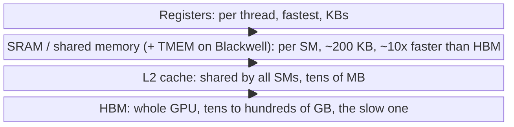
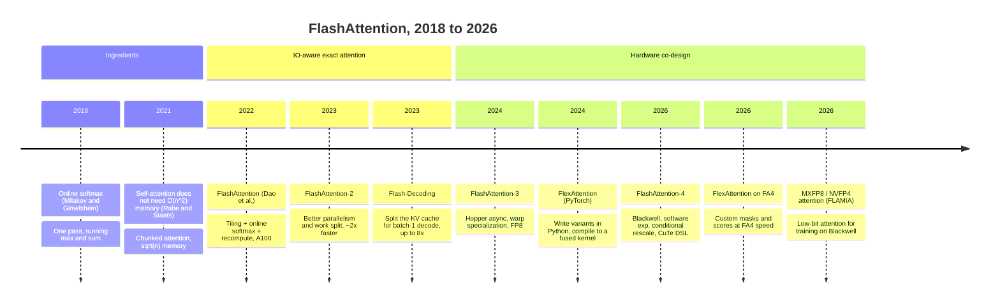
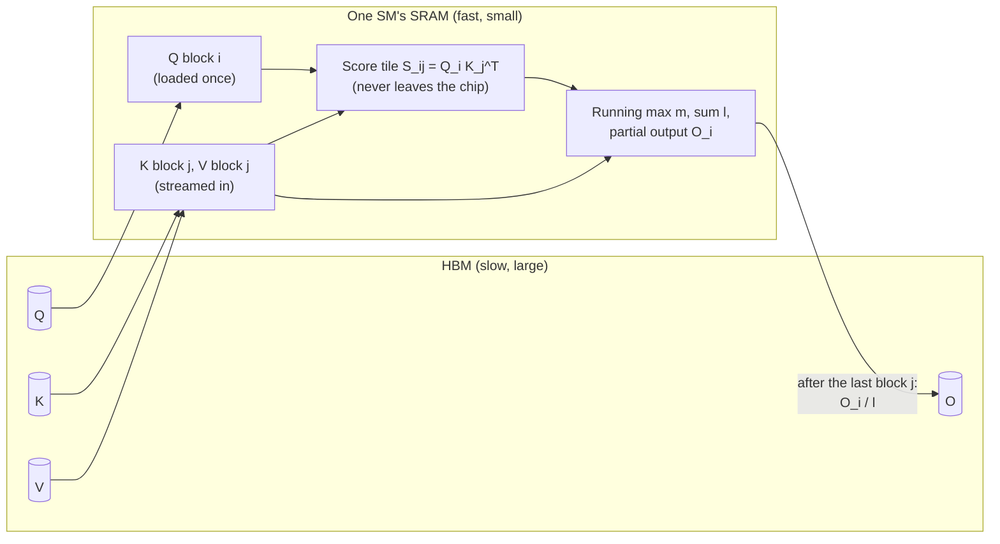
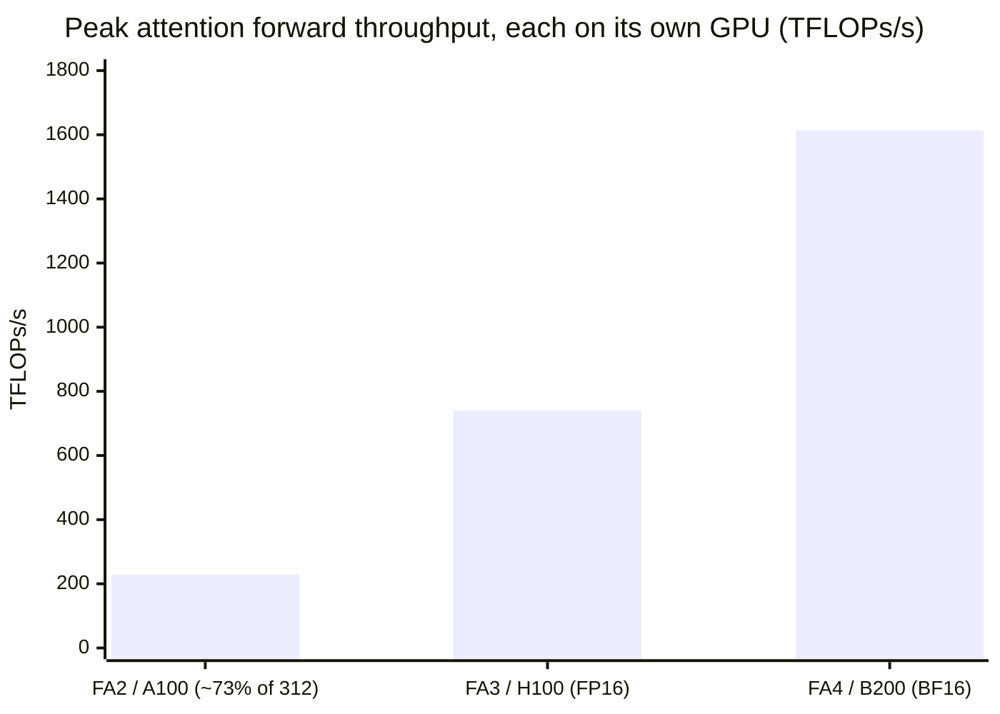

---
tags:
  - ai-ml
  - inference
  - training
  - attention
  - gpu-kernels
status: draft
sources:
  - https://arxiv.org/abs/1805.02867
  - https://arxiv.org/abs/2112.05682
  - https://arxiv.org/abs/2205.14135
  - https://arxiv.org/abs/2307.08691
  - https://crfm.stanford.edu/2023/10/12/flashdecoding.html
  - https://arxiv.org/abs/2407.08608
  - https://arxiv.org/abs/2412.05496
  - https://arxiv.org/abs/2603.05451
  - https://tridao.me/blog/2026/flash4/
  - https://pytorch.org/blog/flexattention-flashattention-4-fast-and-flexible/
  - https://github.com/Dao-AILab/flash-attention
  - https://arxiv.org/abs/2611.03344
  - https://arxiv.org/abs/2609.00097
  - https://jax-ml.github.io/scaling-book/inference/
created: 2026-11-26
updated: 2026-11-26
---

## Table Of Contents

---

- [[#TL;DR|TL;DR]]
- [[#The Problem|The Problem]]
- [[#Foundations|Foundations]]
    - [[#The GPU Memory Hierarchy|The GPU Memory Hierarchy]]
    - [[#Compute-Bound vs Memory-Bound|Compute-Bound vs Memory-Bound]]
    - [[#Kernels and Kernel Fusion|Kernels and Kernel Fusion]]
    - [[#Why Softmax Is the Obstacle|Why Softmax Is the Obstacle]]
- [[#How We Got Here|How We Got Here]]
- [[#How It Works|How It Works]]
    - [[#Tiling|Tiling]]
    - [[#Online Softmax|Online Softmax]]
    - [[#A Worked Example|A Worked Example]]
    - [[#Recomputation in the Backward Pass|Recomputation in the Backward Pass]]
    - [[#IO Complexity|IO Complexity]]
    - [[#What Each Version Changed|What Each Version Changed]]
    - [[#Decoding Is a Different Shape|Decoding Is a Different Shape]]
- [[#Where It Is Now|Where It Is Now]]
    - [[#FlashAttention-4 on Blackwell|FlashAttention-4 on Blackwell]]
    - [[#Flexible Attention on Fast Kernels|Flexible Attention on Fast Kernels]]
    - [[#Low-Precision Attention|Low-Precision Attention]]
    - [[#Beyond NVIDIA and Beyond Dense|Beyond NVIDIA and Beyond Dense]]
- [[#Trade-offs & Open Problems|Trade-offs & Open Problems]]
- [[#Resources|Resources]]
- [[#Related Notes|Related Notes]]

## ***TL;DR***
---
*FlashAttention computes exactly the same [[Attention]] as the textbook formula, but in small tiles that stay in the GPU's fast on-chip memory, so the huge $n \times n$ score matrix is never written to slow memory. It made attention several times faster and its memory linear in sequence length, and every version since has re-fitted the same idea to a new GPU generation.*

- **What it is:** an exact attention kernel. Same inputs, same outputs (up to floating-point rounding) as $\text{softmax}(QK^\top/\sqrt{d})V$. Not an approximation.
- **The insight:** attention was slow because of memory traffic, not arithmetic. The standard implementation writes an $n \times n$ score matrix to the GPU's main memory (HBM), reads it back for the softmax, writes the probabilities, and reads them again. FlashAttention never stores that matrix at all ([Dao et al., 2022](https://arxiv.org/abs/2205.14135)).
- **The three tricks:** *tiling* (process blocks of queries against blocks of keys in on-chip SRAM), *online softmax* (compute the softmax piece by piece with a running max and running sum, fixing earlier pieces with a rescale), and *recomputation* (in training, recompute the scores in the backward pass instead of storing them).
- **What it bought:** memory that grows linearly with sequence length instead of quadratically, up to 3x faster GPT-2 training in 2022, and in practice the long context windows every modern model has. The first Transformers to beat chance on Path-X (16K tokens) used it.
- **Where it is now (Nov 2026):** FlashAttention-4 (Mar 2026) targets NVIDIA Blackwell, reaching about 1,600 TFLOPs/s (71% of peak) on a B200 in BF16. On Blackwell the bottleneck is no longer the matrix multiplies but the exponentials and shared-memory bandwidth, so FA4 computes some exponentials in software and skips most softmax rescales ([Zadouri et al., 2026](https://arxiv.org/abs/2603.05451)). PyTorch's FlexAttention now compiles custom attention variants into the FA4 kernel, and 8-bit and 4-bit attention for training is arriving on Blackwell.

## ***The Problem***
---
*Standard attention does two big matrix multiplies with a softmax in between, and the GPU runs each step as a separate program that round-trips its full $n \times n$ result through slow memory. For long sequences that traffic, not the math, sets the speed, and the stored matrix sets the memory limit.*

The textbook implementation of one attention head, for $n$ tokens and head size $d$:

| Step | Operation | Writes to HBM | Size |
|---|---|---|---|
| 1 | $S = QK^\top / \sqrt{d}$ | Score matrix $S$ | $n \times n$ |
| 2 | $P = \text{softmax}(S)$ (row-wise) | Probability matrix $P$ | $n \times n$ |
| 3 | $O = PV$ | Output $O$ | $n \times d$ |

Steps 1 and 3 are matrix multiplies, which GPUs are built for. Step 2 is cheap arithmetic, but it must read all of $S$ from HBM and write all of $P$ back, and step 3 must read $P$ again. With $n$ much larger than $d$ (say $n = 8192$, $d = 128$), the two $n \times n$ matrices are 64 times larger than $Q$, $K$, $V$ and $O$ combined.

Two consequences follow ([Dao et al., 2022](https://arxiv.org/abs/2205.14135)):

- **Speed.** The GPU spends most of the attention layer waiting for memory. Making the matrix multiplies faster barely helps.
- **Memory.** Training must also keep $P$ (or $S$) for the backward pass. That grows with $n^2$ per head per layer, which is what capped context lengths at a few thousand tokens before 2022.

Approximate attention methods (sparse, low-rank, kernel-based) cut the FLOPs to near-linear, but they mostly did not get faster in wall-clock time, because they still did not address memory traffic, and they changed the model's output. FlashAttention attacked the traffic directly and kept the math exact.

## ***Foundations***
---
*Four ideas are enough to understand FlashAttention: GPUs have a small fast memory and a large slow one, an operation's speed is set by whichever of math or memory runs out first, a GPU kernel only helps if it keeps data on-chip between steps, and softmax looks like it needs a whole row at once.*

#### **The GPU Memory Hierarchy**
A GPU has two kinds of memory that matter here. HBM (high-bandwidth memory) is large and off-chip; it holds the model and all tensors. SRAM (shared memory and registers) is tiny and sits inside each streaming multiprocessor (SM), right next to the arithmetic units (see [[GPU Memory Hierarchy]]).

| Memory | A100 (the FA1 paper's example) | Speed | Who can see it |
|---|---|---|---|
| HBM | 40 to 80 GB | about 1.5 to 2.0 TB/s | Whole GPU |
| SRAM (shared memory) | 192 KB per SM, 108 SMs, about 20 MB total | about 19 TB/s | One SM |
| Registers | A few hundred KB per SM | Fastest | One thread |

SRAM is roughly an order of magnitude faster but thousands of times smaller ([Dao et al., 2022](https://arxiv.org/abs/2205.14135), Fig. 1). The whole game is to do as much work as possible on data while it sits in SRAM, and touch HBM as little as possible.

#### **Compute-Bound vs Memory-Bound**
An operation's *arithmetic intensity* is the number of math operations it does per byte it moves from memory. If that ratio is above the chip's own ratio of compute speed to memory bandwidth, the operation is *compute-bound* (the math units are the limit); below it, *memory-bound* (the memory is the limit). The dividing line is the chip's roofline (see [[1 - All About Rooflines (NOT DONE)|Rooflines]] and [[Roofline Model and Arithmetic Intensity]]).

Large matrix multiplies are compute-bound. Softmax, masking, dropout and other elementwise steps do a handful of operations per number read, so they are memory-bound. Standard attention chains a memory-bound step between two matrix multiplies, on matrices that are $n \times n$ in size, so the memory-bound part dominates.

#### **Kernels and Kernel Fusion**
A *kernel* is one program launched on the GPU. In a framework like PyTorch each operation is usually its own kernel: it reads its inputs from HBM, computes, and writes its output back to HBM. *Kernel fusion* combines several operations into one kernel so intermediate results stay on-chip.

Fusion is easy for elementwise chains. Attention is harder: the softmax in the middle needs the max and the sum of a full row of scores, and a row of $n$ scores does not fit in SRAM for long sequences. That is the obstacle FlashAttention removes.

#### **Why Softmax Is the Obstacle**
Softmax turns a row of scores $s_1, \dots, s_n$ into weights:

$$
p_i = \frac{e^{s_i - m}}{\sum_{j=1}^{n} e^{s_j - m}}, \qquad m = \max_j s_j
$$

*In plain English: exponentiate each score, divide by the total so the weights sum to 1. Subtracting the row's largest score $m$ first changes nothing mathematically but keeps the exponentials from overflowing.*

The denominator and $m$ depend on the entire row, so it seems you must see every score before you can produce any weight. The fix, *online softmax*, shows you can process the row in pieces and correct earlier pieces once a larger max appears ([Milakov & Gimelshein, 2018](https://arxiv.org/abs/1805.02867)).

## ***How We Got Here***
---
*The pieces existed before 2022: online softmax came from NVIDIA in 2018 and memory-efficient chunked attention from Google in 2021. FlashAttention combined them with explicit attention to GPU memory traffic, and each later version rewrote the kernel for a new GPU generation whose bottleneck had moved.*

| Year | Step | Bottleneck it answered | Source |
|---|---|---|---|
| 2018 | Online softmax: compute softmax's normalizer in one pass with a running max, rescaling the running sum when the max grows. Up to 1.3x faster softmax. | Softmax needing multiple passes over memory. | [Milakov & Gimelshein](https://arxiv.org/abs/1805.02867) |
| 2021 | Chunked attention that needs $O(\sqrt{n})$ memory for inference and keeps the math exact. Showed the $n \times n$ matrix need not exist; not tuned for GPU speed. | Attention memory at long sequence length. | [Rabe & Staats](https://arxiv.org/abs/2112.05682) |
| 2022 | FlashAttention: tiling + online softmax + recomputation, written as one fused CUDA kernel. 15% faster BERT-large training than the MLPerf 1.1 record, 3x faster GPT-2 training, 2.4x on Long Range Arena; first Transformers above chance on Path-X (61.4% at 16K) and Path-256 (63.1% at 64K). | Attention bound by HBM traffic; quadratic memory. | [Dao et al.](https://arxiv.org/abs/2205.14135) |
| 2023 | FlashAttention-2: fewer non-matmul FLOPs, parallelism across the sequence (not only batch and heads), better split of work between warps. About 2x faster than FA1, 50 to 73% of A100 peak, up to 225 TFLOPs/s per A100 in GPT training (72% MFU). | FA1 reaching only 25 to 40% of peak. | [Dao](https://arxiv.org/abs/2307.08691) |
| 2023 | Flash-Decoding: also split the KV cache along its length, compute each chunk in parallel, then merge with a log-sum-exp. Up to 8x faster decoding on CodeLlama-34B at long context. | Decode with one query uses under 1% of the GPU at batch size 1. | [Dao, Haziza, Massa & Sizov](https://crfm.stanford.edu/2023/10/12/flashdecoding.html) |
| 2024 | FlashAttention-3: Hopper's asynchronous tensor cores and memory engine (TMA), [[Warp Specialization|warp specialization]], matmul and softmax interleaved, FP8 with block quantization and incoherent processing. 1.5 to 2.0x faster than FA2 on H100, up to 740 TFLOPs/s FP16 (75%), close to 1.2 PFLOPs/s FP8 with 2.6x lower error than a baseline FP8 attention. | FA2 reaching only 35% of H100 peak. | [Shah et al.](https://arxiv.org/abs/2407.08608) |
| 2024 | FlexAttention: write a score or mask modification as a small Python function; the compiler fuses it into a FlashAttention-style kernel. | Every new attention variant needing a hand-written kernel. | [Dong et al.](https://arxiv.org/abs/2412.05496) |
| 2026 | FlashAttention-4: rebuilt for Blackwell, where tensor cores doubled but exponential units and shared memory did not. Software exponentials, conditional rescaling, tensor memory, 2-CTA backward; written in Python (CuTe DSL). | Exponentials and shared memory becoming the limit. | [Zadouri et al.](https://arxiv.org/abs/2603.05451) |

The pattern is worth noticing. The algorithm (tiles, running max, rescale) has barely changed since 2022. What changes is which hardware unit runs out first, and each version reorganizes the same work so that unit stays busy.

## ***How It Works***
---
*Split $Q$ into row blocks and $K, V$ into column blocks. For each query block, stream key and value blocks through SRAM, update a running max, running sum and partial output, and rescale the partial output whenever the max grows. Divide by the final sum at the end. The result is exact, and the $n \times n$ matrix only ever exists one small tile at a time.*

#### **Tiling**
Pick block sizes so a query block, a key block, a value block and the partial results all fit in one SM's SRAM. Typical sizes are 64 to 256 rows by the head dimension (64 to 256).

Each SM owns one query block (FA2 and later; FA1 looped the other way). It loads that block once, then walks across all key and value blocks. Only $Q$, $K$, $V$ and $O$ ever touch HBM. The score tile is computed, used and discarded inside the SM.

#### **Online Softmax**
For one query row, keep three things while key blocks stream past: the largest score seen so far $m$, the running sum of exponentials $\ell$, and the running unnormalized output $o$. When block $j$ arrives with scores $s^{(j)}$:

$$
\begin{aligned}
m_{\text{new}} &= \max\!\big(m,\ \max_k s^{(j)}_k\big) \\
\ell_{\text{new}} &= e^{\,m - m_{\text{new}}}\,\ell \;+\; \sum_k e^{\,s^{(j)}_k - m_{\text{new}}} \\
o_{\text{new}} &= e^{\,m - m_{\text{new}}}\,o \;+\; \sum_k e^{\,s^{(j)}_k - m_{\text{new}}}\, v^{(j)}_k
\end{aligned}
$$

and after the last block, the true output is $o / \ell$.

*In plain English: everything accumulated so far was exponentiated relative to the old max. If the new block has a bigger score, multiply the old sum and old output by $e^{m - m_{\text{new}}}$ (a number at most 1) so they are now relative to the new max, then add the new block's contributions. Dividing by the sum is postponed to the very end, so it happens once.*

This is exact algebra, not an approximation: $e^{s - m_{\text{old}}} \cdot e^{m_{\text{old}} - m_{\text{new}}} = e^{s - m_{\text{new}}}$.

#### **A Worked Example**
One query, four keys in two blocks of two. Scores $[1, 2 \mid 3, 0]$, and each key's value is a single number $[10, 20 \mid 30, 40]$.

| Step | $m$ | $\ell$ | $o$ |
|---|---|---|---|
| Block 1: scores 1, 2 | 2 | $e^{-1} + e^{0} = 1.368$ | $e^{-1}\cdot 10 + e^{0}\cdot 20 = 23.68$ |
| Block 2 arrives: max rises to 3, rescale by $e^{2-3} = 0.368$ | 3 | $0.368 \cdot 1.368 + e^{0} + e^{-3} = 1.553$ | $0.368 \cdot 23.68 + e^{0}\cdot 30 + e^{-3}\cdot 40 = 40.70$ |
| Finish: $o / \ell$ | | | $40.70 / 1.553 = $ **26.21** |

Check against the full softmax in one go: weights $e^1, e^2, e^3, e^0 = 2.718, 7.389, 20.09, 1$ sum to 31.19, and $(27.18 + 147.8 + 602.6 + 40)/31.19 = $ **26.21**. Same answer, without ever holding all four scores at once.

Now scale it up to see what the trick saves. For $n = 4096$ tokens and one head in BF16, the score matrix is $4096^2 \times 2$ bytes $= 32$ MiB, against 1 MiB each for $Q$, $K$, $V$ and $O$. Standard attention writes and reads that 32 MiB twice (once as $S$, once as $P$), per head, per layer. At $n = 131{,}072$ (128K tokens) the same matrix would be 32 GiB per head, which is why long context was out of reach without this.

#### **Recomputation in the Backward Pass**
Training needs gradients, and the textbook backward pass reads the stored $P$. FlashAttention stores only the output $O$ and one number per row, the log-sum-exp $m + \log \ell$. In the backward pass it reloads $Q$, $K$, $V$ block by block and recomputes each score tile on-chip.

That is more FLOPs, but far fewer bytes moved, and since the operation was memory-bound, it is faster overall ([Dao et al., 2022](https://arxiv.org/abs/2205.14135)). Memory for attention drops from $O(n^2)$ to $O(n)$ per head. It is the same trade as activation checkpointing, applied inside one kernel.

#### **IO Complexity**
The FA1 paper counts HBM accesses with SRAM of size $M$ (in elements):

$$
\text{Standard: } \Theta\!\left(nd + n^2\right) \qquad \text{FlashAttention: } \Theta\!\left(\frac{n^2 d^2}{M}\right)
$$

*In plain English: standard attention's traffic is dominated by the $n^2$ score and probability matrices. FlashAttention's traffic is the number of times it must re-read $K$ and $V$, which falls as SRAM grows. With $d$ around 64 to 128 and $M$ around 100,000 elements, $d^2/M$ is well below 1, so FlashAttention moves many times fewer bytes.* The paper also proves a matching lower bound: for a range of SRAM sizes, no exact attention algorithm can need asymptotically fewer HBM accesses.

#### **What Each Version Changed**
| | FA1 (2022) | FA2 (2023) | FA3 (2024) | FA4 (2026) |
|---|---|---|---|---|
| Target GPU | A100 (Ampere) | A100 / H100 | H100 (Hopper) | B200 / GB200 (Blackwell), also Hopper |
| Loop order | Outer over K/V blocks | Outer over Q blocks | Outer over Q blocks | Outer over Q blocks, two Q tiles per block |
| Parallel over | Batch, heads | Batch, heads, sequence | Same, plus warp-specialized producer and consumer warps | Same, plus separate softmax and correction warpgroups |
| Key idea | Tiling, online softmax, recompute | Fewer non-matmul FLOPs, better warp work split | Async tensor cores and TMA, overlap softmax with matmul, FP8 | Software exponentials, conditional rescaling, tensor memory, 2-CTA backward |
| Peak reported | 25 to 40% of A100 (per FA2 paper) | 50 to 73% of A100 | 740 TFLOPs/s FP16, 75% of H100 | about 1,600 TFLOPs/s BF16, 71% of B200 |
| Language | CUDA C++ | CUDA C++ (CUTLASS) | CUDA C++ (CUTLASS 3) | Python (CuTe DSL), 20 to 30x faster compile |

The bars climb mostly because the hardware did. The utilization column is the fairer measure of the kernel: each version brought attention back to roughly 70 to 75% of its GPU's peak, which is close to what a plain matrix multiply achieves.

#### **Decoding Is a Different Shape**
During generation each request has one new query against a long [[KV Cache]]. FlashAttention parallelizes over query blocks, so with one query and a small batch it leaves almost the whole GPU idle. Flash-Decoding adds a split along the cache: each SM takes a chunk of keys and values, computes a partial output plus its log-sum-exp, and a small final step merges the partials with exactly the online-softmax rescale above ([Flash-Decoding](https://crfm.stanford.edu/2023/10/12/flashdecoding.html)).

Paged caches fit the same picture: the kernel reads key and value blocks through a block table instead of a contiguous array (see [[PagedAttention]]). The FlashAttention library exposes both through its KV-cache entry point ([repo](https://github.com/Dao-AILab/flash-attention)). Decode is memory-bound no matter how good the kernel is, so the remaining speedups come from reading fewer cache bytes: [[Quantization|quantized caches]], [[Sparse Attention]], and smaller caches by design.

## ***Where It Is Now***
---
*As of Nov 2026, FlashAttention-4 is the reference attention kernel for Blackwell, PyTorch's FlexAttention can compile custom attention variants onto it, and the frontier has moved to [[Low-Precision Attention|low-precision attention]] for training and to kernels that skip work rather than only moving it faster.*

#### **FlashAttention-4 on Blackwell**
Blackwell doubled tensor-core throughput over Hopper (B200: 2.25 PFLOPs/s dense BF16 vs about 1 on H100) but left the exponential units (16 per clock per SM) and shared-memory bandwidth (128 bytes per clock per SM) the same. For a typical tile, the exponentials now take as long as the matrix multiplies, and shared memory is close behind; in the backward pass shared memory is the main limit ([Zadouri et al., 2026](https://arxiv.org/abs/2603.05451); [Dao's FA4 post](https://tridao.me/blog/2026/flash4/)).

| Problem on Blackwell | FA4's answer |
|---|---|
| Exponential unit (MUFU) as slow as the tensor cores | Compute 10 to 25% of each row's exponentials in software on the FMA units with a cubic polynomial (Cody-Waite range reduction), the rest in hardware. After rounding to BF16 it matches hardware within 1 unit in the last place on 99% of inputs. |
| Rescaling the output is non-matmul work on the critical path | Conditional rescaling: only rescale when the running max jumps by more than a threshold; otherwise keep accumulating against the old max. Still exact, because the final division uses the true normalizer. A dedicated correction warpgroup does the rescales off the critical path. |
| Keeping tensor cores fed | Two 128-row query tiles per block in ping-pong: one tile's matrix multiplies run while the other's softmax runs. Accumulators and probabilities live in Blackwell's new tensor memory (TMEM, 256 KB per SM), not registers. |
| Backward pass limited by shared memory and atomic adds | 2-CTA matrix multiply (two SMs share one large multiply, each staging half of an operand), more intermediates in TMEM, half as many atomic adds for $dQ$. A deterministic mode exists for reproducible RL training. |

Results on B200 in BF16: up to about 1,600 TFLOPs/s (71% of peak), 1.1 to 1.3x faster than cuDNN 9.13 and 2.1 to 2.7x faster than Triton in the forward pass. Dao's post notes newer cuDNN releases have since adopted many of these ideas and now perform similarly ([FA4 post](https://tridao.me/blog/2026/flash4/)). B300 is reported to double the exponential throughput, which would shift the balance again.

FA4 is written entirely in CuTe DSL, NVIDIA's Python layer over CUTLASS, and installs as `flash-attn-4` from the same repo; FA2 remains the stable package for Ampere and Ada, and FA3 a Hopper beta ([repo](https://github.com/Dao-AILab/flash-attention)).

#### **Flexible Attention on Fast Kernels**
Models keep inventing attention variants: sliding windows, document masks for packed training data, ALiBi-style biases, soft-capping. Hand-writing a kernel for each is slow. FlexAttention lets you write the variant as a small Python function that edits a score or masks a position, and `torch.compile` fuses it into the kernel ([Dong et al., 2024](https://arxiv.org/abs/2412.05496)).

Since March 2026 FlexAttention can target FA4 on Hopper and Blackwell instead of its original Triton backend. The user's function is compiled into FA4's softmax warps, and block masks drive which tiles are visited. Reported speedups over the Triton backend are 1.2 to 3.2x on compute-bound workloads; on B200 that is 1.6 to 3.2x forward and 1.85 to 2.3x backward for standard patterns. It is still marked experimental: block sizes are coarser (256 by 128 on Blackwell), learnable bias tensors are not supported, and each new captured scalar recompiles the kernel ([PyTorch blog, Mar 2026](https://pytorch.org/blog/flexattention-flashattention-4-fast-and-flexible/)).

#### **Low-Precision Attention**
FA3 brought FP8 attention to Hopper for the forward pass. On Blackwell, block-scaled formats (MXFP8, NVFP4) let attention run at 8 or 4 bits with a scale per small block (see [[Quantization]]). Yandex Research's FLAMIA (Nov 2026) runs attention for training in MXFP8 and mixed NVFP4/FP8: the MXFP8 path is 1.10 to 1.40x faster than the fastest baseline (including FA4 in BF16 and cuDNN FP8) on causal packed-document workloads on B200, and a 1B-parameter model trained on 100B tokens ends within 0.005 of BF16's loss ([Velikonivtsev et al.](https://arxiv.org/abs/2611.03344)).

FLAMIA also flags a subtle trap: when a quantization scale is shared across a block of positions, a later token can change how earlier tokens are encoded, so the future leaks into the past even with a causal mask. Its fix limits scale groups to 32 tokens and treats diagonal tiles specially. This kind of correctness issue is new to attention kernels and worth knowing about.

#### **Beyond NVIDIA and Beyond Dense**
- **AMD.** The FlashAttention repo supports AMD Instinct GPUs from MI200 to MI355X through a Composable Kernel backend and a Triton backend ([repo](https://github.com/Dao-AILab/flash-attention)). Feature coverage still trails the NVIDIA paths.
- **Specialized kernels for new attention types.** Architectures that change attention itself need their own kernels in the same IO-aware style: [[KV Cache|multi-head latent attention]], [[Sparse Attention|sparse and compressed attention]], and the linear-attention layers in [[Hybrid Attention|hybrids]]. FlashAttention's tiling and online-softmax pattern is the template most of them follow.
- **Skipping work instead of moving it faster.** Dense FlashAttention reads every key. Long-context decoding research now pairs fused kernels with block selection, for example Faster Flash Decoding (Aug 2026), which scans 2-bit "thumbnail" keys to pick blocks and reports up to 1.96x end-to-end throughput over FlashAttention-2 on H100 at 16K context ([Liu et al.](https://arxiv.org/abs/2609.00097)). These are approximate; FlashAttention itself stays exact.

## ***Trade-offs & Open Problems***
---
*FlashAttention gives up almost nothing in the output, but it costs a great deal in engineering: every GPU generation and every attention variant needs a new kernel. The open questions are about portability, low precision, and how to keep exact attention useful at million-token context.*

| Aspect | Gain | Cost |
|---|---|---|
| Exactness | Same output as standard attention; drop-in | Floating-point order differs, so results are not bitwise identical; the backward pass is nondeterministic by default (atomic adds), with an opt-in deterministic mode |
| Memory | $O(n)$ instead of $O(n^2)$ per head | None in practice |
| Backward recompute | Far less HBM traffic | Extra FLOPs (scores computed twice) |
| Hardware specificity | Near-peak utilization on the GPU it targets | Each generation needs a rewrite (Ampere, Hopper, Blackwell); other vendors lag |
| Flexibility | FlexAttention brings variants to fast kernels | Coarser block sizes, recompilation, unsupported features on the fast path |
| Low precision | FP8 and FP4 roughly double or quadruple throughput | Accuracy loss, and new failure modes such as scale-based causal leakage |

Open problems:
- **Portability.** The fastest kernels are tied to one vendor's newest chip. Python DSLs (CuTe DSL, Triton) cut development time, but a kernel tuned for Blackwell does not transfer to TPUs, AMD or the accelerators covered in [[AI Accelerators]].
- **Quadratic compute remains.** FlashAttention removes quadratic *memory*, not quadratic *compute*. At 1M tokens, prefill attention FLOPs dominate, which is why [[Sparse Attention]] and [[Hybrid Attention]] exist (and why [[Long Context]] evaluations matter).
- **The next bottleneck.** Each generation moves the limit: HBM (FA1), occupancy (FA2), asynchrony (FA3), exponentials and shared memory (FA4). Whether future chips keep scaling tensor cores faster than everything else decides what FA5 has to fix.
- **Low-bit attention correctness.** How far training can go at 4-bit attention, and how to guarantee causality with shared scales, is still being worked out case by case.

## ***Resources***
---
*Read the FA1 paper first for the idea and the IO argument, then FA2 for the modern loop structure. FA3 and FA4 are best read as case studies in fitting one algorithm to a specific chip; Dao's FA4 post is the most readable entry to the Blackwell details.*

**Primary papers**
- [Online normalizer calculation for softmax](https://arxiv.org/abs/1805.02867): Milakov & Gimelshein (NVIDIA), May 2018.
- [Self-attention Does Not Need O(n²) Memory](https://arxiv.org/abs/2112.05682): Rabe & Staats (Google), Dec 2021.
- [FlashAttention: Fast and Memory-Efficient Exact Attention with IO-Awareness](https://arxiv.org/abs/2205.14135): Dao, Fu, Ermon, Rudra, Ré, May 2022 (NeurIPS 2022).
- [FlashAttention-2: Faster Attention with Better Parallelism and Work Partitioning](https://arxiv.org/abs/2307.08691): Dao, Jul 2023.
- [FlashAttention-3: Fast and Accurate Attention with Asynchrony and Low-precision](https://arxiv.org/abs/2407.08608): Shah et al., Jul 2024.
- [Flex Attention: A Programming Model for Generating Optimized Attention Kernels](https://arxiv.org/abs/2412.05496): Dong et al., Dec 2024.
- [FlashAttention-4: Algorithm and Kernel Pipelining Co-Design for Asymmetric Hardware Scaling](https://arxiv.org/abs/2603.05451): Zadouri, Hoehnerbach, Shah, Liu, Thakkar, Dao, Mar 2026.
- [FLAMIA: FLAsh MIcroscaling Attention for Fast and Causally Safe Training on Blackwell](https://arxiv.org/abs/2611.03344): Velikonivtsev, Koltakov, Kuznedelev (Yandex Research), Nov 2026.
- [Faster Than Flash: Exploiting Attention Sparsity for Efficient Long-Context Decoding](https://arxiv.org/abs/2609.00097): Liu et al., Aug 2026.

**Lab and engineering posts**
- [Flash-Decoding for long-context inference](https://crfm.stanford.edu/2023/10/12/flashdecoding.html): Dao, Haziza, Massa, Sizov, Oct 2023.
- [FlashAttention-4 blog post](https://tridao.me/blog/2026/flash4/): Tri Dao, Mar 2026. Feeds-and-speeds tables, software exponential, conditional rescaling.
- [FlexAttention + FlashAttention-4: Fast and Flexible](https://pytorch.org/blog/flexattention-flashattention-4-fast-and-flexible/): PyTorch, Mar 2026.
- [Dao-AILab/flash-attention](https://github.com/Dao-AILab/flash-attention): the library; FA2, FA3 beta, FA4 (CuTe DSL), AMD ROCm backends.

**Explainers**
- [How to Scale Your Model, ch. 7: All About Transformer Inference](https://jax-ml.github.io/scaling-book/inference/): Google DeepMind. Why attention and decode are memory-bound (also in the vault as [[7 - All About Transformer Inference (NOT DONE)|note 7]]).

## Related Notes

- [[Attention]] — The exact operation FlashAttention computes; this note is about computing it fast.
- [[Transformer]] — Every block's attention layer runs on a kernel like this one.
- [[KV Cache]] — What decode-time attention reads; Flash-Decoding and paged kernels read it efficiently.
- [[PagedAttention]] — Block tables that attention kernels read the cache through.
- [[Positional Encoding]] — RoPE fits fused kernels because it adds no $n \times n$ bias matrix.
- [[Sparse Attention]] — Skips most key blocks entirely; built on the same tiled kernel pattern.
- [[Hybrid Attention]] — Linear-attention layers that replace most softmax attention, with their own fused kernels.
- [[Quantization]] — FP8, MXFP8 and NVFP4 formats used by low-precision attention.
- [[AI Accelerators]] — Why each GPU generation moves the bottleneck, and how other chips differ.
- [[Long Context]] — FlashAttention made long context affordable; whether models use it well is a separate question.
- [[1 - All About Rooflines (NOT DONE)|1 - All About Rooflines (NOT DONE)]] — The compute-bound vs memory-bound picture behind the whole idea.
- [[7 - All About Transformer Inference (NOT DONE)|7 - All About Transformer Inference (NOT DONE)]] — Prefill and decode costs that attention kernels serve.
