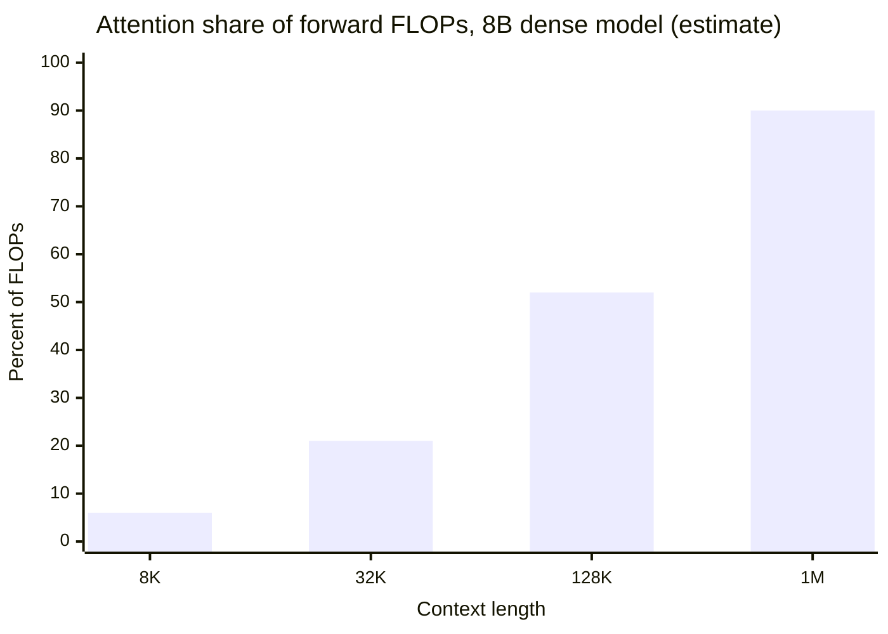
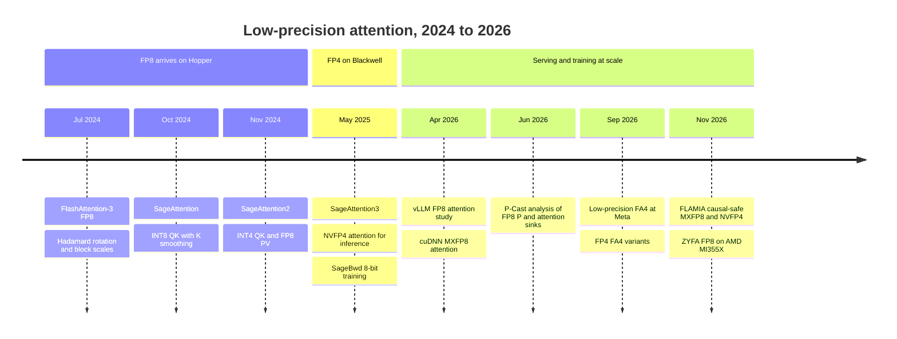
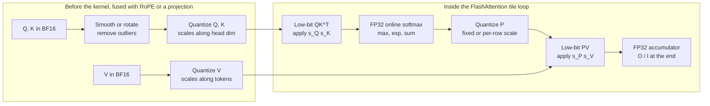

---
tags:
  - ai-ml
  - inference
  - training
  - attention
  - quantization
  - gpu-kernels
status: draft
sources:
  - https://arxiv.org/abs/2001.08361
  - https://arxiv.org/abs/2407.21783
  - https://arxiv.org/abs/2407.08608
  - https://tridao.me/blog/2024/flash3/
  - https://arxiv.org/abs/2410.02367
  - https://arxiv.org/abs/2411.10958
  - https://arxiv.org/abs/2505.11594
  - https://raw.githubusercontent.com/thu-ml/SageAttention/main/README.md
  - https://arxiv.org/abs/2606.06521
  - https://nvidia.github.io/cudnn-frontend/mxfp8-attention-scaling/
  - https://vllm.ai/blog/2026-04-22-fp8-kvcache
  - https://research.nvidia.com/labs/eai/blogs/pushing-intelligence-to-4-bit/
  - https://pytorch.org/blog/low-precision-flash-attention-4-end-to-end-block-scaled-attention-for-blackwell/
  - https://arxiv.org/abs/2609.04105
  - https://arxiv.org/abs/2609.33135
  - https://www.lmsys.org/blog/2026-09-16-nvfp4-kv-cache
  - https://nvidia.github.io/TensorRT-LLM/1.2.0/blogs/tech_blog/blog15_Optimizing_DeepSeek_V32_on_NVIDIA_Blackwell_GPUs.html
  - https://nvidia.github.io/TensorRT-Edge-LLM/user_guide/features/FP8KV.html
  - https://arxiv.org/abs/2611.03344
  - https://arxiv.org/abs/2611.07496
created: 2026-11-26
updated: 2026-11-26
---

## Table Of Contents

---

- [[#TL;DR|TL;DR]]
- [[#The Problem|The Problem]]
- [[#Foundations|Foundations]]
    - [[#Why Attention FLOPs Grow With Context|Why Attention FLOPs Grow With Context]]
    - [[#The Formats in One Paragraph|The Formats in One Paragraph]]
    - [[#Where the Error Comes From|Where the Error Comes From]]
    - [[#Scales and Their Granularity|Scales and Their Granularity]]
- [[#How We Got Here|How We Got Here]]
- [[#How It Works|How It Works]]
    - [[#The Quantized Attention Equation|The Quantized Attention Equation]]
    - [[#Taming Q and K With Smoothing and Rotation|Taming Q and K With Smoothing and Rotation]]
    - [[#A Worked Example|A Worked Example]]
    - [[#Quantizing P|Quantizing P]]
    - [[#Accumulation Precision|Accumulation Precision]]
    - [[#Keeping Scales Causal|Keeping Scales Causal]]
- [[#Where It Is Now|Where It Is Now]]
    - [[#FP8 Attention Is a Serving Default|FP8 Attention Is a Serving Default]]
    - [[#Training With MXFP8 Attention on Blackwell|Training With MXFP8 Attention on Blackwell]]
    - [[#FP4 Attention Is Still Mostly Research|FP4 Attention Is Still Mostly Research]]
    - [[#Beyond NVIDIA|Beyond NVIDIA]]
    - [[#Who Runs What|Who Runs What]]
- [[#Trade-offs & Open Problems|Trade-offs & Open Problems]]
- [[#Resources|Resources]]
- [[#Related Notes|Related Notes]]

## ***TL;DR***
---
*Low-precision attention runs the two matrix multiplies inside [[FlashAttention]] ($QK^\top$ and $PV$) in 8-bit or 4-bit numbers instead of BF16, with a scale factor attached to each tensor or small block. It roughly doubles (FP8) or quadruples (FP4) tensor-core throughput, but attention has awkward numbers to quantize: outlier channels in $Q$ and $K$, probabilities $P$ that are mostly tiny, and very long sums.*

- **What it is:** quantize $Q$, $K$, $V$ (and the probabilities $P$ on the fly), multiply on low-bit tensor cores, and fold the scales back in. Everything else in the FlashAttention tile loop (online softmax, running max and sum) stays in FP32.
- **The three fixes that made it work:** *outlier handling* for $Q$ and $K$ (a Hadamard rotation in [FlashAttention-3](https://arxiv.org/abs/2407.08608), mean-subtraction "smoothing" in [SageAttention](https://arxiv.org/abs/2410.02367)), *per-block scales* instead of one scale per tensor, and *careful accumulation* (Hopper's FP8 tensor cores accumulate in only 22 bits, which broke 128K-token retrieval until a two-level fix).
- **A new correctness trap:** a scale shared across several token positions lets a future token change how past tokens are rounded, so information leaks backwards through a causal mask. [FLAMIA](https://arxiv.org/abs/2611.03344) (Nov 2026) measured it and showed a model can learn to exploit it.
- **Where it is now (Nov 2026):** FP8 attention is the recommended starting point in vLLM for long-context serving (Hopper and Blackwell, Apr 2026), MXFP8 attention is in cuDNN and in Meta's production ads training on Blackwell, and FP4 attention is fast (SageAttention3: 1038 TOPS on an RTX 5090) but still mostly used for video diffusion inference and research kernels.

## ***The Problem***
---
*At long context, attention's own matrix multiplies become the largest single cost of a forward pass, and the rest of the model has already moved to FP8 or FP4. Leaving attention in BF16 leaves half or more of the tensor cores' throughput unused exactly where the FLOPs are.*

[[Quantization]] moved weights and the big linear layers to FP8 and then to 4-bit formats, but low-precision training recipes usually kept attention in BF16 (DeepSeek-V3's FP8 recipe did, as covered in that note). That made sense at 4K tokens, where attention is a small share of the work. It stops making sense at 128K tokens and beyond, where the $n \times n$ score computation dominates (see [[#Why Attention FLOPs Grow With Context|the numbers below]]).

The hardware has also changed the trade. On Hopper, FP8 tensor cores are rated at 1978 TFLOPS against 989 for FP16 ([Tri Dao, Jul 2024](https://tridao.me/blog/2024/flash3/)). On an RTX 5090, FP4 matmul runs at about 1600 TOPS against about 200 for FP16 ([Zhang et al., 2025](https://arxiv.org/abs/2505.11594)). The question is how to capture that speed without wrecking accuracy in an operation whose softmax amplifies small score errors exponentially, and without breaking the causal mask that training depends on.

## ***Foundations***
---
*Four ideas are enough: attention FLOPs grow linearly with context per token while everything else stays flat, low-bit formats need scales, attention has three distinct error sources, and where a scale is computed matters as much as how fine it is.*

#### **Why Attention FLOPs Grow With Context**

Kaplan et al. count the forward pass per token as

$$
C_{\text{forward}} \approx 2N + 2\, n_{\text{layer}}\, n_{\text{ctx}}\, d_{\text{attn}}
$$

*In plain English: each token pays 2 FLOPs per parameter for the weight matrices, plus a term for comparing itself with every earlier token in every layer. The first term is fixed; the second grows with context length* ([Kaplan et al., 2020](https://arxiv.org/abs/2001.08361)).

For an 8B model with 32 layers and 4,096-wide attention (the shape of Llama 3 8B, [Llama 3 paper](https://arxiv.org/abs/2407.21783)), and taking the causal average of half the context per token:

| Context | Attention FLOPs per token | Share of forward FLOPs |
|---|---|---|
| 8K | 1.1 GFLOP | about 6% |
| 32K | 4.3 GFLOP | about 21% |
| 128K | 17 GFLOP | about 52% |
| 1M | 137 GFLOP | about 90% |

These are my estimates from Kaplan's formula, not measurements. Grouped-query attention shrinks the [[KV Cache]] but not these FLOPs, because every query head still computes its own scores. So prefill of long prompts, long-video diffusion (tens of thousands of tokens per clip) and long-context training are where low-precision attention pays.

#### **The Formats in One Paragraph**

FP8 comes as E4M3 (max 448, more precision) and E5M2 (more range). Microscaling formats give every small block its own scale: MXFP8 and MXFP4 use 32-element blocks with a power-of-two E8M0 scale, while NVFP4 uses 16-element blocks of E2M1 values (only ±{0, 0.5, 1, 1.5, 2, 3, 4, 6}) with an E4M3 scale plus a per-tensor FP32 scale. Hopper has FP8 tensor cores; Blackwell adds hardware block-scaled MX and NVFP4 multiplies. The details and bit layouts are in [[Quantization]]. Two facts matter here: E4M3's smallest normal number is $2^{-6} \approx 0.0156$ and its smallest subnormal $2^{-9} \approx 0.002$, and FP4 is useless without a fine-grained scale.

#### **Where the Error Comes From**

| Stage | Why it is hard | Main fix |
|---|---|---|
| $Q$ and $K$ before $QK^\top$ | A few channels carry large values; in $K$ they are mostly a bias shared by every token ([SageAttention](https://arxiv.org/abs/2410.02367)). One big value sets the scale and crushes the small, token-specific parts to zero. | Smoothing (subtract the mean) or a random Hadamard rotation |
| $P$ before $PV$ | Softmax outputs lie in [0, 1] and most are tiny. Many fall below E4M3's normal range, and FP4's grid is coarse. | A fixed scale (256 or 448) or a per-row rescale before casting |
| $V$ | Usually benign, but $PV$ contracts over the sequence, so $V$'s block scales run along tokens, not channels. | Block scales along the sequence; this is where causal leakage enters |
| The accumulator | $PV$ sums over up to $n$ keys; at 128K tokens a short accumulator loses the small terms. | Two-level accumulation into true FP32 |

#### **Scales and Their Granularity**

A quantized number is a low-bit code times a scale: $x \approx s \cdot \hat{x}$. The scale is usually $s = \max|x| / q_{\max}$ over some group. Coarser groups are cheaper but let one outlier ruin the whole group. Attention kernels use, from coarse to fine: per tensor (one scale, often calibrated offline), per head, per block of tokens (one scale for a FlashAttention tile), per token, and per 16 or 32 elements (microscaling). A hardware constraint shapes the choice: a scale can only be "pulled out" of a dot product if it is constant along the dimension being summed, or if the tensor core applies it block by block along that dimension. That is why SageAttention cannot use per-channel scales for $K$, and why MX hardware scales $V$ along the sequence ([SageAttention](https://arxiv.org/abs/2410.02367); [cuDNN, Apr 2026](https://nvidia.github.io/cudnn-frontend/mxfp8-attention-scaling/)).

## ***How We Got Here***
---
*FP8 attention arrived with Hopper in 2024 and solved outliers with a rotation borrowed from quantization theory. A Tsinghua group pushed bit widths down through INT8, INT4 and FP4 for inference in 2024 and 2025. In 2026 the frontier moved to training on Blackwell's block-scaled formats, which exposed accumulator and causality problems nobody had needed to think about at BF16.*

| Date | What changed | Problem it answered | Source |
|---|---|---|---|
| Jul 2024 | FlashAttention-3 FP8: per-block scales for $Q$, $K$, $V$, plus "incoherent processing" (multiply $Q$ and $K$ by a random-sign Hadamard matrix). Close to 1.2 PFLOPs/s on H100, 2.6x lower error than per-tensor FP8 on inputs with outliers. | Hopper doubled FP8 throughput, but naive FP8 attention was inaccurate. | [Shah et al.](https://arxiv.org/abs/2407.08608) |
| Oct 2024 | SageAttention: INT8 $QK^\top$ (INT8 matmul is about 2x FP8 on RTX 4090, and was more accurate than FP8 for $Q$ and $K$ in its tests), FP16 $PV$ with FP16 accumulation, and $K$ smoothing. About 2.1x FlashAttention-2 throughput. | FP8 tensor cores did not exist on most GPUs; $K$'s channel outliers broke INT8. | [Zhang et al.](https://arxiv.org/abs/2410.02367) (ICLR 2025) |
| Nov 2024 | SageAttention2: INT4 $QK^\top$ with per-thread scales, $Q$ smoothing, FP8 $PV$, and two-level accumulation for Hopper and Ada's 22-bit FP8 accumulator. Peak 481 TOPS on RTX 4090, about 3x FlashAttention-2. | Pushing $QK^\top$ to 4 bits; FP8 $PV$ losing precision in long sums. | [Zhang et al.](https://arxiv.org/abs/2411.10958) (ICML 2025) |
| May 2025 | SageAttention3: NVFP4 for both matmuls on Blackwell, with a two-level rescale of $P$; 1038 TOPS on RTX 5090, about 5x the fastest FlashAttention there. Also SageBwd, 8-bit forward and backward for training. | Using Blackwell's FP4 tensor cores; can low-bit attention train? | [Zhang et al.](https://arxiv.org/abs/2505.11594) (NeurIPS 2025 Spotlight) |
| Apr 2026 | vLLM documents FP8 attention (not just FP8 cache) across Hopper and Blackwell; two-level accumulation fixes a 128K retrieval collapse. cuDNN publishes its MXFP8 forward and backward attention. | Production serving needed validated accuracy; training needed a block-scaled kernel. | [vLLM](https://vllm.ai/blog/2026-04-22-fp8-kvcache), [cuDNN](https://nvidia.github.io/cudnn-frontend/mxfp8-attention-scaling/) |
| Jun 2026 | P-Cast analysis: attention sinks push other tokens' probabilities below FP8's range unless $P$ is scaled by $2^8$ before casting. | Why FP8 $P$ silently zeroes most of the distribution in some heads. | [Lau](https://arxiv.org/abs/2606.06521) |
| Sep 2026 | Low-precision FlashAttention-4: MXFP8 forward and backward, in Meta's production ads training. Graphcore and NUDT publish FP4 variants of FA4. | Training speed on Blackwell; FP4 for long-context inference. | [PyTorch blog](https://pytorch.org/blog/low-precision-flash-attention-4-end-to-end-block-scaled-attention-for-blackwell/), [Hu](https://arxiv.org/abs/2609.04105), [Deng et al.](https://arxiv.org/abs/2609.33135) |
| Nov 2026 | FLAMIA: MXFP8 and mixed NVFP4/FP8 training attention that is exactly causal; shows scale sharing leaks future tokens. ZYFA: FP8 attention that actually beats BF16 on AMD MI355X. | Hidden causality bugs in block-scaled kernels; FP8 not paying off on AMD. | [Velikonivtsev et al.](https://arxiv.org/abs/2611.03344), [Anthony et al.](https://arxiv.org/abs/2611.07496) |

## ***How It Works***
---
*Quantize each operand with its scales, multiply the low-bit codes on tensor cores, and multiply the scales back into the result. The work is in choosing scales that keep outliers, tiny probabilities and long sums under control, and that never let a future token influence a past one.*

#### **The Quantized Attention Equation**

With per-token scales $s^Q_i$ and $s^K_j$ (FlashAttention-3 uses one per tile, which is the same idea at block level), the score tile is

$$
S_{ij} \;=\; \frac{1}{\sqrt{d}}\; s^{Q}_{i}\, s^{K}_{j} \sum_{t=1}^{d} \hat{q}_{it}\, \hat{k}_{jt}
$$

and with microscaling, where every block $b$ of 16 or 32 channels has its own scale, the tensor core computes

$$
S_{ij} \;=\; \frac{1}{\sqrt{d}} \sum_{b} s^{Q}_{i,b}\, s^{K}_{j,b} \sum_{t \in b} \hat{q}_{it}\, \hat{k}_{jt}
$$

*In plain English: multiply the small integer or FP8 codes, which is the fast part, then multiply the result by the two scales that turn codes back into real numbers. With one scale per token, the scales factor out of the whole dot product; with block scales, each 16- or 32-channel chunk gets its own correction, which Blackwell's tensor cores apply in hardware.*

The softmax then runs in FP32 exactly as in [[FlashAttention]]: running max $m_i$, $\tilde{P}_{ij} = e^{S_{ij} - m_i}$, running sum $\ell_i$. Before the second matmul, $\tilde{P}$ is quantized again, $\tilde{P} \approx s^P \hat{P}$, and

$$
O_i \;=\; \frac{1}{\ell_i} \sum_{j} s^{P}\, s^{V}_{j}\, \hat{P}_{ij}\, \hat{v}_{j}
$$

where $s^V_j$ is $V$'s scale for the block of keys containing $j$. Note the direction: $PV$ sums over keys, so $V$'s scales must be shared along the sequence, not along channels.

#### **Taming Q and K With Smoothing and Rotation**

Two tricks change the inputs without changing the output.

- **Smoothing (SageAttention).** Subtract the mean key $\bar{k}$ from every key. For any query $q$, $q \cdot \bar{k}$ is the same constant for every key, and softmax ignores a constant added to a whole row, so $\text{softmax}(q(K - \mathbf{1}\bar{k}^\top)^\top) = \text{softmax}(qK^\top)$. The shared bias that caused $K$'s outlier channels disappears, at under 0.2% overhead ([Zhang et al., 2024](https://arxiv.org/abs/2410.02367)). SageAttention2 also smooths $Q$ per block, adding the removed part back with a cheap matrix-vector correction ([Zhang et al.](https://arxiv.org/abs/2411.10958)).
- **Incoherent processing (FlashAttention-3).** Multiply $Q$ and $K$ by the same random orthogonal matrix $M$: $(QM)(KM)^\top = QMM^\top K^\top = QK^\top$. Each entry of $QM$ is a random mix of all entries of a row, so one huge channel is spread thinly across all of them. $M$ is a Hadamard matrix with random signs, which costs $O(d \log d)$ and fuses into the RoPE kernel for free ([Shah et al., 2024](https://arxiv.org/abs/2407.08608)).

How much each part helps, on synthetic inputs where 0.1% of entries have 10x the normal standard deviation (FlashAttention-3, Table 3):

| Method | RMSE vs exact |
|---|---|
| FP16, standard attention | 3.2e-4 |
| FP16, FlashAttention-2 or -3 | 1.9e-4 |
| FP8, per-tensor baseline | 2.4e-2 |
| FP8, FA3 without incoherent processing | 2.4e-2 |
| FP8, FA3 without block quantization | 9.3e-3 |
| FP8, FA3 full | 9.1e-3 |

The rotation does almost all the work on this test; block scales add little. SageAttention's ablation tells the same story for smoothing on real models: without $K$ smoothing, Unidiffuser's FID rises from 163 to between 221 and 267 depending on scale granularity; with smoothing it stays at 166 to 168 ([Zhang et al., 2024](https://arxiv.org/abs/2410.02367)).

#### **A Worked Example**

Two keys share a big bias in channel 1 (the pattern SageAttention describes), and differ only in small channels. Quantize them to INT4 (codes $-7 \dots 7$) with one scale for the block, and compare scores for a query $q = [0.5, 2, 2, 2]$:

| | Keys | Scale | Scores $q \cdot k_1$, $q \cdot k_2$ | Softmax weights |
|---|---|---|---|---|
| Exact | $k_1 = [8.0, 0.6, -0.4, 0.2]$, $k_2 = [8.2, -0.2, 0.8, -0.6]$ | none | 4.80, 4.10 | 0.67, 0.33 |
| Plain INT4 | $[8.2, 1.17, 0, 0]$, $[8.2, 0, 1.17, -1.17]$ | $8.2/7 = 1.17$ | 6.44, 4.10 | **0.91, 0.09** |
| Smooth $K$ first | mean $[8.1, 0.2, 0.2, -0.2]$ removed, residuals $\pm[-0.1, 0.4, -0.6, 0.4]$ | $0.6/7 = 0.086$ | 4.92, 3.98 | 0.72, 0.28 |
| Hadamard-rotate $q$ and $K$ | $k_1 M = [4.2, 3.4, 4.4, 4.0]$, $k_2 M = [4.1, 4.9, 3.9, 3.5]$ | $4.9/7 = 0.70$ | 4.73, 4.20 | 0.63, 0.37 |

With one scale stretched to cover the 8.2, the step size is 1.17, so every small channel rounds to 0 or $\pm 1.17$, and a 0.7-point score gap becomes 2.3 points. The softmax turns that into a weight of 0.91 instead of 0.67. After smoothing, the step is 0.086 and the scores are off by about 0.1. After rotation, no entry dominates, the step is 0.70 but the errors partly cancel across channels. (The smoothed scores include the constant $q \cdot \bar{k}$, which softmax ignores; numbers computed for this note.)

#### **Quantizing P**

After the softmax subtraction, the largest probability in a row is 1 and most of the rest are tiny. Cast a probability of 0.001 straight to E4M3: it sits between 0 and the smallest subnormal $2^{-9} \approx 0.00195$ and rounds up to 0.00195, a 95% error; 0.0004 rounds to zero. Multiply by 256 first and 0.001 becomes 0.256, which E4M3 stores as 0.25: a 2.3% error. Kernels therefore scale $P$ before casting and divide it back out afterwards:

| Kernel | How $P$ is scaled |
|---|---|
| cuDNN MXFP8 | Fixed scale of 256, no block scales ([cuDNN](https://nvidia.github.io/cudnn-frontend/mxfp8-attention-scaling/)) |
| FlashAttention-3 / -4 FP8 | Fixed $S = 256$; FlashInfer and TensorRT-LLM XQA use 448 ([Lau](https://arxiv.org/abs/2606.06521)) |
| Low-precision FA4 (Meta) | MXFP8 with per-32 E8M0 scales, reusing the softmax row max so the scale costs about one extra exp per 32 elements ([PyTorch](https://pytorch.org/blog/low-precision-flash-attention-4-end-to-end-block-scaled-attention-for-blackwell/)) |
| SageAttention3 (NVFP4) | Two levels: stretch each row so its max maps to $448 \times 6$, then apply NVFP4 microscaling; raises $P$'s cosine similarity from 93.3% to 99.5% ([NVIDIA Research](https://research.nvidia.com/labs/eai/blogs/pushing-intelligence-to-4-bit/); [Zhang et al.](https://arxiv.org/abs/2505.11594)) |

[[Attention Sinks and Gated Attention|Attention sinks]] make this worse. A sink token with a high score sets the running max early, pushing every other token's $\tilde{P}$ toward zero. The P-Cast analysis finds that with no scale ($S = 1$) and a sink 7 nats above the rest, 82% of the non-sink probabilities are zeroed, though those tokens still hold about half the attention mass; with $S = 2^8$, none are. It argues 256 beats 448 because power-of-two scaling is exact and gives the smallest worst-case step, worth roughly 10 to 15% in measured error, though it reports output MSE only, not model quality ([Lau, 2026](https://arxiv.org/abs/2606.06521)).

#### **Accumulation Precision**

$PV$ adds up one product per key. SageAttention2 found that Hopper and Ada's FP8 tensor-core instruction, documented as accumulating in FP32, actually keeps about 22 bits (1 sign, 8 exponent, 13 mantissa) ([Zhang et al.](https://arxiv.org/abs/2411.10958)). At long context the small terms vanish. vLLM measured the effect on 128K needle-in-a-haystack: BF16 91%, FP8 attention 13%, FP8 with two-level accumulation (add each tile's partial sum into a true FP32 register) 89%. The fix costs register pressure and prefill speed, especially at head dimension 256, and is not needed on Blackwell with FlashInfer ([vLLM, Apr 2026](https://vllm.ai/blog/2026-04-22-fp8-kvcache)).

#### **Keeping Scales Causal**

In a causal model, token $i$'s output must not depend on tokens after $i$. Exact BF16 attention guarantees this through the mask. Quantization can quietly break it, because a scale computed over a group of positions depends on every value in the group ([Velikonivtsev et al., 2026](https://arxiv.org/abs/2611.03344)):

| Scale | Computed over | Leaks? |
|---|---|---|
| $Q$, $K$ per token along the head dimension | One token's own channels | No |
| $P$ per row or per block of keys | One query's past keys (masked keys are exactly 0) | No |
| $V$ in blocks of 32 along the sequence | 32 consecutive keys, which on a diagonal tile can straddle the query's position | **Yes**: a future key that raises the block max re-rounds past keys' values |
| Any per-tensor scale computed on the fly | The whole sequence | **Yes** |

At 8 bits, doubling a scale usually leaves codes intact, so the leak only appears when a value drops below E4M3's normal range or stops being clamped. FLAMIA measured the largest change in earlier outputs when a future token raises a group max: about $10^{-1}$ for per-tensor scaling and for cuDNN MXFP8 with floor-rounded exponents, exactly 0 for its own exact mode. The danger is that training learns to use the leak. On enwik8, a leaking 4-bit model scored a better loss through its own kernel than BF16 did (0.811 to 0.827 vs 0.852), and a worse one when evaluated with exact attention (0.888 to 0.940 vs 0.862 for a model trained without the leak). FLAMIA's fixes: one power-of-two exponent per 32 tokens, rounded up so nothing clamps; per-token scales for $Q$ and $K$; per-key $V$ scales on diagonal tiles only; and a matching treatment in the backward pass. At inference with static, calibrated scales the issue does not arise, since no scale depends on the input.

## ***Where It Is Now***
---
*As of November 2026, FP8 attention is a validated serving option on Hopper and Blackwell, MXFP8 attention is used in production training on Blackwell, and FP4 attention is fast but still mostly confined to video diffusion inference and research kernels. Four-bit storage of the KV cache is ahead of four-bit attention math.*

#### **FP8 Attention Is a Serving Default**

- **vLLM (Apr 2026).** `--kv-cache-dtype fp8` stores the cache in FP8 *and* runs both attention matmuls in E4M3: through vLLM's FlashAttention-3 fork on H100/H200 and FlashInfer on B200. With uncalibrated per-tensor scales, Qwen3-30B-A3B-Thinking lost at most 1 to 2 points on reasoning benchmarks, Llama-3.3-70B recovered 97 to 98% of long-context MRCR score at 128K, and Qwen3.5-27B matched baseline at 1M tokens. Single-request decode time per added context token fell to 54% of BF16 for Llama-3.1-8B (break-even near 7K tokens on H100, 4K on B200), and output throughput under load rose 14.9%. The authors call it "ready to be the default starting point" for many long-context deployments, with exceptions for head dimension 256 prefill, hybrids with small sliding-window layers, and models such as Kimi-K2.5 that need calibrated scales ([vLLM, Apr 2026](https://vllm.ai/blog/2026-04-22-fp8-kvcache)).
- **TensorRT-LLM.** DeepSeek-V3.2's sparse MLA runs with per-tensor FP8 for both the cache and the math on Blackwell, and its lightning indexer uses blockwise FP8; FP8 sparse MLA gave up to 47% more throughput per GPU ([NVIDIA, updated Mar 2026](https://nvidia.github.io/TensorRT-LLM/1.2.0/blogs/tech_blog/blog15_Optimizing_DeepSeek_V32_on_NVIDIA_Blackwell_GPUs.html)). On edge Blackwell (Thor), TensorRT-Edge-LLM's FP8 kernel reads FP8 $Q$ and KV directly, 9 to 17% faster at head dimension 128, with a warning that some Qwen2.5 models degrade badly ([NVIDIA, Nov 2026](https://nvidia.github.io/TensorRT-Edge-LLM/user_guide/features/FP8KV.html)).
- **SGLang (Sep 2026).** Its NVFP4 KV cache on Blackwell workstation GPUs dequantizes to BF16 for decode and to an FP8 workspace for chunked prefill: the cache is 4-bit, the math is not. It still lifts decode throughput 37 to 78% at fixed memory because more requests fit ([LMSYS, Sep 2026](https://www.lmsys.org/blog/2026-09-16-nvfp4-kv-cache)). See [[KV Cache]] and [[LLM Serving]].

#### **Training With MXFP8 Attention on Blackwell**

- **cuDNN and Transformer Engine (Apr 2026).** MXFP8 forward and backward: $Q$ and $K$ scaled in 32-blocks along the head dimension, $V$ along the sequence, $P$ with a fixed 256, quantized copies of each operand for the backward pass's different contraction axes. Enabled with Transformer Engine's `MXFP8BlockScaling` recipe and `fp8_dpa=True` ([cuDNN](https://nvidia.github.io/cudnn-frontend/mxfp8-attention-scaling/)).
- **Meta's low-precision FlashAttention-4 (Sep 2026).** MXFP8 forward and backward on B200: 2.85 PFLOPs/s forward on LLM shapes (1.43x FA4 BF16, on par with cuDNN 9.24's MXFP8), 1.21 to 1.32x cuDNN BF16 backward, and 1.18 to 1.30x end to end at 8K to 16K KV tokens in an ads model module. The authors state it is neutral on their production metric in GEM ads training, but publish only SQNR, not loss curves. They also report that cuDNN's MXFP8 backward mismatched the reference for $dQ$ and $dK$ in their tests ([PyTorch blog, Sep 2026](https://pytorch.org/blog/low-precision-flash-attention-4-end-to-end-block-scaled-attention-for-blackwell/)).
- **FLAMIA (Nov 2026).** Causally exact MXFP8 and mixed NVFP4/FP8 training attention: 1.10 to 1.40x faster than the best baseline (cuDNN FP8, FA4 BF16) for causal forward plus backward on B200. A 1B model on 100B tokens ended at loss 2.397 (MXFP8) and 2.406 (NVFP4 for $QK^\top$) against 2.392 for BF16, with mean downstream score 0.5737, 0.5814 and 0.5832 ([Velikonivtsev et al.](https://arxiv.org/abs/2611.03344)).

Earlier evidence was more cautious: SageBwd's 8-bit training attention was lossless for fine-tuning but converged more slowly in pretraining ([Zhang et al., 2025](https://arxiv.org/abs/2505.11594)), and Graphcore's FP4 FA4 variant trained to 100B tokens with a validation-loss gap of 0.09 to BF16, with every FP4 $PV$ training run diverging ([Hu, Sep 2026](https://arxiv.org/abs/2609.04105)).

#### **FP4 Attention Is Still Mostly Research**

- **Video and image diffusion** is where 4-bit and 8-bit attention landed first, because clips are long, non-causal and tolerant of small errors. SageAttention is a plug-in replacement for diffusion models; on CogVideoX1.5-5B on an H20, generation took 25'34" with FlashAttention-2, 12'14" with FlashAttention-3 FP8 and 12'07" with SageAttention ([SageAttention README](https://raw.githubusercontent.com/thu-ml/SageAttention/main/README.md)). NVIDIA reports SageAttention3 at about 2.4 to 3x end to end on video diffusion ([NVIDIA Research, Jun 2026](https://research.nvidia.com/labs/eai/blogs/pushing-intelligence-to-4-bit/)).
- **Hybrid widths beat all-FP4.** MpFA (Sep 2026) keeps $QK^\top$ in NVFP4 and $PV$ in FP8 on data-center Blackwell (SM100): 1.31x BF16 FA4 and 1.17x FP8 FlashInfer for 16K to 128K prefill. Its fully NVFP4 version ran at only 0.87x BF16 FA4 at 64K, because quantizing $P$ adds work to the already saturated softmax path ([Deng et al.](https://arxiv.org/abs/2609.33135)). FLAMIA's default 4-bit path makes the same split.
- **NVIDIA's own caveat:** FP4 attention "still carries more accuracy risk than FP4 GEMMs" ([NVIDIA Research, Jun 2026](https://research.nvidia.com/labs/eai/blogs/pushing-intelligence-to-4-bit/)).

#### **Beyond NVIDIA**

Zyphra's ZYFA (Nov 2026) explains why FP8 attention disappointed on AMD's MI355X: FP8 halves the matmul cycles but makes the softmax slower (896 vs 768 vector cycles per tile, because of conversion), so AMD's AITER FP8 kernel reached only 39% of FP8 peak. ZYFA computes each FP8 probability with one multiply-add instead of an exponential, scales $P$ in 64-key power-of-two blocks, and hand-schedules in assembly, reaching 53% of peak and up to 1.76x AITER's FP8 kernel on DeepSeek-V2-Lite's MLA shape (1.16 to 1.17x on Mistral-7B and Qwen3-8B). It is forward-only. Accuracy is the sobering part: full-model KL divergence with all-FP8 attention was 24 to 46x the BF16 noise band, keeping 90% of heads in BF16 still did not match BF16, and a Hadamard rotation roughly halved input quantization error ([Anthony et al., Nov 2026](https://arxiv.org/abs/2611.07496)). See [[AI Accelerators]].

#### **Who Runs What**

| System | Precision of $QK^\top$ / $PV$ | Use | Status (date) |
|---|---|---|---|
| vLLM + FA3 (Hopper), FlashInfer (Blackwell) | FP8 / FP8, per-tensor scales | LLM serving | Recommended starting point for long context (Apr 2026) |
| TensorRT-LLM, DeepSeek-V3.2 | FP8 / FP8 sparse MLA | LLM serving | Shipped, up to 47% throughput (Mar 2026) |
| SGLang NVFP4 KV | BF16 or FP8 math on a 4-bit cache | LLM serving | Shipped (Sep 2026) |
| SageAttention 1/2/3 | INT8 or INT4 or NVFP4 / FP16, FP8 or NVFP4 | Diffusion and LLM inference plug-in | Open source, widely used for video (2024 to 2025) |
| cuDNN / Transformer Engine | MXFP8 / MXFP8 | Training and inference | Available on Blackwell (Apr 2026) |
| Meta low-precision FA4 | MXFP8 / MXFP8 | Production ads training | Internal production (Sep 2026) |
| FLAMIA | MXFP8 or NVFP4 / FP8 | LLM training | Research code (Nov 2026) |
| ZYFA | FP8 / FP8 | Prefill on AMD MI355X | Research, forward only (Nov 2026) |

## ***Trade-offs & Open Problems***
---
*FP8 attention is close to free in accuracy for many models once scales and accumulators are right, but "many" is not "all", and FP4 attention is not yet trusted for training or for the most sensitive LLM workloads. The open questions are about guarantees: causality, per-model accuracy, and whether the speed survives the softmax bottleneck.*

| Choice | Gain | Cost |
|---|---|---|
| FP8 instead of BF16 | About 2x matmul throughput; 1.1 to 1.5x kernel speedups in practice | Small accuracy loss; per-model calibration sometimes needed; accumulator fixes cost speed |
| FP4 for $QK^\top$ | Up to 4x matmul throughput | Needs smoothing or rotation; outliers matter far more |
| FP4 for $PV$ | Full FP4 speed | $P$ quantization overloads the softmax path; diverged in tested training runs |
| Finer scales | Less outlier damage | More scale bookkeeping; scales along the sequence can leak causality |
| Fixed $P$ scale (256) | Free, exact power of two | Coarser than per-row scaling for FP4 |
| Approximate exponentials for $P$ | Relieves the exp bottleneck (ZYFA, FLAMIA inference mode) | Small extra error; unusable in training where the backward pass must reproduce $P$ |

Open problems:
- **Softmax is the real limit.** Low-bit matmuls make the exponential and conversion work a larger share of each tile, the same bottleneck FlashAttention-4 fights at BF16. Speedups are 1.1 to 2x, not the 2x or 4x of the raw tensor cores ([Anthony et al.](https://arxiv.org/abs/2611.07496); [Deng et al.](https://arxiv.org/abs/2609.33135)).
- **Causal guarantees.** FLAMIA showed a widely used MXFP8 configuration leaks; how many other block-scaled kernels do is unknown, and its own default mode still allows a small dependency within a 32-token block ([Velikonivtsev et al.](https://arxiv.org/abs/2611.03344)).
- **Per-model fragility.** Kimi-K2.5, some Qwen2.5 models and the ZYFA KL results show that average-case accuracy hides models or heads that break. Which heads tolerate low precision, and how [[Attention Sinks and Gated Attention|sinks]] interact with $P$ scaling at the model level, are still measured case by case.
- **Pretraining at 4 bits.** Evidence for FP4 attention in pretraining is limited to 1B-scale models and a few runs with visible loss gaps; MXFP8 is the safe training choice for now.
- **Interplay with other savings.** [[Sparse Attention]] and quantized [[KV Cache|KV caches]] already cut decode cost; whether low-bit attention math adds much on top of them for decode, as opposed to prefill and training, is workload-dependent.

## ***Resources***
---
*Start with FlashAttention-3's FP8 section and SageAttention for the two outlier fixes, then the vLLM post for what FP8 attention looks like in production. FLAMIA is the essential read before training with any block-scaled attention kernel.*

**Papers**
- [FlashAttention-3: Fast and Accurate Attention with Asynchrony and Low-precision](https://arxiv.org/abs/2407.08608): Shah et al., Jul 2024. FP8 attention with block quantization and Hadamard rotation; Table 3 error ablation.
- [SageAttention: Accurate 8-bit Attention for Plug-and-Play Inference Acceleration](https://arxiv.org/abs/2410.02367): Zhang et al. (Tsinghua), Oct 2024 (ICLR 2025). $K$ smoothing and INT8 $QK^\top$.
- [SageAttention2: Efficient Attention with Thorough Outlier Smoothing and Per-thread INT4 Quantization](https://arxiv.org/abs/2411.10958): Zhang et al., Nov 2024 (ICML 2025). INT4 $QK^\top$, FP8 $PV$, the 22-bit accumulator.
- [SageAttention3: Microscaling FP4 Attention for Inference and An Exploration of 8-bit Training](https://arxiv.org/abs/2505.11594): Zhang et al., May 2025 (NeurIPS 2025). NVFP4 attention and two-level $P$ scaling.
- [P-Cast Precision in FP8 Attention: Sink-Induced Collapse and the Optimality of S=2^8](https://arxiv.org/abs/2606.06521): Lau (Tencent), Jun 2026. Why $P$ needs a scale before casting.
- [Hardware-Aware FP4 FlashAttention-4](https://arxiv.org/abs/2609.04105): Hu (Graphcore Research), Sep 2026. FP4 variants of FA4 with training results.
- [MpFA: Hardware-Efficient Train-Free QK4V8 FlashAttention Kernels on Blackwell GPUs](https://arxiv.org/abs/2609.33135): Deng, Fang, Dong (NUDT), Sep 2026. Why 4-bit $QK^\top$ with 8-bit $PV$ wins.
- [FLAMIA: FLAsh MIcroscaling Attention for Fast and Causally Safe Training on Blackwell](https://arxiv.org/abs/2611.03344): Velikonivtsev, Koltakov, Kuznedelev (Yandex Research), Nov 2026. Causal scale leakage and the fix.
- [ZYFA: Speed and Accuracy of FP8 FlashAttention on AMD CDNA4](https://arxiv.org/abs/2611.07496): Anthony et al. (Zyphra), Nov 2026. FP8 attention on MI355X and an honest accuracy accounting.
- [Scaling Laws for Neural Language Models](https://arxiv.org/abs/2001.08361): Kaplan et al., Jan 2020. Source of the forward FLOP count with the attention term.

**Posts and docs**
- [The State of FP8 KV-Cache and Attention Quantization in vLLM](https://vllm.ai/blog/2026-04-22-fp8-kvcache): vLLM (Red Hat AI, AWS), Apr 2026. Accuracy and speed of FP8 attention in production, with failure modes.
- [How Scales Are Applied in MXFP8 Attention](https://nvidia.github.io/cudnn-frontend/mxfp8-attention-scaling/): NVIDIA cuDNN, Apr 2026. Clearest diagram of which axis each scale runs along.
- [Low Precision FlashAttention-4: End-to-End Block Scaled Attention for Blackwell](https://pytorch.org/blog/low-precision-flash-attention-4-end-to-end-block-scaled-attention-for-blackwell/): PyTorch blog (Meta authors), Sep 2026. MXFP8 forward and backward in production training.
- [Pushing Intelligence to 4-bit](https://research.nvidia.com/labs/eai/blogs/pushing-intelligence-to-4-bit/): NVIDIA Research, Jun 2026. Survey of NVFP4 across weights, cache and attention.
- [NVFP4 KV cache in SGLang](https://www.lmsys.org/blog/2026-09-16-nvfp4-kv-cache): SGLang, Qwen and NVIDIA, Sep 2026. 4-bit cache with higher-precision attention math.
- [Optimizing DeepSeek-V3.2 on NVIDIA Blackwell GPUs](https://nvidia.github.io/TensorRT-LLM/1.2.0/blogs/tech_blog/blog15_Optimizing_DeepSeek_V32_on_NVIDIA_Blackwell_GPUs.html): NVIDIA TensorRT-LLM, updated Mar 2026. FP8 sparse MLA in production serving.
- [SageAttention repository README](https://raw.githubusercontent.com/thu-ml/SageAttention/main/README.md): Tsinghua thu-ml. Kernel variants per GPU and diffusion benchmarks.

## Related Notes

- [[FlashAttention]] — The tiled kernel this note quantizes; online softmax and tiling are unchanged.
- [[Quantization]] — The FP8, MXFP8 and NVFP4 formats, and the smoothing and rotation ideas borrowed here.
- [[KV Cache]] — FP8 and NVFP4 caches; vLLM's FP8 cache flag also switches attention math to FP8.
- [[Attention Sinks and Gated Attention]] — Sinks push other probabilities below FP8's range unless $P$ is scaled.
- [[Attention]] — The operation being computed, softmax($QK^\top/\sqrt{d}$)$V$.
- [[AI Accelerators]] — Hopper FP8, Blackwell block-scaled FP4, and AMD MI355X where the softmax limits FP8 gains.
- [[Long Context]] — Where attention FLOPs dominate and low precision pays most.
- [[LLM Serving]] — How serving stacks expose FP8 attention as a flag.
- [[Sparse Attention]] — The other way to cut attention cost; DeepSeek-V3.2 combines both.
- [[1 - All About Rooflines (NOT DONE)|1 - All About Rooflines (NOT DONE)]] — Why a faster matmul shifts the bottleneck to the softmax.
