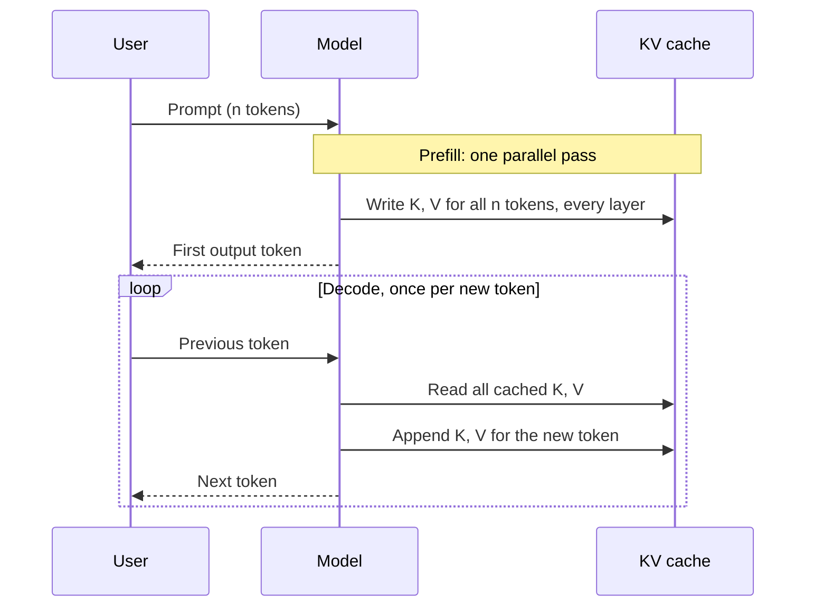
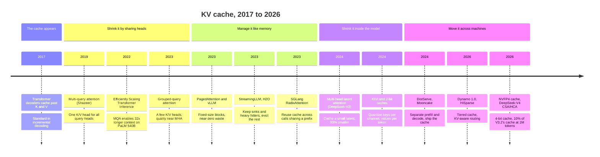
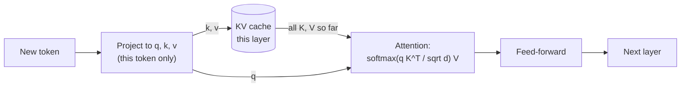
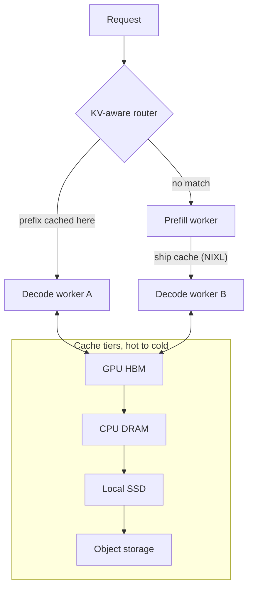

---
tags:
  - ai-ml
  - inference
  - kv-cache
  - serving
status: draft
sources:
  - https://arxiv.org/abs/1706.03762
  - https://arxiv.org/abs/1911.02150
  - https://arxiv.org/abs/2211.05102
  - https://arxiv.org/abs/2305.13245
  - https://arxiv.org/abs/2306.14048
  - https://arxiv.org/abs/2309.06180
  - https://arxiv.org/abs/2309.17453
  - https://arxiv.org/abs/2312.07104
  - https://arxiv.org/abs/2401.09670
  - https://arxiv.org/abs/2402.02750
  - https://arxiv.org/abs/2405.04434
  - https://arxiv.org/abs/2407.00079
  - https://arxiv.org/abs/2407.21783
  - https://arxiv.org/abs/2412.19437
  - https://arxiv.org/abs/2504.19874
  - https://huggingface.co/blog/deepseekv4
  - https://jax-ml.github.io/scaling-book/inference/
  - https://developer.nvidia.com/blog/nvidia-dynamo-1-production-ready/
  - https://research.nvidia.com/labs/eai/blogs/pushing-intelligence-to-4-bit/
  - https://www.lmsys.org/blog/2026-04-10-sglang-hisparse/
  - https://lecompute.fr/en/runtimes/kv-cache-objet-central-serving/
  - https://platform.claude.com/en/docs/build-with-claude/prompt-caching
created: 2026-11-26
updated: 2026-11-28
---

## Table Of Contents

---

- [[#TL;DR|TL;DR]]
- [[#The Problem|The Problem]]
- [[#Foundations|Foundations]]
    - [[#Autoregressive Decoding|Autoregressive Decoding]]
    - [[#Why Past Keys and Values Never Change|Why Past Keys and Values Never Change]]
    - [[#Prefill vs Decode|Prefill vs Decode]]
    - [[#Memory-Bound, Not Compute-Bound|Memory-Bound, Not Compute-Bound]]
- [[#How We Got Here|How We Got Here]]
- [[#How It Works|How It Works]]
    - [[#The Read-Write Loop|The Read-Write Loop]]
    - [[#How Big Is the Cache|How Big Is the Cache]]
    - [[#A Worked Example|A Worked Example]]
    - [[#The Five Levers|The Five Levers]]
    - [[#Paging and Prefix Sharing|Paging and Prefix Sharing]]
- [[#Where It Is Now|Where It Is Now]]
    - [[#The Cache Became Infrastructure|The Cache Became Infrastructure]]
    - [[#Smaller Caches by Architecture|Smaller Caches by Architecture]]
    - [[#4-Bit and 3-Bit Caches|4-Bit and 3-Bit Caches]]
    - [[#Prompt Caching as a Product|Prompt Caching as a Product]]
- [[#Trade-offs & Open Problems|Trade-offs & Open Problems]]
- [[#Resources|Resources]]
- [[#Related Notes|Related Notes]]

## ***TL;DR***
---
*A language model generates one token at a time, and each new token must attend to every earlier one. The KV cache stores the earlier tokens' keys and values so they are computed once instead of on every step, which turns generation from quadratic work into linear work but makes memory the bottleneck.*

- **What it is:** for every layer and every token seen so far, keep the key and value vectors that [[Attention]] produced, so the next step only computes them for the new token.
- **What it buys:** without it, generating token $t$ means re-running the model over all $t$ tokens. With it, each step runs the model on one token and reads the cache.
- **What it costs:** memory that grows linearly with context length and with the number of requests in flight. For a Llama-3-70B-shaped model in BF16 it is about 320 KiB per token, so one 128K-token conversation holds about 40 GiB, a third of the model's own weights.
- **Why it rules inference:** decoding reads the whole cache for every token and does very little math per byte read, so generation speed is set by memory bandwidth and batch size is set by how many caches fit ([Pope et al., 2022](https://arxiv.org/abs/2211.05102); [How to Scale Your Model](https://jax-ml.github.io/scaling-book/inference/)).
- **Where it is now (Nov 2026):** the cache is a managed object in its own right. Serving stacks page it in blocks, share it across requests with the same prefix, move it between GPU, CPU, SSD and object storage, route requests to the machine that already holds their prefix, and store it at 8, 4 or 3 bits. New architectures shrink it at the source: [[Sparse Attention|compressed sparse attention]] in DeepSeek-V4 keeps about 10% of V3.2's cache at 1M tokens ([HF blog](https://huggingface.co/blog/deepseekv4)).

## ***The Problem***
---
*Generation is a loop where each step depends on everything before it. Without a cache the loop redoes all previous work every step; with a cache it stops redoing work but has to store and re-read a pile of state that keeps growing.*

Picture a model writing a 1,000-token answer. Each new token is produced by a full forward pass, and in that pass every layer's attention needs the keys and values of every earlier token.

| Approach | Work per new token | Total work for $n$ tokens | Memory held |
|---|---|---|---|
| No cache: rerun the whole sequence each step | Forward pass over all $t$ tokens | Roughly $O(n^2)$ token-passes (and $O(n^3)$ attention math) | Only activations for the current pass |
| KV cache: keep past K and V | Forward pass over 1 token, plus reading $t$ cached entries | $O(n)$ token-passes ($O(n^2)$ attention math) | Grows by one entry per layer per token |

The cache is a classic trade of memory for compute. It is always worth making, which is why every serving system does it. The hard part is the memory side: the cache is large, its final size is unknown when a request starts (nobody knows how long the answer will be), it is private to each request unless prompts overlap, and it must be read in full on every step.

Those four facts drive almost every inference-systems idea since 2019: shrink it, page it, share it, compress it, move it, or route around it.

## ***Foundations***
---
*Four ideas carry the topic: models generate left to right, causal attention means old keys and values never change, the prompt and the answer are processed in two very different phases, and the answer phase is limited by memory traffic rather than math.*

#### **Autoregressive Decoding**
A decoder-only [[Transformer]] predicts the next token from all the tokens before it, appends that token, and repeats. "Autoregressive" just means each output is fed back in as input. Training can process all positions at once because the true text is known in advance; generation cannot, because token $t+1$ does not exist until token $t$ has been chosen.

#### **Why Past Keys and Values Never Change**
In [[Attention]], each token's query is compared against the keys of the tokens it may see, and the resulting weights average their values. In a decoder, a causal mask stops any token from seeing later ones. So when token 501 arrives, the keys and values of tokens 1 to 500 are exactly what they were when those tokens were processed: nothing that came later is allowed to influence them.

That is the whole justification for the cache. It is also why position schemes matter here: [[Positional Encoding|RoPE]] rotates a key by its own position once, at write time, so a cached key never needs to be re-encoded as the sequence grows.

Only K and V are cached, not Q. A past token's query was only needed to compute that token's own output, which is already done. The new token brings its own query.

#### **Prefill vs Decode**
Serving a request has two phases with opposite cost profiles ([Pope et al., 2022](https://arxiv.org/abs/2211.05102); [DistServe](https://arxiv.org/abs/2401.09670)).

| | Prefill | Decode |
|---|---|---|
| What happens | The whole prompt runs through the model in one parallel pass; every layer writes K and V for every prompt token into the cache. | One token at a time: run the model on the newest token, read the full cache, append one new K and V per layer. |
| Tokens per forward pass | Hundreds to millions | 1 per request (more with [[Speculative Decoding]]) |
| Bottleneck | Arithmetic (big matrix multiplies) | Memory bandwidth (reading weights and cache) |
| User-facing metric | Time to first token (TTFT) | Time per output token (TPOT) |

#### **Memory-Bound, Not Compute-Bound**
A chip has a fixed ratio between how fast it can multiply and how fast it can read memory. A job is *compute-bound* when it does many operations per byte it reads and *memory-bound* when it does few; the dividing line is the chip's roofline (see [[1 - All About Rooflines (NOT DONE)|Rooflines]]).

Decode attention does very few operations per byte. Each cached number is read once and used in roughly one multiply-add against the new token's query (a few more with [[#The Five Levers|grouped-query attention]], where several query heads share one cached head). Modern [[AI Accelerators|accelerators]] can do hundreds of operations in the time it takes to read one byte, so the arithmetic units sit mostly idle while the cache streams in ([How to Scale Your Model, ch. 7](https://jax-ml.github.io/scaling-book/inference/)).

Batching does not rescue attention the way it rescues the weight matrices. Many requests can share one read of the weights, but each request has its *own* cache, so a bigger batch means proportionally more cache to read. This is why the cache, not the weights, becomes the limit at long context.

## ***How We Got Here***
---
*The cache itself is as old as Transformer decoding. What changed is everything around it: first shrinking it by sharing heads, then managing it like operating-system memory, then sharing and moving it across requests and machines, and finally compressing it inside the architecture.*

| Year | Step | Bottleneck it answered | Source |
|---|---|---|---|
| 2017 | Decoders reuse past keys and values during incremental decoding. | Recomputing the prefix every step. | [Vaswani et al.](https://arxiv.org/abs/1706.03762) |
| 2019 | Multi-query attention: all query heads share one K/V head. Much faster decoding, minor quality loss. | Memory bandwidth spent reading many K/V heads. | [Shazeer](https://arxiv.org/abs/1911.02150) |
| 2022 | MQA plus careful partitioning across TPU chips allows 32x longer context on PaLM 540B; 29 ms per token at low batch. | Cache size capping context and batch at 500B scale. | [Pope et al.](https://arxiv.org/abs/2211.05102) |
| 2023 | Grouped-query attention: a middle number of K/V heads. Existing models can be converted with about 5% of pretraining compute; quality near MHA at MQA-like speed. | MQA's quality loss. | [Ainslie et al.](https://arxiv.org/abs/2305.13245) |
| 2023 | PagedAttention: store the cache in fixed-size blocks with a page table, like virtual memory. Prior systems used only 20.4% to 38.2% of cache memory for actual tokens; vLLM gets 2 to 4x throughput. | Fragmentation from reserving max-length slabs per request. | [Kwon et al.](https://arxiv.org/abs/2309.06180) |
| 2023 | StreamingLLM: keep the first few tokens ("attention sinks") plus a recent window; stable to 4M tokens, 22.2x faster than recomputing a sliding window. | Window caches collapse once the first tokens are evicted. | [Xiao et al.](https://arxiv.org/abs/2309.17453) |
| 2023 | H2O: a few "heavy hitter" tokens get most of the attention; keep those plus recent tokens. With 20% kept, up to 29x throughput over offloading baselines. | Cache too big to keep whole. | [Zhang et al.](https://arxiv.org/abs/2306.14048) |
| 2023 | RadixAttention (SGLang): keep caches in a prefix tree and reuse them across calls that share a prefix; up to 6.4x throughput. | Recomputing shared system prompts, few-shot examples and chat history. | [Zheng et al.](https://arxiv.org/abs/2312.07104) |
| 2024 | DistServe: run prefill and decode on different GPUs and transfer the cache; 7.4x more requests or 12.6x tighter latency targets. | Prefill bursts stalling decode when both share a GPU. | [Zhong et al.](https://arxiv.org/abs/2401.09670) |
| 2024 | KIVI: 2-bit cache without tuning by quantizing keys per channel and values per token; 2.6x less peak memory, up to 4x batch. | Cache bytes per number. | [Liu et al.](https://arxiv.org/abs/2402.02750) |
| 2024 | Multi-head latent attention: cache one compressed latent per token and expand it into K and V on the fly; 93.3% smaller cache than DeepSeek 67B. | Head-sharing alone hurts quality. | [DeepSeek-V2](https://arxiv.org/abs/2405.04434) |
| 2024 | Mooncake (Kimi's serving stack): a cluster-wide cache pool built from spare CPU memory and SSD, scheduled around cache locality; Kimi handles 75% more requests. | Cache confined to one GPU's memory. | [Qin et al.](https://arxiv.org/abs/2407.00079) |
| 2026 | Tiered cache managers, KV-aware routing, 4-bit and 3-bit caches, compressed sparse attention. | Million-token contexts and agent workloads with long shared prefixes. | See [[#Where It Is Now\|Where It Is Now]] |

## ***How It Works***
---
*Each layer keeps two growing tensors per request, one of keys and one of values. One formula gives their size, and five levers in that formula explain almost every optimization; paging and prefix trees then decide how those tensors are laid out in memory.*

#### **The Read-Write Loop**
At decode step $t$, in each layer:

1. Compute $q_t$, $k_t$, $v_t$ for the new token only.
2. Append $k_t$ and $v_t$ to that layer's cache, so it now holds $K_{1..t}$ and $V_{1..t}$.
3. Compute attention for the new token against the whole cache:

$$
o_t = \text{softmax}\!\left(\frac{q_t K_{1..t}^{\top}}{\sqrt{d_{head}}}\right) V_{1..t}
$$

*In plain English: score the new token's query against every stored key, turn the scores into weights that sum to 1, and take that weighted average of the stored values. Nothing about tokens $1$ to $t-1$ is recomputed; they are only read.*

Everything else in the layer (the projections and the feed-forward block) touches only the new token. That is where the linear-time saving comes from.

#### **How Big Is the Cache**
For one token, summed over all layers:

$$
\text{KV bytes per token} = 2 \times L \times h_{kv} \times d_{head} \times b
$$

*In plain English: two tensors (K and V), for each of $L$ layers, for each of $h_{kv}$ cached heads, each $d_{head}$ numbers long, each number $b$ bytes. Multiply by the number of tokens in context and by the number of requests in flight to get the total.*

| Symbol | Meaning | Typical 2026 values |
|---|---|---|
| $L$ | Layers that keep a full cache | 40 to 100 (fewer in hybrids that replace some layers) |
| $h_{kv}$ | Key/value heads per layer | 64 in MHA, 4 to 16 in GQA, 1 in MQA |
| $d_{head}$ | Numbers per head | 64 to 256 |
| $b$ | Bytes per number | 2 (BF16), 1 (FP8), 0.5 (FP4) |

#### **A Worked Example**
Take a Llama-3-70B-shaped model: 80 layers, 8 K/V heads (GQA), head size 128 ([Llama 3 paper](https://arxiv.org/abs/2407.21783), Table 3), cache in BF16.

- Per token: $2 \times 80 \times 8 \times 128 \times 2 = 327{,}680$ bytes, which is **320 KiB**.
- One 128K-token context ($131{,}072$ tokens): $320\text{ KiB} \times 131{,}072 =$ **40 GiB**.
- The weights in BF16 are about 140 GB. So on eight 80 GB GPUs (640 GB total), roughly 500 GB is left after the weights, which fits about **twelve** 128K-token conversations at once. At 8K tokens each, the same memory fits about two hundred.

If the same model used full multi-head attention (64 K/V heads), every number above is 8x larger: 2.5 MiB per token and 320 GiB for one 128K context, more than the whole node's memory after weights ([[Attention#What It Costs|Attention]] has the same comparison).

An MLA model caches differently: one latent of 512 numbers plus a 64-number rotary key per token per layer. With DeepSeek-V3's 61 layers ([DeepSeek-V3](https://arxiv.org/abs/2412.19437)) that is $576 \times 61 \times 2 \approx 70$ KB per token in BF16, under a quarter of the GQA model above despite a much larger model.

#### **The Five Levers**
Every term in the size formula, plus the token count, has a family of techniques aimed at it.

| Lever | What shrinks | Representative techniques | What it costs |
|---|---|---|---|
| Fewer K/V heads ($h_{kv}$) | Width of each entry | MQA, GQA | Some quality, unless trained in from the start |
| Smaller entries ($h_{kv} \times d_{head}$) | Width via compression | MLA latents | Extra compute to expand latents; trickier [[Positional Encoding\|RoPE]] (decoupled key) |
| Fewer bytes per number ($b$) | Precision | FP8, NVFP4, KIVI 2-bit, TurboQuant ~3-bit | Dequantization on every read; accuracy at very long context |
| Fewer cached layers ($L$) | Layers with a growing cache | [[Hybrid Attention]] (linear or recurrent layers keep a fixed-size state), cross-layer sharing | Weaker exact recall in the replaced layers |
| Fewer cached tokens | Length | Sliding window, sinks (StreamingLLM), eviction (H2O), [[Sparse Attention]] and token merging (DeepSeek-V4 CSA/HCA) | Information outside the kept set is gone or only approximately reachable |

Two more moves don't shrink the cache but change where it lives: **offloading** (park cold blocks in CPU memory, SSD or object storage) and **disaggregation** (compute it on prefill machines, ship it to decode machines; see [[Prefill-Decode Disaggregation]]).

#### **Paging and Prefix Sharing**
Early servers reserved one contiguous slab per request, sized for the maximum possible length. Because answers are usually much shorter than the maximum, most of that slab sat empty, and gaps between slabs could not be reused. Kwon et al. measured only 20.4% to 38.2% of cache memory holding real tokens ([PagedAttention](https://arxiv.org/abs/2309.06180)).

**PagedAttention** splits each request's cache into small fixed-size blocks and keeps a per-request block table that maps logical positions to physical blocks, exactly like an operating system's page table. Waste is limited to the last, partly filled block, and two requests can point at the same physical block. That second property makes sharing cheap: parallel samples from one prompt, beam search branches, and requests with the same system prompt all reuse one copy, with copy-on-write when they diverge. The details are in [[PagedAttention]].

**Prefix caching** builds on the same idea across time. SGLang's RadixAttention keeps finished requests' blocks in a prefix tree (a radix tree) and, when a new request arrives, matches its longest cached prefix and skips prefill for that part ([Zheng et al.](https://arxiv.org/abs/2312.07104)). Chat history, agent loops that resend the same tools and instructions, and RAG with a fixed preamble all hit this. By 2026, automatic prefix caching is on by default in vLLM, SGLang, TensorRT-LLM and Dynamo ([LeCompute, Aug 2026](https://lecompute.fr/en/runtimes/kv-cache-objet-central-serving/)).

## ***Where It Is Now***
---
*As of November 2026 the cache is treated as first-class infrastructure: tiered across memory and storage, routed on, transferred between machines, and priced as a product. Meanwhile model architectures attack its size directly, so frontier models cache a small fraction of what a 2023 model of the same size would.*

#### **The Cache Became Infrastructure**
- **Tiered storage.** NVIDIA Dynamo 1.0 (March 2026) ships a KV Block Manager that tracks blocks across GPU memory, CPU memory, local SSD and remote object storage (S3 or blob), moving them by how often they are reused. It can be installed into vLLM or TensorRT-LLM without the rest of Dynamo ([NVIDIA, Mar 2026](https://developer.nvidia.com/blog/nvidia-dynamo-1-production-ready/)).
- **KV-aware routing.** Instead of sending a request to the least-busy server, routers weigh which server already holds the request's prefix, skipping its prefill. Dynamo's router combines queue depth with per-worker cache contents; NVIDIA reports up to 4x lower TTFT on agentic workloads ([NVIDIA](https://developer.nvidia.com/blog/nvidia-dynamo-1-production-ready/)).
- **Cache transfer as a standard path.** Prefill/decode disaggregation is routine; NVIDIA's NIXL transfer library is used by vLLM, SGLang, TensorRT-LLM and llm-d to move caches between GPUs. Dynamo's disaggregated serving with wide expert parallelism on GB200 NVL72 reports 7x on DeepSeek-R1 in the SemiAnalysis InferenceX benchmark ([NVIDIA](https://developer.nvidia.com/blog/nvidia-dynamo-1-production-ready/)).
- **Offload paired with sparse attention.** SGLang's HiSparse (April 2026) keeps only frequently selected cache entries on the GPU for models with DeepSeek Sparse Attention, fetching misses from CPU memory; over 3x throughput at 256 concurrent requests on GLM-5.1, up to 5x at long context ([LMSYS, Apr 2026](https://www.lmsys.org/blog/2026-04-10-sglang-hisparse/)).
- **The design is now old enough to be revised.** Mooncake, the cache-centric stack behind Kimi, published its fifth paper revision in October 2026 ([arXiv v5](https://arxiv.org/abs/2407.00079)).

#### **Smaller Caches by Architecture**
The biggest 2026 savings come from model design, not serving tricks:

| Approach | Example (2026) | Effect on the cache | Source |
|---|---|---|---|
| Token compression + sparse selection | DeepSeek-V4: CSA merges every 4 tokens and picks top-k; HCA merges every 128 | At 1M tokens, about 10% of V3.2's cache; about 2% of an 8-head GQA BF16 cache | [HF blog](https://huggingface.co/blog/deepseekv4) |
| Latent compression | MLA in DeepSeek, Kimi K2.5, GLM-5 | One small latent per token instead of full K and V | [DeepSeek-V2](https://arxiv.org/abs/2405.04434) |
| Linear/recurrent layers for most of the stack | Hybrids around 3:1 (see [[Hybrid Attention]]) | Only the full-attention layers keep a growing cache | [[Attention]] |

#### **4-Bit and 3-Bit Caches**
FP8 caches are now the baseline: NVIDIA's MLPerf v6.0 B200 submissions use them ([LeCompute](https://lecompute.fr/en/runtimes/kv-cache-objet-central-serving/)). NVIDIA Research (June 2026) argues NVFP4 is the "quality-first" 4-bit cache format: up to about 50% smaller than FP8 with under 1% accuracy loss, and dequantized on Blackwell's native FP4-to-FP8 path rather than in software ([NVIDIA Research, Jun 2026](https://research.nvidia.com/labs/eai/blogs/pushing-intelligence-to-4-bit/)). Google's TurboQuant reports no measurable quality loss at 3.5 bits per channel and marginal loss at 2.5 ([Zandieh et al.](https://arxiv.org/abs/2504.19874)); vLLM 0.20 integrated it ([LeCompute](https://lecompute.fr/en/runtimes/kv-cache-objet-central-serving/)). The number formats themselves belong in [[Quantization]].

#### **Prompt Caching as a Product**
Providers now sell cache reuse directly. On Anthropic's API, writing a prefix to the cache costs 1.25x the normal input price for a 5-minute lifetime (2x for 1 hour), and reading it back costs 0.1x, or less on the newest models (0.05x on Claude Opus 5.5 and Sonnet 5.5). Hits require a byte-identical prefix up to a marked breakpoint ([Anthropic docs](https://platform.claude.com/en/docs/build-with-claude/prompt-caching)). The practical lesson for anyone building on an API: put static content (tools, instructions, documents) first and per-request content last, because any change early in the prompt invalidates everything after it. Agents, whose input outweighs output about 100 to 1, are built around this: stable prefixes, append-only history and fixed tool lists, as covered in [[Context Engineering and Agent Memory]].

## ***Trade-offs & Open Problems***
---
*Every way of shrinking the cache throws something away: exactness, quality, compute, or latency. The open questions are about which losses are safe at million-token context and how much infrastructure complexity is worth it.*

| Technique | Gains | Costs |
|---|---|---|
| GQA / MQA | 8x to 64x smaller cache, simple | Quality loss grows as heads drop; must be designed or uptrained in |
| MLA | Very small cache with near-MHA quality | Extra up-projection compute; RoPE needs a decoupled key |
| Quantized cache (FP8 to 2-bit) | 2x to 8x smaller | Dequantize on every decode step; errors compound over long sequences |
| Eviction and windows | Bounded memory | Evicted tokens are gone; fails tasks that need exact recall from far back |
| Compressed sparse attention | 10x+ smaller at 1M tokens | Model must be trained for it; selection can miss what matters |
| Offload to CPU/SSD | Far more capacity, cross-request reuse | Transfer latency; only pays off when reuse is high |
| Prefill/decode disaggregation | Independent tuning of TTFT and TPOT | Cache transfer bandwidth; harder scheduling |

Open problems:
- **Effective vs advertised context.** A cache that fits 1M tokens does not mean the model uses them well, especially when eviction or sparse selection decides what it can see (see [[Long Context]]).
- **When is offload worth it?** Moving a block to SSD and back costs bandwidth and latency; most published gains are vendor-reported on high-reuse workloads, not independent reproductions ([LeCompute](https://lecompute.fr/en/runtimes/kv-cache-objet-central-serving/)).
- **Attention sinks and compression.** Eviction and windows must keep the first tokens or the model breaks ([StreamingLLM](https://arxiv.org/abs/2309.17453)); how sinks interact with quantization and token merging is still studied case by case (see [[Attention Sinks and Gated Attention]]).
- **Standard formats.** Each engine and each new attention variant (MLA, CSA, hybrids) has its own cache layout, which makes sharing caches across engines or moving them between machines harder than it should be.
- **Privacy and isolation.** A shared prefix cache is shared state; providers scope caches to an account or organization, but cross-request reuse is inherently a side channel worth respecting.

## ***Resources***
---
*Start with How to Scale Your Model chapter 7 for the cost model and the PagedAttention paper for the systems side. The 2026 serving picture is best read from NVIDIA's Dynamo post and the LeCompute overview, keeping in mind their numbers are vendor-reported.*

**Primary papers**
- [Attention Is All You Need](https://arxiv.org/abs/1706.03762): Vaswani et al., Jun 2017.
- [Fast Transformer Decoding: One Write-Head is All You Need](https://arxiv.org/abs/1911.02150): Shazeer, Nov 2019 (MQA).
- [Efficiently Scaling Transformer Inference](https://arxiv.org/abs/2211.05102): Pope et al., Nov 2022.
- [GQA](https://arxiv.org/abs/2305.13245): Ainslie et al., May 2023.
- [H2O: Heavy-Hitter Oracle](https://arxiv.org/abs/2306.14048): Zhang et al., Jun 2023.
- [Efficient Memory Management for LLM Serving with PagedAttention](https://arxiv.org/abs/2309.06180): Kwon et al., Sep 2023 (SOSP 2023).
- [Efficient Streaming Language Models with Attention Sinks](https://arxiv.org/abs/2309.17453): Xiao et al., Sep 2023 (ICLR 2024).
- [SGLang](https://arxiv.org/abs/2312.07104): Zheng et al., Dec 2023 (RadixAttention).
- [DistServe](https://arxiv.org/abs/2401.09670): Zhong et al., Jan 2024.
- [KIVI](https://arxiv.org/abs/2402.02750): Liu et al., Feb 2024.
- [DeepSeek-V2](https://arxiv.org/abs/2405.04434): DeepSeek-AI, May 2024 (MLA).
- [Mooncake](https://arxiv.org/abs/2407.00079): Qin et al., Jun 2024, revised Oct 2026.
- [The Llama 3 Herd of Models](https://arxiv.org/abs/2407.21783): Meta, Jul 2024 (model shapes used in the worked example).
- [DeepSeek-V3 Technical Report](https://arxiv.org/abs/2412.19437): DeepSeek-AI, Dec 2024.
- [TurboQuant](https://arxiv.org/abs/2504.19874): Zandieh et al., Apr 2025.

**Lab and engineering posts**
- [NVIDIA Dynamo 1.0](https://developer.nvidia.com/blog/nvidia-dynamo-1-production-ready/): NVIDIA, Mar 2026. KV Block Manager, KV-aware routing, NIXL.
- [Pushing Intelligence to 4-bit](https://research.nvidia.com/labs/eai/blogs/pushing-intelligence-to-4-bit/): NVIDIA Research, Jun 2026. NVFP4 cache.
- [SGLang HiSparse](https://www.lmsys.org/blog/2026-04-10-sglang-hisparse/): LMSYS, Apr 2026.
- [DeepSeek-V4 on Hugging Face](https://huggingface.co/blog/deepseekv4): Hugging Face, 2026. CSA/HCA cache numbers.
- [Prompt caching docs](https://platform.claude.com/en/docs/build-with-claude/prompt-caching): Anthropic. Pricing and prefix rules.

**Explainers and analysis**
- [How to Scale Your Model, ch. 7: All About Transformer Inference](https://jax-ml.github.io/scaling-book/inference/): Google DeepMind. Cost model for prefill, decode and the cache (also in the vault as [[7 - All About Transformer Inference (NOT DONE)|note 7]]).
- [The KV cache is no longer a side effect](https://lecompute.fr/en/runtimes/kv-cache-objet-central-serving/): LeCompute, Jul 2026 (updated Aug 2026). Survey of 2026 runtimes; flags which numbers are vendor claims.

## Related Notes

- [[Attention]] — The operation whose keys and values the cache stores; causal masking is what makes caching valid.
- [[Transformer]] — The decoder architecture being sampled; prefill and decode costs come from its blocks.
- [[Positional Encoding]] — RoPE is applied once at write time, so cached keys never need re-encoding; MLA needs a decoupled rotary key.
- [[PagedAttention]] — Deeper note on block tables, copy-on-write, prefix caching and how paging changed for hybrid models.
- [[FlashAttention]] — The fused kernels that read the cache efficiently during prefill and decode.
- [[Quantization]] — FP8, FP4 and INT formats, including the ones used for the cache.
- [[Sparse Attention]] — Sliding windows and DeepSeek's compressed sparse attention, which cut how many tokens are cached or read.
- [[Hybrid Attention]] — Linear-attention layers with fixed-size state, which remove the growing cache from most layers.
- [[Attention Sinks and Gated Attention]] — Why the first tokens must survive any eviction policy.
- [[Speculative Decoding]] — Verifies several draft tokens per pass, reading the cache once for many tokens.
- [[Long Context]] — Whether a model actually uses the context its cache can hold.
- [[7 - All About Transformer Inference (NOT DONE)|7 - All About Transformer Inference (NOT DONE)]] — Prefill vs generation and the KV cache, from How to Scale Your Model.
- [[1 - All About Rooflines (NOT DONE)|1 - All About Rooflines (NOT DONE)]] — Why decode is memory-bound: arithmetic intensity against the chip's roofline.
- [[Prefill-Decode Disaggregation]] — Shipping the cache from prefill to decode machines; its per-token size sets the transfer cost.
- [[Prefix Caching for Hybrid Models]] — Why recurrent layers make prefix reuse a question of state checkpoints, and how engines place and evict them.
- [[Context Engineering and Agent Memory]] — Why agents keep prompts stable and append-only: cache hit rate as the main cost lever.
