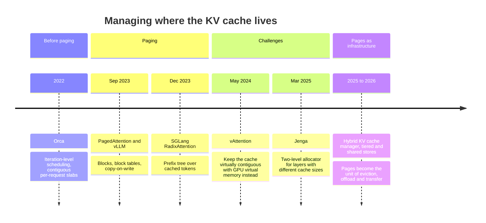
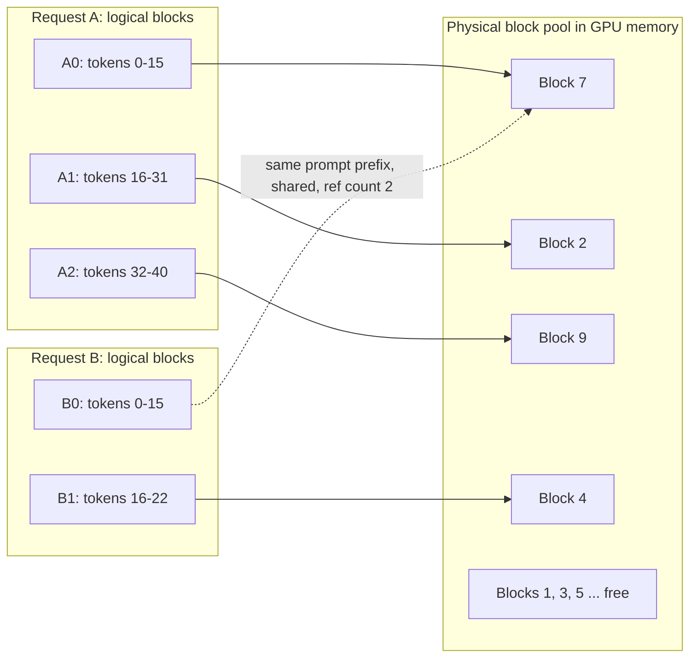
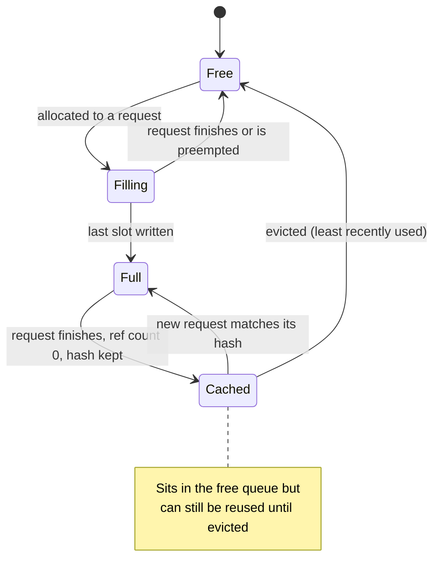

---
tags:
  - ai-ml
  - inference
  - kv-cache
  - serving
  - memory-management
status: draft
sources:
  - https://arxiv.org/abs/2309.06180
  - https://arxiv.org/abs/2312.07104
  - https://arxiv.org/abs/2405.04437
  - https://arxiv.org/abs/2503.18292
  - https://arxiv.org/abs/2607.02574
  - https://arxiv.org/abs/2610.15755
  - https://arxiv.org/abs/2607.16892
  - https://github.com/vllm-project/vllm/pull/58630
  - https://docs.vllm.ai/en/v0.33.0/design/prefix_caching/
  - https://docs.vllm.ai/en/latest/design/hybrid_kv_cache_manager/
  - https://github.com/vllm-project/vllm/blob/main/vllm/config/cache.py
  - https://vllm.ai/blog/2026-01-08-kv-offloading-connector
  - https://docs.sglang.io/docs/advanced_features/hicache_design
  - https://developer.nvidia.com/blog/nvidia-dynamo-1-production-ready/
created: 2026-11-26
updated: 2026-11-26
---

## Table Of Contents

---

- [[#TL;DR|TL;DR]]
- [[#The Problem|The Problem]]
- [[#Foundations|Foundations]]
    - [[#Three Kinds of Wasted Memory|Three Kinds of Wasted Memory]]
    - [[#Virtual Memory in One Paragraph|Virtual Memory in One Paragraph]]
    - [[#Continuous Batching|Continuous Batching]]
- [[#How We Got Here|How We Got Here]]
- [[#How It Works|How It Works]]
    - [[#Blocks and the Block Table|Blocks and the Block Table]]
    - [[#Address Translation|Address Translation]]
    - [[#A Worked Example|A Worked Example]]
    - [[#Sharing and Copy-on-Write|Sharing and Copy-on-Write]]
    - [[#When Memory Runs Out|When Memory Runs Out]]
    - [[#Prefix Caching on Top of Paging|Prefix Caching on Top of Paging]]
    - [[#Choosing the Block Size|Choosing the Block Size]]
- [[#Where It Is Now|Where It Is Now]]
    - [[#Hybrid Models Broke Uniform Pages|Hybrid Models Broke Uniform Pages]]
    - [[#Pages Got Bigger and Contiguous Across Layers|Pages Got Bigger and Contiguous Across Layers]]
    - [[#The Virtual-Memory Rival Came Back In|The Virtual-Memory Rival Came Back In]]
    - [[#Pages as the Unit of Tiering and Transfer|Pages as the Unit of Tiering and Transfer]]
- [[#Trade-offs & Open Problems|Trade-offs & Open Problems]]
- [[#Resources|Resources]]
- [[#Related Notes|Related Notes]]

## ***TL;DR***
---
*PagedAttention stores each request's [[KV Cache]] in small fixed-size blocks that can sit anywhere in GPU memory, and keeps a per-request table mapping token positions to blocks. It is the operating system's paging idea applied to the KV cache, and it is why serving engines stopped wasting most of their cache memory.*

- **The idea:** split the cache into blocks of $B$ tokens (16 in the original paper). A request's logical blocks map to physical blocks through a **block table**, so the cache no longer needs to be one contiguous slab ([Kwon et al., 2023](https://arxiv.org/abs/2309.06180)).
- **What it fixed:** earlier systems used only 20.4% to 38.2% of their cache memory for real tokens. vLLM, the engine built around PagedAttention, used 96.3%, and served 2 to 4x more requests per second than FasterTransformer and Orca at the same latency.
- **What it enabled:** because a physical block can appear in several block tables, requests can share memory. Parallel samples, beam-search branches and common prompt prefixes keep one copy, with **copy-on-write** when one of them needs to change a shared block. This is the base layer that prefix caching (vLLM's hashed blocks, SGLang's radix tree) sits on.
- **What it cost:** attention kernels must gather keys and values through the block table instead of reading one array. The original kernels were 20% to 26% slower than FasterTransformer's at the attention operator itself.
- **Where it is now (Nov 2026):** paging is the default memory model in every major open serving engine, but the page itself has changed. vLLM's default block grew to 64 tokens, its physical blocks now hold every layer's data for those tokens contiguously, hybrid models force pages of hundreds of tokens, and vLLM's main branch reserves the cache with GPU virtual memory, the very approach vAttention proposed as PagedAttention's rival ([vLLM source](https://github.com/vllm-project/vllm/blob/main/vllm/config/cache.py)).

## ***The Problem***
---
*A serving engine does not know how long a request will become, yet it must find room for that request's cache as it grows. Reserving for the worst case wastes most of the memory, and memory is what decides how many requests run at once.*

The [[KV Cache]] note explains why the cache exists and why it is large. This note is about **where it lives**. Three facts make that hard:

| Fact | Consequence for memory |
|---|---|
| The final length of a request is unknown when it starts (nobody knows when the model will stop). | A contiguous allocation must be sized for the *maximum* length, not the actual one. |
| Requests arrive and finish at different times. | Freed slabs leave holes of odd sizes that a new request may not fit into. |
| Many requests share prompt text (system prompts, few-shot examples, multiple samples of one prompt). | Each private slab stores its own copy of identical keys and values. |

Since decoding is memory-bandwidth bound and gets cheaper per token with larger batches, every gigabyte lost to waste is fewer requests in the batch and lower throughput. Kwon et al. measured that waste at roughly two thirds to four fifths of the cache in the systems of 2022 ([PagedAttention](https://arxiv.org/abs/2309.06180)).

## ***Foundations***
---
*Three ideas carry the topic: the specific ways contiguous allocation wastes memory, the operating-system trick of paging that fixes the same problem for programs, and the iteration-level scheduling that made the waste matter.*

#### **Three Kinds of Wasted Memory**
The PagedAttention paper names three sources of waste in contiguous KV allocation ([Kwon et al.](https://arxiv.org/abs/2309.06180)):

- **Reserved slots:** space set aside for tokens the request has not generated yet. It is held for the request's whole lifetime, even though most of it fills only near the end, if at all.
- **Internal fragmentation:** space for tokens the request will *never* generate, because the slab was sized for the maximum possible length and the answer stopped early.
- **External fragmentation:** gaps between slabs left by the allocator (for example, a buddy allocator), too small or too oddly placed for the next request.

#### **Virtual Memory in One Paragraph**
Operating systems solved the same problem for programs decades ago. A program sees one contiguous range of **virtual** addresses. The OS backs it with fixed-size physical **pages** (often 4 KiB) scattered anywhere in RAM, and a **page table** translates each virtual page to its physical page. Memory is committed only when a page is first touched, any free page can serve any request, and two processes can map the same physical page (shared libraries), copying it only if one of them writes (**copy-on-write**). PagedAttention maps this vocabulary one-to-one: a block is a page, a token is a byte, a request is a process ([Kwon et al.](https://arxiv.org/abs/2309.06180)).

#### **Continuous Batching**
Older servers batched whole requests: the batch started together and finished when its longest member did. Orca (OSDI 2022) introduced **iteration-level scheduling**, where the server adds and removes requests after every decode step. That keeps the GPU busy, but it means caches are being created, grown and freed constantly, which is exactly the workload that fragments contiguous memory. PagedAttention was designed to make continuous batching's memory side as fluid as its scheduling side ([Kwon et al.](https://arxiv.org/abs/2309.06180)).

## ***How We Got Here***
---
*Paging arrived in 2023 as a fix for fragmentation, turned out to be the substrate for cross-request sharing, and has since been stretched to cover mixed layer types, multi-tier storage and machine-to-machine transfer.*

| Year | Development | Problem it addressed | Source |
|---|---|---|---|
| 2022 | Orca's continuous batching | Idle GPU slots when batched requests finish at different times | Cited in [Kwon et al.](https://arxiv.org/abs/2309.06180) |
| 2023 | PagedAttention: fixed-size blocks plus a block table, sharing via reference counts | Reserved, internal and external fragmentation; duplicate copies of shared prefixes | [Kwon et al.](https://arxiv.org/abs/2309.06180) |
| 2023 | RadixAttention: keep finished requests' cache in a prefix tree and reuse the longest match | Recomputing the same prefix across requests, not just within one | [Zheng et al.](https://arxiv.org/abs/2312.07104) |
| 2024 | vAttention: reserve a contiguous virtual range per layer, map physical pages on demand with CUDA's virtual memory API | The cost of rewriting every attention kernel to read through block tables | [Prabhu et al.](https://arxiv.org/abs/2405.04437) (ASPLOS 2025) |
| 2025 | Jenga: allocation units sized by the least common multiple of layer cache sizes | Models whose layers have different cache sizes and lifetimes (sliding window, vision tokens, state-space layers) | [Zhang et al.](https://arxiv.org/abs/2503.18292) |
| 2025-26 | vLLM hybrid KV cache manager, contiguous cross-layer blocks, tiered stores | Hybrid architectures; efficient offload and transfer | [vLLM docs](https://docs.vllm.ai/en/latest/design/hybrid_kv_cache_manager/), [vLLM blog](https://vllm.ai/blog/2026-01-08-kv-offloading-connector) |

## ***How It Works***
---
*The cache is cut into blocks of $B$ tokens, a block table maps each request's logical blocks to physical ones, and reference counts let several requests point at one block. Everything else (sharing, eviction, prefix caching) is bookkeeping on top of those three pieces.*

#### **Blocks and the Block Table**
- **Physical blocks.** At startup the engine measures free GPU memory after loading weights and carves it into a pool of equal-size blocks. vLLM preallocates every block object up front to avoid allocation overhead while serving ([vLLM docs](https://docs.vllm.ai/en/v0.33.0/design/prefix_caching/)).
- **Logical blocks.** A request's tokens are numbered 0, 1, 2, ... and grouped $B$ at a time. Logical block $j$ holds tokens $jB$ to $jB + B - 1$.
- **Block table.** Per request, a list whose $j$-th entry is the physical block holding logical block $j$. It only grows: a new physical block is taken from the free pool when the last one fills.
- **Attention kernel.** During decode, the kernel receives the block table and, for each logical block, loads keys and values from the physical block it names. The math is ordinary [[Attention]]; only the memory reads change. Modern kernels such as [[FlashAttention]] accept a block table directly ([vAttention](https://arxiv.org/abs/2405.04437) benchmarks the paged versions of FlashAttention-2 and FlashInfer).

Request A's 41 tokens occupy three blocks scattered across memory; only the last block has empty slots (7 of 16). Request B shares A's first block because their first 16 tokens are identical.

#### **Address Translation**
Where does token $i$ of a request live?

$$
\text{physical block} = T\left[\left\lfloor \tfrac{i}{B} \right\rfloor\right], \qquad \text{slot within block} = i \bmod B
$$

**In plain words:** divide the token's position by the block size; the whole-number part says which entry of the block table $T$ to read, and the remainder says which slot inside that block. It is the same split an OS does between page number and page offset.

**Example:** with $B = 16$, token 37 is in logical block $\lfloor 37/16 \rfloor = 2$ at slot $37 \bmod 16 = 5$. For Request A above, $T[2] = 9$, so its keys and values sit in physical block 9, slot 5.

The waste per request is now bounded by one partly filled block:

$$
\text{wasted slots} = \left\lceil \tfrac{n}{B} \right\rceil B - n \;<\; B
$$

**In plain words:** a request of $n$ tokens rounds up to whole blocks, so it never wastes more than $B - 1$ slots, no matter how long it eventually gets.

#### **A Worked Example**
Take a Llama-3-8B-shaped model: 32 layers, 8 KV heads of dimension 128, keys and values in BF16 (2 bytes).

| Quantity | Calculation | Result |
|---|---|---|
| Cache per token, one layer | $2\ (\text{K and V}) \times 8 \times 128 \times 2\ \text{bytes}$ | 4 KiB |
| Cache per token, all layers | $4\ \text{KiB} \times 32$ | 128 KiB |
| One 16-token block, all layers | $128\ \text{KiB} \times 16$ | 2 MiB |

Now serve a request whose answer ends at 1,000 tokens, under a 4,096-token maximum:

| Allocation | Memory held | Used by real tokens |
|---|---|---|
| Contiguous slab sized for the maximum | $4096 \times 128\ \text{KiB} = 512\ \text{MiB}$ | 125 MiB (24%) |
| Paged, $B = 16$ | $\lceil 1000/16 \rceil = 63$ blocks $= 126\ \text{MiB}$ | 125 MiB (99.2%) |

The slab wastes 387 MiB on this one request, roughly enough for three more requests of the same size. That is the whole case for paging in one row. (The 2 MiB block figure matches the vLLM team's own number for Llama-3.1-8B once blocks hold all layers contiguously; see [[#Pages Got Bigger and Contiguous Across Layers|below]].)

#### **Sharing and Copy-on-Write**
Every physical block carries a **reference count**: how many block tables point at it. A block returns to the free pool only when the count reaches zero ([Kwon et al.](https://arxiv.org/abs/2309.06180)).

- **Parallel sampling.** Asking for $n$ answers to one prompt of $P$ tokens stores the prompt once instead of $n$ times: about $P + nG$ tokens of cache instead of $n(P + G)$ for answers of length $G$.
- **Beam search.** Beams share most of their history and fork often. Sharing blocks across beams replaces the copying that beam search used to need.
- **Copy-on-write.** When a request must write into a block whose count is above one (typically the last, partly filled prompt block, as two samples start to diverge), the engine allocates a new block, copies the contents, points that request's table at the copy and decrements the original's count. The other request then writes to the original without copying.

Measured savings in the paper:

| Workload | Memory saved by sharing |
|---|---|
| Parallel sampling | 6.1% to 9.8% (Alpaca), 16.2% to 30.5% (ShareGPT) |
| Beam search | 37.6% to 55.2% (Alpaca), 44.3% to 66.3% (ShareGPT) |

#### **When Memory Runs Out**
Paging lets the engine admit requests optimistically, so sometimes the pool empties mid-generation. The original vLLM preempts the most recently arrived requests first (first come, first served), and evicts *all* of a request's blocks at once, since a request with half its cache is useless ([Kwon et al.](https://arxiv.org/abs/2309.06180)). It then either:

- **swaps** the blocks to CPU memory and back later, or
- **recomputes** them by re-running prefill over the request's tokens when it is rescheduled.

Small blocks make swapping slow (many small PCIe transfers), while recomputation's cost does not depend on block size; at block sizes 16 to 64 the two performed about the same end to end. This choice later grew into full offload tiers (see [[#Pages as the Unit of Tiering and Transfer|below]]).

#### **Prefix Caching on Top of Paging**
Paging makes it cheap for two requests to point at one block. Prefix caching makes it cheap to *find* that block when the second request arrives after the first has finished.

**vLLM: hashed blocks** ([docs](https://docs.vllm.ai/en/v0.33.0/design/prefix_caching/)).
- Each *full* block gets a hash of (parent block's hash, the block's token IDs, extra keys). The parent hash chains the whole prefix into each block's identity, so two blocks match only if everything before them matches too. Extra keys cover anything else that changes the cache: LoRA adapter, image hashes for multimodal prompts, and a per-request `cache_salt`.
- A new request hashes its prompt block by block and looks each hash up in a map; the first miss ends the cached prefix.
- Freed blocks keep their hash and go to the tail of an LRU free queue (a request's last blocks first, since they are least likely to be shared). Allocation pops from the head, evicting the oldest cached block only when it is actually reused.
- Partly filled blocks are never cached, so hits come in whole blocks. vLLM's main branch now decouples the hash granularity (`prefix_match_unit`) from the physical block, for example 32-token hashes inside a 1,024-token hybrid-model block ([source](https://github.com/vllm-project/vllm/blob/main/vllm/config/cache.py)).
- The default hash is SHA-256; faster non-cryptographic options exist but raise collision risk in multi-tenant serving.

**SGLang: a radix tree** ([Zheng et al.](https://arxiv.org/abs/2312.07104); [SGLang docs](https://docs.sglang.io/docs/advanced_features/hicache_design)). Cached spans of tokens are nodes in a prefix tree. A new request walks the tree for its longest match, splitting a node where the match ends. With `--page-size` above 1, matches land on page boundaries; larger pages cut metadata and speed up transfers but lose partial-page hits.

| | vLLM hashed blocks | SGLang radix tree |
|---|---|---|
| Lookup | Hash each block, look up in a flat map | Walk a tree from the root |
| Match granularity | Whole blocks (finer with `prefix_match_unit`) | Tokens, or pages when `page_size > 1` |
| Eviction | LRU over blocks in a free queue | LRU over tree leaves |
| Strength | Simple, constant-time lookups; easy to extend with extra keys | Natural fit for branching workloads (agents, tree search, multi-turn chat) |

#### **Choosing the Block Size**
Block size $B$ trades three things against each other ([Kwon et al.](https://arxiv.org/abs/2309.06180)):

| Smaller blocks | Larger blocks |
|---|---|
| Less waste in the last block | More waste in the last block |
| Finer-grained sharing and cache hits | Partial matches lost |
| More block-table entries, more gather overhead, poorer GPU parallelism per block | Fewer, larger, more efficient memory reads and transfers |

The paper found 16 to 128 tokens worked best on ShareGPT and 16 to 32 on Alpaca (shorter sequences), and chose 16 as the default. As of November 2026, vLLM's default is 64 tokens ([source](https://github.com/vllm-project/vllm/blob/main/vllm/config/cache.py)), and some kernels force larger pages, which is part of the story below.

## ***Where It Is Now***
---
*As of November 2026, paged KV memory is universal in open serving engines, but the page itself has grown and changed shape. Hybrid architectures, offload and transfer pushed pages to be larger and contiguous across layers, and vLLM now backs its paged pool with GPU virtual memory.*

#### **Hybrid Models Broke Uniform Pages**
PagedAttention assumed every layer stores the same amount per token. 2025-26 models mix layer types: sliding-window layers (gpt-oss, Gemma 3), chunked local attention (Llama 4), and linear or state-space layers whose state is a fixed size rather than growing (see [[Hybrid Attention]] and [[State Space Models]]).

- **Jenga** (Mar 2025, with vLLM authors) showed the uniform-page assumption fragments memory on such models and proposed a two-level allocator whose unit is the least common multiple of the layers' sizes; up to 79.6% better memory use and up to 4.92x throughput (1.80x average) on vLLM ([Zhang et al.](https://arxiv.org/abs/2503.18292)).
- **vLLM's hybrid KV cache manager** keeps one pool with one page size and groups layers so each group's page is the same size ([vLLM docs](https://docs.vllm.ai/en/latest/design/hybrid_kv_cache_manager/)):
    - A 3:1 or 1:1 repeating pattern splits cleanly into equal groups. Gemma-3-27B (52 sliding-window, 10 full layers) needs padding: groups of 10 layers, with 8 unused layer slots.
    - Sliding-window groups free blocks that fall out of the window, and their prefix-cache rule differs: a hit only needs the last window of tokens cached, so the lookup scans right to left.
    - For state-space layers, the attention block size is raised until one attention page is at least as big as one state-space state, which can push blocks above 400 tokens. The docs call this an open issue.
    - Prefix caching supports at most two layer types, one of which must be full attention.
- **The design question is still open.** An October 2026 study in a modified vLLM compared shared paging against separate native pools for attention and recurrent state; which wins depended on memory budget, load and how long recurrent checkpoints are kept ([Kang, 2026](https://arxiv.org/abs/2610.15755)).

#### **Pages Got Bigger and Contiguous Across Layers**
The original layout gave each layer its own block for the same tokens, so one logical block was dozens of small pieces. That is harmless for the attention kernel but terrible for copying blocks to CPU memory or another GPU. vLLM 0.12 changed the physical layout so one block holds every layer's keys and values for its tokens contiguously, multiplying the physical block size by $2 \times$ layers: for Llama-3.1-8B, from 32 KB pieces to one 2 MB block. The vLLM team reports roughly an order of magnitude faster offloading from this change alone ([vLLM blog, Jan 2026](https://vllm.ai/blog/2026-01-08-kv-offloading-connector)).

Kernels push in the same direction: some attention backends only support specific page sizes for certain head sizes (for example, a 128-token page for FlashAttention-4's head-dimension-256 layers on Blackwell), which is one more constraint the block size must satisfy alongside hybrid-model alignment ([vLLM PR #58630](https://github.com/vllm-project/vllm/pull/58630), a draft as of Nov 2026).

#### **The Virtual-Memory Rival Came Back In**
vAttention (Microsoft Research, ASPLOS 2025) argued that software paging was the wrong layer: it forces every attention kernel to be rewritten for block tables, and the paged kernels it measured were slower (up to 37% for FlashAttention-2 prefill, up to 42% for FlashInfer prefill, up to 12% for FlashAttention-2 decode). Its alternative reserves one contiguous *virtual* range per layer and maps physical GPU pages into it on demand using CUDA's virtual memory API, so unmodified kernels see a plain contiguous tensor. It reported up to 1.99x decode throughput over vLLM ([Prabhu et al.](https://arxiv.org/abs/2405.04437)).

In practice the two ideas merged rather than one replacing the other. vLLM's main branch (Nov 2026) enables an **extensible KV cache** by default on CUDA and ROCm: it reserves the cache's address range with device virtual memory and commits physical pages after warmup, so the cache is sized from memory actually free rather than a profiling estimate ([source](https://github.com/vllm-project/vllm/blob/main/vllm/config/cache.py)). Block tables still decide which tokens live where; virtual memory decides how much physical memory backs the pool.

#### **Pages as the Unit of Tiering and Transfer**
The block is now what the whole serving stack moves around, not just what attention reads:

- **Offload to CPU.** vLLM's offloading connector (0.11+) copies blocks to CPU memory asynchronously with DMA and loads them back on a prefix hit or after preemption; on Llama-3.1-8B on H100 it reports 2x to 22x lower time to first token on cache hits, and up to about 9x throughput as the CPU hit rate rises ([vLLM blog](https://vllm.ai/blog/2026-01-08-kv-offloading-connector)).
- **Multi-tier stores.** SGLang's HiCache extends the radix tree across GPU, host memory and a shared storage tier, with write-through or write-back policies and prefetch from storage once a hit exceeds 256 tokens ([SGLang docs](https://docs.sglang.io/docs/advanced_features/hicache_design)). NVIDIA Dynamo's KV Block Manager does the same across GPU, CPU, SSD and object storage ([NVIDIA, Mar 2026](https://developer.nvidia.com/blog/nvidia-dynamo-1-production-ready/)).
- **A field of its own.** A June 2026 survey of more than thirty KV-management systems classifies them into five archetypes, with "local-paged" (PagedAttention's model) as the starting point and disaggregated, shared-store, memory-pool and hybrid-tier designs built out from it ([Li et al., 2026](https://arxiv.org/abs/2607.02574)). The broader serving picture is in [[KV Cache#The Cache Became Infrastructure|KV Cache]].

## ***Trade-offs & Open Problems***
---
*Paging trades a small, constant cost in every attention read for a large gain in usable memory, and that trade has held since 2023. The open problems come from models and workloads the original design did not anticipate.*

| Aspect | Gain | Cost |
|---|---|---|
| Memory use | Waste bounded by one block per request (96% utilization in the paper) | Block-table metadata per request |
| Kernels | Any free block can serve any request | Every attention kernel needs a paged variant; gather reads are slower than contiguous reads |
| Sharing | Prefixes, samples and beams share physical blocks | Reference counting, copy-on-write, and hash bookkeeping |
| Block size | Tunable per workload | No single size is best: small helps sharing, large helps transfers and kernels |
| Prefix caching | Skips prefill for repeated prefixes | Hits only on block boundaries; shared caches can leak through timing (vLLM's `cache_salt` exists to isolate tenants) |
| Preemption | Optimistic admission raises batch size | Evicted requests pay a swap or a full recompute |

Open problems:
- **Hybrid layers.** One uniform page size fits attention, sliding-window and state-space layers only with padding and very large blocks. Whether one pool or several is right is still being measured ([Kang, 2026](https://arxiv.org/abs/2610.15755)).
- **Duplicate blocks.** vLLM's block table is append-only, so if two requests compute the same block before either is cached, the duplicate persists until the request ends ([vLLM docs](https://docs.vllm.ai/en/v0.33.0/design/prefix_caching/)).
- **Admission under uncertain lengths.** Paging admits requests without knowing their final size, so a burst of long answers forces preemption. How much to reserve per request is still being optimized; a 2026 robust-optimization approach reports up to 56% lower serving cost than fixed reservation rules on public traces ([Cheng et al., 2026](https://arxiv.org/abs/2607.16892)).
- **Compressed and sparse caches.** [[Sparse Attention]] and compressed caches (DeepSeek-V4's merged tokens, MLA latents) change what a "token's cache" even is, and each needs its own paged kernels.

## ***Resources***
---
*Read the PagedAttention paper for the core idea and its numbers, then vLLM's prefix-caching design doc to see how the bookkeeping works in a real engine. vAttention is the best counter-argument, and the hybrid KV cache manager doc shows where the design is being stretched now.*

**Primary papers**
- [Efficient Memory Management for Large Language Model Serving with PagedAttention](https://arxiv.org/abs/2309.06180): Kwon et al., Sep 2023 (SOSP 2023).
- [SGLang: Efficient Execution of Structured Language Model Programs](https://arxiv.org/abs/2312.07104): Zheng et al., Dec 2023. RadixAttention.
- [vAttention: Dynamic Memory Management for Serving LLMs without PagedAttention](https://arxiv.org/abs/2405.04437): Prabhu et al. (Microsoft Research India), May 2024 (ASPLOS 2025).
- [Jenga: Effective Memory Management for Serving LLM with Heterogeneity](https://arxiv.org/abs/2503.18292): Zhang et al., Mar 2025.
- [From Tensor Buffer to Distributed Memory Hierarchy: A Survey of KV Cache Management for LLM Serving](https://arxiv.org/abs/2607.02574): Li, Wang, Chen, Jun 2026.
- [Native Dual Pools or Shared Paging? Memory Organization for Concurrent Hybrid LLM Serving](https://arxiv.org/abs/2610.15755): Kang, Oct 2026.
- [Robust KV Cache Management for LLM Serving under Output Token Length Uncertainty](https://arxiv.org/abs/2607.16892): Cheng, Do, Nguyen (Arizona State), Jul 2026.

**Engine docs and source**
- [vLLM: Automatic Prefix Caching](https://docs.vllm.ai/en/v0.33.0/design/prefix_caching/): block hashing, free queue, eviction, with a step-by-step example.
- [vLLM: Hybrid KV Cache Manager](https://docs.vllm.ai/en/latest/design/hybrid_kv_cache_manager/): page-size unification for sliding-window and state-space layers.
- [vLLM `CacheConfig` source](https://github.com/vllm-project/vllm/blob/main/vllm/config/cache.py): current block-size default, prefix-match unit, extensible KV cache.
- [SGLang HiCache design](https://docs.sglang.io/docs/advanced_features/hicache_design): radix tree across GPU, host and storage tiers.

**Engineering posts**
- [Inside vLLM's New KV Offloading Connector](https://vllm.ai/blog/2026-01-08-kv-offloading-connector): Ozeri & Harnik (IBM Research), Jan 2026. Cross-layer contiguous blocks.
- [NVIDIA Dynamo 1.0](https://developer.nvidia.com/blog/nvidia-dynamo-1-production-ready/): NVIDIA, Mar 2026. KV Block Manager across memory tiers (vendor-reported numbers).

## Related Notes

- [[KV Cache]] — What is being paged, why it is large, and the wider 2026 serving stack built around it.
- [[FlashAttention]] — The fused attention kernels that read keys and values through a block table.
- [[Attention]] — The operation the paged kernel computes; paging changes only where its inputs live.
- [[Hybrid Attention]] — Mixed layer types that forced the hybrid KV cache manager.
- [[State Space Models]] — Fixed-size recurrent state that does not fit uniform KV pages.
- [[Sparse Attention]] — Reads only some cached blocks, which pairs naturally with paging and offload.
- [[Speculative Decoding]] — Draft tokens that are written to the cache and may be rolled back.
- [[Quantization]] — Smaller cache formats change how many tokens fit in a block.
- [[7 - All About Transformer Inference (NOT DONE)|How to Scale Your Model, ch. 7]] — The cost model for why cache memory sets batch size.
