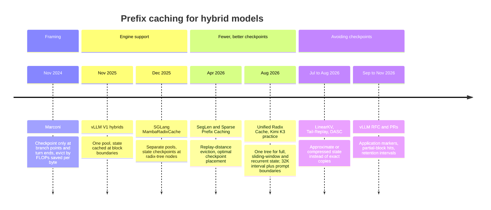
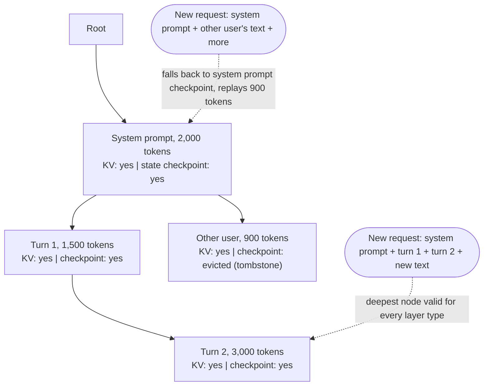

---
tags:
  - ai-ml
  - inference
  - kv-cache
  - prefix-caching
  - hybrid-models
  - serving
status: draft
sources:
  - https://arxiv.org/abs/2411.19379
  - https://docs.vllm.ai/en/latest/design/hybrid_kv_cache_manager/
  - https://github.com/vllm-project/vllm/blob/main/vllm/config/cache.py
  - https://github.com/vllm-project/vllm/issues/40696
  - https://github.com/vllm-project/vllm/pull/46384
  - https://github.com/vllm-project/vllm/pull/45845
  - https://discuss.vllm.ai/t/rfc-pr-stack-application-directed-prefix-checkpoints-for-hybrid-gdn-mamba-up-to-7-6x-speedup-on-l40s/2949
  - https://pytorch.org/blog/hybrid-models-as-first-class-citizens-in-vllm/
  - https://pytorch.org/blog/hybrid-models-meet-sglang-more-than-full-attention/
  - https://www.lmsys.org/blog/2026-08-11-unified-radix-cache
  - https://abdelfattah-lab.github.io/blogs/seglen/
  - https://arxiv.org/abs/2605.05219
  - https://arxiv.org/abs/2608.30310
  - https://arxiv.org/abs/2608.30386
  - https://arxiv.org/abs/2608.11231
  - https://arxiv.org/abs/2610.15755
  - https://newsletter.semianalysis.com/p/kimi-k3-the-manos-the-mythos-the
created: 2026-11-28
updated: 2026-11-28
---

## Table Of Contents

---

- [[#TL;DR|TL;DR]]
- [[#The Problem|The Problem]]
- [[#Foundations|Foundations]]
    - [[#Prefix Caching in One Paragraph|Prefix Caching in One Paragraph]]
    - [[#Why a Recurrent State Cannot Be Rolled Back|Why a Recurrent State Cannot Be Rolled Back]]
    - [[#One Checkpoint Weighs Hundreds of Tokens|One Checkpoint Weighs Hundreds of Tokens]]
- [[#How We Got Here|How We Got Here]]
- [[#How It Works|How It Works]]
    - [[#The Checkpoint Trade-off|The Checkpoint Trade-off]]
    - [[#A Worked Example|A Worked Example]]
    - [[#Where to Put Checkpoints|Where to Put Checkpoints]]
    - [[#What to Evict|What to Evict]]
    - [[#Matching Across Layer Types|Matching Across Layer Types]]
    - [[#Getting By With Fewer Checkpoints|Getting By With Fewer Checkpoints]]
- [[#Where It Is Now|Where It Is Now]]
    - [[#vLLM|vLLM]]
    - [[#SGLang|SGLang]]
    - [[#What Production Models Do|What Production Models Do]]
    - [[#Research Directions|Research Directions]]
- [[#Trade-offs & Open Problems|Trade-offs & Open Problems]]
- [[#Resources|Resources]]
- [[#Related Notes|Related Notes]]

## ***TL;DR***
---
*Prefix caching skips prefill for text a server has already seen. In a hybrid model, the attention layers can reuse a prefix of any length, but the recurrent layers can only resume from a saved snapshot of their state, so the whole design question becomes which snapshots ("checkpoints") to save, where, and for how long.*

- **The catch:** a [[KV Cache]] stores one entry per token, so any prefix of a cached sequence is reusable. A linear-attention or [[State Space Models|SSM]] layer keeps one fixed-size state that is overwritten in place, so a prefix is reusable only if a copy of the state was saved at exactly that position ([Marconi, MLSys 2025](https://arxiv.org/abs/2411.19379)).
- **The cost:** one state checkpoint across all recurrent layers weighs as much as hundreds of tokens of attention KV (worked example below: about 768 tokens), so checkpointing every block can use more memory than the KV cache it sits beside. In Marconi's measurements, 25.0% of KV blocks were reused but only 0.4% of block-level SSM states.
- **The levers:** where to checkpoint (block boundaries, branch points in a prefix tree, prompt and turn boundaries, positions the application marks), what to evict (recency, FLOPs saved per byte, replay distance, session hints), and how to need fewer checkpoints (compress them, or approximately rebuild the state from a short tail of tokens).
- **Where it is now (Nov 2026):** vLLM caches recurrent state only at block boundaries ("align" mode), which forces attention blocks of 500 or more tokens and misses short prefixes; partial-block hits and sparser retention are open PRs. SGLang's Unified Radix Cache (Aug 2026) keeps full-attention KV, sliding-window KV and recurrent checkpoints in one tree with session-aware eviction. Kimi K3 in vLLM checkpoints about every 32K tokens plus at prompt boundaries ([SemiAnalysis, Aug 2026](https://newsletter.semianalysis.com/p/kimi-k3-the-manos-the-mythos-the)).

## ***The Problem***
---
*Hybrid models were adopted to make long contexts cheap, and long-context workloads (agents, multi-turn chat, coding) are exactly where prefix caching pays most. The recurrent layers that make hybrids cheap are also what make their prefixes hard to reuse.*

[[Hybrid Attention|Hybrid models]] such as Qwen3.5, Qwen3-Next, Kimi Linear and K3, Nemotron 3 and Granite 4.0 replace most attention layers with linear-attention or Mamba layers. Those layers carry the sequence in a fixed-size state instead of a growing cache. Serving engines, meanwhile, were built around [[PagedAttention|paged per-token KV blocks]], and their prefix caches assume that "the first $m$ tokens match" means "the first $m$ tokens' cache can be reused".

| Assumption behind classic prefix caching | What breaks in a hybrid |
|---|---|
| The cache is indexed by token, so any matched prefix length is usable. | Recurrent layers hold one state for the whole sequence so far. A matched prefix of length $m$ is usable only if a state was saved at position $m$. |
| Cached entries are small (one token's keys and values). | A recurrent state is 10 to 100 times larger than one token's KV per layer ([Marconi](https://arxiv.org/abs/2411.19379)). |
| Saving more cache entries costs memory in proportion to tokens. | Saving more states costs memory in proportion to the *number of checkpoints*, which a naive policy ties to length again. |
| Block size is a free tuning knob (16 to 64 tokens). | Engines that share one memory pool must make an attention block as big as a recurrent state, which pushes blocks to hundreds of tokens and coarsens every hit ([vLLM docs](https://docs.vllm.ai/en/latest/design/hybrid_kv_cache_manager/)). |

The result is that a hybrid model can have a high *token* match rate and a near-zero *usable* hit rate. SemiAnalysis put the consequence bluntly for Kimi K3: caching a state at every token would make memory "regress to growing with sequence length, defeating the purpose of using linear attention", so in practice the model does "not consume a constant amount of KV cache memory" ([SemiAnalysis, Aug 2026](https://newsletter.semianalysis.com/p/kimi-k3-the-manos-the-mythos-the)).

## ***Foundations***
---
*Three facts carry the topic: how prefix caching finds and reuses cached work, why a recurrent state cannot represent any position but the one it was saved at, and how large that state is compared with a token's keys and values.*

#### **Prefix Caching in One Paragraph**
When a request arrives, the server checks whether its prompt starts with tokens it has already processed (a system prompt, tool definitions, earlier turns of a chat). If so, it reuses the cached keys and values for that prefix and runs prefill only on the new suffix. vLLM finds matches by hashing each full block of tokens together with its parent's hash; SGLang walks a radix tree of cached token spans. Both evict least recently used entries when memory runs short. The details are in [[PagedAttention#Prefix Caching on Top of Paging|PagedAttention]] and the fleet-level picture (tiers, cache-aware routing) is in [[LLM Serving#Prefix Caching and Cache-Aware Routing|LLM Serving]].

#### **Why a Recurrent State Cannot Be Rolled Back**
A linear-attention or SSM layer updates its state once per token:

$$
S_t = f(S_{t-1}, x_t)
$$

**In plain words:** the state after token $t$ is computed from the state after token $t-1$ and the new token. Nothing else about earlier tokens is kept.

That has two consequences ([Marconi](https://arxiv.org/abs/2411.19379); [SGLang team, Dec 2025](https://pytorch.org/blog/hybrid-models-meet-sglang-more-than-full-attention/)):
- **No rollback.** The update overwrites $S_{t-1}$, and gated or decaying updates (Mamba, Gated DeltaNet, KDA) are not invertible in practice. Once a request has advanced to token 10,000, its state cannot be turned back into the state at token 4,000.
- **All or nothing.** For the attention layers, a 4,000-token match is worth 4,000 tokens of saved work. For the recurrent layers it is worth nothing unless a copy of $S_{4000}$ was saved, or the nearest earlier copy, from which the gap must be recomputed.

So the unit of reuse for a hybrid is the **checkpoint**: a saved copy of every recurrent layer's state (plus, for Mamba, its small convolution state) at one position. A hit can land only where every layer type can resume.

#### **One Checkpoint Weighs Hundreds of Tokens**
A Gated DeltaNet or linear-attention head keeps a $d_k \times d_v$ matrix, and a Mamba-2 layer keeps a state of $d_{\text{inner}} \times N$ values. With head dimensions of 128, one layer's state is hundreds of kilobytes to megabytes, while one token's KV in a full-attention layer with grouped-query attention is a few kilobytes. Marconi measured SSM states at 10 to 100 times one token's KV per layer, and a 7B hybrid holding one 10K-token sequence used 17.4 GB in its setup, 3.3 times a same-size Transformer, once block-level checkpoints were kept ([Marconi](https://arxiv.org/abs/2411.19379)). A September 2026 vLLM RFC gives about 512 KB per recurrent layer for Qwen3.5-35B-A3B, enough that the engine can afford only "1 or 2 discrete state checkpoints" per sequence ([vLLM forum](https://discuss.vllm.ai/t/rfc-pr-stack-application-directed-prefix-checkpoints-for-hybrid-gdn-mamba-up-to-7-6x-speedup-on-l40s/2949)).

## ***How We Got Here***
---
*Hybrids shipped in 2024 to 2025 without working prefix caches. Marconi framed the problem as admission and eviction of checkpoints; engines then shipped block-boundary checkpointing; 2026 work is about placing fewer, better checkpoints or avoiding them.*

| When | Development | Problem it addressed | Source |
|---|---|---|---|
| Nov 2024 (MLSys 2025) | **Marconi** (Princeton and AWS, with Tri Dao): speculative insertion decides which states to admit; eviction weighs recency against FLOPs saved per byte | Block-level checkpoints fill memory with states that are almost never hit | [Pan et al.](https://arxiv.org/abs/2411.19379) |
| Nov 2025 | **vLLM V1** makes hybrids first-class: one allocator for KV blocks and Mamba state, attention blocks grown until a page holds a state (672 tokens for Nemotron-Nano-12B-v2) | Running hybrids at all in a paged engine | [vLLM team](https://pytorch.org/blog/hybrid-models-as-first-class-citizens-in-vllm/) |
| Dec 2025 | **SGLang MambaRadixCache**: separate Mamba and KV pools, checkpoints forked into the radix tree, two LRU lists | Prefix reuse with per-request (not per-token) recurrent state | [SGLang team](https://pytorch.org/blog/hybrid-models-meet-sglang-more-than-full-attention/) |
| Apr 2026 | **SegLen** (Cornell): eviction by replay distance to the nearest valid ancestor; **Sparse Prefix Caching**: checkpoint placement as a dynamic program | Marconi's FLOP estimates are model-specific; fixed intervals waste checkpoints | [Qiao et al.](https://abdelfattah-lab.github.io/blogs/seglen/); [Shirokikh & Nikolenko](https://arxiv.org/abs/2605.05219) |
| Jul to Aug 2026 | **LinearKV, Tail-Replay** (TeleAI): rebuild recurrent state approximately; **DASC** (Meituan and ECNU): compress stored checkpoints | Exact checkpoints are big and land only where they were saved | [LinearKV](https://arxiv.org/abs/2608.11231); [Tail-Replay](https://arxiv.org/abs/2608.30310); [DASC](https://arxiv.org/abs/2608.30386) |
| Aug 2026 | **Unified Radix Cache** (SGLang): one tree, per-layer-type validity rules, session-aware eviction | Models mixing three state types (full, sliding-window, recurrent) | [LMSYS](https://www.lmsys.org/blog/2026-08-11-unified-radix-cache) |
| Sep to Nov 2026 | **vLLM**: application-directed checkpoint markers (RFC), partial-block hits via `prefix_match_unit`, retention intervals for Mamba (open PRs) | Block-boundary-only checkpoints miss prompts shorter than a block and branch points inside blocks | [RFC](https://discuss.vllm.ai/t/rfc-pr-stack-application-directed-prefix-checkpoints-for-hybrid-gdn-mamba-up-to-7-6x-speedup-on-l40s/2949); [PR #46384](https://github.com/vllm-project/vllm/pull/46384); [PR #45845](https://github.com/vllm-project/vllm/pull/45845) |

## ***How It Works***
---
*Every design trades checkpoint memory against recomputation. The two decisions are where to save states (admission) and which to drop (eviction); matching then picks the deepest position that every layer type can resume from.*

#### **The Checkpoint Trade-off**
Suppose a sequence of $n$ tokens keeps a recurrent checkpoint every $c$ tokens, each checkpoint weighing $S$ bytes across all recurrent layers. Then:

$$
M_{\text{ckpt}}(c) = \left\lceil \frac{n}{c} \right\rceil S, \qquad \mathbb{E}[\text{tokens recomputed on a hit}] \approx \frac{c}{2}
$$

**In plain words:** checkpointing more often costs memory in proportion to how many checkpoints you keep; checkpointing less often means that a new request whose shared prefix ends at a random point has to recompute, on average, half an interval of tokens through the recurrent layers from the nearest earlier checkpoint. (The usable hit falls back to that checkpoint for the whole model, not only the recurrent layers: the layers are interleaved, so recomputing a recurrent layer over the gap needs the hidden states produced by the layers below it.)

The $c/2$ figure assumes match points land uniformly. Real workloads are not uniform: in multi-turn chat and agents most matches end exactly at the previous turn's boundary. That is why *placement* (saving at the right positions) beats *density* (saving often), and why every serious design below checkpoints at turn or branch boundaries rather than on a grid.

Marconi adds a value argument. A checkpoint at depth $L$ saves the compute of $L$ tokens but costs a fixed $S$ bytes, while a KV block's size grows with the tokens it saves. For their 7B hybrid ($D = 4096$, $N = 128$), FLOPs saved per byte stored are roughly $L + 8192$ for attention and $200L$ for SSM layers. A deep recurrent checkpoint is therefore worth far more per byte than a shallow one of identical size, which recency-only (LRU) and size-only policies cannot see ([Marconi, Table 1](https://arxiv.org/abs/2411.19379)).

#### **A Worked Example**
An illustrative 40-layer hybrid in a 3:1 pattern, shaped like Qwen3-Next-style models (these dimensions are assumptions for the arithmetic, not a specific model card):
- 30 Gated DeltaNet layers, each with 16 heads of $128 \times 128$ state in BF16: $16 \times 128 \times 128 \times 2$ bytes $= 512$ KiB per layer, in line with the per-layer figure in the vLLM RFC.
- 10 full-attention layers with 2 KV heads of dimension 256: $2\ (\text{K and V}) \times 2 \times 256 \times 2$ bytes $= 2$ KiB per token per layer.

| Quantity | Calculation | Result |
|---|---|---|
| Attention KV per token | $10 \times 2$ KiB | 20 KiB |
| One recurrent checkpoint $S$ | $30 \times 512$ KiB | 15 MiB |
| Tokens of KV equal to one checkpoint | $15\ \text{MiB} / 20\ \text{KiB}$ | 768 tokens |
| KV for a 100K-token agent transcript | $100{,}000 \times 20$ KiB | 1.91 GiB |
| Same transcript in a 40-layer full-attention model | $100{,}000 \times 40 \times 2$ KiB | 7.63 GiB |

Now vary the checkpoint interval for that 100K-token transcript:

| Interval $c$ | Checkpoints | Checkpoint memory | Expected recompute at a random match point |
|---|---|---|---|
| 512 tokens (block-level) | 196 | 2.87 GiB, more than the KV itself | ~256 tokens |
| 4,096 tokens | 25 | 375 MiB | ~2,048 tokens |
| 32,768 tokens | 4 | 60 MiB | ~16,384 tokens |
| 32,768 tokens + one per turn boundary (say 20 turns) | 24 | 360 MiB | 0 when the next turn starts at a boundary |

Block-level checkpointing still beats the full-attention model on total memory (1.91 + 2.87 = 4.78 GiB against 7.63 GiB), but it gives away most of what the hybrid saved. The last row is the shape most production systems converged on: a sparse safety-net interval plus checkpoints exactly where reuse is likely.

#### **Where to Put Checkpoints**
| Strategy | Where states are saved | Who uses it | Strength | Weakness |
|---|---|---|---|---|
| Block boundary | Every position that is a multiple of the block size, at the end of a scheduler step | vLLM "align" mode ([source](https://github.com/vllm-project/vllm/blob/main/vllm/config/cache.py)) | Simple; reuses paged-block hashing | Dense, memory-hungry; hits only on block boundaries; prompts shorter than a block never hit ([issue #40696](https://github.com/vllm-project/vllm/issues/40696)) |
| Branch points and last decoded token | Where a new request would split a radix-tree node (shared system prompts), and at the end of each response (conversation history) | Marconi ([Pan et al.](https://arxiv.org/abs/2411.19379)); SGLang's trees | Saves states only where reuse is evidenced | A shared prefix pays off only from its third occurrence; needs a two-pass prefill or chunk-boundary trick to land on the exact position |
| Interval plus prompt boundary | Every $c$ tokens, plus at the end of each prompt | Kimi K3 in vLLM, $c \approx$ 32K ([SemiAnalysis](https://newsletter.semianalysis.com/p/kimi-k3-the-manos-the-mythos-the)); vLLM retention-interval PR ([#45845](https://github.com/vllm-project/vllm/pull/45845)) | Bounded memory, catches agent turns | Mid-prompt branch points cost up to one interval of recompute |
| Distribution-aware | Positions chosen by an exact $O(NM)$ dynamic program over the observed distribution of overlap depths | Sparse Prefix Caching ([Shirokikh & Nikolenko](https://arxiv.org/abs/2605.05219)) | Matches block caching with substantially fewer checkpoints; best at low budgets | Needs a stable overlap distribution |
| Application-directed | Where the client puts a `<|mamba_checkpoint|>` marker (end of system prompt, after an image) | vLLM RFC, open PRs ([forum](https://discuss.vllm.ai/t/rfc-pr-stack-application-directed-prefix-checkpoints-for-hybrid-gdn-mamba-up-to-7-6x-speedup-on-l40s/2949)) | The application knows its boundaries; batches many consumers behind one producer | API change; only helps clients that use it |

Two implementation details recur. Mamba-2 and chunked linear-attention kernels compute states at chunk boundaries anyway, so saving one there is nearly free; Marconi saves the second-to-last chunk boundary for this reason. And a matched checkpoint is **copied** into the request's private state slot before it is updated, because the shared copy must stay valid for the next request ([SGLang team](https://pytorch.org/blog/hybrid-models-meet-sglang-more-than-full-attention/); [LMSYS](https://www.lmsys.org/blog/2026-08-11-unified-radix-cache)).

#### **What to Evict**
| Policy | Score | Used in | Evidence |
|---|---|---|---|
| LRU | Last access time | Default in vLLM and SGLang | Baseline |
| FLOP-aware | $S(n) = \text{recency}(n) + \alpha \cdot \text{FLOPs saved per byte}(n)$, both normalized; $\alpha$ tuned by replaying early requests | Marconi | 19.0% to 219.7% higher hit rate than LRU; up to 34.4x token hit rate over a block-level baseline on SWE-bench traces ([Pan et al.](https://arxiv.org/abs/2411.19379)) |
| Replay distance | Recency plus tokens back to the nearest ancestor with a valid state (a model-agnostic stand-in for FLOPs) | SegLen, SGLang PR | Qwen3.5-9B on SWE-bench: mean TTFT 2,108 ms to 1,027 ms (51.3% lower), hit rate 0.33 to 0.42; no gain on low-reuse ShareGPT ([Qiao et al.](https://abdelfattah-lab.github.io/blogs/seglen/)) |
| Superseded-state demotion | A request's previous checkpoint ($t-1$) stays as a rollback fallback; older ones ($t-2$ and earlier) move to a lower-priority tier | vLLM, on by default with Mamba prefix caching | Design doc, no figures ([vLLM docs](https://docs.vllm.ai/en/latest/design/hybrid_kv_cache_manager/)) |
| Session-aware | Clients tag requests with a `session_id`; referenced entries are evicted last but not pinned | SGLang Unified Radix Cache | Qwen3.5-397B-A17B device hit ratio about 5% to 34% at batch 32 ([LMSYS](https://www.lmsys.org/blog/2026-08-11-unified-radix-cache)) |

A subtlety SegLen found when porting Marconi into SGLang: once a node's recurrent state is evicted, it becomes a **tombstone** (its KV may remain, its state does not), so the real recompute distance can be far longer than the tree's shape suggests. KV and recurrent state also evict differently: KV must be evicted from leaves toward the root (a child's KV is useless without its parent's), while a state checkpoint can be dropped from any node ([SGLang team](https://pytorch.org/blog/hybrid-models-meet-sglang-more-than-full-attention/)).

#### **Matching Across Layer Types**
A hit length is valid only if every layer type can resume there. SGLang's Unified Radix Cache walks the full-attention path of the tree and accepts the deepest node that every component validates: full attention needs all of the prefix's KV, sliding-window attention needs only the last window of KV, and recurrent layers need a checkpoint at that node ([LMSYS](https://www.lmsys.org/blog/2026-08-11-unified-radix-cache)). vLLM's coordinator does the same by lowering the candidate hit length until all cache groups cover it ([PR #46384](https://github.com/vllm-project/vllm/pull/46384)).

The second request matches 2,900 tokens of KV but only 2,000 tokens of recurrent state, so its usable hit is 2,000 tokens and the 900-token gap is recomputed through the model. Avoiding exactly this recompute is what Tail-Replay's cached hidden states are for (below).

#### **Getting By With Fewer Checkpoints**
Three 2026 lines of work cut the checkpoint bill instead of placing checkpoints better:

- **Compress the checkpoint (DASC).** Different heads (Gated DeltaNet) or channels (KDA) forget at different rates, and the rate can be read from the model's decay parameters. DASC stores only long-memory units in persistent checkpoints and zero-fills the rest on reuse (or replays a short suffix to refresh them). On Kimi-Linear-48B-A3B in SGLang: 2.63x smaller checkpoints with quality close to full caching, 42.6% lower mean TTFT and 68.4% higher input throughput at a fixed state budget ([Yu et al., Aug 2026](https://arxiv.org/abs/2608.30386)).
- **Rebuild the state from a tail (Tail-Replay).** Cache the full-attention KV and full-attention output hidden states per token, then on a hit start each recurrent group from a zero state and run it over only the last 5% to 10% of the matched prefix. Because gated updates fade old inputs, the approximate state is close: Qwen3.6-27B kept 96% to 99.9% of full-prefill scores on LongBench and RULER, with 14.3x lower TTFT at a 32K match; OLMo-Hybrid-7B lost more (about 93%). Reuse can land on any token, with no checkpoints at all ([Liu et al., Aug 2026](https://arxiv.org/abs/2608.30310)). The cost is that the result is no longer exact.
- **Position-independent reuse (LinearKV).** For retrieved chunks reused at different positions (RAG), the same group showed that initializing each recurrent layer from one cached chunk state and repairing a few tokens works as well as composing exact states on Gated DeltaNet models and much better on Mamba-2 ([Liu et al., Jul 2026](https://arxiv.org/abs/2608.11231)).

## ***Where It Is Now***
---
*As of November 2026, both major open engines serve hybrid models with prefix caching, but neither treats it as finished. SGLang has the more complete design for mixed state types; vLLM's block-boundary approach is being loosened through open PRs, and approximate methods are research-only.*

#### **vLLM**
- **Mode.** `mamba_cache_mode` is `"none"` or `"align"`; with prefix caching on, align caches "the mamba state of the last token of each scheduler step ... when the token is at position i * block_size" ([CacheConfig source](https://github.com/vllm-project/vllm/blob/main/vllm/config/cache.py)).
- **Coarse blocks.** To share one page size, attention blocks grow until they hold a recurrent state, which "can lead to more than 400 block_size" ([vLLM docs](https://docs.vllm.ai/en/latest/design/hybrid_kv_cache_manager/)). A vLLM issue reports 528-token blocks for Qwen3.5, a 0% hit rate for prompts under 528 tokens, and QPS falling from 200 to under 100 when prompts crossed below the boundary; a maintainer called it "a limitation of current vllm hybrid model prefix caching design" ([issue #40696](https://github.com/vllm-project/vllm/issues/40696)).
- **Limits.** Prefix caching handles exactly two cache groups and requires one to be full attention; the doc says the feature "is still in its early stage" (page dated Nov 26, 2026).
- **In review (Nov 2026).** A partial-hit PR decouples match granularity (`prefix_match_unit`) from block size and uses copy-on-write for partial blocks; on Qwen3.5-35B-A3B-FP8 a 10,200-token follow-up request after a 10,000-token one fell from 0.134 s to 0.096 s, while a reviewer noted that shared boundaries *inside* a request still have no checkpoint ([PR #46384](https://github.com/vllm-project/vllm/pull/46384)). A second PR keeps one Mamba state per retention interval instead of per block; its author reports block-level snapshots taking about 80% of KV blocks at block size 128 in a test setting ([PR #45845](https://github.com/vllm-project/vllm/pull/45845)). The application-directed checkpoint RFC reports a 7.58x kernel-level speedup for 1 producer and 16 consumers on an L40S, not an end-to-end serving number.

#### **SGLang**
- **Unified Radix Cache (Aug 11, 2026).** One token-keyed tree with FULL, SWA and MAMBA components; DeepSeek-V4 uses FULL + SWA, Kimi K3 uses FULL + MAMBA, Inkling all three. Session-aware eviction raised Qwen3.5-397B-A17B's device hit ratio from about 5% to 34% and cut its TTFT 13.5% to 16.6% at batch 32 to 64 against LRU ([LMSYS](https://www.lmsys.org/blog/2026-08-11-unified-radix-cache)).
- **Tiers.** With host and storage tiers (HiCache), Inkling-Small kept a 96.8% hit rate in multi-turn tests.
- **Speculative decoding.** ReplaySSM replays accepted tokens through the recurrence instead of snapshotting a state per draft position, the same idea as checkpoint-plus-replay applied to rollback (see [[Hybrid Attention#Kernels and Serving|Hybrid Attention]] and [[Speculative Decoding]]).

#### **What Production Models Do**
Moonshot's guidance for Kimi K3 in vLLM is to checkpoint KDA state about every 32K tokens and additionally at prompt boundaries, because an agent's next turn usually starts where the last prompt ended ([SemiAnalysis, Aug 2026](https://newsletter.semianalysis.com/p/kimi-k3-the-manos-the-mythos-the)). That is the worked example's last row in practice. Cache size for hybrid deployments is therefore not constant per request, a point capacity planners copying full-attention rules of thumb tend to miss.

#### **Research Directions**
| Direction | Representative work | Status |
|---|---|---|
| Admission and eviction of exact checkpoints | Marconi, SegLen, Sparse Prefix Caching | Policies in papers and SGLang PRs; not default anywhere |
| Smaller exact-ish checkpoints | DASC (2.63x) | Implemented in SGLang by the authors (paper) |
| Approximate state reconstruction | Tail-Replay, LinearKV | Quality depends on the recurrence (Gated DeltaNet tolerates it better than Mamba-2) |
| Memory organization | Kang: shared paging vs native dual pools in modified vLLM; checkpoint availability limited joint reuse, and longer producer-side retention raised reusable depth at a fixed page budget ([Oct 2026](https://arxiv.org/abs/2610.15755)) | Neither layout wins uniformly; single-author study |

## ***Trade-offs & Open Problems***
---
*Every design moves cost between checkpoint memory, recomputation and exactness. The open problems are about knowing where reuse will happen and about trusting approximate states.*

| Choice | Gain | Cost |
|---|---|---|
| Dense checkpoints (every block) | Fine-grained hits, simple | Checkpoints can outweigh the KV cache; most are never hit (0.4% reuse in Marconi's block-32 baseline) |
| Sparse checkpoints (interval) | Bounded memory | Up to one interval of recompute on mid-prompt matches |
| Boundary checkpoints (turns, branches, markers) | Hits exactly where agents and chat reuse | Needs evidence of reuse (Marconi: third occurrence) or client cooperation |
| Value-aware eviction | Keeps deep, expensive prefixes | Model-specific FLOP models (Marconi) or heuristics (SegLen) |
| One shared pool (vLLM) | No fixed split between KV and state memory | Huge attention blocks, coarse hits, padding |
| Separate pools (SGLang) | Natural block sizes per type | The split must be tuned or made elastic |
| Compression or tail replay | Far fewer bytes, token-level reuse | Approximate; quality loss varies by model and task |

Open problems:
- **Predicting reuse points.** Engines see tokens, not conversation structure. Session IDs, checkpoint markers and prompt-boundary rules are all ways of having the application say where reuse will happen; none is standard across APIs.
- **Exactness.** Tail-Replay and DASC's zero-fill change the model's outputs slightly. Whether that is acceptable for long agent runs, where small errors compound, has not been measured at production scale, and Kang flags retained-state continuation correctness as unresolved.
- **Three or more layer types.** vLLM's manager supports two cache groups; models like Inkling mix full, sliding-window and recurrent layers, which only SGLang's unified tree covers today.
- **Interaction with other features.** Disaggregation must ship checkpoints between machines (see [[Prefill-Decode Disaggregation]]), [[Speculative Decoding]] needs rollback, and [[Quantization|quantized]] states change checkpoint size and drift; each adds its own copy and validity rules.
- **Isolation.** A shared checkpoint, like shared KV, is cross-request state; tenant scoping applies to recurrent checkpoints as much as to KV blocks.

## ***Resources***
---
*Start with Marconi for the framing and the FLOPs-per-byte argument, then the SGLang Unified Radix Cache post for a working design. The vLLM docs and PRs show the block-boundary approach and its limits; Tail-Replay and DASC show where research is pushing.*

**Papers**
- [Marconi: Prefix Caching for the Era of Hybrid LLMs](https://arxiv.org/abs/2411.19379): Pan, Wang, Jia, Karakus, Zancato, Wang, Dao, Netravali (Princeton, AWS), Nov 2024 (MLSys 2025).
- [Sparse Prefix Caching for Hybrid and Recurrent LLM Serving](https://arxiv.org/abs/2605.05219): Shirokikh & Nikolenko, Apr 2026.
- [LinearKV: One Cached State Suffices for Position-Independent Caching in Hybrid LLMs](https://arxiv.org/abs/2608.11231): Liu et al. (TeleAI), Jul 2026.
- [Tail-Replay: Escaping the Curse of Linear Attention in Prefix Caching for Hybrid LLMs](https://arxiv.org/abs/2608.30310): Liu, Qi, Wu, Liu, Chen (TeleAI), Aug 2026.
- [DASC: Decay-Aware State Compression for Hybrid Linear-Attention Serving](https://arxiv.org/abs/2608.30386): Yu et al. (ECNU, Meituan), Aug 2026.
- [Native Dual Pools or Shared Paging? Memory Organization for Concurrent Hybrid LLM Serving](https://arxiv.org/abs/2610.15755): Kang, Oct 2026.

**Engine docs, posts and code**
- [vLLM: Hybrid KV Cache Manager](https://docs.vllm.ai/en/latest/design/hybrid_kv_cache_manager/): page-size unification, block-boundary state caching, superseded-state demotion.
- [vLLM `CacheConfig` source](https://github.com/vllm-project/vllm/blob/main/vllm/config/cache.py): `mamba_cache_mode`, `mamba_block_size`, `prefix_match_unit`.
- [Hybrid Models as First-Class Citizens in vLLM](https://pytorch.org/blog/hybrid-models-as-first-class-citizens-in-vllm/): vLLM team, Nov 2025.
- [Hybrid Models Meet SGLang: More than Full Attention](https://pytorch.org/blog/hybrid-models-meet-sglang-more-than-full-attention/): SGLang team, Dec 2025. MambaRadixCache and elastic pools.
- [Unified Radix Cache](https://www.lmsys.org/blog/2026-08-11-unified-radix-cache): Huang, Bao, Zhang, Ouyang, Pan (LMSYS), Aug 2026.
- [Rethinking Prefix Caching for Hybrid LLMs (SegLen)](https://abdelfattah-lab.github.io/blogs/seglen/): Qiao, Zhou, Chang, Abdelfattah (Cornell), Apr 2026.
- vLLM [issue #40696](https://github.com/vllm-project/vllm/issues/40696) (short prompts never hit), [PR #46384](https://github.com/vllm-project/vllm/pull/46384) (partial-block hits), [PR #45845](https://github.com/vllm-project/vllm/pull/45845) (retention interval), [application-directed checkpoints RFC](https://discuss.vllm.ai/t/rfc-pr-stack-application-directed-prefix-checkpoints-for-hybrid-gdn-mamba-up-to-7-6x-speedup-on-l40s/2949) (Sep 2026).

**Analysis**
- [Kimi K3, The Manos, The Mythos, The Legendos](https://newsletter.semianalysis.com/p/kimi-k3-the-manos-the-mythos-the): SemiAnalysis, Aug 2026. "KDA Prefix Cache Management" section.

## Related Notes

- [[KV Cache]] — The per-token cache that hybrids shrink; prefix caching for full attention starts there.
- [[PagedAttention]] — Block tables, hashed prefix caching and the hybrid KV cache manager this note builds on.
- [[Hybrid Attention]] — The linear-attention layers (Gated DeltaNet, KDA) whose state must be checkpointed.
- [[State Space Models]] — Mamba and Mamba-2, the other source of fixed-size recurrent state.
- [[LLM Serving]] — Prefix caching, cache-aware routing and tiers across a fleet.
- [[Prefill-Decode Disaggregation]] — Shipping KV blocks and recurrent state between machines.
- [[Speculative Decoding]] — The same rollback problem, solved with per-draft state slots or replay.
- [[Sparse Attention]] — Sliding-window layers, the third state type a unified cache must validate.
- [[Long Context]] — The long agent transcripts where hybrid prefix reuse matters most.
- [[Context Engineering and Agent Memory]] — Prompt layouts that put reusable content at stable boundaries (planned note).
- [[Quantization]] — Lower-precision recurrent state shrinks checkpoints but is precision-sensitive.
