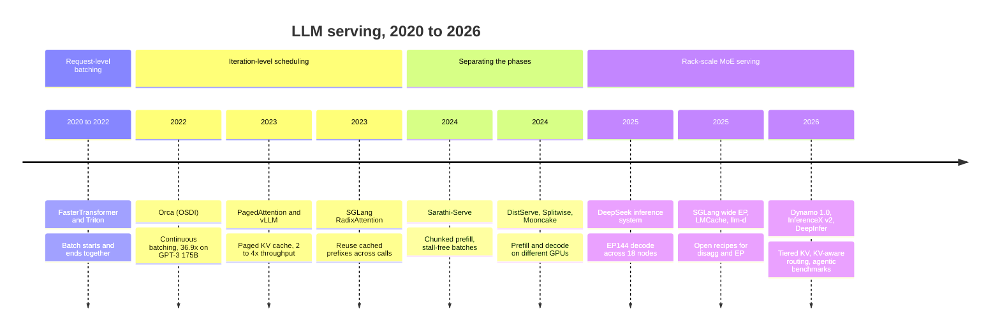
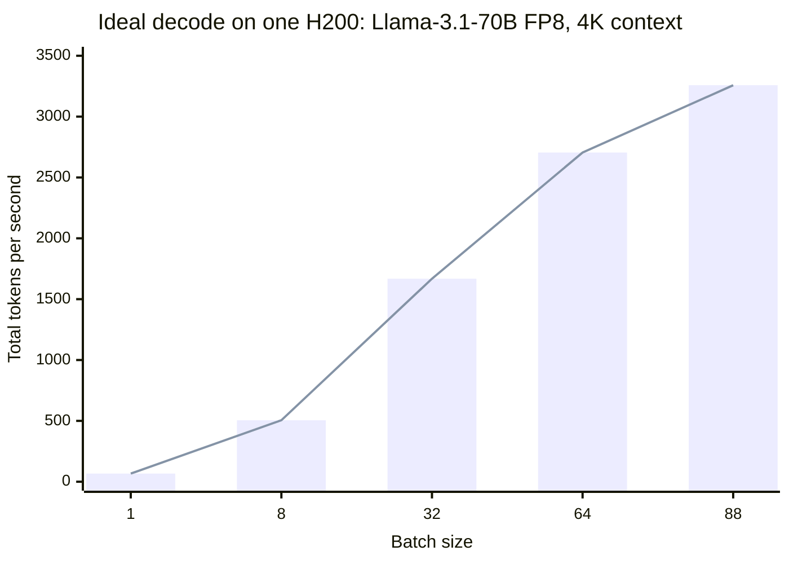
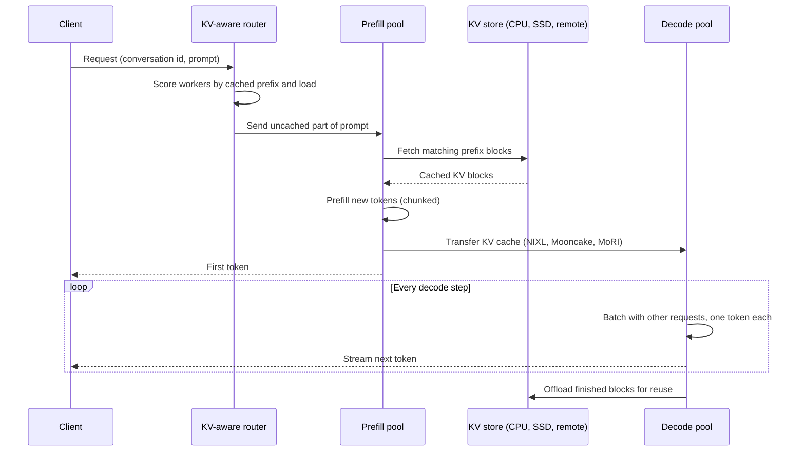

---
tags:
  - ai-ml
  - inference
  - serving
  - batching
  - disaggregation
status: draft
sources:
  - https://www.usenix.org/conference/osdi22/presentation/yu
  - https://arxiv.org/abs/2309.06180
  - https://arxiv.org/abs/2312.07104
  - https://arxiv.org/abs/2311.18677
  - https://arxiv.org/abs/2401.09670
  - https://arxiv.org/abs/2403.02310
  - https://arxiv.org/abs/2407.00079
  - https://arxiv.org/abs/2407.21783
  - https://arxiv.org/abs/2510.09665
  - https://jax-ml.github.io/scaling-book/inference/
  - https://www.nvidia.com/en-us/data-center/h200/
  - https://github.com/deepseek-ai/open-infra-index/blob/main/202502OpenSourceWeek/day_6_one_more_thing_deepseekV3R1_inference_system_overview.md
  - https://lmsys.org/blog/2025-05-05-large-scale-ep/
  - https://www.lmsys.org/blog/2026-10-24-dsv41-deepinfer
  - https://vllm.ai/blog/2026-10-23-deepseek-v41-flash-pd-wide-ep
  - https://vllm.ai/blog/2026-11-12-deepseek-v41-flash-vera-rubin
  - https://developer.nvidia.com/blog/nvidia-dynamo-1-production-ready/
  - https://www.cncf.io/blog/2026/03/24/welcome-llm-d-to-the-cncf-evolving-kubernetes-into-sota-ai-infrastructure/
  - https://huggingface.co/docs/text-generation-inference/en/index.md
  - https://inferencex.semianalysis.com/about
  - https://inferencex.semianalysis.com/blog/inferencex-v2-nvidia-blackwell-vs-amd-vs-hopper
  - https://epoch.ai/data-insights/llm-inference-price-trends
  - https://epoch.ai/publications/the-plunging-price-of-thought
  - https://lecompute.fr/en/runtimes/kv-cache-objet-central-serving/
created: 2026-11-26
updated: 2026-11-28
---

## Table Of Contents

---

- [[#TL;DR|TL;DR]]
- [[#The Problem|The Problem]]
- [[#Foundations|Foundations]]
    - [[#Two Phases, Two Bottlenecks|Two Phases, Two Bottlenecks]]
    - [[#Compute-Bound vs Memory-Bound|Compute-Bound vs Memory-Bound]]
    - [[#Latency Metrics|Latency Metrics]]
    - [[#Throughput, Goodput and SLOs|Throughput, Goodput and SLOs]]
    - [[#Batching Is the Main Lever|Batching Is the Main Lever]]
- [[#How We Got Here|How We Got Here]]
- [[#How It Works|How It Works]]
    - [[#The Scheduling Loop|The Scheduling Loop]]
    - [[#The Decode Step Equation|The Decode Step Equation]]
    - [[#A Worked Example|A Worked Example]]
    - [[#Chunked Prefill|Chunked Prefill]]
    - [[#Prefix Caching and Cache-Aware Routing|Prefix Caching and Cache-Aware Routing]]
    - [[#Disaggregated Serving|Disaggregated Serving]]
    - [[#Wide Expert Parallelism for MoE|Wide Expert Parallelism for MoE]]
    - [[#Speculative Decoding in the Scheduler|Speculative Decoding in the Scheduler]]
- [[#Where It Is Now|Where It Is Now]]
    - [[#The Engines|The Engines]]
    - [[#Disaggregation Plus Wide EP Is the Production Default|Disaggregation Plus Wide EP Is the Production Default]]
    - [[#Reported Throughput at Scale|Reported Throughput at Scale]]
    - [[#Benchmarks Moved to Agentic Workloads|Benchmarks Moved to Agentic Workloads]]
    - [[#What It Did to Prices|What It Did to Prices]]
- [[#Trade-offs & Open Problems|Trade-offs & Open Problems]]
- [[#Resources|Resources]]
- [[#Related Notes|Related Notes]]

## ***TL;DR***
---
*An LLM server's job is to turn a stream of independent user requests into tokens as cheaply as possible without making anyone wait too long. Because generating each token is limited by memory bandwidth rather than math, the whole field is about packing more requests into each forward pass and keeping the two phases of a request, prompt processing and token generation, from getting in each other's way.*

- **The core tension:** decoding reads all the weights for every step whether one request or a hundred are in the batch, so bigger batches give almost free throughput. But bigger batches slow every user down, and a long new prompt can freeze everyone else's stream. Serving systems manage that trade against latency targets (SLOs).
- **The lineage:** request-level batching (FasterTransformer) gave way to iteration-level "continuous" batching ([Orca, OSDI 2022](https://www.usenix.org/conference/osdi22/presentation/yu): 36.9x throughput on GPT-3 175B), then paged cache memory ([[PagedAttention]], vLLM 2023), chunked prefill ([Sarathi-Serve, 2024](https://arxiv.org/abs/2403.02310)), prefix caching (SGLang), and finally splitting prefill and decode onto different GPUs ([DistServe](https://arxiv.org/abs/2401.09670), [Splitwise](https://arxiv.org/abs/2311.18677), Mooncake).
- **The cost model in one line:** a decode step takes about (weight bytes + cache bytes) / memory bandwidth. Each step yields one token per request, so throughput is batch size over step time, and memory capacity for [[KV Cache|caches]] usually caps the batch before compute does.
- **Where it is now (Nov 2026):** production serving of large [[Mixture of Experts]] models is disaggregated prefill/decode plus wide expert parallelism across rack-scale NVLink domains, with KV-aware routing and tiered cache storage. vLLM reports 954K tokens/s per GPU (counting cached input) for DeepSeek-V4.1-Flash on one GB300 NVL72 rack at 196 tokens/s per user ([vLLM, Oct 2026](https://vllm.ai/blog/2026-10-23-deepseek-v41-flash-pd-wide-ep)). DeepSeek open-sourced its own engine, DeepInfer, in October 2026; Hugging Face's TGI is in maintenance mode; SemiAnalysis's open InferenceX benchmark (formerly InferenceMAX) now measures agentic, cache-heavy traffic.

## ***The Problem***
---
*Serving is a scheduling problem under two hard limits: GPU memory, which caps how many conversations can be in flight, and memory bandwidth, which caps how fast each step runs. A naive server wastes most of the chip; a good one gets tens of times more tokens out of the same hardware.*

Requests arrive at random times with prompts from a few tokens to hundreds of thousands, and nobody knows in advance how long each answer will be. Each request then needs hundreds or thousands of sequential forward passes. Three naive designs fail in different ways:

| Naive design | What goes wrong |
|---|---|
| One request at a time | Each decode step streams every weight from memory to produce one token; the arithmetic units sit idle. Throughput is a small fraction of what the chip can do. |
| Fixed batches that start and end together | Short requests finish early but cannot leave; new requests wait for the whole batch to drain ([Orca](https://www.usenix.org/conference/osdi22/presentation/yu)). Memory is reserved for the longest possible answer. |
| Mix new prompts and ongoing generation freely | A long prompt's prefill takes one huge step, and every user who is mid-answer sees their stream freeze for that step ([Sarathi-Serve](https://arxiv.org/abs/2403.02310)). |

The measure of success is not peak tokens per second but tokens per second per GPU *while* meeting a time-to-first-token and a time-per-token target, because that is what sets the price per million tokens a provider can charge.

## ***Foundations***
---
*Five ideas carry the topic: a request runs in two phases that stress different parts of the chip, a job is either compute-bound or memory-bound, users feel latency through a few specific metrics, throughput only counts when it meets latency targets, and batching is the knob that trades one for the other.*

#### **Two Phases, Two Bottlenecks**
Every request is served in two phases ([Sarathi-Serve](https://arxiv.org/abs/2403.02310); [Splitwise](https://arxiv.org/abs/2311.18677)). The cost model behind them is in [[7 - All About Transformer Inference (NOT DONE)|How to Scale Your Model, ch. 7]] and the [[KV Cache#Prefill vs Decode|KV Cache]] note; here is what matters for a scheduler.

| | Prefill | Decode |
|---|---|---|
| Work | The whole prompt in one forward pass; writes the [[KV Cache]] | One token per request per forward pass; reads the weights and the whole cache |
| Bound by | Compute: thousands of tokens share each weight read | Memory bandwidth: each weight read serves only the requests in the batch |
| Duration of one step | Long, roughly proportional to prompt length | Short and roughly constant |
| What batching does | Little: one long prompt already fills the chip | Almost everything: more requests per weight read means more tokens per second |
| User-facing metric | Time to first token | Time between later tokens |

Splitwise's measurements put it plainly: prompt computation is compute-intensive, token generation is memory-intensive, and "the token generation phase underutilizes compute resources" even with state-of-the-art batching ([Patel et al., 2023](https://arxiv.org/abs/2311.18677)).

#### **Compute-Bound vs Memory-Bound**
A chip can do a fixed number of FLOPs per byte it reads from memory. A job that does more FLOPs per byte than that ratio is compute-bound; one that does fewer is memory-bound, and its arithmetic units wait for data. The dividing line is the chip's roofline ridge point (see [[1 - All About Rooflines (NOT DONE)|Rooflines]]). An H200 does 1,979 dense FP8 TFLOP/s (3,958 with sparsity) against 4.8 TB/s of HBM bandwidth ([NVIDIA](https://www.nvidia.com/en-us/data-center/h200/)), so its ridge is about **412 FLOPs per byte**.

A decode step at batch size $B$ does about $2B$ FLOPs per weight it reads (one multiply and one add per request). With 1-byte FP8 weights it needs $B \approx 206$ before the weight matrices alone become compute-bound. Real batches are often smaller, and every request also brings its own cache to read, so decode nearly always sits on the memory-bound side of the roofline ([How to Scale Your Model, ch. 7](https://jax-ml.github.io/scaling-book/inference/)).

#### **Latency Metrics**
| Metric | Definition | What drives it |
|---|---|---|
| TTFT (time to first token) | Arrival to first output token | Queueing plus prefill of the uncached part of the prompt |
| TPOT (time per output token) | Average gap between output tokens after the first | Decode step time, which grows with batch size |
| ITL (inter-token latency) | Each individual gap; its tail (P90, P99) exposes stalls | Decode step time, plus any prefill that blocks a decode step |
| End-to-end latency | Arrival to last token | TTFT + TPOT x (output tokens - 1) |

Benchmarks often report **interactivity** in tokens/s per user, which is about 1/ITL ([InferenceX](https://inferencex.semianalysis.com/about)). Chat cares about TTFT and interactivity; agents, which make many calls in a row, care about end-to-end latency and cost.

#### **Throughput, Goodput and SLOs**
Throughput is total tokens per second across all requests, and it sets cost per token. But throughput can be bought by making everyone wait. DistServe's answer is **goodput**: the maximum request rate per GPU that can be served while staying within both a TTFT and a TPOT service-level objective (SLO), for a target share of requests such as over 90% ([Zhong et al., 2024](https://arxiv.org/abs/2401.09670)). A late token is a token the user did not want, so goodput is what a product actually sells.

#### **Batching Is the Main Lever**
During decode the weights are read once per step whatever the batch size, so adding a request costs only its own cache reads and a little compute. Per-user speed falls slowly while total throughput rises almost linearly, until memory runs out (the caches no longer fit) or the step becomes compute-bound. Almost every system below is a way to keep the batch large without breaking latency targets: admit requests sooner, waste less memory, stop prefills from stalling decodes, skip work already done, or move the two phases apart.

## ***How We Got Here***
---
*Each step fixed the bottleneck the previous one exposed: request-level batching wasted the GPU, iteration-level batching wasted memory, paging fixed memory but let prefills stall decodes, chunking and disaggregation fixed the stalls, and giant MoE models then forced serving across whole racks.*

| Year | What changed | Problem it answered | Source |
|---|---|---|---|
| 2022 | **Iteration-level scheduling**: the scheduler runs one model iteration at a time, so finished requests leave and new ones join after every step. **Selective batching** batches the matrix multiplies but runs attention per request, since requests have different lengths. 36.9x throughput over FasterTransformer at the same latency on GPT-3 175B. | Request-level batches held finished requests and blocked new ones. | [Orca (Yu et al.)](https://www.usenix.org/conference/osdi22/presentation/yu) |
| 2023 | **PagedAttention**: KV cache in fixed-size blocks with a block table. Memory used for real tokens rose from 20.4% to 38.2% in earlier systems to 96.3%; 2 to 4x throughput over FasterTransformer and Orca. | Continuous batching creates, grows and frees caches constantly, which fragments contiguous memory. See [[PagedAttention]]. | [Kwon et al.](https://arxiv.org/abs/2309.06180) |
| 2023 | **RadixAttention**: keep finished requests' caches in a prefix tree and reuse the longest match; up to 6.4x throughput. | Recomputing shared system prompts, few-shot examples and chat history. | [Zheng et al.](https://arxiv.org/abs/2312.07104) |
| 2023 to 2024 | **Phase splitting on separate machines** with state transfer over the cluster's fast interconnect: 1.4x throughput at 20% lower cost, or 2.35x throughput at the same cost and power. | Decode does not need the newest GPU's compute; one machine type wastes money on one of the phases. | [Splitwise (Patel et al.)](https://arxiv.org/abs/2311.18677) |
| 2024 | **Disaggregation for goodput**: prefill and decode on different GPUs with separately chosen parallelism; 7.4x more requests or 12.6x tighter SLOs. | Colocated phases interfere and must share one parallelism plan. | [DistServe (Zhong et al.)](https://arxiv.org/abs/2401.09670) |
| 2024 | **Chunked prefill and stall-free batching**: split prompts into near-equal chunks and add them to batches without pausing ongoing decodes. 2.6x capacity for Mistral-7B on one A100 and up to 3.7x for Yi-34B on two A100s vs vLLM; up to 5.6x for Falcon-180B with pipeline parallelism. | Long prefills froze decodes, forcing a choice between throughput and tail latency. | [Sarathi-Serve (Agrawal et al.)](https://arxiv.org/abs/2403.02310) |
| 2024 | **KV-cache-centric disaggregation** (Kimi's Mooncake): a cluster-wide cache pool in spare CPU memory and SSD, scheduled around cache locality; 75% more requests for Kimi. | Cache confined to one GPU's memory; no reuse across machines. | [Qin et al.](https://arxiv.org/abs/2407.00079) |
| 2025 | **Cross-node expert parallelism in production**: DeepSeek serves V3/R1 with prefill at EP32 over 4 nodes and decode at EP144 over 18 nodes, overlapping communication with compute. | 8 of 256 experts per token means tiny per-expert batches unless the global batch is huge. | [DeepSeek, Feb 2025](https://github.com/deepseek-ai/open-infra-index/blob/main/202502OpenSourceWeek/day_6_one_more_thing_deepseekV3R1_inference_system_overview.md) |
| 2025 | **Open wide-EP recipes and a shared KV layer**: SGLang reproduces DeepSeek-style serving on 96 H100s; LMCache moves caches out of vLLM and SGLang for reuse and P/D transfer (up to 15x throughput). llm-d launches in May 2025. | Only a few labs could run disaggregated MoE serving. | [LMSYS](https://lmsys.org/blog/2025-05-05-large-scale-ep/), [LMCache](https://arxiv.org/abs/2510.09665), [CNCF](https://www.cncf.io/blog/2026/03/24/welcome-llm-d-to-the-cncf-evolving-kubernetes-into-sota-ai-infrastructure/) |
| 2026 | **Infrastructure layer matures**: Dynamo 1.0 (tiered KV, KV-aware router), llm-d joins the CNCF, InferenceX v2 benchmarks disagg + wide EP, DeepSeek open-sources DeepInfer. | Agentic workloads with long shared prefixes and million-token contexts. | See [[#Where It Is Now\|Where It Is Now]] |

## ***How It Works***
---
*A modern server is a loop: every step the scheduler picks which requests run, how many prompt tokens to mix in, and where their cache blocks live. One equation for the decode step explains most of its choices; chunking, prefix caching, disaggregation and expert parallelism are each a way of keeping that equation favorable.*

#### **The Scheduling Loop**
Each iteration of a continuous-batching engine (vLLM, SGLang, TensorRT-LLM) does roughly this:

1. **Retire** requests that emitted an end token or hit their length limit; free their cache blocks or keep them in the prefix cache.
2. **Admit** waiting requests while free cache blocks and the token budget allow, checking the prefix cache first so matched tokens skip prefill.
3. **Fill the token budget:** one token for each running decode, then chunks of pending prompts up to a fixed budget per step.
4. **Preempt** if memory runs out: swap a request's blocks to CPU memory or drop them and recompute later (see [[PagedAttention#When Memory Runs Out|PagedAttention]]).
5. **Run one forward pass** over this mixed batch, sample, stream tokens out, repeat.

The CPU work in steps 1 to 4 is not free. SGLang has overlapped it with the GPU since v0.4 (December 2024), preparing step N+1 on the CPU while the GPU runs step N ([LMSYS, Oct 2026](https://www.lmsys.org/blog/2026-10-24-dsv41-deepinfer)). At rack scale it matters more: vLLM found an unoptimized 32-GPU decode instance ran slower than a 16-GPU one (17.57 vs 13.84 ms per step) because of CPU overhead and straggling ranks ([vLLM, Oct 2026](https://vllm.ai/blog/2026-10-23-deepseek-v41-flash-pd-wide-ep)).

#### **The Decode Step Equation**
For a batch of $B$ requests each holding about $S$ tokens of context:

$$
t_{\text{step}}(B) \approx \max\!\left(\frac{W + B \cdot S \cdot k}{\text{BW}},\ \frac{2 N_{\text{active}} B + F_{\text{attn}}(B,S)}{\text{FLOP/s}}\right)
$$

*In plain English: a decode step takes whichever is longer, the time to stream the weights ($W$ bytes) plus every request's cache ($k$ bytes per token) out of memory, or the time to do the math (about 2 FLOPs per active parameter per request, plus attention). Each step emits one token per request, so throughput is $B / t_{\text{step}}$ and each user sees one token every $t_{\text{step}}$.*

Two consequences fall out directly ([How to Scale Your Model, ch. 7](https://jax-ml.github.io/scaling-book/inference/)):
- **Small batches ride free.** While $B \cdot S \cdot k \ll W$, adding requests barely changes $t_{\text{step}}$, so throughput grows almost linearly with $B$.
- **The cache term caps the gain.** Each extra request adds $S \cdot k$ bytes to read but only $2N_{\text{active}}$ FLOPs, so at long context the batch can stay memory-bound however large it grows, and memory capacity rather than compute sets the limit. Shrinking $k$ with [[Quantization]], GQA, MLA, [[Sparse Attention]] or [[Hybrid Attention]] is therefore a direct throughput lever. DeepSeek-V4.1-Flash stores only 890 bytes of global KV cache per token, and vLLM reports that for it "KV capacity rarely limits batch size" ([vLLM](https://vllm.ai/blog/2026-10-23-deepseek-v41-flash-pd-wide-ep)).

For a [[Mixture of Experts]] model, $N_{\text{active}}$ is small but $W$ is all the experts. With few requests per GPU, each expert sees a tiny batch and the step reads weights that serve almost no one; that is the case for [[#Wide Expert Parallelism for MoE|wide expert parallelism]].

#### **A Worked Example**
Serve a Llama-3.1-70B-shaped model in FP8 on one H200 (141 GB HBM3e, 4.8 TB/s, 1,979 dense FP8 TFLOP/s per [NVIDIA](https://www.nvidia.com/en-us/data-center/h200/)). Shape from the [Llama 3 paper](https://arxiv.org/abs/2407.21783): 80 layers, 8 KV heads, head size 128.

- **Weights:** 70.6B parameters x 1 byte = **70.6 GB**.
- **Cache per token** (FP8): $2 \times 80 \times 8 \times 128 \times 1 = 163{,}840$ bytes (160 KiB), as in the [[KV Cache#A Worked Example|KV Cache]] note but at 1 byte. A request holding 4,096 tokens of context needs **0.67 GB**.
- **Room for caches:** assume about 60 GB is left after weights and working memory, which fits about **88 requests** at 4K context.

Plug into the equation (ideal: peak bandwidth, no overheads, all requests at 4K context):

| Batch $B$ | Bytes read per step | Step time (memory) | Step time (compute) | Per-user speed | Total throughput |
|---|---|---|---|---|---|
| 1 | 71.3 GB | 14.8 ms | 0.08 ms | 67 tok/s | 67 tok/s |
| 8 | 76.0 GB | 15.8 ms | 0.6 ms | 63 tok/s | 505 tok/s |
| 32 | 92.1 GB | 19.2 ms | 2.5 ms | 52 tok/s | 1,668 tok/s |
| 64 | 113.5 GB | 23.7 ms | 4.9 ms | 42 tok/s | 2,705 tok/s |
| 88 | 129.7 GB | 27.0 ms | 6.8 ms | 37 tok/s | 3,258 tok/s |

Going from 1 to 88 requests multiplies throughput by about **49x** while each user slows by about **1.8x**. The compute column never catches up: each added request brings 141 GFLOPs of work but 0.67 GB of cache, about 210 FLOPs per byte, under the H200's ridge of about 412. This deployment is capped by memory capacity, not FLOPs. Real engines reach only part of peak bandwidth, so real numbers are lower; the shape is the point.

What the table leaves out is what the rest of this section handles: an 8,000-token prompt arriving mid-stream (its prefill would freeze all 88 decodes for one long step), requests that share prefixes, and models too big for one GPU.

#### **Chunked Prefill**
Sarathi-Serve splits each prompt into near-equal chunks and gives every step a fixed **token budget**: all running decodes first, then as many prefill tokens as fit. New requests join "without pausing ongoing decodes", so step times stay uniform and inter-token latency stays bounded ([Agrawal et al., 2024](https://arxiv.org/abs/2403.02310)). A side benefit is that the decode tokens ride along in a compute-heavy step, using FLOPs that were idle anyway.

The budget is the main knob. A small budget keeps every step short (low ITL) but stretches prompts across more steps (higher TTFT); a large budget does the reverse. Chunking also makes pipeline parallelism work better, because uniform steps leave fewer pipeline bubbles, which is where Sarathi-Serve's 5.6x on Falcon-180B came from.

#### **Prefix Caching and Cache-Aware Routing**
Much of a prompt has been seen before: the system prompt, tool definitions, the earlier turns of a chat, an agent's growing transcript. Prefix caching keeps finished requests' cache blocks and skips prefill for the longest matching prefix (vLLM hashes blocks; SGLang keeps a radix tree; details in [[PagedAttention#Prefix Caching on Top of Paging|PagedAttention]] and [[KV Cache#Paging and Prefix Sharing|KV Cache]]). Hybrid models need recurrent-state checkpoints on top of this; see [[Prefix Caching for Hybrid Models]]. By 2026 it is on by default in vLLM, SGLang, TensorRT-LLM and Dynamo ([LeCompute, Aug 2026](https://lecompute.fr/en/runtimes/kv-cache-objet-central-serving/)).

Two things make it work at fleet scale:
- **Tiers.** Hot blocks stay in HBM, colder ones move to CPU memory, local SSD or shared storage and are fetched back on a hit. LMCache does this across vLLM and SGLang and reports up to 15x throughput on multi-round QA and document analysis; it also found that context truncation, common in industry, can cut the prefix hit ratio by half ([Liu et al., 2025](https://arxiv.org/abs/2510.09665)). DeepSeek reported that 56.3% of its 608B daily input tokens hit an on-disk KV cache ([DeepSeek, Feb 2025](https://github.com/deepseek-ai/open-infra-index/blob/main/202502OpenSourceWeek/day_6_one_more_thing_deepseekV3R1_inference_system_overview.md)).
- **Routing.** A cache only helps if the next turn lands on the machine that holds it. KV-aware routers score each worker by its cached prefix overlap and its load; NVIDIA reports up to 4x lower TTFT on agentic workloads with Dynamo's router ([NVIDIA, Mar 2026](https://developer.nvidia.com/blog/nvidia-dynamo-1-production-ready/)). SemiAnalysis warns that without conversation-aware routing "prefix-cache reuse collapses" and a benchmark measures routing scatter instead of the engine ([InferenceX](https://inferencex.semianalysis.com/about)).

#### **Disaggregated Serving**
Chunking makes the two phases share a GPU politely; disaggregation stops them sharing at all. Prefill runs on one pool, decode on another, and the KV cache is shipped between them over NVLink or RDMA. Each pool gets its own parallelism and size: DistServe chooses them to maximize goodput under given TTFT and TPOT targets ([Zhong et al.](https://arxiv.org/abs/2401.09670)), and Splitwise even uses different hardware per phase ([Patel et al.](https://arxiv.org/abs/2311.18677)).

The price is the transfer: a long prompt's cache can be gigabytes, so disaggregation needs fast interconnect and a transfer library (NVIDIA's NIXL is used by vLLM, SGLang, TensorRT-LLM and llm-d per [NVIDIA](https://developer.nvidia.com/blog/nvidia-dynamo-1-production-ready/); SGLang also supports Mooncake and AMD's MoRI per [LMSYS](https://www.lmsys.org/blog/2026-10-24-dsv41-deepinfer)). It pays off most when prompts are long and latency targets are tight; on a single small node, chunked prefill is often enough. Pool sizing, transfer costs and when it hurts are in [[Prefill-Decode Disaggregation]].

#### **Wide Expert Parallelism for MoE**
DeepSeek-V3 activates 8 of 256 experts per layer, so a batch of 64 requests gives each expert about 2 tokens: decode would read every expert's weights to do almost no work. DeepSeek's fix is to spread experts across many GPUs (expert parallelism, EP) while replicating attention (data parallelism, DP), so that the global batch is huge but each GPU holds and reads only a few experts ([DeepSeek, Feb 2025](https://github.com/deepseek-ai/open-infra-index/blob/main/202502OpenSourceWeek/day_6_one_more_thing_deepseekV3R1_inference_system_overview.md)):

| Phase | Layout | Experts per GPU |
|---|---|---|
| Prefill | Routed experts EP32, attention and shared expert DP32, 4 nodes | 9 routed + 1 shared |
| Decode | Routed experts EP144, attention and shared expert DP144, 18 nodes | 2 routed + 1 shared |

Three problems come with it. **Communication**: every MoE layer needs an all-to-all dispatch and combine, hidden by splitting the batch into two micro-batches that alternate compute and communication. **Expert imbalance**: some experts are hot, so an expert-parallel load balancer (EPLB) places redundant copies of them. In vLLM's 2026 runs, EPLB raised balancedness (mean over max load) from 0.35 to 0.94 ([vLLM](https://vllm.ai/blog/2026-10-23-deepseek-v41-flash-pd-wide-ep)). **DP imbalance**: one rank with longer prompts stalls all the others at every layer, so prefill and decode each need their own load balancer.

Wide EP has diminishing returns. Going from 4 to 32 GPUs per decode instance cut vLLM's MoE time per step from 13.4 to 6.0 ms, but the remaining work stayed around 10 ms ([vLLM](https://vllm.ai/blog/2026-10-23-deepseek-v41-flash-pd-wide-ep)). Large NVLink domains (GB200/GB300 NVL72) make the all-to-all cheap enough that "large scale up domains ... absolutely dominate in total throughput per GPU" in SemiAnalysis's tests ([InferenceX v2, Feb 2026](https://inferencex.semianalysis.com/blog/inferencex-v2-nvidia-blackwell-vs-amd-vs-hopper)). The parallelism layouts themselves are covered in [[Mixture of Experts]], and the kernels, balancers and attention-FFN disaggregation in [[Expert Parallelism and MoE Serving]].

#### **Speculative Decoding in the Scheduler**
[[Speculative Decoding]] has a draft model or extra heads propose several tokens that the target model verifies in one pass, so one weight read yields more than one token per request. In a server it interacts with batching: at large batch the step is already efficient, so verifying extra tokens costs real compute, and engines tune draft length by load. It is now standard in production MoE serving. DeepSeek-V4.1-Flash ships a draft model (DSpark); in SGLang's benchmark of DeepSeek's decode setup, 3 draft tokens per step gave 3.25 accepted tokens per step ([LMSYS, Oct 2026](https://www.lmsys.org/blog/2026-10-24-dsv41-deepinfer)). The draft has its own experts, so EPLB must balance both models ([vLLM](https://vllm.ai/blog/2026-10-23-deepseek-v41-flash-pd-wide-ep)).

## ***Where It Is Now***
---
*As of November 2026 two open engines, vLLM and SGLang, dominate open serving, NVIDIA's TensorRT-LLM and Dynamo lead on its own hardware, and Kubernetes-native layers such as llm-d handle routing and scaling. Large MoE models are served disaggregated with wide expert parallelism on rack-scale systems, and benchmarks have shifted from synthetic prompts to agentic traces with heavy cache reuse.*

#### **The Engines**
| System | Role | Status and notable features (2026) | Source |
|---|---|---|---|
| vLLM | General-purpose engine | P/D disaggregation and wide EP on GB300 NVL72; within 6% of DeepSeek's own engine on decode; specialized low-latency decode path (826 tok/s for one user on four B300s). Development led by Inferact with the vLLM team. | [vLLM, Oct 2026](https://vllm.ai/blog/2026-10-23-deepseek-v41-flash-pd-wide-ep) |
| SGLang | General-purpose engine | Unified radix cache including hybrid models, HiCache host tier, shared L3 storage (3FS or Mooncake), P/D with Mooncake, NIXL or MoRI transfer, model gateway with prefix-cache routing; on par with or ahead of DeepInfer on DeepInfer's own benchmarks. | [LMSYS, Oct 2026](https://www.lmsys.org/blog/2026-10-24-dsv41-deepinfer) |
| TensorRT-LLM | NVIDIA's engine | Most mature disaggregated implementation in InferenceX v2 when run under Dynamo; serves "billions of tokens per hour" at providers such as Together AI (per SemiAnalysis). | [InferenceX v2](https://inferencex.semianalysis.com/blog/inferencex-v2-nvidia-blackwell-vs-amd-vs-hopper) |
| NVIDIA Dynamo | Orchestration over engines | 1.0 in March 2026: KV Block Manager across GPU, CPU, SSD and object storage; KV-aware router; NIXL transfer; runs vLLM, SGLang or TensorRT-LLM as backends. | [NVIDIA, Mar 2026](https://developer.nvidia.com/blog/nvidia-dynamo-1-production-ready/) |
| llm-d | Kubernetes-native layer | Launched May 2025 by Red Hat, Google Cloud, IBM Research, CoreWeave and NVIDIA; CNCF Sandbox since March 2026. Prefix-cache-aware routing via the Gateway API Inference Extension, P/D as separately scaled pods, wide EP via LeaderWorkerSet, hierarchical KV offload. | [CNCF, Mar 2026](https://www.cncf.io/blog/2026/03/24/welcome-llm-d-to-the-cncf-evolving-kubernetes-into-sota-ai-infrastructure/) |
| LMCache | KV cache layer | Offload and cross-engine transfer for vLLM and SGLang; MLSys 2026. | [Liu et al.](https://arxiv.org/abs/2510.09665) |
| DeepInfer | DeepSeek's production engine | Open-sourced October 2026 for DeepSeek-V4.1-Flash; offline engine, originally built on vLLM. Its README lists a KV cache system, P/D disaggregation and cross-replica load balancing as not included. | [vLLM](https://vllm.ai/blog/2026-10-23-deepseek-v41-flash-pd-wide-ep), [LMSYS](https://www.lmsys.org/blog/2026-10-24-dsv41-deepinfer) |
| TGI (Hugging Face) | Former general engine | In maintenance mode; Hugging Face now recommends vLLM and SGLang (and llama.cpp or MLX locally). | [HF docs](https://huggingface.co/docs/text-generation-inference/en/index.md) |

The pattern: engines compete on kernels and scheduling inside a model replica, while routing, cache tiers and autoscaling move into a separate layer (Dynamo, llm-d, SGLang's gateway) that treats engines as interchangeable backends.

#### **Disaggregation Plus Wide EP Is the Production Default**
SemiAnalysis states that disaggregated prefill with wide EP "is what is deployed in production at Frontier AI Labs like OpenAI, Anthropic, xAI, Google Deepmind, DeepSeek" and at API providers such as Together AI, Baseten and Fireworks, and has made it the focus of InferenceX ([InferenceX v2, Feb 2026](https://inferencex.semianalysis.com/blog/inferencex-v2-nvidia-blackwell-vs-amd-vs-hopper)); that is the analyst's claim, since closed labs do not publish their stacks. In its results, multi-node disaggregated serving beat single-node aggregated serving on throughput per GPU "at almost all interactivity levels" for DeepSeek R1 on NVIDIA hardware, while on AMD MI355X disaggregation only won at low interactivity because the optimizations did not yet compose well.

The 2026 open recipes show the typical shape: many small prefill instances and one wide decode instance. vLLM's GB300 setup ran N prefill instances of 2 GPUs each (DEP2) plus one 16- or 32-GPU decode instance, 34 to 64 GPUs in all. Small prefill groups suffer less from DP imbalance: when ranks fell out of step, a 4-GPU group lost 13.6% of its throughput against 5.9% for 2 GPUs ([vLLM, Oct 2026](https://vllm.ai/blog/2026-10-23-deepseek-v41-flash-pd-wide-ep)).

#### **Reported Throughput at Scale**
Numbers are per GPU or per node, from the operators' own posts; workloads and token-counting rules differ, so compare within a row, not across rows.

| Date | Deployment | Reported result | Source |
|---|---|---|---|
| Feb 2025 | DeepSeek V3/R1 service on H800, 226.75 nodes average | ~73.7k input tok/s per node in prefill (including cache hits), ~14.8k output tok/s per node in decode; 20 to 22 tok/s per user; theoretical 545% cost profit margin if all tokens were billed at R1 prices | [DeepSeek](https://github.com/deepseek-ai/open-infra-index/blob/main/202502OpenSourceWeek/day_6_one_more_thing_deepseekV3R1_inference_system_overview.md) |
| May 2025 | SGLang, DeepSeek on 96 H100s, P/D + large-scale EP | 52.3k input and 22.3k output tok/s per node | [LMSYS](https://lmsys.org/blog/2025-05-05-large-scale-ep/) |
| Mar 2026 | llm-d scheduling, Qwen3-32B on 16 H100 (8 vLLM pods) | ~120k tok/s with near-zero TTFT, vs a plain Kubernetes service that degrades under load | [CNCF](https://www.cncf.io/blog/2026/03/24/welcome-llm-d-to-the-cncf-evolving-kubernetes-into-sota-ai-infrastructure/) |
| Oct 2026 | vLLM, DeepSeek-V4.1-Flash on GB300 NVL72, P/D + wide EP, AgentX | 954K tok/s per GPU (cached + uncached input + output) at P90 196 tok/s per user; 7.9x its single-node result | [vLLM](https://vllm.ai/blog/2026-10-23-deepseek-v41-flash-pd-wide-ep) |
| Nov 2026 | vLLM, same model on Vera Rubin NVL72, AgentX | 1.7M tok/s per GPU at P90 387 tok/s per user, reported as 58x GB300 NVL72 at the same interactivity | [vLLM](https://vllm.ai/blog/2026-11-12-deepseek-v41-flash-vera-rubin) |

Hardware generations compound with software. SemiAnalysis measured GB300 NVL72 at up to 100x a strong H100 disagg + wide EP + [[Multi-Token Prediction|MTP]] baseline (comparing FP4 to FP8) and up to 65x at FP8 for both, and GB200 NVL72 at up to 55x H100 at 75 tok/s per user ([InferenceX v2](https://inferencex.semianalysis.com/blog/inferencex-v2-nvidia-blackwell-vs-amd-vs-hopper)). See [[AI Accelerators]].

#### **Benchmarks Moved to Agentic Workloads**
SemiAnalysis's **InferenceX** (formerly InferenceMAX, launched October 2025) is an open, continuously rerun benchmark across NVIDIA, AMD, Google TPU7x and AWS Trainium3 hardware and many serving stacks ([About InferenceX](https://inferencex.semianalysis.com/about)). Every data point links to the public GitHub Actions run that produced it. Its v2 (February 2026) added disaggregated wide-EP DeepSeek runs on all six recent NVIDIA SKUs and AMD's recent SKUs, about 1,000 GPUs per full run ([InferenceX v2](https://inferencex.semianalysis.com/blog/inferencex-v2-nvidia-blackwell-vs-amd-vs-hopper)).

Its newer **AgentX** scenario replays real agentic-coding session shapes: long multi-turn sessions with shared prefixes, pauses between turns and parallel subagents, with cache-busting across sessions so only genuine in-session reuse counts. It reports TTFT, ITL, end-to-end latency, prefix-cache behavior, cost per million tokens and joules per token ([About InferenceX](https://inferencex.semianalysis.com/about)). The shift matters because the older fixed-length tests used random data with prefix caching disabled, which SemiAnalysis itself calls a baseline rather than real-world traffic ([InferenceX v2](https://inferencex.semianalysis.com/blog/inferencex-v2-nvidia-blackwell-vs-amd-vs-hopper)). For agents, cache hit rate and routing now matter as much as raw decode speed.

#### **What It Did to Prices**
Serving efficiency is one of several reasons prices fall, along with smaller models and cheaper hardware. Epoch measured in March 2025 that the price to reach a fixed benchmark score fell 9x to 900x per year depending on the milestone, for example 40x per year for GPT-4-level performance on GPQA ([Epoch AI, Mar 2025](https://epoch.ai/data-insights/llm-inference-price-trends)). Its September 2026 report, which measures the full cost per task (so reasoning-token counts are included), finds the cost of a given performance level falling about 47% per quarter, or 13x per year, since 2023: 66% per quarter when a level is new, slowing to 32% per quarter two years later ([Epoch AI, Sep 2026](https://epoch.ai/publications/the-plunging-price-of-thought)).

## ***Trade-offs & Open Problems***
---
*Every serving technique trades one resource for another: latency for throughput, memory for recomputation, interconnect bandwidth for phase isolation, simplicity for scale. The open problems are about agentic traffic, imbalance at scale, and benchmarks that reflect it.*

| Technique | Gains | Costs |
|---|---|---|
| Larger decode batches | Near-linear throughput while memory-bound | Every user's token rate falls; caches fill memory |
| Chunked prefill | Bounded inter-token latency, fewer pipeline bubbles | Higher TTFT for long prompts; budget needs tuning per workload |
| Prefix caching and tiers | Skip prefill for repeated context | Memory and storage for cold blocks; only pays off with reuse and good routing |
| P/D disaggregation | Separate tuning of TTFT and TPOT; no interference | KV transfer bandwidth; two pools to size and balance; worse on small deployments |
| Wide expert parallelism | Big per-expert batches, fewer weights per GPU | All-to-all every layer; expert and DP imbalance; needs large NVLink domains |
| Speculative decoding | More tokens per weight read at small batch | Extra compute that competes with batching at high load |

Open problems:
- **Agentic traffic.** Agent sessions are long, bursty and pause between turns, so caches must survive minutes of idleness and requests must stick to the right worker. How long to keep a block, and in which tier, is still tuned by hand; LMCache's finding that common context truncation halves prefix hit rates shows how fragile reuse is ([Liu et al.](https://arxiv.org/abs/2510.09665)).
- **Imbalance at scale.** Wide EP synchronizes every rank every layer, so one slow rank stalls the instance; expert, DP and CPU-side imbalance all grow with world size ([vLLM](https://vllm.ai/blog/2026-10-23-deepseek-v41-flash-pd-wide-ep)).
- **Composability.** Optimizations that each work alone (FP4, disaggregation, wide EP, MTP) do not always combine well on every platform, which SemiAnalysis found to be AMD's main weakness in early 2026 ([InferenceX v2](https://inferencex.semianalysis.com/blog/inferencex-v2-nvidia-blackwell-vs-amd-vs-hopper)).
- **Vendor numbers.** Most headline results come from engine teams or hardware vendors tuning for their own posts; open, reproducible benchmarks like InferenceX help, but token-counting rules (cached input counted or not, per GPU vs per decode GPU) still make figures hard to compare.
- **New architectures.** [[Hybrid Attention]], [[Sparse Attention]] and compressed caches change what a cache block is and how prefix reuse works, so each model family needs its own cache manager and kernels; [[Long Context]] pushes prefill cost back to the top of the bill.
- **Isolation.** Shared prefix caches and batched execution are shared state across tenants; providers scope caches per account, but the side-channel risk grows as reuse grows.

## ***Resources***
---
*Read Orca, the PagedAttention paper, Sarathi-Serve and DistServe for the core ideas, then DeepSeek's one-page system overview for how it looks in production. For the late-2026 state, the vLLM and LMSYS DeepSeek-V4.1-Flash posts and SemiAnalysis's InferenceX v2 are the most concrete.*

**Papers**
- [Orca: A Distributed Serving System for Transformer-Based Generative Models](https://www.usenix.org/conference/osdi22/presentation/yu): Yu et al., OSDI 2022. Iteration-level scheduling and selective batching.
- [Efficient Memory Management for LLM Serving with PagedAttention](https://arxiv.org/abs/2309.06180): Kwon et al., SOSP 2023. vLLM.
- [SGLang](https://arxiv.org/abs/2312.07104): Zheng et al., Dec 2023. RadixAttention prefix caching.
- [Splitwise](https://arxiv.org/abs/2311.18677): Patel et al. (Microsoft), Nov 2023. Phase splitting across machine types.
- [DistServe](https://arxiv.org/abs/2401.09670): Zhong et al., OSDI 2024. Goodput and disaggregation.
- [Taming Throughput-Latency Tradeoff in LLM Inference with Sarathi-Serve](https://arxiv.org/abs/2403.02310): Agrawal et al. (Microsoft Research), Mar 2024. Chunked prefill.
- [Mooncake](https://arxiv.org/abs/2407.00079): Qin et al. (Moonshot AI), Jun 2024. KV-cache-centric disaggregation behind Kimi.
- [LMCache](https://arxiv.org/abs/2510.09665): Liu et al., Oct 2025 (MLSys 2026). KV cache layer across engines.
- [The Llama 3 Herd of Models](https://arxiv.org/abs/2407.21783): Meta, Jul 2024. Model shape used in the worked example.

**Engineering posts**
- [DeepSeek-V3/R1 Inference System Overview](https://github.com/deepseek-ai/open-infra-index/blob/main/202502OpenSourceWeek/day_6_one_more_thing_deepseekV3R1_inference_system_overview.md): DeepSeek, Feb 2025. EP layouts, load balancers, real fleet statistics.
- [Deploying DeepSeek with PD Disaggregation and Large-Scale EP on 96 H100s](https://lmsys.org/blog/2025-05-05-large-scale-ep/): LMSYS, May 2025. The first open reproduction.
- [Serving DeepSeek-V4.1-Flash at Scale](https://vllm.ai/blog/2026-10-23-deepseek-v41-flash-pd-wide-ep): Inferact and vLLM, Oct 2026. P/D + wide EP on GB300 NVL72, with a frank list of what broke at scale.
- [DeepSeek-V4.1-Flash on Vera Rubin NVL72](https://vllm.ai/blog/2026-11-12-deepseek-v41-flash-vera-rubin): vLLM, Nov 2026.
- [More Than DeepInfer: What SGLang Delivers](https://www.lmsys.org/blog/2026-10-24-dsv41-deepinfer): LMSYS, Oct 2026. What a full serving system adds beyond an engine.
- [NVIDIA Dynamo 1.0](https://developer.nvidia.com/blog/nvidia-dynamo-1-production-ready/): NVIDIA, Mar 2026. KV Block Manager, KV-aware routing, NIXL.
- [Welcome llm-d to the CNCF](https://www.cncf.io/blog/2026/03/24/welcome-llm-d-to-the-cncf-evolving-kubernetes-into-sota-ai-infrastructure/): llm-d maintainers, Mar 2026.
- [Text Generation Inference docs](https://huggingface.co/docs/text-generation-inference/en/index.md): Hugging Face. Maintenance-mode notice.

**Explainers, analysis and benchmarks**
- [How to Scale Your Model, ch. 7: All About Transformer Inference](https://jax-ml.github.io/scaling-book/inference/): Google DeepMind. The cost model behind the decode equation (also in the vault as [[7 - All About Transformer Inference (NOT DONE)|note 7]]).
- [InferenceX v2](https://inferencex.semianalysis.com/blog/inferencex-v2-nvidia-blackwell-vs-amd-vs-hopper): SemiAnalysis, Feb 2026. Disagg + wide EP across NVIDIA and AMD, with a primer on the throughput-interactivity curve.
- [About InferenceX and AgentX](https://inferencex.semianalysis.com/about): SemiAnalysis. How the agentic benchmark works and what it measures.
- [LLM inference prices have fallen rapidly but unequally across tasks](https://epoch.ai/data-insights/llm-inference-price-trends): Epoch AI, Mar 2025.
- [The plunging price of thought](https://epoch.ai/publications/the-plunging-price-of-thought): Epoch AI, Sep 2026. Cost per task at fixed performance.
- [The KV cache is no longer a side effect](https://lecompute.fr/en/runtimes/kv-cache-objet-central-serving/): LeCompute, Jul 2026 (updated Aug 2026). Survey of 2026 runtimes.

## Related Notes

- [[KV Cache]] — The per-request state that fills GPU memory and sets the batch limit; its size formula drives the decode equation.
- [[PagedAttention]] — The block-based memory manager that made continuous batching practical; prefix caching sits on top of it.
- [[Mixture of Experts]] — Why large MoE models need wide expert parallelism, and the routing and parallelism layouts in detail.
- [[Speculative Decoding]] — More tokens per weight read; how draft length interacts with batch size.
- [[Quantization]] — FP8 and FP4 weights and caches shrink the bytes each decode step must read.
- [[AI Accelerators]] — HBM bandwidth, NVLink domain size and FP4 support set the serving ceiling.
- [[Long Context]] — Long prompts make prefill and cache size dominate cost.
- [[Sparse Attention]] — Compressed sparse attention shrinks the cache and the attention work per decode step.
- [[Hybrid Attention]] — Fixed-size recurrent state removes the growing cache from most layers but complicates prefix caching.
- [[Prefix Caching for Hybrid Models]] — How engines checkpoint recurrent state so hybrid prefixes can be reused.
- [[FlashAttention]] — The fused attention kernels that serving engines run for prefill and paged decode.
- [[Top-k and Sampling Kernels]] — The GPU kernels behind the sampling step: top-k, top-p, min-p without sorting.
- [[7 - All About Transformer Inference (NOT DONE)|7 - All About Transformer Inference (NOT DONE)]] — Prefill vs decode costs and batching math, from How to Scale Your Model.
- [[1 - All About Rooflines (NOT DONE)|1 - All About Rooflines (NOT DONE)]] — Why decode is memory-bound: arithmetic intensity against the chip's roofline.
- [[Expert Parallelism and MoE Serving]] — Wide EP in depth: tokens per expert, all-to-all kernels, EPLB and attention-FFN disaggregation.
- [[Prefill-Decode Disaggregation]] — Separate prefill and decode pools: sizing, KV transfer cost and when it pays.
