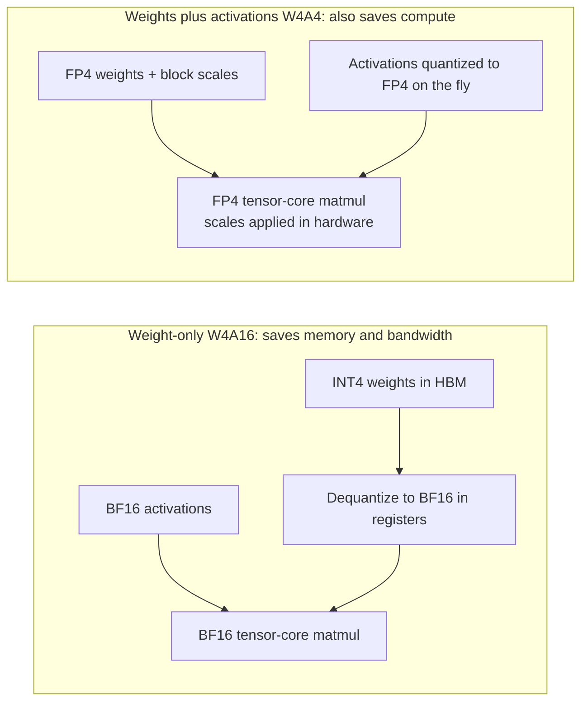
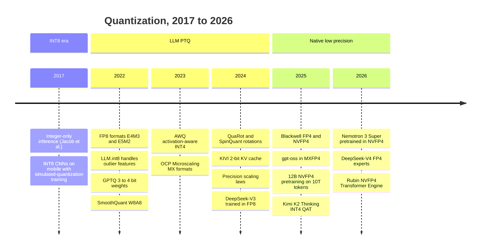
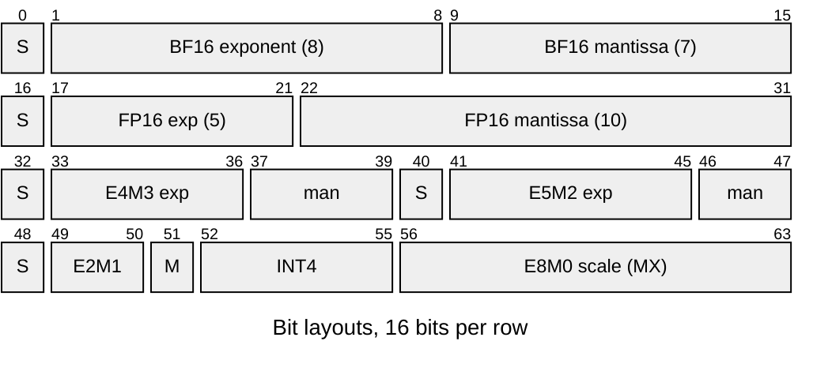

---
tags:
  - ai-ml
  - inference
  - quantization
  - number-formats
  - low-precision-training
status: draft
sources:
  - https://arxiv.org/abs/1712.05877
  - https://arxiv.org/abs/2209.05433
  - https://arxiv.org/abs/2208.07339
  - https://arxiv.org/abs/2210.17323
  - https://arxiv.org/abs/2211.10438
  - https://arxiv.org/abs/2306.00978
  - https://arxiv.org/abs/2310.10537
  - https://arxiv.org/abs/2402.02750
  - https://arxiv.org/abs/2404.00456
  - https://arxiv.org/abs/2405.16406
  - https://arxiv.org/abs/2411.04330
  - https://arxiv.org/abs/2412.19437
  - https://arxiv.org/abs/2501.02423
  - https://arxiv.org/html/2505.14669v2
  - https://arxiv.org/html/2508.10925v1
  - https://arxiv.org/abs/2509.22935
  - https://arxiv.org/html/2509.25149v2
  - https://arxiv.org/html/2610.17637
  - https://arxiv.org/pdf/2611.00301
  - https://developer.nvidia.com/blog/introducing-nvfp4-for-efficient-and-accurate-low-precision-inference
  - https://developer.nvidia.com/blog/?p=104887
  - https://developer.nvidia.com/blog/introducing-nemotron-3-super-an-open-hybrid-mamba-transformer-moe-for-agentic-reasoning
  - https://research.nvidia.com/labs/eai/blogs/pushing-intelligence-to-4-bit/
  - https://huggingface.co/moonshotai/Kimi-K2-Thinking
  - https://www.kimi.com/blog/kimi-k2-thinking
  - https://www.infoq.com/news/2025/11/kimi-k2-open-source-moe-ai
  - https://huggingface.co/blog/deepseekv4
  - https://www.amd.com/en/products/accelerators/instinct/mi350/mi355x.html
  - https://tomshardware.com/pc-components/gpus/nvidia-launches-vera-rubin-nvl72-ai-supercomputer-at-ces-promises-up-to-5x-greater-inference-performance-and-10x-lower-cost-per-token-than-blackwell-coming-2h-2026
  - https://www.nvidia.com/en-eu/data-center/technologies/rubin/
  - https://docs.vllm.ai/en/latest/features/quantization/formats/
  - https://docs.vllm.ai/en/latest/features/quantization/quantized_kvcache/
created: 2026-11-26
updated: 2026-11-26
---

## Table Of Contents

---

- [[#TL;DR|TL;DR]]
- [[#The Problem|The Problem]]
- [[#Foundations|Foundations]]
    - [[#How a Floating-Point Number Is Stored|How a Floating-Point Number Is Stored]]
    - [[#Integers, Scales and Zero Points|Integers, Scales and Zero Points]]
    - [[#Granularity From Per-Tensor to Per-Block|Granularity From Per-Tensor to Per-Block]]
    - [[#Why Outliers Are the Enemy|Why Outliers Are the Enemy]]
    - [[#Why Fewer Bits Means Faster|Why Fewer Bits Means Faster]]
- [[#How We Got Here|How We Got Here]]
- [[#How It Works|How It Works]]
    - [[#The Format Zoo|The Format Zoo]]
    - [[#Microscaling and NVFP4|Microscaling and NVFP4]]
    - [[#A Worked Example|A Worked Example]]
    - [[#Weight-Only PTQ With GPTQ and AWQ|Weight-Only PTQ With GPTQ and AWQ]]
    - [[#Weights and Activations With LLM.int8 and SmoothQuant|Weights and Activations With LLM.int8 and SmoothQuant]]
    - [[#Rotations With QuaRot and SpinQuant|Rotations With QuaRot and SpinQuant]]
    - [[#Quantizing the KV Cache|Quantizing the KV Cache]]
    - [[#Quantization-Aware Training|Quantization-Aware Training]]
    - [[#Training in Low Precision|Training in Low Precision]]
- [[#Where It Is Now|Where It Is Now]]
    - [[#Hardware Built Around FP8 and FP4|Hardware Built Around FP8 and FP4]]
    - [[#Models Released Natively in Low Precision|Models Released Natively in Low Precision]]
    - [[#Precision Scaling Laws|Precision Scaling Laws]]
    - [[#What Serving Stacks Ship|What Serving Stacks Ship]]
- [[#Trade-offs & Open Problems|Trade-offs & Open Problems]]
- [[#Resources|Resources]]
- [[#Related Notes|Related Notes]]

## ***TL;DR***
---
*Quantization stores and computes a model's numbers with fewer bits: 8 or 4 instead of 16 or 32. Because LLM decoding is limited by how fast weights stream out of memory, halving the bytes per weight roughly doubles tokens per second and halves the GPUs needed, and low-precision tensor cores add 2x to 4x more raw compute on top.*

- **What it is:** map each real number $x$ to a small code $q$ plus a shared scale $s$, so $x \approx s \cdot q$. The design space is the code format (INT8, FP8, FP4 and friends), how many numbers share one scale (a whole tensor, a channel, or a block of 16 or 32), and whether you quantize after training (PTQ) or train with it (QAT).
- **The core problem:** a few huge values (outliers) stretch the scale and crush everything else to zero. Every major method since 2022 is a way around outliers: keep them in 16-bit ([LLM.int8](https://arxiv.org/abs/2208.07339)), shift them into the weights ([SmoothQuant](https://arxiv.org/abs/2211.10438)), protect the weights they touch ([AWQ](https://arxiv.org/abs/2306.00978)), rotate them away ([QuaRot](https://arxiv.org/abs/2404.00456)), or give every 16 to 32 numbers their own scale ([MX](https://arxiv.org/abs/2310.10537), [NVFP4](https://developer.nvidia.com/blog/introducing-nvfp4-for-efficient-and-accurate-low-precision-inference)).
- **The lineage:** INT8 CNN inference (2017) → LLM.int8 and GPTQ for billion-parameter models (2022) → FP8 inference and training on Hopper (DeepSeek-V3, Dec 2024) → block-scaled FP4 on Blackwell (2025).
- **Where it is now (Nov 2026):** frontier open models ship in low precision from the lab: gpt-oss in MXFP4 (Aug 2025), Kimi K2 Thinking with INT4 QAT (Nov 2025), DeepSeek-V4 with FP4 experts and FP8 elsewhere (Apr 2026), and NVIDIA's Nemotron 3 Super *pretrained* in NVFP4 on 25T tokens (Mar 2026). FP8 is the serving baseline, 4-bit block formats are the frontier, and Rubin (volume production 2H 2026) is rated at 50 PFLOPS of NVFP4 inference per GPU.

## ***The Problem***
---
*A 70B-parameter model in 16-bit is 140 GB of weights: it does not fit on one 80 GB GPU, and every generated token must read all 140 GB from memory. Quantization attacks both the capacity problem and the bandwidth problem, but only if the model's quality survives the rounding.*

Three costs scale with bits per number:

| Cost | Why bits matter | What quantization buys |
|---|---|---|
| Memory capacity | Weights, [[KV Cache]] and activations must fit in HBM | 2x (8-bit) to about 3.5x (4-bit with scales) more model or more cache per GPU |
| Memory bandwidth | Decode reads every weight once per step, so it is bandwidth-bound | Fewer bytes per step means proportionally faster tokens at small batch |
| Compute | Tensor cores do more low-bit multiplies per cycle | FP8 is 2x BF16 and FP4 is 4x BF16 peak on Blackwell and MI355X ([NVIDIA](https://developer.nvidia.com/blog/?p=104887), [AMD](https://www.amd.com/en/products/accelerators/instinct/mi350/mi355x.html)) |

The catch is accuracy. An 8-bit integer has 256 levels and a 4-bit one has 16; FP4 E2M1 has only the magnitudes 0, 0.5, 1, 1.5, 2, 3, 4 and 6. Naively rounding a big model to that grid used to wreck it: direct-casting LLaMA-7B to MXFP4 raised WikiText perplexity from 9.488 to 27.201 ([Rouhani et al., 2023](https://arxiv.org/abs/2310.10537)). The field's job has been to make such grids work, first for inference, then for training.

## ***Foundations***
---
*Five ideas make every quantization paper readable: how a float spends its bits, how a scale and zero point map reals to integers, how many numbers share a scale, why outliers ruin a shared scale, and why bytes, not FLOPs, set decode speed.*

#### **How a Floating-Point Number Is Stored**

A float is a sign bit $S$, $e$ exponent bits $E$ and $m$ mantissa bits $M$ ("ExMy" names the split):

$$
x = (-1)^S \cdot 2^{\,E - \text{bias}} \cdot \left(1 + \frac{M}{2^{m}}\right)
$$

*In plain English: the exponent picks a power of two (the range) and the mantissa picks a point between that power and the next (the precision). More exponent bits reach bigger and smaller numbers; more mantissa bits space the points more finely. With few bits you must choose.*

- **BF16 vs FP16:** both are 16 bits. BF16 keeps FP32's 8 exponent bits (same range, 7 mantissa bits); FP16 has 5 exponent bits (max 65504) and 10 mantissa bits. BF16 rarely overflows, which is why it became the default training format.
- **FP8 comes in two flavours:** E4M3 (more precision, max 448) and E5M2 (more range, max 57344). E4M3 drops infinities and keeps a single NaN pattern to stretch its range ([Micikevicius et al., 2022](https://arxiv.org/abs/2209.05433)).
- **FP4 E2M1:** sign, 2 exponent bits, 1 mantissa bit. It can only say ±{0, 0.5, 1, 1.5, 2, 3, 4, 6}, so it is useless without a scale ([NVIDIA, Jun 2025](https://developer.nvidia.com/blog/introducing-nvfp4-for-efficient-and-accurate-low-precision-inference)).

Exponent bits matter slightly more than mantissa bits for low-precision LLM training, per a 2025 scaling study that fits the best exponent/mantissa split for each bit width ([Sun et al., 2025](https://arxiv.org/abs/2501.02423)).

#### **Integers, Scales and Zero Points**

An integer format is evenly spaced, so it needs an external scale $s$ to say what one step is worth. **Symmetric** quantization centres the grid on zero:

$$
q = \mathrm{clip}\!\left(\mathrm{round}\!\left(\frac{x}{s}\right),\, -q_{\max},\, q_{\max}\right),
\qquad
s = \frac{\max_i |x_i|}{q_{\max}},
\qquad
\hat{x} = s \cdot q
$$

*In plain English: find the largest magnitude in the group, make that the top of the grid ($q_{\max} = 127$ for INT8, 7 for INT4), divide everything by the step size and round. To read a number back ("dequantize"), multiply by the step size again. The rounding is the only lossy step.*

**Asymmetric** quantization adds a zero point $z$ so the grid covers $[x_{\min}, x_{\max}]$ instead of $[-\max|x|, \max|x|]$:

$$
\hat{x} = s\,(q - z), \qquad s = \frac{x_{\max} - x_{\min}}{2^{b} - 1}, \qquad z = \mathrm{round}\!\left(-\frac{x_{\min}}{s}\right)
$$

*In plain English: if the data is lopsided (say all positive, like post-ReLU activations), shift the grid so none of its levels are wasted on values that never occur. The cost is one more stored number per group and an extra subtraction.*

Floating-point codes (FP8, FP4) are symmetric by construction, so modern block formats use a scale only. The integer convention from mobile inference, where both real and integer zero line up exactly, comes from [Jacob et al. (2017)](https://arxiv.org/abs/1712.05877).

#### **Granularity From Per-Tensor to Per-Block**

How many numbers share one scale is the biggest lever on accuracy:

| Granularity | One scale per | Scale overhead | Typical use |
|---|---|---|---|
| Per-tensor | Whole matrix | Negligible | FP8 activations and KV cache with calibration ([vLLM](https://docs.vllm.ai/en/latest/features/quantization/quantized_kvcache/)) |
| Per-channel / per-token | Each output row of $W$, or each token row of $X$ | Small | INT8 weights; LLM.int8's "vector-wise" scheme ([Dettmers et al.](https://arxiv.org/abs/2208.07339)) |
| Per-group | Each run of $g$ weights, often 64 or 128 | 16-bit scale / $g$ | GPTQ and AWQ INT4 weights |
| Per-block (microscaling) | 32 values (MX) or 16 values (NVFP4) | 8-bit scale / block | FP4/FP6/FP8 on Blackwell and MI355X ([Rouhani et al.](https://arxiv.org/abs/2310.10537)) |
| 2D tiles | 1×128 activation tiles, 128×128 weight blocks | Small | DeepSeek-V3 FP8 training ([DeepSeek-AI](https://arxiv.org/abs/2412.19437)) |

The storage cost of the scales is

$$
b_{\text{eff}} = b_{\text{elem}} + \frac{b_{\text{scale}}}{g}
$$

*In plain English: each element pays its own bits plus its share of the scale. MXFP4 is $4 + 8/32 = 4.25$ bits, NVFP4 is $4 + 8/16 = 4.5$ bits, and INT4 with an FP16 scale per 128 weights is $4 + 16/128 = 4.125$ bits.* gpt-oss's model card confirms the 4.25 for MXFP4 ([OpenAI, Aug 2025](https://arxiv.org/html/2508.10925v1)); NVIDIA states 4.5 for NVFP4 ([NVIDIA, Jun 2025](https://developer.nvidia.com/blog/introducing-nvfp4-for-efficient-and-accurate-low-precision-inference)).

#### **Why Outliers Are the Enemy**

With absmax scaling, the largest value in a group sets the step size for all the others. If one value is 100x the rest, the rest land in the bottom one or two levels of the grid, or round to zero.

LLMs have exactly this problem in their activations. Dettmers et al. found "outlier features" with magnitudes up to 20x the other dimensions, confined to about 0.1% of feature dimensions; at around 6.7B parameters "a phase shift occurs" and they appear in every [[Transformer]] layer, which is when naive INT8 started failing ([Dettmers et al., 2022](https://arxiv.org/abs/2208.07339)). Weights are much tamer, which is why weight-only 4-bit worked years before 4-bit activations did. For the architecture side of activation magnitudes, see [[Residual Stream and Normalization]].

Two ways to fight outliers recur in everything below: **shrink the group** (fewer numbers share the blow-up) and **reshape the distribution** (scale, smooth or rotate before rounding).

#### **Why Fewer Bits Means Faster**

At batch size 1, decoding one token multiplies every weight once: about 2 FLOPs per parameter, after reading $b/8$ bytes per parameter. The arithmetic intensity is $16/b$ FLOPs per byte, so 1 FLOP/byte in BF16. An MI355X has 2.5 PFLOPS of dense BF16 and 8 TB/s of HBM ([AMD](https://www.amd.com/en/products/accelerators/instinct/mi350/mi355x.html)), a ridge point of about 312 FLOPs/byte. Decode sits two orders of magnitude below the ridge, so it is memory-bound and its time per token is set by bytes:

$$
t_{\text{token}} \gtrsim \frac{N \cdot b/8}{\text{HBM bandwidth}}
$$

*In plain English: at small batch a GPU spends its time waiting for weights to arrive, not multiplying them. Cut the bytes per weight in half and the wait halves.* The roofline reasoning is in [[1 - All About Rooflines (NOT DONE)]] and the decode-specific version in [[7 - All About Transformer Inference (NOT DONE)]].

Prefill and large-batch decode are compute-bound instead. There, weight-only quantization does nothing for speed: "Weight-only schemes save memory; the matrix multiply still runs in 16-bit unless activations are quantized too" ([vLLM docs](https://docs.vllm.ai/en/latest/features/quantization/formats/)). Getting the 2x (FP8) or 4x (FP4) tensor-core speedup needs both operands in low precision. The chips themselves are covered in [[AI Accelerators]].

## ***How We Got Here***
---
*Quantization went mainstream with INT8 CNNs on phones, hit a wall with LLM outliers in 2022, and broke through with outlier-aware PTQ. From 2023 the hardware started co-evolving with the methods: FP8 on Hopper, then block-scaled FP4 on Blackwell, until labs began training and releasing models directly in 4 bits.*

| Year | What changed | Problem it answered | Source |
|---|---|---|---|
| 2017 | Integer-only inference scheme plus a training procedure co-designed to keep accuracy after quantization; gains even on MobileNets. | Run CNNs on integer-only mobile hardware. | [Jacob et al.](https://arxiv.org/abs/1712.05877) |
| 2022 | FP8 E4M3/E5M2 match 16-bit training quality on CNNs, RNNs and Transformers up to 175B, with unchanged hyperparameters. | A training-grade 8-bit format; INT8 PTQ failed on some LLMs. | [Micikevicius et al.](https://arxiv.org/abs/2209.05433) |
| 2022 | LLM.int8: vector-wise INT8 plus a 16-bit path for outlier dimensions; over 99.9% of values multiplied in 8-bit; 175B with no degradation at half the memory. | Naive INT8 breaks past about 6.7B parameters. | [Dettmers et al.](https://arxiv.org/abs/2208.07339) |
| 2022 | GPTQ: one-shot 3 to 4 bit weights using approximate second-order information; 175B quantized in about four GPU hours; 3.25x (A100) and 4.5x (A6000) faster than FP16. | Round-to-nearest at 4 bits loses too much. | [Frantar et al.](https://arxiv.org/abs/2210.17323) |
| 2022 | SmoothQuant: migrate outliers from activations to weights with an equivalent rescaling; W8A8 with up to 1.56x speedup and 2x memory reduction. | Use INT8 tensor cores, not just INT8 storage. | [Xiao et al.](https://arxiv.org/abs/2211.10438) |
| 2023 | AWQ: protect the 1% of salient weight channels, found from activations, by scaling them; no backprop. MLSys 2024 best paper. | GPTQ can overfit its calibration set; needed a simpler 4-bit method. | [Lin et al.](https://arxiv.org/abs/2306.00978) |
| 2023 | MX formats: 32 elements share an E8M0 scale; MXFP6 trains GPT-1.5B at FP32 parity. Backed by Microsoft, AMD, Intel, Meta, NVIDIA, Qualcomm. | Per-tensor scales cannot handle sub-8-bit. | [Rouhani et al.](https://arxiv.org/abs/2310.10537) |
| 2024 | QuaRot: rotate hidden states to remove outliers; all weights, activations and KV cache in 4 bits; LLaMA2-70B loses at most 0.47 perplexity. | 4-bit activations were still out of reach. | [Ashkboos et al.](https://arxiv.org/abs/2404.00456) |
| 2024 | DeepSeek-V3 trained in FP8 with fine-grained tile scaling; loss within 0.25% of BF16. | FP8 training at frontier scale. | [DeepSeek-AI](https://arxiv.org/abs/2412.19437) |
| 2025 | NVFP4: 16-element blocks with an E4M3 scale plus an FP32 tensor scale; DeepSeek-R1 within about 1% of FP8. | MXFP4's power-of-two scale and 32-wide blocks lose accuracy. | [NVIDIA](https://developer.nvidia.com/blog/introducing-nvfp4-for-efficient-and-accurate-low-precision-inference) |
| 2025 | 12B model pretrained in NVFP4 on 10T tokens, MMLU-Pro 62.58 vs 62.62 for FP8. | Can 4-bit replace 8-bit for pretraining? | [NVIDIA](https://arxiv.org/html/2509.25149v2) |
| 2025 to 2026 | Labs release models trained or post-trained in 4 bits (gpt-oss, Kimi K2 Thinking, DeepSeek-V4, Nemotron 3 Super). | PTQ of long-reasoning models loses accuracy; QAT avoids it. | [[#Models Released Natively in Low Precision|below]] |

## ***How It Works***
---
*Pick a format, pick a scale granularity, then pick how to choose the quantized values: round to nearest (cheap), solve a small optimization per layer with calibration data (PTQ), or let training adapt to the rounding (QAT). Low-precision training goes one step further and runs the forward and backward matmuls themselves in FP8 or FP4.*

#### **The Format Zoo**

Bit layouts of the common formats (bit numbers count across the whole diagram; read each labelled run as one format):

| Format | Bits (S/E/M) | Range or levels | Where it is used |
|---|---|---|---|
| FP32 | 1/8/23 | about $\pm 3.4 \times 10^{38}$ | Master weights, optimizer state, accumulators |
| BF16 | 1/8/7 | Same range as FP32 | Default training and serving format |
| FP16 | 1/5/10 | Max 65504 | Older training (needs loss scaling), some inference |
| FP8 E4M3 | 1/4/3 | Max 448 | Weights and activations; DeepSeek-V3 used it for all tensors ([DeepSeek-AI](https://arxiv.org/abs/2412.19437)) |
| FP8 E5M2 | 1/5/2 | Max 57344 | Gradients in the original FP8 recipe ([Micikevicius et al.](https://arxiv.org/abs/2209.05433)) |
| INT8 | two's complement | −128 to 127 | Classic PTQ (W8A8), per-channel scales |
| FP6 E3M2 / E2M3 | 1/3/2, 1/2/3 | Max 28 / 7.5 | MXFP6 ([Rouhani et al.](https://arxiv.org/abs/2310.10537)) |
| INT4 | two's complement | −8 to 7 | GPTQ/AWQ weights, Kimi K2 Thinking |
| FP4 E2M1 | 1/2/1 | ±{0, 0.5, 1, 1.5, 2, 3, 4, 6} | MXFP4, NVFP4 |
| E8M0 | 0/8/0 | Powers of two only | Shared MX block scale |

Shorthand: **W4A16** means 4-bit weights, 16-bit activations; **W8A8** both 8-bit; **W4A4KV4** adds a 4-bit [[KV Cache]].

#### **Microscaling and NVFP4**

Microscaling puts a tiny scale on every small block, so an outlier only spoils its own 16 or 32 neighbours, and the hardware applies the scale inside the tensor core.

| | MXFP8 / MXFP6 / MXFP4 (OCP MX) | NVFP4 (NVIDIA) |
|---|---|---|
| Element | E4M3 or E5M2 / E2M3 or E3M2 / E2M1 | E2M1 |
| Block size | 32 | 16 |
| Block scale | E8M0 (a power of two) | E4M3 (fractional) |
| Tensor scale | None | One FP32 per tensor |
| Bits per element | 8.25 / 6.25 / 4.25 | 4.5 |
| Source | [Rouhani et al., 2023](https://arxiv.org/abs/2310.10537) | [NVIDIA, Jun 2025](https://developer.nvidia.com/blog/introducing-nvfp4-for-efficient-and-accurate-low-precision-inference) |

The two NVFP4 changes target the weakness of a power-of-two scale: it can be off by nearly 2x from the ideal, so the block maximum often lands badly on the 4-bit grid. In NVIDIA's example the block MSE was 0.72 with an E8M0 scale and 0.08 with E4M3, and NVIDIA reports the two-level scheme cuts quantization error by about 88% versus power-of-two scaling ([NVIDIA Research, Jun 2026](https://research.nvidia.com/labs/eai/blogs/pushing-intelligence-to-4-bit/)). The FP32 tensor scale exists because E4M3 alone (max 448) cannot cover every tensor's range. In pretraining, MXFP4 needed 36% more tokens than NVFP4 to reach the same loss on an 8B model ([NVIDIA, 2025](https://arxiv.org/html/2509.25149v2)).

#### **A Worked Example**

**Memory for a 70B dense model's weights** (KV cache and activations extra; $70 \times 10^9 \times b_{\text{eff}} / 8$ bytes):

| Format | Bits per weight | Weights | Fits on | Decode bound at 8 TB/s |
|---|---|---|---|---|
| FP32 | 32 | 280 GB | 4× 80 GB GPUs | 35 ms/token |
| BF16 | 16 | 140 GB | 2× 80 GB | 17.5 ms (about 57 tok/s) |
| FP8 / INT8 (per-channel) | about 8 | 70 GB | 1× 80 GB, 10 GB left for cache | 8.75 ms (about 114 tok/s) |
| MXFP6 | 6.25 | 54.7 GB | 1× 80 GB | 6.8 ms |
| NVFP4 | 4.5 | 39.4 GB | 1× 48 GB | 4.9 ms |
| MXFP4 | 4.25 | 37.2 GB | 1× 48 GB | 4.6 ms (about 215 tok/s) |
| INT4, FP16 scale per 128 | 4.125 | 36.1 GB | 1× 48 GB | 4.5 ms |

The last column is the batch-1 lower bound from the equation in [[#Why Fewer Bits Means Faster|Foundations]], using MI355X's 8 TB/s as the example bandwidth and ignoring cache reads. Real kernels land below these ceilings, but the ratios hold: 4-bit weights make a 70B model about 3.8x faster to decode than BF16 on the same chip.

**Rounding four numbers.** Take the group $x = [0.12, -0.53, 0.338, 1.27]$.

*Symmetric INT4:* $s = 1.27 / 7 = 0.1814$. Then $x/s = [0.66, -2.92, 1.86, 7.0]$ rounds to $q = [1, -3, 2, 7]$, which dequantizes to $[0.181, -0.544, 0.363, 1.27]$. Errors: 0.061, 0.014, 0.025, 0.

*Add one outlier:* replace 1.27 with 12.7. Now $s = 12.7/7 = 1.814$ and $x/s = [0.07, -0.29, 0.19, 7]$, so the first three values all round to **0**. INT8 survives ($s = 0.1$, giving $[0.1, -0.5, 0.3, 12.7]$) but with 6% to 17% relative error on the small values. This is the outlier problem in one line, and why small blocks matter.

*MXFP4 vs NVFP4 on the original group* (E2M1 grid $\{0, 0.5, 1, 1.5, 2, 3, 4, 6\}$):

| | Scale | $x / s$ | Rounded to grid | Dequantized | Squared error sum |
|---|---|---|---|---|---|
| MXFP4 | Power of two that keeps the max inside ±6: $0.25$ | 0.48, −2.12, 1.35, 5.08 | 0.5, −2, 1.5, 6 | 0.125, −0.5, 0.375, **1.5** | 0.055 |
| NVFP4 | $1.27/6 = 0.2117$, stored as nearest E4M3 value $0.21875$ | 0.55, −2.42, 1.55, 5.81 | 0.5, −2, 1.5, 6 | 0.109, −0.4375, 0.328, 1.3125 | 0.011 |

The power-of-two scale forces the largest value, 1.27, to come back as 1.5; the fractional E4M3 scale lands it at 1.31. On this toy group NVFP4's error is 5x lower, the same effect NVIDIA's MSE comparison shows. (Real NVFP4 blocks hold 16 values, and the FP32 tensor scale is taken as 1 here.)

#### **Weight-Only PTQ With GPTQ and AWQ**

Post-training quantization (PTQ) takes a trained model and a few hundred calibration samples and picks quantized weights layer by layer, with no retraining.

**GPTQ** treats each linear layer as a least-squares problem: find quantized $\hat{W}$ that keeps the layer's output on calibration inputs $X$ unchanged.

$$
\hat{W} = \arg\min_{\hat{W}} \left\lVert W X - \hat{W} X \right\rVert_2^2,
\qquad
\delta_{F} = -\frac{w_q - \mathrm{quant}(w_q)}{[H_F^{-1}]_{qq}} \cdot (H_F^{-1})_{:,q},
\qquad
H = 2 X X^{\top}
$$

*In plain English: quantize one weight column at a time. Each rounding introduces an error, and the inverse Hessian $H^{-1}$ (built from the calibration activations) says how to nudge the not-yet-quantized weights to cancel that error's effect on the output. Weights that matter more to the output get compensated harder.* This is second-order error correction from the Optimal Brain Surgeon line of work, made fast enough to do 175B in about four GPU hours ([Frantar et al., 2022](https://arxiv.org/abs/2210.17323)).

**AWQ** starts from the observation that "protecting only 1% salient weights can greatly reduce quantization error," and that salience should be judged by activation magnitude, not weight magnitude. Instead of keeping those weights in 16-bit (awkward for kernels), it scales the salient input channels up before quantization and folds the inverse scale into the previous operation, which reduces their relative rounding error. No backprop or reconstruction is needed ([Lin et al., 2023](https://arxiv.org/abs/2306.00978)).

Both are W4A16 methods: they shrink memory and speed up bandwidth-bound decode, and they need kernels that dequantize INT4 to BF16 on the fly.

#### **Weights and Activations With LLM.int8 and SmoothQuant**

To use low-precision tensor cores, activations must be quantized too, and activations are where the outliers live.

- **LLM.int8 (2022):** quantize each row of $X$ and each column of $W$ with its own scale, and split off the outlier feature dimensions (magnitude above a threshold $\alpha = 6.0$) into a separate 16-bit matmul. It matched 16-bit quality up to 175B, but the separate outlier path is extra work for the kernel ([Dettmers et al., 2022](https://arxiv.org/abs/2208.07339)).
- **SmoothQuant (2022):** activations are hard to quantize and weights are easy, so move the difficulty across. For a per-channel factor $s_j$:

$$
Y = X W = \left(X\, \mathrm{diag}(s)^{-1}\right)\left(\mathrm{diag}(s)\, W\right),
\qquad
s_j = \frac{\max |X_{:,j}|^{\alpha}}{\max |W_{j,:}|^{1-\alpha}}
$$

*In plain English: divide each activation channel by a factor and multiply the matching weight row by the same factor; the product is unchanged. Choose the factor so outlier channels get flattened in $X$ while $W$ absorbs a manageable bump. $\alpha$ sets how much difficulty moves to the weights.* The rescaling is folded offline into the preceding LayerNorm or linear layer, so it costs nothing at runtime and enables true W8A8 ([Xiao et al., 2022](https://arxiv.org/abs/2211.10438)).

#### **Rotations With QuaRot and SpinQuant**

For 4-bit activations, smoothing is not enough. Rotation methods use the fact that for any orthogonal matrix $Q$ ($QQ^{\top} = I$):

$$
Y = X W = (X Q)(Q^{\top} W)
$$

*In plain English: rotate the activations and counter-rotate the weights, and the output is identical. A random-looking rotation such as a Hadamard matrix smears one huge channel across all channels, so after rotation no single value dominates and a 4-bit grid fits everything well.*

- **QuaRot (2024)** applies Hadamard rotations to the residual stream, feed-forward activations, parts of attention and the KV cache, giving end-to-end 4-bit weights, activations and cache; LLaMA2-70B loses at most 0.47 WikiText-2 perplexity and keeps 99% of zero-shot accuracy ([Ashkboos et al., 2024](https://arxiv.org/abs/2404.00456)).
- **SpinQuant (2024)** noticed that random rotations vary by up to 13 points of zero-shot accuracy, and *learns* the rotations instead; on LLaMA-3 8B it closes the gap to full precision by up to 45.1% more than QuaRot ([Liu et al., 2024](https://arxiv.org/abs/2405.16406)).

Rotations survived into training: NVIDIA's NVFP4 pretraining recipe applies 16×16 random Hadamard transforms to the weight-gradient inputs ([NVIDIA, 2025](https://arxiv.org/html/2509.25149v2)).

#### **Quantizing the KV Cache**

At [[Long Context|long context]] the [[KV Cache]] can outgrow the weights, and it is re-read every decode step, so its bytes per number matter as much as the weights'. The patterns differ from weights:

- **Keys have per-channel outliers, values do not.** KIVI therefore quantizes keys per channel and values per token, reaching 2-bit caches without tuning, with 2.6x less peak memory ([Liu et al., 2024](https://arxiv.org/abs/2402.02750)).
- **FP8 is the default.** vLLM supports FP8 E4M3 and E5M2 caches with per-tensor scales, or per-head scales with calibration ([vLLM docs](https://docs.vllm.ai/en/latest/features/quantization/quantized_kvcache/)).
- **NVFP4 caches on Blackwell** cut the footprint by up to about 50% versus FP8 with under 1% accuracy loss, dequantized on Blackwell's native FP4-to-FP8 path rather than in software ([NVIDIA Research, Jun 2026](https://research.nvidia.com/labs/eai/blogs/pushing-intelligence-to-4-bit/)).

Running the attention matmuls themselves in FP8 or FP4 (FlashAttention-3's FP8 path, SageAttention) is a separate topic: see [[Low-Precision Attention]] and [[FlashAttention]].

#### **Quantization-Aware Training**

QAT inserts "fake quantization" into the forward pass (quantize then immediately dequantize, so the model sees the rounding error) while gradients flow through as if rounding were the identity, the straight-through estimator. The weights learn to sit where rounding hurts least. The idea dates to the 2017 integer-inference work, which co-designed training to preserve accuracy after quantization ([Jacob et al., 2017](https://arxiv.org/abs/1712.05877)).

QAT came back in 2025 for a specific reason: reasoning models. Moonshot says "thinking models use excessive decoding lengths, and thus quantization often results in substantial performance drops," so Kimi K2 Thinking applies QAT in post-training with INT4 weight-only quantization of the MoE components, for "a roughly 2x generation speed improvement," and reports all benchmarks at INT4 ([Moonshot AI](https://www.kimi.com/blog/kimi-k2-thinking)). How long to train with QAT is itself now a scaling question: the loss-optimal fraction of compute spent in QAT, versus full precision first, *grows* with total compute and is predictable from tokens per parameter-byte ([Dremov et al., ICLR 2026](https://arxiv.org/abs/2509.22935)).

#### **Training in Low Precision**

Low-precision training runs the big matmuls of the forward and backward pass in FP8 or FP4, keeping master weights, optimizer state and sensitive layers in higher precision (full treatment in [[Low-Precision Training]]; see also [[Optimizers]] and [[Distributed Training]]).

**FP8 (DeepSeek-V3, Dec 2024).** The recipe that made FP8 frontier-viable ([DeepSeek-AI](https://arxiv.org/abs/2412.19437)):
- E4M3 for *all* tensors, rather than E5M2 for gradients, made possible by fine-grained scales: 1×128 tiles for activations (per token per 128 channels), 128×128 blocks for weights.
- Higher-precision accumulation: partial sums are promoted from tensor cores to FP32 on CUDA cores every 128 elements (4 WGMMA instructions), the shortest interval that "can significantly improve precision."
- Embedding, output head, MoE gating, normalization and attention stay in BF16 or FP32.
- Result: relative loss error "consistently below 0.25%" versus BF16, validated at two scales on about 1T tokens.

**NVFP4 (NVIDIA, 2025 to 2026).** The 12B hybrid Mamba-Transformer run on 10T tokens, "the longest publicly documented training run in 4-bit precision," used ([NVIDIA](https://arxiv.org/html/2509.25149v2)):
- 2D 16×16 block scaling for weights (so the same quantized weight works in forward and backward), 1×16 for activations and gradients.
- Random Hadamard transforms on weight-gradient inputs; stochastic rounding for gradients, round-to-nearest-even elsewhere.
- About 16% of linear layers in BF16 (the first two and last eight blocks); the general advice is under 15%, mostly at the end of the network.
- Loss within 1% of FP8 in the stable phase, slightly above 1.5% during learning-rate decay; MMLU 76.57 vs 77.36.

## ***Where It Is Now***
---
*As of November 2026, FP8 is the floor for serving and is routine for training, and 4-bit block formats are moving from "PTQ for deployment" to "the format the model was trained in." Hardware roadmaps price compute in NVFP4, and the newest scaling laws say the best precision depends on the compute budget.*

#### **Hardware Built Around FP8 and FP4**

| Chip | Available | Dense low-precision peak | Memory | Source |
|---|---|---|---|---|
| NVIDIA H100 (Hopper) | 2022 | FP8: 2 PFLOPS (no FP4) | 80 GB | [NVIDIA, Aug 2025](https://developer.nvidia.com/blog/?p=104887) |
| NVIDIA B200 (Blackwell) | 2025 | NVFP4: 10 PFLOPS; FP8: 5 | 192 GB HBM3E | [NVIDIA, Aug 2025](https://developer.nvidia.com/blog/?p=104887) |
| NVIDIA B300 (Blackwell Ultra) | 2025 | NVFP4: 15 PFLOPS; FP8: 5 | 288 GB HBM3E | [NVIDIA, Aug 2025](https://developer.nvidia.com/blog/?p=104887) |
| AMD MI355X (CDNA 4) | 2H 2025 | MXFP4 and MXFP6: 10.1 PFLOPS; FP8: 5; BF16: 2.5 | 288 GB, 8 TB/s | [AMD](https://www.amd.com/en/products/accelerators/instinct/mi350/mi355x.html) |
| NVIDIA Rubin | Volume production 2H 2026 | NVFP4: 50 PFLOPS inference, 35 training | 288 GB HBM4, 22 TB/s | [Tom's Hardware, Jan 2026](https://tomshardware.com/pc-components/gpus/nvidia-launches-vera-rubin-nvl72-ai-supercomputer-at-ces-promises-up-to-5x-greater-inference-performance-and-10x-lower-cost-per-token-than-blackwell-coming-2h-2026) |

Two things stand out. Blackwell Ultra raised NVFP4 throughput by 1.5x but left FP8 flat, so the speed gap between 8-bit and 4-bit widened to 3x. And Rubin's NVL72 adds "a new Transformer Engine with adaptive compression to boost NVFP4 inference performance" ([NVIDIA](https://www.nvidia.com/en-eu/data-center/technologies/rubin/)): vendors now quote headline compute in a 4-bit format. Formats are also being standardized outside OCP: the IEEE P3109 draft for low-precision formats was submitted for review, with standardization expected in 2027 ([Lemieux & Overton, 2026](https://arxiv.org/pdf/2611.00301)). More on the chips in [[AI Accelerators]].

#### **Models Released Natively in Low Precision**

| Model | Date | Format | How | Source |
|---|---|---|---|---|
| DeepSeek-V3 | Dec 2024 | FP8 weights | Pretrained in FP8 | [DeepSeek-AI](https://arxiv.org/abs/2412.19437) |
| gpt-oss-120b / 20b | Aug 2025 | MXFP4 MoE weights (4.25 bits) | Post-trained with MoE weights quantized; experts are 90+% of parameters. 120b fits one 80 GB GPU, 20b runs in 16 GB | [OpenAI](https://arxiv.org/html/2508.10925v1) |
| Kimi K2 Thinking (1T total, 32B active) | Nov 2025 | INT4 weight-only MoE | QAT in post-training; about 2x faster generation | [Moonshot AI](https://huggingface.co/moonshotai/Kimi-K2-Thinking), [InfoQ, Nov 2025](https://www.infoq.com/news/2025/11/kimi-k2-open-source-moe-ai) |
| Nemotron 3 Super | Mar 2026 | NVFP4 | "Pretrained on 25 trillion tokens using NVFP4," native "from the first gradient update"; most multiply-accumulates in NVFP4 | [NVIDIA, Mar 2026](https://developer.nvidia.com/blog/introducing-nemotron-3-super-an-open-hybrid-mamba-transformer-moe-for-agentic-reasoning) |
| DeepSeek-V4-Pro / Flash (1.6T / 284B total) | Apr 2026 | FP4 experts, FP8 elsewhere (instruct); FP8 base; FP8 KV cache | NVIDIA describes the FP4 experts as trained with QAT | [Hugging Face, Apr 2026](https://huggingface.co/blog/deepseekv4), [NVIDIA Research](https://research.nvidia.com/labs/eai/blogs/pushing-intelligence-to-4-bit/) |

The pattern: quantize the [[Mixture of Experts]] expert weights hardest, because they are most of the parameters but each token touches only a few, and keep attention, routing and embeddings at 8 bits or more. Llama 4 also used FP8 for training and inference ([Lemieux & Overton, 2026](https://arxiv.org/pdf/2611.00301)). For models trained in 16-bit, NVFP4 PTQ is the deployment path: DeepSeek-R1-0528 stays within about one point of FP8 on MMLU-Pro, GPQA and LiveCodeBench, and scores higher on AIME 2024 (91 vs 89) ([NVIDIA, Jun 2025](https://developer.nvidia.com/blog/introducing-nvfp4-for-efficient-and-accurate-low-precision-inference)).

#### **Precision Scaling Laws**

Precision has joined parameters and data as a variable in [[Scaling Laws]]:

$$
N_{\text{eff}} = N \left(1 - e^{-P_w/\gamma_w}\right)\left(1 - e^{-P_a/\gamma_a}\right)\left(1 - e^{-P_{kv}/\gamma_{kv}}\right)
$$

*In plain English: training with $P_w$-bit weights, $P_a$-bit activations and a $P_{kv}$-bit cache behaves like having fewer parameters. Each factor approaches 1 as bits grow, and the fitted $\gamma$s say how sensitive each part is* ([Kumar et al., 2024](https://arxiv.org/abs/2411.04330)).

| Paper | Finding |
|---|---|
| [Kumar et al., Nov 2024](https://arxiv.org/abs/2411.04330) (ICLR 2025) | PTQ damage grows with training data, "eventually making additional [[Pretraining Data\|pretraining data]] actively harmful"; compute-optimal training precision is about 7 to 8 bits for integer types; going below 4 bits would need models more than 4x larger. Fits on 465+ runs up to 1.7B. |
| [Sun et al., Jan 2025](https://arxiv.org/abs/2501.02423) | For float formats, exponent bits matter slightly more than mantissa; optimal precision grows with compute; best cost-performance between 4 and 8 bits. |
| [Castro et al., 2025](https://arxiv.org/html/2505.14669v2) (Quartet) | With a good recipe, fully MXFP4 training of all linear layers can be compute-optimal versus FP8 and BF16; up to about 1.8x end-to-end speedup over FP8 on an RTX 5090. |
| [Dremov et al., Sep 2025](https://arxiv.org/abs/2509.22935) (ICLR 2026) | The optimal share of training spent in QAT grows with compute. |
| [Kim et al., Oct 2026](https://arxiv.org/html/2610.17637) | Forward-pass quantization hurts more than backward (NVFP4 forward-only +0.94 to 1.22% loss vs backward-only +0.32 to 0.72%); "the optimal precision increases with the compute budget." Fits up to 0.9B. |

The tension with Kumar's PTQ result is the practical story of 2025 to 2026: heavily overtrained models quantize badly after the fact, which pushes labs toward training or post-training in the target precision (QAT, native NVFP4) rather than quantizing at the end.

#### **What Serving Stacks Ship**

vLLM's quantization page in late 2026 lists FP8 (per-tensor, per-channel, per-block), MXFP8, MXFP4 and a gpt-oss MXFP4 path, NVFP4 via ModelOpt, W4A-FP8, GPTQ and AWQ with Marlin kernels, INT8, and a dedicated `deepseek_v4_fp8` method, plus online shorthands such as `mxfp4_hadamard32` that quantize an unquantized checkpoint at load time ([vLLM docs](https://docs.vllm.ai/en/latest/features/quantization/formats/)). In other words, every method in this note is a flag; the choice is set by the hardware (FP8 on Hopper, NVFP4 on Blackwell, MXFP4/MXFP6 on MI355X) and by the format the model was released in. For how this fits into batching and scheduling, see [[LLM Serving]].

## ***Trade-offs & Open Problems***
---
*Every bit removed trades accuracy for speed and memory, and the trade is uneven: it depends on the tensor, the layer, the model's training length and the task's output length. The open questions are how low training can go, how to predict damage before deploying, and how to stop formats fragmenting across vendors.*

| Choice | Gain | Cost or risk |
|---|---|---|
| Weight-only INT4 (GPTQ/AWQ) | About 3.5x less weight memory; faster bandwidth-bound decode | No compute speedup in prefill or large batches; needs dequant kernels |
| W8A8 FP8 | 2x tensor-core throughput, small accuracy loss | Needs Hopper-class hardware; activation scales must be calibrated or computed on the fly |
| W4A4 (NVFP4, MXFP4) | Up to 4x BF16 GEMM throughput ([NVIDIA Research](https://research.nvidia.com/labs/eai/blogs/pushing-intelligence-to-4-bit/)) | Outliers, need rotations or QAT; Blackwell or MI355X only |
| Smaller blocks (16 vs 32) | Lower error | More scale bits (4.5 vs 4.25) and hardware support |
| PTQ | Cheap, no training | Damage grows with overtraining ([Kumar et al.](https://arxiv.org/abs/2411.04330)) and with long reasoning outputs ([Moonshot AI](https://www.kimi.com/blog/kimi-k2-thinking)) |
| QAT or native low-precision training | Model adapts to the grid; ships at target precision | Training-time cost and complexity; recipe still keeps some layers at 16-bit |
| Quantized KV cache | 2x to 8x more context or batch | Error on every read, compounding over long sequences |

- **How low can training go?** NVFP4 pretraining works with about 15% of layers kept in BF16 and a loss gap of 1 to 1.5% ([NVIDIA](https://arxiv.org/html/2509.25149v2)); whether that gap closes, and whether it matters after post-training, is open. Kumar et al. suggest the race "may have to stop before going below 4-bits" ([Kumar et al.](https://arxiv.org/abs/2411.04330)).
- **Format fragmentation.** MXFP4 (OCP, AMD), NVFP4 (NVIDIA), INT4 with group scales, DeepSeek's custom FP8 tiles, and IEEE P3109 coming in 2027 ([Lemieux & Overton](https://arxiv.org/pdf/2611.00301)). A checkpoint in one format often needs requantization to run fast on another vendor's chip.
- **Scaling laws are small-scale.** The precision laws above are fit on models up to about 2B parameters and extrapolated to trillion-parameter runs.

## ***Resources***
---
*Start with NVIDIA's NVFP4 post for the formats and the GPTQ and SmoothQuant papers for the classic PTQ ideas. Then read DeepSeek-V3's FP8 section and NVIDIA's NVFP4 pretraining paper for how training moved to low precision, and Kumar et al. for why it matters at scale.*

**Papers**
- [Quantization and Training of Neural Networks for Efficient Integer-Arithmetic-Only Inference](https://arxiv.org/abs/1712.05877): Jacob et al., Dec 2017. The INT8 scale-and-zero-point scheme and simulated-quantization training.
- [FP8 Formats for Deep Learning](https://arxiv.org/abs/2209.05433): Micikevicius et al., Sep 2022. Defines E4M3 and E5M2.
- [LLM.int8(): 8-bit Matrix Multiplication for Transformers at Scale](https://arxiv.org/abs/2208.07339): Dettmers, Lewis, Belkada, Zettlemoyer, Aug 2022 (NeurIPS 2022). Outlier features and mixed-precision decomposition.
- [GPTQ: Accurate Post-Training Quantization for Generative Pre-trained Transformers](https://arxiv.org/abs/2210.17323): Frantar, Ashkboos, Hoefler, Alistarh, Oct 2022 (ICLR 2023).
- [SmoothQuant](https://arxiv.org/abs/2211.10438): Xiao et al., Nov 2022. W8A8 by migrating outliers.
- [AWQ: Activation-aware Weight Quantization](https://arxiv.org/abs/2306.00978): Lin et al., Jun 2023. MLSys 2024 best paper.
- [Microscaling Data Formats for Deep Learning](https://arxiv.org/abs/2310.10537): Rouhani et al., Oct 2023. The MX formats.
- [KIVI: A Tuning-Free Asymmetric 2bit Quantization for KV Cache](https://arxiv.org/abs/2402.02750): Liu et al., Feb 2024.
- [QuaRot: Outlier-Free 4-Bit Inference in Rotated LLMs](https://arxiv.org/abs/2404.00456): Ashkboos et al., Mar 2024.
- [SpinQuant: LLM Quantization with Learned Rotations](https://arxiv.org/abs/2405.16406): Liu et al., May 2024.
- [Scaling Laws for Precision](https://arxiv.org/abs/2411.04330): Kumar et al., Nov 2024 (ICLR 2025).
- [DeepSeek-V3 Technical Report](https://arxiv.org/abs/2412.19437): DeepSeek-AI, Dec 2024. Section on FP8 training is the best practical recipe.
- [Scaling Laws for Floating Point Quantization Training](https://arxiv.org/abs/2501.02423): Sun et al., Jan 2025.
- [Quartet: Native FP4 Training Can Be Optimal for Large Language Models](https://arxiv.org/html/2505.14669v2): Castro et al. (ISTA, ETH), 2025.
- [Compute-Optimal Quantization-Aware Training](https://arxiv.org/abs/2509.22935): Dremov, Grangier, Katharopoulos, Hannun, Sep 2025 (ICLR 2026).
- [Pretraining Large Language Models with NVFP4](https://arxiv.org/html/2509.25149v2): NVIDIA, Sep 2025 (v2 Mar 2026).
- [Mixed Precision Scaling Laws for Quantized Pretraining](https://arxiv.org/html/2610.17637): Kim, Saha, Balın, Park, Oct 2026.
- [The Rise of Low Precision Floating Point](https://arxiv.org/pdf/2611.00301): Lemieux & Overton, 2026. A numerical-analysis view of FP8/FP4, OCP and IEEE P3109.

**Posts, model cards and docs**
- [Introducing NVFP4 for Efficient and Accurate Low-Precision Inference](https://developer.nvidia.com/blog/introducing-nvfp4-for-efficient-and-accurate-low-precision-inference): NVIDIA, Jun 2025. The clearest explanation of NVFP4 vs MXFP4.
- [Inside NVIDIA Blackwell Ultra](https://developer.nvidia.com/blog/?p=104887): NVIDIA, Aug 2025. Hopper vs Blackwell vs Blackwell Ultra throughput per format.
- [Pushing Intelligence to 4-bit](https://research.nvidia.com/labs/eai/blogs/pushing-intelligence-to-4-bit/): NVIDIA Research, Jun 2026. NVFP4 for weights, activations, cache and attention.
- [gpt-oss-120b and gpt-oss-20b Model Card](https://arxiv.org/html/2508.10925v1): OpenAI, Aug 2025. MXFP4 MoE weights.
- [Kimi K2 Thinking](https://huggingface.co/moonshotai/Kimi-K2-Thinking): Moonshot AI, Nov 2025. INT4 QAT.
- [Introducing Nemotron 3 Super](https://developer.nvidia.com/blog/introducing-nemotron-3-super-an-open-hybrid-mamba-transformer-moe-for-agentic-reasoning): NVIDIA, Mar 2026. 25T tokens pretrained in NVFP4.
- [DeepSeek-V4 on Hugging Face](https://huggingface.co/blog/deepseekv4): Hugging Face, Apr 2026. FP4 experts, FP8 elsewhere.
- [vLLM quantization methods and schemes](https://docs.vllm.ai/en/latest/features/quantization/formats/) and [quantized KV cache](https://docs.vllm.ai/en/latest/features/quantization/quantized_kvcache/): vLLM docs. What a production server actually supports.
- [AMD Instinct MI355X](https://www.amd.com/en/products/accelerators/instinct/mi350/mi355x.html): AMD. MXFP4/MXFP6 peak figures.
- [Vera Rubin NVL72 at CES](https://tomshardware.com/pc-components/gpus/nvidia-launches-vera-rubin-nvl72-ai-supercomputer-at-ces-promises-up-to-5x-greater-inference-performance-and-10x-lower-cost-per-token-than-blackwell-coming-2h-2026): Tom's Hardware, Jan 2026. Rubin NVFP4 figures.

## Related Notes

- [[KV Cache]] — The second-biggest tensor to quantize; FP8 and NVFP4 caches.
- [[Low-Precision Attention]] — Running the attention matmuls themselves in FP8 and FP4.
- [[FlashAttention]] — The attention kernel family whose FP8 path builds on these formats.
- [[AI Accelerators]] — The tensor cores and block-scaling hardware that make FP8 and FP4 fast.
- [[1 - All About Rooflines (NOT DONE)]] — Why decode is bandwidth-bound, so fewer bytes means faster tokens.
- [[7 - All About Transformer Inference (NOT DONE)]] — Inference cost arithmetic where bytes per parameter enter.
- [[Scaling Laws]] — Precision as a scaling variable; why overtrained models quantize worse.
- [[Mixture of Experts]] — Expert weights are where 4-bit formats are applied first.
- [[Residual Stream and Normalization]] — Architecture context for the activation outliers that make quantization hard.
- [[Distributed Training]] — FP8 and FP4 training also shrink communication and memory per GPU.
- [[Optimizers]] — Master weights and optimizer state that stay in high precision.
- [[LLM Serving]] — How quantized models are batched and served.
- [[Low-Precision Training]] — Training-time FP8 and FP4 recipes in depth: scaling, rounding, exempt layers, and 2026 production runs.
- [[Distillation]] — The other main way to make a model cheaper to serve.
- [[Reasoning Models]] — Long outputs make PTQ errors compound, motivating QAT.
- [[Low-Precision Formats - FP8, FP4 and MX|Low-Precision Formats: FP8, FP4 and MX]] — The GPU side: bit layouts, block-scaled tensor-core instructions and hardware support.
- [[Pruning]] — Removing weights, heads, layers or experts instead of bits; 2:4 sparsity versus FP8 and FP4.
