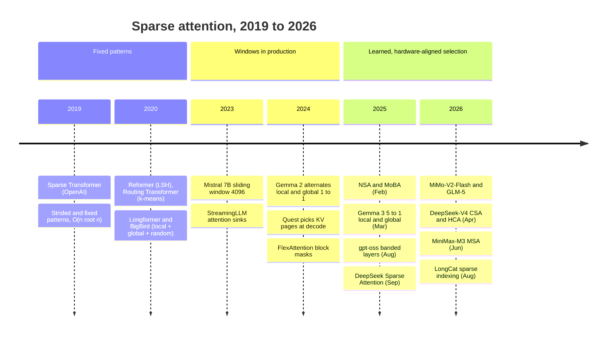
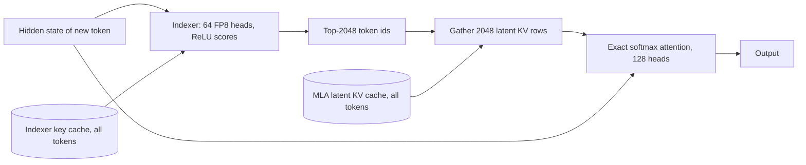
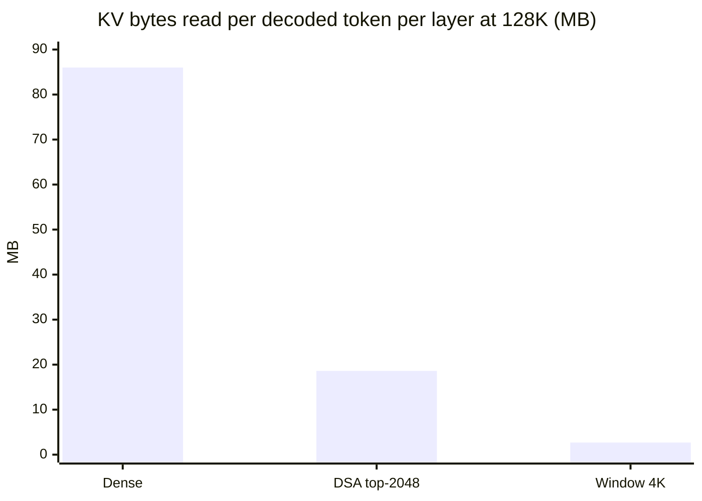

---
tags:
  - ai-ml
  - inference-systems
  - attention
  - sparse-attention
  - long-context
status: draft
sources:
  - https://arxiv.org/abs/1904.10509
  - https://arxiv.org/abs/2001.04451
  - https://arxiv.org/abs/2003.05997
  - https://arxiv.org/abs/2004.05150
  - https://arxiv.org/abs/2007.14062
  - https://arxiv.org/abs/2310.06825
  - https://arxiv.org/pdf/2310.06825
  - https://arxiv.org/abs/2309.17453
  - https://arxiv.org/abs/2406.10774
  - https://arxiv.org/abs/2502.11089
  - https://arxiv.org/pdf/2502.11089
  - https://arxiv.org/abs/2502.13189
  - https://arxiv.org/html/2502.13189v1
  - https://arxiv.org/abs/2503.19786
  - https://openai.com/index/introducing-gpt-oss/
  - https://arxiv.org/abs/2508.10925
  - https://arxiv.org/abs/2512.02556
  - https://github.com/deepseek-ai/DeepSeek-V3.2-Exp
  - https://huggingface.co/deepseek-ai/DeepSeek-V3.2-Exp/blob/main/config.json
  - https://api-docs.deepseek.com/news/news250929
  - https://venturebeat.com/technology/deepseeks-new-v3-2-exp-model-cuts-api-pricing-in-half-to-less-than-3-cents
  - https://vllm.ai/blog/deepseek-v3-2
  - https://github.com/deepseek-ai/FlashMLA
  - https://pytorch.org/blog/flexattention/
  - https://arxiv.org/abs/2601.02780
  - https://arxiv.org/abs/2602.15763
  - https://huggingface.co/blog/deepseekv4
  - https://sebastianraschka.com/llm-architecture-gallery/csa-hca/
  - https://sebastianraschka.com/blog/2026/gemma-4-release-notes.html
  - https://www.lmsys.org/blog/2026-04-10-sglang-hisparse/
  - https://venturebeat.com/technology/minimax-teases-upcoming-m3-model-with-new-sparse-attention-mechanism-and-15-6x-response-speed-boost
  - https://arxiv.org/abs/2606.13392
  - https://huggingface.co/MiniMaxAI/MiniMax-M3
  - https://www.modular.com/blog/day-zero-minimax-m3-open-weights-on-modular-cloud
  - https://arxiv.org/abs/2608.01662
  - https://api-docs.deepseek.com/quick_start/pricing
created: 2026-11-26
updated: 2026-11-26
---

## Table Of Contents

---

- [[#TL;DR|TL;DR]]
- [[#The Problem|The Problem]]
- [[#Foundations|Foundations]]
    - [[#What Dense Attention Costs|What Dense Attention Costs]]
    - [[#Prefill Is Compute, Decode Is Memory|Prefill Is Compute, Decode Is Memory]]
    - [[#Static vs Dynamic Sparsity|Static vs Dynamic Sparsity]]
    - [[#Why Sparsity Must Come in Blocks|Why Sparsity Must Come in Blocks]]
    - [[#Trained Sparse vs Bolted-On Sparse|Trained Sparse vs Bolted-On Sparse]]
- [[#How We Got Here|How We Got Here]]
- [[#How It Works|How It Works]]
    - [[#Fixed Patterns: Windows, Strides and Global Tokens|Fixed Patterns: Windows, Strides and Global Tokens]]
    - [[#Sliding Windows Interleaved with Global Layers|Sliding Windows Interleaved with Global Layers]]
    - [[#Block Selection: Quest, MoBA and MSA|Block Selection: Quest, MoBA and MSA]]
    - [[#Native Sparse Attention: Three Branches|Native Sparse Attention: Three Branches]]
    - [[#DeepSeek Sparse Attention: Indexer and Top-k|DeepSeek Sparse Attention: Indexer and Top-k]]
    - [[#Compress, Then Select: DeepSeek-V4's CSA and HCA|Compress, Then Select: DeepSeek-V4's CSA and HCA]]
    - [[#A Worked Example: One Decoded Token at 128K|A Worked Example: One Decoded Token at 128K]]
- [[#Where It Is Now|Where It Is Now]]
    - [[#Who Uses What in Production|Who Uses What in Production]]
    - [[#Measured Speed and Price Changes|Measured Speed and Price Changes]]
    - [[#Kernels and Serving Support|Kernels and Serving Support]]
    - [[#Quality on Long-Context Benchmarks|Quality on Long-Context Benchmarks]]
- [[#Trade-offs & Open Problems|Trade-offs & Open Problems]]
- [[#Resources|Resources]]
- [[#Related Notes|Related Notes]]

## ***TL;DR***
---
*Sparse attention lets each query look at only a chosen subset of keys instead of all of them. It is how open models in 2025 to 2026 made 128K to 1M-token contexts affordable: the cost of each new token stops growing with the whole context and grows instead with the size of the subset.*

- **What it is:** a rule for which keys each query may attend to. The rule can be fixed in advance (a sliding window, strides, a few global tokens) or chosen per query from the content (pick the top-k most relevant tokens or blocks).
- **The core idea that made it work:** sparsity only saves wall-clock time if it skips whole tiles of memory that the GPU would otherwise load. Early research patterns gave big theoretical savings and small real ones; the modern methods (NSA, MoBA, DSA, MSA) are designed around GPU block sizes and are trained with the sparsity from the start or through continued pretraining.
- **The big shift:** from fixed patterns (Sparse Transformer 2019, Longformer and BigBird 2020) to **learned, content-based selection**. DeepSeek Sparse Attention (Sep 2025) uses a cheap FP8 "lightning indexer" to score every past token and then runs full attention on the top 2,048 ([DeepSeek, 2025](https://arxiv.org/abs/2512.02556)).
- **Where it is now (Nov 2026):** two families ship in production. Sliding-window layers interleaved with global layers are standard in Gemma 3 and 4, gpt-oss and MiMo-V2-Flash. Learned top-k selection is in DeepSeek-V3.2 and V4, GLM-5 and 5.1, and MiniMax-M3, with vLLM, SGLang and FlashMLA kernels behind them. DeepSeek cut API prices by 50%+ the day it shipped DSA, and V4 needs 10% of V3.2's KV cache at 1M tokens ([HF blog, Apr 2026](https://huggingface.co/blog/deepseekv4)).

## ***The Problem***
---
*Dense [[Attention]] makes every new token look at every old token. At 128K tokens and beyond, that makes prefill quadratic in compute and makes each decoded token re-read the whole [[KV Cache]], which is what long-context serving actually pays for.*

The [[Transformer]]'s attention compares each query with every earlier key. For a sequence of length $n$ this has two costs that grow badly:

| Cost | Dense attention | Why it hurts |
|---|---|---|
| Prefill compute | $O(n^2)$: every token scores every earlier token | Doubling the prompt quadruples attention FLOPs; at 128K attention dominates the layer |
| Decode memory traffic | $O(n)$ bytes per new token per layer: the whole KV cache is read | Decode is memory-bound, so time per token rises linearly with context |
| KV cache capacity | $O(n)$ bytes per sequence | Long contexts shrink the batch that fits on a GPU, cutting throughput |

Agents and reasoning models made all three worse at once: long tool transcripts, long chains of thought and many concurrent sessions. [[Long Context]] is only useful if the per-token price stays low. Sparse attention attacks the first two costs directly (fewer keys scored, fewer bytes read). Some variants also attack the third by caching fewer or compressed entries (sliding windows, DeepSeek-V4's compression).

The catch: attention is useful precisely because any token can reach any other. A sparsity rule that drops the one token the answer depends on breaks the model. The history of the field is the search for rules that save most of the cost while almost never dropping what matters.

## ***Foundations***
---
*Five ideas explain why sparse attention looks the way it does today: what dense attention costs, why decode and prefill bottleneck differently, the split between fixed and content-based sparsity, why GPUs only reward block-shaped sparsity, and why sparsity must be trained in.*

#### **What Dense Attention Costs**

For one query $q$ and $n$ keys of head dimension $d$, attention computes $n$ scores $q \cdot k_s$ (about $2nd$ FLOPs), a softmax, and a weighted sum of $n$ value vectors (another $2nd$ FLOPs). Per head, per layer:

$$
\text{FLOPs per query} \approx 4nd, \qquad \text{FLOPs for a whole prefill} \approx 4 \cdot \tfrac{n^2}{2} \cdot d
$$

*In plain English: one new token costs work proportional to how many tokens came before it, so a whole prompt costs work proportional to the square of its length. The causal mask halves it, nothing more.*

A sparse rule replaces $n$ with $k$, the number of keys actually attended. If $k$ is fixed (a window of 4,096, or the top 2,048), per-token cost stops growing with context and prefill becomes $O(nk)$.

#### **Prefill Is Compute, Decode Is Memory**

- **Prefill** processes the whole prompt at once. Many queries share each loaded key, so it is compute-bound; sparsity helps by skipping score computations.
- **Decode** produces one token per step per sequence. Each step must read the KV entries it attends to from HBM and does little math per byte loaded, so it is memory-bandwidth-bound (see [[KV Cache]] and [[7 - All About Transformer Inference (NOT DONE)|7 - All About Transformer Inference (NOT DONE)]]). Sparsity helps by **reading fewer bytes**.

The two phases reward different designs. A method that saves FLOPs but still reads the full cache (for example by scoring every key at full precision) saves little at decode.

#### **Static vs Dynamic Sparsity**

| Kind | Who decides which keys | Examples | Strength | Weakness |
|---|---|---|---|---|
| Static (fixed pattern) | The architecture, before seeing any data | Sliding window, strided, dilated, global tokens | Free to compute, trivially block-aligned, cache can be truncated | Blind to content: a fact 50K tokens back is unreachable in a window layer |
| Dynamic (content-based) | A scoring step that looks at the query and keys | LSH buckets (Reformer), k-means routing, top-k blocks (Quest, MoBA, NSA, MSA), top-k tokens (DSA) | Can reach any token if it scores high | The scorer costs something, may miss, and the full cache usually must be kept |

Static sparsity gives memory savings (you can evict what you will never attend to). Dynamic sparsity mostly gives bandwidth and compute savings (you read a subset each step but must keep everything, since any token may be chosen later).

#### **Why Sparsity Must Come in Blocks**

GPUs load memory and multiply matrices in tiles. [[FlashAttention]] processes attention as tiles of, say, 64 or 128 queries by 64 or 128 keys held in on-chip SRAM. A mask that removes scattered individual entries saves nothing if every tile still has at least one live entry: the tile is loaded and multiplied anyway.

So the useful unit of sparsity is the tile. PyTorch's FlexAttention makes this explicit: a `BlockMask` records, for each 128 by 128 block, whether it is fully masked (skipped), fully computed, or partial (computed with a mask). A causal mask is about 50% sparse, and skipping its empty blocks makes the kernel about 2x faster at the same TFLOPS ([PyTorch, Aug 2024](https://pytorch.org/blog/flexattention/)). Every production method below either picks whole blocks (NSA, MoBA, MSA, Quest) or picks tokens but gathers them into dense tiles in a purpose-built kernel (DSA with FlashMLA).

At decode, the same logic applies to cache pages: a [[PagedAttention]] block of 16 to 64 tokens is the unit that gets fetched, so selecting at page granularity keeps reads contiguous.

#### **Trained Sparse vs Bolted-On Sparse**

Applying a sparse rule to a model trained densely (training-free sparsity) is cheap, but the model never learned to cope with what it can't see. NSA's authors made native trainability one of their two goals, alongside hardware-aligned speedups in decoding, forward and backward passes, and reported that NSA-pretrained models match or beat full attention ([Yuan et al., 2025](https://arxiv.org/abs/2502.11089)). The 2025 to 2026 production methods all train with sparsity: from scratch (NSA, MSA-PT) or by **continued pretraining** from a dense checkpoint with a warm-up that first teaches the selector to imitate dense attention (DSA in DeepSeek-V3.2 and GLM-5, MSA-CPT).

## ***How We Got Here***
---
*Fixed patterns came first (2019 to 2020) and proved long sequences were possible but rarely gave real speedups on GPUs. Sliding windows survived because they are trivially efficient, and since 2024 have been interleaved with full layers. In 2025 learned, hardware-aligned selection (NSA, MoBA, DSA) finally gave large real speedups, and by 2026 it is in several frontier open models.*

| Year | What changed | Problem it answered | Source |
|---|---|---|---|
| 2019 | Factorized patterns: each head attends to a local band plus a stride (or fixed "summary" columns), so any position reaches any other in two hops. $O(n\sqrt{n})$; sequences of tens of thousands of steps. | Dense attention could not model long images, audio or text. | [Child et al.](https://arxiv.org/abs/1904.10509) |
| 2020 | Reformer hashes queries and keys with LSH so each attends within its bucket: $O(L \log L)$. Routing Transformer clusters with online k-means: $O(n^{1.5}d)$, PG-19 perplexity 33.2. | Fixed patterns ignore content; can similar tokens find each other cheaply? | [Kitaev et al.](https://arxiv.org/abs/2001.04451), [Roy et al.](https://arxiv.org/abs/2003.05997) |
| 2020 | Longformer: sliding window plus task-chosen global tokens, linear in length. BigBird adds random links; proves sparse attention with $O(1)$ global tokens is a universal approximator and Turing complete; 8x longer inputs on the same hardware. | Long documents for BERT-style models; does sparsity lose expressive power? | [Beltagy et al.](https://arxiv.org/abs/2004.05150), [Zaheer et al.](https://arxiv.org/abs/2007.14062) |
| 2023 | Mistral 7B: every layer uses a 4,096-token sliding window; stacking 32 layers gives a theoretical span of about 131K; a rolling buffer cuts cache memory 8x at 32K. | A small model with cheap inference on long inputs. | [Jiang et al.](https://arxiv.org/abs/2310.06825) |
| 2023 | StreamingLLM: windows break when the first tokens are evicted, because heads dump attention on them. Keeping a few "sink" tokens plus the window is stable to 4M tokens. | Why naive window caches collapse. | [Xiao et al.](https://arxiv.org/abs/2309.17453) |
| 2024 | Quest keeps min and max key values per KV page and loads only the pages whose bound is highest for the current query: up to 2.23x attention speedup at decode, training-free. | Decode reads the whole cache even when few tokens matter. | [Tang et al.](https://arxiv.org/abs/2406.10774) |
| 2024 to 2025 | Gemma 2 alternates local (4,096) and global layers 1:1; Gemma 3 moves to 5 local per global with a 1,024 window to shrink the cache. | Window-only models can't retrieve far back; full-only models have huge caches. | [Gemma Team](https://arxiv.org/abs/2503.19786) |
| Feb 2025 | NSA: compressed, selected and sliding branches with learned gates, built for GQA kernels and trained natively. 9.0x forward and 6.0x backward speedup at 64K. MoBA: MoE-style top-k block routing, deployed for Kimi's long context. | Sparse methods that are both trainable and fast on real hardware. | [Yuan et al.](https://arxiv.org/abs/2502.11089), [Lu et al.](https://arxiv.org/abs/2502.13189) |
| Sep 2025 | DSA in DeepSeek-V3.2-Exp: an FP8 lightning indexer scores all tokens; attention runs on the top 2,048. Added by continued pretraining; API prices cut 50%+. | Make 128K contexts cheap without retraining from scratch. | [DeepSeek](https://arxiv.org/abs/2512.02556), [DeepSeek API news](https://api-docs.deepseek.com/news/news250929) |
| 2026 | GLM-5 adopts DSA; DeepSeek-V4 compresses KV 4x before selecting (CSA) and 128x for dense layers (HCA); MiniMax-M3 ships block selection on uncompressed GQA KV (MSA); Meituan's LSA cuts the indexer's own cost. | 1M-token agents; the indexer itself becomes the bottleneck. | See [[#Where It Is Now\|Where It Is Now]] |

**Why the fixed-pattern era faded.** Its headline savings were asymptotic. GPU kernels only save time by skipping whole tiles ([PyTorch, 2024](https://pytorch.org/blog/flexattention/)), and irregular patterns (random links, hashing, clustering) leave few tiles empty, so their savings were hard to turn into wall-clock gains. Sliding windows survived because they are perfectly tile-shaped. Content-based sparsity returned in 2025 once production contexts reached 128K and the methods were redesigned around kernels: NSA's stated aim was an algorithm balanced for arithmetic intensity and implemented for modern hardware ([Yuan et al., 2025](https://arxiv.org/abs/2502.11089)).

## ***How It Works***
---
*Every method answers one question: for this query, which keys? Fixed patterns answer by position. Selection methods answer with a cheap scorer, then run exact softmax attention on the winners. The DSA indexer formula is the clearest example of the modern recipe.*

#### **Fixed Patterns: Windows, Strides and Global Tokens**

| Pattern | Query at position $t$ attends to | Keys per query | Used in |
|---|---|---|---|
| Sliding window (local, banded) | $\{t-W+1, \ldots, t\}$ | $W$ | Longformer, Mistral 7B ($W=4096$), Gemma ($W=1024$), gpt-oss (bandwidth 128), MiMo-V2-Flash ($W=128$) |
| Strided | every $s$-th earlier position | $n/s$ | Sparse Transformer (paired with a local band) |
| Global tokens | a few designated tokens attend to and from everyone | $O(1)$ extra | Longformer, BigBird |
| Random | a few random positions | $r$ | BigBird |
| Sinks | the first few tokens, always | 1 to 4 | StreamingLLM; learned sink biases in gpt-oss (see [[Attention Sinks and Gated Attention]]) |

A window layer only needs the last $W$ entries in its cache, so its memory is constant in $n$. Information can still travel further than $W$ by hopping through layers (Mistral's 131K theoretical span), but in practice multi-hop relay is lossy, which is why pure-window models gave way to interleaved designs.

#### **Sliding Windows Interleaved with Global Layers**

The pragmatic 2024 to 2026 recipe: most layers are cheap windows, and every few layers a full (global) layer gives exact access to the whole context.

| Model | Local : global | Window | Context | Source |
|---|---|---|---|---|
| Gemma 2 (2024) | 1 : 1 | 4,096 | n/a | [Gemma 3 report](https://arxiv.org/abs/2503.19786) |
| Gemma 3 (Mar 2025) | 5 : 1 | 1,024 | 128K | [Gemma 3 report](https://arxiv.org/abs/2503.19786) |
| gpt-oss (Aug 2025) | alternating 1 : 1 | 128 (banded) | 131,072 | [OpenAI model card](https://arxiv.org/abs/2508.10925) |
| MiMo-V2-Flash (Jan 2026) | 5 : 1 | 128 | n/a | [Xiaomi](https://arxiv.org/abs/2601.02780) |
| Gemma 4 31B (Apr 2026) | 5 : 1 (50 + 10 layers) | 1,024 | 256K | [Raschka, Apr 2026](https://sebastianraschka.com/blog/2026/gemma-4-release-notes.html) |

Gemma 3's report gives the reason in memory terms: for a 2B model at 32K, a global-only design spends 60% extra memory on the KV cache, which drops below 15% with a 1:3 local:global mix and a 1,024 window ([Gemma Team, 2025](https://arxiv.org/abs/2503.19786)). Gemma 3 also keeps local layers at RoPE base 10K while raising global layers to 1M (see [[Positional Encoding]]): local layers never see long distances, so they don't need long-range positional resolution.

The cost of an interleaved model is dominated by its global layers. With 5 local layers at $W$ and 1 global layer at $n$, the average keys per layer is $(5W + n)/6$; at $n = 131{,}072$ and $W = 1{,}024$ that is about 22,700, roughly 17% of dense. Fewer global layers or sparse global layers are the next lever, which is where learned selection comes in.

#### **Block Selection: Quest, MoBA and MSA**

Split the cached keys into blocks, score each block cheaply against the query, and attend fully only inside the top-k blocks.

- **Quest (2024, decode only, training-free):** per KV page, track the minimal and maximal key values, use them with the current query to estimate how critical the page is, and load only the most critical pages: up to 2.23x self-attention speedup ([Tang et al., 2024](https://arxiv.org/abs/2406.10774)).
- **MoBA (Moonshot, Feb 2025):** split context into blocks of size $B$; score block $i$ as $s_i = \langle q, \text{mean\_pool}(K[I_i]) \rangle$; keep the top-k. The query's own block is always selected (with a causal mask inside it); future blocks are never selected. Their 1M-context Llama-8B used block size 4,096 and top-12 (95.31% sparse), kept the last three of 32 layers dense, and reported up to 6.5x faster prefill at 1M tokens ([Lu et al., 2025](https://arxiv.org/html/2502.13189v1)).
- **MSA (MiniMax, Jun 2026):** an index branch with one index query head per GQA group and one shared index key head scores tokens, max-pools the scores into 128-token blocks, and picks the top 16 blocks per group plus the current block, so each query attends to at most 2,048 tokens of the **uncompressed** GQA cache ([MiniMax, 2026](https://arxiv.org/abs/2606.13392)). Sink blocks and the recent window are always kept, and the kernel groups queries by the KV block they chose so each block is loaded from HBM once ([Modular, Jun 2026](https://www.modular.com/blog/day-zero-minimax-m3-open-weights-on-modular-cloud)).

#### **Native Sparse Attention: Three Branches**

NSA (DeepSeek and Peking University, Feb 2025) runs three attention branches per query, each with its own keys and values, and mixes them with learned gates:

$$
o_t = \sum_{c \in \{\text{cmp},\ \text{slc},\ \text{win}\}} g_t^{c} \cdot \text{Attn}\big(q_t, \tilde{K}_t^{c}, \tilde{V}_t^{c}\big), \qquad g_t^c \in [0, 1]
$$

*In plain English: one branch reads a coarse summary of everything (compressed blocks), one reads the full detail of the few blocks that summary says matter most (selected), and one reads the recent neighborhood (window). A small MLP decides per token how much to trust each.*

| Setting | Value |
|---|---|
| Compression block / stride | 32 / 16 tokens |
| Selection block size, count | 64 tokens, 16 blocks (incl. 1 initial and 2 local) |
| Sliding window | 512 |
| Test model | 27B total, 3B active MoE, GQA with 4 groups |

The kernel loads all query heads of a GQA group together because they share the same selected blocks. Results at 64K: 9.0x faster forward and 6.0x faster backward than FlashAttention-2, an expected 11.6x decode speedup from memory-access volume, perfect 64K needle retrieval, and a LongBench average of 0.469 vs 0.437 for full attention ([Yuan et al., 2025](https://arxiv.org/pdf/2502.11089)).

#### **DeepSeek Sparse Attention: Indexer and Top-k**

DSA (DeepSeek-V3.2-Exp, Sep 2025) keeps selection at **token** granularity. A small "lightning indexer" computes, for query token $t$ and each earlier token $s$:

$$
I_{t,s} = \sum_{j=1}^{H_I} w^{I}_{t,j} \cdot \text{ReLU}\left(q^{I}_{t,j} \cdot k^{I}_{s}\right)
$$

then the main attention runs only on the winners:

$$
u_t = \text{Attn}\Big(h_t,\ \{c_s \mid I_{t,s} \in \text{Top-}k(I_{t,:})\}\Big), \qquad k = 2048
$$

*In plain English: the indexer is a miniature attention with a few heads. Each indexer head $j$ asks "how relevant is token $s$ to me?" as a dot product, throws away negative answers with ReLU, and the per-head answers are blended with weights $w$ that the query itself produces. Every past token gets one relevance number; the 2,048 highest win, and real attention reads only those.*

Details that make it fast ([DeepSeek, 2025](https://arxiv.org/abs/2512.02556); [config](https://huggingface.co/deepseek-ai/DeepSeek-V3.2-Exp/blob/main/config.json)):

- **Cheap scorer:** 64 indexer heads of dimension 128, one shared indexer key per token, ReLU instead of softmax, run in FP8. It is still $O(n^2)$ over a sequence, but with a far smaller constant than the main attention.
- **Built on MLA's MQA mode:** each token's single compressed latent KV entry is shared by all 128 query heads, so one selection serves every head and the gather is one set of rows.
- **Trained in two stages from V3.1-Terminus:** (1) dense warm-up, main model frozen, indexer trained for 1,000 steps (2.1B tokens) with a KL loss to match the head-summed dense attention distribution; (2) sparse training at top-2048 for 15,000 steps (943.7B tokens), with the indexer's input detached so the main model learns only from the language-modeling loss.
- **Complexity:** core attention drops from $O(L^2)$ to $O(Lk)$.

#### **Compress, Then Select: DeepSeek-V4's CSA and HCA**

DeepSeek-V4 (Apr 2026, Pro 1.6T total / 49B active, Flash 284B / 13B, both 1M context) extends DSA in two directions ([HF blog, Apr 2026](https://huggingface.co/blog/deepseekv4)):

- **Compressed Sparse Attention (CSA):** pool every 4 consecutive KV entries into one (softmax-gated pooling with a learned positional bias), then an FP4 lightning indexer picks the top-k compressed blocks. A sliding-window branch covers recent uncompressed tokens.
- **Heavily Compressed Attention (HCA):** pool 128 entries into one and attend **densely** to all of them, which is cheap because the compressed sequence is 128x shorter. Also has a sliding-window branch.
- **Layout:** in V4-Pro's 61 layers, layers 0 and 1 are HCA and layers 2 to 60 alternate CSA and HCA. Both keep a 128-token local window of uncompressed entries ([Raschka](https://sebastianraschka.com/llm-architecture-gallery/csa-hca/)). KV is stored mostly in FP8, RoPE dimensions in BF16.

Compression shrinks both what is cached and what the indexer must scan; selection then keeps the per-token attention cost bounded. At 1M tokens V4-Pro needs 27% of V3.2's single-token FLOPs and 10% of its KV cache; V4-Flash needs 10% and 7%. DeepSeek did not publish CSA's top-k in the sources read here.

#### **A Worked Example: One Decoded Token at 128K**

Take a DeepSeek-V3.2-shaped layer: 128 query heads attending over MLA latents (576-dim keys, 512-dim values), an FP8 cache of 656 bytes per token ([vLLM, Sep 2025](https://vllm.ai/blog/deepseek-v3-2)), 61 layers. Context $n = 131{,}072$. Attention FLOPs per attended key per layer $= 128 \times (2 \cdot 576 + 2 \cdot 512) \approx 2.79 \times 10^5$. For the indexer, assume 132 bytes per token (128 FP8 values plus a 4-byte scale; my estimate of the layout) and $64 \times 2 \times 128 = 16{,}384$ FLOPs per key. These are my calculations from the published configuration, not DeepSeek's figures, and they ignore weights, MoE and other layers.

| Per decoded token, per layer | Dense (all 131,072) | Sliding window 4K | DSA top-2048 |
|---|---|---|---|
| Keys attended | 131,072 | 4,096 | 2,048 |
| Main KV bytes read | 86.0 MB | 2.69 MB | 1.34 MB |
| Indexer bytes read | 0 | 0 | 17.3 MB |
| **Total bytes read** | **86.0 MB** | **2.69 MB** | **18.6 MB** |
| Main attention FLOPs | 36.5 GFLOP | 1.14 GFLOP | 0.57 GFLOP |
| Indexer FLOPs (FP8) | 0 | 0 | 2.15 GFLOP |
| Whole model, 61 layers, bytes | 5.25 GB | 164 MB | 1.14 GB |
| Can reach token 100,000 back? | Yes | No (only by multi-layer relay) | Yes, if the indexer ranks it top-2048 |
| Cache that must be kept | All | Last 4,096 only | All (plus indexer keys) |

Three readings:

- **DSA cuts decode traffic about 4.6x and main-attention FLOPs about 64x** at 128K. The saving grows with context, since only the indexer term scales with $n$.
- **The indexer dominates DSA's decode cost** in this estimate: 17.3 of 18.6 MB. This matches what later work measured: Meituan found the lightning indexer takes up to 90% of per-layer latency at 1,024K tokens ([LongCat, Aug 2026](https://arxiv.org/abs/2608.01662)), and it is one reason V4 compresses KV 4x before indexing.
- **The window is cheapest but blind.** Its 32x saving comes from never looking past 4,096 tokens, which is why window layers are paired with global or selected layers rather than used alone.

## ***Where It Is Now***
---
*As of November 2026, sparse attention is standard in open frontier models. Interleaved sliding windows are the default for dense mid-size models, and learned top-k selection (DSA and its descendants, MSA) powers the 1M-context MoE models from DeepSeek, Zhipu and MiniMax. Closed labs have not disclosed their attention designs.*

#### **Who Uses What in Production**

| Model (release) | Scheme | Key numbers | Source |
|---|---|---|---|
| Gemma 3 (Mar 2025), Gemma 4 (Apr 2026) | Sliding window 1,024, 5 local : 1 global | 128K, then 256K for Gemma 4 31B | [Gemma Team](https://arxiv.org/abs/2503.19786), [Raschka](https://sebastianraschka.com/blog/2026/gemma-4-release-notes.html) |
| gpt-oss-120b / 20b (Aug 2025) | Alternating banded window (128) and dense layers, learned sink bias per head | 131,072 context, GQA with 8 KV heads | [OpenAI](https://arxiv.org/abs/2508.10925) |
| Kimi long-context service (by Feb 2025) | MoBA block selection | Deployed for long-context requests | [Lu et al.](https://arxiv.org/abs/2502.13189) |
| DeepSeek-V3.2-Exp (Sep 2025), V3.2 (Dec 2025) | DSA, top-2048 tokens over MLA | Sparse training on 128K sequences | [DeepSeek](https://arxiv.org/abs/2512.02556) |
| MiMo-V2-Flash (Jan 2026) | Sliding window 128, 5 SWA : 1 global | 309B total, 15B active | [Xiaomi](https://arxiv.org/abs/2601.02780) |
| GLM-5 (Feb 2026), GLM-5.1 | DSA via continued pretraining | 744B total, 40B active, about 200K context | [Zhipu](https://arxiv.org/abs/2602.15763) |
| DeepSeek-V4 Pro / Flash (Apr 2026) | CSA + HCA interleaved, sliding window | 1M context | [HF blog](https://huggingface.co/blog/deepseekv4) |
| MiniMax-M3 (Jun 11, 2026) | MSA block selection on GQA | 428B total, about 23B active, 1M context | [HF model card](https://huggingface.co/MiniMaxAI/MiniMax-M3) |
| LongCat-2.0 (2026) | LSA: DSA-style selection with cross-layer and hierarchical indexing | 1.6T total, 48B active | [Meituan](https://arxiv.org/abs/2608.01662) |

Two notes on the map. MiniMax had rejected sub-quadratic attention for M2 over precision and prefix-caching problems; MSA's design of selecting blocks of real (uncompressed) KV was meant to avoid those ([VentureBeat, May 2026](https://venturebeat.com/technology/minimax-teases-upcoming-m3-model-with-new-sparse-attention-mechanism-and-15-6x-response-speed-boost)). And some other 2025 to 2026 open models went a different way, mixing linear or recurrent layers with full attention; those are covered in [[Hybrid Attention]].

#### **Measured Speed and Price Changes**

| Change | Number | Date | Source |
|---|---|---|---|
| DeepSeek API price cut on shipping DSA | "50%+": input cache hit $0.07 → $0.028, cache miss $0.56 → $0.28, output $1.68 → $0.42 per 1M tokens | Sep 29, 2025 | [DeepSeek](https://api-docs.deepseek.com/news/news250929), [VentureBeat](https://venturebeat.com/technology/deepseeks-new-v3-2-exp-model-cuts-api-pricing-in-half-to-less-than-3-cents) |
| GLM-5 attention cost with DSA | About 1.5 to 2x less attention compute on long sequences; 128K at about half the GPU cost | Feb 2026 | [Zhipu](https://arxiv.org/abs/2602.15763) |
| DeepSeek-V4 vs V3.2 at 1M tokens | Pro: 27% of FLOPs, 10% of KV cache; Flash: 10% and 7% | Apr 2026 | [HF blog](https://huggingface.co/blog/deepseekv4) |
| MiniMax-M3 vs M2 at 1M | 9x prefill, 15x decode, per-token compute about 1/20 | Jun 2026 | [HF model card](https://huggingface.co/MiniMaxAI/MiniMax-M3) |
| MSA paper, H800 at 1M | 28.4x fewer attention FLOPs, 14.2x prefill, 7.6x decode wall clock | Jun 2026 | [MiniMax](https://arxiv.org/abs/2606.13392) |
| SGLang HiSparse on GLM-5.1 | Over 3x throughput at 256 concurrent requests; up to 5x at long context | Apr 2026 | [LMSYS](https://www.lmsys.org/blog/2026-04-10-sglang-hisparse/) |
| LongCat LSA vs DSA | 1.42 to 3.60x prefill, 1.25 to 1.40x decode | Aug 2026 | [Meituan](https://arxiv.org/abs/2608.01662) |

DeepSeek's November 2026 price list shows its V4-generation 1M-context models with cache-hit input as low as $0.003 per 1M tokens off-peak for the Flash model ([DeepSeek pricing](https://api-docs.deepseek.com/quick_start/pricing)); prices mix many factors besides attention, so treat them as context, not as a measured effect of sparsity.

#### **Kernels and Serving Support**

- **FlashMLA (DeepSeek):** token-level sparse attention kernels for prefill and for decode with an FP8 cache, released Sep 29, 2025, for SM90 and SM100. Sparse MLA decode reaches 410 TFLOPS on H800; sparse prefill reaches 640 TFLOPS on H800 and up to 1,450 TFLOPS on B200 ([FlashMLA](https://github.com/deepseek-ai/FlashMLA)). DeepGEMM hosts the indexer logit kernels, including paged versions, and TileLang has readable reference kernels ([DeepSeek-V3.2-Exp repo](https://github.com/deepseek-ai/DeepSeek-V3.2-Exp)).
- **vLLM:** day-0 DSA support (Sep 29, 2025). The indexer keeps its own FP8 key cache separate from the MLA cache; DeepGEMM's `fp8_mqa_logits` computes scores; only KV block size 64 is supported because of the indexer layout and FlashMLA ([vLLM](https://vllm.ai/blog/deepseek-v3-2)). The [[PagedAttention]] block is the unit sparse kernels gather from.
- **SGLang:** day-0 DSA support, and HiSparse (Apr 2026), which keeps a hot GPU buffer of frequently selected KV entries and leaves the rest in host memory, turning dynamic sparsity into capacity savings as well as bandwidth savings ([LMSYS](https://www.lmsys.org/blog/2026-04-10-sglang-hisparse/)). Both vLLM and SGLang serve MiniMax-M3 ([HF model card](https://huggingface.co/MiniMaxAI/MiniMax-M3)).
- **FlexAttention (PyTorch):** the research path. Any mask written as a Python predicate (sliding window, document, prefix) is compiled to a fused kernel that skips empty 128 by 128 blocks; about 90% of FlashAttention-2's forward speed on dense causal masks ([PyTorch](https://pytorch.org/blog/flexattention/)).

#### **Quality on Long-Context Benchmarks**

Published results show trained sparse attention at or near parity with dense, sometimes above it:

| Model | Comparison | Result | Source |
|---|---|---|---|
| NSA 27B (research) | vs full attention | LongBench 0.469 vs 0.437; perfect 64K needle | [Yuan et al.](https://arxiv.org/pdf/2502.11089) |
| DeepSeek-V3.2-Exp | vs V3.1-Terminus | AA-LCR +4 points in reasoning mode; better on Fiction.liveBench; general benchmarks flat (MMLU-Pro 85.0 vs 85.0, GPQA 79.9 vs 80.7) | [DeepSeek](https://arxiv.org/abs/2512.02556), [repo](https://github.com/deepseek-ai/DeepSeek-V3.2-Exp) |
| GLM-5 DSA | vs MLA baseline | SQuAD-128K 86.0 vs 79.7; MV-NIAH-128K 97.0 vs 95.5; HotpotQA-128K 63.0 vs 66.3 | [Zhipu](https://arxiv.org/abs/2602.15763) |
| MSA 109B (CPT) | vs full attention | HELMET-128K 45.93 vs 46.53; RULER-128K 72.12 vs 72.00 | [MiniMax](https://arxiv.org/abs/2606.13392) |
| DeepSeek-V4-Pro-Max | absolute | MRCR 8-needle above 0.82 through 256K, 0.59 at 1M | [HF blog](https://huggingface.co/blog/deepseekv4) |

The pattern: wins and losses of a few points by task, not systematic loss. Multi-hop retrieval (HotpotQA) is where selection seems most likely to miss. GLM-5's authors tested sliding-window and linear alternatives and called DSA "lossless by construction" by contrast, since it can still reach every token.

## ***Trade-offs & Open Problems***
---
*Sparse attention trades exact access for cost. Fixed windows save memory but can't see far; learned selection sees everything but keeps the full cache and pays for its scorer. The open problems are the scorer's own quadratic cost, misses on multi-hop tasks, and fitting sparsity into caching and batching systems.*

| Approach | Gains | Costs and risks |
|---|---|---|
| Sliding window only | Constant cache and compute per token | Blind beyond $W$; relay through layers is lossy; needs sinks |
| Window + global interleave | Simple, tile-friendly, big cache savings | Global layers still $O(n)$ per token; dominate cost at 1M |
| Training-free block selection (Quest) | No retraining; decode speedup | Bounds are loose; full cache still stored; quality depends on model |
| Trained block selection (NSA, MoBA, MSA) | Large real speedups; near-dense quality | Block granularity can waste budget on mostly irrelevant blocks |
| Token selection with indexer (DSA) | Finest granularity; continued-pretraining path from dense | Indexer is $O(n^2)$ and dominates at very long context; extra cache for indexer keys |
| Compress + select (V4 CSA/HCA) | 10x smaller cache at 1M; cheaper indexing | Lossy compression; architecture must be trained for it |

- **The indexer is the new bottleneck.** Selection makes main attention $O(nk)$, but scoring every token keeps an $O(n^2)$ term. Fixes in 2026: compress before indexing (V4), reuse one layer's selection across layers and score coarse-to-fine (LongCat), and offload cold entries (HiSparse).
- **Misses are silent.** A top-k that drops the needed token gives a fluent wrong answer. Multi-hop tasks, where the second fact only looks relevant after the first is read, are hardest; GLM-5's lower HotpotQA-128K score fits this.
- **Memory is not saved by selection alone.** Dynamic methods must keep the whole cache since any token may be chosen later. Capacity savings need compression (V4), windows, or offload (HiSparse).
- **Batching and prefix caching.** Each sequence and head group picks different blocks, so gathers are irregular and harder to batch than dense reads. MiniMax cited prefix caching as a reason it avoided sub-quadratic attention in M2 ([VentureBeat, May 2026](https://venturebeat.com/technology/minimax-teases-upcoming-m3-model-with-new-sparse-attention-mechanism-and-15-6x-response-speed-boost)).
- **Short contexts gain nothing.** Below a few thousand tokens, top-2048 is close to dense, and the indexer is pure overhead.
- **Interaction with other compression.** Selection combined with [[Quantization]] of the cache or [[Low-Precision Attention]] (FP8 or FP4 indexers) is tested case by case; how attention sinks behave under selection and compression is still studied ([[Attention Sinks and Gated Attention]]).
- **Benchmarks lag the claims.** Most long-context results are from the labs themselves, at 128K; independent evaluation at 1M tokens is thin (see [[Long Context]]).

## ***Resources***
---
*Start with the DeepSeek-V3.2 paper for the modern recipe, then NSA for why hardware alignment matters, and FlexAttention for how block masks make sparsity real. The 2019 to 2020 papers explain the patterns still in use.*

**Papers: foundations**
- [Generating Long Sequences with Sparse Transformers](https://arxiv.org/abs/1904.10509): Child, Gray, Radford, Sutskever (OpenAI), Apr 2019. Strided and fixed factorized patterns.
- [Reformer: The Efficient Transformer](https://arxiv.org/abs/2001.04451): Kitaev, Kaiser, Levskaya (Google), Jan 2020. LSH attention.
- [Efficient Content-Based Sparse Attention with Routing Transformers](https://arxiv.org/abs/2003.05997): Roy, Saffar, Vaswani, Grangier (Google), Mar 2020. Online k-means routing.
- [Longformer: The Long-Document Transformer](https://arxiv.org/abs/2004.05150): Beltagy, Peters, Cohan (AI2), Apr 2020. Window plus global tokens.
- [Big Bird: Transformers for Longer Sequences](https://arxiv.org/abs/2007.14062): Zaheer et al. (Google), Jul 2020. Local + global + random, with expressivity proofs.
- [Mistral 7B](https://arxiv.org/abs/2310.06825): Jiang et al. (Mistral AI), Oct 2023. Sliding window and rolling buffer cache in a production model.
- [Efficient Streaming Language Models with Attention Sinks](https://arxiv.org/abs/2309.17453): Xiao et al., Sep 2023. Why windows need sinks.
- [Quest: Query-Aware Sparsity for Efficient Long-Context LLM Inference](https://arxiv.org/abs/2406.10774): Tang et al., Jun 2024. Page selection at decode.

**Papers: learned, hardware-aligned sparsity**
- [Native Sparse Attention](https://arxiv.org/abs/2502.11089): Yuan et al. (DeepSeek, PKU), Feb 2025. Three-branch design and GQA-aware kernel.
- [MoBA: Mixture of Block Attention for Long-Context LLMs](https://arxiv.org/abs/2502.13189): Lu et al. (Moonshot AI), Feb 2025. Top-k block routing deployed in Kimi.
- [Gemma 3 Technical Report](https://arxiv.org/abs/2503.19786): Gemma Team (Google DeepMind), Mar 2025. 5:1 local:global and cache arithmetic.
- [gpt-oss-120b & gpt-oss-20b Model Card](https://arxiv.org/abs/2508.10925): OpenAI, Aug 2025. Alternating banded and dense layers with sink biases.
- [DeepSeek-V3.2: Pushing the Frontier of Open Large Language Models](https://arxiv.org/abs/2512.02556): DeepSeek-AI, Dec 2025. DSA formula, training recipe, cost curves.
- [MiMo-V2-Flash Technical Report](https://arxiv.org/abs/2601.02780): Xiaomi, Jan 2026. 128-token windows at 5:1.
- [GLM-5: from Vibe Coding to Agentic Engineering](https://arxiv.org/abs/2602.15763): Zhipu AI, Feb 2026. Adopting DSA by short continued pretraining, with ablations against windows.
- [MiniMax Sparse Attention](https://arxiv.org/abs/2606.13392): MiniMax et al., Jun 2026. Block selection on uncompressed GQA KV.
- [LongCat Sparse Attention](https://arxiv.org/abs/2608.01662): Meituan LongCat Team, Aug 2026. Attacking the indexer's own cost.

**Posts, docs and code**
- [DeepSeek-V4: a million-token context that agents can actually use](https://huggingface.co/blog/deepseekv4): Hugging Face, Apr 2026. CSA and HCA explained with cache and FLOP numbers.
- [CSA and HCA](https://sebastianraschka.com/llm-architecture-gallery/csa-hca/): Sebastian Raschka, 2026. Diagram-level walkthrough of V4's attention.
- [Gemma 4 Architecture and Benchmark Notes](https://sebastianraschka.com/blog/2026/gemma-4-release-notes.html): Sebastian Raschka, Apr 2026.
- [FlexAttention](https://pytorch.org/blog/flexattention/): PyTorch team (incl. Horace He), Aug 2024. Block masks and why block sparsity is what GPUs reward.
- [DeepSeek-V3.2-Exp in vLLM](https://vllm.ai/blog/deepseek-v3-2): vLLM, Sep 2025. How a serving engine implements the indexer and sparse MLA.
- [HiSparse](https://www.lmsys.org/blog/2026-04-10-sglang-hisparse/): LMSYS, Apr 2026. Offloading cold KV for DSA models.
- [FlashMLA](https://github.com/deepseek-ai/FlashMLA): DeepSeek. Sparse MLA kernels and performance numbers.
- [Introducing DeepSeek-V3.2-Exp](https://api-docs.deepseek.com/news/news250929): DeepSeek, Sep 2025. The release and price cut.

**Analysis and news**
- [MiniMax teases M3 with new sparse attention](https://venturebeat.com/technology/minimax-teases-upcoming-m3-model-with-new-sparse-attention-mechanism-and-15-6x-response-speed-boost): VentureBeat, May 2026. Why MiniMax moved from full to sparse attention.
- [Day zero MiniMax-M3 on Modular Cloud](https://www.modular.com/blog/day-zero-minimax-m3-open-weights-on-modular-cloud): Modular, Jun 2026. Kernel scheduling for block-sparse decode.

## Related Notes

- [[Attention]] — The dense mechanism that sparse attention restricts.
- [[KV Cache]] — What decode reads each step; sparse attention cuts how much of it is read or kept.
- [[FlashAttention]] — The tiled kernel whose tile shape decides which sparsity patterns pay off.
- [[PagedAttention]] — Cache blocks are the unit sparse kernels select and gather.
- [[Long Context]] — The workload that makes sparsity necessary, and where effective vs advertised context is judged.
- [[Hybrid Attention]] — The other route to cheap long context: mixing linear or recurrent layers with full attention.
- [[Attention Sinks and Gated Attention]] — Why windows must keep the first tokens, and learned sink biases in gpt-oss.
- [[Mixture of Experts]] — MoBA borrows its routing idea; every production DSA and MSA model is also an MoE.
- [[Positional Encoding]] — Local and global layers use different RoPE bases in Gemma.
- [[Low-Precision Attention]] — FP8 and FP4 indexers and caches in DSA and V4.
- [[LLM Serving]] — vLLM and SGLang integration, batching and offload of sparse caches.
- [[7 - All About Transformer Inference (NOT DONE)|7 - All About Transformer Inference (NOT DONE)]] — The memory-bandwidth arithmetic behind decode cost.
