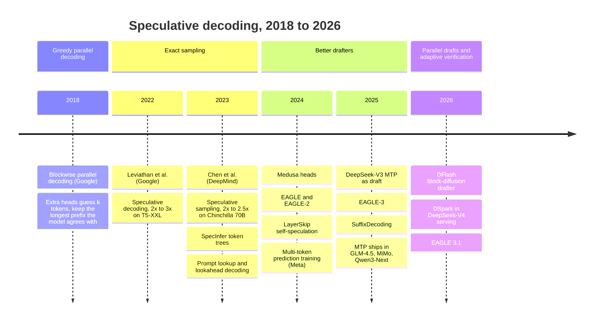
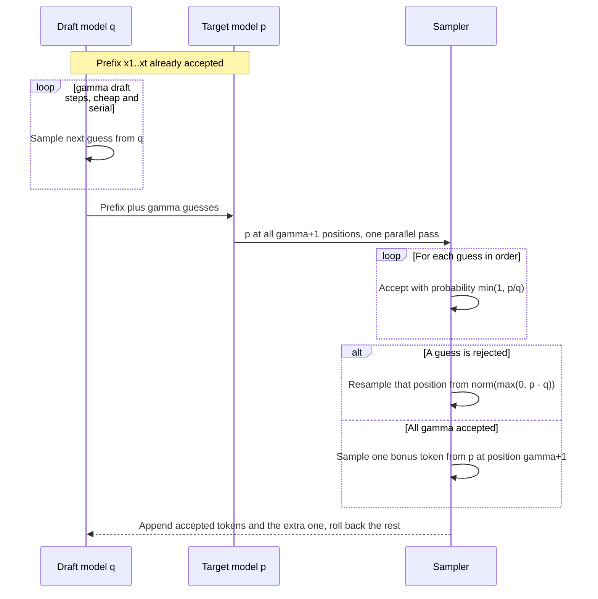
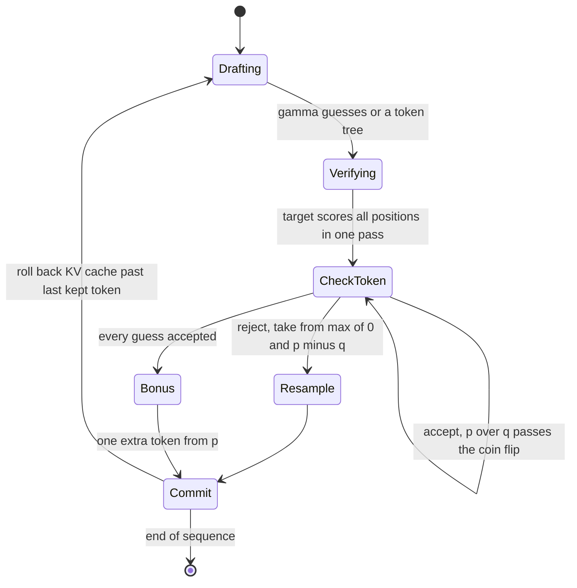

---
tags:
  - ai-ml
  - inference-systems
  - speculative-decoding
  - decoding
  - serving
  - latency
status: draft
sources:
  - https://arxiv.org/abs/1811.03115
  - https://arxiv.org/abs/2211.17192
  - https://arxiv.org/abs/2302.01318
  - https://arxiv.org/abs/2305.09781
  - https://arxiv.org/abs/2309.08168
  - https://www.github.com/apoorvumang/prompt-lookup-decoding
  - https://www.lmsys.org/blog/2023-11-21-lookahead-decoding
  - https://arxiv.org/abs/2402.02057
  - https://arxiv.org/abs/2401.10774
  - https://arxiv.org/abs/2401.15077
  - https://arxiv.org/abs/2406.16858
  - https://arxiv.org/abs/2503.01840
  - https://arxiv.org/abs/2404.16710
  - https://arxiv.org/abs/2404.19737
  - https://arxiv.org/abs/2412.19437
  - https://arxiv.org/abs/2411.04975
  - https://arxiv.org/abs/2408.11049
  - https://arxiv.org/abs/2505.07608
  - https://arxiv.org/abs/2508.06471
  - https://www.alibabacloud.com/blog/qwen3-next-towards-ultimate-training-%26-inference-efficiency_602580
  - https://www.lmsys.org/blog/2025-07-17-mtp
  - https://arxiv.org/abs/2602.06036
  - https://huggingface.co/papers/2607.05147
  - https://www.lmsys.org/blog/2026-07-06-dspark-sglang
  - https://vllm.ai/blog/2026-05-26-eagle-3-1
  - https://vllm.ai/blog/2026-08-23-speculative-decoding-amd-gpus
  - https://vllm.ai/blog/tags/speculative-decoding
  - https://docs.vllm.ai/en/latest/features/speculative_decoding/index.html
  - https://nvidia.github.io/TensorRT-LLM/latest/features/speculative-decoding.html
  - https://nvidia.github.io/TensorRT-LLM/latest/blogs/tech_blog/blog11_GPT_OSS_Eagle3.html
  - https://huggingface.co/nvidia/gpt-oss-120b-Eagle3-throughput
  - https://jax-ml.github.io/scaling-book/inference/
  - https://inferencex.semianalysis.com/compare-spec-decode/glm-5-2-b300-fp4-mtp-vs-none
created: 2026-11-26
updated: 2026-11-26
---

## Table Of Contents

---

- [[#TL;DR|TL;DR]]
- [[#The Problem|The Problem]]
- [[#Foundations|Foundations]]
    - [[#Decode Is Memory-Bound|Decode Is Memory-Bound]]
    - [[#Scoring k Tokens Costs About One Step|Scoring k Tokens Costs About One Step]]
    - [[#Draft Model and Target Model|Draft Model and Target Model]]
    - [[#Greedy and Sampled Decoding|Greedy and Sampled Decoding]]
- [[#How We Got Here|How We Got Here]]
- [[#How It Works|How It Works]]
    - [[#The Draft-Then-Verify Loop|The Draft-Then-Verify Loop]]
    - [[#The Acceptance Rule|The Acceptance Rule]]
    - [[#A Worked Example|A Worked Example]]
    - [[#Why the Output Is Exactly the Target's|Why the Output Is Exactly the Target's]]
    - [[#Expected Tokens per Step|Expected Tokens per Step]]
    - [[#Choosing the Draft Length|Choosing the Draft Length]]
    - [[#Greedy Verification|Greedy Verification]]
    - [[#Tree Verification|Tree Verification]]
    - [[#Kinds of Drafter|Kinds of Drafter]]
- [[#Where It Is Now|Where It Is Now]]
    - [[#Serving Engines|Serving Engines]]
    - [[#Models That Ship Their Own Drafter|Models That Ship Their Own Drafter]]
    - [[#Parallel and Diffusion Drafters|Parallel and Diffusion Drafters]]
    - [[#Speculation at Large Batch|Speculation at Large Batch]]
    - [[#Reported Speedups|Reported Speedups]]
- [[#Trade-offs & Open Problems|Trade-offs & Open Problems]]
- [[#Resources|Resources]]
- [[#Related Notes|Related Notes]]

## ***TL;DR***
---
*Speculative decoding makes a large model generate several tokens per forward pass instead of one: something cheap guesses the next few tokens, the large model checks all the guesses in a single pass, and a modified rejection-sampling rule keeps the accepted text distributed exactly as if the large model had written it alone. It works because decode is limited by memory bandwidth, not arithmetic, so checking 5 tokens costs about the same as producing 1.*

- **What it is:** a lossless latency trick for autoregressive decoding. A *draft* (small model, extra heads, n-gram lookup) proposes $\gamma$ tokens; the *target* model scores them all at once and keeps the longest prefix that passes, plus one token of its own ([Leviathan et al., 2022](https://arxiv.org/abs/2211.17192); [Chen et al., 2023](https://arxiv.org/abs/2302.01318)).
- **The core rule:** accept a drafted token $x$ with probability $\min(1, p(x)/q(x))$, where $p$ is the target's probability and $q$ the draft's; on rejection, resample from $\text{norm}(\max(0, p - q))$. The output distribution is provably identical to sampling from $p$.
- **The core number:** with per-token acceptance rate $\alpha$ and draft length $\gamma$, each target pass yields on average $(1 - \alpha^{\gamma+1})/(1 - \alpha)$ tokens. At $\alpha = 0.8$, $\gamma = 4$ that is 3.36 tokens per pass.
- **Where it is now (Nov 2026):** it is on by default in production serving. Most new open models ship their own drafter: built-in multi-token-prediction (MTP) layers (DeepSeek, Qwen3.5/3.6, GLM, MiMo, Gemma 4) or a trained EAGLE-3 head (gpt-oss, Kimi). Since mid-2026 the frontier is *parallel* drafters that emit a whole block per pass (DFlash, DeepSeek's DSpark) and *adaptive verification* that trims drafts per request so speculation still pays at high batch size; DSpark reported 60 to 85% faster per-user generation than MTP-1 on DeepSeek-V4's live traffic ([DeepSeek, Jul 2026](https://huggingface.co/papers/2607.05147)).

## ***The Problem***
---
*Each new token needs a full forward pass of the model, and each pass has to stream every weight (and the whole [[KV Cache]]) out of memory. At small batch sizes the chip spends nearly all its time waiting on memory, so per-user speed is capped by bandwidth, not by how fast the chip can multiply.*

Autoregressive generation is serial: token $t+1$ cannot be computed until token $t$ is known. For a single request, that means one full pass per token, and each pass reads the entire model from high-bandwidth memory (HBM) to compute a few vectors of output.

| | What the pass does | What limits it |
|---|---|---|
| Prefill (the prompt) | Thousands of tokens through each weight matrix at once | Compute: many FLOPs per byte read |
| Decode (one new token) | One token per request through each weight matrix | Memory bandwidth: about 1 multiply-add per weight byte read |

The arithmetic units are idle most of the time during decode. Batching many users together fixes that for *throughput*, because they share one read of the weights, but it does nothing for the speed one user sees, and it does not share the KV cache, which every request owns separately ([How to Scale Your Model, ch. 7](https://jax-ml.github.io/scaling-book/inference/)).

The question speculative decoding answers: **can a single request use those idle FLOPs to produce more than one token per weight read, without changing what the model would have said?** Running the model on several *future* positions at once is easy; the hard part is that we do not know those future tokens yet. Speculative decoding guesses them cheaply and then checks.

## ***Foundations***
---
*Four ideas make the method readable: why decode is memory-bound, why scoring several tokens in one pass is nearly free, what the draft and target models are, and the difference between greedy and sampled decoding.*

#### **Decode Is Memory-Bound**

A chip has a fixed ratio of arithmetic speed to memory speed. A kernel that does fewer operations per byte read than that ratio is *memory-bound*; the crossover point is the chip's roofline (see [[1 - All About Rooflines (NOT DONE)|Rooflines]]).

In decode, a weight matrix of shape $d \times d$ is read once and multiplied by a batch of $B$ token vectors. That is about $2Bd^2$ FLOPs for $2d^2$ bytes (in bf16), so the arithmetic intensity is roughly $B$ FLOPs per byte. To be compute-bound on the feed-forward and projection matmuls, the total token batch must exceed the chip's critical batch size, about **240 tokens** for bf16 on a TPU v5e ([How to Scale Your Model, ch. 7](https://jax-ml.github.io/scaling-book/inference/)). A single request decoding one token at a time has $B = 1$, so it uses well under 1% of the chip's arithmetic.

#### **Scoring k Tokens Costs About One Step**

Here is the trick. If you already had $k$ candidate tokens, you could feed all of them to the model in one pass, like a tiny prefill. Each weight is still read once, but now it is used $k$ times. As long as $k$ (times the batch) stays under the critical batch size, the pass takes about the same wall-clock time as a one-token pass. The pass also reads the KV cache once for all $k$ positions instead of $k$ times ([How to Scale Your Model, ch. 7](https://jax-ml.github.io/scaling-book/inference/)).

That single pass gives the model's next-token distribution at **every** one of the $k$ positions (the same causal masking that makes training parallel). So you learn, in one step, what the target model would have predicted after each prefix of the guess. That is exactly the information needed to check the guess.

The catch: those extra FLOPs are only free while the hardware is memory-bound. Rejected tokens are wasted work, and the draft itself costs time, so every *accepted* token costs more FLOPs than in plain decoding. Speculation trades FLOPs for latency.

#### **Draft Model and Target Model**

- **Target model** $M_p$: the model whose output you actually want. Its next-token distribution is written $p(x)$.
- **Draft model** $M_q$ (also "approximation model", "drafter", "speculator"): anything cheaper that proposes tokens, with distribution $q(x)$. It can be a smaller model from the same family, extra heads on the target, an early exit from the target's own layers, or a non-neural lookup of n-grams.
- **Cost coefficient** $c$: time for one draft step divided by time for one target step. Leviathan et al. used T5-small (77M) as a draft for T5-XXL (11B) ([Leviathan et al., 2022](https://arxiv.org/abs/2211.17192)).
- **Acceptance rate** $\alpha$: the expected probability that the target accepts a drafted token. It measures how well $q$ imitates $p$.

The draft and target must share a [[Tokenization and Embeddings|tokenizer]], or acceptance collapses ([TensorRT-LLM docs](https://nvidia.github.io/TensorRT-LLM/latest/features/speculative-decoding.html)).

#### **Greedy and Sampled Decoding**

- **Greedy** (temperature 0): always take the single most likely token. The target's choice is deterministic, so checking a guess is a yes/no comparison with the target's argmax.
- **Sampled** (temperature > 0, top-p and so on): draw a token at random from $p$. Now "would the target have produced this token?" has no yes/no answer; you need a rule that accepts tokens at the right *rate* so the final text is distributed as $p$. That rule is the modified rejection sampling in [[#The Acceptance Rule|How It Works]].

Acceptance is usually higher under greedy decoding: in Leviathan et al.'s translation runs with a T5-small draft, $\alpha$ was 0.75 at temperature 0 and 0.62 at temperature 1 ([Leviathan et al., 2022](https://arxiv.org/abs/2211.17192)).

## ***How We Got Here***
---
*The idea started in 2018 as greedy-only parallel decoding with extra heads. In late 2022 two teams independently found the rejection-sampling rule that makes it exact for sampling, and from then on the work has been about better, cheaper drafters, trees of guesses, and keeping the gain at large batch sizes.*

| Year | What changed | Problem it answered | Source |
|---|---|---|---|
| 2018 | Train extra output heads to predict positions $t+1 \ldots t+k$; the base model scores them in one pass and keeps the longest prefix matching its own greedy choice. Up to 2x fewer iterations at no quality loss, 4x wall-clock with some loss. | Serial greedy decoding wastes parallel hardware. | [Stern, Shazeer, Uszkoreit](https://arxiv.org/abs/1811.03115) |
| 2022 to 2023 | Any cheap draft model plus a modified rejection-sampling rule; output distribution identical to the target's, no retraining. 2x to 3x on T5-XXL; 2x to 2.5x on Chinchilla 70B. Found independently by two teams. | Blockwise decoding only worked for greedy and needed a retrained model. | [Leviathan et al.](https://arxiv.org/abs/2211.17192), [Chen et al.](https://arxiv.org/abs/2302.01318) |
| 2023 | Verify a *tree* of candidate continuations in one pass with a tree-shaped attention mask. | A single guessed chain dies at its first wrong token. | [SpecInfer, Miao et al.](https://arxiv.org/abs/2305.09781) |
| 2023 | Draft by skipping some of the target's own middle layers; no extra model or memory. Up to 1.99x on LLaMA-2. | A separate draft model needs its own weights, memory and training. | [Draft & Verify, Zhang et al.](https://arxiv.org/abs/2309.08168) |
| 2023 | Prompt lookup: draft by matching the last few tokens against the prompt and copying what followed. About 2.4x on summarization and context QA. | Model-based drafts cost compute; much output copies the input. | [Saxena](https://www.github.com/apoorvumang/prompt-lookup-decoding) |
| 2023 to 2024 | Lookahead decoding: Jacobi iteration generates n-grams in parallel inside the target's own pass; matching n-grams are verified in the same pass. 1.5x to 2.3x. | Exact speedup with no draft model or datastore. | [LMSYS blog](https://www.lmsys.org/blog/2023-11-21-lookahead-decoding), [Fu et al.](https://arxiv.org/abs/2402.02057) |
| 2024 | Medusa: several extra decoding heads on the target plus tree attention. Over 2.2x with a frozen backbone, 2.3x to 3.6x when trained jointly. | Separate draft models are awkward to train and serve. | [Cai et al.](https://arxiv.org/abs/2401.10774) |
| 2024 | EAGLE: a one-layer drafter that predicts the target's top-layer *features*, fed the sampled token one step ahead. 2.7x to 3.5x on LLaMA2-Chat 70B. EAGLE-2 makes the draft tree dynamic using the drafter's calibrated confidence: 3.05x to 4.26x. | Medusa heads are independent and ignore what earlier draft tokens were. | [Li et al.](https://arxiv.org/abs/2401.15077), [EAGLE-2](https://arxiv.org/abs/2406.16858) |
| 2024 | LayerSkip trains with layer dropout and a shared early-exit loss so the target's own early layers make a good draft. Up to 2.16x. Meta's multi-token prediction trains $n$ heads on one trunk; 4-token models decode up to 3x faster. | Self-speculation without training-time support gave poor drafts. | [Elhoushi et al.](https://arxiv.org/abs/2404.16710), [Gloeckle et al.](https://arxiv.org/abs/2404.19737) |
| 2024 to 2025 | DeepSeek-V3 trains one MTP module during pretraining and reuses it as a draft: second-token acceptance 85% to 90%, about 1.8x tokens per second. | A drafter that comes free with the model and matches it closely. | [DeepSeek-V3 report](https://arxiv.org/abs/2412.19437) |
| 2025 | EAGLE-3 drops feature prediction, predicts tokens directly from fused low, middle and high layer features, trained with "training-time test". Up to 6.5x; 1.38x throughput at batch 64 in SGLang. | EAGLE's feature loss stopped it from improving with more training data. | [Li et al.](https://arxiv.org/abs/2503.01840) |
| 2024 to 2025 | SuffixDecoding: suffix trees over prompts and past outputs; speculate long when a match is likely. Up to 5.3x on agentic workloads. | Agents repeat long token sequences that model drafters do not exploit. | [Oliaro et al.](https://arxiv.org/abs/2411.04975) |
| 2026 | DFlash: a block-diffusion drafter emits a whole block in one pass, conditioned on target hidden states. Over 6x lossless, up to 2.5x higher speedup than EAGLE-3. DSpark (DeepSeek): semi-autoregressive block drafter plus confidence-scheduled verification. | Autoregressive drafters cost $\gamma$ serial steps, and big drafts waste batch capacity on tokens that will be rejected. | [Chen, Liang, Liu](https://arxiv.org/abs/2602.06036), [DSpark](https://huggingface.co/papers/2607.05147) |

## ***How It Works***
---
*Every step: draft $\gamma$ tokens, score them all in one target pass, accept each in turn with probability $\min(1, p/q)$, and on the first rejection resample from the leftover probability mass. The math guarantees the target's exact distribution, and a capped geometric series gives the expected speedup.*

#### **The Draft-Then-Verify Loop**

Each iteration (from [Leviathan et al., 2022](https://arxiv.org/abs/2211.17192), Algorithm 1):

1. **Draft.** Run $M_q$ autoregressively $\gamma$ times to get guesses $x_1, \ldots, x_\gamma$ and their draft probabilities $q_i(x_i)$.
2. **Score.** Run $M_p$ once on the prefix plus all $\gamma$ guesses. This returns $p_1, \ldots, p_{\gamma+1}$: the target's distribution at each guessed position and one past the end.
3. **Accept left to right.** For $i = 1, 2, \ldots$, accept $x_i$ with probability $\min(1, p_i(x_i)/q_i(x_i))$. Stop at the first rejection.
4. **Correct.** If $x_n$ was rejected, replace it with a sample from the residual distribution. If all $\gamma$ were accepted, sample one more token from $p_{\gamma+1}$, which the target already computed for free.
5. **Roll back.** Discard the draft's (and target's) [[KV Cache]] entries past the last accepted token and repeat.

Every iteration produces **at least one** token (the correction or bonus token), so speculation can never be slower than plain decoding in *steps*, only in wall-clock time when drafting or verification overhead outweighs the accepted tokens.

#### **The Acceptance Rule**

For a drafted token $x$ sampled from $q$:

$$
P(\text{accept } x) = \min\!\left(1, \frac{p(x)}{q(x)}\right),
\qquad
p'(x) = \frac{\max\big(0,\ p(x) - q(x)\big)}{\sum_{x'} \max\big(0,\ p(x') - q(x')\big)}
$$

*In plain English: if the draft gave a token less probability than the target would ($q \le p$), always keep it. If the draft was over-confident ($q > p$), keep it only a fraction $p/q$ of the time. When you reject, sample a replacement from $p'$: only the tokens the draft under-weighted, in proportion to how much it under-weighted them. That replacement step adds back exactly the probability the draft failed to propose.*

The probability that a single drafted token is accepted, averaged over the draft's choice, is

$$
\beta = \sum_x \min\big(p(x), q(x)\big) = 1 - D_{TV}(p, q)
$$

*In plain English: acceptance equals the overlap between the two distributions. Identical distributions overlap fully and every guess is kept; a draft that puts its mass where the target does not is rejected in proportion to that mismatch.* Leviathan et al. call $1 - \beta$ the divergence $D_{LK}$, and define the acceptance rate as its average over prefixes, $\alpha = E[\beta]$ ([Leviathan et al., 2022](https://arxiv.org/abs/2211.17192)).

#### **A Worked Example**

A three-token vocabulary at one position. The target says $p = (A: 0.5,\ B: 0.3,\ C: 0.2)$; the draft says $q = (A: 0.7,\ B: 0.1,\ C: 0.2)$.

| Draft proposes | $q(x)$ | $p(x)$ | Accept probability $\min(1, p/q)$ | Probability this path is accepted, $q \cdot \min(1,p/q)$ |
|---|---|---|---|---|
| A | 0.7 | 0.5 | 0.5 / 0.7 = **0.714** | 0.5 |
| B | 0.1 | 0.3 | **1** | 0.1 |
| C | 0.2 | 0.2 | **1** | 0.2 |
| **Total accepted** | | | | $\beta = 0.8$ |

- **Rejection** happens only when the draft proposes A and the coin flip fails: $0.7 \times (1 - 0.714) = 0.2$.
- **Residual:** $\max(0, p - q) = (0,\ 0.2,\ 0)$, which normalizes to $(0, 1, 0)$. Every rejection becomes B.
- **Final output probabilities:** A $= 0.5$; B $= 0.1 + 0.2 = 0.3$; C $= 0.2$. That is exactly $p$.

So 80% of the time the draft's guess is kept, and the other 20% the target's correction is used, and the overall result cannot be told apart from sampling the target directly.

#### **Why the Output Is Exactly the Target's**

The example generalizes. For any token $x$:

$$
P(\text{output} = x) = \underbrace{q(x)\min\!\left(1, \tfrac{p(x)}{q(x)}\right)}_{\min(p(x),\, q(x))} + \underbrace{(1 - \beta)}_{P(\text{reject})} \cdot \underbrace{\frac{p(x) - \min(p(x), q(x))}{1 - \beta}}_{p'(x)} = p(x)
$$

*In plain English: the "accepted directly" path contributes the overlap $\min(p, q)$; the "rejected and resampled" path contributes exactly the rest, $p - \min(p, q)$, because $\max(0, p - q) = p - \min(p,q)$ and its total mass equals the rejection probability $1 - \beta$. They add to $p$.*

Applied position by position, this holds for the whole sequence, which is why both founding papers call the method lossless ([Leviathan et al., 2022](https://arxiv.org/abs/2211.17192); [Chen et al., 2023](https://arxiv.org/abs/2302.01318)). In real systems it is lossless "up to the precision limits of hardware numerics": a batched verification pass can round differently from a one-token pass, so logprobs are not bit-stable ([vLLM docs](https://docs.vllm.ai/en/latest/features/speculative_decoding/index.html)).

#### **Expected Tokens per Step**

Treat each drafted token as accepted independently with probability $\alpha$. The number of tokens produced per target pass is then a geometric variable capped at $\gamma + 1$:

$$
E[\text{tokens per step}] = \frac{1 - \alpha^{\gamma+1}}{1 - \alpha}
$$

*In plain English: you always get one token; you get a second if the first guess survives (probability $\alpha$), a third if the first two survive ($\alpha^2$), and so on up to $\gamma + 1$. Summing $1 + \alpha + \alpha^2 + \cdots + \alpha^\gamma$ gives the formula. With an infinite draft it tends to $1/(1-\alpha)$.*

| $\alpha$ | $\gamma = 1$ | $\gamma = 2$ | $\gamma = 4$ | $\gamma = 7$ | $\gamma = 10$ | Limit $1/(1-\alpha)$ |
|---|---|---|---|---|---|---|
| 0.6 | 1.60 | 1.96 | 2.31 | 2.46 | 2.49 | 2.5 |
| 0.8 | 1.80 | 2.44 | 3.36 | 4.16 | 4.57 | 5.0 |
| 0.9 | 1.90 | 2.71 | 4.10 | 5.70 | 6.86 | 10.0 |

Two readings. First, acceptance matters more than draft length: going from $\alpha = 0.6$ to $0.8$ at $\gamma = 4$ adds a full token per step, while making a 0.6 draft longer than 4 adds almost nothing. Second, the T5 numbers line up: $\alpha = 0.75$ and $\gamma = 7$ predict 3.6 tokens per step, and Leviathan et al. measured a 3.4x speedup for that setup ([Leviathan et al., 2022](https://arxiv.org/abs/2211.17192)). DeepSeek-V3's single MTP draft token with 85% to 90% acceptance predicts $1 + 0.875 \approx 1.9$ tokens per step, against the reported 1.8x tokens per second ([DeepSeek-V3 report](https://arxiv.org/abs/2412.19437)).

Real acceptance falls with depth (later guesses depend on earlier guesses being right), so this formula is an upper-bound sketch. Engines therefore report the measured *mean acceptance length* (MAL), the average number of tokens kept per step.

#### **Choosing the Draft Length**

Drafting is not free. If one draft step costs $c$ target steps, one iteration takes $\gamma c + 1$ target-step times (assuming the verify pass costs the same as one normal step, which holds while memory-bound), and the walltime speedup is

$$
\text{speedup} = \frac{1 - \alpha^{\gamma+1}}{(1 - \alpha)(\gamma c + 1)}
$$

*In plain English: tokens per step divided by time per step. A longer draft adds tokens with shrinking returns but adds drafting time linearly, so there is a best $\gamma$ for each $\alpha$ and $c$* ([Leviathan et al., 2022](https://arxiv.org/abs/2211.17192), Theorem 3.8).

| $\alpha$ | Best $\gamma$ at $c = 0.05$ | Speedup | Best $\gamma$ at $c = 0.2$ | Speedup |
|---|---|---|---|---|
| 0.6 | 4 | 1.92x | 2 | 1.40x |
| 0.8 | 8 | 3.09x | 4 | 1.87x |
| 0.9 | 13 | 4.67x | 6 | 2.37x |

This is why the field moved from separate small models ($c$ around 0.05 to 0.2) toward tiny heads and one-pass block drafters whose cost barely grows with $\gamma$: a drafter that emits the whole block in one pass makes the denominator nearly constant, so long drafts pay off ([DFlash](https://arxiv.org/abs/2602.06036)).

#### **Greedy Verification**

At temperature 0 the target's distribution is one-hot on its argmax. Plugging that into the rule: $p(x) = 1$ if $x$ is the argmax, else 0, so a guess is accepted exactly when it equals the target's top token, and the residual is the argmax itself. Greedy verification is just "keep the longest prefix where draft and target agree, then append the target's next token." This is Stern et al.'s 2018 rule ([Stern et al., 2018](https://arxiv.org/abs/1811.03115)). Non-neural drafters like prompt lookup only output tokens, not probabilities, which is fine for greedy; for sampling they act as a draft with $q$ one-hot on the guess, accepted with probability $p(x)$.

#### **Tree Verification**

A single chain dies at its first wrong guess. If the draft is unsure between two continuations, it is cheaper to guess both. **Tree verification** lays several candidate branches out as one flattened sequence and gives the target an attention mask in which each token sees only its own ancestors. One pass scores every branch, and the longest accepted root-to-leaf path is kept ([SpecInfer](https://arxiv.org/abs/2305.09781); [Medusa](https://arxiv.org/abs/2401.10774)).

Trees raise the accepted length but spend more verify tokens per step, so they help most at batch size 1 and are trimmed as batches grow. EAGLE-2 made the tree shape depend on the drafter's confidence, since acceptance depends on context, not just position ([EAGLE-2](https://arxiv.org/abs/2406.16858)). Keeping sampled outputs exact over many branches is harder than over one chain, and engines restrict some tree modes to greedy decoding (TensorRT-LLM's dynamic tree for MTP is greedy-only) ([TensorRT-LLM docs](https://nvidia.github.io/TensorRT-LLM/latest/features/speculative-decoding.html)).

#### **Kinds of Drafter**

| Drafter | How it guesses | Extra training | Typical strength | Example |
|---|---|---|---|---|
| Separate small model | Same-family smaller LM | None or distillation | General; costs memory and $c$ | T5-small for T5-XXL; Chinchilla draft |
| Extra heads | $k$ heads on the target's last hidden state | Heads only | Cheap, no second model | Medusa |
| Feature-level drafter | One small layer fed target hidden states | Drafter only | High acceptance, low $c$ | EAGLE, EAGLE-2, EAGLE-3, EAGLE 3.1 |
| Built-in MTP layers | Extra prediction modules trained with the model (see [[Multi-Token Prediction]]) | Part of pretraining | Closely matched to target, free with the checkpoint | DeepSeek-V3/V4, Qwen3-Next, GLM-4.5, MiMo |
| Self-speculative | Early exit or skipped layers of the target | Optional (LayerSkip) | No extra memory | Draft & Verify, LayerSkip |
| Retrieval / n-gram | Copy from prompt, history or a suffix tree | None | Huge wins on repetitive text (code edits, RAG, agents) | Prompt lookup, SuffixDecoding |
| Jacobi / lookahead | Target refines parallel guesses inside its own pass | None | No draft at all | Lookahead decoding |
| Parallel block drafter | Whole block in one pass (diffusion or mask tokens) | Drafter only | $c$ nearly independent of $\gamma$ | DFlash, PARD, DSpark |

## ***Where It Is Now***
---
*By late 2026 speculative decoding is a default part of serving, not an optional extra. Open models ship with their own drafter, the three main engines support the same core methods, and research has moved to one-pass block drafters and to verification budgets that adapt per request so speculation keeps paying at high batch size.*

#### **Serving Engines**

| Engine | Methods supported (late 2026) | Notes | Source |
|---|---|---|---|
| vLLM | EAGLE (incl. EAGLE-3 and 3.1), MTP, draft model, n-gram, suffix decoding, DFlash and DSpark-style block drafters, plus newer drafter types the docs list as DSpine, DFly and LiLiCorr; custom speculators; dynamic speculative decoding; adaptive verification; an opt-in lossy "FLy" verification mode | Docs say model-based methods (EAGLE, MTP, draft models) "provide the best latency reduction"; MTP is best when the model has native MTP | [vLLM docs](https://docs.vllm.ai/en/latest/features/speculative_decoding/index.html), [vLLM blog](https://vllm.ai/blog/tags/speculative-decoding) |
| SGLang | EAGLE-style MTP, EAGLE-3, DSpark with `static`, `compact` and `cap-accept` verify modes; overlap scheduling; data-parallel attention | DSpark on DeepSeek-V4-Pro at batch 1 (TP=8, B300): 383.7 tok/s at accept length about 5 | [LMSYS, Jul 2026](https://www.lmsys.org/blog/2026-07-06-dspark-sglang) |
| TensorRT-LLM | Draft/target, EAGLE 3 (linear chain or dynamic tree), MTP, PARD, DFlash (DFlash 2 and LiLiCorr checkpoints too), Suffix Automaton (alone or boosting MTP, EAGLE 3, PARD); n-gram deprecated | `draft_len_schedule` sets draft length by batch size and turns speculation off above a cutoff | [TensorRT-LLM docs, Nov 2026](https://nvidia.github.io/TensorRT-LLM/latest/features/speculative-decoding.html) |

Training drafters has become tooling too: vLLM's Speculators library trains EAGLE-3 drafts for MoE and dense verifiers (v0.3.0, Dec 2025) and added DFlash block-diffusion drafts and online training in v0.5.0 (May 2026) ([vLLM blog](https://vllm.ai/blog/tags/speculative-decoding)).

#### **Models That Ship Their Own Drafter**

| Model family | Drafter | What is reported | Source |
|---|---|---|---|
| DeepSeek-V3 (Dec 2024) | 1 MTP module (depth $D = 1$): a Transformer block sharing the main embedding and output head | Second-token acceptance 85% to 90%, about 1.8x TPS; up to about 60% higher output throughput in SGLang (Jul 2025) | [DeepSeek-V3](https://arxiv.org/abs/2412.19437), [LMSYS](https://www.lmsys.org/blog/2025-07-17-mtp) |
| DeepSeek-V4 (2026) | DSpark replaced the MTP-1 production baseline | 60% to 85% faster per-user generation at matched throughput on live traffic | [DSpark](https://huggingface.co/papers/2607.05147) |
| Xiaomi MiMo-7B (May 2025) | 1 MTP layer in pretraining, copied and fine-tuned to 3 layers for inference | About 90% acceptance for the first MTP layer, above 75% for the third, on AIME24 | [MiMo](https://arxiv.org/abs/2505.07608) |
| GLM-4.5 (Aug 2025) onward | An MoE layer as the MTP layer "to support speculative decoding" | GLM-5.2 on 24 B300s: mean TPOT 40 ms to 17 ms with P/D disaggregation, MTP and other changes combined | [GLM-4.5](https://arxiv.org/abs/2508.06471), [vLLM blog, Jul 2026](https://vllm.ai/blog/tags/speculative-decoding) |
| Qwen3-Next (2025), Qwen3.5, Qwen3.6 | Native MTP, trained multi-step to match inference | Qwen3.5-122B-A10B: MAL 5.85 and 2.08x on GSM8K, 2.20x on MATH500 | [Qwen3-Next](https://www.alibabacloud.com/blog/qwen3-next-towards-ultimate-training-%26-inference-efficiency_602580), [vLLM on AMD, Aug 2026](https://vllm.ai/blog/2026-08-23-speculative-decoding-amd-gpus) |
| Gemma 4 (2026) | Separate MTP "assistant" checkpoints for E2B, E4B, 12B, 26B-A4B, 31B | 26B-A4B: 2.74x on GSM8K (MAL 5.00) | [vLLM on AMD, Aug 2026](https://vllm.ai/blog/2026-08-23-speculative-decoding-amd-gpus) |
| gpt-oss-120b (Aug 2025) | NVIDIA's 0.8B EAGLE3 head, one draft token | MT-Bench tokens per step 1.64 to 1.84 at draft length 1 | [NVIDIA model card](https://huggingface.co/nvidia/gpt-oss-120b-Eagle3-throughput), [TensorRT-LLM guide](https://nvidia.github.io/TensorRT-LLM/latest/blogs/tech_blog/blog11_GPT_OSS_Eagle3.html) |
| Kimi K2.6 / K3 (2026) | EAGLE 3.1 draft (K2.6); DSpark trained on GB300 NVL72 (K3) | K2.6-NVFP4 on GB200: 2.03x per-user throughput at concurrency 1 | [EAGLE 3.1](https://vllm.ai/blog/2026-05-26-eagle-3-1), [vLLM blog](https://vllm.ai/blog/tags/speculative-decoding) |

The pattern for autumn 2026 launches on vLLM is day-0 support with a DSpark drafter: Muse Spark Open (Oct 15), Mistral Large 4 (Oct 29), Inkling 2 Small and Mini (Nov 12 and 20) and ERNIE 5.5 Flash Preview (Nov 24) all list DSpark decoding ([vLLM blog](https://vllm.ai/blog/tags/speculative-decoding)).

#### **Parallel and Diffusion Drafters**

The 2026 shift is from drafters that generate one token per step to drafters that generate the whole block at once, removing the $\gamma c$ term in the speedup formula.

- **DFlash (Feb 2026, ICML 2026):** a lightweight block-diffusion model drafts a block "in a single forward pass," conditioned on context features from the target. Over 6x lossless acceleration, up to 2.5x higher speedup than EAGLE-3 ([Chen, Liang, Liu](https://arxiv.org/abs/2602.06036)). Follow-ups include DFlash 2, supported in TensorRT-LLM.
- **P-EAGLE (Mar 2026):** EAGLE-style drafter that produces multiple draft tokens in one forward pass, merged into vLLM ([vLLM blog](https://vllm.ai/blog/tags/speculative-decoding)).
- **PARD:** predicts all draft tokens in one pass using mask tokens ([TensorRT-LLM docs](https://nvidia.github.io/TensorRT-LLM/latest/features/speculative-decoding.html)).
- **DSpark (Jul 2026, DeepSeek):** pure parallel drafts lose quality on later tokens, so DSpark pairs a parallel backbone with a light sequential module that models dependencies inside the block ("semi-autoregressive"), and adds **confidence-scheduled verification**: it estimates how likely each prefix is to survive and sets each request's verify length from that and the engine's throughput profile ([DSpark](https://huggingface.co/papers/2607.05147)).
- **EAGLE 3.1 (May 2026):** not parallel, but fixes EAGLE-3's fragility at deep speculation ("attention drift" away from sink tokens) with normalization of the fused hidden states. Up to 2x longer acceptance length on long-context workloads, compatible with EAGLE-3 checkpoints ([vLLM, May 2026](https://vllm.ai/blog/2026-05-26-eagle-3-1)).

#### **Speculation at Large Batch**

The original argument for speculation is that decode is memory-bound. At large batch the weight matmuls approach compute-bound, and every rejected draft token is now real wasted compute: the target verifies about $B \times K$ tokens per step for batch $B$ and draft length $K$ ([LMSYS, Jul 2026](https://www.lmsys.org/blog/2026-07-06-dspark-sglang)). Measured speedups shrink as concurrency rises: EAGLE 3.1 on Kimi K2.6 went from 2.03x at concurrency 1 to 1.71x at 4 and 1.66x at 16 ([vLLM, May 2026](https://vllm.ai/blog/2026-05-26-eagle-3-1)).

Three responses, all in production engines by late 2026:

- **Turn it down as batches grow.** TensorRT-LLM's `draft_len_schedule` lowers draft length by batch size and disables speculation above a threshold; an acceptance-rate cutoff can also switch it off ([TensorRT-LLM docs](https://nvidia.github.io/TensorRT-LLM/latest/features/speculative-decoding.html)). The gpt-oss EAGLE3 "throughput" head drafts a single token for the same reason ([NVIDIA model card](https://huggingface.co/nvidia/gpt-oss-120b-Eagle3-throughput)).
- **Verify adaptively per request.** DSpark's `compact` mode verifies only each request's predicted-survivable window; the gain is small at batch 1 and grows as throughput plateaus, more so on low-acceptance workloads ([LMSYS, Jul 2026](https://www.lmsys.org/blog/2026-07-06-dspark-sglang)). vLLM's adaptive verification sizes the budget from per-request confidence with "one configuration covering batch sizes 1 to 256" (Aug 2026), and an Oct 2026 variant fits the acceptance estimate online from the drafter's own logits ([vLLM blog](https://vllm.ai/blog/tags/speculative-decoding)).
- **[[Long Context|Long context]] changes the bottleneck back.** At long sequence lengths the per-request [[KV Cache]] dominates memory traffic even at large batch, so decode stays memory-bound and speculation helps throughput again. MagicDec used a sparse-KV draft to get up to 2.51x on Llama3.1-8B at batch sizes 32 to 256 ([Sadhukhan et al., 2024](https://arxiv.org/abs/2408.11049)).

See [[LLM Serving]] for how this interacts with continuous batching and prefill/decode disaggregation.

#### **Reported Speedups**

| System | Setup | Speedup vs no speculation | Source |
|---|---|---|---|
| Kimi-K2.6 + EAGLE 3.1 | vLLM, GB200, TP=4, coding | 2.03x (conc. 1), 1.66x (conc. 16) | [vLLM, May 2026](https://vllm.ai/blog/2026-05-26-eagle-3-1) |
| Gemma-4-26B-A4B | Gemma 4 MTP / DFlash / EAGLE-3, AMD | 2.74x / up to 2.87x / 2.11x to 2.27x | [vLLM, Aug 2026](https://vllm.ai/blog/2026-08-23-speculative-decoding-amd-gpus) |
| Qwen3.6-35B-A3B | DFlash vs native MTP, AMD | 1.77x to 2.06x vs 1.28x to 1.49x | [vLLM, Aug 2026](https://vllm.ai/blog/2026-08-23-speculative-decoding-amd-gpus) |
| Kimi-K2.5 | EAGLE-3 / DFlash, AMD | up to 2.33x / up to 2.68x | [vLLM, Aug 2026](https://vllm.ai/blog/2026-08-23-speculative-decoding-amd-gpus) |
| DeepSeek-V4 | DSpark vs MTP-1, live traffic | +60% to 85% per-user speed at matched throughput | [DSpark, Jul 2026](https://huggingface.co/papers/2607.05147) |
| DeepSeek-V3 | MTP, 16 H200, SGLang | +60% output throughput (MAL 2.44) | [LMSYS, Jul 2025](https://www.lmsys.org/blog/2025-07-17-mtp) |

Read these with care: the best draft length differed across models and datasets even within one study ([vLLM, Aug 2026](https://vllm.ai/blog/2026-08-23-speculative-decoding-amd-gpus)), and SemiAnalysis's InferenceX notes that MTP acceptance implementations differ across engines, so cross-engine comparisons can reflect the engine rather than the drafter ([InferenceX](https://inferencex.semianalysis.com/compare-spec-decode/glm-5-2-b300-fp4-mtp-vs-none)).

## ***Trade-offs & Open Problems***
---
*Speculation buys latency with extra FLOPs and extra system complexity. Its value depends on workload predictability, batch size and how well the drafter tracks the target, and the open questions are about keeping it worthwhile at scale and keeping drafters matched as models change.*

| Trade-off | What happens | Mitigation |
|---|---|---|
| FLOPs for latency | Rejected tokens and the draft are wasted compute; harmful when the chip is compute-bound | Draft-length schedules, adaptive verification ([TensorRT-LLM](https://nvidia.github.io/TensorRT-LLM/latest/features/speculative-decoding.html), [DSpark](https://huggingface.co/papers/2607.05147)) |
| Workload dependence | Acceptance is high on code, math and copying, low on open-ended creative text; Leviathan's $\alpha$ fell from 0.75 to 0.62 going from greedy to temperature 1 | Retrieval drafters for repetitive text ([SuffixDecoding](https://arxiv.org/abs/2411.04975)); per-request budgets |
| Drafter drift | A drafter trained for one checkpoint, chat template or context length degrades on another; EAGLE-3 lost acceptance at depth and long context | Native MTP trained with the model; EAGLE 3.1 normalization ([vLLM](https://vllm.ai/blog/2026-05-26-eagle-3-1)) |
| Memory | A separate draft model needs its own weights and KV cache | Heads, MTP or self-speculation ([LayerSkip](https://arxiv.org/abs/2404.16710)) |
| System complexity | KV-cache rollback, tree masks, CUDA graphs per draft length, interaction with sliding-window or MLA attention | Engines restrict modes: TensorRT-LLM disables dynamic trees for gpt-oss and DeepSeek ([docs](https://nvidia.github.io/TensorRT-LLM/latest/features/speculative-decoding.html)) |
| "Lossless" in practice | Batched verification changes floating-point rounding, so logprobs are not bit-identical | Accept as numerical noise; avoid lossy modes like FLy when exactness matters ([vLLM docs](https://docs.vllm.ai/en/latest/features/speculative_decoding/index.html)) |

Open problems:

- **Exactness for parallel and tree drafts under sampling.** Greedy verification is a simple comparison; sampled verification over trees and big blocks is harder to get right and to make fast, and some engine modes still ship greedy-only ([TensorRT-LLM docs](https://nvidia.github.io/TensorRT-LLM/latest/features/speculative-decoding.html)).
- **Does MTP help training or only inference?** DeepSeek-V3 reports that the MTP objective also improves benchmark scores with the module discarded ([DeepSeek-V3](https://arxiv.org/abs/2412.19437)), but how much to invest in prediction depth during pretraining is unsettled.
- **Speculation inside RL rollouts.** RL generates enormous numbers of tokens with a policy that changes every step, so the drafter goes stale; vLLM points to dynamic speculative decoding for RL and fluctuating load ([vLLM docs](https://docs.vllm.ai/en/latest/features/speculative_decoding/index.html)). See [[RL for Reasoning]].
- **Where the ceiling is.** With one-pass drafters, speedup is bounded by acceptance and by how many verify tokens the batch can absorb, not by drafting cost. How far confidence-scheduled verification can push that at batch 256 and beyond is the 2026 research front.

## ***Resources***
---
*Read Leviathan et al. for the algorithm and the formulas, Chen et al. for the same idea from DeepMind with a clean proof, then EAGLE-3 and the DeepSeek-V3 MTP section for how drafters are built today. The DSpark paper and LMSYS post show where production speculation is heading.*

**Papers**
- [Blockwise Parallel Decoding for Deep Autoregressive Models](https://arxiv.org/abs/1811.03115): Stern, Shazeer, Uszkoreit (Google), Nov 2018. The greedy precursor.
- [Fast Inference from Transformers via Speculative Decoding](https://arxiv.org/abs/2211.17192): Leviathan, Kalman, Matias (Google), Nov 2022 (ICML 2023). Algorithm, acceptance rate, expected tokens and walltime formulas.
- [Accelerating Large Language Model Decoding with Speculative Sampling](https://arxiv.org/abs/2302.01318): Chen et al. (DeepMind), Feb 2023. Independent derivation, Chinchilla 70B results.
- [SpecInfer](https://arxiv.org/abs/2305.09781): Miao et al., May 2023. Token trees and tree-based parallel verification.
- [Draft & Verify](https://arxiv.org/abs/2309.08168): Zhang et al., Sep 2023. Self-speculation by skipping layers.
- [Break the Sequential Dependency of LLM Inference Using Lookahead Decoding](https://arxiv.org/abs/2402.02057): Fu, Bailis, Stoica, Zhang, Feb 2024.
- [Medusa](https://arxiv.org/abs/2401.10774): Cai et al., Jan 2024. Multiple decoding heads with tree attention.
- [EAGLE](https://arxiv.org/abs/2401.15077), [EAGLE-2](https://arxiv.org/abs/2406.16858), [EAGLE-3](https://arxiv.org/abs/2503.01840): Li, Wei, Zhang, Zhang, 2024 to 2025. The most widely deployed trained drafter line.
- [LayerSkip](https://arxiv.org/abs/2404.16710): Elhoushi et al., Apr 2024 (ACL 2024). Early-exit self-speculative decoding.
- [Better & Faster Large Language Models via Multi-token Prediction](https://arxiv.org/abs/2404.19737): Gloeckle et al., Apr 2024. MTP as a training objective.
- [DeepSeek-V3 Technical Report](https://arxiv.org/abs/2412.19437): DeepSeek, Dec 2024. MTP module reused as a draft.
- [SuffixDecoding](https://arxiv.org/abs/2411.04975): Oliaro, Jia, Campos, Qiao, Nov 2024. Model-free drafting for agents.
- [MagicDec](https://arxiv.org/abs/2408.11049): Sadhukhan et al., Aug 2024 (ICLR 2025). Speculation at large batch and long context.
- [DFlash: Block Diffusion for Flash Speculative Decoding](https://arxiv.org/abs/2602.06036): Chen, Liang, Liu, Feb 2026 (ICML 2026).
- [DSpark: Confidence-Scheduled Speculative Decoding with Semi-Autoregressive Generation](https://huggingface.co/papers/2607.05147): DeepSeek, Jul 2026.

**Posts and docs**
- [How to Scale Your Model, ch. 7: Inference](https://jax-ml.github.io/scaling-book/inference/): Google DeepMind. Why decode is memory-bound and why verifying is nearly free.
- [Lookahead Decoding](https://www.lmsys.org/blog/2023-11-21-lookahead-decoding): LMSYS, Nov 2023. Clear Jacobi-iteration explainer.
- [Prompt Lookup Decoding](https://www.github.com/apoorvumang/prompt-lookup-decoding): Apoorv Saxena, Nov 2023.
- [Accelerating DeepSeek V3 with MTP in SGLang](https://www.lmsys.org/blog/2025-07-17-mtp): LMSYS, Jul 2025.
- [DSpark in SGLang](https://www.lmsys.org/blog/2026-07-06-dspark-sglang): LMSYS, Jul 2026. Verify modes and batch-size behavior.
- [EAGLE 3.1](https://vllm.ai/blog/2026-05-26-eagle-3-1): EAGLE, vLLM and TorchSpec teams, May 2026.
- [Exploring Speculative Decoding in vLLM on AMD GPUs](https://vllm.ai/blog/2026-08-23-speculative-decoding-amd-gpus): vLLM, Aug 2026. Long benchmark of MTP, EAGLE-3, DFlash, DSpark.
- [vLLM speculative decoding docs](https://docs.vllm.ai/en/latest/features/speculative_decoding/index.html) and [TensorRT-LLM speculative decoding docs](https://nvidia.github.io/TensorRT-LLM/latest/features/speculative-decoding.html): current method lists and tuning advice.

**Analysis**
- [InferenceX speculative decoding comparisons](https://inferencex.semianalysis.com/compare-spec-decode/glm-5-2-b300-fp4-mtp-vs-none): SemiAnalysis, 2026. MTP on vs off across engines and hardware.

## Related Notes

- [[KV Cache]] — Verification reads the cache once for many tokens; rejected tokens' cache entries must be rolled back.
- [[1 - All About Rooflines (NOT DONE)|1 - All About Rooflines (NOT DONE)]] — The arithmetic-intensity argument for why scoring several tokens costs about one step.
- [[7 - All About Transformer Inference (NOT DONE)|7 - All About Transformer Inference (NOT DONE)]] — Prefill vs decode costs that speculation exploits.
- [[LLM Serving]] — Continuous batching, P/D disaggregation and how engines schedule draft and verify work.
- [[Transformer]] — Causal masking is what lets one pass score every drafted position.
- [[Attention]] — Tree verification is just a custom attention mask.
- [[Mixture of Experts]] — Most models shipping MTP drafters are MoEs; GLM uses an MoE layer as its MTP layer.
- [[Distillation]] — Draft models and EAGLE heads are trained to imitate the target's distribution.
- [[Reasoning Models]] — Long reasoning outputs are where per-token latency savings add up most.
- [[RL for Reasoning]] — Rollout generation is a large, changing-policy decode workload for speculation.
- [[Quantization]] — Low-precision targets and drafters are routinely combined with speculation in serving.
- [[Multi-Token Prediction]] — The training objective behind built-in MTP drafters: designs, quality gains, and why DeepSeek-V4.1-Flash dropped it for DSpark.
- [[Attention Sinks and Gated Attention]] — EAGLE 3.1 traces EAGLE-3's deep-draft failures to attention drifting off sink tokens.
