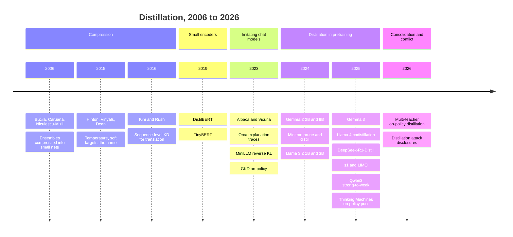
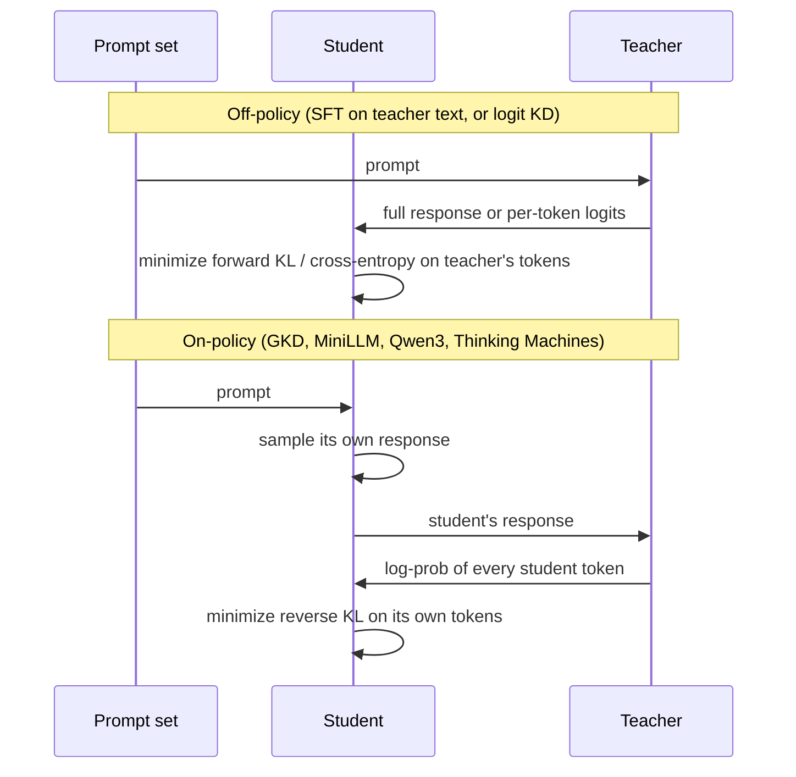

---
tags:
  - ai-ml
  - training
  - distillation
  - small-models
  - post-training
status: draft
sources:
  - https://arxiv.org/abs/1503.02531
  - https://arxiv.org/abs/2505.09388
  - https://arxiv.org/abs/2408.00118
  - https://arxiv.org/abs/2501.12948
  - https://cs.cornell.edu/~caruana/compression.kdd06.pdf
  - https://arxiv.org/abs/1606.07947
  - https://arxiv.org/abs/1910.01108
  - https://arxiv.org/abs/1909.10351
  - https://crfm.stanford.edu/2023/03/13/alpaca.html
  - https://lmsys.org/blog/2023-03-30-vicuna/
  - https://arxiv.org/abs/2306.02707
  - https://arxiv.org/abs/2306.08543
  - https://arxiv.org/abs/2306.13649
  - https://arxiv.org/abs/2407.14679
  - https://ai.meta.com/blog/llama-3-2-connect-2024-vision-edge-mobile-devices/
  - https://arxiv.org/abs/2501.19393
  - https://arxiv.org/abs/2502.03387
  - https://www.thinkingmachines.ai/blog/on-policy-distillation/
  - https://arxiv.org/html/2606.19348
  - https://huggingface.co/blog/sergiopaniego/distillation-2026
  - https://ai.meta.com/blog/Llama-4-multimodal-intelligence/
  - https://arxiv.org/abs/2503.19786
  - https://github.com/simplescaling/s1
  - https://arxiv.org/html/2604.00626v3
  - https://huggingface.co/papers/2607.02770
  - https://huggingface.co/Qwen/Qwen3.5-9B
  - https://huggingface.co/blog/nvidia/nemotron-3-nano-4b
  - https://arxiv.org/html/2508.10925v1
  - https://www.openai.com/policies/terms-of-use/
  - https://restofworld.org/2026/openai-deepseek-distillation-dispute-us-china/
  - https://anthropic.com/news/detecting-and-preventing-distillation-attacks
  - https://anthropic.com/research/distillation-defenses
  - https://arxiv.org/abs/2502.08606
  - https://arxiv.org/abs/2503.20083
  - https://arxiv.org/abs/2505.17612
  - https://arxiv.org/pdf/2608.06802
  - https://arxiv.org/pdf/2606.01249
created: 2026-11-26
updated: 2026-11-26
---

## Table Of Contents

---

- [[#TL;DR|TL;DR]]
- [[#The Problem|The Problem]]
- [[#Foundations|Foundations]]
    - [[#Teacher and Student|Teacher and Student]]
    - [[#Hard Labels vs Soft Targets|Hard Labels vs Soft Targets]]
    - [[#Softmax Temperature|Softmax Temperature]]
    - [[#Forward and Reverse KL Divergence|Forward and Reverse KL Divergence]]
    - [[#Distilling from Teacher Samples|Distilling from Teacher Samples]]
- [[#How We Got Here|How We Got Here]]
- [[#How It Works|How It Works]]
    - [[#The Knowledge Distillation Loss|The Knowledge Distillation Loss]]
    - [[#A Worked Example with Three Classes|A Worked Example with Three Classes]]
    - [[#Three Things You Can Match|Three Things You Can Match]]
    - [[#Off-Policy vs On-Policy Distillation|Off-Policy vs On-Policy Distillation]]
- [[#Where It Is Now|Where It Is Now]]
    - [[#Distilling Reasoning Beats RL for Small Models|Distilling Reasoning Beats RL for Small Models]]
    - [[#On-Policy Distillation and What It Costs|On-Policy Distillation and What It Costs]]
    - [[#Which Current Models Are Distilled|Which Current Models Are Distilled]]
    - [[#Terms of Service and Distillation Attacks|Terms of Service and Distillation Attacks]]
- [[#Trade-offs & Open Problems|Trade-offs & Open Problems]]
- [[#Resources|Resources]]
- [[#Related Notes|Related Notes]]

## ***TL;DR***
---
*Distillation trains a small "student" model to imitate a large "teacher": instead of learning only from the one right answer, the student learns from the teacher's whole probability distribution, or from text the teacher wrote. It is how almost every strong small language model of 2024 to 2026 was made, and the cheapest known way to give a small model reasoning skills.*

- **What it is:** a training method, not a compression format. The student is a new, smaller network trained on the teacher's outputs (soft probabilities, hidden states or generated text). Contrast [[Quantization]], which keeps the same model and stores it in fewer bits.
- **The core idea:** a teacher's soft targets say which wrong answers are *almost* right ("dark knowledge"), which is far more information per example than a one-hot label. Softening them with a temperature $T$ and matching them with a KL divergence is Hinton, Vinyals and Dean's 2015 recipe ([Hinton et al., 2015](https://arxiv.org/abs/1503.02531)).
- **The LLM-era twist:** off-policy distillation (train on teacher text or teacher logits) is cheap but the student never learns to recover from its own mistakes. On-policy distillation (student writes, teacher grades every token with reverse KL) fixes that, and beat RL on Qwen3-8B (74.4% vs 67.6% on AIME'24) for about a tenth of the GPU hours ([Qwen, May 2025](https://arxiv.org/abs/2505.09388)).
- **Where it is now (Nov 2026):** distilled small models are the norm (Gemma 3, Llama 3.2, Qwen3, Nemotron 3 Nano 4B), and frontier pipelines such as DeepSeek-V4 now merge per-domain RL experts into one model with multi-teacher on-policy distillation. Disclosure is thinning (Gemma 4 and Qwen3.5 do not spell out their recipes), and distilling closed models is a live dispute: Anthropic reported about 24,000 fraudulent accounts used to distill Claude in February 2026.

## ***The Problem***
---
*The biggest models are the best, but they are too slow and expensive to serve everywhere and too large for a phone. Training a small model from scratch on the same data leaves a lot of quality on the table; distillation is how you transfer most of the big model's skill into a model you can afford to run.*

Three forces make this the central problem of small-model training:

| Force | Why it pushes toward distillation | Example |
|---|---|---|
| Inference cost dominates | A model is trained once and served billions of times, so per-token cost matters more than training cost | The reason labs overtrain small models far past the Chinchilla point (see [[Scaling Laws]]) |
| Small models learn inefficiently from hard labels | A one-hot next token is a noisy, low-information target; a small model has little capacity to waste on noise | Gemma 2's 2B and 9B were trained on teacher distributions instead of next tokens ([Gemma Team, 2024](https://arxiv.org/abs/2408.00118)) |
| Some skills are expensive to learn directly | Long chain-of-thought reasoning via RL needs huge compute and may not work at all in small models | DeepSeek-R1's distilled 32B beat the same 32B base trained with large-scale RL on every reasoning benchmark it reported ([DeepSeek-AI, 2025](https://arxiv.org/abs/2501.12948)) |

The question distillation answers: given a strong teacher and a fixed budget for a small student, what should the student be trained *on*, and with what loss, to get as close to the teacher as possible?

## ***Foundations***
---
*Five ideas carry the whole topic: a teacher and a student, the difference between a hard label and a full probability distribution, how temperature reshapes that distribution, the KL divergence that measures how far the student is from the teacher, and the fact that you can distill just by training on text the teacher wrote.*

#### **Teacher and Student**

The **teacher** is a large, already-trained model (or an ensemble). The **student** is a smaller model trained to imitate it. The student is not a compressed copy of the teacher's weights; it is a new network, often with a different depth, width or even architecture, that learns to produce the same *outputs*. Only the teacher's outputs (and sometimes its hidden states) are needed, and only during training. At deployment the teacher is gone and you pay only for the student.

This is the key contrast with [[Quantization]], which keeps the same model and stores its weights in fewer bits. Distillation changes the parameter count; quantization changes the bytes per parameter. The two stack: a distilled 4B model can then be quantized to 4 bits.

#### **Hard Labels vs Soft Targets**

A normal training example has a **hard label**: one correct answer, written as a one-hot vector. For a next-token predictor, the label is the single token that actually came next in the text. The loss only says "this token, not the others".

A teacher gives a **soft target**: its whole probability distribution over the answers. For the prompt "The capital of France is", a teacher might put 0.90 on "Paris", 0.04 on "a", 0.02 on "the" and tiny amounts on thousands of others. That vector says far more than the hard label:

- **Which wrong answers are nearly right.** Hinton's example: an image of a BMW has only a tiny chance of being mistaken for a garbage truck, but that mistake is still many times more probable than mistaking it for a carrot. Those ratios between wrong answers encode how the teacher sees the world, and are widely called "dark knowledge" ([Hinton et al., 2015](https://arxiv.org/abs/1503.02531)).
- **How sure the teacher is.** A peaked distribution says "easy"; a flat one says "genuinely ambiguous".
- **More bits per example.** A hard label carries at most $\log_2 V$ bits; a full distribution constrains every one of the $V$ outputs. On speech recognition, a model trained on hard labels from 3% of the data reached 44.5% test frame accuracy, while the same model trained on the teacher's soft targets for that 3% reached 57.0%, close to the 58.9% of a model trained on all the data ([Hinton et al., 2015](https://arxiv.org/abs/1503.02531)).

#### **Softmax Temperature**

A network outputs **logits** $z_i$, and softmax turns them into probabilities. Temperature $T$ divides the logits first:

$$
p_i(T) = \frac{\exp(z_i / T)}{\sum_j \exp(z_j / T)}
$$

*In plain English: $T = 1$ is the normal softmax. A higher $T$ squashes the logits closer together, so the distribution gets flatter and the small probabilities grow; a lower $T$ sharpens it toward the top answer.*

A well-trained teacher is very confident, so at $T = 1$ the wrong-answer probabilities are tiny and contribute almost nothing to a cross-entropy loss. Raising $T$ makes that dark knowledge large enough to learn from. Both teacher and student are softened with the same $T$ during distillation; the student then runs at $T = 1$ at inference. See the [[#A Worked Example with Three Classes|worked example]] below.

#### **Forward and Reverse KL Divergence**

To make the student's distribution $q$ match the teacher's $p$, you need a distance between distributions. The standard one is the **Kullback-Leibler divergence**:

$$
\mathrm{KL}(p \,\|\, q) = \sum_i p_i \log \frac{p_i}{q_i}
$$

*In plain English: the average extra "surprise" (in nats) you suffer by using $q$ when the truth is $p$. It is zero only when the two match, and it is not symmetric, so the order matters.*

| | Forward KL, $\mathrm{KL}(p_{\text{teacher}} \,\|\, q_{\text{student}})$ | Reverse KL, $\mathrm{KL}(q_{\text{student}} \,\|\, p_{\text{teacher}})$ |
|---|---|---|
| Averaged over | What the teacher considers likely | What the student considers likely |
| Big penalty when | Student gives near-zero probability where the teacher has mass | Student puts mass where the teacher has near-zero |
| Behaviour | **Mode-covering**: spreads out to cover every teacher mode | **Mode-seeking**: locks onto one or a few teacher modes |
| Risk for a small student | Too little capacity to cover everything, so it smears probability into "gaps" and generates text the teacher never would | Less diversity; may ignore valid alternatives |
| Used by | Hinton KD, DistilBERT, most logit distillation in pretraining | MiniLLM, GKD variants, on-policy distillation |

Cross-entropy and forward KL differ only by the teacher's own entropy, which is a constant for the student, so minimizing $H(p, q) = -\sum_i p_i \log q_i$ is the same as minimizing forward KL. The mode-covering vs mode-seeking argument is why MiniLLM switched to reverse KL for generative models: with thousands of plausible continuations, a small student cannot cover them all, and forward KL pushes it toward "overestimating the low-probability regions of the teacher distribution" ([Gu et al., 2023](https://arxiv.org/abs/2306.08543)).

#### **Distilling from Teacher Samples**

If you cannot see the teacher's probabilities (a closed API), or do not want to store them, you can still distill: have the teacher **generate text**, then train the student on it with ordinary next-token cross-entropy, exactly like supervised fine-tuning. Each sampled token is a one-sample estimate of the teacher's distribution, so in expectation this is forward-KL distillation over whole sequences. Kim & Rush introduced this "sequence-level" distillation for translation, training the student on the teacher's beam-search outputs ([Kim & Rush, 2016](https://arxiv.org/abs/1606.07947)). It is noisier per token than matching logits, but it works across different tokenizers and needs only API access, which is why it powers instruction-data distillation (Alpaca, Orca), reasoning-trace distillation (DeepSeek-R1-Distill) and the legal fights over distilling closed models.

## ***How We Got Here***
---
*Distillation started as a trick to shrink ensembles (2006), got its name and its temperature in 2015, shrank BERT in 2019, and became the default way to build small LLMs once labs had giant teachers. Each step answered a concrete problem: models too big to deploy, students that ignore the teacher's uncertainty, students that cannot recover from their own errors, and small models that RL cannot teach to reason.*

| Year | What changed | Problem it answered | Source |
|---|---|---|---|
| 2006 | Label a large unlabeled or synthetic (MUNGE) set with a big ensemble, train a neural net on it. Mimic nets about "1000 times smaller and 1000 times faster" with nearly the same accuracy. | The best models were ensembles of hundreds of classifiers, too big and slow to deploy. | [Bucila et al., KDD 2006](https://cs.cornell.edu/~caruana/compression.kdd06.pdf) |
| 2015 | Soften teacher and student with temperature $T$, match them, mix with the hard-label loss. MNIST: a small net went from 146 test errors to 74 (teacher: 67). Speech: a single distilled model kept most of a 10-model ensemble's gain (60.8% vs 61.1% frame accuracy, same 10.7% WER). | Matching only the top answer throws away what the teacher knows about similar classes. | [Hinton et al.](https://arxiv.org/abs/1503.02531) |
| 2016 | Train the student on the teacher's beam-search output sequences. Best student ran 10x faster than its teacher; with pruning, 13x fewer parameters for 0.4 BLEU. | Word-level KD ignores that errors compound over a generated sequence. | [Kim & Rush](https://arxiv.org/abs/1606.07947) |
| 2019 | DistilBERT: 40% smaller, 60% faster, 97% of BERT's language understanding, using a triple loss (masked LM, distillation, cosine). TinyBERT: layer-wise Transformer distillation in pretraining and fine-tuning; 4 layers, 7.5x smaller, 9.4x faster, over 96.8% of BERT-base on GLUE. | BERT was too slow and large for phones and cheap serving. | [Sanh et al.](https://arxiv.org/abs/1910.01108), [Jiao et al.](https://arxiv.org/abs/1909.10351) |
| 2023 | Alpaca: LLaMA 7B on 52K instructions written by text-davinci-003, under $600 total. Vicuna: LLaMA on about 70K ShareGPT conversations, about $300 to train. | Open models could not follow instructions; teacher API text was a cheap substitute for human demonstrations. | [Stanford CRFM](https://crfm.stanford.edu/2023/03/13/alpaca.html), [LMSYS](https://lmsys.org/blog/2023-03-30-vicuna/) |
| 2023 | Orca: a 13B model trained on GPT-4 and ChatGPT explanation traces ("step-by-step thought processes"), not just answers. | Imitation models learned "to imitate the style, but not the reasoning process." | [Mukherjee et al.](https://arxiv.org/abs/2306.02707) |
| 2023 | MiniLLM: reverse KL optimized on-policy. GKD: train on the student's own samples with teacher feedback, any divergence, combinable with RLHF. | Forward KL makes small generative students spread mass where the teacher has none; off-policy training suffers train/inference mismatch. | [Gu et al.](https://arxiv.org/abs/2306.08543), [Agarwal et al.](https://arxiv.org/abs/2306.13649) |
| 2024 | Gemma 2 trains its 2B and 9B on teacher distributions instead of next tokens, on more than 50x the compute-optimal token count. Ablation: a 2B distilled from a 7B averaged 67.7 vs 60.3 from scratch. | Small models trained on one-hot next tokens waste their long training runs. | [Gemma Team](https://arxiv.org/abs/2408.00118) |
| 2024 | Minitron: [[Pruning\|prune]] Nemotron-4 15B to 8B and 4B, then distill. Up to 40x fewer training tokens per model, 1.8x less compute for the family, up to 16% better MMLU than from scratch. Llama 3.2 1B/3B: pruned from Llama 3.1 8B, with 8B and 70B logits as pretraining targets. | Training every size in a family from scratch is wasteful when a big model already exists. | [Muralidharan et al.](https://arxiv.org/abs/2407.14679), [Meta, Sep 2024](https://ai.meta.com/blog/llama-3-2-connect-2024-vision-edge-mobile-devices/) |
| 2025 | DeepSeek-R1's reasoning distilled into six Qwen2.5 and Llama models by SFT on 800K samples, no RL. s1 (1,000 traces) and LIMO (about 1% of prior data) show tiny curated sets suffice. | Small models trained with RL alone reasoned poorly and at great cost. | [DeepSeek-AI](https://arxiv.org/abs/2501.12948), [Muennighoff et al.](https://arxiv.org/abs/2501.19393), [Ye et al.](https://arxiv.org/abs/2502.03387) |
| 2025 | Qwen3's small models: off-policy then on-policy distillation from Qwen3-32B and Qwen3-235B-A22B. Thinking Machines shows on-policy distillation reaching RL-level reasoning at a fraction of the cost. | Running the full multi-stage RL pipeline for every small size is too expensive. | [Qwen Team](https://arxiv.org/abs/2505.09388), [Thinking Machines](https://www.thinkingmachines.ai/blog/on-policy-distillation/) |
| 2026 | Frontier pipelines train per-domain RL experts and merge them into one model with multi-teacher on-policy distillation (DeepSeek-V4, MiMo-V2-Flash, Nemotron 3 Ultra). | Mixed multi-domain RL is unstable and domains interfere. | [DeepSeek-AI](https://arxiv.org/html/2606.19348), [Paniego, HF, Jul 2026](https://huggingface.co/blog/sergiopaniego/distillation-2026) |

## ***How It Works***
---
*The classic recipe mixes two losses: cross-entropy on the true labels and a temperature-softened KL to the teacher. For language models the real choice is what text the student is graded on: text the teacher wrote (off-policy) or text the student wrote (on-policy).*

#### **The Knowledge Distillation Loss**

Hinton, Vinyals and Dean's objective, in the form most papers write it:

$$
\mathcal{L}_{\text{KD}} = (1 - \alpha)\, \mathrm{CE}\big(y,\ q^{(1)}\big) \;+\; \alpha\, T^2\, \mathrm{KL}\big(p^{(T)} \,\|\, q^{(T)}\big)
$$

where $y$ is the hard label, $q^{(1)}$ is the student's normal softmax, $p^{(T)}$ and $q^{(T)}$ are teacher and student softened at temperature $T$, and $\alpha \in [0, 1]$ weights the two terms.

*In plain English: the first term says "get the right answer"; the second says "and be unsure in the same way the teacher is". Softening both with $T$ exposes the teacher's small probabilities. The $T^2$ is bookkeeping: the gradient of the soft term shrinks like $1/T^2$, so multiplying by $T^2$ keeps the two terms balanced when you change $T$* ([Hinton et al., 2015](https://arxiv.org/abs/1503.02531)).

Two limits help: with $\alpha = 0$ it is ordinary training; with $\alpha = 1$ the student never sees the true labels. Hinton et al. found that a considerably lower weight on the hard-label term worked best. In LLM pretraining, labs often drop the hard-label term entirely: Gemma 2's 2B and 9B replaced next-token prediction with cross-entropy against the teacher's full distribution, $-\sum_x P_T(x \mid x_c) \log P_S(x \mid x_c)$ ([Gemma Team, 2024](https://arxiv.org/abs/2408.00118)). Meta's Llama 4 went the other way and used a loss that "dynamically weights the soft and hard targets through training" ([Meta, Apr 2025](https://ai.meta.com/blog/Llama-4-multimodal-intelligence/)).

#### **A Worked Example with Three Classes**

Three classes: *dog*, *wolf*, *car*. The image is a dog. The teacher's logits are $z = [6, 4, 0]$; a half-trained student's are $[4, 4, 1]$.

| | dog | wolf | car | KL(teacher ‖ student) | $T^2 \cdot$ KL |
|---|---|---|---|---|---|
| Hard label | 1 | 0 | 0 | | |
| Teacher, $T = 1$ | 0.879 | 0.119 | 0.002 | | |
| Student, $T = 1$ | 0.488 | 0.488 | 0.024 | 0.344 | 0.344 |
| Teacher, $T = 4$ | 0.547 | 0.332 | 0.122 | | |
| Student, $T = 4$ | 0.405 | 0.405 | 0.191 | 0.044 | 0.701 |

Reading the table:

- **At $T = 1$** the teacher's target is nearly a hard label. "Car" gets 0.002, so the student learns almost nothing about how dissimilar cars are. The only extra signal over the hard label is "wolf, a bit".
- **At $T = 4$** the same logits give 0.547 / 0.332 / 0.122. Now the student is told clearly: dog first, wolf a close second, car a distant third. That ranking is the dark knowledge.
- **The $T^2$ factor:** the raw KL at $T = 4$ (0.044) is about 8x smaller than at $T = 1$, because softened distributions are all closer together. Multiplying by $T^2 = 16$ restores a usable loss scale (0.701).
- **The hard-label term** for this student is $-\ln 0.488 = 0.718$ nats; it only cares about the dog column.

For an LLM the same arithmetic runs over a vocabulary of tens to hundreds of thousands of tokens at every position, which is why storing full teacher distributions is expensive. Gemma 3 kept 256 logits per token, sampled according to the teacher's probabilities, set the rest to zero and renormalized ([Gemma Team, 2025](https://arxiv.org/abs/2503.19786)).

#### **Three Things You Can Match**

| Level | What the student copies | Example | Needs |
|---|---|---|---|
| Logits / token distributions | Teacher's full or top-$k$ next-token probabilities at each position | Hinton KD, DistilBERT, Gemma 2/3, Llama 3.2 1B/3B | White-box teacher, same vocabulary |
| Intermediate representations | Internal layers, matched layer by layer | TinyBERT's "Transformer distillation" | White-box teacher, a mapping between layers |
| Sequences | Text the teacher generated; plain cross-entropy | Kim & Rush, Alpaca, Orca, R1-Distill, s1 | Only sampling access; any tokenizer |

#### **Off-Policy vs On-Policy Distillation**

Every method above is **off-policy**: the student is trained on contexts that come from the dataset or from the teacher. At inference, though, the student conditions on *its own* previous tokens. Once it makes a mistake the teacher would never make, it is in a state it never trained on, and errors compound. This is called **exposure bias**; MiniLLM, trained on-policy, reported lower exposure bias than off-policy baselines ([Gu et al., 2023](https://arxiv.org/abs/2306.08543)).

**On-policy distillation** fixes this: the student generates, the teacher grades every token of the student's output, and the student is updated to lower the per-token reverse KL. It combines RL's on-policy sampling with distillation's dense, per-token signal. GKD framed the problem as a "distribution mismatch between output sequences seen during training and those generated by the student" and fixed it by training on the student's own outputs ([Agarwal et al., 2023](https://arxiv.org/abs/2306.13649)).

| | Off-policy distillation (SFT) | Reinforcement learning | On-policy distillation |
|---|---|---|---|
| Where the text comes from | Teacher | Student | Student |
| Signal per sequence | Dense: every token has a target | Sparse: one reward at the end | Dense: every token graded by teacher |
| Fixes compounding errors | No | Yes | Yes |
| Needs | Teacher samples or logits | A reward function or verifier | Teacher log-probs on student text (same tokenizer, white-box) |

The per-token reverse KL in on-policy distillation can be written as a reward: for each student token $x_t$, $r_t = \log p_{\text{teacher}}(x_t \mid x_{<t}) - \log q_{\text{student}}(x_t \mid x_{<t})$. Thinking Machines implemented it exactly this way: sample from the student, have the teacher score each token, use the negative per-token reverse KL as the advantage, with a discount factor of zero so each token is judged on its own ([Lu et al., Oct 2025](https://www.thinkingmachines.ai/blog/on-policy-distillation/)). Their framing of why it is efficient: RL teaches a fixed number of bits per episode, while distillation teaches $O(N)$ bits for an $N$-token episode.

## ***Where It Is Now***
---
*As of November 2026, distillation is a standard stage in building small open models and, increasingly, in building big ones: frontier pipelines train specialist RL experts and fold them into one model with on-policy distillation. It is also the cheapest known route to reasoning in small models, and a live security and policy fight between labs.*

#### **Distilling Reasoning Beats RL for Small Models**

The defining result of 2025 came from DeepSeek-R1. DeepSeek took about 800K samples curated with R1, fine-tuned six open models on them with SFT only, and compared against running large-scale RL directly on the same 32B base ([DeepSeek-AI, Jan 2025](https://arxiv.org/abs/2501.12948)):

| Model (AIME 2024 pass@1) | How it was trained | Score |
|---|---|---|
| QwQ-32B-Preview | Qwen's own reasoning model | 50.0 |
| DeepSeek-R1-Zero-Qwen-32B | Large-scale RL on Qwen2.5-32B | 47.0 |
| DeepSeek-R1-Distill-Qwen-32B | SFT on R1 traces, no RL | **72.6** |
| R1-Distill-Qwen-1.5B / 7B / 14B | SFT on R1 traces | 28.9 / 55.5 / 69.7 |
| R1-Distill-Llama-8B / 70B | SFT on R1 traces | 50.4 / 70.0 |

DeepSeek's conclusion: distilling stronger models into smaller ones "yields excellent results," while small models relying on large-scale RL "require enormous computational power and may not even achieve the performance of distillation." Their caveat: going beyond the frontier still needs stronger base models and larger-scale RL. Distillation copies capability; it does not create it. See [[RL for Reasoning]] and [[Reasoning Models]].

Two follow-ups showed the data can be tiny if it is well chosen. **s1** fine-tuned Qwen2.5-32B-Instruct on just 1,000 questions with reasoning traces (generated with Gemini; a later s1K-1.1 used R1 traces) and beat o1-preview on competition math by up to 27% ([Muennighoff et al., Jan 2025](https://arxiv.org/abs/2501.19393); [s1 repo](https://github.com/simplescaling/s1)). **LIMO** reached 63.3% on AIME24 and 95.6% on MATH500 with about 1% of the training data of earlier approaches ([Ye et al., Feb 2025](https://arxiv.org/abs/2502.03387)).

#### **On-Policy Distillation and What It Costs**

Off-policy reasoning SFT works, but on-policy distillation gets more per GPU-hour. The cleanest numbers, from Qwen3-8B (quoted in the Thinking Machines post from the Qwen3 report):

| Method on Qwen3-8B | AIME'24 | GPU hours |
|---|---|---|
| Off-policy distillation | 55.0% | |
| Reinforcement learning | 67.6% | 17,920 |
| On-policy distillation | **74.4%** | **1,800** |

So on-policy distillation beat RL by about 7 points for about a tenth of the GPU hours ([Qwen Team, May 2025](https://arxiv.org/abs/2505.09388); [Lu et al., Oct 2025](https://www.thinkingmachines.ai/blog/on-policy-distillation/)). Thinking Machines' own runs (Qwen3-8B-Base student, Oct 2025):

- **Against SFT:** off-policy SFT on 400K prompts reached 60% on AIME'24 and was extrapolated to need about 2M prompts for 70%. On-policy distillation reached 70% in about 150 steps (about 77K prompts). They put the saving at 9x to 30x depending on whether the teacher's sampling cost for SFT data is counted, about 18x in GPU hours.
- **Against RL:** distilling from an RL-trained teacher recovered its AIME score in under 10 gradient steps where RL took 70, which they estimate as 50x to 100x more compute-efficient.
- **Against forgetting:** after mid-training an 8B assistant on internal documents (IF-eval chat score fell from 85% to 79%), on-policy distillation from the original checkpoint restored IF-eval to 83% while keeping the new knowledge (41% vs 18% on internal QA).

By 2026 this was the fastest-moving corner of the field: a Tencent survey counts on-policy distillation as a core training ingredient in several production systems ([Song & Zheng, 2026](https://arxiv.org/html/2604.00626v3)), and arXiv saw a stream of 2026 papers on its failure modes and fixes, from [warm-up schedules](https://arxiv.org/pdf/2608.06802) to [trust regions](https://arxiv.org/pdf/2606.01249).

#### **Which Current Models Are Distilled**

| Model family (date) | What is publicly stated | Source |
|---|---|---|
| Gemma 2 (2024) | 2B and 9B pretrained on a teacher's distribution instead of next tokens; 27B from scratch | [Gemma Team](https://arxiv.org/abs/2408.00118) |
| Gemma 3 (Mar 2025) | "All Gemma 3 models are trained with knowledge distillation": 256 sampled logits per token in pretraining, distillation from a large instruction-tuned teacher in post-training, then RL | [Gemma Team](https://arxiv.org/abs/2503.19786) |
| Gemma 4 (report Jun 2026) | E2B, E4B, 12B, 26B-A4B MoE, 31B; the report says pretraining and post-training follow an approach "similar" to Gemma 3's but does not spell out distillation | [Gemma Team](https://huggingface.co/papers/2607.02770) |
| Llama 3.2 1B/3B (Sep 2024) | Structured pruning of Llama 3.1 8B, then 8B and 70B logits as token-level pretraining targets | [Meta](https://ai.meta.com/blog/llama-3-2-connect-2024-vision-edge-mobile-devices/) |
| Llama 4 Maverick (Apr 2025) | Codistilled during pretraining from Llama 4 Behemoth (288B active, nearly 2T total), with soft and hard targets dynamically weighted | [Meta](https://ai.meta.com/blog/Llama-4-multimodal-intelligence/) |
| Qwen3 0.6B to 14B (May 2025) | Strong-to-weak distillation: off-policy warm-up, then on-policy logit distillation from Qwen3-32B / 235B-A22B | [Qwen Team](https://arxiv.org/abs/2505.09388), [Song & Zheng](https://arxiv.org/html/2604.00626v3) |
| Qwen3.5 small, 0.8B to 9B (2026) | Model card describes pretraining, post-training and RL "scaled across million-agent environments"; it does not say whether distillation was used | [Qwen3.5-9B card](https://huggingface.co/Qwen/Qwen3.5-9B) |
| Nemotron 3 Nano 4B (Mar 2026) | Pruned and distilled from Nemotron Nano 9B v2 with a frozen 9B teacher (Nemotron Elastic), about 213B tokens across two stages, then SFT and RL | [NVIDIA, HF blog](https://huggingface.co/blog/nvidia/nemotron-3-nano-4b) |
| Nemotron 3 Ultra (2026) | Multi-teacher on-policy distillation from more than ten specialized teachers | [Paniego, HF, Jul 2026](https://huggingface.co/blog/sergiopaniego/distillation-2026) |
| DeepSeek-V4 Pro and Flash (2026) | Per-domain experts (math, code, agent, instruction following), each SFT then GRPO, merged into one model trained to minimize reverse KL to the teachers; a survey reports this replaced the mixed RL stage | [DeepSeek-AI](https://arxiv.org/html/2606.19348), [Song & Zheng](https://arxiv.org/html/2604.00626v3) |
| gpt-oss-120b / 20b (Aug 2025) | Model card says post-training used "similar CoT RL techniques as OpenAI o3"; it does not describe distillation | [OpenAI](https://arxiv.org/html/2508.10925v1) |

Three patterns stand out. First, in pretraining the teacher's logits have become an input alongside the text itself, so a small model's training set is partly another model's predictions (see [[Pretraining Data]]). Second, the teacher is no longer always bigger: in the expert-merging recipes the teachers are usually same-size checkpoints specialized with RL, and in Thinking Machines' continual-learning demo the teacher is the model's own earlier checkpoint ([Paniego, HF, Jul 2026](https://huggingface.co/blog/sergiopaniego/distillation-2026)). Third, disclosure is getting thinner: Gemma 4 and Qwen3.5 say less about distillation than Gemma 3 and Qwen3 did, gpt-oss says nothing about it, so "distilled" is often an inference, not a stated fact.

#### **Terms of Service and Distillation Attacks**

Distilling someone else's model only needs its outputs, so closed labs forbid it by contract. OpenAI's terms (effective Jan 1, 2026) bar using output "to develop models that compete with OpenAI" ([OpenAI](https://www.openai.com/policies/terms-of-use/)); Alpaca's authors cited the same clause in 2023 when they barred commercial use ([Stanford CRFM](https://crfm.stanford.edu/2023/03/13/alpaca.html)). The 2026 disputes, with sources only:

- **Feb 12, 2026:** OpenAI told the US House Select Committee on China that accounts linked to DeepSeek employees used obfuscated third-party routers to get around access restrictions and wrote code to collect outputs for distillation ([Rest of World, Feb 2026](https://restofworld.org/2026/openai-deepseek-distillation-dispute-us-china/)). No DeepSeek response was reported.
- **Feb 23, 2026:** Anthropic said DeepSeek, Moonshot AI and MiniMax ran campaigns through about 24,000 fraudulent accounts and over 16 million exchanges with Claude, targeting agentic reasoning, tool use and coding, in violation of its terms and regional restrictions ([Anthropic, Feb 2026](https://anthropic.com/news/detecting-and-preventing-distillation-attacks)).
- **Oct 12, 2026:** Anthropic described new defenses (summarized reasoning, classifiers, bans) and said reasoning tokens extracted by distillers fell 10x to 100x or more; it named Zhipu (GLM-5.3) and Moonshot ([Anthropic, Oct 2026](https://anthropic.com/research/distillation-defenses)).

These are accusations by one party; the legal status of distillation beyond contract terms is not settled in any of these sources.

## ***Trade-offs & Open Problems***
---
*Distillation is cheap, reliable and copies a teacher well, but it cannot exceed the teacher, it needs the teacher at training time, and its best form needs white-box access and a shared tokenizer. The open questions are about the gap between teacher and student, crossing vocabularies, and teaching agents rather than answers.*

| Trade-off or problem | What goes wrong | What is known |
|---|---|---|
| **Teacher-student capacity gap** | A much stronger teacher can be a worse teacher: the student cannot represent its distribution | Gemma 3 found a smaller teacher is better for short training runs, but the trend reverses for long ones ([Gemma Team, 2025](https://arxiv.org/abs/2503.19786)). Apple's distillation scaling laws report a capacity gap "when the teacher becomes too powerful relative to the student" ([Busbridge et al., 2025](https://arxiv.org/abs/2502.08606), as quoted by [Song & Zheng](https://arxiv.org/html/2604.00626v3)). |
| **Is it worth it at all?** | If you must train the teacher too, its cost counts | Distillation beats plain pretraining only up to a compute level that grows with student size, and if one student needs a newly trained teacher, "supervised learning is generally preferable" ([Busbridge et al., 2025](https://arxiv.org/abs/2502.08606)). Its value comes from reusing one teacher for many students. See [[Scaling Laws]]. |
| **Different tokenizers** | Logit matching assumes the same vocabulary; across model families the token boundaries differ | Sequence-level SFT sidesteps it but loses the dense signal. Approximate likelihood matching distills across tokenizers, including subword to byte-level ([Minixhofer et al., 2025](https://arxiv.org/abs/2503.20083)). See [[Tokenization and Embeddings]]. |
| **Ceiling at the teacher** | The student inherits the teacher's errors and cannot exceed it | DeepSeek: pushing past the frontier still needs stronger base models and more RL ([DeepSeek-AI, 2025](https://arxiv.org/abs/2501.12948)). |
| **Style without substance** | Students trained on teacher text copy its tone more than its reasoning | Orca's authors made this the motivation for explanation traces ([Mukherjee et al., 2023](https://arxiv.org/abs/2306.02707)). |
| **Agentic behavior** | Multi-step tool use needs whole trajectories, and credit for a late failure is hard to assign | Distilling full agent trajectories with retrieval and code tools let 0.5B to 3B students match the next size up trained with plain chain-of-thought distillation ([Kang et al., 2025](https://arxiv.org/abs/2505.17612)); the 2026 survey lists multi-turn agentic failure modes and agent-level distillation as open ([Song & Zheng](https://arxiv.org/html/2604.00626v3)). |
| **On-policy instability** | Teacher feedback on a student's broken prefix can mislead ("flawed prefix trap"); responses can grow longer and less diverse | Listed failure modes include length inflation and diversity collapse, mitigated with reference divergence constraints and rollout mixing ([Song & Zheng](https://arxiv.org/html/2604.00626v3)). |
| **Teacher inference cost** | On-policy distillation needs a teacher forward pass on every student rollout | Making it affordable for trillion-parameter teachers is an open question ([Song & Zheng](https://arxiv.org/html/2604.00626v3)); DeepSeek-V4 reportedly caches teacher hidden states and reconstructs logits on the fly. |
| **Access and legality** | The strongest teachers are closed, and their terms forbid it | See Terms of Service and Distillation Attacks under Where It Is Now. |
| **Distillation vs [[Quantization]]** | They solve different problems | Quantization shrinks the bytes per weight of the same model and needs little or no training; distillation trains a new, smaller model, which costs a training run but can change the architecture and parameter count. The two stack: a distilled model can then be quantized. |

## ***Resources***
---
*Start with Hinton for the core loss, then MiniLLM and GKD for why LLM distillation went on-policy. The Thinking Machines post is the clearest modern explainer with real costs, and DeepSeek-R1 section 4.1 is the key evidence on distillation vs RL.*

**Papers**
- [Model Compression](https://cs.cornell.edu/~caruana/compression.kdd06.pdf): Bucila, Caruana, Niculescu-Mizil, KDD 2006. The original idea of training a small net to mimic an ensemble.
- [Distilling the Knowledge in a Neural Network](https://arxiv.org/abs/1503.02531): Hinton, Vinyals, Dean, Mar 2015. Temperature, soft targets and the KD loss.
- [Sequence-Level Knowledge Distillation](https://arxiv.org/abs/1606.07947): Kim & Rush, Jun 2016 (EMNLP 2016). Training on teacher outputs for sequence models.
- [DistilBERT](https://arxiv.org/abs/1910.01108): Sanh et al. (Hugging Face), Oct 2019. The standard small BERT.
- [TinyBERT](https://arxiv.org/abs/1909.10351): Jiao et al., Sep 2019. Layer-wise Transformer distillation.
- [Orca](https://arxiv.org/abs/2306.02707): Mukherjee et al. (Microsoft Research), Jun 2023. Distilling explanation traces.
- [MiniLLM](https://arxiv.org/abs/2306.08543): Gu et al., Jun 2023 (ICLR 2024). Reverse KL for generative students.
- [On-Policy Distillation of Language Models (GKD)](https://arxiv.org/abs/2306.13649): Agarwal et al. (Google DeepMind), Jun 2023 (ICLR 2024). Training on student samples.
- [Gemma 2](https://arxiv.org/abs/2408.00118): Gemma Team, 2024. Distillation replacing next-token prediction in pretraining.
- [Compact Language Models via Pruning and Knowledge Distillation](https://arxiv.org/abs/2407.14679): Muralidharan et al. (NVIDIA), Jul 2024 (NeurIPS 2024). Minitron prune-and-distill.
- [DeepSeek-R1](https://arxiv.org/abs/2501.12948): DeepSeek-AI, Jan 2025. Reasoning distillation and the distillation vs RL comparison.
- [s1: Simple test-time scaling](https://arxiv.org/abs/2501.19393): Muennighoff et al., Jan 2025. 1,000 curated traces.
- [LIMO: Less is More for Reasoning](https://arxiv.org/abs/2502.03387): Ye et al., Feb 2025. Tiny curated reasoning data.
- [Distillation Scaling Laws](https://arxiv.org/abs/2502.08606): Busbridge et al. (Apple), Feb 2025 (ICML 2025). When distillation beats pretraining.
- [Gemma 3 Technical Report](https://arxiv.org/abs/2503.19786): Gemma Team, Mar 2025. Sampled-logit distillation and the teacher-size experiment.
- [Universal Cross-Tokenizer Distillation via Approximate Likelihood Matching](https://arxiv.org/abs/2503.20083): Minixhofer, Vulić, Ponti, Mar 2025. Distilling across vocabularies.
- [Qwen3 Technical Report](https://arxiv.org/abs/2505.09388): Qwen Team, May 2025. Strong-to-weak on-policy distillation and its cost vs RL.
- [Distilling LLM Agent into Small Models with Retrieval and Code Tools](https://arxiv.org/abs/2505.17612): Kang et al., May 2025 (NeurIPS 2025). Agent trajectory distillation.
- [A Survey of On-Policy Distillation for Large Language Models](https://arxiv.org/html/2604.00626v3): Song & Zheng (Tencent), 2026. Production users and open problems.
- [DeepSeek-V4](https://arxiv.org/html/2606.19348): DeepSeek-AI, 2026. Expert training merged by on-policy distillation.

**Posts and explainers**
- [On-Policy Distillation](https://www.thinkingmachines.ai/blog/on-policy-distillation/): Kevin Lu et al. (Thinking Machines), Oct 2025. The best practical explainer, with cost comparisons.
- [Distillation in 2026 (so far)](https://huggingface.co/blog/sergiopaniego/distillation-2026): Sergio Paniego (Hugging Face), Jul 2026. Which frontier models use distillation and how.
- [Llama 3.2](https://ai.meta.com/blog/llama-3-2-connect-2024-vision-edge-mobile-devices/) and [Llama 4](https://ai.meta.com/blog/Llama-4-multimodal-intelligence/): Meta, Sep 2024 and Apr 2025. Logit distillation and codistillation in pretraining.
- [Nemotron 3 Nano 4B](https://huggingface.co/blog/nvidia/nemotron-3-nano-4b): NVIDIA, Mar 2026. A current prune-and-distill recipe.
- [Alpaca](https://crfm.stanford.edu/2023/03/13/alpaca.html) and [Vicuna](https://lmsys.org/blog/2023-03-30-vicuna/): Stanford CRFM and LMSYS, Mar 2023. The start of distilling chat models from APIs.

**Policy**
- [Detecting and preventing distillation attacks](https://anthropic.com/news/detecting-and-preventing-distillation-attacks): Anthropic, Feb 2026.
- [Strengthening our defenses against distillation attacks](https://anthropic.com/research/distillation-defenses): Anthropic, Oct 2026.
- [OpenAI-DeepSeek distillation dispute](https://restofworld.org/2026/openai-deepseek-distillation-dispute-us-china/): Rest of World, Feb 2026.

## Related Notes

- [[RL for Reasoning]] — RL creates reasoning skills in large models; distillation moves them into small ones, and on-policy distillation borrows RL's sampling loop.
- [[Reasoning Models]] — R1-Distill, s1 and LIMO are distilled reasoning models.
- [[Quantization]] — The other way to shrink a model: same network in fewer bits, versus a new smaller network.
- [[Scaling Laws]] — Why small models are overtrained, and distillation scaling laws for when a teacher pays off.
- [[Pretraining Data]] — Teacher logits and synthetic teacher text are now part of the pretraining data mix.
- [[Synthetic Data]] — The wider practice of training on model-written text, from instruction pairs to reasoning traces, and its collapse risk.
- [[Tokenization and Embeddings]] — Logit distillation needs a shared vocabulary; cross-tokenizer methods work around it.
- [[Mixture of Experts]] — Many teachers and students (Llama 4 Behemoth, DeepSeek-V4, Gemma 4 26B-A4B) are MoE models.
- [[Speculative Decoding]] — Draft models are small models whose job is to agree with a big one, the same goal distillation trains for.
- [[Pruning]] — The first half of prune-and-distill: how the child is cut from the parent before it is distilled.
