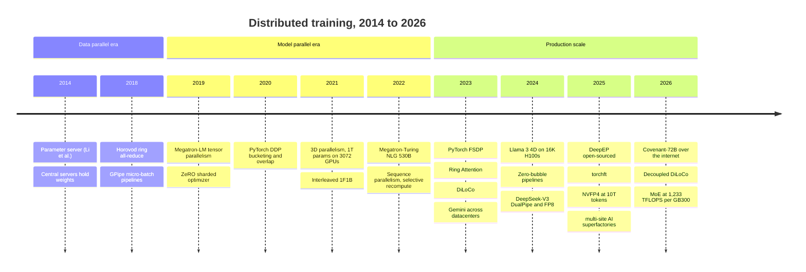
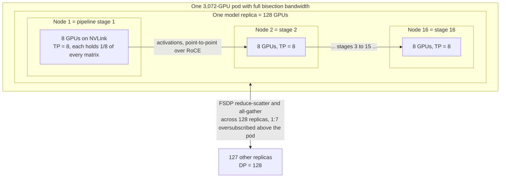

---
tags:
  - ai-ml
  - training
  - distributed-training
  - parallelism
  - systems
status: draft
sources:
  - https://www.cs.cmu.edu/~dga/papers/osdi14-paper-li_mu-abstract.html
  - https://arxiv.org/abs/1802.05799
  - https://arxiv.org/abs/1811.06965
  - https://arxiv.org/abs/1909.08053
  - https://arxiv.org/abs/1910.02054
  - https://arxiv.org/abs/2006.15704
  - https://arxiv.org/abs/2104.04473
  - https://arxiv.org/abs/2201.11990
  - https://arxiv.org/abs/2205.05198
  - https://arxiv.org/abs/2304.11277
  - https://arxiv.org/abs/2310.01889
  - https://arxiv.org/abs/2311.08105
  - https://arxiv.org/abs/2312.11805
  - https://arxiv.org/abs/2401.10241
  - https://arxiv.org/abs/2407.21783
  - https://arxiv.org/abs/2410.06511
  - https://arxiv.org/abs/2412.19437
  - https://arxiv.org/abs/2509.25149v1
  - https://arxiv.org/abs/2603.07685
  - https://arxiv.org/abs/2603.08163v2
  - https://arxiv.org/abs/2604.21428
  - https://arxiv.org/html/2605.29359
  - https://raw.githubusercontent.com/NVIDIA/nccl-tests/master/doc/PERFORMANCE.md
  - https://huggingface.co/spaces/nanotron/ultrascale-playbook/blob/main/ultra_blog.md
  - https://github.com/deepseek-ai/DeepEP
  - https://github.com/deepseek-ai/DualPipe
  - https://github.com/AI-Hypercomputer/maxtext
  - https://pytorch.org/blog/fault-tolerant-llama-training-with-2000-synthetic-failures-every-15-seconds-and-no-checkpoints-on-crusoe-l40s/
  - https://ai.meta.com/blog/llama-4-multimodal-intelligence/
  - https://deepmind.google/blog/decoupled-diloco
  - https://news.microsoft.com/source/features/ai/from-wisconsin-to-atlanta-microsoft-connects-datacenters-to-build-its-first-ai-superfactory/
  - https://aboutamazon.com/news/aws/aws-project-rainier-ai-trainium-chips-compute-cluster/
  - https://newsletter.semianalysis.com/p/100000-h100-clusters-power-network
  - https://epoch.ai/topics/data-centers
created: 2026-11-26
updated: 2026-11-26
---

## Table Of Contents

---

- [[#TL;DR|TL;DR]]
- [[#The Problem|The Problem]]
- [[#Foundations|Foundations]]
    - [[#What Has to Fit in Memory|What Has to Fit in Memory]]
    - [[#Collectives and What They Cost|Collectives and What They Cost]]
    - [[#Overlapping Compute and Communication|Overlapping Compute and Communication]]
    - [[#Activation Checkpointing|Activation Checkpointing]]
    - [[#The Bandwidth Hierarchy|The Bandwidth Hierarchy]]
- [[#How We Got Here|How We Got Here]]
- [[#How It Works|How It Works]]
    - [[#Data Parallelism|Data Parallelism]]
    - [[#ZeRO and FSDP|ZeRO and FSDP]]
    - [[#Tensor Parallelism|Tensor Parallelism]]
    - [[#Sequence and Context Parallelism|Sequence and Context Parallelism]]
    - [[#Pipeline Parallelism|Pipeline Parallelism]]
    - [[#Expert Parallelism|Expert Parallelism]]
    - [[#Combining the Dimensions|Combining the Dimensions]]
    - [[#Worked Example for a 70B Model|Worked Example for a 70B Model]]
- [[#Where It Is Now|Where It Is Now]]
    - [[#The Largest Disclosed Runs|The Largest Disclosed Runs]]
    - [[#Training Across Datacenters|Training Across Datacenters]]
    - [[#Failures, Checkpoints and Goodput|Failures, Checkpoints and Goodput]]
    - [[#Low-Precision Training and Communication|Low-Precision Training and Communication]]
    - [[#Decentralized and Low-Communication Training|Decentralized and Low-Communication Training]]
    - [[#Frameworks|Frameworks]]
- [[#Trade-offs & Open Problems|Trade-offs & Open Problems]]
- [[#Resources|Resources]]
- [[#Related Notes|Related Notes]]

## ***TL;DR***
---
*Distributed training is the set of tricks that lets one training run use thousands to hundreds of thousands of accelerators as if they were one machine. Every trick splits something (the data, the optimizer state, a matrix, the sequence, the layers or the experts) and pays for it in communication, so the art is matching each split to the right speed of wire.*

- **What it is:** a frontier model needs far more memory and compute than one chip has. Training memory for mixed-precision Adam is about **16 bytes per parameter** before activations, so a 70B model needs about 1,120 GB just for its weights, gradients and optimizer state ([ZeRO, 2019](https://arxiv.org/abs/1910.02054); [HF Ultra-Scale Playbook](https://huggingface.co/spaces/nanotron/ultrascale-playbook/blob/main/ultra_blog.md)).
- **The dimensions:** data parallelism (copy the model, split the batch), ZeRO/FSDP (also shard the copies), tensor parallelism (split each matrix), context parallelism (split the sequence), pipeline parallelism (split the layers) and expert parallelism (split a [[Mixture of Experts]] layer's experts). Real runs combine four or five of them, e.g. Llama 3 405B used TP 8 x CP x PP 16 x DP on up to 16,384 H100s ([Llama 3, 2024](https://arxiv.org/abs/2407.21783)).
- **The rule of thumb:** put the chattiest split (tensor, and now expert) inside the fast NVLink domain, pipeline between nearby nodes, and data parallelism across the slow, oversubscribed network ([Narayanan et al., 2021](https://arxiv.org/abs/2104.04473); [SemiAnalysis, 2024](https://newsletter.semianalysis.com/p/100000-h100-clusters-power-network)).
- **Where it is now (Nov 2026):** clusters are counted in hundreds of thousands of chips and no longer fit in one building, so training jobs span several datacenters (Microsoft's Fairwater "AI superfactory", Nov 2025; AWS Project Rainier for Anthropic, Oct 2025). FP8 is routine and 4-bit NVFP4 has been shown at 10T tokens. Low-communication methods in the DiLoCo family have trained a 12B model across four US regions (Google DeepMind, Apr 2026) and a 72B model over the open internet (Covenant-72B, Mar 2026).

## ***The Problem***
---
*A single accelerator has tens to a couple of hundred gigabytes of memory and a fixed FLOP rate. A frontier run needs terabytes of state and around $10^{25}$ to $10^{26}$ FLOPs, so it must be split, and every split adds communication that can leave chips idle.*

Two walls force the split:

| Wall | Numbers | What it rules out |
|---|---|---|
| **Memory** | 70B params x 16 bytes = 1,120 GB of model state, vs 80 GB on an H100 ([HF Playbook](https://huggingface.co/spaces/nanotron/ultrascale-playbook/blob/main/ultra_blog.md)) | Even storing the model on one chip. The playbook notes a 7B model (112 GB) already exceeds one H100. |
| **Time** | Llama 3 405B: about $3.8 \times 10^{25}$ FLOPs ([Rahman, 2026](https://arxiv.org/html/2605.29359)); at the reported 400 TFLOPs per GPU, one H100 would need about 3,000 years | Training on any number of chips that cannot each do useful work |

The goal is not just to split but to keep **MFU** (model FLOPs utilization: useful FLOPs divided by peak FLOPs) high while splitting. Llama 3 405B hit 38% to 43% BF16 MFU ([Llama 3](https://arxiv.org/abs/2407.21783)); Megatron's 2021 trillion-parameter run hit 52% ([Narayanan et al.](https://arxiv.org/abs/2104.04473)). Everything lost is time chips spend waiting on the network, on a pipeline that is not full, on recomputation, or on a restart after a failure.

## ***Foundations***
---
*Five ideas explain every parallelism scheme: what lives in memory during training, the handful of collective operations chips use to talk, how communication is hidden behind compute, how activations are traded for recomputation, and why links inside a server are an order of magnitude faster than links between them.*

#### **What Has to Fit in Memory**

During training each parameter carries several copies of state. For mixed-precision Adam with $\Psi$ parameters ([Rajbhandari et al., 2019](https://arxiv.org/abs/1910.02054)):

| State | Precision | Bytes per parameter |
|---|---|---|
| Weights (used in forward/backward) | BF16/FP16 | 2 |
| Gradients | BF16/FP16 | 2 |
| Master copy of weights | FP32 | 4 |
| Adam first moment (momentum) | FP32 | 4 |
| Adam second moment (variance) | FP32 | 4 |
| **Total model state** | | **16** |

So model state is $16\Psi$ bytes: 120 GB for a 7.5B model. Libraries that accumulate gradients in FP32 add 4 more bytes, making it 20 ([HF Playbook](https://huggingface.co/spaces/nanotron/ultrascale-playbook/blob/main/ultra_blog.md)). The optimizer state is 12 of the 16 bytes, which is why sharding it first (ZeRO-1) is the cheapest big win. See [[Optimizers]] for why Adam keeps two moments.

On top of model state sit **activations**: the intermediate tensors saved in the forward pass for use in the backward pass. They scale with sequence length times batch size, not with parameter count, and at long context they dominate (see the [[#Worked Example for a 70B Model|worked example]]).

#### **Collectives and What They Cost**

Chips coordinate through a few **collective operations**, implemented by libraries such as NCCL. With $N$ chips and a tensor of $S$ bytes:

| Collective | What happens | Used by | Bytes each chip sends, relative to $S$ |
|---|---|---|---|
| **All-reduce** | Everyone ends with the sum of everyone's tensor | DDP gradients, tensor parallelism | $2(N-1)/N$ |
| **Reduce-scatter** | Everyone ends with the sum of one $1/N$ shard | ZeRO/FSDP gradients | $(N-1)/N$ |
| **All-gather** | Everyone ends with every shard concatenated | ZeRO-3/FSDP parameters, context parallelism | $(N-1)/N$ |
| **All-to-all** | Every chip sends a different piece to every other chip | Expert parallelism, Ulysses-style sequence parallelism | $(N-1)/N$ |
| **Point-to-point** | One chip sends to one chip | Pipeline parallelism | activation size |

The factors are NCCL's own "bus bandwidth" corrections ([nccl-tests](https://raw.githubusercontent.com/NVIDIA/nccl-tests/master/doc/PERFORMANCE.md)). An all-reduce is a reduce-scatter followed by an all-gather, so it costs twice as much as either ([ZeRO](https://arxiv.org/abs/1910.02054)). The ring algorithm achieves this bound: data circulates around a ring of chips in $2(N-1)$ steps of $S/N$ bytes each.

$$
t_{\text{all-reduce}} \approx \frac{S}{B} \cdot \frac{2(N-1)}{N}
$$

*In plain English: an all-reduce takes about twice as long as just sending your tensor once over your own link of bandwidth $B$, and that cost barely grows with the number of chips. That near-constant cost is why ring all-reduce made large data-parallel training practical.* The catch is latency: a ring has $2(N-1)$ sequential steps, so at very large $N$ libraries switch to tree or hierarchical algorithms.

**Example:** all-reducing the BF16 gradients of a 70B model (140 GB) across 64 GPUs, each with a 400 Gbps (50 GB/s) network link: $140/50 \times 126/64 \approx 5.5$ seconds per step, if nothing is overlapped.

#### **Overlapping Compute and Communication**

Communication is only a cost if chips wait for it. The standard trick is to start sending results as soon as they exist. PyTorch DDP groups gradients into **buckets** and launches each bucket's all-reduce while the backward pass is still computing earlier layers ([Li et al., 2020](https://arxiv.org/abs/2006.15704)). FSDP prefetches the next layer's parameters while the current layer computes. DeepSeek-V3's DualPipe goes furthest, splitting each chunk into attention, dispatch, MLP and combine phases so a forward chunk's communication hides under a backward chunk's compute ([DeepSeek-V3, 2024](https://arxiv.org/abs/2412.19437)). The ratio that matters is compute time per step over communication time per step; when it falls toward 1:1, overlap stops being enough.

#### **Activation Checkpointing**

Instead of saving every activation, save only some (for example, each layer's input) and **recompute** the rest during the backward pass. Full recomputation shrinks a layer's stored activations to $2sbh$ bytes ($s$ = sequence length, $b$ = micro-batch size, $h$ = hidden size) but costs roughly one extra forward pass. **Selective recomputation** recomputes only the attention-score terms, which take lots of memory but few FLOPs; combined with sequence parallelism it cut activation memory about 5x and recompute overhead by over 90%, raising a 530B model's MFU on 2,240 A100s from 42.1% to 54.2% ([Korthikanti et al., 2022](https://arxiv.org/abs/2205.05198)). Those attention-score terms are the same ones [[FlashAttention]] avoids materializing.

#### **The Bandwidth Hierarchy**

Accelerators sit in a hierarchy of links, each much slower than the one inside it:

| Level | Example | Approximate bandwidth per GPU |
|---|---|---|
| Inside a node / NVLink domain | 8 H800s on NVLink/NVSwitch | about 160 GB/s achieved in DeepSeek's setup |
| Between nodes, same pod | InfiniBand or RoCE, 400 Gbps | about 50 GB/s |
| Between pods | Oversubscribed aggregation layer | Meta's RoCE fabric: 1:7 oversubscribed |
| Between datacenters | Dedicated WAN fiber | 2 to 5 Gbps WAN in DeepMind's 2026 multi-region run |

Figures from [DeepSeek-V3](https://arxiv.org/abs/2412.19437), [Llama 3](https://arxiv.org/abs/2407.21783) and [Google DeepMind, 2026](https://deepmind.google/blog/decoupled-diloco). This hierarchy, more than anything else, decides which parallelism goes where. Rack-scale systems such as GB200 NVL72 (72 GPUs per NVLink domain) and Trainium2 UltraServers (64 chips on NeuronLink) enlarge the fast inner level ([Microsoft, 2025](https://news.microsoft.com/source/features/ai/from-wisconsin-to-atlanta-microsoft-connects-datacenters-to-build-its-first-ai-superfactory/); [Amazon, 2025](https://aboutamazon.com/news/aws/aws-project-rainier-ai-trainium-chips-compute-cluster/)). See [[AI Accelerators]] and [[2 - How To Think About TPUs (NOT DONE)]] for the TPU torus version of the same idea.

## ***How We Got Here***
---
*Each new parallelism dimension appeared when models outgrew the previous one: data parallelism when datasets outgrew one machine, tensor and pipeline parallelism when models outgrew one GPU's memory, ZeRO when replicas wasted memory, expert parallelism when sparse models arrived, and multi-datacenter methods when clusters outgrew one site's power.*

| Year | What changed | Problem it answered | Source |
|---|---|---|---|
| 2014 | Parameter server: workers compute gradients, central server nodes hold and update the weights. | Sharing a model across a cluster. Central servers become a bandwidth bottleneck as workers grow. | [Li et al., OSDI 2014](https://www.cs.cmu.edu/~dga/papers/osdi14-paper-li_mu-abstract.html) |
| 2018 | Horovod: ring all-reduce for gradients in a few lines of code. | Removes the central bottleneck; each GPU's traffic is nearly independent of $N$. | [Sergeev & Del Balso](https://arxiv.org/abs/1802.05799) |
| 2018 | GPipe: split a model's layers across accelerators and the batch into micro-batches to pipeline them. 6B-parameter, 128-layer Transformer. | Models too big for one accelerator. | [Huang et al.](https://arxiv.org/abs/1811.06965) |
| 2019 | Megatron-LM: split each layer's matrices across GPUs with a few all-reduces. 8.3B params on 512 GPUs at 76% scaling efficiency. | Layers too wide for one GPU; needs no compiler changes. | [Shoeybi et al.](https://arxiv.org/abs/1909.08053) |
| 2019 | ZeRO: shard optimizer state, gradients and parameters across data-parallel ranks instead of replicating them. | Data parallelism wasted memory on $N$ identical copies. | [Rajbhandari et al.](https://arxiv.org/abs/1910.02054) |
| 2020 | PyTorch DDP: gradient bucketing and overlap with backward; near-linear to 256 GPUs. | Hiding all-reduce time. | [Li et al.](https://arxiv.org/abs/2006.15704) |
| 2021 | PTD-P: tensor inside a node, pipeline across nodes, data parallel on top; interleaved 1F1B. 1T params on 3,072 GPUs at 502 petaFLOP/s, 52% of peak. | How to combine the dimensions. | [Narayanan et al.](https://arxiv.org/abs/2104.04473) |
| 2022 | Megatron-Turing NLG 530B trained with DeepSpeed + Megatron 3D parallelism. | Combining ZeRO-style and Megatron-style parallelism. | [Smith et al.](https://arxiv.org/abs/2201.11990) |
| 2022 | Sequence parallelism and selective recomputation. | Activation memory, not weights, became the limit. | [Korthikanti et al.](https://arxiv.org/abs/2205.05198) |
| 2023 | PyTorch FSDP: ZeRO-3 built into PyTorch core, DDP-level performance on larger models. | Making sharded data parallelism the default. | [Zhao et al.](https://arxiv.org/abs/2304.11277) |
| 2023 | Ring Attention: pass KV blocks around a ring of devices, overlapped with attention. | Sequences longer than one device's memory. | [Liu, Zaharia, Abbeel](https://arxiv.org/abs/2310.01889) |
| 2023 | Gemini Ultra trained on TPUv4 SuperPods in multiple datacenters; goodput raised from 85% to 97%. | One site was not enough. | [Gemini Team](https://arxiv.org/abs/2312.11805) |
| 2023 to 2024 | Zero-bubble pipeline: split backward into input-gradient (B) and weight-gradient (W) passes and fill bubbles with W. | Idle pipeline time. | [Qi et al.](https://arxiv.org/abs/2401.10241) |
| 2024 | Llama 3 405B: 4D parallelism [TP, CP, PP, DP] on up to 16K H100s; 466 interruptions in 54 days. | Scale plus long context, with failure as a daily event. | [Llama 3](https://arxiv.org/abs/2407.21783) |
| 2024 | DeepSeek-V3: DualPipe, custom all-to-all kernels, FP8 training; no tensor parallelism. 2,048 H800s. | MoE all-to-all made compute:communication about 1:1. | [DeepSeek-V3](https://arxiv.org/abs/2412.19437) |

## ***How It Works***
---
*Each dimension splits a different axis of the computation. The choice is a trade between memory saved and communication added, and the communication pattern decides which links it can tolerate. The pipeline bubble formula and a 70B memory budget make the trade concrete.*

#### **Data Parallelism**

Every GPU holds a full copy of the model and processes a different slice of the global batch. After the backward pass, gradients are all-reduced so every copy applies the same update.

- **Communication:** one all-reduce of all gradients per step ($2\Psi$ elements), overlapped with backward via bucketing ([Li et al., 2020](https://arxiv.org/abs/2006.15704)).
- **Limit:** memory. Every GPU holds all $16\Psi$ bytes of model state, so DP alone cannot train anything that does not already fit on one GPU. Also, the global batch grows with the number of replicas, and past some critical batch size more data per step stops helping.

#### **ZeRO and FSDP**

ZeRO keeps data parallelism's simple communication pattern but stops replicating state. With $N_d$ data-parallel ranks ([Rajbhandari et al., 2019](https://arxiv.org/abs/1910.02054)):

| Stage | What is sharded | Model state per GPU | 7.5B, $N_d = 64$ | Communication vs DP |
|---|---|---|---|---|
| DP baseline | nothing | $16\Psi$ | 120 GB | $2\Psi$ (1x) |
| ZeRO-1 ($P_{os}$) | optimizer state | $4\Psi + 12\Psi/N_d$ | 31.4 GB | 1x |
| ZeRO-2 ($P_{os+g}$) | + gradients | $2\Psi + 14\Psi/N_d$ | 16.6 GB | 1x |
| ZeRO-3 ($P_{os+g+p}$) | + parameters | $16\Psi/N_d$ | 1.9 GB | 1.5x ($3\Psi$) |

How ZeRO-3 runs a step: before each layer's forward pass, **all-gather** that layer's parameter shards; compute; free the gathered copy. Do the same in the backward pass, then **reduce-scatter** the gradients so each rank keeps only its shard and updates only its shard of the optimizer state. Stages 1 and 2 are free because an all-reduce is already a reduce-scatter plus an all-gather; ZeRO just moves the optimizer step between them. **FSDP** is PyTorch's built-in implementation of the same idea ([Zhao et al., 2023](https://arxiv.org/abs/2304.11277)). **HSDP** (hybrid sharding) shards within a group of GPUs and replicates across groups, so the frequent all-gathers stay on fast links.

#### **Tensor Parallelism**

Megatron-LM splits the weight matrices inside each layer ([Shoeybi et al., 2019](https://arxiv.org/abs/1909.08053)). In the MLP, $Y = \text{GeLU}(XA)$, $Z = YB$:

- Split $A$ by **columns** across $t$ GPUs. Each GPU computes its own slice of $Y$ and applies GeLU locally, with no communication, because GeLU acts element by element.
- Split $B$ by **rows**. Each GPU multiplies its slice of $Y$ by its slice of $B$, giving a partial sum of $Z$. One **all-reduce** adds the partials.
- Attention is split the same way, by heads: each GPU owns $a/t$ heads, then the output projection is row-split and all-reduced.

That gives two all-reduces in the forward pass and two in the backward pass per layer ([Narayanan et al., 2021](https://arxiv.org/abs/2104.04473)). Because these sit on the critical path of every layer and cannot be hidden by a large batch, TP is kept inside the NVLink domain: Megatron's Takeaway #1 is to use tensor parallelism up to the number of GPUs in one server, typically $t \le 8$.

#### **Sequence and Context Parallelism**

TP leaves some operations (LayerNorm, dropout) replicated, and their activations still cost full memory on every GPU. **Sequence parallelism** splits those regions along the sequence dimension, turning TP's all-reduces into a reduce-scatter plus all-gather of the same total volume ([Korthikanti et al., 2022](https://arxiv.org/abs/2205.05198)).

**Context parallelism (CP)** splits the whole sequence across GPUs for every layer, which matters for [[Long Context]] training where attention activations explode. Attention is the hard part, since every query needs every key and value:

- **Ring Attention** passes KV blocks around a ring of devices, overlapping each transfer with attention on the block it already holds, so the maximum sequence length grows with the number of devices ([Liu et al., 2023](https://arxiv.org/abs/2310.01889)).
- **All-gather CP** (Llama 3) simply gathers the full K and V tensors. Meta argues the exposed cost is small because grouped-query attention makes K and V small ([Llama 3](https://arxiv.org/abs/2407.21783)).

Llama 3 405B used CP = 16 for its 131,072-token stage ([Llama 3](https://arxiv.org/abs/2407.21783)). See [[Attention]] and [[Hybrid Attention]] for why long sequences stress attention specifically.

#### **Pipeline Parallelism**

Assign consecutive groups of layers to $p$ **stages** on different GPUs; each stage sends its output activations to the next by point-to-point transfer. Communication is small (one activation tensor per micro-batch per boundary), so PP tolerates slower inter-node links. The cost is the **bubble**: at the start of a step later stages wait for work, and at the end earlier stages sit idle.

Split the batch into $m$ micro-batches. With forward time $t_f$ and backward time $t_b$ per micro-batch per stage, a step takes $(m + p - 1)(t_f + t_b)$, of which $(p-1)(t_f+t_b)$ is bubble:

$$
\text{bubble fraction} = \frac{p - 1}{m + p - 1}, \qquad \frac{t_{\text{bubble}}}{t_{\text{ideal}}} = \frac{p-1}{m}
$$

*In plain English: the pipeline wastes $p-1$ slots filling and draining, out of $m+p-1$ in total. To make the waste small you need many more micro-batches than stages; doubling the stages roughly doubles the waste unless you double the micro-batches too.* Narayanan et al. quote the second form, idle time relative to ideal compute ([Narayanan et al., 2021](https://arxiv.org/abs/2104.04473)).

**Example:** $p = 8$, $m = 32$: bubble fraction $7/39 = 17.9\%$ of the step ($7/32 = 21.9\%$ overhead). With $m = 64$ it falls to $7/71 = 9.9\%$, but a larger $m$ means a larger global batch or smaller micro-batches that use the GPU less well.

The schedules differ in memory and in how they shrink the bubble:

| Schedule | Idea | Bubble | Activation memory | Source |
|---|---|---|---|---|
| GPipe | All $m$ forwards, then all $m$ backwards | $(p-1)/m$ | all $m$ micro-batches in flight | [Huang et al., 2018](https://arxiv.org/abs/1811.06965) |
| 1F1B | After warm-up, alternate one forward and one backward | $(p-1)/m$ | at most $p$ micro-batches | [Narayanan et al., 2021](https://arxiv.org/abs/2104.04473) |
| Interleaved 1F1B | Each GPU holds $v$ non-adjacent chunks of layers | $\frac{1}{v} \cdot \frac{p-1}{m}$ | about the same; $v$x more P2P traffic | [Narayanan et al., 2021](https://arxiv.org/abs/2104.04473) |
| Zero bubble (ZB) | Split backward into B (input grads) and W (weight grads); W fills bubbles | near zero; up to 23% faster than 1F1B (31% with relaxed memory) | similar to 1F1B | [Qi et al., 2023](https://arxiv.org/abs/2401.10241) |
| DualPipe | Feed micro-batches from both ends; overlap forward and backward chunks with their communication | $(p/2 - 1)(F\&B + B - 3W)$ vs 1F1B's $(p-1)(F+B)$ | $p + 1$, but **2x parameters** | [DeepSeek-V3](https://arxiv.org/abs/2412.19437) |
| DualPipeV | "Cut-in-half" V-shape version of DualPipe | same as DualPipe | uses $p/2$ devices | [DualPipe repo](https://github.com/deepseek-ai/DualPipe) |

A 1F1B schedule with $p = 4$, $m = 4$ (F = forward, B = backward, numbers are micro-batches, a dot is bubble):

| Stage | t1 | t2 | t3 | t4 | t5 | t6 | t7 | t8 | t9 | t10 | t11 | t12 | t13 | t14 |
|---|---|---|---|---|---|---|---|---|---|---|---|---|---|---|
| 1 | F1 | F2 | F3 | F4 | · | · | · | B1 | · | B2 | · | B3 | · | B4 |
| 2 | · | F1 | F2 | F3 | · | · | B1 | F4 | B2 | · | B3 | · | B4 | · |
| 3 | · | · | F1 | F2 | · | B1 | F3 | B2 | F4 | B3 | · | B4 | · | · |
| 4 | · | · | · | F1 | B1 | F2 | B2 | F3 | B3 | F4 | B4 | · | · | · |

(Simplified with backward drawn the same length as forward; in reality it is about twice as long.) Stage 1 holds at most 4 micro-batches' activations, against all of them in GPipe.

#### **Expert Parallelism**

A [[Mixture of Experts]] layer has many expert MLPs, and each token goes to only a few. **Expert parallelism (EP)** places different experts on different GPUs. Each MoE layer then needs two **all-to-all** exchanges: **dispatch** (send each token to the GPUs holding its chosen experts) and **combine** (send the results back).

- **Why it is hard:** all-to-all traffic cannot be reduced by batching and is uneven when routing is imbalanced. For DeepSeek-V3, cross-node EP made computation and communication about 1:1 ([DeepSeek-V3](https://arxiv.org/abs/2412.19437)).
- **DeepSeek's fixes:** limit each token to at most 4 nodes so most traffic rides NVLink instead of InfiniBand; write custom kernels that saturate IB and NVLink using only 20 of the H800's 132 SMs; send dispatch activations in FP8; overlap everything with DualPipe.
- **DeepEP**, DeepSeek's open library of these all-to-all kernels, provides high-throughput kernels for training and low-latency ones for inference. Its V2 supports up to EP2048 on an NCCL backend with up to 4x fewer SMs; on Blackwell (EP 8) intranode dispatch reaches about 726 GB/s with 64 SMs ([DeepEP](https://github.com/deepseek-ai/DeepEP)).

#### **Combining the Dimensions**

Each dimension multiplies: total GPUs $= t \times c \times p \times d$ (times $e$ for expert layers, which usually reuse the data-parallel ranks). The mapping follows the bandwidth hierarchy: TP inside the server, PP between nodes within a full-bandwidth island, DP between islands, because DP's gradient traffic is the easiest to overlap ([SemiAnalysis, 2024](https://newsletter.semianalysis.com/p/100000-h100-clusters-power-network)). Llama 3 405B's 16,384-GPU layout:

Sizes from [Llama 3, Table 4](https://arxiv.org/abs/2407.21783) (TP 8, CP 1, PP 16, DP 128 for 8K-token training); the pod and oversubscription figures are from the same paper. For the 128K-context stage Meta set CP = 16 and DP = 8 instead. DeepSeek-V3 chose differently: 16-way PP, 64-way EP across 8 nodes, ZeRO-1 DP, and **no** TP ([DeepSeek-V3](https://arxiv.org/abs/2412.19437)), because for a fine-grained MoE the expert all-to-all, not TP, is what needs the fast links.

#### **Worked Example for a 70B Model**

Model state for $\Psi = 70\text{B}$ at 16 bytes per parameter is 1,120 GB. Per-GPU model state, using the ZeRO formulas above:

| Layout | GPUs | Formula | Per-GPU model state | Fits in 80 GB? |
|---|---|---|---|---|
| Plain DP | any | $16\Psi$ | 1,120 GB | No |
| ZeRO-1, $N_d = 64$ | 64 | $4\Psi + 12\Psi/64$ | 293 GB | No |
| ZeRO-2, $N_d = 64$ | 64 | $2\Psi + 14\Psi/64$ | 155 GB | No |
| ZeRO-3 / FSDP, $N_d = 64$ | 64 | $16\Psi/64$ | 17.5 GB | Yes, before activations |
| ZeRO-3 / FSDP, $N_d = 512$ | 512 | $16\Psi/512$ | 2.2 GB | Yes |
| TP 8 x PP 8, plain DP on top | 64 per replica | $16\Psi/64$ | 17.5 GB | Yes, before activations |
| TP 8 x PP 8 x DP 16 with ZeRO-1 | 1,024 | $4\Psi/64 + 12\Psi/1024$ | 5.2 GB | Yes |

Now activations, for an assumed 70B shape ($h = 8192$, $L = 80$ layers, $a = 64$ heads) at $s = 4096$, $b = 1$, using Korthikanti et al.'s per-layer formula $sbh(34 + 5as/h)$ bytes (standard attention):

| Strategy | Per layer | Whole model (or first PP stage) |
|---|---|---|
| Store everything, no TP | $sbh \times 194$ = 6.5 GB | 521 GB |
| Full recomputation, no TP (ZeRO-3 style) | $2sbh$ = 67 MB | 5.4 GB, plus one layer's working set during recompute |
| TP 8 + sequence parallel + selective recompute | $34sbh/8$ = 143 MB | first PP stage holds about $L$ layers' worth for $p$ micro-batches: 11.4 GB |

Formulas from [Korthikanti et al., 2022](https://arxiv.org/abs/2205.05198); the $5as/h = 160$ term is the attention scores, which is why recomputing them (or never storing them) matters so much at long context.

**Reading the result:** ZeRO-3 and TP x PP reach the same 17.5 GB of model state on 64 GPUs, but pay differently. ZeRO-3 moves $3\Psi$ = 210 B elements per step over the data-parallel network but needs no model changes. TP x PP keeps weights resident, puts frequent small all-reduces on NVLink and suffers a pipeline bubble (17.9% at $p = 8$, $m = 32$). At thousands of GPUs, labs combine both: TP and PP to fit and to keep the global batch reasonable, FSDP/ZeRO over the DP dimension to drop the optimizer copies, which is exactly the Llama 3 recipe.

## ***Where It Is Now***
---
*As of November 2026 the frontier is set by power and failures more than by parallelism theory. Clusters span several buildings or states, MoE models make all-to-all the hard collective, FP8 is standard and 4-bit is arriving, and asynchronous low-communication methods are moving from papers into multi-region training.*

#### **The Largest Disclosed Runs**

| Run | Date | Scale | Notes | Source |
|---|---|---|---|---|
| Llama 3 405B | Jul 2024 | up to 16,384 H100s, 54-day snapshot | 4D parallelism, 38% to 43% BF16 MFU, 466 interruptions (419 unexpected, about 78% hardware) | [Llama 3](https://arxiv.org/abs/2407.21783) |
| DeepSeek-V3 (671B MoE, 37B active) | Dec 2024 | 2,048 H800s, 2.788M GPU hours ($5.576M at $2/hour) | DualPipe, FP8, PP 16 x EP 64 x ZeRO-1, no TP | [DeepSeek-V3](https://arxiv.org/abs/2412.19437) |
| Llama 4 Behemoth | Apr 2025 | 32K GPUs, FP8 | 390 TFLOPs/GPU, more than 30T tokens of data | [Meta, Apr 2025](https://ai.meta.com/blog/llama-4-multimodal-intelligence/) |
| Megatron Core MoE benchmarks | Mar 2026 | thousands of GB200/GB300 GPUs | DeepSeek-V3: 1,233 TFLOPS/GPU on GB300, 1,048 on GB200; Qwen3-235B: 974 / 919 | [Yan et al., 2026](https://arxiv.org/abs/2603.07685) |

The frontier labs (OpenAI, Anthropic, Google DeepMind, xAI) do not publish per-run GPU counts. What is public is the cluster scale: SemiAnalysis analyzed 100,000-H100 clusters in June 2024 (over 150 MW, spread across multi-building campuses) ([SemiAnalysis](https://newsletter.semianalysis.com/p/100000-h100-clusters-power-network)); Epoch AI reports that the record compute of the largest single AI data center has doubled about every seven months since Colossus 1 launched in August 2024, and in November 2026 described Colossus 2 as the world's largest AI data center ([Epoch AI](https://epoch.ai/topics/data-centers)).

#### **Training Across Datacenters**

A single site cannot supply the power, so jobs now span sites:

- **Google, 2023:** Gemini Ultra trained on TPUv4 SuperPods of 4,096 chips in multiple datacenters, with model parallelism inside a pod and data parallelism across pods ([Gemini Team](https://arxiv.org/abs/2312.11805)).
- **Microsoft, Nov 2025:** the Fairwater "AI superfactory" links datacenters in different states (Wisconsin and Atlanta) over a dedicated AI WAN (120,000 miles of fiber) into a network of sites "supporting that one job", with GB200 NVL72 racks scaling to hundreds of thousands of Blackwell GPUs. Mark Russinovich: "You really need to make it so that you can train across multiple regions" ([Microsoft](https://news.microsoft.com/source/features/ai/from-wisconsin-to-atlanta-microsoft-connects-datacenters-to-build-its-first-ai-superfactory/)).
- **AWS, Oct 2025:** Project Rainier, nearly 500,000 Trainium2 chips across multiple US data centers, used by Anthropic to train and serve Claude, with Claude expected on more than 1 million Trainium2 chips by end of 2025 ([Amazon](https://aboutamazon.com/news/aws/aws-project-rainier-ai-trainium-chips-compute-cluster/)).

The parallelism mapping extends naturally: data parallelism (the least frequent, most overlappable traffic) crosses the slowest links. When even that is too much, the answer is to synchronize less often, which is the DiLoCo line below.

#### **Failures, Checkpoints and Goodput**

At this scale a failure is not an exception but a schedule. Llama 3's run saw at least one interruption a day; faulty GPUs alone caused 148 of 419 unexpected interruptions, yet effective training time stayed above 90% with only three manual interventions. Meta also saw 1% to 2% daily throughput swings from temperature, and power swings of tens of megawatts when thousands of GPUs paused together ([Llama 3](https://arxiv.org/abs/2407.21783)).

| Technique | What it does | Example |
|---|---|---|
| Frequent, asynchronous checkpoints | Save each GPU's shard (1 MB to 4 GB) quickly to a fast distributed file system | Llama 3 on Tectonic (240 PB, about 2 TB/s sustained) ([Llama 3](https://arxiv.org/abs/2407.21783)) |
| In-memory redundant copies | Restore from a replica's HBM instead of storage | Gemini: goodput 85% to 97% ([Gemini Team](https://arxiv.org/abs/2312.11805)); SemiAnalysis estimates about 1.6 s to restore over the backend fabric |
| Per-replica fault tolerance | Drop a failed replica group, keep training, recover it peer-to-peer | torchft, Jun 2025: training continued through about 2,000 synthetic failures with checkpoints turned off ([PyTorch](https://pytorch.org/blog/fault-tolerant-llama-training-with-2000-synthetic-failures-every-15-seconds-and-no-checkpoints-on-crusoe-l40s/)) |
| Silent data corruption hunting | Deterministic replay, scanners, hot standbys | Gemini expected SDC "every week or two" ([Gemini Team](https://arxiv.org/abs/2312.11805)) |

Rack-scale systems raise the stakes: SemiAnalysis notes a whole GB200 NVL72 can go down with one GPU or optic failure ([SemiAnalysis](https://newsletter.semianalysis.com/p/100000-h100-clusters-power-network)).

#### **Low-Precision Training and Communication**

Lower precision cuts both compute and the bytes on the wire (see [[Quantization]]):

- **FP8 is production:** DeepSeek-V3 used tile-wise FP8 (1x128 tiles for activations, 128x128 blocks for weights, promoted to FP32 accumulation every 128 elements) with loss within 0.25% of BF16. MoE dispatch went in FP8 while combine stayed in BF16 ([DeepSeek-V3](https://arxiv.org/abs/2412.19437)). Llama 4 Behemoth was pretrained in FP8 ([Meta](https://ai.meta.com/blog/llama-4-multimodal-intelligence/)).
- **4-bit is arriving:** NVIDIA trained a 12B model on 10T tokens in NVFP4, "the longest publicly documented training run in 4-bit precision", matching an FP8 baseline using random Hadamard transforms, 2D scaling, stochastic rounding and a few higher-precision layers (Sep 2025) ([NVIDIA](https://arxiv.org/abs/2509.25149v1)). Megatron Core lists FP8 and NVFP4 training for MoE (Mar 2026) ([Yan et al.](https://arxiv.org/abs/2603.07685)).
- **What stays high precision:** Llama 3 kept gradient accumulation and gradient reduce-scatter in FP32 for stability ([Llama 3](https://arxiv.org/abs/2407.21783)); DeepEP's benchmarks use FP8 dispatch and BF16 combine ([DeepEP](https://github.com/deepseek-ai/DeepEP)).

#### **Decentralized and Low-Communication Training**

DiLoCo (Nov 2023) lets each worker group run many local AdamW steps and synchronize only occasionally with an outer Nesterov step, communicating 500x less than synchronous training while matching it with 8 workers on C4 ([Douillard et al.](https://arxiv.org/abs/2311.08105)). Since then:

- **Decoupled DiLoCo (Google DeepMind, Apr 2026):** independent "learners" send parameter fragments asynchronously to a synchronizer that tolerates stragglers and failures. In simulation, 88% goodput vs 27% for data parallelism under high failure rates, 0.84 Gbps vs 198 Gbps across 8 data centers, and 64.1% vs 64.4% average benchmark accuracy. A 12B model was trained across four US regions over 2 to 5 Gbps, mixing TPU v6e and v5p ([DeepMind blog](https://deepmind.google/blog/decoupled-diloco); [Douillard et al.](https://arxiv.org/abs/2604.21428)).
- **Covenant-72B (Mar 2026):** a 72B model pretrained on about 1.1T tokens by permissionless peers over the internet using the SparseLoCo optimizer ([Lidin et al.](https://arxiv.org/abs/2603.08163v2)), reported at 146x compression and 94.5% of time spent computing ([Rahman, 2026](https://arxiv.org/html/2605.29359)).
- **The gap:** Covenant-72B used about $4.8 \times 10^{23}$ FLOP, roughly two orders of magnitude below frontier runs; the projection that DiLoCo scales to frontier compute is extrapolated from fits up to 16B parameters ([Rahman, 2026](https://arxiv.org/html/2605.29359)).

#### **Frameworks**

| Framework | What it is | Source |
|---|---|---|
| Megatron-Core (NVIDIA) | Reference for TP/SP/PP/CP/EP; "Parallel Folding" for MoE, FP8/NVFP4, CUDA Graphs | [Yan et al., 2026](https://arxiv.org/abs/2603.07685) |
| torchtitan (PyTorch) | PyTorch-native, composable parallelism with Float8; 30% extra speedup for Llama 3.1 405B with 3D parallelism on 512 H100s | [Liang et al., 2024](https://arxiv.org/abs/2410.06511) |
| torchft | Per-replica fault tolerance and DiLoCo for PyTorch | [PyTorch blog](https://pytorch.org/blog/fault-tolerant-llama-training-with-2000-synthetic-failures-every-15-seconds-and-no-checkpoints-on-crusoe-l40s/) |
| DeepSpeed (Microsoft) | Home of ZeRO; used with Megatron for MT-NLG 530B | [ZeRO](https://arxiv.org/abs/1910.02054), [MT-NLG](https://arxiv.org/abs/2201.11990) |
| JAX / MaxText (Google) | Pure-JAX reference on TPUs and GPUs, "up to tens of thousands of chips", relying on XLA for sharding | [MaxText](https://github.com/AI-Hypercomputer/maxtext) |
| DeepEP / DualPipe (DeepSeek) | Open MoE all-to-all kernels and pipeline schedules | [DeepEP](https://github.com/deepseek-ai/DeepEP), [DualPipe](https://github.com/deepseek-ai/DualPipe) |

## ***Trade-offs & Open Problems***
---
*Every parallelism dimension trades memory or idle time for communication, and no single layout is best. The open questions are about scale itself: failures, power, cross-site bandwidth, and whether synchronous training survives the next 10x.*

| Dimension | Saves | Costs | Needs |
|---|---|---|---|
| Data parallel | Nothing in memory; scales throughput | Gradient all-reduce, larger global batch | Any network; overlappable |
| ZeRO-3 / FSDP | Model state by $N_d$ | 1.5x DP traffic, per-layer all-gathers | Good bandwidth, or hybrid sharding |
| Tensor parallel | Weights and activations by $t$ | 4 all-reduces per layer on the critical path | NVLink-class links, $t \le$ domain size |
| Context parallel | Activations by $c$ (long sequences) | KV exchange per attention layer | Fast links; overlap via rings |
| Pipeline parallel | Weights by $p$ | Bubble $(p-1)/(m+p-1)$, more micro-batches | Little bandwidth; careful load balance |
| Expert parallel | Expert weights by $e$ | Two all-to-alls per MoE layer, routing imbalance | Large NVLink domains or limited node fan-out |

- **Critical batch size caps data parallelism.** More replicas mean a bigger global batch, and past some size extra batch stops reducing steps; this is part of why labs add TP and PP instead of only adding replicas.
- **MoE communication.** All-to-all scales poorly and is uneven; DeepSeek needed custom kernels, node-limited routing and DualPipe to get to 1:1 overlap ([DeepSeek-V3](https://arxiv.org/abs/2412.19437)). Larger NVLink domains (NVL72) help, at the cost of a bigger blast radius per failure.
- **Reliability scales badly.** Mean time between failures falls in proportion to chip count ([Gemini Team](https://arxiv.org/abs/2312.11805)); silent data corruption is still detected mostly by replay and scanning.
- **Power, not just network.** Synchronous steps make tens of thousands of GPUs pause and resume together, swinging site power by tens of megawatts ([Llama 3](https://arxiv.org/abs/2407.21783)).
- **Asynchronous methods at frontier scale.** DiLoCo-style training matches synchronous quality in published tests up to 12B (DeepMind) and 72B (Covenant), but nobody has shown it on a frontier-size run, and fitted efficiency laws are extrapolated ([Rahman, 2026](https://arxiv.org/html/2605.29359)).
- **Low precision vs stability.** FP8 and NVFP4 need careful scaling and some high-precision layers; which parts of communication (gradients especially) can go to low precision safely is still per-recipe ([NVIDIA](https://arxiv.org/abs/2509.25149v1)).
- **Complexity.** A 4D or 5D layout has many knobs (micro-batch size, $v$, recompute policy, bucket sizes), and Megatron's own guidance is that the best micro-batch size depends on the model and all the other degrees ([Narayanan et al.](https://arxiv.org/abs/2104.04473)).

## ***Resources***
---
*Start with the Hugging Face Ultra-Scale Playbook for intuition, then read ZeRO, Megatron-LM and Narayanan et al. for the core math. The Llama 3 and DeepSeek-V3 reports show what a production run actually looks like.*

**Papers**
- [Scaling Distributed Machine Learning with the Parameter Server](https://www.cs.cmu.edu/~dga/papers/osdi14-paper-li_mu-abstract.html): Li et al., OSDI 2014. The pre-all-reduce design.
- [Horovod: fast and easy distributed deep learning in TensorFlow](https://arxiv.org/abs/1802.05799): Sergeev & Del Balso (Uber), Feb 2018. Ring all-reduce goes mainstream.
- [GPipe](https://arxiv.org/abs/1811.06965): Huang et al. (Google), Nov 2018. Micro-batch pipeline parallelism.
- [Megatron-LM](https://arxiv.org/abs/1909.08053): Shoeybi et al. (NVIDIA), Sep 2019. Column/row tensor parallelism.
- [ZeRO: Memory Optimizations Toward Training Trillion Parameter Models](https://arxiv.org/abs/1910.02054): Rajbhandari et al. (Microsoft), Oct 2019. The 16-bytes-per-parameter accounting and the three stages.
- [PyTorch Distributed: Experiences on Accelerating Data Parallel Training](https://arxiv.org/abs/2006.15704): Li et al. (Meta), Jun 2020 (VLDB 2020). DDP bucketing and overlap.
- [Efficient Large-Scale Language Model Training on GPU Clusters Using Megatron-LM](https://arxiv.org/abs/2104.04473): Narayanan et al., Apr 2021. 3D parallelism, bubble formulas, interleaved 1F1B.
- [Using DeepSpeed and Megatron to Train Megatron-Turing NLG 530B](https://arxiv.org/abs/2201.11990): Smith et al., Jan 2022.
- [Reducing Activation Recomputation in Large Transformer Models](https://arxiv.org/abs/2205.05198): Korthikanti et al. (NVIDIA), May 2022. Activation memory formulas, sequence parallelism.
- [PyTorch FSDP](https://arxiv.org/abs/2304.11277): Zhao et al. (Meta), Apr 2023.
- [Ring Attention with Blockwise Transformers](https://arxiv.org/abs/2310.01889): Liu, Zaharia, Abbeel, Oct 2023.
- [DiLoCo: Distributed Low-Communication Training of Language Models](https://arxiv.org/abs/2311.08105): Douillard et al. (Google DeepMind), Nov 2023.
- [Gemini: A Family of Highly Capable Multimodal Models](https://arxiv.org/abs/2312.11805): Gemini Team, Dec 2023. Multi-datacenter training and goodput section.
- [Zero Bubble Pipeline Parallelism](https://arxiv.org/abs/2401.10241): Qi et al., Nov 2023.
- [The Llama 3 Herd of Models](https://arxiv.org/abs/2407.21783): Meta, Jul 2024. Section 3.3 is the best public account of a 16K-GPU run and its failures.
- [TorchTitan](https://arxiv.org/abs/2410.06511): Liang et al. (Meta), Oct 2024.
- [DeepSeek-V3 Technical Report](https://arxiv.org/abs/2412.19437): DeepSeek-AI, Dec 2024. DualPipe, all-to-all kernels, FP8.
- [Pretraining Large Language Models with NVFP4](https://arxiv.org/abs/2509.25149v1): NVIDIA, Sep 2025.
- [Scalable Training of Mixture-of-Experts Models with Megatron Core](https://arxiv.org/abs/2603.07685): Yan et al., Mar 2026.
- [Covenant-72B](https://arxiv.org/abs/2603.08163v2): Lidin et al., Mar 2026. Internet-scale permissionless pretraining.
- [Decoupled DiLoCo for Resilient Distributed Pre-training](https://arxiv.org/abs/2604.21428): Douillard et al. (Google DeepMind), Apr 2026.
- [Does Distributed Training Undermine Compute Governance?](https://arxiv.org/html/2605.29359): Rahman, 2026. Survey and simulator of decentralized training scale.

**Posts and explainers**
- [The Ultra-Scale Playbook](https://huggingface.co/spaces/nanotron/ultrascale-playbook/blob/main/ultra_blog.md): Hugging Face (nanotron), 2025. The best single explainer, built on over 4,000 scaling experiments on up to 512 GPUs.
- [nccl-tests performance notes](https://raw.githubusercontent.com/NVIDIA/nccl-tests/master/doc/PERFORMANCE.md): NVIDIA. Where the $2(N-1)/N$ factors come from.
- [DeepEP](https://github.com/deepseek-ai/DeepEP) and [DualPipe](https://github.com/deepseek-ai/DualPipe): DeepSeek repos with schedule tables and benchmarks.
- [Fault tolerant Llama training](https://pytorch.org/blog/fault-tolerant-llama-training-with-2000-synthetic-failures-every-15-seconds-and-no-checkpoints-on-crusoe-l40s/): PyTorch, Jun 2025. torchft in practice.
- [Decoupled DiLoCo](https://deepmind.google/blog/decoupled-diloco): Google DeepMind, Apr 2026.
- [Microsoft's first AI superfactory](https://news.microsoft.com/source/features/ai/from-wisconsin-to-atlanta-microsoft-connects-datacenters-to-build-its-first-ai-superfactory/): Microsoft, Nov 2025.
- [Project Rainier](https://aboutamazon.com/news/aws/aws-project-rainier-ai-trainium-chips-compute-cluster/): Amazon, Jun 2025, updated Oct 2025.

**Analysis**
- [100,000 H100 Clusters](https://newsletter.semianalysis.com/p/100000-h100-clusters-power-network): SemiAnalysis, Jun 2024. Power, topology, parallelism mapping, failure math.
- [Epoch AI: AI data centers](https://epoch.ai/topics/data-centers): Epoch AI, updated Nov 2026. Growth of the largest sites.

## Related Notes

- [[Transformer]] — The architecture being split; tensor parallelism follows its attention heads and MLP matrices.
- [[Mixture of Experts]] — Adds expert parallelism and makes all-to-all the bottleneck collective.
- [[Optimizers]] — Adam's two moments are 8 of the 16 bytes per parameter; DiLoCo is an inner/outer optimizer scheme.
- [[Quantization]] — FP8 and NVFP4 training and low-precision communication.
- [[Scaling Laws]] — The compute budgets that make all of this necessary.
- [[AI Accelerators]] — NVLink domains, NVL72, Trainium UltraServers and TPU pods set the bandwidth hierarchy.
- [[2 - How To Think About TPUs (NOT DONE)|2 - How To Think About TPUs (NOT DONE)]] — The TPU torus view of sharding and collectives.
- [[Long Context]] — Context parallelism and ring attention exist to train long sequences.
- [[FlashAttention]] — Avoids storing attention scores, the biggest activation term.
- [[Attention]] — Why sequence splitting is hard: every query needs every key.
- [[Multi-GPU Communication - NVLink and NCCL]] — How NCCL implements the collectives these strategies use.
