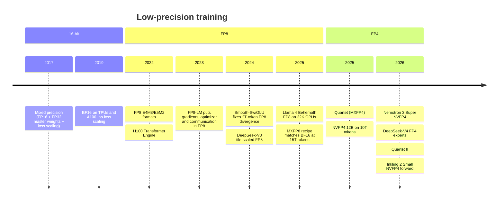
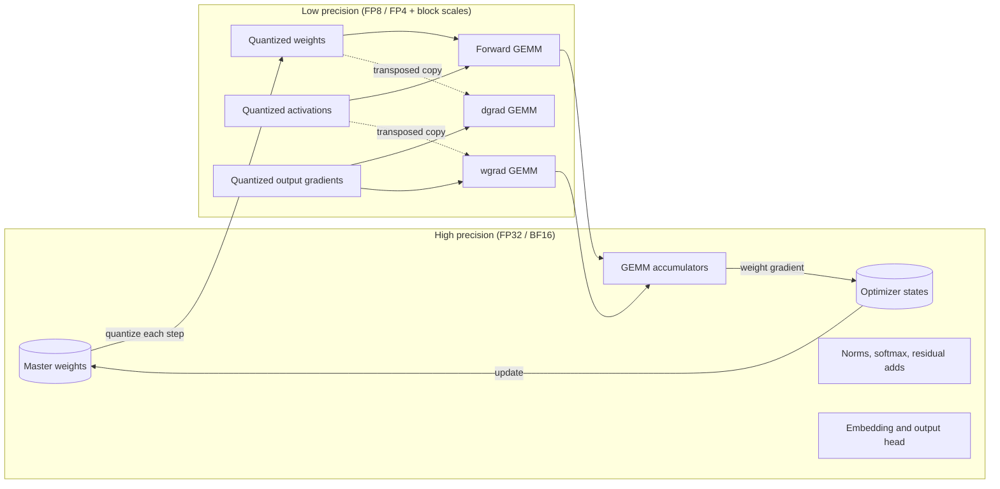

---
tags:
  - ai-ml
  - training
  - pretraining
  - low-precision
  - fp8
  - fp4
  - nvfp4
  - mxfp8
status: draft
sources:
  - https://arxiv.org/abs/1710.03740
  - https://arxiv.org/abs/1905.12322
  - https://arxiv.org/abs/2209.05433
  - https://arxiv.org/abs/2310.18313
  - https://arxiv.org/abs/2409.12517
  - https://arxiv.org/abs/2410.19313
  - https://arxiv.org/abs/2412.19437
  - https://ai.meta.com/blog/llama-4-multimodal-intelligence/
  - https://arxiv.org/abs/2505.14669
  - https://arxiv.org/abs/2506.08027
  - https://arxiv.org/abs/2509.25149
  - https://arxiv.org/abs/2512.02010
  - https://arxiv.org/abs/2601.22813
  - https://developer.nvidia.com/blog/introducing-nemotron-3-super-an-open-hybrid-mamba-transformer-moe-for-agentic-reasoning
  - https://research.nvidia.com/labs/eai/blogs/pushing-intelligence-to-4-bit/
  - https://arxiv.org/abs/2607.04422
  - https://arxiv.org/abs/2609.02846
  - https://arxiv.org/abs/2610.00053
  - https://arxiv.org/abs/2610.34915
  - https://thinkingmachines.ai/blog/end-to-end-4-bit-training/
  - https://docs.nvidia.com/deeplearning/transformer-engine/user-guide/features/low_precision_training/mxfp8/mxfp8.html
created: 2026-11-28
updated: 2026-11-28
---

## Table Of Contents

---

- [[#TL;DR|TL;DR]]
- [[#The Problem|The Problem]]
- [[#Foundations|Foundations]]
    - [[#Floating-Point Formats in One Table|Floating-Point Formats in One Table]]
    - [[#Scales and Block Scaling|Scales and Block Scaling]]
    - [[#The Three GEMMs of a Linear Layer|The Three GEMMs of a Linear Layer]]
    - [[#Master Weights and Accumulation|Master Weights and Accumulation]]
- [[#How We Got Here|How We Got Here]]
- [[#How It Works|How It Works]]
    - [[#What Goes Low and What Stays High|What Goes Low and What Stays High]]
    - [[#The FP8 Recipes|The FP8 Recipes]]
    - [[#The FP4 Recipes|The FP4 Recipes]]
    - [[#A Worked Example: One NVFP4 Block|A Worked Example: One NVFP4 Block]]
    - [[#Why Long Runs Diverge|Why Long Runs Diverge]]
    - [[#Beyond the Matmuls: Optimizer, Communication, Attention|Beyond the Matmuls: Optimizer, Communication, Attention]]
- [[#Where It Is Now|Where It Is Now]]
    - [[#Production Runs|Production Runs]]
    - [[#Research Frontier in 2026|Research Frontier in 2026]]
    - [[#Low Precision Through RL|Low Precision Through RL]]
- [[#Trade-offs & Open Problems|Trade-offs & Open Problems]]
- [[#Resources|Resources]]
- [[#Related Notes|Related Notes]]

## ***TL;DR***
---
*Low-precision training runs the big matrix multiplies of pretraining in 8-bit or 4-bit floating point instead of 16-bit, to get 2x to 6x more math per second and less memory per GPU. It works only with a recipe: fine-grained scales, careful rounding, high-precision master weights and accumulation, and a few sensitive layers kept at higher precision.*

- **What it is:** the forward and backward matmuls of each linear layer use FP8 (E4M3) or FP4 (E2M1) inputs, each small block of numbers carrying its own scale. Master weights, optimizer updates, accumulation, normalization and usually attention softmax stay in BF16 or FP32. This is different from [[Quantization]] for deployment, which shrinks an already-trained model: here the model *learns* in low precision.
- **FP8 is routine.** DeepSeek-V3 (Dec 2024) used 1×128 / 128×128 tile scales and kept loss within 0.25% of BF16 ([DeepSeek-AI](https://arxiv.org/abs/2412.19437)); Llama 4 Behemoth was pretrained in FP8 on 32K GPUs at 390 TFLOPs/GPU ([Meta](https://ai.meta.com/blog/llama-4-multimodal-intelligence/)); NVIDIA's MXFP8 recipe matched BF16 on an 8B model over 15T tokens ([Mishra et al.](https://arxiv.org/abs/2506.08027)).
- **FP4 is arriving.** NVIDIA's NVFP4 recipe trained a 12B model on 10T tokens with about 1% to 1.5% higher loss than FP8 ([NVIDIA](https://arxiv.org/abs/2509.25149)); Nemotron 3 Super was pretrained on 25T tokens in NVFP4 (Mar 2026); DeepSeek-V4 trains its experts in FP4 with QAT (Apr 2026).
- **Where it is now (Nov 2026):** the newest production recipe is *asymmetric*: Thinking Machines' Inkling 2 Small used NVFP4 for the MoE forward pass and MXFP8 for the backward pass, from pretraining through RL, costing about 2% compute-efficiency for an 8% pretraining and 20% RL wall-clock gain over full MXFP8 ([Thinking Machines, Nov 13 2026](https://thinkingmachines.ai/blog/end-to-end-4-bit-training/)). Research is about unbiased FP4 gradients (Quartet II), better scale formats (UE5M3), fusing away quantization overhead, and putting optimizer states and attention in FP4 too.

## ***The Problem***
---
*Pretraining cost is dominated by matrix multiplies, and both their speed and their memory traffic scale with the number of bits per number. Fewer bits buys speed, but gradients and activations span huge ranges, and every rounding error is repeated trillions of times.*

**Bits are compute.** On NVIDIA's GB300, dense throughput is 2.5 PFLOPS in BF16, 5 in MXFP8 and 15 in NVFP4 ([Thinking Machines](https://thinkingmachines.ai/blog/end-to-end-4-bit-training/)). Halving the bits also halves the bytes moved per weight and activation, which matters for memory capacity, for the activations kept for the backward pass, and for the all-to-all and all-gather traffic of [[Distributed Training]]. Since almost every FLOP of a [[Transformer]] is in the linear layers (6ND, see [[Scaling Laws]]), moving those to 8 or 4 bits is the biggest single lever on training cost after the hardware itself ([[AI Accelerators]]).

**Bits are also precision and range.** Training needs three things that fight a small format:
- **Range:** gradients can be $10^{-8}$ while some activations reach thousands ("massive activations", see [[Residual Stream and Normalization]]). An 8-bit E4M3 number only spans about 448 down to $2^{-9}$.
- **Precision:** a 4-bit E2M1 number has only 8 magnitudes: 0, 0.5, 1, 1.5, 2, 3, 4, 6. Small updates added to large weights simply vanish.
- **Unbiasedness over time:** a rounding error that always leans one way adds up over hundreds of thousands of steps. Deployment quantization can tolerate a fixed error; training cannot tolerate a systematic one.

So the problem is not "can we multiply in 4 bits" but "which tensors, at what granularity, with which rounding, so the loss curve tracks 16-bit for trillions of tokens."

## ***Foundations***
---
*Four ideas carry the whole topic: what the formats can represent, how a shared scale stretches them, which three matmuls a linear layer does in training, and why the weights themselves stay in high precision.*

#### **Floating-Point Formats in One Table**

A float is sign × $2^{\text{exponent}}$ × (1 + mantissa). Exponent bits buy range; mantissa bits buy precision.

| Format | Bits (sign/exp/mantissa) | Largest value | Used for in training |
|---|---|---|---|
| FP32 | 1/8/23 | ~$3.4 \times 10^{38}$ | Master weights, optimizer states, accumulation |
| BF16 | 1/8/7 | ~$3.4 \times 10^{38}$ | Default "16-bit" training since ~2019; same range as FP32 |
| FP16 | 1/5/10 | 65,504 | 2017-era mixed precision; needs loss scaling |
| FP8 E4M3 | 1/4/3 | 448 | Weights and activations; with fine scales, gradients too |
| FP8 E5M2 | 1/5/2 | 57,344 | Gradients in per-tensor FP8 recipes |
| FP4 E2M1 | 1/2/1 | 6 | NVFP4 and MXFP4 elements |

Sources: [Micikevicius et al., 2022](https://arxiv.org/abs/2209.05433) for the FP8 pair; [Mishra et al.](https://arxiv.org/abs/2506.08027) and [NVIDIA](https://arxiv.org/abs/2509.25149) for MXFP8 and NVFP4. Bit layouts are drawn in [[Quantization]] and, from the GPU side, in [[Low-Precision Formats - FP8, FP4 and MX|Low-Precision Formats: FP8, FP4 and MX]].

#### **Scales and Block Scaling**

A low-bit number on its own covers too little range, so every group of numbers shares a higher-precision **scale** $s$: the stored code $q$ means $x \approx s \cdot q$. The finer the group, the less one outlier can crush its neighbours.

| Scaling scheme | Group size | Scale format | Example |
|---|---|---|---|
| Per-tensor (delayed) | Whole tensor; scale from a history of past maxima | FP32 | Transformer Engine FP8 on Hopper (2022) |
| Per-tensor (current) | Whole tensor; scale from this step's max | FP32 | TE "current scaling" |
| Tile / block | 1×128 activations, 128×128 weights | FP32 | DeepSeek-V3 FP8 |
| MX (microscaling) | 32 consecutive values | E8M0 (power of two) | MXFP8, MXFP4 (OCP standard) |
| NVFP4 | 16 values, plus one per-tensor FP32 scale | E4M3 (has a mantissa) | Blackwell native FP4 |

The trade: a smaller group means lower error but more scale bits (MXFP4 is 4.25 bits per value, NVFP4 4.5) and more work to compute scales. A power-of-two scale (E8M0) is cheap but coarse; an E4M3 scale lands closer to the true maximum, which is a large part of why NVFP4 trains better than MXFP4 (NVIDIA reports MXFP4 "needed 36% more tokens to reach the same loss as NVFP4" ([NVIDIA Research, Jun 2026](https://research.nvidia.com/labs/eai/blogs/pushing-intelligence-to-4-bit/))).

#### **The Three GEMMs of a Linear Layer**

For a layer $Y = XW$ with input $X$ and weight $W$, training does three matrix multiplies (GEMMs):

$$
\underbrace{Y = X W}_{\text{forward (fprop)}} \qquad \underbrace{\nabla X = \nabla Y \, W^\top}_{\text{data gradient (dgrad)}} \qquad \underbrace{\nabla W = X^\top \nabla Y}_{\text{weight gradient (wgrad)}}
$$

*In words: the forward pass makes the output, the data gradient sends the error back to the previous layer, and the weight gradient tells the optimizer how to change $W$.* Each is a candidate for low precision, and they are not equally sensitive: forward errors change what the model computes, gradient errors change where it learns to go. Note that $W$ appears transposed in dgrad and $X$ transposed in wgrad. With 1-D block scales along one axis, a transposed tensor needs a *second* quantized copy scaled along the other axis; Transformer Engine's MXFP8 keeps separate rowwise (1×32) and columnwise (32×1) copies for exactly this reason ([TE docs](https://docs.nvidia.com/deeplearning/transformer-engine/user-guide/features/low_precision_training/mxfp8/mxfp8.html)). NVIDIA's NVFP4 recipe instead uses square 16×16 weight blocks so one quantized weight serves both directions ([NVIDIA](https://arxiv.org/abs/2509.25149)).

#### **Master Weights and Accumulation**

Two habits from 2017 still hold ([Micikevicius et al., 2017](https://arxiv.org/abs/1710.03740)):
- **Master weights in high precision.** The optimizer keeps an FP32 (or BF16) copy of every weight and applies updates there; the low-bit copy is re-made from it each step. Otherwise an update smaller than half a rounding step is lost forever. See [[Optimizers]].
- **Accumulate in high precision.** A matmul sums thousands of products; summing them in the input format would drown small terms. Tensor cores accumulate in FP32, and DeepSeek-V3 found Hopper's FP8 accumulator effectively kept only about 14 bits, so it promoted partial sums to FP32 on CUDA cores every 128 elements ([DeepSeek-AI](https://arxiv.org/abs/2412.19437)).

FP16 also needed **loss scaling**: multiply the loss by a large constant so tiny gradients do not underflow, then divide it back out. BF16's FP32-sized exponent removed that need ([Kalamkar et al., 2019](https://arxiv.org/abs/1905.12322)), which is why BF16 became the default. FP8 and FP4 bring the range problem back, and per-block scales are the modern answer to it.

## ***How We Got Here***
---
*Each step down in bits came from new hardware plus a recipe that found which tensors could tolerate it: FP16 with loss scaling (2017), BF16 (2019), per-tensor FP8 on Hopper (2022), fine-grained FP8 at frontier scale (2024), block-scaled FP8 and FP4 on Blackwell (2025 to 2026).*

| Year | Step | Why it mattered | Source |
|---|---|---|---|
| 2017 | FP16 storage and math, FP32 master weights, loss scaling | Halved memory, used Volta tensor cores, matched FP32 accuracy | [Micikevicius et al.](https://arxiv.org/abs/1710.03740) |
| 2019 | BF16 training studied across workloads | Same range as FP32, so no loss scaling; became the default | [Kalamkar et al.](https://arxiv.org/abs/1905.12322) |
| 2022 | FP8 formats E4M3 and E5M2 proposed jointly by NVIDIA, Arm and Intel; H100 ships them | Models up to 175B trained to 16-bit accuracy with per-tensor scales | [Micikevicius et al.](https://arxiv.org/abs/2209.05433) |
| 2023 | FP8-LM: FP8 gradients and all-reduce, FP8 first Adam moment, FP8 parallel communication | GPT-175B on H100: 39% less memory than BF16, 75% faster, 37% faster than Transformer Engine | [Peng et al. (Microsoft)](https://arxiv.org/abs/2310.18313) |
| 2024 | Llama2-7B in FP8 for 2T tokens on Gaudi2 diverges near 200B tokens; Smooth-SwiGLU fixes it | First evidence that FP8 problems appear only in long runs | [Fishman et al. (Intel)](https://arxiv.org/abs/2409.12517) |
| 2024 | COAT: FP8 optimizer states and activations | 1.54x memory, 1.43x speed vs BF16 | [Xi et al.](https://arxiv.org/abs/2410.19313) |
| Dec 2024 | DeepSeek-V3: E4M3 everywhere, tile scales, FP32 promotion | FP8 at 671B MoE frontier scale, loss within 0.25% of BF16 | [DeepSeek-AI](https://arxiv.org/abs/2412.19437) |
| Apr 2025 | Llama 4 Behemoth pretrained in FP8, 390 TFLOPs/GPU on 32K GPUs | FP8 at a large US lab, "without sacrificing quality" | [Meta](https://ai.meta.com/blog/llama-4-multimodal-intelligence/) |
| 2025 | MXFP8 recipe with round-up scales matches BF16 on 8B / 15T tokens | Block-scaled FP8 with no BF16 layers needed | [Mishra et al. (NVIDIA)](https://arxiv.org/abs/2506.08027) |
| 2025 | Quartet: full MXFP4 linear layers can be compute-optimal | First serious case that 4-bit training can win, not just survive | [Castro et al.](https://arxiv.org/abs/2505.14669) |
| Sep 2025 | NVFP4 recipe: 12B hybrid Mamba-Transformer, 10T tokens | Longest public 4-bit run; loss within about 1 to 1.5% of FP8 | [NVIDIA](https://arxiv.org/abs/2509.25149) |
| Mar 2026 | Nemotron 3 Super pretrained on 25T tokens in NVFP4 | First released frontier-class model trained natively in 4-bit | [NVIDIA](https://developer.nvidia.com/blog/introducing-nemotron-3-super-an-open-hybrid-mamba-transformer-moe-for-agentic-reasoning) |
| Apr 2026 | DeepSeek-V4 trains experts and the sparse-attention indexer in FP4 with QAT, FP8 elsewhere | 4-bit by design for most of a 1.6T-parameter model | [NVIDIA Research](https://research.nvidia.com/labs/eai/blogs/pushing-intelligence-to-4-bit/) |
| Nov 2026 | Inkling 2 Small: NVFP4 forward, MXFP8 backward, pretraining through RL | Asymmetric recipe in production; same numerics end to end | [Thinking Machines](https://thinkingmachines.ai/blog/end-to-end-4-bit-training/) |

## ***How It Works***
---
*Every recipe answers the same three questions: which tensors go low, at what scale granularity, and with which rounding. FP8 recipes now differ mostly in scaling; FP4 recipes add rotations, stochastic rounding and a small set of high-precision layers.*

#### **What Goes Low and What Stays High**

Across published recipes the pattern is stable:

| Component | FP8 recipes | FP4 recipes |
|---|---|---|
| Linear-layer GEMMs (QKV, attention out, MLP / experts) | FP8 for all three GEMMs | NVFP4 or MXFP4; some recipes keep the backward in FP8 |
| Attention scores and softmax | Usually BF16 (see [[Low-Precision Attention]]) | Usually BF16 |
| Embedding, output head, MoE router | BF16 / FP32 | BF16 / FP32 |
| Norms, activations, residual adds | BF16 / FP32 | BF16 / FP32 |
| A few whole blocks | None needed with fine scales | About 15% of layers, mostly the last ones |
| Master weights, optimizer states | FP32 (FP8 moments in some recipes) | FP32 / BF16 (FP4 moments in research) |
| Accumulation | FP32 | FP32 |

#### **The FP8 Recipes**

| Recipe | Scaling | Element formats | Notes | Source |
|---|---|---|---|---|
| Transformer Engine, Hopper (2022) | Per-tensor, delayed (amax history) | E4M3 forward, E5M2 gradients ("hybrid") | Cheap scales; one outlier in a tensor costs everyone precision | [Micikevicius et al.](https://arxiv.org/abs/2209.05433) |
| DeepSeek-V3 (2024) | 1×128 activation tiles, 128×128 weight blocks, computed online | E4M3 for all tensors | FP32 promotion every 128 elements; BF16 for embedding, head, gating, norms, attention | [DeepSeek-AI](https://arxiv.org/abs/2412.19437) |
| MXFP8 (2025) | 32-value blocks, E8M0 scales, rounded *up* | E4M3 for all tensors | Rowwise and columnwise copies; no BF16 layers needed; 8B / 15T within 0.5% of BF16 perplexity | [Mishra et al.](https://arxiv.org/abs/2506.08027) |

The MXFP8 paper's key catch: the OCP standard's scale computation effectively rounds the scale *down*, which maps a block's maximum above 448 so it must be clamped. On an 843M model that either diverged (E4M3 everywhere, 300B tokens) or opened a widening loss gap (E5M2 gradients, 1T tokens). Rounding the scale exponent up fixed both ([Mishra et al.](https://arxiv.org/abs/2506.08027)). Small numerical details decide whether a run survives.

#### **The FP4 Recipes**

FP4 has so few levels that two extra tools become essential:
- **Stochastic rounding (SR)** for gradients: round up or down at random, with probability proportional to closeness, so the *expected* value equals the true value. $\mathbb{E}[\text{SR}(x)] = x$, which keeps gradients unbiased even when each individual rounding is coarse.
- **Random Hadamard transforms (RHT):** multiply a block by a random ±1 orthogonal matrix before quantizing. This spreads an outlier's energy across the block so the scale is not set by one value; the inverse transform is folded into the other side of the matmul.

| Recipe | Forward | Backward | Kept higher | Result | Source |
|---|---|---|---|---|---|
| NVIDIA NVFP4 (2025) | NVFP4; 16×16 weight blocks, 1×16 activations, round-to-nearest | NVFP4; SR on gradients; 16×16 RHT on wgrad inputs | ~16% of linear layers in BF16 (first 2, last 8 blocks) | 12B, 10T tokens: loss within ~1% of FP8, ~1.5% in LR decay; MMLU 76.57 vs 77.36 | [NVIDIA](https://arxiv.org/abs/2509.25149) |
| Four Over Six (Dec 2025) | NVFP4 with adaptive block scale | Same | Same | Closer to BF16 loss on Nemotron 3 Nano 30B-A3B | [Cook et al.](https://arxiv.org/abs/2512.02010) |
| Quartet II (Jan to Jun 2026) | Native 1×16 NVFP4, round-to-nearest, 4/6 scale choice | MS-EDEN: RHT over 128-value chunks, round-to-nearest, SR on the *scales* only | Not reported as needed | >2x lower gradient quantization error than SR; ≥20% lower loss gap than prior schemes; up to 1.9B / 38B tokens | [Panferov et al. (ISTA)](https://arxiv.org/abs/2601.22813) |
| UE5M3 scales (Sep 2026) | NVFP4 elements with an unsigned 5-exponent scale (max 61,440) | SR only on the output gradient; no RHT | No BF16 final-layer exemption | Nemotron-H 8B, ~189B tokens: lower loss than TE NVFP4 (single seed); 21% more throughput without RHT and exemptions | [Hu, Luschi & Balanca](https://arxiv.org/abs/2609.02846) |
| Inkling 2 Small (Nov 2026) | NVFP4 for MoE experts, per-token activations, 4/6 on activations | MXFP8 with SR re-quantization | Last 1/6 of layers in MXFP8 | ~2% compute-efficiency cost; 8% faster pretraining, 20% faster RL than full MXFP8 | [Thinking Machines](https://thinkingmachines.ai/blog/end-to-end-4-bit-training/) |

The 2026 direction is visible in the table: replace per-element stochastic rounding (noisy) with lower-variance unbiased estimators, replace square weight blocks with native 1×16 blocks plus re-quantization in the backward pass, and spend the 4-bit budget where it pays (the forward pass of the experts) while keeping the gradient path at 8 bits.

#### **A Worked Example: One NVFP4 Block**

Take four values from a 16-value block (the rest are small): $x = [0.9, -2.4, 0.1, 5.1]$. FP4 E2M1 can represent $\pm\{0, 0.5, 1, 1.5, 2, 3, 4, 6\}$.

$$
s = \frac{\max_i |x_i|}{6}, \qquad q_i = \text{round}_{\text{E2M1}}\!\left(\frac{x_i}{s}\right), \qquad \hat{x}_i = s \cdot q_i
$$

*In words: pick a scale so the block's largest value lands on FP4's largest code (6), round each scaled value to the nearest FP4 level, and multiply back.*

1. Ideal scale: $5.1 / 6 = 0.85$. But the scale is itself stored in FP8 E4M3, whose nearest value is **0.875**.
2. Scaled values: $x / 0.875 = [1.03, -2.74, 0.114, 5.83]$.
3. Round to FP4: $[1, -3, 0, 6]$.
4. Dequantized: $[0.875, -2.625, 0, 5.25]$. Errors: 0.025, 0.225, **0.1 (lost entirely)**, 0.15.

Two lessons. First, the small value 0.1 is flushed to zero: in a gradient that would be a systematic loss of signal, which is why gradients use stochastic rounding. With SR, $0.114$ sits between levels 0 and 0.5, so it becomes 0.5 with probability $0.114 / 0.5 = 0.23$ and 0 otherwise, averaging exactly 0.114. Second, rounding the *scale* pushed the maximum from 6 down to 5.83, and FP4's step between 4 and 6 is wide, so the largest value took a 3% error. That is the problem Four Over Six attacks: sometimes scaling the block so its maximum maps to 4 instead of 6 gives a more even grid and lower total error ([Cook et al.](https://arxiv.org/abs/2512.02010)).

#### **Why Long Runs Diverge**

Low-precision problems often hide for hundreds of billions of tokens. Intel's FP8 Llama2-7B run was fine until about 200B tokens and then diverged. The cause: in SwiGLU MLPs (see [[Transformer]]), the two input weight vectors of some channels slowly *align* under weight decay, and because SwiGLU multiplies two linear branches, aligned weights produce rare, huge activation spikes that per-tensor FP8 cannot represent. Smooth-SwiGLU adds a per-channel scale to one branch and undoes it after the down-projection, so the function is unchanged and the scales fold into the weights at inference. With it, the 2T-token FP8 run matched BF16 at about 34% higher throughput on Gaudi2 ([Fishman et al.](https://arxiv.org/abs/2409.12517)).

The general lessons, which every later recipe follows:
- **Short ablations are not enough.** Validate at the token horizon you will train to; NVIDIA's NVFP4 gap also widened during learning-rate decay ([NVIDIA](https://arxiv.org/abs/2509.25149)).
- **Outliers are structural.** Massive activations and [[Attention Sinks and Gated Attention|attention-sink]] dimensions are learned features, so fine-grained scales and rotations beat hoping they go away.
- **The last layers are the most sensitive**, which is why FP4 recipes exempt mostly the final blocks.

#### **Beyond the Matmuls: Optimizer, Communication, Attention**

- **Optimizer state.** Adam keeps two moments per parameter, 8 bytes in FP32. FP8-LM stored the first moment in FP8 and the second in FP16, cutting optimizer memory from 16 to 6 bytes per parameter ([Peng et al.](https://arxiv.org/abs/2310.18313)); Intel used E4M3 / E5M2 for the two moments ([Fishman et al.](https://arxiv.org/abs/2409.12517)); COAT expands each state's dynamic range with a power function before quantizing ([Xi et al.](https://arxiv.org/abs/2410.19313)). In 2026, Full-Stack FP4 stored AdamW moments in NVFP4 and ran a Muon-style Newton-Schulz step in NVFP4 too (see [[Optimizers]]).
- **Communication.** Low-bit tensors are also cheaper to send. FP8-LM cut weight-related communication by 63% to 65% ([Peng et al.](https://arxiv.org/abs/2310.18313)). Inkling 2 Small dispatches MoE tokens in NVFP4 and sends the combine step in an 8.25-bit block format after a 32-dimension Hadamard transform, because plain MXFP8 combine lost too much to outliers ([Thinking Machines](https://thinkingmachines.ai/blog/end-to-end-4-bit-training/)). More in [[Distributed Training]] and [[Mixture of Experts]].
- **Attention.** Most recipes leave the $QK^\top$ and $PV$ matmuls in BF16. MXFP8 attention for training reached cuDNN and Meta's production in 2026, and Full-Stack FP4 runs $QK^\top$ and $dS$ in NVFP4 while keeping $PV$ in BF16. Details in [[Low-Precision Attention]].

## ***Where It Is Now***
---
*As of November 2026, FP8 (block-scaled on Blackwell) is the default for frontier pretraining, NVFP4 is in production for the bulk of the compute in several model families, and the measured end-to-end gains are far below the 2x to 3x peak-FLOPs ratio because communication and quantization overhead eat them.*

#### **Production Runs**

| Model | Date | Precision recipe | Reported outcome | Source |
|---|---|---|---|---|
| DeepSeek-V3 (671B MoE) | Dec 2024 | Tile-scaled FP8 E4M3 | Loss within 0.25% of BF16 | [DeepSeek-AI](https://arxiv.org/abs/2412.19437) |
| Llama 4 Behemoth | Apr 2025 | FP8, 32K GPUs | 390 TFLOPs/GPU | [Meta](https://ai.meta.com/blog/llama-4-multimodal-intelligence/) |
| NVIDIA 12B research model | Sep 2025 | NVFP4, 10T tokens | ~1 to 1.5% loss gap vs FP8 | [NVIDIA](https://arxiv.org/abs/2509.25149) |
| Nemotron 3 Super | Mar 2026 | NVFP4 "from the first gradient update", 25T tokens | Released model | [NVIDIA](https://developer.nvidia.com/blog/introducing-nemotron-3-super-an-open-hybrid-mamba-transformer-moe-for-agentic-reasoning) |
| DeepSeek-V4 (1.6T MoE) | Apr 2026 | FP4 QAT for experts and indexer; FP8 elsewhere | Released in that precision | [NVIDIA Research](https://research.nvidia.com/labs/eai/blogs/pushing-intelligence-to-4-bit/) |
| Inkling 2 Small | Nov 2026 | NVFP4 MoE forward, MXFP8 backward and last 1/6 of layers; pretraining through RL | Pretrained in 68 hours on GB300 NVL72; ~2% compute-efficiency cost; no discernible RL reward difference | [Thinking Machines](https://thinkingmachines.ai/blog/end-to-end-4-bit-training/) |

What the Thinking Machines post shows most clearly is the gap between peak and real gains. Full NVFP4 (forward *and* backward) caused "very large hits" to compute efficiency, so they kept the backward at 8 bits; and the expected ~3x faster MoE forward turned into 8% wall-clock in pretraining because expert-parallel communication became the bottleneck ([Thinking Machines](https://thinkingmachines.ai/blog/end-to-end-4-bit-training/)). NVIDIA's own headline is larger: about 1.9x faster pretraining than FP8 on Llama-3.1 405B with NVFP4 ([NVIDIA Research](https://research.nvidia.com/labs/eai/blogs/pushing-intelligence-to-4-bit/)), measured by the hardware vendor on a dense model.

#### **Research Frontier in 2026**

| Work | Date | Idea | Result | Source |
|---|---|---|---|---|
| Quartet II | Jun 2026 (v2) | Unbiased NVFP4 gradients via MS-EDEN | ≥20% smaller loss gap; >1.8x BF16 end-to-end at 1B | [Panferov et al.](https://arxiv.org/abs/2601.22813) |
| Full-Stack FP4 | Jul 2026 | NVFP4 for projections (BF16 low-rank branch), optimizer states and parts of attention | 3B / 64B tokens: loss 2.286 vs 2.267 BF16 (0.84% gap); optimizer peak memory 38% to 43% lower | [Ding et al.](https://arxiv.org/abs/2607.04422) |
| UE5M3 scales | Sep 2026 | Unsigned wider-range scale, no RHT, no BF16 exemption | Simpler recipe, lower loss than TE NVFP4 at 8B (one seed) | [Hu, Luschi & Balanca](https://arxiv.org/abs/2609.02846) |
| Format-aware fusion | Sep 2026 | Fuse scale computation, packing and layout into each quantize step | Llama-3 8B: BF16 18.8K tok/s/GPU, TE NVFP4 27.6K (+1.34% loss), fused MXFP4 37.2K (+2.11% loss) | [Hu](https://arxiv.org/abs/2610.00053) |

The fusion paper makes the overhead problem concrete: "scale computation, operand packing, layout construction, and saved backward state can erase the gain" of FP4 tensor cores, and the fastest route doubled BF16 throughput only by accepting a larger loss gap. It also warns that "downstream rankings differ from training-loss rankings" ([Hu](https://arxiv.org/abs/2610.00053)), so a recipe that wins on loss is not automatically the better model.

#### **Low Precision Through RL**

[[RL for Reasoning]] adds a new reason to care: the sampler (vLLM or SGLang) and the learner (Megatron, FSDP) compute slightly different log-probabilities, which makes on-policy training subtly off-policy. Training and sampling in the *same* low-precision numerics is one fix. Inkling 2 Small configured numerics identically "from the start of pretraining through the final RL rollout," so no calibration was needed when shipping ([Thinking Machines](https://thinkingmachines.ai/blog/end-to-end-4-bit-training/)). A single-author study of end-to-end MXFP8 RL on B200 (Oct 2026, Qwen3-8B and 30B-A3B, one seed, 10 to 60 steps) found that sharing the learner's weight grid with the sampler halved early KL mismatch on the MoE, that MXFP8 mismatch stayed flat while per-tensor FP8 mismatch grew, and that speed gains appear only past about 4.5K tokens per micro-batch. It also logged seven failures, five silent, such as a quantized output head producing NaN logits and zero reward ([Zhang](https://arxiv.org/abs/2610.34915)). Treat it as an early, small-scale report.

## ***Trade-offs & Open Problems***
---
*Low precision trades a small, measurable loss gap and a lot of engineering for large throughput and memory gains. The open questions are whether 4-bit gradients can ever be safe, whether the loss gap survives post-training, and how to turn peak FLOPs into real wall-clock gains.*

| Choice | Gain | Cost or risk | Evidence |
|---|---|---|---|
| Per-tensor FP8 | Simple, cheap scales | Outliers force coarse precision; long-run divergence | [Fishman et al.](https://arxiv.org/abs/2409.12517) |
| Block-scaled FP8 (tiles, MXFP8) | Matches BF16 with no exempt layers | Two quantized copies (rowwise and columnwise); Blackwell for native MX | [Mishra et al.](https://arxiv.org/abs/2506.08027) |
| NVFP4 everywhere | Up to 6x BF16 peak math on GB300 | ~1 to 1.5% loss gap; ~15% of layers exempt; "very large hits" without an 8-bit backward in one production test | [NVIDIA](https://arxiv.org/abs/2509.25149), [Thinking Machines](https://thinkingmachines.ai/blog/end-to-end-4-bit-training/) |
| FP4 forward, FP8 backward | Most of the FP4 speed with ~2% efficiency cost | Forward errors matter more than backward per Kim et al.; the asymmetric choice is empirical | [Thinking Machines](https://thinkingmachines.ai/blog/end-to-end-4-bit-training/), [[Quantization]] |
| MXFP4 instead of NVFP4 | Cheaper power-of-two scales; OCP standard, runs on AMD | Needed 36% more tokens for the same loss (vendor figure) | [NVIDIA Research](https://research.nvidia.com/labs/eai/blogs/pushing-intelligence-to-4-bit/) |
| RHT and stochastic rounding | Unbiased, outlier-robust gradients | Extra kernels and overhead; UE5M3 work drops RHT for 21% throughput | [Hu, Luschi & Balanca](https://arxiv.org/abs/2609.02846) |
| Low-precision optimizer state | 2x to 2.6x less optimizer memory | Orthogonalizing optimizers (Muon) are sensitive to state error | [Peng et al.](https://arxiv.org/abs/2310.18313), [[Optimizers]] |

- **Can the backward pass go to 4 bits at scale?** Quartet II and NVIDIA say yes with the right estimator; the largest production run said not yet. Thinking Machines has "not yet computed the backward pass in FP4" ([Thinking Machines](https://thinkingmachines.ai/blog/end-to-end-4-bit-training/)).
- **Peak FLOPs vs wall-clock.** FP4 matmuls are so fast that quantization kernels, communication and memory traffic dominate. Expect gains to track fusion work and interconnect, not tensor-core specs ([Hu](https://arxiv.org/abs/2610.00053)).
- **Small, short experiments.** Most FP4 research runs are 1B to 8B parameters and under 200B tokens, while the 2024 FP8 lesson was that failures appear past 200B tokens. Single-seed results (UE5M3, MXFP8 RL) need replication.
- **Loss gap vs model quality.** A 1% loss gap is measurable, but whether it shows up after [[Distillation]], SFT and RL is mostly unreported, and loss rankings and downstream rankings can disagree.
- **Precision as a scaling-law axis.** Precision-aware [[Scaling Laws]] suggest optimal training precision rises with compute budget (see [[Quantization]]), which cuts against "always use the fewest bits." Those laws are fit below about 2B parameters.
- **Format fragmentation.** E8M0, E4M3 and now UE5M3 scales, 16- vs 32-value blocks, and vendor-specific kernels mean a recipe tuned on one chip may not carry over ([[AI Accelerators]]).

## ***Resources***
---
*Read DeepSeek-V3's FP8 section and NVIDIA's NVFP4 paper for the two reference recipes, then the Thinking Machines post for what actually happens in a production 4-bit run.*

**Papers**
- [Mixed Precision Training](https://arxiv.org/abs/1710.03740): Micikevicius et al. (NVIDIA, Baidu), 2017. FP16, master weights, loss scaling.
- [A Study of BFLOAT16 for Deep Learning Training](https://arxiv.org/abs/1905.12322): Kalamkar et al. (Intel), 2019.
- [FP8 Formats for Deep Learning](https://arxiv.org/abs/2209.05433): Micikevicius et al. (NVIDIA, Arm, Intel), 2022. E4M3 and E5M2.
- [FP8-LM: Training FP8 Large Language Models](https://arxiv.org/abs/2310.18313): Peng et al. (Microsoft), 2023. FP8 gradients, optimizer and communication.
- [Scaling FP8 Training to Trillion-Token LLMs](https://arxiv.org/abs/2409.12517): Fishman, Chmiel, Banner & Soudry (Intel, Technion), ICLR 2025. Smooth-SwiGLU.
- [COAT](https://arxiv.org/abs/2410.19313): Xi et al. (Berkeley, NVIDIA, MIT, Tsinghua), 2024. FP8 optimizer states and activations.
- [DeepSeek-V3 Technical Report](https://arxiv.org/abs/2412.19437): DeepSeek-AI, Dec 2024. Section on FP8 training.
- [Quartet: Native FP4 Training Can Be Optimal for LLMs](https://arxiv.org/abs/2505.14669): Castro et al. (ISTA, ETH), 2025.
- [Recipes for Pre-training LLMs with MXFP8](https://arxiv.org/abs/2506.08027): Mishra, Stosic & Layton (NVIDIA), 2025.
- [Pretraining Large Language Models with NVFP4](https://arxiv.org/abs/2509.25149): NVIDIA, Sep 2025.
- [Four Over Six](https://arxiv.org/abs/2512.02010): Cook et al., Dec 2025 (v5 May 2026). Adaptive NVFP4 block scaling.
- [Quartet II](https://arxiv.org/abs/2601.22813): Panferov, Schultheis, Tabesh & Alistarh (ISTA), 2026.
- [Full-Stack FP4](https://arxiv.org/abs/2607.04422): Ding et al. (CAS Institute of Automation and others), Jul 2026.
- [UE5M3 FP4 Block Scaling for Stable Language Model Pretraining](https://arxiv.org/abs/2609.02846): Hu, Luschi & Balanca, Sep 2026.
- [Format-Aware Fusion for Fast FP4 Pretraining](https://arxiv.org/abs/2610.00053): Hu, Sep 2026.
- [End-to-End MXFP8 Reinforcement Learning on Blackwell](https://arxiv.org/abs/2610.34915): Zhang, Oct 2026. Single-author, small-scale.

**Posts and docs**
- [End-to-End 4-Bit Training](https://thinkingmachines.ai/blog/end-to-end-4-bit-training/): Thinking Machines, Nov 13 2026. Inkling 2 Small's recipe and measured gains.
- [Pushing Intelligence to 4-bit](https://research.nvidia.com/labs/eai/blogs/pushing-intelligence-to-4-bit/): NVIDIA Research, Jun 2026. NVFP4 vs MXFP4, DeepSeek-V4 and gpt-oss.
- [Introducing Nemotron 3 Super](https://developer.nvidia.com/blog/introducing-nemotron-3-super-an-open-hybrid-mamba-transformer-moe-for-agentic-reasoning): NVIDIA, Mar 2026.
- [The Llama 4 herd](https://ai.meta.com/blog/llama-4-multimodal-intelligence/): Meta, Apr 2025. FP8 Behemoth pretraining.
- [Transformer Engine: MXFP8](https://docs.nvidia.com/deeplearning/transformer-engine/user-guide/features/low_precision_training/mxfp8/mxfp8.html): NVIDIA docs. Rowwise and columnwise copies, E8M0 scales.

## ***Related Notes***
---
*Read Quantization first for the number formats and deployment side; the rest cover the hardware, optimizer, parallelism and model parts that low-precision training touches.*

- [[Quantization]] — Formats, bit layouts, PTQ and QAT, and precision-aware scaling laws; this note is its training-time counterpart.
- [[Low-Precision Attention]] — FP8, MXFP8 and FP4 attention kernels, the part most training recipes still leave in BF16.
- [[AI Accelerators]] — Hopper's FP8 and Blackwell's MX and NVFP4 tensor cores that make these recipes pay.
- [[Distributed Training]] — Low-precision communication, expert parallelism and the bottlenecks that cap real speedups.
- [[Optimizers]] — Master weights, Adam and Muon state, and quantized optimizer moments.
- [[Mixture of Experts]] — Experts are where 4-bit training is applied first (DeepSeek-V4, Inkling 2 Small).
- [[Residual Stream and Normalization]] — Massive activations and the outliers that break per-tensor scaling.
- [[Transformer]] — The SwiGLU MLP behind the trillion-token FP8 divergence.
- [[Scaling Laws]] — Where precision enters as a variable, and why optimal precision may rise with compute.
- [[RL for Reasoning]] — The sampler-learner mismatch that shared low-precision numerics try to remove.
- [[FlashAttention]] — FP8 and FP4 attention kernels for Hopper and Blackwell.
- [[Hybrid Attention]] — Nemotron's hybrid Mamba-Transformer backbones, the first NVFP4-pretrained models.
- [[Distillation]] — Post-training stages where any low-precision loss gap would need to be re-measured.
- [[Low-Precision Formats - FP8, FP4 and MX|Low-Precision Formats: FP8, FP4 and MX]] — The tensor-core instructions and bit layouts behind each recipe.
- [[Blackwell Architecture]] — The GPU generation with native MXFP8 and NVFP4 tensor cores.
- [[Multi-GPU Communication - NVLink and NCCL]] — The collectives that low-bit dispatch and combine shrink.
- [[Random Number Generation on GPUs]] — Where the random bits for stochastic rounding and Hadamard signs come from.
