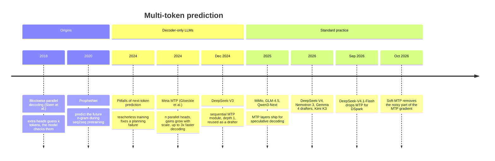
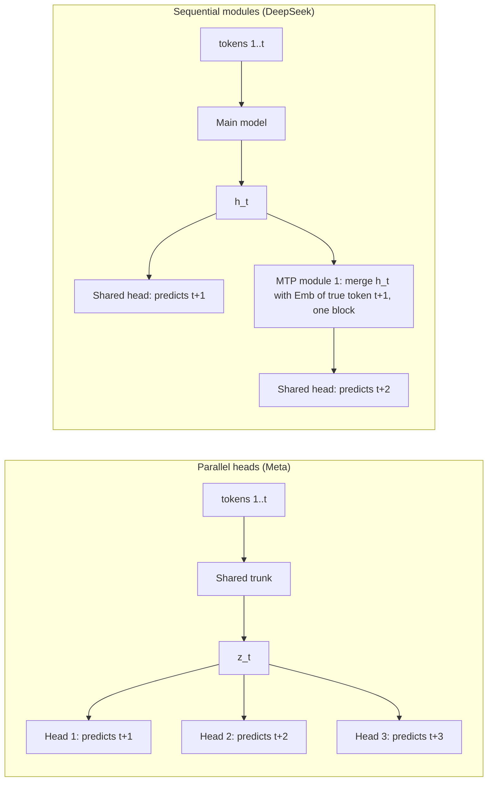

---
tags:
  - ai-ml
  - training
  - pretraining
  - multi-token-prediction
  - mtp
  - speculative-decoding
status: draft
sources:
  - https://arxiv.org/abs/1811.03115
  - https://arxiv.org/abs/2001.04063
  - https://arxiv.org/abs/2403.06963
  - https://arxiv.org/abs/2404.19737
  - https://arxiv.org/abs/2412.19437
  - https://arxiv.org/abs/2502.09419
  - https://arxiv.org/abs/2504.15266
  - https://arxiv.org/abs/2505.07608
  - https://arxiv.org/abs/2505.10518
  - https://arxiv.org/abs/2507.11851
  - https://arxiv.org/abs/2508.06471
  - https://www.alibabacloud.com/blog/qwen3-next-towards-ultimate-training-%26-inference-efficiency_602580
  - https://www.lmsys.org/blog/2025-07-17-mtp
  - https://arxiv.org/abs/2510.14751
  - https://arxiv.org/abs/2602.06019
  - https://developer.nvidia.com/blog/introducing-nemotron-3-super-an-open-hybrid-mamba-transformer-moe-for-agentic-reasoning
  - https://arxiv.org/abs/2604.11912
  - https://awesomepapers.io/llm-papers/papers/2605.28184
  - https://huggingface.co/papers/2606.15007.md
  - https://huggingface.co/papers/2606.19348.md
  - https://huggingface.co/papers/2607.05147
  - https://vllm.ai/blog/2026-08-23-speculative-decoding-amd-gpus
  - https://recipes.vllm.ai/deepseek-ai/DeepSeek-V4.1-Flash
  - https://arxiv.org/html/2610.38331
  - https://docs.nvidia.com/nemo/automodel/nightly/nemo-automodel/nemo_automodel/components/models/deepseek_v4/mtp.md
  - https://github.com/Xiaohao-Liu/Awesome-Multi-Token-Prediction
created: 2026-11-28
updated: 2026-11-28
---

## Table Of Contents

---

- [[#TL;DR|TL;DR]]
- [[#The Problem|The Problem]]
- [[#Foundations|Foundations]]
    - [[#Next-Token Prediction and Teacher Forcing|Next-Token Prediction and Teacher Forcing]]
    - [[#Heads, Trunk and Offsets|Heads, Trunk and Offsets]]
    - [[#Auxiliary Loss|Auxiliary Loss]]
- [[#How We Got Here|How We Got Here]]
- [[#How It Works|How It Works]]
    - [[#Parallel Heads (Meta, 2024)|Parallel Heads (Meta, 2024)]]
    - [[#Sequential Modules (DeepSeek-V3)|Sequential Modules (DeepSeek-V3)]]
    - [[#A Worked Example|A Worked Example]]
    - [[#Why It Can Help Learning|Why It Can Help Learning]]
    - [[#Keeping Memory in Check|Keeping Memory in Check]]
    - [[#From Training Objective to Drafter|From Training Objective to Drafter]]
- [[#Where It Is Now|Where It Is Now]]
    - [[#Models That Train With MTP|Models That Train With MTP]]
    - [[#The DSpark Counter-Move|The DSpark Counter-Move]]
    - [[#Research Directions in 2026|Research Directions in 2026]]
- [[#Trade-offs & Open Problems|Trade-offs & Open Problems]]
- [[#Resources|Resources]]
- [[#Related Notes|Related Notes]]

## ***TL;DR***
---
*Multi-token prediction (MTP) trains a language model to guess several future tokens from each position, not just the next one. It is two things at once: an auxiliary pretraining loss that can make big models learn more per token, and a built-in drafter that the model later uses for [[Speculative Decoding]].*

- **What it is:** at position $t$, the normal head predicts token $t+1$ and one or more extra heads (or small extra blocks) predict $t+2$, $t+3$ and so on. Their cross-entropy losses are added, usually down-weighted, to the main loss ([Gloeckle et al., 2024](https://arxiv.org/abs/2404.19737); [DeepSeek-V3](https://arxiv.org/abs/2412.19437)).
- **Two designs:** Meta's version puts $n$ *parallel* heads on one shared trunk. DeepSeek's version stacks *sequential* modules: each one sees the previous module's hidden state plus the embedding of the next true token, so the chain of predictions stays causal.
- **What it buys in training:** at 13B, Meta's 4-token model solved 12% more HumanEval and 17% more MBPP problems than a next-token twin. DeepSeek's 228.7B MoE ablation raised HumanEval from 44.5 to 53.7 and GSM8K from 72.3 to 74.0. Small models are *hurt*: the gain only appears at scale.
- **What it buys at inference:** the extra heads are a free, well-matched drafter. DeepSeek-V3's one MTP module had 85% to 90% second-token acceptance, about 1.8x tokens per second; Meta's 4-token code model decoded up to 3x faster.
- **Where it is now (Nov 2026):** standard in open frontier MoEs (DeepSeek-V3/V4, Qwen3-Next to Qwen3.6, GLM-4.5 to GLM-5, MiMo, Nemotron 3 Super and Ultra, Gemma 4 drafters). The main counter-move: DeepSeek-V4.1-Flash (Sep 2026) *dropped* its MTP module for DSpark, a block drafter trained after pretraining ([vLLM recipe](https://recipes.vllm.ai/deepseek-ai/DeepSeek-V4.1-Flash)). Research has moved to fixing the MTP gradient (Soft-MTP, Oct 2026), predicting longer-range summaries, and keeping MTP heads aligned through RL.

## ***The Problem***
---
*Next-token prediction teaches a model to be good at the very next token, which is often easy and locally predictable. MTP asks whether forcing the model to look further ahead gives a better learning signal, and whether the same look-ahead can be reused to decode faster.*

Two separate problems motivate MTP.

**1. A training signal that may be too short-sighted.** Standard pretraining scores the model only on token $t+1$ given the true tokens up to $t$ (teacher forcing; see [[Transformer]]). Many next tokens are nearly determined by the last few words ("United" → "States"), so a lot of the loss can be cut by local pattern-matching. Gloeckle et al. argue this makes next-token training sample-inefficient and biased toward local patterns ([Gloeckle et al., 2024](https://arxiv.org/abs/2404.19737)). Bachmann and Nagarajan built a small path-finding task where both Transformers and Mamba ([[State Space Models]]) trained with teacher forcing *fail to learn* a correct next-token predictor at all, and showed that predicting several tokens ahead ("teacherless" training) fixes it ([Bachmann & Nagarajan, ICML 2024](https://arxiv.org/abs/2403.06963)).

**2. Decoding one token per pass is slow.** Each decode step reads every weight and the whole [[KV Cache]] to produce one token, so per-user speed is capped by memory bandwidth. [[Speculative Decoding]] fixes this with a cheap drafter, but a separate draft model has to be trained, served and kept in sync. Heads that already predict $t+2, t+3, \dots$ are a drafter that comes with the checkpoint.

## ***Foundations***
---
*Three ideas are enough: what teacher forcing is, what a "head" on a "trunk" means, and what an auxiliary loss does. MTP changes only the output side of a standard Transformer.*

#### **Next-Token Prediction and Teacher Forcing**

A decoder-only [[Transformer]] reads tokens $x_1, \dots, x_t$ and outputs a probability distribution over the vocabulary for $x_{t+1}$. During training every position is scored at once, each against the true next token, and the loss is the average negative log-probability:

$$
\mathcal{L}_{\text{NTP}} = -\sum_{t} \log P_\theta(x_{t+1} \mid x_{1:t})
$$

*In words:* for each position, how surprised was the model by the actual next token? Lower is better. Feeding the *true* previous tokens (not the model's own guesses) is called **teacher forcing**. It is what lets one forward pass train every position in parallel.

#### **Heads, Trunk and Offsets**

- **Trunk:** the stack of Transformer layers that turns tokens into a hidden state $z_t$ (one vector per position). It sits on the [[Residual Stream and Normalization|residual stream]].
- **Head:** whatever maps $z_t$ to vocabulary logits. In next-token models that is one linear "unembedding" layer, often tied to the input embedding (see [[Tokenization and Embeddings]]).
- **Offset $k$:** how far ahead a head predicts. The normal head has $k = 1$; MTP adds heads for $k = 2, 3, \dots, n$.

MTP keeps the trunk and adds heads (Meta) or small extra Transformer blocks feeding the shared head (DeepSeek).

#### **Auxiliary Loss**

An auxiliary loss is an extra term added to the main objective to shape what the trunk learns, then thrown away (or repurposed) at inference. MTP's extra predictions are almost always auxiliary: the model still generates with its normal next-token head, and the MTP loss is scaled by a weight $\lambda < 1$ so it guides the trunk without dominating it.

## ***How We Got Here***
---
*The idea of predicting several tokens at once is older than LLMs; it went from a decoding trick (2018) to a seq2seq pretraining objective (2020) to a large-scale decoder-only result (Meta, 2024), and became standard once DeepSeek-V3 showed it both helped quality and gave a production drafter.*

| When | What changed | Why it was needed | Source |
|---|---|---|---|
| 2018 | Blockwise parallel decoding: add $k-1$ extra output heads, propose a block, keep the longest prefix the base model agrees with. Up to about 2x fewer decoding iterations with no quality loss, more with small losses. | Autoregressive decoding is serial. | [Stern et al.](https://arxiv.org/abs/1811.03115) |
| 2020 | ProphetNet predicts the next $n$ tokens at each step during seq2seq pretraining, using "n-stream self-attention", to "plan for the future tokens" and avoid overfitting to strong local correlations. | Next-token training leans on local word pairs. | [Qi et al.](https://arxiv.org/abs/2001.04063) |
| 2024 | Bachmann and Nagarajan show teacher forcing can fail to learn even a simple planning task; predicting several tokens ahead with dummy inputs fixes it. | A concrete case where the next-token objective, not inference, is the problem. | [Bachmann & Nagarajan](https://arxiv.org/abs/2403.06963) |
| 2024 | Meta trains models from 300M to 13B with $n$ parallel heads on a shared trunk. Worse than next-token at small scale, better at 13B (+12% HumanEval, +17% MBPP); 4-token models decode up to 3x faster. | First evidence at LLM scale that MTP is a better *pretraining* loss, not only a decoding trick. | [Gloeckle et al.](https://arxiv.org/abs/2404.19737) |
| Dec 2024 | DeepSeek-V3 adds one sequential MTP module during 14.8T-token pretraining, with loss weight 0.3 then 0.1. Discarded or used as a drafter at inference. | Parallel heads predict each future token without seeing the ones before it; a causal chain fits drafting better. | [DeepSeek-V3](https://arxiv.org/abs/2412.19437) |
| 2025 | MiMo-7B trains one MTP layer and copies it to three for inference; GLM-4.5 uses an MoE layer as its MTP layer; Qwen3-Next trains MTP multi-step to match inference. | MTP became the default way to ship a drafter with an open model. | [MiMo](https://arxiv.org/abs/2505.07608), [GLM-4.5](https://arxiv.org/abs/2508.06471), [Qwen3-Next](https://www.alibabacloud.com/blog/qwen3-next-towards-ultimate-training-%26-inference-efficiency_602580) |
| 2025 | MuToR, future-summary prediction and teacherless studies probe *why* MTP helps and how to get the benefit with fewer changes. | The parallel-heads design is clumsy to bolt onto existing models. | [MuToR](https://arxiv.org/abs/2505.10518), [FSP](https://arxiv.org/abs/2510.14751), [Nagarajan et al.](https://arxiv.org/abs/2504.15266) |

## ***How It Works***
---
*Both designs add a loss for tokens beyond the next one. The difference is whether each extra prediction sees the tokens before it (DeepSeek's sequential modules) or not (Meta's parallel heads), and that choice decides how good the heads are as drafters.*

#### **Parallel Heads (Meta, 2024)**

The trunk produces one hidden state $z_t$. Each of $n$ independent heads (one Transformer layer plus the shared unembedding) predicts a different offset from that same $z_t$:

$$
\mathcal{L}_n = -\sum_{t} \sum_{i=1}^{n} \log P_\theta\left(x_{t+i} \mid z_t\right), \qquad z_t = \text{Trunk}(x_{1:t})
$$

*In words:* from what it has read so far, the model must name the next token, the one after, and so on up to $n$ ahead, and every guess is scored. Head $i$ never sees tokens $t+1 \dots t+i-1$, so it has to guess them implicitly. That is what forces the trunk to encode more about the future ([Gloeckle et al., 2024](https://arxiv.org/abs/2404.19737)).

#### **Sequential Modules (DeepSeek-V3)**

DeepSeek instead chains $D$ small modules. Module $k$ takes the previous depth's hidden state at position $i$ and the embedding of the *true* token $t_{i+k}$, merges them, runs one Transformer block, and predicts token $t_{i+k+1}$ through the shared output head:

$$
h'^{\,k}_i = M_k\left[\text{RMSNorm}\left(h^{k-1}_i\right);\ \text{RMSNorm}\left(\text{Emb}(t_{i+k})\right)\right], \quad h^k_{1:T-k} = \text{TRM}_k\left(h'^{\,k}_{1:T-k}\right), \quad P^k_{i+k+1} = \text{OutHead}\left(h^k_i\right)
$$

$$
\mathcal{L} = \mathcal{L}_{\text{main}} + \frac{\lambda}{D} \sum_{k=1}^{D} \mathcal{L}^{k}_{\text{MTP}}
$$

*In words:* the first module is told "the next token was actually X; now predict the one after". It is like a one-layer next-token model sitting on top of the main model, fed the main model's hidden state. The embedding and output head are shared with the main model, so the only new weights are the merge projection $M_k$ and one block per depth. DeepSeek-V3 and V4 use $D = 1$, with $\lambda = 0.3$ for most of training and $0.1$ later ([DeepSeek-V3](https://arxiv.org/abs/2412.19437); [DeepSeek-V4](https://huggingface.co/papers/2606.19348.md)).

| | Parallel heads | Sequential modules |
|---|---|---|
| What head $k$ sees | Only $z_t$ | $h^{k-1}_t$ plus the true (or drafted) token $t+k$ |
| Joint distribution of the guesses | Each guess independent given $z_t$ | A causal chain, like a tiny autoregressive model |
| Extra weights | $n-1$ Transformer layers | One projection and one block per depth |
| Typical depth in shipped models | 4 in Meta's study | 1 (DeepSeek), up to 3 at inference (MiMo) |

#### **A Worked Example**

Text: "the cat sat on the mat". Look at the position after "cat", with DeepSeek's setup ($D = 1$, $\lambda = 0.3$).

| Prediction | True token | Model's probability | Loss $-\ln p$ |
|---|---|---|---|
| Main head (offset 1) | "sat" | 0.60 | 0.51 |
| MTP module (offset 2, told the next token was "sat") | "on" | 0.30 | 1.20 |

Loss at this position: $0.51 + \frac{0.3}{1} \times 1.20 = 0.87$. The main prediction still dominates; the MTP term adds a smaller push for the trunk's hidden state at "cat" to carry information useful two tokens out. Later in training, $\lambda = 0.1$ shrinks that push to $0.12$.

#### **Why It Can Help Learning**

Gloeckle et al. give an information-theoretic reading. For two consecutive tokens $X$ and $Y$, next-token training (over many positions) effectively targets $H(X)$, while 2-token prediction targets $H(X) + H(Y)$, which expands as:

$$
H(X) + H(Y) = H(X \mid Y) + 2\, I(X; Y) + H(Y \mid X)
$$

*In words:* the mutual information $I(X;Y)$, how much one token tells you about the next, is counted twice. Tokens that matter for what follows (choice points) get extra weight; tokens that are easy and inconsequential do not ([Gloeckle et al., 2024](https://arxiv.org/abs/2404.19737)). Their small-scale results fit this: 2-token prediction sharply improved induction ability in models up to about 30M non-embedding parameters (the edge vanished by about 100M), and MTP beat a 3x larger next-token model on polynomial arithmetic.

A 2026 theory paper finds a mechanism on a star-graph planning task: MTP leads a two-layer Transformer to first attend to the goal node and then trace the path backward, which next-token training does not find. The authors attribute this to MTP decoupling the gradients ([Huang et al., COLM 2026](https://arxiv.org/abs/2604.11912)).

#### **Keeping Memory in Check**

Each head produces a full vocabulary of logits per position, so $n$ heads naively need $n$ times the logit memory, the biggest activation in training. Meta's fix: run the trunk once, then run each head's forward *and* backward pass one after another, accumulating only the $d$-dimensional gradient at the trunk. Peak memory drops from $O(nV + d)$ to $O(V + d)$ with no runtime cost ([Gloeckle et al., 2024](https://arxiv.org/abs/2404.19737)). DeepSeek's design shares the one output head, which keeps parameters down but still needs a second set of logits per depth.

#### **From Training Objective to Drafter**

At inference the MTP module can be thrown away, and the model generates normally. Or it can draft: the main model emits token $t+1$, the MTP module guesses $t+2$ from the main model's hidden state, and the next forward pass verifies the guess while producing the token after it. With one draft token and acceptance rate $\alpha$, each pass yields about $1 + \alpha$ tokens; DeepSeek-V3's 85% to 90% gives about 1.9, against a measured 1.8x tokens per second ([DeepSeek-V3](https://arxiv.org/abs/2412.19437); maths in [[Speculative Decoding]]). To draft more than one token, engines run the module repeatedly on its own outputs, or (MiMo) copy and fine-tune it into several layers; acceptance falls with depth, from about 90% for MiMo's first MTP layer to above 75% for its third ([MiMo](https://arxiv.org/abs/2505.07608)).

## ***Where It Is Now***
---
*As of November 2026, MTP is a default ingredient of open frontier MoE pretraining, mainly because it doubles as a drafter. The frontier has split: some labs keep training MTP and post-train it to draft better, while DeepSeek's newest Flash model dropped it for a dedicated block drafter.*

#### **Models That Train With MTP**

| Model (date) | MTP setup | Notes | Source |
|---|---|---|---|
| DeepSeek-V3 (Dec 2024) | 1 sequential module, $\lambda$ 0.3 then 0.1 | Ablation: HumanEval 44.5 → 53.7, GSM8K 72.3 → 74.0 at 228.7B total; MMLU 67.5 → 66.6 | [DeepSeek-V3](https://arxiv.org/abs/2412.19437) |
| DeepSeek-V4 Flash and Pro (Apr to Jun 2026) | Same as V3: depth 1, weight 0.3, then 0.1 from the start of LR decay | Each depth is one attention block plus one MoE block on the hyper-connection stream | [DeepSeek-V4](https://huggingface.co/papers/2606.19348.md), [NeMo AutoModel docs](https://docs.nvidia.com/nemo/automodel/nightly/nemo-automodel/nemo_automodel/components/models/deepseek_v4/mtp.md) |
| MiMo-7B (May 2025) | 1 MTP layer in pretraining, copied to 3 for inference | About 90% first-layer acceptance on AIME24 | [MiMo](https://arxiv.org/abs/2505.07608) |
| GLM-4.5 (Aug 2025) onward, GLM-5 | An MoE layer as the MTP layer | Explicitly "to support speculative decoding" | [GLM-4.5](https://arxiv.org/abs/2508.06471) |
| Qwen3-Next (2025), Qwen3.5, Qwen3.6 | Native MTP trained multi-step | Training matches multi-step inference to raise acceptance | [Qwen3-Next](https://www.alibabacloud.com/blog/qwen3-next-towards-ultimate-training-%26-inference-efficiency_602580) |
| Nemotron 3 Super (Mar 2026) | Shared-weight MTP heads | NVIDIA claims up to 3x wall-clock speedups on structured tasks (code, tool calls) | [NVIDIA blog](https://developer.nvidia.com/blog/introducing-nemotron-3-super-an-open-hybrid-mamba-transformer-moe-for-agentic-reasoning) |
| Nemotron 3 Ultra (Jun 2026) | 2 MTP layers sharing weights, each attention + MoE; loss scale 0.1; kept during SFT | Adds "MTP Boosting": a post-training phase that freezes the backbone and retrains only the MTP head on the final model's own rollouts | [Nemotron 3 Ultra](https://huggingface.co/papers/2606.15007.md) |
| Gemma 4 (2026) | Separate MTP "assistant" checkpoints per size | 26B-A4B: 2.74x on GSM8K in vLLM on AMD | [vLLM, Aug 2026](https://vllm.ai/blog/2026-08-23-speculative-decoding-amd-gpus) |
| Kimi K3 (2026) | MTP named among adopters; vLLM ships a Kimi K3 MTP model class | Details not checked here | [Teoh, Oct 2026](https://arxiv.org/html/2610.38331) |

Two patterns stand out. First, every model in this table is an [[Mixture of Experts|MoE]] or hybrid MoE ([[Hybrid Attention]] in Nemotron 3), where an extra MoE block adds little active compute. Second, labs increasingly treat the MTP head as a *product* to tune after pretraining (Qwen's multi-step training, Nemotron's MTP Boosting), because the head drifts away from the final model once the backbone is fine-tuned and RL-trained.

#### **The DSpark Counter-Move**

DeepSeek's July 2026 DSpark drafter, a block drafter added after pretraining, beat its own MTP-1 baseline by 60% to 85% in per-user speed on DeepSeek-V4's live traffic ([DSpark](https://huggingface.co/papers/2607.05147)). DeepSeek-V4.1-Flash (launched Sep 9, 2026) then "dropped the MTP module that V3 and V4 trained alongside the backbone"; DSpark is the only speculative method for that checkpoint, with three stages drafting a block of 5 tokens ([vLLM recipe](https://recipes.vllm.ai/deepseek-ai/DeepSeek-V4.1-Flash)). The open question this raises: if the drafting role moves to a separate post-trained drafter, is the MTP *training* benefit alone worth the extra pretraining compute? DeepSeek has not published why it dropped it.

#### **Research Directions in 2026**

| Direction | What it does | Result | Source |
|---|---|---|---|
| Fix the MTP gradient | Splits the MTP gradient into a useful KL term (pull each head toward the model's own next-token distribution) and a noisy residual; Soft-MTP keeps only the KL part with a one-line change | Residual is about 80% of the MTP gradient at the trunk with about 4x lower signal-to-noise; at 1.2B, lower next-token loss, 1.7x to 1.8x speculative speedup, HumanEval pass@64 43.9 vs 40.9 | [Teoh, Oct 2026](https://arxiv.org/html/2610.38331) |
| Predict further than a few tokens | Future summary prediction (FSP): an auxiliary head predicts a summary of the long-range future (bag of words, or a reverse-LM embedding) | Beats both next-token and MTP at 3B and 8B on math, reasoning and code | [Mahajan et al., ICLR 2026](https://arxiv.org/abs/2510.14751) |
| No new heads | MuToR interleaves learnable register tokens that predict $d$ steps ahead, discarded at inference | Gemma 2B GSM8K fine-tune 38.9% → 42.1% | [Gerontopoulos et al., NeurIPS 2025](https://arxiv.org/abs/2505.10518) |
| Retrofit an existing model | Online self-distillation turns a next-token checkpoint into one that emits several tokens per pass, with no separate verifier | Over 3x faster decoding for under 5% GSM8K accuracy loss | [Kirchenbauer et al., 2026](https://arxiv.org/abs/2602.06019) |
| Retrofit with mask tokens | Masked future slots, gated LoRA and a small sampler on a frozen model | Nearly 5x faster on code and math, about 2.5x on chat, reported lossless | [Samragh et al. (Apple), 2025](https://arxiv.org/abs/2507.11851) |
| Keep MTP through RL | Current RL practice detaches MTP gradients because joint training hurts; OCC tunes the MTP coefficient online | Matches or beats the detach baseline on six math benchmarks | [Wang et al., May 2026](https://awesomepapers.io/llm-papers/papers/2605.28184) |

A curated, regularly updated paper list is [Awesome-Multi-Token-Prediction](https://github.com/Xiaohao-Liu/Awesome-Multi-Token-Prediction).

## ***Trade-offs & Open Problems***
---
*MTP is cheap to add and pays off at scale, but its training benefit is uneven across tasks, it hurts small models, and its drafting benefit is now contested by drafters trained after pretraining.*

| Issue | What happens | Evidence |
|---|---|---|
| Hurts small models | Below some scale MTP underperforms next-token training; the gain appears and grows with size | Meta 300M to 13B sweep ([Gloeckle et al.](https://arxiv.org/abs/2404.19737)) |
| Uneven by task | Big gains on code; on multiple-choice NLP, 2-token matches the baseline and 4-token regresses slightly; GSM8K gain at 200B tokens reversed at 500B | [Gloeckle et al.](https://arxiv.org/abs/2404.19737); DeepSeek's MMLU fell 67.5 → 66.6 at large scale ([DeepSeek-V3](https://arxiv.org/abs/2412.19437)) |
| How many tokens ahead | Best $n$ depends on domain and tokenization: $n = 4$ for code tokens, $n = 8$ for bytes | [Gloeckle et al.](https://arxiv.org/abs/2404.19737) |
| Extra cost | Extra blocks and a second set of vocabulary logits per depth; memory tricks or shared heads needed | [Gloeckle et al.](https://arxiv.org/abs/2404.19737) |
| Noisy gradient | Most of the MTP gradient reaching the trunk is a low signal-to-noise residual that interferes with next-token learning, more so at scale | [Teoh, Oct 2026](https://arxiv.org/html/2610.38331) |
| Short-range only | MTP mostly captures dependencies a few tokens out; longer planning may need summary targets | [Mahajan et al.](https://arxiv.org/abs/2510.14751) |
| Hard to bolt on | Hidden states of a next-token-trained model are specialized; heads added to a frozen model work poorly, joint fine-tuning helps only partly | [Mehra et al., Feb 2025](https://arxiv.org/abs/2502.09419) |
| Drifts after post-training | The head was trained against the base model; SFT and RL change the backbone, so acceptance falls unless the head is retrained or trained jointly | Nemotron 3 Ultra's MTP Boosting; RL detach practice ([Nemotron 3 Ultra](https://huggingface.co/papers/2606.15007.md), [Wang et al.](https://awesomepapers.io/llm-papers/papers/2605.28184)) |
| Drafter quality ceiling | A depth-1 MTP module drafts one token well; dedicated block drafters now beat it in production | [DSpark](https://huggingface.co/papers/2607.05147), [vLLM recipe](https://recipes.vllm.ai/deepseek-ai/DeepSeek-V4.1-Flash) |
| Not settled by [[Scaling Laws]] | No public scaling law yet says how much MTP is worth in compute-equivalent terms at frontier scale; evidence is ablations at one or two sizes | Inferred from the sources above |

Open questions: whether MTP's quality gain survives once the drafting role is handed to a post-trained drafter (DeepSeek's V4.1 choice); whether the benefit is really "planning" or mostly a better-conditioned gradient (Huang et al. vs Teoh); and whether multi-token objectives help open-ended, creative generation, where Nagarajan et al. found teacherless and diffusion training more diverse and original than next-token training on small tasks ([Nagarajan et al., 2025](https://arxiv.org/abs/2504.15266)).

## ***Resources***
---
*Start with Gloeckle et al. for the training case and DeepSeek-V3 section 2.2 for the design most models copy; read Teoh (2026) for the current understanding of the gradient.*

**Papers**
- [Blockwise Parallel Decoding for Deep Autoregressive Models](https://arxiv.org/abs/1811.03115): Stern, Shazeer & Uszkoreit, Nov 2018. Extra heads plus verification.
- [ProphetNet](https://arxiv.org/abs/2001.04063): Qi et al., Jan 2020. Future n-gram prediction in seq2seq pretraining.
- [The Pitfalls of Next-Token Prediction](https://arxiv.org/abs/2403.06963): Bachmann & Nagarajan, ICML 2024. Teacher forcing can fail; teacherless training fixes it.
- [Better & Faster Large Language Models via Multi-token Prediction](https://arxiv.org/abs/2404.19737): Gloeckle et al. (Meta), ICML 2024. The parallel-heads study, 300M to 13B.
- [DeepSeek-V3 Technical Report](https://arxiv.org/abs/2412.19437): DeepSeek, Dec 2024. Section 2.2 (sequential MTP), Table 4 (ablation).
- [On multi-token prediction for efficient LLM inference](https://arxiv.org/abs/2502.09419): Mehra et al., Feb 2025. Why heads on frozen models struggle.
- [Roll the dice & look before you leap](https://arxiv.org/abs/2504.15266): Nagarajan et al., 2025. Multi-token objectives and open-ended creativity.
- [MiMo](https://arxiv.org/abs/2505.07608): Xiaomi, May 2025. MTP in a 7B reasoning model.
- [Multi-Token Prediction Needs Registers](https://arxiv.org/abs/2505.10518): Gerontopoulos et al., NeurIPS 2025.
- [Your LLM Knows the Future](https://arxiv.org/abs/2507.11851): Samragh et al. (Apple), Jul 2025.
- [GLM-4.5](https://arxiv.org/abs/2508.06471): Zhipu/Z.ai, Aug 2025. MoE layer as MTP layer.
- [Beyond Multi-Token Prediction: Pretraining LLMs with Future Summaries](https://arxiv.org/abs/2510.14751): Mahajan et al., ICLR 2026.
- [Multi-Token Prediction via Self-Distillation](https://arxiv.org/abs/2602.06019): Kirchenbauer et al., ICML 2026.
- [How Transformers Learn to Plan via MTP](https://arxiv.org/abs/2604.11912): Huang et al., COLM 2026.
- [Joint Training of MTP in RL via Optimal Coefficient Calibration](https://awesomepapers.io/llm-papers/papers/2605.28184): Wang et al., May 2026.
- [Nemotron 3 Ultra](https://huggingface.co/papers/2606.15007.md): NVIDIA, Jun 2026. Shared-weight MTP layers and MTP Boosting.
- [DeepSeek-V4: Towards Highly Efficient Million-Token Context Intelligence](https://huggingface.co/papers/2606.19348.md): DeepSeek, Jun 2026. MTP depth and loss schedule.
- [DSpark](https://huggingface.co/papers/2607.05147): DeepSeek, Jul 2026. The block drafter that replaced MTP-1.
- [Multi-Token Prediction Done Right](https://arxiv.org/html/2610.38331): Teoh (MIT), Oct 2026. Soft-MTP and the gradient decomposition.

**Posts, docs and lists**
- [Qwen3-Next](https://www.alibabacloud.com/blog/qwen3-next-towards-ultimate-training-%26-inference-efficiency_602580): Qwen, Oct 2025. Multi-step MTP training.
- [Deploying DeepSeek with MTP in SGLang](https://www.lmsys.org/blog/2025-07-17-mtp): LMSYS, Jul 2025.
- [Introducing Nemotron 3 Super](https://developer.nvidia.com/blog/introducing-nemotron-3-super-an-open-hybrid-mamba-transformer-moe-for-agentic-reasoning): NVIDIA, Mar 2026.
- [Speculative decoding on AMD GPUs](https://vllm.ai/blog/2026-08-23-speculative-decoding-amd-gpus): vLLM, Aug 2026. Gemma 4 and Qwen3.6 MTP numbers.
- [DeepSeek-V4.1-Flash recipe](https://recipes.vllm.ai/deepseek-ai/DeepSeek-V4.1-Flash): vLLM. Confirms V4.1 dropped MTP.
- [DeepSeek V4 MTP module](https://docs.nvidia.com/nemo/automodel/nightly/nemo-automodel/nemo_automodel/components/models/deepseek_v4/mtp.md): NVIDIA NeMo AutoModel docs.
- [Awesome-Multi-Token-Prediction](https://github.com/Xiaohao-Liu/Awesome-Multi-Token-Prediction): curated paper list.

## ***Related Notes***
---
*Read Speculative Decoding next for how the MTP heads are used at inference; the rest cover the model parts MTP attaches to and the training stages it spans.*

- [[Speculative Decoding]] — The draft-then-verify loop, acceptance maths, and the production drafters (EAGLE, DFlash, DSpark) MTP competes with.
- [[Transformer]] — The trunk, causal masking and teacher forcing that MTP changes only at the output.
- [[Tokenization and Embeddings]] — The shared embedding and output head the MTP module reuses, and why byte-level models favour larger $n$.
- [[Mixture of Experts]] — Nearly every model shipping MTP is an MoE; GLM and DeepSeek-V4 use MoE blocks in the MTP module.
- [[Residual Stream and Normalization]] — RMSNorm and the hyper-connection stream that the MTP module merges with the next token's embedding.
- [[Pretraining Data]] — The stage where MTP's auxiliary loss is applied, and where its gains are measured per token.
- [[Scaling Laws]] — Why MTP's benefit is described as scale-dependent, and what a compute-equivalent measure would need.
- [[Distillation]] — Self-distillation retrofits and the KL view of what an MTP head learns.
- [[RL for Reasoning]] — Why MTP gradients are usually detached during RL, and the drafter drift that follows.
- [[LLM Serving]] — Engines that run MTP drafting alongside disaggregation and expert parallelism.
- [[KV Cache]] — Drafted tokens that are rejected must be rolled back out of the cache.
- [[State Space Models]] — Mamba fails the same teacher-forced planning task as Transformers.
- [[Hybrid Attention]] — Nemotron 3's hybrid Mamba-Transformer backbone under its MTP layers.
