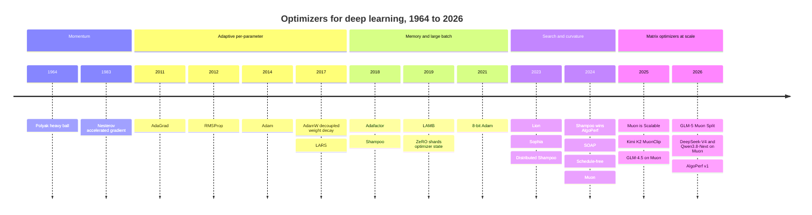
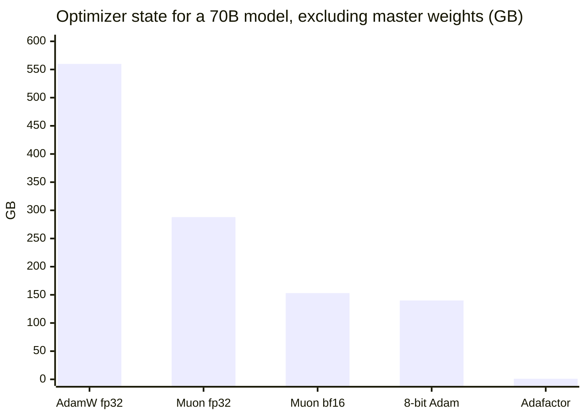
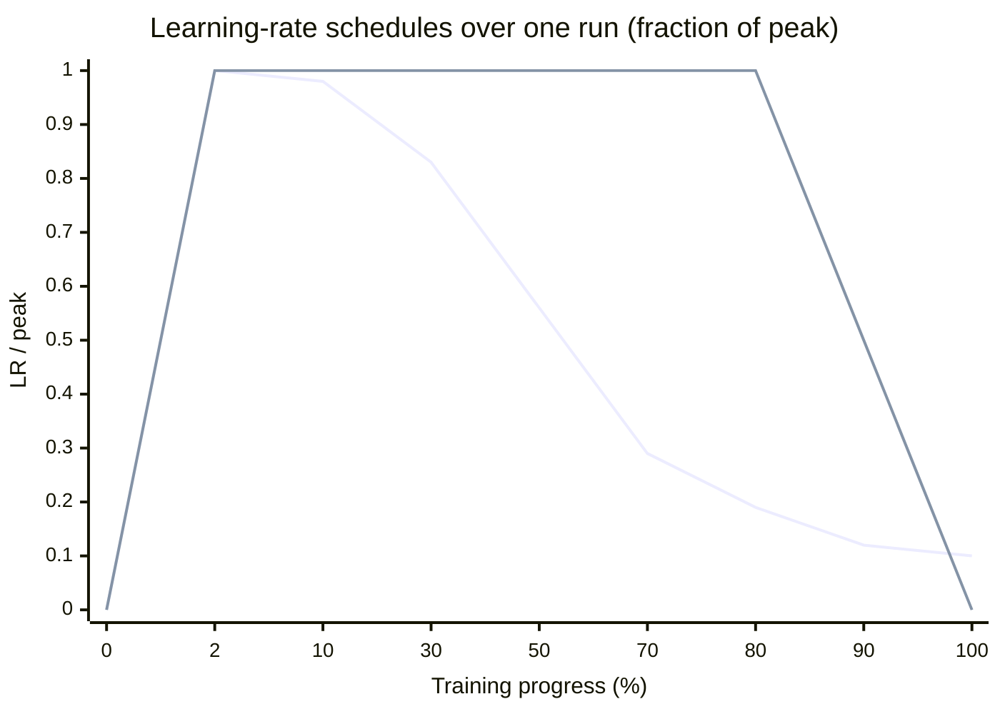

---
tags:
  - ai-ml
  - training
  - optimizers
  - optimization
  - pretraining
status: draft
sources:
  - https://arxiv.org/abs/1412.6980
  - https://arxiv.org/abs/1711.05101
  - https://jmlr.org/papers/v12/duchi11a.html
  - https://arxiv.org/abs/1804.04235
  - https://arxiv.org/abs/2110.02861
  - https://arxiv.org/abs/1708.03888
  - https://arxiv.org/abs/1904.00962
  - https://arxiv.org/abs/1802.09568
  - https://arxiv.org/abs/2309.06497
  - https://arxiv.org/abs/2302.06675
  - https://arxiv.org/abs/2305.14342
  - https://arxiv.org/abs/2409.11321
  - https://arxiv.org/abs/2409.20325
  - https://kellerjordan.github.io/posts/muon/
  - https://arxiv.org/abs/2502.16982
  - https://arxiv.org/abs/2507.20534
  - https://arxiv.org/abs/2508.06471
  - https://arxiv.org/abs/1910.02054
  - https://arxiv.org/abs/2407.21783
  - https://arxiv.org/abs/2412.19437
  - https://arxiv.org/abs/2203.03466
  - https://arxiv.org/abs/2404.06395
  - https://arxiv.org/abs/2405.18392
  - https://arxiv.org/abs/2405.15682
  - https://arxiv.org/abs/1706.02677
  - https://arxiv.org/abs/1812.06162
  - https://arxiv.org/abs/2103.00065
  - https://arxiv.org/abs/1503.05671
  - https://arxiv.org/abs/2502.15015
  - https://arxiv.org/abs/2509.02046
  - https://arxiv.org/abs/2504.05295
  - https://arxiv.org/abs/2205.10287
  - https://arxiv.org/abs/2502.15938
  - https://arxiv.org/abs/2512.13961
  - https://arxiv.org/abs/2602.15763
  - https://arxiv.org/abs/2602.02276
  - https://arxiv.org/abs/2606.19348
  - https://arxiv.org/abs/2608.30320
  - https://arxiv.org/abs/2607.20548
  - https://arxiv.org/abs/2610.13036
  - https://arxiv.org/abs/2611.03633
  - https://docs.pytorch.org/docs/2.14/generated/torch.optim.Muon.html
  - https://github.com/pytorch/pytorch/blob/v2.9.0/torch/optim/_muon.py
created: 2026-11-26
updated: 2026-11-26
---

## Table Of Contents

---

- [[#TL;DR|TL;DR]]
- [[#The Problem|The Problem]]
- [[#Foundations|Foundations]]
    - [[#The Loss Landscape and Gradient Descent|The Loss Landscape and Gradient Descent]]
    - [[#Mini-Batches and Gradient Noise|Mini-Batches and Gradient Noise]]
    - [[#The Learning Rate|The Learning Rate]]
    - [[#Momentum|Momentum]]
    - [[#Conditioning and Per-Parameter Scaling|Conditioning and Per-Parameter Scaling]]
    - [[#Second-Order Methods, the Hessian and the Fisher|Second-Order Methods, the Hessian and the Fisher]]
    - [[#Optimizer State Costs Memory|Optimizer State Costs Memory]]
- [[#How We Got Here|How We Got Here]]
- [[#How It Works|How It Works]]
    - [[#Adam and AdamW|Adam and AdamW]]
    - [[#A Worked Example: Two Adam Steps|A Worked Example: Two Adam Steps]]
    - [[#Muon: Orthogonalized Momentum|Muon: Orthogonalized Momentum]]
    - [[#Making Muon Work at Scale|Making Muon Work at Scale]]
    - [[#Optimizer-State Memory for a 70B Model|Optimizer-State Memory for a 70B Model]]
    - [[#Learning-Rate Schedules|Learning-Rate Schedules]]
    - [[#Hyperparameter Transfer and Batch Size|Hyperparameter Transfer and Batch Size]]
- [[#Where It Is Now|Where It Is Now]]
    - [[#Which Open Models Use What|Which Open Models Use What]]
    - [[#Fair Benchmarks Shrank the Claimed Gains|Fair Benchmarks Shrank the Claimed Gains]]
    - [[#Muon Goes Mainstream|Muon Goes Mainstream]]
- [[#Trade-offs & Open Problems|Trade-offs & Open Problems]]
- [[#Resources|Resources]]
- [[#Related Notes|Related Notes]]

## ***TL;DR***
---
*An optimizer is the rule that turns each batch's gradient into an actual change to the weights. For a decade LLM pretraining ran on one rule, AdamW; since late 2024 Muon, which orthogonalizes the update for each weight matrix, has become the first serious challenger at frontier scale.*

- **What it is:** gradient descent says "step downhill". The optimizer decides how far, in which exact direction, and with what memory of past steps. Adam keeps two running averages per parameter (direction and size) and divides one by the other, so every parameter takes a step of roughly the same size no matter how large its raw gradient is ([Kingma & Ba, 2014](https://arxiv.org/abs/1412.6980)).
- **Why AdamW won:** it is robust across architectures and scales, and decoupling weight decay from the adaptive step fixed Adam's main flaw ([Loshchilov & Hutter, 2017](https://arxiv.org/abs/1711.05101)). Its cost is memory: two extra fp32 numbers per parameter, 560 GB for a 70B model.
- **The challenger:** Muon treats each weight matrix as a matrix, not a bag of numbers. It takes the momentum matrix and replaces it with the nearest orthogonal matrix (all singular values set to 1) using a few Newton-Schulz iterations ([Jordan, Dec 2024](https://kellerjordan.github.io/posts/muon/)). It needs one state buffer instead of two and, with weight decay and update-scale matching, about half the compute of AdamW to reach the same loss in Moonshot's tests ([Liu et al., Feb 2025](https://arxiv.org/abs/2502.16982)).
- **Where it is now (Nov 2026):** Muon variants now train the hidden matrices of the flagship open MoE models from Moonshot (Kimi K2, Jul 2025), Zhipu (GLM-4.5, Aug 2025; GLM-5, Feb 2026), DeepSeek (V4, 2026) and Qwen (Qwen3.8-Flash-Next, Aug 2026), with AdamW kept for embeddings, head and norms; Llama 3 and DeepSeek-V3 were AdamW. Independent tuned comparisons put the gain over AdamW at about 1.1x to 1.4x at small scale, an NVIDIA study (Jul 2026) found it holding at multi-billion scale, and a Nov 2026 paper found AdamW-pretrained models fine-tune better past large data budgets.

## ***The Problem***
---
*Backpropagation tells you the gradient: which way each of billions of weights should move to lower the loss on this batch. It does not tell you how far to move, how to cope with a noisy estimate, or how to handle directions where the loss is steep next to directions where it is almost flat. Getting that wrong wastes compute or blows the run up.*

A pretraining run takes a few hundred thousand to a few million optimizer steps. Every step is one decision: given a gradient $g_t$ measured on one mini-batch, produce an update $\Delta\theta_t$. The plain answer, $\Delta\theta_t = -\eta g_t$, fails in four ways at LLM scale:

| Failure | What happens | What fixed it |
|---|---|---|
| Noise | Each batch's gradient is a noisy sample of the true gradient; steps zig-zag | Momentum (averaging gradients over steps) and larger batches |
| Bad conditioning | Some directions are thousands of times steeper than others; one learning rate is too big for the steep ones and too small for the flat ones | Per-parameter scaling (AdaGrad, RMSProp, Adam), then per-matrix preconditioning (Shampoo, SOAP, Muon) |
| Instability | Loss spikes and divergence, especially in large models with big learning rates | Warmup, gradient clipping, weight decay, logit control such as QK-Clip |
| Memory | Each per-parameter statistic costs as much memory as the model's weights | Factored or 8-bit state (Adafactor, 8-bit Adam), single-buffer methods (Lion, Muon), sharding (ZeRO) |

Because a frontier run costs months of compute, a better optimizer is worth a lot: an optimizer that reaches the same loss in half the steps is worth as much as doubling the cluster. That is why claimed speedups are scrutinized so hard, and why most of them shrink under fair tuning (see [[#Fair Benchmarks Shrank the Claimed Gains|Where It Is Now]]).

## ***Foundations***
---
*Seven ideas explain every optimizer in this note: the loss landscape, noisy mini-batch gradients, the learning rate, momentum, conditioning, curvature (Hessian and Fisher) and the memory each optimizer keeps. Adam and Muon are both answers to "how do we cheaply approximate a good preconditioner?".*

#### **The Loss Landscape and Gradient Descent**

Picture the loss $L(\theta)$ as a surface over the space of all weights $\theta$ (billions of dimensions). Training is finding a low point. The gradient $\nabla L(\theta)$ points in the direction of steepest ascent, so gradient descent steps the other way:

$$
\theta_{t+1} = \theta_t - \eta \, \nabla L(\theta_t)
$$

*In plain English: look at the slope under your feet, take a step of size $\eta$ downhill, repeat.* "Steepest" is measured in the ordinary Euclidean norm, where moving every weight by the same small amount counts the same. Much of optimizer design is choosing a better notion of distance: Adam effectively uses a per-coordinate one, and Muon uses the spectral norm of each matrix ([Bernstein & Newhouse, 2024](https://arxiv.org/abs/2409.20325)).

#### **Mini-Batches and Gradient Noise**

The true loss averages over all training text, which is far too much to compute per step. Instead each step uses a **mini-batch** of $B$ sequences (in LLMs, millions of tokens). This is **stochastic gradient descent (SGD)**: the batch gradient is an unbiased but noisy estimate of the true one, and its noise shrinks like $1/\sqrt{B}$.

- **Bigger batches** give cleaner gradients and use hardware in parallel, but past a point each extra sample adds little. McCandlish et al. called that point the **critical batch size** and showed it can be predicted from the gradient noise scale; it grows as the loss falls, so batches can grow during training ([McCandlish et al., 2018](https://arxiv.org/abs/1812.06162)).
- **Noise is not all bad:** some noise helps escape sharp regions, but at LLM scale the main concern is using compute well, not regularization.

#### **The Learning Rate**

$\eta$ is the single most important hyperparameter. On a quadratic bowl with curvature $\lambda$ along some direction, gradient descent is stable only if $\eta < 2/\lambda$; above it, that direction oscillates with growing amplitude and the loss explodes. So the steepest direction (largest curvature $\lambda_{\max}$) caps the learning rate for the whole model. Cohen et al. found that full-batch training drifts until the sharpness sits right at $2/\eta$, the "edge of stability", and keeps making progress there ([Cohen et al., 2021](https://arxiv.org/abs/2103.00065)). This is why large learning rates are both fast and dangerous, and why schedules (warmup, decay) matter.

#### **Momentum**

Momentum keeps a running average of past gradients and steps along that instead of the latest gradient:

$$
m_t = \beta m_{t-1} + g_t, \qquad \theta_{t+1} = \theta_t - \eta\, m_t
$$

*In plain English: a ball rolling downhill keeps its velocity. Components of the gradient that point the same way every step add up; components that flip sign (noise, or oscillation across a narrow valley) cancel out.* With $\beta = 0.9$ the average covers roughly the last $1/(1-\beta) = 10$ steps. Polyak introduced this "heavy ball" method in 1964; Nesterov's 1983 variant evaluates the gradient at the look-ahead point $\theta_t - \eta\beta m_{t-1}$, which corrects overshoot earlier. Muon uses the Nesterov form.

#### **Conditioning and Per-Parameter Scaling**

The **condition number** $\kappa = \lambda_{\max}/\lambda_{\min}$ is the ratio of the steepest to the flattest curvature. The learning rate must respect $\lambda_{\max}$, so progress along the flattest direction per step is only about $1/\kappa$ of what it could be. Transformer losses are badly conditioned: embeddings for rare tokens get tiny, rare gradients, while some attention and output weights get large, frequent ones.

The fix is a **preconditioner** $P$: step along $-\eta P^{-1} g$ instead of $-\eta g$, where $P$ stretches flat directions and shrinks steep ones. The cheapest useful $P$ is diagonal, one scale per parameter. AdaGrad, RMSProp and Adam all set that scale from the history of squared gradients, so a parameter whose gradients are usually large takes proportionally smaller steps, and a parameter with small gradients takes larger ones ([Duchi et al., 2011](https://jmlr.org/papers/v12/duchi11a.html)). A diagonal preconditioner cannot see correlations between parameters; that is the gap Shampoo, SOAP and Muon go after by preconditioning each weight matrix as a whole.

#### **Second-Order Methods, the Hessian and the Fisher**

The ideal preconditioner is the curvature itself. The **Hessian** $H = \nabla^2 L$ is the matrix of second derivatives; Newton's method steps by $-H^{-1} g$, which in a quadratic bowl jumps straight to the minimum in one step, whatever the conditioning. The catch for a model with $N$ parameters:

| Object | Size for $N = 7\times10^{10}$ | Problem |
|---|---|---|
| Full Hessian $H$ | $N^2 \approx 5 \times 10^{21}$ entries | Cannot be stored, let alone inverted ($O(N^3)$) |
| Fisher information $F = \mathbb{E}[\nabla \log p \, \nabla \log p^\top]$ | Same size | Always positive semi-definite (the Hessian need not be); the basis of the natural gradient |
| Diagonal of $F$ (squared gradients) | $N$ entries | Cheap; this is roughly what Adam's $v_t$ tracks |
| Kronecker factors per layer | Two small matrices per weight matrix | K-FAC and Shampoo; much richer than diagonal, still tractable |

So practical "second-order" optimizers approximate. K-FAC approximates each layer's Fisher block as a Kronecker product of two small matrices ([Martens & Grosse, 2015](https://arxiv.org/abs/1503.05671)); Shampoo builds similar left and right factors from gradients ([Gupta et al., 2018](https://arxiv.org/abs/1802.09568)); Sophia estimates the Hessian diagonal directly ([Liu et al., 2023](https://arxiv.org/abs/2305.14342)). Muon is related: with momentum switched off and no accumulation, Shampoo's update equals Muon's orthogonalized gradient ([Jordan, 2024](https://kellerjordan.github.io/posts/muon/)).

#### **Optimizer State Costs Memory**

Every running statistic an optimizer keeps is extra memory, usually one number per parameter. In standard mixed-precision training with Adam, each parameter costs 2 bytes (bf16 weight) + 2 bytes (bf16 gradient) + 12 bytes of optimizer state (fp32 master weight, fp32 $m$, fp32 $v$) = **16 bytes**, of which 12 are optimizer-related ([Rajbhandari et al., 2019](https://arxiv.org/abs/1910.02054)). For large models that state dominates memory, which is why it is the first thing [[Distributed Training]] shards across GPUs (ZeRO stage 1) and why memory-light optimizers keep being invented.

## ***How We Got Here***
---
*The history runs in three waves: momentum to smooth noisy gradients, per-parameter adaptive scaling that culminated in AdamW, and from 2018 matrix-aware preconditioners (Shampoo, SOAP, Muon) that only became practical for LLMs in 2024 to 2025. Alongside, a memory thread (Adafactor, 8-bit Adam) and a large-batch thread (LARS, LAMB) answered hardware constraints.*

| Year | What changed | Problem it answered | Source |
|---|---|---|---|
| 1964, 1983 | Heavy-ball momentum (Polyak); Nesterov's look-ahead momentum | Slow progress along narrow valleys, noisy steps | Polyak 1964; Nesterov 1983 |
| 2011 | AdaGrad: divide each parameter's step by the root of its summed squared gradients | Rare features (sparse gradients) learned too slowly with one global rate | [Duchi et al.](https://jmlr.org/papers/v12/duchi11a.html) |
| 2012 | RMSProp: use an exponential moving average of squared gradients instead of a sum | AdaGrad's sum only grows, so its step size decays to zero | Hinton, Coursera lecture 6e (unpublished) |
| 2014 | Adam: RMSProp scaling plus momentum, with bias correction for the zero-initialized averages | One robust default for noisy, badly scaled problems | [Kingma & Ba](https://arxiv.org/abs/1412.6980) |
| 2017 | AdamW: apply weight decay directly to the weights, outside the adaptive scaling | In Adam, L2 regularization gets divided by $\sqrt{v}$, so heavily used weights are barely regularized | [Loshchilov & Hutter](https://arxiv.org/abs/1711.05101) |
| 2017, 2019 | LARS, then LAMB: scale each layer's update by the ratio of weight norm to update norm | Training diverges at very large batches; LAMB trained BERT in 76 minutes | [You et al. 2017](https://arxiv.org/abs/1708.03888), [You et al. 2019](https://arxiv.org/abs/1904.00962) |
| 2018 | Adafactor: store the second moment as row and column sums of each matrix; drop momentum | Adam's state doubles memory; needed for very large T5-style models | [Shazeer & Stern](https://arxiv.org/abs/1804.04235) |
| 2018 | Shampoo: precondition each matrix gradient from the left and right with $L^{-1/4}$ and $R^{-1/4}$ | Diagonal scaling ignores correlations inside a weight matrix | [Gupta, Koren & Singer](https://arxiv.org/abs/1802.09568) |
| 2021 | 8-bit Adam: block-wise quantized $m$ and $v$ | Cut optimizer memory by about 75% without losing quality | [Dettmers et al.](https://arxiv.org/abs/2110.02861) |
| 2023 | Lion: found by program search; update is the sign of a momentum blend, one state buffer | Memory, and whether search can beat hand design | [Chen et al.](https://arxiv.org/abs/2302.06675) |
| 2023 | Sophia: clipped steps preconditioned by a cheap Hessian-diagonal estimate | Adam ignores curvature; claimed 2x fewer steps on GPT-2 | [Liu et al.](https://arxiv.org/abs/2305.14342) |
| 2023 to 2024 | Distributed Shampoo (Meta) wins AlgoPerf's external-tuning track; schedule-free AdamW wins the self-tuning track | Is anything actually faster than AdamW under a fair, fixed benchmark? | [Shi et al.](https://arxiv.org/abs/2309.06497), [Kasimbeg et al.](https://arxiv.org/abs/2502.15015) |
| 2024 | SOAP: run Adam in the eigenbasis of Shampoo's preconditioner | Shampoo is fiddly and costly to tune; Adam in a rotated basis is simpler | [Vyas et al.](https://arxiv.org/abs/2409.11321) |
| 2024 | Muon: orthogonalize the momentum of each 2D weight matrix with Newton-Schulz | Cheap matrix-aware preconditioning; set NanoGPT speedrun records | [Jordan](https://kellerjordan.github.io/posts/muon/) |
| 2025 | Muon with weight decay and AdamW-matched update RMS; about 2x compute efficiency | Muon untested beyond small models | [Liu et al. (Moonshot)](https://arxiv.org/abs/2502.16982) |
| 2025 | MuonClip (Muon + QK-Clip) trains Kimi K2 (1T params) without a loss spike | Exploding attention logits under Muon at scale | [Kimi Team](https://arxiv.org/abs/2507.20534) |
| 2025 | GLM-4.5 trains a 355B MoE with Muon and picks a cosine schedule over WSD | Does Muon carry over to another lab's frontier recipe? | [GLM Team](https://arxiv.org/abs/2508.06471) |
| 2025 | Ten optimizers tuned separately at 0.1B to 1.2B: speedups of 1.4x falling to 1.1x | Published speedups compared against under-tuned AdamW | [Wen et al.](https://arxiv.org/abs/2509.02046) |
| 2026 | GLM-5, DeepSeek-V4 and Qwen3.8-Flash-Next train on Muon without logit clipping, splitting fused matrices and refining Newton-Schulz | Making Muon stable through architecture rather than clipping | [GLM Team](https://arxiv.org/abs/2602.15763), [DeepSeek-AI](https://arxiv.org/abs/2606.19348), [Qwen Team](https://arxiv.org/abs/2608.30320) |
| 2026 | SOAP and Muon beat AdamW at multi-billion scale and 100M-token batches | Does the edge survive scale? | [Khona et al.](https://arxiv.org/abs/2607.20548) |
| 2026 | AdamW-pretrained models fine-tune better past a large pretraining data budget | Is pretraining speed the whole story? | [Li et al.](https://arxiv.org/abs/2611.03633) |

Why AdamW stuck for so long: it is not the fastest optimizer on any single problem, but it is reliable across every architecture, scale and data mix tried, its hyperparameters ($\beta_1 = 0.9$, $\beta_2 = 0.95$, weight decay 0.1) barely change between runs, and every training framework, sharding system and mixed-precision recipe was built around it. A new optimizer has to beat it after both are tuned well, and at the largest scale, before a lab will risk a run on it.

## ***How It Works***
---
*AdamW normalizes each parameter's step by its own gradient history. Muon normalizes each matrix's step as a whole by flattening its singular values. Both sit inside the same outer machinery: a learning-rate schedule, weight decay, and hyperparameters that must transfer from small proxy runs to the real one.*

#### **Adam and AdamW**

For each parameter, with gradient $g_t$ at step $t$:

$$
\begin{aligned}
m_t &= \beta_1 m_{t-1} + (1-\beta_1)\, g_t \\
v_t &= \beta_2 v_{t-1} + (1-\beta_2)\, g_t^2 \\
\hat m_t &= \frac{m_t}{1-\beta_1^t}, \qquad \hat v_t = \frac{v_t}{1-\beta_2^t} \\
\theta_t &= \theta_{t-1} - \eta_t \left( \frac{\hat m_t}{\sqrt{\hat v_t} + \epsilon} + \lambda\, \theta_{t-1} \right)
\end{aligned}
$$

*In plain English: $m$ is a smoothed gradient (which way to go), $v$ is a smoothed squared gradient (how big this parameter's gradients usually are). Dividing one by the square root of the other gives a step of roughly size $\eta$ in the consistent direction, regardless of the gradient's raw scale. Both averages start at zero, so early on they are too small; dividing by $1-\beta^t$ corrects that. The last term, $\lambda\theta$, shrinks every weight a little each step (weight decay).*

| Symbol | Meaning | Typical LLM value |
|---|---|---|
| $\beta_1$ | Momentum decay (memory of about $1/(1-\beta_1)$ steps) | 0.9 |
| $\beta_2$ | Second-moment decay | 0.95 for LLMs (0.999 in the paper); lower reacts faster to gradient spikes |
| $\epsilon$ | Avoids division by zero | $10^{-8}$ |
| $\lambda$ | Decoupled weight decay | 0.1 |
| $\eta_t$ | Learning rate at step $t$, from the schedule | Peak around $10^{-4}$ to $10^{-3}$, lower for bigger models |

LLM values are from Llama 3 and DeepSeek-V3 ([Llama Team, 2024](https://arxiv.org/abs/2407.21783); [DeepSeek-AI, 2024](https://arxiv.org/abs/2412.19437)); the paper defaults are from [Kingma & Ba](https://arxiv.org/abs/1412.6980).

**Adam vs AdamW.** Plain Adam implements weight decay as an L2 term added to the gradient, $g_t + \lambda\theta$. That term then goes through the division by $\sqrt{\hat v_t}$, so weights with large gradient history get almost no decay. AdamW applies the decay outside the adaptive step, as in the last line above, so every weight decays at the same rate. Loshchilov & Hutter showed this improves generalization and makes the best learning rate and decay independent of each other ([Loshchilov & Hutter, 2017](https://arxiv.org/abs/1711.05101)).

**Why it works well on transformers:** the division by $\sqrt{v}$ is a diagonal preconditioner that approximates the square root of the Fisher diagonal. It equalizes step sizes across parameters whose gradients differ by orders of magnitude (embeddings, norms, attention, MLP), which plain SGD cannot do with one learning rate.

#### **A Worked Example: Two Adam Steps**

One parameter, $\theta_0 = 1.0$, with $\eta = 0.001$, $\beta_1 = 0.9$, $\beta_2 = 0.999$, $\epsilon = 10^{-8}$, weight decay $\lambda = 0.1$. Gradients: $g_1 = 0.5$, then $g_2 = -0.1$.

| Quantity | Step 1 ($g = 0.5$) | Step 2 ($g = -0.1$) |
|---|---|---|
| $m_t = 0.9\,m_{t-1} + 0.1\,g_t$ | 0.05 | $0.045 - 0.01 = 0.035$ |
| $v_t = 0.999\,v_{t-1} + 0.001\,g_t^2$ | 0.00025 | 0.00025975 |
| $\hat m_t = m_t / (1 - 0.9^t)$ | $0.05 / 0.1 = 0.5$ | $0.035 / 0.19 = 0.1842$ |
| $\hat v_t = v_t / (1 - 0.999^t)$ | $0.00025 / 0.001 = 0.25$ | $0.00025975 / 0.001999 = 0.1299$ |
| $\hat m_t / \sqrt{\hat v_t}$ | $0.5 / 0.5 = 1.0$ | $0.1842 / 0.3605 = 0.511$ |
| Adam step $\eta \times$ that | 0.001 | 0.000511 |
| Decay step $\eta\lambda\theta_{t-1}$ | 0.0001 | 0.0000999 |
| New $\theta$ | **0.9989** | **0.998289** |

Three things to read off it:

- **Scale invariance.** On step 1 the step is exactly $\eta$. If the gradient had been 50 or 0.005 instead of 0.5, the step would still be 0.001, because $\hat m$ and $\sqrt{\hat v}$ scale together. SGD at the same learning rate would have stepped $0.001 \times 0.5 = 0.0005$, and 100x more or less for the other gradients.
- **Momentum overrides one noisy gradient.** On step 2 the gradient flipped sign, but $\theta$ kept moving down, at half speed, because $m$ still remembers step 1.
- **Bias correction matters.** Without it, step 1 would have used $m = 0.05$ and $\sqrt{v} = 0.0158$, giving a step of $3.16\eta$, about 3x too large at exactly the moment the model is most fragile.

#### **Muon: Orthogonalized Momentum**

Muon applies to the 2D weight matrices inside the transformer blocks (attention projections, MLP matrices). Embeddings, the output head, norm gains and biases stay on AdamW ([Jordan, 2024](https://kellerjordan.github.io/posts/muon/)). For a weight matrix $W \in \mathbb{R}^{A \times B}$ with gradient $G_t$:

$$
\begin{aligned}
M_t &= \mu\, M_{t-1} + G_t \\
O_t &= \mathrm{NewtonSchulz}_5\!\left(G_t + \mu M_t\right) \approx U V^\top \quad \text{where } G_t + \mu M_t = U \Sigma V^\top \\
W_t &= W_{t-1} - \eta_t \left( s \cdot O_t + \lambda W_{t-1} \right)
\end{aligned}
$$

*In plain English: keep a momentum matrix as in SGD (Nesterov form, $\mu = 0.95$). Then throw away the sizes of its singular values and keep only its directions: every singular value becomes about 1. The update moves the weights equally far along every direction the momentum points in, instead of mostly along the one or two dominant directions. $s$ rescales the update for the matrix's shape.*

Why throw away the singular values? Jordan observed that the SGD and Adam updates for transformer weight matrices have very high condition numbers: they are nearly low-rank, dominated by a few directions. Orthogonalizing boosts the rare directions that matter for learning but have small magnitude ([Jordan, 2024](https://kellerjordan.github.io/posts/muon/)). Bernstein & Newhouse give the theory: $UV^\top$ is exactly the steepest-descent step when distance is measured by the spectral norm, the natural norm for a matrix that maps input vectors to output vectors ([Bernstein & Newhouse, 2024](https://arxiv.org/abs/2409.20325)).

**Newton-Schulz instead of SVD.** An SVD per matrix per step is too slow on GPUs. Newton-Schulz uses only matrix multiplies, which run fast in bf16:

$$
X_0 = \frac{B}{\lVert B \rVert_F}, \qquad X_{k+1} = a X_k + b\,(X_k X_k^\top) X_k + c\,(X_k X_k^\top)^2 X_k, \qquad (a, b, c) = (3.4445,\ -4.7750,\ 2.0315)
$$

*In plain English: dividing by the Frobenius norm puts every singular value in $(0, 1]$. Each iteration applies the odd polynomial $p(\sigma) = a\sigma + b\sigma^3 + c\sigma^5$ to every singular value at once without ever computing them. The coefficients were tuned so that five iterations push any value in $(0,1]$ into a band around 1. They trade exactness for speed: Jordan tuned them to land in roughly $[0.7, 1.3]$ rather than exactly at 1, and found that this error does not hurt training.*

Tracing $p$ for single singular values (computed from the formula above):

| Start $\sigma$ | After 1 | After 2 | After 3 | After 4 | After 5 |
|---|---|---|---|---|---|
| 1.0 | 0.701 | 1.114 | 0.721 | 1.090 | 0.696 |
| 0.1 | 0.340 | 0.992 | 0.707 | 1.107 | 0.712 |
| 0.01 | 0.034 | 0.118 | 0.400 | 1.093 | 0.699 |
| 0.001 | 0.003 | 0.012 | 0.041 | 0.140 | 0.471 |

So a momentum matrix whose strongest direction is 100x its weakest (singular values 1.0 and 0.01 after normalizing) comes out with both near 0.70: the weak direction gets the same step as the strong one. Directions weaker than about 1/1000 of the strongest are only partly boosted in five steps. Each iteration costs a few matrix multiplies on an $A \times B$ matrix; Jordan estimates the total overhead below 1% of training FLOPs in typical LLM setups ([Jordan, 2024](https://kellerjordan.github.io/posts/muon/)).

#### **Making Muon Work at Scale**

The original Muon was tuned on small speedrun models. Three additions made it work for production LLMs:

| Change | Problem | Fix | Source |
|---|---|---|---|
| Weight decay | Without it, weights and layer outputs kept growing over long runs, eventually hurting quality | Add AdamW-style decoupled decay $\lambda W$ | [Liu et al., 2025](https://arxiv.org/abs/2502.16982) |
| Update-scale matching | $UV^\top$ has RMS that depends on matrix shape, so different matrices got different effective learning rates, and AdamW hyperparameters did not carry over | Scale each update by $s = 0.2 \sqrt{\max(A, B)}$, which matches AdamW's typical update RMS of 0.2 to 0.4, so AdamW's learning rate and decay can be reused | [Liu et al., 2025](https://arxiv.org/abs/2502.16982) |
| Split fused matrices | Orthogonalizing a concatenated Q/K/V matrix mixes directions that belong to different projections | Orthogonalize each projection separately (later per head) | [Jordan, 2024](https://kellerjordan.github.io/posts/muon/); [GLM Team, 2026](https://arxiv.org/abs/2602.15763) |
| QK-Clip | Muon at trillion-parameter scale let attention logits grow without bound, causing loss spikes | After each step, if a head's max pre-softmax logit exceeds a threshold $\tau$, shrink that head's query and key weights by a factor that brings it back to $\tau$ | [Kimi Team, 2025](https://arxiv.org/abs/2507.20534) |

QK-Clip in detail ([Kimi Team, 2025](https://arxiv.org/abs/2507.20534)): for each attention head $h$, track the largest scaled logit seen in the batch, $S^h_{\max} = \max_{i,j} \tfrac{1}{\sqrt d}\, q_i \cdot k_j$, and set

$$
\gamma_h = \min\!\left(1, \frac{\tau}{S^h_{\max}}\right), \qquad \tau = 100
$$

*In plain English: if a head's biggest attention score went above 100, compute how much it overshot. Shrink that head's query and key weights so their product shrinks by $\gamma_h$, splitting the cut between them ($\sqrt{\gamma_h}$ each). Heads under the threshold are untouched, and the forward and backward pass of the current step are unchanged; this is a weight edit after the update.* In Kimi K2's MLA attention the per-head rotary query part is scaled by $\gamma_h$ and the shared rotary key is left alone, so one head's clip does not leak into others. In a mid-scale run (53B total, 9B active) with plain Muon, max logits passed 1,000; with QK-Clip they started capped at 100 and fell back into a normal range after about 30% of training on their own.

**Sharding.** AdamW is elementwise, so its state shards trivially across GPUs. Muon needs the full matrix for Newton-Schulz, so under ZeRO-style sharding each matrix's momentum must be gathered, orthogonalized, and scattered back. Moonshot's implementation does this per matrix with modest overhead ([Liu et al., 2025](https://arxiv.org/abs/2502.16982)); Microsoft's Dion orthonormalizes a low-rank approximation instead to cut that communication ([Ahn et al., 2025](https://arxiv.org/abs/2504.05295)). See [[Distributed Training]].

#### **Optimizer-State Memory for a 70B Model**

Using Llama 3 70B's shapes (hidden size 8,192, vocabulary 128,256, untied input and output embeddings, so about 2.1B embedding parameters and about 67.9B in block matrices) and the standard mixed-precision layout ([Llama Team, 2024](https://arxiv.org/abs/2407.21783); [Rajbhandari et al., 2019](https://arxiv.org/abs/1910.02054)). My arithmetic, not a published table:

| Optimizer | State per parameter | Optimizer state | Plus fp32 master weights | Notes |
|---|---|---|---|---|
| AdamW (fp32 $m$, $v$) | 8 bytes | **560 GB** | 840 GB | The 12-bytes-per-parameter baseline |
| 8-bit Adam | 2 bytes (+ small per-block scales) | **about 140 GB** | about 420 GB | Block-wise quantization, [Dettmers et al., 2021](https://arxiv.org/abs/2110.02861) |
| Muon (fp32 momentum) + AdamW on embeddings | 4 bytes on 67.9B, 8 bytes on 2.1B | **about 288 GB** | about 568 GB | One buffer per matrix; embeddings and head keep two |
| Muon with bf16 momentum | 2 bytes on 67.9B, 8 on 2.1B | about 153 GB | about 433 GB | Halves the momentum memory at some precision risk |
| Adafactor (no momentum) | About $(A+B)$ per $A \times B$ matrix | Under 1 GB | about 281 GB | Factored second moment, [Shazeer & Stern, 2018](https://arxiv.org/abs/1804.04235) |

For comparison, the bf16 weights are 140 GB and bf16 gradients another 140 GB. Sharded across 1,024 GPUs with ZeRO stage 1, AdamW's 840 GB becomes about 0.8 GB per GPU, which is why at frontier scale optimizer memory is a sharding problem more than a capacity problem; it matters most for fine-tuning on few GPUs, where 8-bit and factored states earn their keep.

#### **Learning-Rate Schedules**

The optimizer gives the direction; the schedule $\eta_t$ decides the step size over the run. Every LLM recipe has three phases:

| Phase | What and why | Example |
|---|---|---|
| Warmup | Ramp $\eta$ from near 0 over the first few thousand steps. Early on Adam's $v$ estimates are poor and weights are random, so full-size steps blow up. Goyal et al. made gradual warmup standard for large-batch training | [Goyal et al., 2017](https://arxiv.org/abs/1706.02677); Llama 3 405B warmed up over 8,000 steps |
| Peak / stable | Train at high $\eta$: fast progress, but the loss plateaus above what the model can reach because steps are too big to settle | |
| Decay | Lower $\eta$ to near zero; the loss drops sharply as the weights settle into the basin | Llama 3 405B: cosine from $8\times10^{-5}$ to $8\times10^{-7}$ over 1.2M steps |

Schedule shapes:

- **Cosine** decays smoothly from peak to a floor over a fixed, pre-chosen length. Its drawback is that the length must be known in advance: stopping early leaves the model mid-decay, which is what skewed Kaplan's scaling laws (see [[Scaling Laws]]).
- **Linear decay to zero (D2Z)** beats cosine-to-10% at compute-optimal data sizes: a 610M model trained at 80 tokens per parameter with D2Z reached lower loss than one trained at 200 tokens per parameter with a 10x cosine decay, which the authors call a 60% compute saving ([Bergsma et al., 2025](https://arxiv.org/abs/2502.15938)).
- **Warmup-stable-decay (WSD)** holds $\eta$ constant and decays only in a short final phase (often 10 to 20% of training). Any stable-phase checkpoint can be decayed into a finished model, so one long run yields many model sizes' worth of data points, and training can be extended without restarting. MiniCPM introduced it; Hägele et al. showed it matches cosine and makes scaling-law fits much cheaper ([Hu et al., 2024](https://arxiv.org/abs/2404.06395); [Hägele et al., 2024](https://arxiv.org/abs/2405.18392)). DeepSeek-V3 used a WSD-like shape: constant to 10T tokens, then cosine decay ([DeepSeek-AI, 2024](https://arxiv.org/abs/2412.19437)).
- **Schedule-free** methods drop the decay entirely: they keep an average of iterates that plays the role annealing would, so no stopping time needs to be fixed. Schedule-free AdamW won AlgoPerf's self-tuning track ([Defazio et al., 2024](https://arxiv.org/abs/2405.15682); [Kasimbeg et al., 2025](https://arxiv.org/abs/2502.15015)).

*Upper-left curve: cosine to 10% of peak. Flat-then-drop curve: WSD with a linear decay over the last 20%. Illustrative shapes, not from one paper.*

#### **Hyperparameter Transfer and Batch Size**

The best learning rate depends on model width, so tuning it on a small model normally fails at a large one, and nobody can afford to sweep at full scale.

- **μP (Maximal Update Parametrization)** rescales initialization and per-layer learning rates with width so that the optimal hyperparameters stay put as the model grows. Yang et al. tuned a 40M-parameter proxy and transferred its hyperparameters to a 6.7B GPT-3, beating the published model at a tuning cost of about 7% of one pretraining run ([Yang et al., 2022](https://arxiv.org/abs/2203.03466)). Muon's shape-dependent scaling factor plays a similar role for matrix updates, which is part of why its hyperparameters transfer well.
- **Batch size and learning rate move together.** For SGD the linear scaling rule says double the batch, double the learning rate ([Goyal et al., 2017](https://arxiv.org/abs/1706.02677)); for Adam the matching rule scales the learning rate with the square root of the batch ([Malladi et al., 2022](https://arxiv.org/abs/2205.10287)), and both rules break down past the critical batch size ([McCandlish et al., 2018](https://arxiv.org/abs/1812.06162)). Since the critical batch grows as loss falls, big runs ramp the batch: DeepSeek-V3 grew from 3,072 to 15,360 sequences over the first 469B tokens ([DeepSeek-AI, 2024](https://arxiv.org/abs/2412.19437)), and Llama 3 405B from 4M to 16M tokens ([Llama Team, 2024](https://arxiv.org/abs/2407.21783)).

## ***Where It Is Now***
---
*As of November 2026 the default has split. Western and older open models were trained with AdamW, but the flagship open MoE models from Moonshot, Zhipu, DeepSeek and Qwen released from mid-2025 to late 2026 all train their hidden matrices with Muon variants. Careful benchmarks agree matrix optimizers beat AdamW, but by less than first claimed, and the margin depends on scale, tuning and what happens after pretraining.*

#### **Which Open Models Use What**

| Model (size, total / active) | Date | Optimizer | Schedule and batch | Source |
|---|---|---|---|---|
| Llama 3 405B (dense) | Jul 2024 | AdamW | 8,000-step warmup, cosine from $8\times10^{-5}$ to $8\times10^{-7}$; batch 4M to 16M tokens | [Llama Team](https://arxiv.org/abs/2407.21783) |
| DeepSeek-V3 (671B / 37B) | Dec 2024 | AdamW ($\beta_1 = 0.9$, $\beta_2 = 0.95$, decay 0.1) | Constant $2.2\times10^{-4}$ to 10T tokens, then cosine to $2.2\times10^{-5}$ (WSD-like); batch 3,072 to 15,360 sequences | [DeepSeek-AI](https://arxiv.org/abs/2412.19437) |
| Moonlight (16B / 3B) | Feb 2025 | Muon + decay + RMS matching | 5.7T tokens | [Liu et al.](https://arxiv.org/abs/2502.16982) |
| Kimi K2 (1.04T / 32B) | Jul 2025 | MuonClip ($\tau = 100$), decay 0.1 | WSD: $2\times10^{-4}$ for 10T tokens, cosine to $2\times10^{-5}$ over 5.5T; constant 67M-token batch; 15.5T tokens, no loss spike | [Kimi Team](https://arxiv.org/abs/2507.20534) |
| GLM-4.5 (355B / 32B) | Aug 2025 | Muon (5 NS steps, momentum 0.95, update RMS 0.2, decay 0.1); AdamW for embeddings, biases, norms | Cosine, chosen over WSD because WSD models did worse on SimpleQA and MMLU; batch 16M to 64M tokens over the first 500B | [GLM Team](https://arxiv.org/abs/2508.06471) |
| Olmo 3 (7B, 32B dense) | Nov 2025 | Not stated in the sections I read | Cosine with 2,000-step warmup, peak $3\times10^{-4}$ (7B) and $6\times10^{-4}$ (32B), final 10% of peak | [Team Olmo](https://arxiv.org/abs/2512.13961) |
| Kimi K2.5 | Feb 2026 | MuonClip (stated for its RL stage; built on K2 with about 15T further mixed vision and text tokens) | | [Kimi Team](https://arxiv.org/abs/2602.02276) |
| GLM-5 (744B / 40B) | Feb 2026 | "Muon Split": orthogonalize the query, key and value up-projections per head; attention logits stayed stable with no clipping | 28.5T tokens | [GLM Team](https://arxiv.org/abs/2602.15763) |
| DeepSeek-V4-Pro (1.6T / 49B), V4-Flash (284B / 13B) | 2026 | Muon with Nesterov momentum and decay; AdamW for embeddings, head, RMSNorm weights and mHC biases and gates; no QK-Clip, because its normalization already prevents exploding logits | About 32T to 33T tokens | [DeepSeek-AI](https://arxiv.org/abs/2606.19348) |
| Qwen3.8-Flash-Next (125B / 6B) | Aug 2026 | Muon on 2D linear maps, 8 NS steps, fused matrices split first; AdamW for embeddings, head, MoE router | No batch-size warmup (a ramp cost 18.8% more steps for no gain); full run with no loss spike and no qk-clip | [Qwen Team](https://arxiv.org/abs/2608.30320) |

Two details from the 2026 reports show how the recipe has matured:

- **Hybrid Newton-Schulz.** DeepSeek-V4 runs 10 iterations: 8 with Jordan's fast coefficients $(3.4445, -4.7750, 2.0315)$, then 2 with $(2, -1.5, 0.5)$ ([DeepSeek-AI, 2026](https://arxiv.org/abs/2606.19348)). The second polynomial, $p(\sigma) = 2\sigma - 1.5\sigma^3 + 0.5\sigma^5$, has $p(1) = 1$ and $p'(1) = 0$, so it pins values that are already near 1 to exactly 1: a fast rough stage, then a precise polish.
- **Split before orthogonalizing.** Jordan's post already advised treating Q, K and V separately ([Jordan, 2024](https://kellerjordan.github.io/posts/muon/)). Qwen splits every fused parameter because "orthogonalizing a concatenated matrix mixes singular directions across unrelated sub-blocks" ([Qwen Team, 2026](https://arxiv.org/abs/2608.30320)), and GLM-5 goes further, splitting per attention head, which is what kept its logits stable without QK-Clip ([GLM Team, 2026](https://arxiv.org/abs/2602.15763)).

#### **Fair Benchmarks Shrank the Claimed Gains**

| Study | Date | Setup | Finding |
|---|---|---|---|
| AlgoPerf competition | Feb 2025 analysis | Fixed workloads and hardware, time-to-target scoring | Distributed Shampoo won the external-tuning ruleset, the first clear wall-clock win for non-diagonal preconditioning; schedule-free AdamW won self-tuning ([Kasimbeg et al.](https://arxiv.org/abs/2502.15015)) |
| Fantastic Pretraining Optimizers | Sep 2025 | 10 optimizers, 0.1B to 1.2B parameters, 1x to 8x Chinchilla data, each tuned separately | Muon and SOAP fastest, but speedup over tuned AdamW falls from about 1.4x at 0.1B to 1.1x at 1.2B; borrowed hyperparameters and mid-run checkpoints both mislead ([Wen et al.](https://arxiv.org/abs/2509.02046)) |
| SOAP, Muon, and Beyond (NVIDIA) | Jul 2026 | Multi-billion-parameter models, trillions of tokens, batches up to 100M tokens, in Megatron-LM | SOAP and Muon consistently beat AdamW; at very large batches they stay stable while AdamW degrades; matching update RMS makes learning rates transfer between optimizers ([Khona et al.](https://arxiv.org/abs/2607.20548)) |
| AlgoPerf v1 self-tuning leaderboard | Sep 2026 | 13 submissions, one fixed configuration across nine workloads incl. FineWeb-Edu LM | Schedule-Free AdamW v2 first again; Muon 6th on wall clock, 5th on steps. Muon has the highest per-workload ceiling but keeps only 47% of it when forced to one configuration ([Kasimbeg et al.](https://arxiv.org/abs/2610.13036)) |
| Muon vs AdamW after fine-tuning | Nov 2026 | Pretrain with each, then fine-tune | Past a large enough pretraining data budget, AdamW-pretrained models fine-tune better; larger models reach the crossover at fewer tokens per parameter ([Li et al.](https://arxiv.org/abs/2611.03633)) |

The pattern: matrix-aware optimizers (Muon, SOAP, Shampoo) are genuinely better per step, and most robust at huge batch sizes, which is what frontier MoE training uses. But the gain is sensitive to tuning, can be eaten by per-step cost on small workloads, and the "2x" numbers come from labs' own scaling fits rather than from independent head-to-head runs at frontier scale.

#### **Muon Goes Mainstream**

- **In the frameworks.** PyTorch ships `torch.optim.Muon` (present in the source by v2.9.0) with Jordan's default coefficients, 5 steps, momentum 0.95, decoupled decay 0.1, and a choice of update scaling: Jordan's original, Moonshot's `match_rms_adamw`, or Bernstein's spectral scaling. It is restricted to 2D hidden-layer weights, with AdamW expected for the rest ([PyTorch docs](https://docs.pytorch.org/docs/2.14/generated/torch.optim.Muon.html); [PyTorch source](https://github.com/pytorch/pytorch/blob/v2.9.0/torch/optim/_muon.py)). NVIDIA's work above added a layer-wise distributed version to Megatron-LM ([Khona et al., 2026](https://arxiv.org/abs/2607.20548)).
- **Communication-aware variants.** Dion orthonormalizes a low-rank approximation so the update can be computed on sharded matrices without gathering them whole ([Ahn et al., 2025](https://arxiv.org/abs/2504.05295)); GLM-5 restricts Muon's all-gather to the shards each rank owns ([GLM Team, 2026](https://arxiv.org/abs/2602.15763)).
- **Stability without clipping.** Kimi K2 needed QK-Clip in 2025; by 2026 GLM-5, DeepSeek-V4 and Qwen3.8-Flash-Next all report stable logits from architecture choices instead (normalization layers, per-head splits), so logit control has moved from the optimizer back into the model. See [[Attention Sinks and Gated Attention]] and [[Residual Stream and Normalization]].
- **AdamW is not gone.** It still trains the embeddings, output head, norms and routers inside every Muon model, remains the stronger self-tuning default on mixed workloads, and is still the safe choice when a model will be heavily fine-tuned.

## ***Trade-offs & Open Problems***
---
*No optimizer dominates: the gains from beating AdamW are real but smaller than first claimed, shrink with scale in controlled studies, and come with costs in communication, stability and tooling. The open questions are whether matrix optimizers keep their edge at the very largest scales and how they interact with everything tuned around Adam.*

| Choice | Gains | Costs |
|---|---|---|
| AdamW | Robust, well understood, elementwise (trivial to shard), every tool supports it | 8 bytes of state per parameter; diagonal preconditioning only |
| 8-bit Adam / Adafactor | 4x to near-total cut in state memory | Small quality and stability risks; less benefit once state is sharded anyway |
| Lion | One buffer, simple sign update | Needs a 3x to 10x smaller learning rate and larger decay ([Chen et al., 2023](https://arxiv.org/abs/2302.06675)); not among the leaders in tuned comparisons ([Wen et al., 2025](https://arxiv.org/abs/2509.02046)) |
| Shampoo / SOAP | Strongest per-step progress in controlled tests | Extra matrix state (preconditioners, eigenbases), periodic expensive eigendecompositions, more hyperparameters |
| Muon | About 2x compute efficiency reported at scale; half of AdamW's state; hyperparameters transfer | Needs whole matrices per step (sharding and communication cost), still needs AdamW for embeddings and head, new instabilities (attention logits) |

- **Speedups shrink with scale.** Tuned separately, the best matrix optimizers' speedup over AdamW fell from about 1.4x at 0.1B parameters to 1.1x at 1.2B ([Wen et al., 2025](https://arxiv.org/abs/2509.02046)), yet NVIDIA still found SOAP and Muon ahead at multi-billion scale ([Khona et al., 2026](https://arxiv.org/abs/2607.20548)) and Moonshot's scaling fits show about 2x ([Liu et al., 2025](https://arxiv.org/abs/2502.16982)). Which trend holds at frontier scale has no independent answer yet.
- **Tuning is the confounder.** A new optimizer tuned carefully against an AdamW baseline with borrowed hyperparameters will look good. The AlgoPerf benchmark and the 2025 Stanford study both found most published gains disappear when the baseline is tuned as hard ([Kasimbeg et al., 2025](https://arxiv.org/abs/2502.15015); [Wen et al., 2025](https://arxiv.org/abs/2509.02046)).
- **Stability at the frontier.** Muon's first trillion-parameter run needed a new fix (QK-Clip) for logits that AdamW runs had kept in check by other means. Other interactions, with low-precision training, [[Mixture of Experts]] routers and very long runs, are less mapped. See [[Residual Stream and Normalization]] for the norm-related side of stability.
- **Pretrain and fine-tune mismatch.** Muon's pretraining advantage can reverse after fine-tuning once the pretraining data budget is large; the authors trace it to a "margin-to-spread ratio" of the output logits that favours AdamW at high data budgets ([Li et al., Nov 2026](https://arxiv.org/abs/2611.03633)). Labs that pretrain with Muon and then post-train heavily are exactly in that regime.
- **Communication.** Elementwise optimizers fit fully sharded data parallelism; matrix optimizers need gathers or low-rank workarounds (Dion), and the overhead grows with tensor-parallel splits. See [[Distributed Training]].
- **Theory lags practice.** Why orthogonalized updates help transformers so much, and which norm each kind of layer should use, are active research questions ([Bernstein & Newhouse, 2024](https://arxiv.org/abs/2409.20325)).
- **Low-precision state.** Quantizing optimizer state is mature for Adam (8-bit) and newer for Muon, where the orthogonalization step is sensitive to errors in the momentum. See [[Quantization]].

## ***Resources***
---
*Read Adam and AdamW for the baseline, Jordan's Muon post and Bernstein & Newhouse for the matrix view, then Moonshot and Kimi K2 for what it took to scale. The AlgoPerf analysis and the Stanford optimizer study are the antidote to inflated speedup claims.*

**Papers: the Adam lineage**
- [Adaptive Subgradient Methods for Online Learning and Stochastic Optimization](https://jmlr.org/papers/v12/duchi11a.html): Duchi, Hazan, Singer, JMLR 2011. AdaGrad.
- [Adam: A Method for Stochastic Optimization](https://arxiv.org/abs/1412.6980): Kingma & Ba, Dec 2014 (ICLR 2015). The update rule and bias correction.
- [Decoupled Weight Decay Regularization](https://arxiv.org/abs/1711.05101): Loshchilov & Hutter, Nov 2017 (ICLR 2019). AdamW.
- [Adafactor: Adaptive Learning Rates with Sublinear Memory Cost](https://arxiv.org/abs/1804.04235): Shazeer & Stern, Apr 2018. Factored second moments.
- [8-bit Optimizers via Block-wise Quantization](https://arxiv.org/abs/2110.02861): Dettmers et al., Oct 2021. 8-bit Adam.
- [Large Batch Training of Convolutional Networks](https://arxiv.org/abs/1708.03888): You, Gitman, Ginsburg, Aug 2017. LARS.
- [Large Batch Optimization for Deep Learning: Training BERT in 76 minutes](https://arxiv.org/abs/1904.00962): You et al., Apr 2019. LAMB.
- [Symbolic Discovery of Optimization Algorithms](https://arxiv.org/abs/2302.06675): Chen et al. (Google), Feb 2023. Lion.
- [Sophia: A Scalable Stochastic Second-order Optimizer for Language Model Pre-training](https://arxiv.org/abs/2305.14342): Liu et al., May 2023.

**Papers: matrix and second-order optimizers**
- [Optimizing Neural Networks with Kronecker-factored Approximate Curvature](https://arxiv.org/abs/1503.05671): Martens & Grosse, Mar 2015. K-FAC.
- [Shampoo: Preconditioned Stochastic Tensor Optimization](https://arxiv.org/abs/1802.09568): Gupta, Koren, Singer, Feb 2018.
- [A Distributed Data-Parallel PyTorch Implementation of the Distributed Shampoo Optimizer](https://arxiv.org/abs/2309.06497): Shi et al. (Meta), Sep 2023. The AlgoPerf-winning implementation.
- [SOAP: Improving and Stabilizing Shampoo using Adam](https://arxiv.org/abs/2409.11321): Vyas et al., Sep 2024.
- [Old Optimizer, New Norm: An Anthology](https://arxiv.org/abs/2409.20325): Bernstein & Newhouse, Sep 2024. Why orthogonalized updates are steepest descent in the spectral norm.
- [Muon is Scalable for LLM Training](https://arxiv.org/abs/2502.16982): Liu et al. (Moonshot AI), Feb 2025. Weight decay, update-scale matching, Moonlight.
- [Kimi K2: Open Agentic Intelligence](https://arxiv.org/abs/2507.20534): Kimi Team, Jul 2025. MuonClip and QK-Clip at 1T parameters.
- [Dion: Distributed Orthonormalized Updates](https://arxiv.org/abs/2504.05295): Ahn et al. (Microsoft), Apr 2025. Communication-efficient Muon alternative.

**Papers: schedules, transfer and batch size**
- [Accurate, Large Minibatch SGD: Training ImageNet in 1 Hour](https://arxiv.org/abs/1706.02677): Goyal et al., Jun 2017. Linear scaling rule and warmup.
- [An Empirical Model of Large-Batch Training](https://arxiv.org/abs/1812.06162): McCandlish et al. (OpenAI), Dec 2018. Critical batch size.
- [On the SDEs and Scaling Rules for Adaptive Gradient Algorithms](https://arxiv.org/abs/2205.10287): Malladi et al., May 2022. Square-root scaling for Adam.
- [Tensor Programs V: Tuning Large Neural Networks via Zero-Shot Hyperparameter Transfer](https://arxiv.org/abs/2203.03466): Yang et al., Mar 2022. μP.
- [MiniCPM: Unveiling the Potential of Small Language Models with Scalable Training Strategies](https://arxiv.org/abs/2404.06395): Hu et al., Apr 2024. WSD schedule.
- [Scaling Laws and Compute-Optimal Training Beyond Fixed Training Durations](https://arxiv.org/abs/2405.18392): Hägele et al., May 2024. WSD vs cosine.
- [The Road Less Scheduled](https://arxiv.org/abs/2405.15682): Defazio et al., May 2024. Schedule-free optimizers.
- [Gradient Descent on Neural Networks Typically Occurs at the Edge of Stability](https://arxiv.org/abs/2103.00065): Cohen et al., Feb 2021.
- [ZeRO: Memory Optimizations Toward Training Trillion Parameter Models](https://arxiv.org/abs/1910.02054): Rajbhandari et al., Oct 2019. The 16-bytes-per-parameter accounting.

**Benchmarks and model reports**
- [Accelerating Neural Network Training: An Analysis of the AlgoPerf Competition](https://arxiv.org/abs/2502.15015): Kasimbeg et al., Feb 2025 (ICLR 2025).
- [Fantastic Pretraining Optimizers and Where to Find Them](https://arxiv.org/abs/2509.02046): Wen et al. (Stanford), Sep 2025 (ICLR 2026).
- [The Llama 3 Herd of Models](https://arxiv.org/abs/2407.21783): Llama Team (Meta), Jul 2024. AdamW recipe, schedule and batch ramp.
- [DeepSeek-V3 Technical Report](https://arxiv.org/abs/2412.19437): DeepSeek-AI, Dec 2024. AdamW with a WSD-like schedule.
- [GLM-4.5: Agentic, Reasoning, and Coding (ARC) Foundation Models](https://arxiv.org/abs/2508.06471): GLM Team (Zhipu AI), Aug 2025. Muon in a 355B MoE.
- [GLM-5: from Vibe Coding to Agentic Engineering](https://arxiv.org/abs/2602.15763): GLM Team (Zhipu AI), Feb 2026. Muon Split and distributed Muon.
- [Kimi K2.5: Visual Agentic Intelligence](https://arxiv.org/abs/2602.02276): Kimi Team, Feb 2026.
- [DeepSeek-V4: Towards Highly Efficient Million-Token Context Intelligence](https://arxiv.org/abs/2606.19348): DeepSeek-AI, 2026. Hybrid Newton-Schulz, Muon without QK-Clip.
- [On the Design of Qwen3.8-Next Architecture](https://arxiv.org/abs/2608.30320): Qwen Team, Aug 2026. Muon with split fused matrices; no batch warmup.
- [Olmo 3](https://arxiv.org/abs/2512.13961): Team Olmo (Ai2), Dec 2025. Fully open recipe with schedule details.
- [SOAP, Muon, and Beyond: Pushing LLM Pretraining Scales](https://arxiv.org/abs/2607.20548): Khona et al. (NVIDIA), Jul 2026. Matrix optimizers at multi-billion scale and 100M-token batches.
- [Towards Easier-to-Tune Training Algorithms: New Results from AlgoPerf](https://arxiv.org/abs/2610.13036): Kasimbeg et al., Sep 2026. Self-tuning leaderboard with Muon.
- [Pretraining Data Scale Reverses the Muon-AdamW Fine-Tuning Gap](https://arxiv.org/abs/2611.03633): Li et al., Nov 2026.
- [Straight to Zero: Why Linearly Decaying the Learning Rate to Zero Works Best for LLMs](https://arxiv.org/abs/2502.15938): Bergsma et al., Feb 2025 (ICLR 2025).

**Posts and explainers**
- [Muon: An optimizer for hidden layers in neural networks](https://kellerjordan.github.io/posts/muon/): Keller Jordan, Dec 2024. The original design, Newton-Schulz coefficients and speedrun results.

## Related Notes

- [[Distributed Training]] — ZeRO shards optimizer state first; why Muon's whole-matrix step complicates sharding.
- [[Scaling Laws]] — Learning-rate schedules decided the Kaplan vs Chinchilla disagreement; WSD makes scaling-law sweeps cheaper.
- [[Residual Stream and Normalization]] — Norms, logit control and weight decay are the other half of training stability.
- [[Quantization]] — 8-bit optimizer states and low-precision training share the same block-wise quantization ideas.
- [[Low-Precision Training]] — FP32 master weights, FP8 and FP4 Adam moments, and Newton-Schulz in NVFP4.
- [[Transformer]] — The weight matrices Muon orthogonalizes, and the embeddings and norms left on AdamW.
- [[Mixture of Experts]] — Kimi K2, GLM-4.5 and DeepSeek-V3 are MoE models; expert weights and routers add their own optimizer questions.
- [[Attention]] — QK-Clip exists because Muon let attention logits grow too large.
- [[Pretraining Data]] — Optimizer gains depend on the data-to-parameter ratio of the run.
