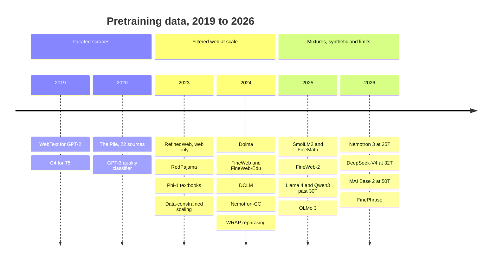
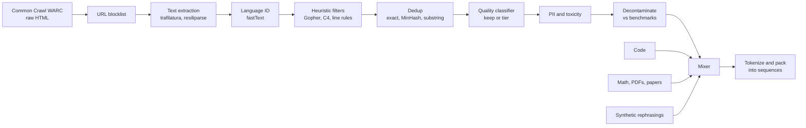

---
tags:
  - ai-ml
  - training
  - pretraining
  - data
  - datasets
status: draft
sources:
  - https://stanford-cs324.github.io/winter2022/lectures/data
  - https://arxiv.org/abs/2306.01116
  - https://arxiv.org/abs/2411.12372
  - https://arxiv.org/abs/2402.00159
  - https://arxiv.org/abs/2406.17557
  - https://arxiv.org/html/2406.17557v2
  - https://arxiv.org/abs/2406.11794v4
  - https://arxiv.org/html/2406.11794v4
  - https://arxiv.org/abs/2412.02595
  - https://arxiv.org/abs/2305.10429v4
  - https://arxiv.org/abs/2403.16952v1
  - https://arxiv.org/abs/2407.01492
  - https://arxiv.org/abs/2306.11644
  - https://arxiv.org/abs/2401.16380
  - https://arxiv.org/abs/2402.19173v1
  - https://arxiv.org/abs/2310.06786v1
  - https://arxiv.org/abs/2502.02737v1
  - https://huggingface.co/datasets/HuggingFaceTB/finemath/raw/main/README.md
  - https://arxiv.org/abs/2506.20920v1
  - https://arxiv.org/html/2305.16264v5
  - https://arxiv.org/abs/2607.25271
  - https://epoch.ai/blog/will-we-run-out-of-data-limits-of-llm-scaling-based-on-human-generated-data
  - https://ideas.repec.org/a/nat/nature/v631y2024i8022d10.1038_s41586-024-07566-y.html
  - https://arxiv.org/html/2407.21783
  - https://arxiv.org/abs/2412.19437
  - https://ai.meta.com/blog/llama-4-multimodal-intelligence/
  - https://arxiv.org/pdf/2505.09388
  - https://arxiv.org/pdf/2512.13961
  - https://arxiv.org/html/2512.20848v1
  - https://developer.nvidia.com/blog/inside-nvidia-nemotron-3-techniques-tools-and-data-that-make-it-efficient-and-accurate
  - https://build.nvidia.com/nvidia/nemotron-3-super-120b-a12b.md
  - https://huggingface.co/papers/2606.19348.md
  - https://www.alibabacloud.com/blog/qwen-3-5-towards-native-multimodal-agents_602894
  - https://microsoft.ai/news/frontier-pre-training-at-microsoft-ai/
  - https://arxiv.org/html/2604.13977v1
  - https://www.infoq.com/news/2026/01/huggingface-fine-translations
  - https://www.jurist.org/news/2026/07/judge-approves-record-1-5-billion-settlement-involving-anthropic/
  - https://digital-strategy.ec.europa.eu/en/policies/ai-code-practice
  - https://www.lw.com/en/insights/eu-ai-act-gpai-model-obligations-in-force-and-final-gpai-code-of-practice-in-place
created: 2026-11-26
updated: 2026-11-26
---

## Table Of Contents

---

- [[#TL;DR|TL;DR]]
- [[#The Problem|The Problem]]
- [[#Foundations|Foundations]]
    - [[#Tokens, Documents and Epochs|Tokens, Documents and Epochs]]
    - [[#Common Crawl and the Raw Web|Common Crawl and the Raw Web]]
    - [[#The Cleaning Pipeline|The Cleaning Pipeline]]
    - [[#Deduplication, Exact and Fuzzy|Deduplication, Exact and Fuzzy]]
    - [[#Quality Filtering, Heuristic and Model-Based|Quality Filtering, Heuristic and Model-Based]]
    - [[#Mixtures, Domain Weights and Annealing|Mixtures, Domain Weights and Annealing]]
- [[#How We Got Here|How We Got Here]]
- [[#How It Works|How It Works]]
    - [[#The Pipeline End to End|The Pipeline End to End]]
    - [[#How MinHash Finds Near-Duplicates|How MinHash Finds Near-Duplicates]]
    - [[#Effective Data Under Repetition|Effective Data Under Repetition]]
    - [[#A Worked Token Budget for a 15T Run|A Worked Token Budget for a 15T Run]]
    - [[#Choosing the Mixture|Choosing the Mixture]]
    - [[#Synthetic Data and Rephrasing|Synthetic Data and Rephrasing]]
- [[#Where It Is Now|Where It Is Now]]
    - [[#Disclosed Token Counts|Disclosed Token Counts]]
    - [[#Synthetic Data Is Now a Large Share|Synthetic Data Is Now a Large Share]]
    - [[#Open Datasets of 2025 and 2026|Open Datasets of 2025 and 2026]]
    - [[#The Data Wall|The Data Wall]]
    - [[#Licensing, Opt-Outs and Copyright|Licensing, Opt-Outs and Copyright]]
- [[#Trade-offs & Open Problems|Trade-offs & Open Problems]]
- [[#Resources|Resources]]
- [[#Related Notes|Related Notes]]

## ***TL;DR***
---
*Pretraining data is the tens of trillions of tokens a base model reads before any fine-tuning: mostly filtered web text from Common Crawl, plus code, math, PDFs, books and, increasingly, model-written text. How that text is extracted, deduplicated, filtered and mixed can be worth several times more compute, which is why data work became the main lever of open pretraining after 2023.*

- **What it is:** a pipeline that turns hundreds of terabytes of raw crawl into a few trillion clean tokens: HTML extraction, language ID, heuristic filters, exact and fuzzy deduplication, a learned quality classifier, safety and PII scrubbing, benchmark decontamination, then a weighted mixture of domains.
- **The key finding:** quality filtering with a small learned classifier beats hand-written rules. DCLM's fastText filter, keeping the top 10% of documents, got a 7B model to 64% MMLU with 6.6x less compute than Llama 3 8B ([Li et al., 2024](https://arxiv.org/abs/2406.11794v4)).
- **The constraint:** good text is finite. Epoch AI puts the stock of usable public human text at about 300T tokens and expects it to be fully used between 2026 and 2032 ([Villalobos et al., 2024](https://epoch.ai/blog/will-we-run-out-of-data-limits-of-llm-scaling-based-on-human-generated-data)); repeating data for about 4 epochs is nearly free, but value decays after that ([Muennighoff et al., 2023](https://arxiv.org/html/2305.16264v5)).
- **Where it is now (Nov 2026):** disclosed runs are 25T to 50T tokens (Nemotron 3 at 25T, DeepSeek-V4 at 32T to 33T, Microsoft's MAI Base 2 at 50T), trained in stages that end on a smaller high-quality "annealing" mix. Synthetic rephrasings of web text now run to trillions of tokens, and copyright pressure (a $1.5 billion US settlement, the EU AI Act's opt-out rules) shapes what can be crawled.

## ***The Problem***
---
*A model can only know what its training text contains, and it learns the style and errors of that text along with the facts. The problem is turning a noisy, duplicated, mostly low-value web into enough clean tokens to feed a run, without throwing away so much that you run out.*

[[Scaling Laws]] say loss falls as a power law in training tokens $D$, and modern runs are trained far past the Chinchilla ratio of about 20 tokens per parameter. A model served at scale wants trillions of tokens. Three things make that hard:

| Difficulty | What goes wrong | Example |
|---|---|---|
| The raw web is mostly junk for training | Boilerplate menus, spam, keyword lists, machine-generated pages and near-copies dominate a crawl | FineWeb's base filters cut 96 crawls to about 36T tokens; dedup and further filters left 15T ([Penedo et al., 2024](https://arxiv.org/html/2406.17557v2)) |
| Filtering trades quantity for quality | The best filters keep only a few percent; a strict filter can starve a long run | DCLM keeps about 3.8T tokens out of a 240T-token pool, about 1.6% ([Li et al., 2024](https://arxiv.org/html/2406.11794v4)) |
| The mix matters as much as the pieces | Too much web text and the model is weak at math and code; too little and it lacks general knowledge | Llama 3 settled on about 50% general knowledge, 25% math and reasoning, 17% code, 8% multilingual ([Llama Team, 2024](https://arxiv.org/html/2407.21783)) |

You also cannot test a data recipe on the full model; each test costs a training run. So data work is done with small "ablation" models (about 1B parameters, tens to hundreds of billions of tokens) and the winning recipe is trusted to transfer.

## ***Foundations***
---
*Six ideas cover how pretraining data is built: what a token budget counts, where the raw text comes from, the stages of the cleaning pipeline, how duplicates are found, how quality is judged, and how sources are weighted and scheduled.*

#### **Tokens, Documents and Epochs**

- **Token:** the unit the model reads, produced by its tokenizer (see [[Tokenization and Embeddings]]). The same text gives different token counts under different tokenizers, so budgets from different labs compare only roughly.
- **Document:** one web page, file, paper or book after extraction. Filters and deduplication work on documents (sometimes on lines or paragraphs); budgets are stated in tokens.
- **Unique vs seen tokens:** a dataset of $U$ unique tokens trained for 4 epochs gives $D = 4U$ seen tokens. "Trained on 15T tokens" means 15T seen; how many were unique is often not disclosed.
- **Epoch:** one full pass over a dataset. In mixtures, different sources get different epoch counts: high-value sources are upsampled (repeated) and bulk web text is seen once or less.

#### **Common Crawl and the Raw Web**

Common Crawl is a nonprofit that crawls the web and publishes free snapshots; its April 2021 snapshot alone was about 320 TB ([Stanford CS324](https://stanford-cs324.github.io/winter2022/lectures/data)). It has been the base of almost every large corpus since T5 and GPT-3. DCLM extracted a 240T-token pool from Common Crawl as a shared starting point ([Li et al., 2024](https://arxiv.org/abs/2406.11794v4)).

Snapshots come in two forms that matter: **WARC** files hold the raw HTML, and **WET** files hold Common Crawl's own text extraction. Better corpora re-extract from WARC: FineWeb found WET files "retained too much boilerplate and menu text" and used the trafilatura library instead ([Penedo et al., 2024](https://arxiv.org/html/2406.17557v2)); DCLM found resiliparse and trafilatura each beat WET by at least 2.5 points on its core benchmark set ([Li et al., 2024](https://arxiv.org/html/2406.11794v4)).

#### **The Cleaning Pipeline**

Every modern web corpus runs roughly the same stages. FineWeb and DCLM are the best documented:

| Stage | What it does | Typical tool or rule |
|---|---|---|
| URL filtering | Drop adult and known-bad domains | Blocklists ([FineWeb](https://arxiv.org/html/2406.17557v2)) |
| Text extraction | HTML to clean text, dropping navigation and boilerplate | trafilatura, resiliparse; Llama 3 used a custom parser that keeps math alt text ([Llama Team](https://arxiv.org/html/2407.21783)) |
| Language ID | Keep the target language(s) | fastText classifier; FineWeb keeps English scoring at least 0.65 |
| Heuristic filters | Remove pages that look broken or spammy | Gopher repetition and quality rules; C4 rules (lorem ipsum, curly braces, policy text); line-level rules |
| Deduplication | Remove exact and near-duplicate documents | Hashes, MinHash LSH, Bloom filters, suffix arrays |
| Model-based quality | Keep documents a classifier rates as high value | fastText or small transformer classifiers |
| Safety and PII | Drop toxic content, mask emails and IPs | Classifiers and regexes; FineWeb anonymizes emails and public IPs |
| Decontamination | Remove overlaps with evaluation benchmarks | n-gram matching; FineMath drops 13-gram overlaps with GSM8k, MATH, MMLU, ARC ([FineMath card](https://huggingface.co/datasets/HuggingFaceTB/finemath/raw/main/README.md)) |

Order matters for cost: cheap filters run first so the expensive steps (fuzzy dedup, neural classifiers) see less data. FineWeb's classifier pass over 15T tokens took about 6,000 H100 GPU hours ([Penedo et al., 2024](https://arxiv.org/html/2406.17557v2)).

#### **Deduplication, Exact and Fuzzy**

The web repeats itself: mirrors, templates, syndicated articles, boilerplate legal pages. Duplicates waste compute and push models toward memorizing repeated text.

- **Exact dedup:** hash each document (or URL, line or paragraph) and keep one copy per hash. OLMo 3's exact pass removed about 67% of web documents ([Olmo Team, 2025](https://arxiv.org/pdf/2512.13961)).
- **Fuzzy dedup (MinHash LSH):** find documents that are mostly the same. Each document becomes a set of word n-grams; MinHash compresses the set into a short signature whose agreement rate estimates Jaccard similarity; banding (LSH) finds candidate pairs without comparing every pair. OLMo 3's MinHash pass removed another 23% ([Olmo Team, 2025](https://arxiv.org/pdf/2512.13961)). Details in [[#How MinHash Finds Near-Duplicates|How It Works]].
- **Substring dedup:** suffix arrays find long repeated spans inside otherwise different documents; OLMo 3 removed about 14% of remaining text bytes this way.
- **Global vs per-snapshot:** deduplicating across all crawls sounds best but was not. FineWeb found global dedup left about 4T tokens that trained worse, and in one old crawl the data it kept was lower quality than what it removed; deduplicating each snapshot on its own kept about 20T tokens and matched RefinedWeb ([Penedo et al., 2024](https://arxiv.org/html/2406.17557v2)). Content that survives in many crawls tends to be content people keep online, which is weak evidence of quality.

#### **Quality Filtering, Heuristic and Model-Based**

Heuristics catch broken pages; they do not tell a textbook explanation from a forum argument. Model-based filters do:

- **Reference classifiers:** train a cheap classifier to tell "good" reference text from random crawl, keep what scores high. GPT-3 used WebText (pages linked from Reddit) as positives ([Stanford CS324](https://stanford-cs324.github.io/winter2022/lectures/data)). DCLM used OpenHermes 2.5 instruction data and top r/ExplainLikeImFive posts as positives, random crawl as negatives, and kept the top 10% ([Li et al., 2024](https://arxiv.org/html/2406.11794v4)).
- **LLM-annotated classifiers:** have a large model grade a sample, train a small model on its grades. FineWeb-Edu had Llama-3-70B-Instruct score 460,000 pages for educational value on a 0 to 5 scale, trained a linear regressor on embeddings, and kept pages scoring 3 or more ([Penedo et al., 2024](https://arxiv.org/html/2406.17557v2)).
- **Tiered rather than binary:** recent pipelines keep more data but repeat the best more often. OLMo 3 splits web text into 24 topics and 20 quality tiers and upsamples roughly the top 5% up to 7 times ([Olmo Team, 2025](https://arxiv.org/pdf/2512.13961)).

#### **Mixtures, Domain Weights and Annealing**

A corpus is a set of sources (web, code, math, papers, books, encyclopedias, multilingual), and the **mixture** gives each source a weight: the share of training tokens drawn from it. Weights can differ a lot from raw sizes. In GPT-3's data, Common Crawl was 82% of the tokens but only 60% of what the model saw during training ([Stanford CS324](https://stanford-cs324.github.io/winter2022/lectures/data)).

Modern runs also change the mixture over time:

- **Main phase:** a broad, diverse mix for most of the tokens.
- **Annealing or mid-training:** as the learning rate decays, switch to a small, high-quality mix (math, code, curated web, instruction-like and reasoning data). Llama 3's annealing on high-quality code and math raised its 8B model's GSM8K and MATH validation scores by 24.0% and 6.4%, with negligible gains at 405B ([Llama Team, 2024](https://arxiv.org/html/2407.21783)).
- **Long-context extension:** a final phase on long documents at longer sequence length (see [[Long Context]]).

## ***How We Got Here***
---
*Corpora went from link-curated web scrapes (2019) to big hand-assembled collections (2020) to aggressively filtered Common Crawl (2023), then to learned quality classifiers and LLM rewriting (2024 onward). Each step answered the last one's bottleneck: quality, then scale, then quality at scale, then running out.*

| Year | What changed | Problem it answered | Source |
|---|---|---|---|
| 2019 | WebText: outbound links from Reddit posts with at least 3 karma, 40 GB. Uses human curation as a quality filter. | Raw crawl was too noisy for GPT-2. | [CS324](https://stanford-cs324.github.io/winter2022/lectures/data) |
| 2019 | C4: one April 2019 Common Crawl snapshot (1.4T tokens) filtered by rules to 806 GB, about 156B tokens. | A big, public, clean web corpus for T5. | [CS324](https://stanford-cs324.github.io/winter2022/lectures/data) |
| 2020 | The Pile: 825 GB from 22 academic and professional sources. GPT-3 trains a classifier with WebText as positives and fuzzy-dedups. | Diversity beyond the web; filtering the web without hand rules. | [CS324](https://stanford-cs324.github.io/winter2022/lectures/data) |
| 2023 | RefinedWeb: 5T tokens from Common Crawl alone, 600B released; filtered and deduplicated web beats models trained on The Pile. | Curated sources do not scale to trillions of tokens. | [Penedo et al.](https://arxiv.org/abs/2306.01116) |
| 2023 | RedPajama-V1 reproduces the LLaMA data recipe openly; V2 releases raw web text plus quality signals so users choose their own filters. Together over 100T tokens. | LLaMA's data was described but not released. | [Weber et al.](https://arxiv.org/abs/2411.12372) |
| 2023 | Phi-1: a 1.3B model on about 6B tokens of filtered "textbook quality" web code plus 1B synthetic textbook tokens from GPT-3.5 reaches 50.6% HumanEval. | Whether quality can substitute for quantity. | [Gunasekar et al.](https://arxiv.org/abs/2306.11644) |
| 2023 | DoReMi learns domain weights with a 280M proxy model; the 8B model reaches baseline accuracy in 2.6x fewer steps. | Mixture weights were set by hand. | [Xie et al.](https://arxiv.org/abs/2305.10429v4) |
| 2023 | Up to 4 epochs of repetition is nearly as good as fresh data; value decays after that. | What to do when unique data runs out. | [Muennighoff et al.](https://arxiv.org/html/2305.16264v5) |
| 2024 | Dolma: 3T open tokens from web, papers, code, books, social media and encyclopedias, with the toolkit. | Fully open data for fully open models (OLMo). | [Soldaini et al.](https://arxiv.org/abs/2402.00159) |
| 2024 | FineWeb (15T tokens, 96 snapshots) with every pipeline choice ablated; FineWeb-Edu (1.3T) lifts MMLU from 33% to 37% and ARC from 46% to 57% at 1.71B scale. | Open web data lagged closed corpora; choices were folklore. | [Penedo et al.](https://arxiv.org/html/2406.17557v2) |
| 2024 | DCLM: a controlled benchmark over a 240T pool and 53 evals; model-based filtering is "key". | Data recipes were compared on different models and budgets. | [Li et al.](https://arxiv.org/abs/2406.11794v4) |
| 2024 | WRAP rephrases C4 "like Wikipedia" or as Q&A; about 3x faster pretraining. | Strict filters throw away most data; rewriting can recover it. | [Maini et al.](https://arxiv.org/abs/2401.16380) |
| 2024 | Nemotron-CC: classifier ensembles, synthetic rephrasing and fewer heuristics give 6.3T tokens with 4x DCLM's unique real tokens; an 8B on 15T beats Llama 3.1 8B by 5 MMLU points. | Top-10% filtering is too small for long runs. | [Su et al.](https://arxiv.org/abs/2412.02595) |
| 2025 | SmolLM2 trains a 1.7B on about 11T tokens in stages and releases FineMath and Stack-Edu for the stages where data fell short. | Small models need specialist data late in training. | [Allal et al.](https://arxiv.org/abs/2502.02737v1) |
| 2025 | FineWeb-2: one pipeline adapted automatically to over 1,000 languages, about 20 TB. | Multilingual corpora were hand-tuned per language. | [Penedo et al.](https://arxiv.org/abs/2506.20920v1) |

## ***How It Works***
---
*The mechanics: a staged pipeline with measured yields at each step, MinHash banding for near-duplicate search, a formula for how much repeated data is worth, and small-model experiments to pick the mixture. Together they let you plan a token budget backwards from the run size.*

#### **The Pipeline End to End**

The other sources get their own pipelines (license filtering for code, OCR for PDFs, LaTeX-preserving extraction for math) before the mixer. At the end, documents are tokenized and packed into fixed-length sequences; DeepSeek-V4 packs documents from different sources together to minimize truncation and masks attention between them ([DeepSeek-AI, 2026](https://huggingface.co/papers/2606.19348.md)).

#### **How MinHash Finds Near-Duplicates**

Represent each document as its set of word 5-grams. The Jaccard similarity of two documents is $s = |A \cap B| / |A \cup B|$. For a random hash function, the probability that both sets have the same minimum hash value is exactly $s$. Compute many such hashes, split them into $b$ bands of $r$ hashes each, and call two documents candidates if they match on every hash in at least one band. Then

$$
P(\text{flagged as duplicate}) = 1 - \left(1 - s^{r}\right)^{b}
$$

*In plain English: a band matches only if all $r$ of its hashes agree, which is likely only for very similar documents ($s^r$). With $b$ independent bands, a near-duplicate gets $b$ chances to be caught. Raising $r$ makes the test stricter; raising $b$ makes it more forgiving. The result is an S-curve that sharply separates "mostly the same" from "different".*

FineWeb uses 112 hashes as 14 bands of 8, aimed at documents about 75% similar ([Penedo et al., 2024](https://arxiv.org/html/2406.17557v2)). Plugging in $r = 8$, $b = 14$:

| Jaccard similarity $s$ | 0.5 | 0.6 | 0.7 | 0.75 | 0.8 | 0.9 |
|---|---|---|---|---|---|---|
| $P$(flagged) | 5.3% | 21% | 57% | 77% | 92% | over 99.9% |

Pages that share half their 5-grams almost always survive; pages that share 90% almost never do. The cost is linear in the number of documents (hash each once, bucket by band) instead of quadratic.

#### **Effective Data Under Repetition**

When unique data $U$ is smaller than the token budget $D$, you repeat it. Muennighoff et al. fit how much a repeated token is worth compared to a fresh one ([Muennighoff et al., 2023](https://arxiv.org/html/2305.16264v5)):

$$
D' = U + U R^{*} \left(1 - e^{-R/R^{*}}\right), \qquad R = \frac{D}{U} - 1
$$

*In plain English: $D'$ is the number of fresh tokens your run is "worth". The first pass over the data counts in full ($U$). Each further pass ($R$ is epochs minus one) counts for less than the one before, decaying exponentially with a half-life-like constant $R^{*}$, fitted at about 15 (roughly 16 epochs). However many times you repeat, $D'$ can never exceed $U(1 + R^{*})$, about 16 times the unique data.*

What the formula says, with $R^{*} = 15$:

| Epochs over $U$ | $D'$ as a multiple of $U$ | Value per seen token, $D'/D$ |
|---|---|---|
| 1 | 1.00 | 100% |
| 2 | 1.97 | 98% |
| 4 | 3.72 | 93% |
| 8 | 6.59 | 82% |
| 16 | 10.48 | 66% |
| 40 | 14.89 | 37% |

The paper's own runs agree: an 8.7B model trained for 4 epochs ended with only 0.5% higher validation loss than a single-epoch model, gains continue to about 16 epochs and then fall off fast, and runs at 44 epochs failed. Two more findings from the same paper: mixing in code (up to half the data) roughly doubles effective tokens even on language-only tasks, and deduplication did not help downstream scores in their setting while perplexity filtering did.

Caveat: the 2026 follow-up by Qin, Hamidieh and Alvarez-Melis finds that the worth of repeated and paraphrased tokens is "far from constant" and saturates as the corpus grows, so the classic compute-optimal split is suboptimal in most practical settings; its fits span 14M to 600M parameters on Dolma 3 ([Qin et al., 2026](https://arxiv.org/abs/2607.25271)). The 4-epoch rule is a guide, not a constant.

#### **A Worked Token Budget for a 15T Run**

Start from FineWeb, the best-documented open pipeline, which produced 15T tokens from 96 Common Crawl snapshots ([Penedo et al., 2024](https://arxiv.org/html/2406.17557v2)):

| Stage | Tokens left | Kept from previous | Note |
|---|---|---|---|
| URL filter, trafilatura extraction, English at 0.65 or more, Gopher filters | about 36T | n/a | Raw crawl before this is hundreds of TB of HTML |
| Per-snapshot MinHash dedup | about 20T | about 56% | Global dedup would leave about 4T, and train worse |
| C4 filters (minus terminal punctuation) and three custom line filters | 15T | about 75% | Custom filters alone remove about 22% |
| Educational classifier, score 3 or more (FineWeb-Edu) | 1.3T | about 8.7% | MMLU 33% to 37% at 1.71B scale |

So a strict classifier keeps under a tenth of an already filtered corpus. Now fill a 15T-token run three ways, valuing repeats with the formula above ($R^{*} = 15$):

| Plan | Unique tokens $U$ | Epochs | Effective tokens $D'$ | Value per seen token |
|---|---|---|---|---|
| A. All of FineWeb, once | 15T | 1 | 15.0T | 100% |
| B. DCLM-Baseline-sized pool (top 10%) | 3.8T | 3.9 | 14.0T | 93% |
| C. FineWeb-Edu only | 1.3T | 11.5 | 11.1T | 74% |

The formula measures value against fresh tokens *of the same quality*, so plan C can still win if each Edu token is worth much more than an average FineWeb token; that is what the FineWeb-Edu and DCLM results suggest at small scale. The practical answer in 2025 to 2026 is a blend: most tokens from a broad, medium-quality pool seen about once, the top few percent repeated several times, and synthetic rephrasings to stretch the top tier. Nemotron-CC was built for exactly this case: its 8B 15T-token run drew on 7.2T tokens of the dataset ([Su et al., 2024](https://arxiv.org/abs/2412.02595)), and OLMo 3 caps repetition of its top tier at 7x ([Olmo Team, 2025](https://arxiv.org/pdf/2512.13961)).

For scale: at Chinchilla's 20 tokens per parameter, 15T tokens would suit a 750B-parameter dense model; Llama 3's 405B flagship saw 15.6T ([Llama Team, 2024](https://arxiv.org/html/2407.21783)), and the same family's 8B model was trained on about 15T. The token budget is set by overtraining for cheap inference, not by Chinchilla (see [[Scaling Laws]]).

#### **Choosing the Mixture**

Mixture weights cannot be tuned on the full model, so labs fit them on small models and extrapolate, as with scaling laws:

- **DoReMi (2023):** train a 280M proxy with Group DRO, which upweights domains where it lags a reference model; use the learned weights for an 8B model. +6.5 points average few-shot accuracy over The Pile's default weights ([Xie et al., 2023](https://arxiv.org/abs/2305.10429v4)).
- **Data mixing laws (2024):** fit per-domain loss as a function of the mixture proportions $r_j$:

$$
L_i(r) = c_i + k_i \exp\Big(\sum_j t_{ij}\, r_j\Big)
$$

*In plain English: loss on domain $i$ is a floor $c_i$ plus a term that shrinks exponentially as you add data from domains that help it ($t_{ij} < 0$) and grows with domains that compete with it. Fit the $t_{ij}$ on small runs, then search for the mixture with the lowest predicted total loss.* On RedPajama, the optimized mixture for a 1B model on 100B tokens matched the default mixture trained for 48% more steps ([Ye et al., 2024](https://arxiv.org/abs/2403.16952v1)).
- **RegMix (2024):** train 512 tiny models (1M parameters, 1B tokens) on random mixtures, regress performance on mixture, pick the best predicted one. It matched or beat DoReMi with 10% of the compute, and found web text correlates with downstream scores more than "high quality" sources like Wikipedia ([Liu et al., 2024](https://arxiv.org/abs/2407.01492)).
- **At production scale:** Llama 3 used a knowledge classifier to downsample over-represented web topics and small-model scaling experiments to pick the mix ([Llama Team, 2024](https://arxiv.org/html/2407.21783)); Qwen3 labeled over 30T tokens by educational value, field, domain and safety, and optimized the mixture per instance with small proxy models ([Qwen Team, 2025](https://arxiv.org/pdf/2505.09388)).

#### **Synthetic Data and Rephrasing**

Three kinds of model-written pretraining data, in order of how far they move from real text:

| Kind | What it is | Evidence |
|---|---|---|
| Rephrasing | An LLM rewrites real web documents in a cleaner style (Wikipedia-like, Q&A, tutorial). Facts come from the source; the model adds structure. | WRAP: about 3x faster pretraining on C4, over 10% better perplexity ([Maini et al., 2024](https://arxiv.org/abs/2401.16380)). Nemotron-CC rephrases low-quality documents to rescue them ([Su et al., 2024](https://arxiv.org/abs/2412.02595)). |
| Generated textbooks and exercises | An LLM writes new teaching material on chosen topics. | Phi-1's 1B synthetic tokens ([Gunasekar et al., 2023](https://arxiv.org/abs/2306.11644)); Qwen3 generated "trillions" of synthetic tokens with Qwen2.5, Qwen2.5-Math and Qwen2.5-Coder ([Qwen Team, 2025](https://arxiv.org/pdf/2505.09388)). |
| Reasoning and instruction-style data | QA pairs, worked solutions, thinking traces mixed into mid-training. | OLMo 3's Dolmino mid-training mix includes synthetic math, QA and thinking traces ([Olmo Team, 2025](https://arxiv.org/pdf/2512.13961)). |

What a 2026 Hugging Face study learned about doing rephrasing well ([Niklaus et al., Apr 2026](https://arxiv.org/html/2604.13977v1)):

- **Format beats generator size:** structured outputs (math, table, FAQ, tutorial prompts) beat the DCLM web baseline; a 1B generator (Gemma 3 1B) beat a 27B one, and gains mostly stop past about 1B parameters.
- **Never synthetic alone:** synthetic-only training underperformed synthetic mixed with real data (12.32 vs 14.30 for one prompt), and a strong real "mix-in" mattered more than the quality of the source documents being rewritten.
- **Cheap at scale:** their 486B-token FinePhrase set was generated with SmolLM2 1.7B.

Rephrasing is also a form of [[Distillation]]: the generator's knowledge and style leak into the student. Some labs now advertise that they do not do it: Microsoft says MAI Base 2's pretraining uses "organic data which does not involve distillation from other models" ([Microsoft AI, Oct 2026](https://microsoft.ai/news/frontier-pre-training-at-microsoft-ai/)).

## ***Where It Is Now***
---
*As of November 2026 disclosed pretraining runs are 25T to 50T tokens, built in stages that end on curated high-quality data, with synthetic rephrasing filling trillions of tokens. Open datasets now rival closed ones in recipe quality; the scarce inputs are unique high-quality human text and the legal right to use it.*

#### **Disclosed Token Counts**

| Model | Date | Pretraining tokens | Data notes | Source |
|---|---|---|---|---|
| Llama 3 405B | Jul 2024 | 15.6T text | About 50% general, 25% math and reasoning, 17% code, 8% multilingual; annealing at the end | [Llama Team](https://arxiv.org/html/2407.21783) |
| DeepSeek-V3 | Dec 2024 | 14.8T | 671B total, 37B active parameters | [DeepSeek-AI](https://arxiv.org/abs/2412.19437) |
| SmolLM2 1.7B | Feb 2025 | about 11T | Multi-stage; FineMath, Stack-Edu added late | [Allal et al.](https://arxiv.org/abs/2502.02737v1) |
| Llama 4 | Apr 2025 | more than 30T | "More than double" Llama 3; text, image, video; 200 languages, 10x the multilingual tokens of Llama 3; mid-training | [Meta](https://ai.meta.com/blog/llama-4-multimodal-intelligence/) |
| Qwen3 | May 2025 | about 36T | 119 languages; over 30T general at 4K context, about 5T reasoning-heavy, then long context at 32K; PDFs extracted with Qwen2.5-VL | [Qwen Team](https://arxiv.org/pdf/2505.09388) |
| OLMo 3 7B / 32B | Dec 2025 report | 5.93T (32B stopped near 5.5T) | Dolma 3 Mix: 76.1% web, 13.6% science PDFs via olmOCR, 6.89% code, 2.56% FineMath; then 100B Dolmino mid-training and 50B to 100B Longmino long-context | [Olmo Team](https://arxiv.org/pdf/2512.13961) |
| Nemotron 3 Nano | Dec 2025 | about 25T | 23.5T diverse, then 1.5T high-quality from the 94% mark, then 121B long-context | [NVIDIA](https://arxiv.org/html/2512.20848v1) |
| Qwen3.5 397B-A17B | Feb 2026 | not disclosed | 201 languages; more visual-text tokens than Qwen3; stricter filtering | [Qwen](https://www.alibabacloud.com/blog/qwen-3-5-towards-native-multimodal-agents_602894) |
| Nemotron 3 Super | Mar 2026 | over 25T | Pretraining data through June 2025; "a large amount of synthetic data" | [NVIDIA model card](https://build.nvidia.com/nvidia/nemotron-3-super-120b-a12b.md) |
| DeepSeek-V4 Flash / Pro | Jun 2026 report | 32T / 33T | Filters templated auto-generated web text to reduce collapse risk; more multilingual and long-document data; agentic data in mid-training | [DeepSeek-AI](https://huggingface.co/papers/2606.19348.md) |
| MAI Base 2 (Microsoft) | Oct 2026 | 50T mixture | Unique corpus up 36% over MAI Base 1; own robots.txt-respecting crawler; web cutoff March 2026; 18% vision-language data | [Microsoft AI](https://microsoft.ai/news/frontier-pre-training-at-microsoft-ai/) |

Closed frontier labs (OpenAI, Google DeepMind, Anthropic) do not publish token counts or mixtures. The pattern across the open reports is consistent: a long diverse phase, a short high-quality phase as the learning rate decays (see [[Optimizers]]), then a long-context phase ([[Long Context]]).

#### **Synthetic Data Is Now a Large Share**

- NVIDIA describes a synthetic pretraining corpus of "nearly 10 trillion tokens" behind Nemotron 3, against a 25T-token dataset; it does not give the exact share used in training ([NVIDIA, Dec 2025](https://developer.nvidia.com/blog/inside-nvidia-nemotron-3-techniques-tools-and-data-that-make-it-efficient-and-accurate)).
- The Nemotron 3 Super card lists synthetic Common Crawl rewritten by Qwen3-30B-A3B and Mistral-NeMo-12B (415.8B tokens) and synthetic code from phi-4 (427.9B), beside 3.36T tokens of real English Common Crawl ([NVIDIA, Mar 2026](https://build.nvidia.com/nvidia/nemotron-3-super-120b-a12b.md)).
- Qwen3 reports "trillions" of synthetic tokens ([Qwen Team, 2025](https://arxiv.org/pdf/2505.09388)); a 2026 survey of the field says several recent LLMs used "hundreds of billions of synthetic tokens during pretraining" ([Niklaus et al., 2026](https://arxiv.org/html/2604.13977v1)).

The worry is **model collapse**: Shumailov et al. showed that "indiscriminate use of model-generated content in training causes irreversible defects", with the tails of the original distribution disappearing over generations ([Nature, Jul 2024](https://ideas.repec.org/a/nat/nature/v631y2024i8022d10.1038_s41586-024-07566-y.html)). Labs respond by keeping real data in every mix, using synthetic data mainly as rewrites of real documents, and filtering machine-generated web text: DeepSeek-V4 explicitly removes batched, templated auto-generated pages for this reason ([DeepSeek-AI, 2026](https://huggingface.co/papers/2606.19348.md)).

#### **Open Datasets of 2025 and 2026**

| Dataset | Date | Size | What it adds | Source |
|---|---|---|---|---|
| FineMath | Feb 2025 | about 34B tokens (3+), 54B with InfiMM-WebMath | Math pages re-extracted from WARC, classifier-scored for step-by-step solutions, decontaminated | [HF card](https://huggingface.co/datasets/HuggingFaceTB/finemath/raw/main/README.md) |
| FineWeb-2 | Jun 2025 | about 20 TB, 5B documents | Over 1,000 languages; rebalancing by duplication count and quality | [Penedo et al.](https://arxiv.org/abs/2506.20920v1) |
| Dolma 3 | Dec 2025 | about 9.3T pool | Includes olmOCR science PDFs and Stack-Edu; dedup cut web from 38.7B to 9.7B documents | [Olmo Team](https://arxiv.org/pdf/2512.13961) |
| Nemotron-CC-v2.1 and companions | Dec 2025 | 2.5T+ new English tokens; CC-Code 428B | Rephrasing and translation from nine languages; synthetic STEM sets | [NVIDIA](https://arxiv.org/html/2512.20848v1) |
| FineTranslations | Jan 2026 | over 1T tokens | FineWeb-2 text in 500+ languages translated to English with Gemma 3 27B | [InfoQ](https://www.infoq.com/news/2026/01/huggingface-fine-translations) |
| FinePhrase | Apr 2026 | 486B tokens | Structured rephrasings (math, table, FAQ, tutorial) by SmolLM2 1.7B; FinePhrase-Table +3.41 over DCLM | [Niklaus et al.](https://arxiv.org/html/2604.13977v1) |

Code and math corpora sit beside these: The Stack v2 (Feb 2024) was built with Software Heritage across 619 programming languages, 4x the first StarCoder data ([Lozhkov et al.](https://arxiv.org/abs/2402.19173v1)); OpenWebMath (Oct 2023) showed 14.7B tokens of LaTeX-preserving math pages beat 20x more general text for a 1.4B model ([Paster et al.](https://arxiv.org/abs/2310.06786v1)).

#### **The Data Wall**

- **The stock:** about 300T tokens of quality- and repetition-adjusted public human text (90% CI 100T to 1,000T), fully used between 2026 and 2032 at current trends; with 5x overtraining, by 2027 ([Villalobos et al., Jun 2024](https://epoch.ai/blog/will-we-run-out-of-data-limits-of-llm-scaling-based-on-human-generated-data)). A 50T-token mixture like MAI Base 2's is already a sixth of that central estimate, before counting repetition.
- **Stretching it:** repetition (nearly free to about 4 epochs), rephrasing (trillions of tokens), new modalities (PDFs via OCR, images, video), translation into English, and more languages. Each has a declining value per token that 2026 work is still measuring ([Qin et al., 2026](https://arxiv.org/abs/2607.25271)).
- **Compute moved elsewhere:** labs now spend more compute on RL and inference than on pretraining (see [[Scaling Laws]] and [[RL for Reasoning]]), partly because pretraining tokens are the scarce input.

#### **Licensing, Opt-Outs and Copyright**

- **United States:** in *Bartz v. Anthropic*, Judge Alsup ruled in June 2025 that training on lawfully bought books can be fair use, but building a permanent library from pirated copies was not. The $1.5 billion class settlement, about $3,000 per book for over 400,000 books, got final approval in July 2026 ([JURIST, Jul 2026](https://www.jurist.org/news/2026/07/judge-approves-record-1-5-billion-settlement-involving-anthropic/)). The lesson for data teams: *how* a corpus was acquired matters, not only what it is used for.
- **European Union:** AI Act rules for general-purpose models apply from 2 August 2025, and providers must publish a summary of training content on a Commission template adopted in July 2025 ([European Commission](https://digital-strategy.ec.europa.eu/en/policies/ai-code-practice)). The Code of Practice's copyright chapter commits signatories to honor robots.txt and other machine-readable opt-outs, not circumvent technical protections such as paywalls, and exclude listed piracy sites. AI Office enforcement began 2 August 2026; models already on the market have until 2 August 2027 ([Latham & Watkins, Sep 2025](https://www.lw.com/en/insights/eu-ai-act-gpai-model-obligations-in-force-and-final-gpai-code-of-practice-in-place)).
- **Effect on corpora:** honoring opt-outs shrinks the crawlable web over time; open datasets ship under ODC-By and inherit Common Crawl's terms ([FineMath card](https://huggingface.co/datasets/HuggingFaceTB/finemath/raw/main/README.md)), and Microsoft now advertises a crawler that respects robots.txt and excludes sources on the USTR Notorious Markets list ([Microsoft AI, Oct 2026](https://microsoft.ai/news/frontier-pre-training-at-microsoft-ai/)).

## ***Trade-offs & Open Problems***
---
*Every data choice trades quality against quantity, and the right answer depends on run length. The open questions are how to judge quality without a human in the loop, how far synthetic data can go, and how to measure progress honestly when benchmarks leak into the web.*

| Trade-off | One side | Other side | Where the evidence sits |
|---|---|---|---|
| Filter strictness | Top 10% wins at 1B to 7B scale ([DCLM](https://arxiv.org/html/2406.11794v4)) | Long runs need more unique tokens; Nemotron-CC keeps more and rephrases ([Su et al.](https://arxiv.org/abs/2412.02595)) | Tiered upsampling (OLMo 3) splits the difference |
| Dedup aggressiveness | Removes waste and memorization | Global dedup removed good data in FineWeb's tests; Muennighoff saw no downstream gain | Per-snapshot or tier-aware dedup |
| Synthetic share | Cheap, controllable, rescues low-quality text | Collapse risk; inherits the generator's errors and style | Keep real data in the mix; rewrite rather than invent |
| Classifier target | "Educational" or "instruction-like" text lifts MMLU and ARC | Narrows style and topic coverage; benchmark-shaped data can inflate scores | Topic binning and diversity sampling (OLMo 3, MAI Base 2) |
| Small-model ablations | Only affordable way to test recipes | Mixture effects may not transfer; Llama 3's annealing gains vanished at 405B | Mixing laws, RegMix up to 7B |

- **Contamination:** web text increasingly contains benchmark questions and answers. n-gram decontamination catches copies, not paraphrases, so reported gains from "high-quality" data can partly be leakage.
- **Quality is defined by proxies:** every classifier encodes a choice (Reddit links, ELI5 answers, an LLM's idea of "educational"). There is no agreed measure of what text is worth for training other than training on it.
- **Disclosure is shrinking at the top:** closed labs publish nothing, and even open-weight reports (Qwen3.5) can omit token counts, which makes the data wall hard to measure.
- **Value of a token is not fixed:** repeated, paraphrased and synthetic tokens lose value faster for larger models and higher token ratios ([Qin et al., 2026](https://arxiv.org/abs/2607.25271)); fits stop well below frontier scale.
- **Legal uncertainty:** fair use and opt-out rules differ by country and are still being litigated; datasets built today may not be usable tomorrow.

## ***Resources***
---
*Read FineWeb for a fully ablated pipeline and DCLM for why model-based filtering wins, then Muennighoff for the data-constrained math. The OLMo 3 and Nemotron 3 reports are the most complete public views of a 2025 to 2026 production data stack.*

**Papers: corpora and pipelines**
- [The RefinedWeb Dataset for Falcon LLM](https://arxiv.org/abs/2306.01116): Penedo et al. (TII), Jun 2023. Web-only data beats curated corpora.
- [RedPajama: an Open Dataset for Training Large Language Models](https://arxiv.org/abs/2411.12372): Weber et al. (Together AI), Nov 2024. Raw web plus quality signals.
- [Dolma: an Open Corpus of Three Trillion Tokens](https://arxiv.org/abs/2402.00159): Soldaini et al. (AI2), Jan 2024. Open data and toolkit behind OLMo.
- [The FineWeb Datasets](https://arxiv.org/abs/2406.17557): Penedo et al. (Hugging Face), Jun 2024 (NeurIPS 2024). Every pipeline step ablated; FineWeb-Edu classifier.
- [DataComp-LM](https://arxiv.org/abs/2406.11794v4): Li et al., Jun 2024. Controlled benchmark of data recipes; model-based filtering wins.
- [Nemotron-CC](https://arxiv.org/abs/2412.02595): Su et al. (NVIDIA), Dec 2024 (ACL 2025). Classifier ensembles and rephrasing for long runs.
- [FineWeb2](https://arxiv.org/abs/2506.20920v1): Penedo et al. (Hugging Face), Jun 2025. One pipeline for over 1,000 languages.
- [StarCoder 2 and The Stack v2](https://arxiv.org/abs/2402.19173v1): Lozhkov et al. (BigCode), Feb 2024. Code corpus from Software Heritage.
- [OpenWebMath](https://arxiv.org/abs/2310.06786v1): Paster et al., Oct 2023. LaTeX-preserving math web text.
- [SmolLM2](https://arxiv.org/abs/2502.02737v1): Allal et al. (Hugging Face), Feb 2025. Data-centric multi-stage training; FineMath and Stack-Edu.

**Papers: mixtures, repetition and synthetic data**
- [Scaling Data-Constrained Language Models](https://arxiv.org/html/2305.16264v5): Muennighoff et al., May 2023 (NeurIPS 2023). The effective-data formula.
- [DoReMi](https://arxiv.org/abs/2305.10429v4): Xie et al., May 2023. Learned domain weights from a proxy model.
- [Data Mixing Laws](https://arxiv.org/abs/2403.16952v1): Ye et al., Mar 2024 (ICLR 2025). Predict loss from mixture proportions.
- [RegMix](https://arxiv.org/abs/2407.01492): Liu et al., Jul 2024 (ICLR 2025). Mixture search by regression over tiny models.
- [Textbooks Are All You Need](https://arxiv.org/abs/2306.11644): Gunasekar et al. (Microsoft Research), Jun 2023. Phi-1 and synthetic textbooks.
- [Rephrasing the Web (WRAP)](https://arxiv.org/abs/2401.16380): Maini et al., Jan 2024. Style rewriting speeds pretraining about 3x.
- [How Can We Synthesize High-Quality Pretraining Data?](https://arxiv.org/html/2604.13977v1): Niklaus et al. (Hugging Face), Apr 2026. Prompt, generator and mix-in ablations; FinePhrase.
- [AI models collapse when trained on recursively generated data](https://ideas.repec.org/a/nat/nature/v631y2024i8022d10.1038_s41586-024-07566-y.html): Shumailov et al., Nature, Jul 2024.
- [Bridging Compute- and Data-Optimal Pretraining](https://arxiv.org/abs/2607.25271): Qin, Hamidieh, Alvarez-Melis, Jul 2026. Token effectiveness of repetition and paraphrase.

**Model reports with data sections**
- [The Llama 3 Herd of Models](https://arxiv.org/html/2407.21783): Meta, Jul 2024. Mix, dedup levels, annealing.
- [Qwen3 Technical Report](https://arxiv.org/pdf/2505.09388): Qwen Team, May 2025. 36T tokens, instance-level mixing.
- [Olmo 3](https://arxiv.org/pdf/2512.13961): AI2, Dec 2025. Dolma 3, Dolmino, Longmino, full dedup numbers.
- [Nemotron 3 Nano](https://arxiv.org/html/2512.20848v1): NVIDIA, Dec 2025. 25T tokens in phases; new open datasets.
- [DeepSeek-V4](https://huggingface.co/papers/2606.19348.md): DeepSeek-AI, Jun 2026. 32T to 33T tokens.
- [Frontier Pre-training at Microsoft AI](https://microsoft.ai/news/frontier-pre-training-at-microsoft-ai/): Microsoft AI, Oct 2026. 50T-token MAI Base 2.

**Explainers and analysis**
- [Stanford CS324: Data](https://stanford-cs324.github.io/winter2022/lectures/data): Stanford, 2022. Lineage from WebText to The Pile and GPT-3's filter.
- [Will We Run Out of Data?](https://epoch.ai/blog/will-we-run-out-of-data-limits-of-llm-scaling-based-on-human-generated-data): Villalobos et al. (Epoch AI), Jun 2024. The stock of human text.
- [EU AI Act GPAI obligations and Code of Practice](https://www.lw.com/en/insights/eu-ai-act-gpai-model-obligations-in-force-and-final-gpai-code-of-practice-in-place): Latham & Watkins, Sep 2025. Copyright and opt-out commitments, key dates.

## Related Notes

- [[Scaling Laws]] — Why runs need so many tokens, and where the data-constrained laws plug in.
- [[Tokenization and Embeddings]] — The tokenizer decides what a "token" is and so every budget in this note.
- [[Distillation]] — Synthetic rephrasing and generated textbooks pass a teacher model's knowledge into pretraining.
- [[Long Context]] — The long-document phase that ends most 2025 to 2026 pretraining runs.
- [[Distributed Training]] — How tens of trillions of tokens are streamed through thousands of accelerators.
- [[Optimizers]] — Learning-rate decay is when annealing on high-quality data pays off.
- [[RL for Reasoning]] — Where compute went as fresh pretraining data got scarce.
- [[Mixture of Experts]] — Most of the 2025 to 2026 models in the token-count table are MoE.
- [[Transformer]] — The architecture all of this data trains.
