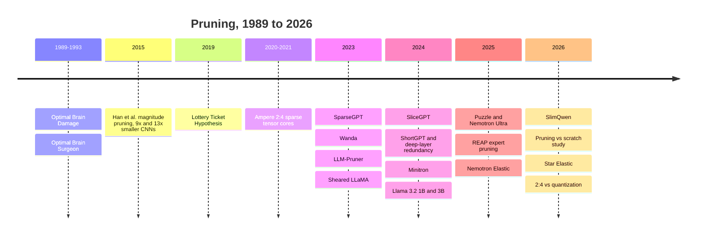
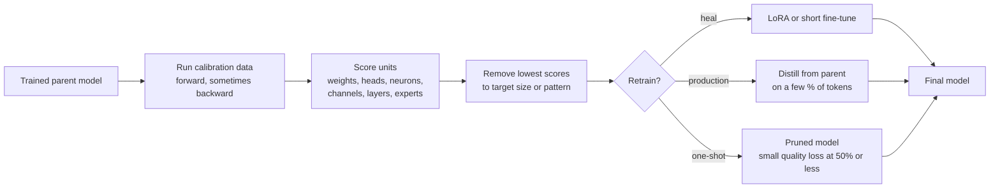

---
tags:
  - ai-ml
  - training
  - pruning
  - compression
  - sparsity
  - efficiency
status: draft
sources:
  - https://papers.nips.cc/paper/1989/hash/6c9882bbac1c7093bd25041881277658-Abstract.html
  - https://proceedings.neurips.cc/paper/1992/hash/303ed4c69846ab36c2904d3ba8573050-Abstract.html
  - https://arxiv.org/abs/1506.02626
  - https://arxiv.org/abs/1803.03635
  - https://arxiv.org/abs/2104.08378
  - https://arxiv.org/abs/2301.00774
  - https://arxiv.org/pdf/2306.11695
  - https://arxiv.org/abs/2305.11627
  - https://arxiv.org/abs/2310.06694v2
  - https://arxiv.org/abs/2401.15024
  - https://arxiv.org/html/2403.03853v3
  - https://arxiv.org/abs/2403.17887v2
  - https://arxiv.org/html/2407.14679v2
  - https://arxiv.org/pdf/2408.11796v3
  - https://ai.meta.com/blog/llama-3-2-connect-2024-vision-edge-mobile-devices/
  - https://arxiv.org/pdf/2411.19146
  - https://arxiv.org/html/2505.00949v2
  - https://arxiv.org/html/2510.13999v2
  - https://iclr.cc/virtual/2026/poster/10006871
  - https://github.com/CerebrasResearch/reap
  - https://docs.vllm.ai/projects/llm-compressor/en/latest/examples/reap_expert_pruning/
  - https://arxiv.org/abs/2511.16664
  - https://icml.cc/virtual/2026/poster/61782
  - https://huggingface.co/blog/nvidia/nemotron-3-nano-4b
  - https://arxiv.org/html/2605.08738v1
  - https://arxiv.org/html/2606.14150v1
  - https://arxiv.org/pdf/2610.28947
  - https://github.com/NVIDIA/Model-Optimizer/blob/main/CHANGELOG.rst
created: 2026-11-28
updated: 2026-11-28
---

## Table Of Contents

---

- [[#TL;DR|TL;DR]]
- [[#The Problem|The Problem]]
- [[#Foundations|Foundations]]
    - [[#What Gets Removed|What Gets Removed]]
    - [[#How Importance Is Scored|How Importance Is Scored]]
    - [[#Recovery - Fine-Tuning, Healing and Distillation|Recovery - Fine-Tuning, Healing and Distillation]]
    - [[#Fewer Weights Is Not Faster|Fewer Weights Is Not Faster]]
- [[#How We Got Here|How We Got Here]]
- [[#How It Works|How It Works]]
    - [[#The Prune and Recover Pipeline|The Prune and Recover Pipeline]]
    - [[#Second-Order Pruning - OBS and SparseGPT|Second-Order Pruning - OBS and SparseGPT]]
    - [[#Activation-Aware Pruning - Wanda|Activation-Aware Pruning - Wanda]]
    - [[#Width Pruning - Minitron|Width Pruning - Minitron]]
    - [[#Depth Pruning - Dropping Layers|Depth Pruning - Dropping Layers]]
    - [[#Expert Pruning - REAP|Expert Pruning - REAP]]
    - [[#N to M Sparsity and Hardware|N to M Sparsity and Hardware]]
- [[#Where It Is Now|Where It Is Now]]
    - [[#Pruned Models in Production|Pruned Models in Production]]
    - [[#What 2026 Research Measured|What 2026 Research Measured]]
    - [[#Tooling|Tooling]]
- [[#Trade-offs & Open Problems|Trade-offs & Open Problems]]
- [[#Resources|Resources]]
- [[#Related Notes|Related Notes]]

## ***TL;DR***
---
*Pruning removes parts of a trained network (single weights, attention heads, MLP neurons, hidden channels, whole layers or whole experts) and then repairs the damage with a short retrain. For LLMs it is now mostly a way to make a family of smaller models from one big one, almost always paired with [[Distillation]].*

- **Two kinds:** *unstructured* pruning zeroes individual weights (accurate, but dense hardware gets no faster), and *structured* pruning deletes whole rows, columns, layers or experts (the model really becomes smaller and faster, but quality drops more and must be retrained back).
- **Scoring:** what to remove is decided by an importance score: weight magnitude, a second-order loss estimate (Optimal Brain Surgeon, SparseGPT), magnitude times input size (Wanda), activation norms (Minitron), how little a layer changes its input (ShortGPT), or how much a router relies on an expert (REAP).
- **The working recipe:** prune a trained parent along width or depth, then distill from the parent on a few percent of the original tokens. NVIDIA's Minitron made 8B and 4B models from a 15B parent with up to 40x fewer tokens per model ([Muralidharan et al., 2024](https://arxiv.org/html/2407.14679v2)); Llama 3.2 1B and 3B were pruned from Llama 3.1 8B ([Meta, Sep 2024](https://ai.meta.com/blog/llama-3-2-connect-2024-vision-edge-mobile-devices/)).
- **Where it is now (Nov 2026):** pruning has moved to [[Mixture of Experts]] (dropping 50% of experts from Qwen3-Coder-480B and Kimi-K2 with at most about 2% accuracy lost on code generation, [REAP, ICLR 2026](https://iclr.cc/virtual/2026/poster/10006871)) and to "many-in-one" checkpoints that hold nested smaller models ([Star Elastic, ICML 2026](https://icml.cc/virtual/2026/poster/61782)). A controlled 2026 study found that pruning beats training from scratch only when the parent's training cost is already paid ([Xu et al., Jun 2026](https://arxiv.org/html/2606.14150v1)), and 2:4 sparsity has largely lost to [[Quantization]] as a speedup on current GPUs.

## ***The Problem***
---
*Trained networks have far more parameters than they need for the task, but you cannot know which ones are spare before training. Pruning finds and removes them afterwards, trading a little quality for a model that is cheaper to store, serve or train further.*

Three pressures make it worth doing:

| Pressure | Why it binds | What pruning offers |
|---|---|---|
| Serving cost | Decode reads every weight every step, so smaller models give cheaper, faster tokens | A smaller network with the parent's knowledge, not a fresh small model |
| A whole model family is expensive | Labs want 1B to 70B+ sizes; training each from scratch on trillions of tokens repeats most of the work | Train the biggest once, then cut it down; Minitron needed under 3% of the original data per child ([Muralidharan et al.](https://arxiv.org/html/2407.14679v2)) |
| Memory limits | A model that misses one GPU or one node by a few percent costs a whole extra device | Cut exactly enough: Nemotron Ultra 253B was cut from Llama 3.1 405B to fit one 8xH100 node ([NVIDIA, 2025](https://arxiv.org/html/2505.00949v2)) |

The hard part is that removing anything hurts, and the hurt is not spread evenly. Some weights, heads and layers matter enormously (often the ones that handle rare large activations; see [[Residual Stream and Normalization]]) and most matter little. A pruning method is a way of guessing which is which, plus a way of repairing what the guess broke.

## ***Foundations***
---
*Four ideas carry the field: the granularity of what you remove, the score that ranks it, the retraining that recovers quality, and the gap between "fewer nonzero weights" and "actually faster".*

#### **What Gets Removed**

| Granularity | Unit removed | Model actually shrinks? | Typical LLM sparsity before big losses | Examples |
|---|---|---|---|---|
| Unstructured | Single weights, anywhere | No: matrices keep their shape, just with zeros | 50 to 60% one-shot | SparseGPT, Wanda |
| Semi-structured (N:M) | N of every M consecutive weights | Storage and math shrink only on hardware that supports the pattern | 50% (2:4), with clear quality loss | 2:4 on NVIDIA tensor cores |
| Width (structured) | Attention heads, MLP neurons, hidden (embedding) channels | Yes: smaller dense matrices | 25 to 50% with retraining | Minitron, SliceGPT, Sheared LLaMA |
| Depth (structured) | Whole transformer blocks | Yes: fewer sequential layers | about 25% before retraining | ShortGPT, Gromov et al. |
| Experts | Whole experts in an MoE layer | Yes: fewer expert weights in memory; active compute per token unchanged | 25 to 50% | REAP |

A useful rule: the finer the unit, the more you can remove without losing quality, and the less a GPU gains from removing it.

#### **How Importance Is Scored**

| Score | What it measures | Needs | Used by |
|---|---|---|---|
| Magnitude $\lvert w\rvert$ | Small weights probably matter little | Nothing | Han et al. 2015, Lottery Ticket |
| Second-order (Hessian) | How much loss rises if the weight is removed, using curvature | Hessian or its inverse (per layer for LLMs) | OBD, OBS, SparseGPT |
| Magnitude times input norm | How much the weight contributes to the output on real data | A few hundred calibration sequences | Wanda |
| Gradient or Taylor | First-order change in loss when a group is removed | Backward passes | LLM-Pruner |
| Activation norms | How strongly a head, neuron or channel fires on real data | Forward passes on about 1,024 samples | Minitron |
| Layer similarity | How little a layer changes its input (cosine similarity) | Forward passes | ShortGPT, Gromov et al. |
| Router gate times expert output | How much an expert contributes to the MoE layer's output | Forward passes | REAP |

#### **Recovery - Fine-Tuning, Healing and Distillation**

Pruning is almost never the last step:

- **None (one-shot):** SparseGPT and Wanda prune a frozen model in minutes to hours with no retraining; works up to about 50% unstructured on large models.
- **Light healing:** LoRA or QLoRA fine-tuning on a small set. LLM-Pruner recovered in about 3 hours on about 50K samples ([Ma et al., 2023](https://arxiv.org/abs/2305.11627)); Gromov et al. healed layer-dropped models on a single 40GB A100 ([2024](https://arxiv.org/abs/2403.17887v2)).
- **Continued pretraining:** billions of tokens of ordinary next-token training (Sheared LLaMA).
- **Distillation from the parent:** the parent's output distribution is the training target for the pruned child. This is what production recipes use, and it is why pruning and [[Distillation]] are usually discussed together. Minitron found KL-divergence distillation beat conventional retraining.

#### **Fewer Weights Is Not Faster**

GPUs are built for dense matrix math. A matrix that is 50% zeros in random places is still multiplied as a full matrix unless a special sparse kernel or format is used, and those rarely win below very high sparsity. Real speedups come from:

- **Structured pruning:** the matrix really is smaller.
- **Hardware N:M support:** NVIDIA tensor cores since Ampere skip the zeros in a 2:4 pattern, roughly doubling peak matrix throughput ([Mishra et al., 2021](https://arxiv.org/abs/2104.08378); see [[AI Accelerators]]).
- **Fewer bytes to read:** in memory-bound decode, compressed sparse storage can help even without faster math, but [[Quantization]] usually cuts bytes more for less quality loss.

## ***How We Got Here***
---
*Pruning is as old as backpropagation. It went from second-order theory (1989 to 1993) to magnitude pruning of CNNs (2015), to the Lottery Ticket question of why it works (2019), to one-shot pruning of 175B-parameter LLMs (2023), and then to structured prune-and-distill pipelines and expert pruning that labs ship.*

| Year | Step | What it showed | What it left open |
|---|---|---|---|
| 1989 | Optimal Brain Damage ([LeCun, Denker, Solla](https://papers.nips.cc/paper/1989/hash/6c9882bbac1c7093bd25041881277658-Abstract.html)) | Use the loss curvature (a diagonal Hessian) to rank weights; beats removing small weights | Ignores how weights interact |
| 1992 | Optimal Brain Surgeon ([Hassibi, Stork](https://proceedings.neurips.cc/paper/1992/hash/303ed4c69846ab36c2904d3ba8573050-Abstract.html)) | Full inverse Hessian: remove a weight and update the others to compensate | Inverse Hessian is impossible at modern scale |
| 2015 | Learning both weights and connections ([Han et al.](https://arxiv.org/abs/1506.02626)) | Train, prune small weights, retrain: AlexNet 9x and VGG-16 13x fewer parameters with no accuracy loss | Unstructured: no speedup on dense hardware |
| 2019 | Lottery Ticket Hypothesis ([Frankle, Carbin](https://arxiv.org/abs/1803.03635), ICLR 2019) | Subnetworks under 10 to 20% of the original, reset to their initial weights, train to the same accuracy | Finding them needs training the full network first |
| 2021 | 2:4 sparsity ([Mishra et al., NVIDIA](https://arxiv.org/abs/2104.08378)) | A hardware-friendly 50% pattern, about 2x matrix throughput on Ampere tensor cores, with a recipe that keeps accuracy | Needs retraining; only 50% |
| 2023 | SparseGPT ([Frantar, Alistarh](https://arxiv.org/abs/2301.00774), ICML 2023) | OBS-style layer-by-layer pruning of OPT-175B and BLOOM-176B to 50 to 60% in under 4.5 hours, negligible perplexity loss | Unstructured and N:M only |
| 2023 | Wanda ([Sun et al.](https://arxiv.org/pdf/2306.11695), ICLR 2024) | Magnitude times input norm, no weight updates, matches SparseGPT about 300x faster | Same speedup problem |
| 2023 | LLM-Pruner ([Ma et al.](https://arxiv.org/abs/2305.11627)), Sheared LLaMA ([Xia et al.](https://arxiv.org/abs/2310.06694v2)) | Structured pruning of LLaMA with LoRA or continued pretraining; Sheared LLaMA made 1.3B and 2.7B from LLaMA2-7B with about 3% of from-scratch compute | Which axes to prune, and how much data |
| 2024 | SliceGPT ([Ashkboos et al.](https://arxiv.org/abs/2401.15024)) | Shrink the hidden dimension by rotating and slicing; up to 25% of LLaMA2-70B removed with about 99% zero-shot quality kept | Bigger cuts need retraining |
| 2024 | ShortGPT ([Men et al.](https://arxiv.org/html/2403.03853v3)), Gromov et al. ([2024](https://arxiv.org/abs/2403.17887v2)) | About 25% of layers can be dropped with about 90% of quality kept; up to half before collapse in some models after healing | Mostly knowledge benchmarks; reasoning suffers more |
| 2024 | Minitron ([Muralidharan et al.](https://arxiv.org/html/2407.14679v2), NeurIPS 2024) | Prune width and depth from Nemotron-4 15B, distill: 8B and 4B with up to 40x fewer tokens each, up to 16% better MMLU than from scratch | Needs the original data, solved by "teacher correction" ([Sreenivas et al.](https://arxiv.org/pdf/2408.11796v3)) |
| 2025 | Puzzle and Llama-Nemotron ([NVIDIA](https://arxiv.org/html/2505.00949v2)) | Search over per-layer block variants (drop attention, shrink FFN) under a latency budget: 253B from 405B with 1.71x lower latency | Search cost; hardware-specific |
| 2025 | REAP ([Lasby et al., Cerebras](https://arxiv.org/html/2510.13999v2)) | One-shot expert pruning beats expert merging on generative tasks | Only one-shot; no retraining studied |

## ***How It Works***
---
*Every method is the same loop: measure importance on real data, remove the least important units, and retrain until the loss comes back. The methods differ in the unit, the score and how much retraining they assume.*

#### **The Prune and Recover Pipeline**

Two choices matter most. **How much at once:** cutting gradually (prune a bit, retrain, repeat) gives a smoother path than one big cut; SlimQwen found progressive schedules beat one-shot compression at the same token budget ([Qwen, May 2026](https://arxiv.org/html/2605.08738v1)), while Minitron found iterative *scoring* added nothing. **Which parent checkpoint:** prune from the model closest to the target size, and from the final training phase (Minitron's best practices).

#### **Second-Order Pruning - OBS and SparseGPT**

Optimal Brain Surgeon asks: if I set weight $w_q$ to zero and let all the other weights adjust to make up for it, how much does the loss rise?

$$\Delta L_q = \frac{w_q^2}{2\,[\mathbf{H}^{-1}]_{qq}}, \qquad \delta\mathbf{w} = -\frac{w_q}{[\mathbf{H}^{-1}]_{qq}}\,\mathbf{H}^{-1}\mathbf{e}_q$$

**In plain words:** a weight is cheap to remove if it is small (the $w_q^2$ on top) or if the loss is flat in its direction (a large diagonal entry of the inverse Hessian). The second formula is the correction: nudge the remaining weights so they absorb the removed weight's job. Optimal Brain Damage is the special case that ignores the correction and the off-diagonal terms.

The full Hessian of a 175B model is impossible to form, so **SparseGPT** works one layer at a time. For a linear layer the question becomes "keep this layer's output on calibration inputs $\mathbf{X}$ the same", whose Hessian is just $\mathbf{H} = \mathbf{X}\mathbf{X}^\top$, sized by the layer's input width rather than its parameter count. It then prunes column by column, updating the not-yet-pruned weights with the OBS correction ([Frantar & Alistarh, 2023](https://arxiv.org/abs/2301.00774)). The same machinery underlies GPTQ quantization (see [[Quantization]]).

#### **Activation-Aware Pruning - Wanda**

Wanda drops the Hessian and keeps the part that matters most: a weight's effect on the output is its size times the size of the input it multiplies.

$$S_{ij} = \lvert W_{ij}\rvert \cdot \lVert \mathbf{X}_j \rVert_2$$

**In plain words:** score each weight by its magnitude times the L2 norm of its input feature over the calibration tokens, then drop the lowest-scoring weights *within each output row*, so every output neuron keeps the same fraction of its inputs. No weights are updated.

**Small example (illustrative numbers):** one output row with weights $\lvert W\rvert = [0.5, 2.0, 0.1, 1.0]$ and input norms $\lVert X\rVert = [4, 0.2, 20, 1.5]$. Scores are $[2.0, 0.4, 2.0, 1.5]$. At 50% sparsity Wanda removes the 2.0 weight (score 0.4) and the 1.0 weight (score 1.5). Magnitude pruning would have removed 0.1 and 0.5 instead, deleting the tiny weight that sits on a very large input feature and so contributes as much to the output as any other. LLMs have a few such outlier features, which is why plain magnitude pruning fails on them.

Measured on LLaMA (WikiText perplexity, dense 7B = 5.68, 65B = 3.56) ([Sun et al.](https://arxiv.org/pdf/2306.11695)):

| Method | 50% unstructured, 7B | 50% unstructured, 65B | 2:4, 7B | 2:4, 65B | Time to score 65B |
|---|---|---|---|---|---|
| Magnitude | 17.29 | 5.90 | 42.13 | 7.11 | – |
| SparseGPT | 7.22 | 4.57 | 11.00 | 6.28 | 1,353 s |
| Wanda | 7.26 | 4.57 | 11.53 | 6.25 | 5.6 s |

Two things show here: big models tolerate pruning much better than small ones, and 2:4 costs far more quality than 50% unstructured, because the pattern forces cuts in places the scores would have spared.

#### **Width Pruning - Minitron**

Minitron scores each prunable unit with forward passes only, on 1,024 calibration samples ([Muralidharan et al.](https://arxiv.org/html/2407.14679v2)):

| Unit | Importance |
|---|---|
| Attention head | L2 norm of the head's output, summed over batch and sequence |
| MLP neuron | Sum of its activation $\mathbf{X}(\mathbf{W}_1^i)^\top$ |
| Embedding channel | Sum of the post-LayerNorm activation in that channel |
| Layer | Block importance (below) or perplexity with the layer removed |

The lowest-ranked heads, neurons and channels are cut, the matrices are physically resized, and the child is distilled from the parent with a KL-divergence loss on logits (plus hidden-state losses when many layers were removed). Key findings: prefer width over depth up to the 15B scale studied, and judge candidates after a short retrain, because right after pruning the depth-pruned candidate looked better and the ranking flipped after about 200 steps.

The width-versus-depth trade shows clearly in NVIDIA's Llama 3.1 8B to 4B experiment ([Sreenivas et al., 2024](https://arxiv.org/pdf/2408.11796v3)), both distilled on 94B tokens:

| Child | Quality | Throughput vs Llama 3.1 8B (TensorRT-LLM) |
|---|---|---|
| 4B-Width (same 32 layers, thinner) | Better overall | 1.7x to 1.8x |
| 4B-Depth (half the layers) | Worse | 2.7x |

Depth wins on speed because decode runs layers one after another; width keeps more quality because each layer still sees a full sequence of transformations.

#### **Depth Pruning - Dropping Layers**

In a pre-norm transformer each block adds a small update to the [[Residual Stream and Normalization|residual stream]]. If a block's output is almost the same as its input, removing it changes little. ShortGPT's **Block Influence** measures that ([Men et al.](https://arxiv.org/html/2403.03853v3)):

$$\mathrm{BI}_i = 1 - \mathbb{E}_{X,t}\left[\frac{\mathbf{x}_{i,t}^\top \mathbf{x}_{i+1,t}}{\lVert\mathbf{x}_{i,t}\rVert_2\,\lVert\mathbf{x}_{i+1,t}\rVert_2}\right]$$

**In plain words:** average the cosine similarity between a token's hidden state going into layer $i$ and coming out of it; BI is one minus that. A layer with BI 0.02 (98% similar in and out) is barely doing anything and is a candidate to drop; a layer with BI 0.3 is rewriting the representation and should stay.

What happens when you drop layers:

- ShortGPT removed 10 of LLaMA2-13B's 40 layers and MMLU went from 55.0 to 52.2, keeping about 92% of the dense average across its benchmarks at a 24.6% pruning ratio.
- Gromov et al. dropped contiguous blocks chosen by similarity and found some open models barely degrade on knowledge benchmarks until about half the layers are gone, after QLoRA healing. Their reading: either pretraining underuses the deep layers, or the shallow layers hold most of the knowledge ([2024](https://arxiv.org/abs/2403.17887v2)).
- The redundant layers are usually deep but not the very last ones; the first and last few layers are almost never safe to drop.

Puzzle generalizes this: instead of keep-or-drop, each layer picks from a library of variants (full block, attention removed, FFN at 87%, 75%, 50% or 10% width), each trained by local distillation, and a solver picks the mix that best meets a latency and memory budget. For Nemotron Ultra it also fused runs of consecutive FFNs into fewer, wider parallel FFNs to cut sequential depth ([NVIDIA, 2025](https://arxiv.org/html/2505.00949v2)).

#### **Expert Pruning - REAP**

A [[Mixture of Experts]] model stores hundreds of experts per layer but runs only a few per token, so memory, not compute, is its cost. Removing whole experts shrinks the memory bill directly. The question is which experts. REAP (Router-weighted Expert Activation Pruning) scores expert $j$ by how much it actually contributes when it is chosen ([Lasby et al.](https://arxiv.org/html/2510.13999v2); formula as given in [vLLM llm-compressor docs](https://docs.vllm.ai/projects/llm-compressor/en/latest/examples/reap_expert_pruning/)):

$$S_j = \frac{1}{N_j}\sum_{t\,\in\,\mathcal{X}_j} g_j(t)\,\lVert f_j(t)\rVert_2$$

**In plain words:** over the $N_j$ calibration tokens routed to expert $j$, average the router's gate weight $g_j(t)$ times the size of the expert's output $f_j(t)$. An expert that is picked often but always with a tiny gate and a small output contributes little; one picked rarely but with a high gate and a large output is a specialist worth keeping.

**Small example (illustrative numbers):** expert A gets 1,000 tokens with average gate 0.05 and output norm 2, so $S_A = 0.1$. Expert B gets 50 tokens with gate 0.6 and output norm 3, so $S_B = 1.8$. Frequency-based pruning would remove B; REAP removes A.

Why prune instead of merge two experts into one? A merged expert gets a single gate, so the router loses the ability to weight the two halves differently per token. REAP's authors show this leaves an error that no merged expert can remove, and that in fine-grained MoEs it collapses the layer's output space; pruning just renormalizes the remaining gates ([Lasby et al.](https://arxiv.org/html/2510.13999v2)). Pruning also keeps weights byte-identical, so already-quantized block formats need no re-quantization. On models from 20B to 1T parameters, removing 50% of experts from Qwen3-Coder-480B and Kimi-K2 cost at most about 2% accuracy on code generation. Expert pruning leaves active parameters per token unchanged, so it saves memory and devices, not FLOPs (see [[Expert Parallelism and MoE Serving]]).

#### **N to M Sparsity and Hardware**

In N:M sparsity every group of M consecutive weights has at most N nonzeros, stored as the N values plus small indices. NVIDIA tensor cores have supported 2:4 since Ampere at about twice dense peak throughput ([Mishra et al.](https://arxiv.org/abs/2104.08378)); vendor "with sparsity" FLOPS figures assume it ([[AI Accelerators]]).

**Small example:** a 2:4 row `[0.3, 0, 0, -1.2 | 0, 0.7, 0.1, 0]` stores `[0.3, -1.2, 0.7, 0.1]` plus 2-bit positions `[0, 3, 1, 2]`. Half the values and a little index metadata, and the tensor core skips the zeros.

The catch is quality: forcing exactly two zeros in every group of four removes weights that unstructured scores would keep (the Wanda table above), so 2:4 needs retraining to be usable, and its 2x is a peak figure on the matrix multiplies only.

## ***Where It Is Now***
---
*As of late 2026, pruning in production means structured prune-and-distill to build model families (NVIDIA, Meta, Qwen), expert pruning of large MoEs for cheaper deployment (Cerebras and community checkpoints), and nested "elastic" checkpoints. Unstructured and 2:4 pruning have mostly given way to quantization as the way to speed up serving.*

#### **Pruned Models in Production**

| Model | Date | Pruned from | Method | Retraining | Source |
|---|---|---|---|---|---|
| Minitron 8B and 4B | Jul 2024 | Nemotron-4 15B | Width and depth, activation importance | KD on under 3% of original data | [NVIDIA](https://arxiv.org/html/2407.14679v2) |
| Llama 3.2 1B and 3B | Sep 2024 | Llama 3.1 8B | Structured pruning | 8B and 70B logits as pretraining targets | [Meta](https://ai.meta.com/blog/llama-3-2-connect-2024-vision-edge-mobile-devices/) |
| Llama 3.1 Minitron 4B | Aug 2024 | Llama 3.1 8B | Width or depth | 94B tokens of KD after teacher correction | [NVIDIA](https://arxiv.org/pdf/2408.11796v3) |
| Llama-Nemotron Super 49B / Ultra 253B | Apr 2025 | Llama 3.3 70B / Llama 3.1 405B | Puzzle block search, FFN fusion (Ultra) | 40B tokens KD (Super); 65B KD plus 88B continued pretraining (Ultra) | [NVIDIA](https://arxiv.org/html/2505.00949v2) |
| Nemotron Elastic 9B and 6B | Nov 2025 | Nemotron Nano V2 12B (hybrid Mamba-attention) | Nested width and depth with a learned router | 110B tokens for both children, about 7x cheaper than prior compression | [NVIDIA](https://arxiv.org/abs/2511.16664) |
| Nemotron 3 Nano 4B | Mar 2026 | Nemotron Nano 9B v2 | Pruned and distilled with a frozen 9B teacher (Nemotron Elastic) | About 213B tokens in two stages, then SFT and RL | [NVIDIA, HF blog](https://huggingface.co/blog/nvidia/nemotron-3-nano-4b) |
| REAP checkpoints | Oct 2025 to 2026 | GLM-4.6, GLM-4.5-Air, Qwen3-Coder-480B and 30B, MiniMax-M2, Kimi-Linear, DeepSeek-V3.2 | One-shot expert pruning | None | [Cerebras](https://github.com/CerebrasResearch/reap) |

Pruning works on [[State Space Models]] and [[Hybrid Attention]] models too, but it has to respect their structure: Nemotron Elastic uses group-aware pruning of the Mamba layers so their structural constraints stay valid.

#### **What 2026 Research Measured**

**Pruning versus training from scratch.** Xu et al. (Princeton, NYU, CMU; Jun 2026) pretrained their own Llama-3.1-8B-shaped parent on 200B tokens, pruned it 50% to 81% with six methods, and retrained on 50B tokens, against small models trained from scratch ([Xu et al.](https://arxiv.org/html/2606.14150v1)):

| Comparison at 50% pruning | Pruned then retrained | From scratch | Winner |
|---|---|---|---|
| Same 50B training tokens, width (Minitron-W) | 66.3% avg | 59.9% | Pruning |
| Same 50B training tokens, depth (Minitron-D) | 64.4% | 60.7% | Pruning |
| Same 250B *total* tokens, depth | 64.4% | 66.2% | Scratch |
| Same 250B total tokens, width | 66.3% | 67.5% | Scratch |
| Same 250B total tokens, unstructured (Wanda) | 68.1% | 67.2% | Pruning |

The advantage shrinks as the pruning ratio rises and nearly vanishes at 81%. **What it means:** pruning a structured child pays off when the parent already exists (it always does for a lab shipping a family), not as a cheaper way to make one small model from nothing. Caveats: one parent, one dataset (DCLM), no distillation (plain retraining), and timings on TPU v4, which has no sparse tensor cores.

**MoE compression at a frontier lab.** Qwen's SlimQwen compressed Qwen3-Next-80A3B (a hybrid-attention MoE) about 4x to a 23A2B model by cutting depth (last 25% of layers), width (activation-ranked hidden dims) and experts ([Qwen, May 2026](https://arxiv.org/html/2605.08738v1)). Findings: pruning beats training the target shape from scratch at equal tokens; after 400B tokens of continued pretraining, the choice of one-shot expert pruning or merging method mostly washes out; KD plus the LM loss beats KD alone on knowledge tasks; distilling the [[Multi-Token Prediction]] head too gives consistent gains and better [[Speculative Decoding]] acceptance; progressive pruning beats one-shot.

**Many-in-one checkpoints.** Star Elastic (NVIDIA, ICML 2026) builds nested children into one parent in a single post-training job: 23B (2.8B active) and 12B (2.0B active) inside Nemotron Nano v3 30B-A3.6B with 160B tokens, and 9B and 6B inside Nano v2 12B with 110B tokens ([ICML 2026](https://icml.cc/virtual/2026/poster/61782)). Because children share weights, deployment memory stays flat as sizes are added, and a [[Reasoning Models|reasoning model]] can use different children for its thinking and answering phases ("elastic budget control"), reported as up to 16% higher accuracy and 1.9x lower latency on the accuracy-latency trade-off.

**Is 2:4 still worth it?** A single-author study (Oct 2026, independent researcher, flagged as one result) measured 2:4 against quantization on L40S, H100 and RTX PRO 6000 Blackwell ([Qin, 2026](https://arxiv.org/pdf/2610.28947)):

- When a lower precision is available, dropping precision beats adding 2:4 on both speed and accuracy: 2:4 with FP16 values ran at 0.74x to 0.89x the speed of dense FP8.
- At the precision floor, 2:4 on top of FP8 sped up linear layers 1.33x to 1.65x, and a retrained 2:4 FP8 Llama-3.1-8B gave 27% more prefill throughput in vLLM on H100.
- One-shot 2:4 at FP8 was unusable (GSM8K 0.552 to 0.028); retraining recovered perplexity faster than reasoning, so perplexity overstates recovery.
- Blackwell's 4:8 sparse NVFP4 was about 1.4x faster than dense NVFP4 but not usable at the 1B-token retraining budget tested.

#### **Tooling**

- **NVIDIA Model Optimizer:** Minitron pruning scripts and Puzzletron (the open Puzzle search), both active in the 0.48 and 0.49 releases of late 2026 ([changelog](https://github.com/NVIDIA/Model-Optimizer/blob/main/CHANGELOG.rst)).
- **vLLM llm-compressor:** REAP expert pruning with a report mode that writes per-expert routed-token counts and saliency, uniform or global per-layer budgets, and pruning straight from safetensors shards ([docs](https://docs.vllm.ai/projects/llm-compressor/en/latest/examples/reap_expert_pruning/)).
- **Cerebras REAP repo:** added a layer-wise calibration observer for pruning very large models on one GPU (Mar 2026) and renormalized router logits, cutting mean accuracy loss from 2.6% to 1.9% across five models ([repo](https://github.com/CerebrasResearch/reap)).

## ***Trade-offs & Open Problems***
---
*Pruning trades capacity for cost, and the trade is only as good as the score that picks what to remove and the retraining that follows. The open questions are what pruning silently breaks, when it beats simply training a small model, and whether hardware will ever reward fine-grained sparsity.*

| Choice | Gain | Cost | Evidence |
|---|---|---|---|
| Unstructured vs structured | Unstructured keeps far more quality at the same ratio | No speedup on dense hardware | [Xu et al.](https://arxiv.org/html/2606.14150v1), [Sun et al.](https://arxiv.org/pdf/2306.11695) |
| Width vs depth | Width keeps quality | Depth gives more decode speedup (2.7x vs about 1.8x at 8B to 4B) | [Sreenivas et al.](https://arxiv.org/pdf/2408.11796v3) |
| One-shot vs retrained | One-shot takes minutes and no data pipeline | Fails at high ratios and for 2:4 at low precision | [Qin](https://arxiv.org/pdf/2610.28947), [SlimQwen](https://arxiv.org/html/2605.08738v1) |
| Expert pruning vs merging | Pruning keeps router control and quantized bytes | Loses rare specialists if calibration data misses them | [REAP](https://arxiv.org/html/2510.13999v2) |
| Pruning vs [[Quantization]] | Pruning gives a genuinely smaller architecture | Quantization usually gives more speed per point of quality lost; the two stack | [Qin](https://arxiv.org/pdf/2610.28947) |

- **Calibration data decides what survives:** every score is measured on a few hundred to a few thousand samples. An expert, head or layer that matters only for a language, a domain or tool calls the calibration set lacks will look useless and be cut. Cerebras released a separate agentic calibration mix for exactly this reason.
- **Perplexity hides damage:** knowledge and perplexity recover first; multi-step reasoning, long context and instruction-following recover later or not at all. Layer-dropping results are strongest on multiple-choice knowledge benchmarks.
- **When is it worth it:** structured pruning beats scratch only when the parent's compute is a sunk cost, and the margin shrinks as the cut grows. There is no scaling law yet that predicts the pruned child's loss from the parent's and the token budget.
- **Why deep layers are redundant:** whether this is a fact about how knowledge is stored or a sign that pretraining underuses depth is open, and it bears on architecture work such as [[Looped Transformers]].
- **Hardware for sparsity:** 2:4 is the only widely deployed pattern, and it has lost to FP8 and FP4 as the speedup of choice. Sparsity in attention ([[Sparse Attention]]) and in experts ([[Mixture of Experts]]) is where "sparse" now pays off, because it is built into the architecture rather than cut out afterwards.
- **Safety and behavior drift:** pruning changes refusals, calibration and style in ways benchmark averages do not show; pruned checkpoints from third parties are rarely re-evaluated for these.

## ***Resources***
---
*Read OBS for the theory, Wanda for the clearest modern method, Minitron for the production recipe, and REAP for MoE. Xu et al. 2026 is the best evidence on when pruning beats training from scratch.*

**Classic**
- [Optimal Brain Damage](https://papers.nips.cc/paper/1989/hash/6c9882bbac1c7093bd25041881277658-Abstract.html): LeCun, Denker, Solla, NeurIPS 1989.
- [Second order derivatives for network pruning: Optimal Brain Surgeon](https://proceedings.neurips.cc/paper/1992/hash/303ed4c69846ab36c2904d3ba8573050-Abstract.html): Hassibi, Stork, NeurIPS 1992.
- [Learning both Weights and Connections for Efficient Neural Networks](https://arxiv.org/abs/1506.02626): Han et al., Jun 2015.
- [The Lottery Ticket Hypothesis](https://arxiv.org/abs/1803.03635): Frankle, Carbin, ICLR 2019.
- [Accelerating Sparse Deep Neural Networks](https://arxiv.org/abs/2104.08378): Mishra et al. (NVIDIA), Apr 2021. 2:4 sparsity.

**LLM pruning methods**
- [SparseGPT](https://arxiv.org/abs/2301.00774): Frantar, Alistarh, Jan 2023 (ICML 2023).
- [A Simple and Effective Pruning Approach for LLMs (Wanda)](https://arxiv.org/pdf/2306.11695): Sun, Liu, Bair, Kolter, Jun 2023 (ICLR 2024).
- [LLM-Pruner](https://arxiv.org/abs/2305.11627): Ma, Fang, Wang, May 2023.
- [Sheared LLaMA](https://arxiv.org/abs/2310.06694v2): Xia, Gao, Zeng, Chen (Princeton), Oct 2023.
- [SliceGPT](https://arxiv.org/abs/2401.15024): Ashkboos et al., Jan 2024.
- [ShortGPT](https://arxiv.org/html/2403.03853v3): Men et al. (Baichuan), Mar 2024.
- [The Unreasonable Ineffectiveness of the Deeper Layers](https://arxiv.org/abs/2403.17887v2): Gromov et al., Mar 2024 (ICLR 2025).
- [REAP the Experts](https://arxiv.org/html/2510.13999v2): Lasby et al. (Cerebras), Oct 2025 (ICLR 2026). [Code and checkpoints](https://github.com/CerebrasResearch/reap).

**Prune and distill in production**
- [Compact Language Models via Pruning and Knowledge Distillation (Minitron)](https://arxiv.org/html/2407.14679v2): Muralidharan et al. (NVIDIA), Jul 2024 (NeurIPS 2024).
- [LLM Pruning and Distillation in Practice](https://arxiv.org/pdf/2408.11796v3): Sreenivas et al. (NVIDIA), Aug 2024. Teacher correction, width vs depth.
- [Puzzle: Distillation-Based NAS for Inference-Optimized LLMs](https://arxiv.org/pdf/2411.19146): NVIDIA, Nov 2024.
- [Llama-Nemotron: Efficient Reasoning Models](https://arxiv.org/html/2505.00949v2): NVIDIA, May 2025.
- [Nemotron Elastic](https://arxiv.org/abs/2511.16664): Taghibakhshi et al. (NVIDIA), Nov 2025.
- [Star Elastic](https://icml.cc/virtual/2026/poster/61782): Taghibakhshi et al. (NVIDIA), ICML 2026.
- [Nemotron 3 Nano 4B](https://huggingface.co/blog/nvidia/nemotron-3-nano-4b): NVIDIA, Mar 2026.

**2026 evidence**
- [SlimQwen: Pruning and Distillation in Large MoE Model Pre-training](https://arxiv.org/html/2605.08738v1): Tang et al. (Qwen), May 2026.
- [Small LLMs: Pruning vs. Training from Scratch](https://arxiv.org/html/2606.14150v1): Xu et al. (Princeton, NYU, CMU), Jun 2026.
- [Is 2:4 Sparsity Still Worth It?](https://arxiv.org/pdf/2610.28947): Qin, 2026. Single independent author.

**Tools**
- [vLLM llm-compressor: REAP expert pruning](https://docs.vllm.ai/projects/llm-compressor/en/latest/examples/reap_expert_pruning/)
- [NVIDIA Model Optimizer changelog](https://github.com/NVIDIA/Model-Optimizer/blob/main/CHANGELOG.rst): Minitron and Puzzletron.

## ***Related Notes***
---
*Pruning is one of the two main ways to shrink a trained model (the other is quantization), and in practice it is the first half of a prune-and-distill pipeline.*

- [[Distillation]] — How pruned children are retrained: the parent's logits are the target.
- [[Quantization]] — Same network in fewer bits; usually the better speedup, and it stacks with pruning.
- [[Mixture of Experts]] — Expert pruning targets MoE memory; MoE is itself built-in sparsity.
- [[Expert Parallelism and MoE Serving]] — Fewer experts means fewer devices per replica, but the same active compute.
- [[AI Accelerators]] — Where 2:4 sparse tensor cores and "with sparsity" FLOPS come from.
- [[Residual Stream and Normalization]] — Why layers can be dropped, and the outlier features that break magnitude pruning.
- [[Transformer]] — The heads, MLP neurons, hidden channels and blocks that structured pruning removes.
- [[Scaling Laws]] — Why small models are overtrained and when cutting down a big one beats training a small one.
- [[Multi-Token Prediction]] — SlimQwen distills the MTP head too, keeping speculative decoding acceptance.
- [[Speculative Decoding]] — Pruned children make natural drafters for their parents.
- [[State Space Models]] — Nemotron Elastic prunes Mamba layers group-aware to keep their structure valid.
- [[Hybrid Attention]] — SlimQwen and Nemotron Elastic prune hybrid attention models.
- [[Sparse Attention]] — Sparsity designed into attention, as opposed to weights cut after training.
- [[Looped Transformers]] — Another answer to "do we need all these layers": reuse them instead of dropping them.
- [[Reasoning Models]] — Star Elastic's elastic budget control uses different nested sizes for thinking and answering.
- [[LLM Serving]] — Where the smaller model's savings show up.
