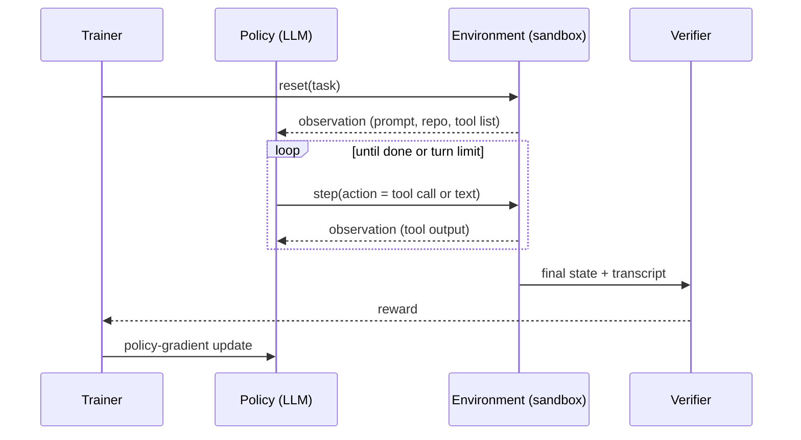
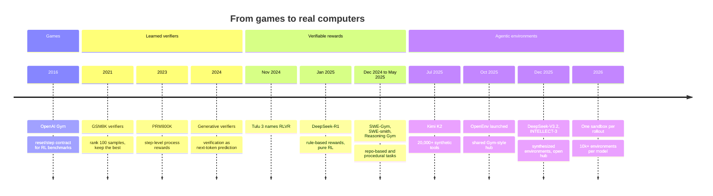
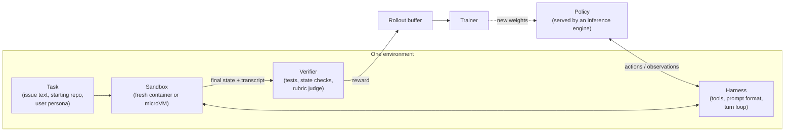

---
tags:
  - ai-ml
  - training
  - post-training
  - reinforcement-learning
  - rl-environments
  - verifiers
  - agents
status: draft
sources:
  - https://arxiv.org/abs/1606.01540v1
  - https://arxiv.org/abs/2110.14168
  - https://openai.com/index/solving-math-word-problems/
  - https://arxiv.org/abs/2305.20050
  - https://arxiv.org/abs/2408.15240v3
  - https://arxiv.org/abs/2210.10760
  - https://arxiv.org/abs/2412.21139
  - https://arxiv.org/abs/2504.21798
  - https://arxiv.org/abs/2505.24760
  - https://arxiv.org/html/2505.22203v1
  - https://web3.arxiv.org/abs/2506.10947
  - https://arxiv.org/abs/2507.08794
  - https://arxiv.org/html/2507.20534v2
  - https://arxiv.org/html/2510.20270v1
  - https://arxiv.org/abs/2511.22570v1
  - https://arxiv.org/html/2512.02556
  - https://arxiv.org/pdf/2512.16144
  - https://arxiv.org/pdf/2609.01354
  - https://arxiv.org/pdf/2610.17824
  - https://huggingface.co/blog/openenv
  - https://huggingface.co/blog/openenv-agentic-rl
  - https://huggingface.co/blog/sergiopaniego/rl-environments-2026
  - https://github.com/PrimeIntellect-ai/verifiers
  - https://github.com/harbor-framework/harbor
  - https://developers.openai.com/api/docs/guides/graders
  - https://epoch.ai/gradient-updates/state-of-rl-envs
  - https://newsletter.semianalysis.com/p/rl-environments-and-rl-for-science
created: 2026-11-27
updated: 2026-11-27
---

## Table Of Contents

---

- [[#TL;DR|TL;DR]]
- [[#The Problem|The Problem]]
- [[#Foundations|Foundations]]
    - [[#The Environment Contract|The Environment Contract]]
    - [[#Verifier, Grader, Reward Model|Verifier, Grader, Reward Model]]
    - [[#Outcome and Process Rewards|Outcome and Process Rewards]]
    - [[#A Verifier Is a Classifier|A Verifier Is a Classifier]]
    - [[#Pass Rate Decides Whether a Task Teaches|Pass Rate Decides Whether a Task Teaches]]
- [[#How We Got Here|How We Got Here]]
- [[#How It Works|How It Works]]
    - [[#Anatomy of an Agentic Environment|Anatomy of an Agentic Environment]]
    - [[#Kinds of Verifiers|Kinds of Verifiers]]
    - [[#What Verifier Noise Does to the Reward|What Verifier Noise Does to the Reward]]
    - [[#Hybrid Verification|Hybrid Verification]]
    - [[#Coding Environments from Real Repositories|Coding Environments from Real Repositories]]
    - [[#Synthesizing Environments at Scale|Synthesizing Environments at Scale]]
    - [[#Validating an Environment Before Training|Validating an Environment Before Training]]
- [[#Where It Is Now|Where It Is Now]]
    - [[#One Sandbox per Rollout|One Sandbox per Rollout]]
    - [[#Standards and Hubs|Standards and Hubs]]
    - [[#The Environment Market|The Environment Market]]
    - [[#Verifiers Become Models|Verifiers Become Models]]
    - [[#Reward Hacking Lives in the Environment|Reward Hacking Lives in the Environment]]
    - [[#Auditing the Checkers|Auditing the Checkers]]
- [[#Trade-offs & Open Problems|Trade-offs & Open Problems]]
- [[#Resources|Resources]]
- [[#Related Notes|Related Notes]]

## ***TL;DR***
---
*An RL environment is everything a model acts on during reinforcement learning: the task, the tools and machine it works in, and the verifier that turns what it did into a reward. As RL became the biggest post-training stage, environments and verifiers, not the update rule, became the scarce and expensive part.*

- **What it is:** a task plus a sandbox (from a single prompt up to a full Linux machine with a repo, shell and mock apps) plus a **verifier**, the code or model that scores the attempt. The trainer only ever sees the reward, so the verifier *is* the definition of success.
- **The lineage:** Gym's `reset`/`step` contract for games (2016), trained verifiers for math (2021), step-level process rewards (2023), rule-based "verifiable rewards" that made [[RL for Reasoning]] work (2024 to 2025), then real repositories, terminals and app clones for agents (2025 to 2026).
- **The core risk:** a verifier is a classifier with false positives and false negatives. Random errors mostly slow learning; errors the policy can *find and repeat* (editing the tests, a token that fools a judge) become reward hacking.
- **Where it is now (Nov 2026):** one fresh sandbox per rollout is standard, labs report 10k+ environments per model, OpenEnv, Prime Intellect's verifiers/Environments Hub and Harbor are the open plumbing, and single high-fidelity environments reportedly cost up to hundreds of thousands of dollars to build.

## ***The Problem***
---
*RL only improves what the reward measures. For math, a reward is one line of code; for "fix this bug" or "file this expense report", someone has to build the world the model acts in and a checker that cannot be fooled. That building is now the bottleneck.*

RL post-training needs three things on every step: prompts, a way for the model to act on them, and a score for what it did. Pretraining never had this problem, because the "reward" was just the next token of text that already existed.

| Need | Easy case | Hard case |
|---|---|---|
| A task | A math problem with a known answer | "Resolve this GitHub issue", "book the cheapest flight in this mock airline site" |
| A place to act | Nothing: the model just writes text | A container with the repo, a shell, tests, a browser, fake Slack and Gmail |
| A score | Compare the boxed answer to the reference | Run the tests, check the database state, or ask a judge with a rubric |
| Robustness | Hard to fake a correct number | Easy to edit a test, hard-code an output, or say the magic word to an LLM judge |

Three facts make this the bottleneck rather than a detail:

- **The verifier defines success.** The policy gradient pushes toward whatever the verifier rewards, including its mistakes ([[RL for Reasoning#Reward Hacking|reward hacking]]).
- **Agent tasks need a whole machine per attempt.** Every rollout is a long-running process with a filesystem, so environments are an infrastructure problem as much as a data problem ([HF, Sep 2026](https://huggingface.co/blog/sergiopaniego/rl-environments-2026)).
- **Good tasks are expensive and wear out.** Zhipu, as quoted in the Hugging Face review: "As agent capability improves, much of the difficulty in scaling post-training moves from the model to the environment."

## ***Foundations***
---
*Five ideas carry the rest of the note: the reset/step contract that defines an environment, the vocabulary of verifiers, graders and reward models, outcome versus process rewards, the verifier as a classifier with two error rates, and why pass rate decides whether a task teaches anything.*

#### **The Environment Contract**

Classic RL splits the world into an **agent** and an **environment**. OpenAI Gym (June 2016) standardized the boundary as "a common interface" over benchmark problems, which became `reset()` (start an episode, return the first observation) and `step(action)` (apply an action, return the next observation, a reward, and whether the episode ended) ([Brockman et al., 2016](https://arxiv.org/abs/1606.01540v1)).

For a language model the mapping is:

| Gym idea | LLM version |
|---|---|
| Observation | The prompt, then each tool's output (file contents, test logs, a web page) |
| Action | One assistant turn: text, or a tool call such as `bash("pytest")` |
| Episode | One **rollout**: from prompt to final answer, possibly hundreds of turns |
| Reward | Usually one number at the end, from the verifier |
| Environment state | Single-turn math: none. Agents: the whole machine (files, processes, database rows) |

Single-turn math RL barely needs the contract, because the "environment" is deterministic text (see [[RL for Reasoning#Why LLM RL Looks Like a Bandit|why LLM RL looks like a bandit]]). Agentic RL needs all of it, which is why the 2026 standards below are Gym-style APIs again.

#### **Verifier, Grader, Reward Model**

The words overlap in practice. This note uses them like this:

| Term | What it is | Example |
|---|---|---|
| **Verifier** | Anything that judges whether an attempt is correct; the general term | A unit test suite; a trained model that scores math solutions |
| **Rule-based verifier** | Deterministic code, no learned parts | Parse `\boxed{}` and compare with `math-verify`; run tests |
| **Grader** | A product term for a scoring function, usually returning 0 to 1 | OpenAI's `string_check`, `text_similarity`, `score_model` and `python` graders ([OpenAI docs](https://developers.openai.com/api/docs/guides/graders)) |
| **Reward model** | A learned model that outputs a score, usually trained on human preferences | The RLHF reward model in [[RL for Reasoning#RLHF with a Reward Model and PPO\|RLHF]] |
| **LLM judge / rubric** | A general LLM prompted to score against criteria | Rubrics as Rewards (see [[RL for Reasoning#Rewards Beyond Verifiers\|Rewards Beyond Verifiers]]) |
| **RLVR** | RL with *verifiable* rewards: rule-based checks, named in Tulu 3 (Nov 2024) | DeepSeek-R1's accuracy and format rewards |

#### **Outcome and Process Rewards**

- **Outcome reward:** score only the final result (answer correct, tests pass). Cheap and hard to argue with, but one bit at the end of a long attempt says little about which step mattered.
- **Process reward:** score each intermediate step. OpenAI's "Let's Verify Step by Step" (May 2023) collected PRM800K, "800,000 step-level human feedback labels", and its process-supervised reward model picked solutions that solved 78% of a representative MATH test subset, beating outcome supervision ([Lightman et al., 2023](https://arxiv.org/abs/2305.20050)).

Lightman et al. used their process reward model to rerank sampled solutions (best-of-N), not as an RL reward. DeepSeek-R1 then showed that plain outcome rewards were enough to train strong reasoning with RL, and avoided neural reward models because they invite hacking (see [[RL for Reasoning#Verifiable Rewards|Verifiable Rewards]]). For long agent rollouts, step-level scoring is coming back as **per-step rubrics** to fight sparse rewards ([SemiAnalysis, Jan 2026](https://newsletter.semianalysis.com/p/rl-environments-and-rl-for-science)).

#### **A Verifier Is a Classifier**

Every verifier answers "is this attempt correct?", so it has the two errors of any classifier:

- **False negative (FN):** a correct attempt gets reward 0. Example: the answer is `0.5` and the reference is `\frac{1}{2}`, or a trailing period breaks parsing.
- **False positive (FP):** a wrong attempt gets reward 1. Example: the model edits the test file so nothing fails, or an LLM judge accepts a response that is just `"Thought process:"`.

They do different damage. False negatives withhold credit, which slows learning. False positives *pay* for wrong behavior, and if the model can produce the fooling input on purpose, RL will find and amplify it. Rule-based answer matchers mostly err toward false negatives; generative judges mostly err toward false positives ([Gupta & Joshi, 2026](https://arxiv.org/pdf/2610.17824)).

#### **Pass Rate Decides Whether a Task Teaches**

Group-based methods like GRPO compare several samples of the same prompt (see [[RL for Reasoning#GRPO and Group-Relative Advantages|GRPO]]). If all $G$ samples get the same reward, every advantage is zero and the prompt teaches nothing. For a task the model solves with probability $p$:

$$
P(\text{useful group}) = 1 - p^{G} - (1-p)^{G}
$$

*In plain English: a group is useless if every sample succeeds ($p^G$) or every sample fails ($(1-p)^G$); otherwise it carries signal.*

**Worked example.** A hard task with $p = 0.02$ and $G = 64$: $(0.98)^{64} \approx 0.27$ and $0.02^{64} \approx 0$, so about 73% of groups contain at least one success and produce a gradient. At $p = 0.002$, $(0.998)^{64} \approx 0.88$, so only about 12% do. This is why environment builders interviewed by Epoch AI target a minimum pass rate of roughly 2 to 3%, or "at least one success in 64 or 128 rollouts", and treat a 0% task as possibly impossible unless a human solves it blind ([Epoch AI, Jan 2026](https://epoch.ai/gradient-updates/state-of-rl-envs)). Tasks the model always solves are dropped for the same reason (ScaleRL does this, see [[RL for Reasoning#ScaleRL and Predictable RL Compute|ScaleRL]]).

## ***How We Got Here***
---
*Environments went from games, to math checkers, to real computers. Each step happened because the previous kind of reward ran out: games did not teach language, learned reward models got hacked, and math checkers cover only math.*

| When | What changed | Why | Source |
|---|---|---|---|
| Jun 2016 | Gym gives RL a shared environment interface | Every lab had its own simulator wrappers; results were not comparable | [Brockman et al.](https://arxiv.org/abs/1606.01540v1) |
| Oct 2021 | Train a 6B verifier on GSM8K, sample 100 solutions, keep the top-ranked | One sample is unreliable; the verifier gave "approximately equivalent to a 30x model size increase" | [Cobbe et al.](https://arxiv.org/abs/2110.14168), [OpenAI](https://openai.com/index/solving-math-word-problems/) |
| May 2023 | Process supervision: label every step | Outcome-only labels give weak credit assignment | [Lightman et al.](https://arxiv.org/abs/2305.20050) |
| Aug 2024 | GenRM: a verifier that writes its reasoning before judging | Discriminative scorers ignore the LLM's generation skills; GSM8K best-of-N went from 73% to 93.4% | [Zhang et al.](https://arxiv.org/abs/2408.15240v3) |
| Nov 2024 to Jan 2025 | Rule-based "verifiable" rewards drive RL directly | Learned reward models get hacked at scale | [[RL for Reasoning]] |
| Dec 2024 to May 2025 | Coding environments from real repos: SWE-Gym (2,438 instances), SWE-smith (50k instances, 128 repos) | Agents need executable tasks, not text Q&A | [Pan et al.](https://arxiv.org/abs/2412.21139), [Yang et al.](https://arxiv.org/abs/2504.21798) |
| May 2025 | Reasoning Gym: "over 100 data generators and verifiers" with adjustable difficulty | Fixed datasets saturate and leak; generators make unlimited fresh tasks | [Stojanovski et al.](https://arxiv.org/abs/2505.24760) |
| Jul 2025 | Kimi K2: 3,000+ real MCP tools and 20,000+ synthetic tools, tasks with rubrics, simulated users | Real tool use is scarce and hard to sandbox | [Kimi Team](https://arxiv.org/html/2507.20534v2) |
| Oct 2025 | OpenEnv hub (Meta and Hugging Face) | Environments were locked inside each trainer | [HF, Oct 2025](https://huggingface.co/blog/openenv) |
| Dec 2025 | DeepSeek-V3.2 synthesizes 1,827 environments; INTELLECT-3 trains on an open hub of 500+ | Agentic RL needs breadth, and open labs need shared environments | [DeepSeek-AI](https://arxiv.org/html/2512.02556), [Prime Intellect](https://arxiv.org/pdf/2512.16144) |
| 2026 | One sandbox per rollout; tens of thousands of environments; a paid market | Coding and office agents became the main RL target | [HF, Sep 2026](https://huggingface.co/blog/sergiopaniego/rl-environments-2026) |

## ***How It Works***
---
*An agentic environment has four parts: task, harness, sandbox and verifier. Verifiers range from string match to trained models; mixing them, validating them before training, and knowing how their errors bend the reward are what separate a useful environment from one that trains cheating.*

#### **Anatomy of an Agentic Environment**

The September 2026 Hugging Face review of 13 labs notes "environment" is used at four levels at once ([HF, Sep 2026](https://huggingface.co/blog/sergiopaniego/rl-environments-2026)):

| Part | Job | 2026 examples |
|---|---|---|
| **Task** | What to do, and the starting state | Real GitHub issues; synthesized bugs; search questions; office tasks in mock Gmail, Notion, Slack |
| **Harness** | The contract the agent acts through: tool definitions, prompt format, loop | *White-box:* the trainer drives each step (Kimi's reconstructed Claude Code and Codex harnesses). *Black-box:* a shipped agent runs unmodified and a proxy records its tokens (Liquid AI, MiniMax's Forge) |
| **Sandbox** | An isolated machine per rollout | Fresh containers (Microsoft MAI-Thinking-1), resumable microVMs (Kimi K3), gVisor sandboxes, targeting 256 per node (Prime Intellect) |
| **Verifier** | Turns the end state into a reward | Hidden unit tests, database state checks, rubric judges |

The review notes the harness is increasingly treated as the environment itself, and some labs vary it on purpose: Thinking Machines trained Inkling across varied harnesses with randomized tool sets.

#### **Kinds of Verifiers**

| Verifier | How it decides | Where it is used | Main failure |
|---|---|---|---|
| Exact or normalized match | Parse the final answer and compare (`math-verify`, regex) | Math, multiple choice, short answers | False negatives on equivalent forms and formatting |
| Execution / unit tests | Run the code against tests | Competitive programming, SWE tasks | Tests can be edited, special-cased, or be too weak |
| State check | Inspect the end state of the sandbox | Agents: "is the row in the database?", "was the file created?" | Checks only what the builder thought of |
| Format and constraint checks | Code that checks length, JSON schema, banned words | Instruction following (Kimi K2 used code checks plus a judge for nuanced constraints) | Rewards form, not substance |
| Discriminative reward model | A model that outputs a score | RLHF, best-of-N reranking | Overoptimization ([Gao et al.](https://arxiv.org/abs/2210.10760)) |
| Generative verifier / LLM judge | A model reasons, then gives a verdict, often with a rubric | Science answers, writing, proofs | Fooled by superficial "master key" inputs |
| Proof verifier | A model trained to find flaws in proofs, or a formal checker | Olympiad and research math | Expensive; learned verifiers can be gamed |

#### **What Verifier Noise Does to the Reward**

Let a task's true outcome be $c \in \{0, 1\}$ and the verifier's verdict be $r$. Write the false-negative rate $\alpha = P(r=0 \mid c=1)$ and false-positive rate $\beta = P(r=1 \mid c=0)$. If the policy truly solves the task with probability $p$, its expected reward is:

$$
\mathbb{E}[r] = p(1-\alpha) + (1-p)\beta = \beta + p\,(1 - \alpha - \beta)
$$

*In plain English: the reward still rises with true accuracy $p$, but its slope is shrunk from 1 to $J = 1 - \alpha - \beta$, a quantity known as Youden's index. As long as the errors are random and $J > 0$, RL still points the right way, just more slowly. The formula assumes errors do not depend on* what *the model writes; when they do, the model can raise its own $\beta$ by writing the fooling output, and the formula breaks down. That is reward hacking.*

**Worked example.** A rule-based math checker with 86% recall ($\alpha = 0.14$, the average Huang et al. measured) and 1% false positives ($\beta = 0.01$) has $J = 0.85$. A policy at $p = 0.5$ earns $0.01 + 0.5 \times 0.85 = 0.435$; improving to $p = 0.6$ earns $0.52$. The true gain of 0.10 shows up as 0.085, a 15% weaker signal ([Huang et al., May 2025](https://arxiv.org/html/2505.22203v1)). Now suppose the policy finds an input the verifier always accepts: on that input $\beta = 1$, the reward is 1 with no solving, and RL pushes every rollout toward it.

An October 2026 synthesis by two independent researchers puts it as "Structure decides the regime; rate decides the cost within it": random flips mostly slow learning, while exploitable false positives can collapse a run, and "false positives cost more than false negatives at equal J" ([Gupta & Joshi, 2026](https://arxiv.org/pdf/2610.17824)). Noise can even help on some models for reasons unrelated to correctness: Qwen2.5-Math-7B gained 21.4 MATH-500 points from RLVR with *random* rewards (vs 29.1 with true rewards), but those spurious rewards did not help Llama3 or OLMo2 ([Shao et al., Jun 2025](https://web3.arxiv.org/abs/2506.10947)). So a result shown on one model family with one verifier is weak evidence.

#### **Hybrid Verification**

The standard fix for rule-based false negatives is a cascade: rules first, then a model on the answers the rules rejected.

- **Measured gain:** in Huang et al., rule-based verifiers had about 99% precision but averaged 86% recall; adding a model check on rejected answers raised recall about 3 points with precision above 98% ([Huang et al.](https://arxiv.org/html/2505.22203v1)).
- **Measured risk:** when that hybrid was used *during RL* with a small trained verifier (R1-Distill-Verifier-1.5B), training reward surged around iteration 450, diverged from a GPT-4o oracle, and evaluation accuracy collapsed. Single symbols like `{` and long gibberish strings fooled it; discriminative verifiers (xVerify) were far more robust than generative ones (attack success 0.1 to 0.4% vs 18.8%).
- **In production:** INTELLECT-3 checks math with `math-verify`, then has CompassVerifier-7B re-check answers the rules marked wrong, because rule-based checking "had a non-negligible false-negative rate"; code is checked by running up to 15 test cases per problem in a sandbox, and completions are masked (not scored 0) if the sandbox itself fails ([Prime Intellect, Dec 2025](https://arxiv.org/pdf/2512.16144)).

Masking on infrastructure failure is worth copying: a crashed container is neither a right nor a wrong answer, and scoring it 0 teaches the model to avoid whatever happened to crash.

#### **Coding Environments from Real Repositories**

Coding is the most demanded environment type ([SemiAnalysis, Jan 2026](https://newsletter.semianalysis.com/p/rl-environments-and-rl-for-science)) because tests give a cheap, mostly honest verifier. The recipe:

1. **Pick a repo and pin its environment.** Build a container where the test suite runs. SWE-Gym's 2,438 Python instances each have "a codebase with an executable runtime environment, unit tests, and a task specified in natural language" ([Pan et al., Dec 2024](https://arxiv.org/abs/2412.21139)).
2. **Get a task with a known fix.** Mine real pull requests that closed an issue, or *synthesize* bugs: SWE-smith breaks existing tests in a working codebase, reaching 50k instances from 128 repos against "at most 1,000s" from 11 or fewer repos in prior datasets; its SWE-agent-LM-32B reached 40.2% on SWE-bench Verified ([Yang et al., Apr 2025](https://arxiv.org/abs/2504.21798)).
3. **Validate the task.** SWE-rebench's rule: at least one test fails before the fix, all those tests pass after it, and previously passing tests still pass (as described by [SemiAnalysis](https://newsletter.semianalysis.com/p/rl-environments-and-rl-for-science)).
4. **Hide the tests from the agent** and run them only at the end, in the sandbox, as the verifier.

The weak spot is step 4. Passing tests is "an incomplete criterion": several fixes can pass while differing in quality, and agents have been seen searching online for the solution or checking out future commits from the repo's history ([Epoch AI, Jan 2026](https://epoch.ai/gradient-updates/state-of-rl-envs)).

#### **Synthesizing Environments at Scale**

Hand-built environments do not reach tens of thousands, so labs generate them:

- **Synthetic tools and users (Kimi K2, Jul 2025):** fetch 3,000+ real MCP tools, evolve 20,000+ synthetic tools by category and domain, generate agents and tasks with explicit rubrics, simulate users with LLM personas and tools with a stateful simulator, and keep only trajectories an LLM judge passes against the rubric. Real sandboxes are kept for coding, where tests give ground truth ([Kimi Team](https://arxiv.org/html/2507.20534v2)).
- **Synthesized agentic tasks (DeepSeek-V3.2, Dec 2025):** 1,827 environments and about 85,000 agentic prompts ([DeepSeek-AI](https://arxiv.org/html/2512.02556)); SemiAnalysis reports 24,667 coding tasks for the same model.
- **Procedural generators (Reasoning Gym, 2025):** code that generates puzzles, algebra, graph and logic problems at a chosen difficulty, with a matching verifier, so data never runs out and difficulty can track the model ([Stojanovski et al.](https://arxiv.org/abs/2505.24760)).
- **End-to-end environment pipelines (GLM-5.3, 2026):** Zhipu's pipelines synthesize environments, a judge agent checks the task is solvable, and verifiers ship only after passing checks, though they "still require a meaningful amount of human-in-the-loop work" (as summarized in [HF, Sep 2026](https://huggingface.co/blog/sergiopaniego/rl-environments-2026)).

The trade-off is fidelity. A simulated Slack is cheap but may not behave like Slack, and Epoch's interviewees warn many website and app clones are low quality ([Epoch AI](https://epoch.ai/gradient-updates/state-of-rl-envs)).

#### **Validating an Environment Before Training**

The checks practitioners describe, collected:

| Check | What it catches | Source |
|---|---|---|
| **Oracle:** the reference solution must score 1 | Broken verifier, impossible task | GLM-5.3, via [HF review](https://huggingface.co/blog/sergiopaniego/rl-environments-2026) |
| **No-op:** doing nothing must score 0 | Tasks that pass at the start; trivial hacks | GLM-5.3 |
| **Unsolved state:** the starting state must fail the verifier | Leaky setups | GLM-5.3 |
| **Difficulty band:** pass rate above about 2 to 3%, below 100% | Tasks with no learning signal | [Epoch AI](https://epoch.ai/gradient-updates/state-of-rl-envs) |
| **Blind human solve** for 0% tasks | Infeasible tasks | Epoch AI |
| **Adversarial probes** on model verifiers | Master-key and gibberish exploits | [Gupta & Joshi](https://arxiv.org/pdf/2610.17824), [Zhao et al.](https://arxiv.org/abs/2507.08794) |
| **Oracle reward logged during training** | Training reward rising while true accuracy falls | [Huang et al.](https://arxiv.org/html/2505.22203v1) |

Robust graders take "many many iterations", and robustness to reward hacking is the quality criterion buyers cite most ([Epoch AI](https://epoch.ai/gradient-updates/state-of-rl-envs)).

## ***Where It Is Now***
---
*As of November 2026, agentic RL runs each attempt in its own throwaway machine, labs report environment counts in the tens of thousands, open standards have formed around a Gym-style API, and environments are a paid market. The research front is verifiers that are models, and measuring how often environments reward cheating.*

#### **One Sandbox per Rollout**

The Hugging Face review of fifteen reports from thirteen labs (Oct 2025 to Sep 2026) found the shared pattern is a fresh, isolated machine per rollout, destroyed afterward ([HF, Sep 2026](https://huggingface.co/blog/sergiopaniego/rl-environments-2026)):

| Lab / model | Reported environment detail |
|---|---|
| Zhipu GLM-5 | Over 10k verifiable environments, thousands of repos, 9 programming languages |
| Moonshot Kimi K3 | Million-token agentic RL; resumable microVMs; mock Gmail, Notion, Slack, Canvas; GPU kernel tasks; reconstructed Claude Code and Codex harnesses; open-sourced AgentENV for snapshot, resume and fork |
| Cursor Composer | "hundreds of thousands of concurrent sandboxed coding environments" |
| DeepSeek | "hundreds of thousands of sandboxes per cluster" |
| Thinking Machines Inkling | Over 30 million rollouts across varied harnesses and randomized tools |
| NVIDIA Nemotron 3 Ultra | "multi-environment RLVR" in one run |
| Ai2 OLMo 3 | 17.2 million code samples checked in parallel isolated environments |
| OpenAI, Anthropic, Google | Little published about training environments |

Sandbox providers such as Modal and E2B sell this as a service; generation, not the trainer, dominates RL wall-clock time, which is why [[LLM Serving]] engines sit inside the loop (see [[RL for Reasoning#Async and Off-Policy RL|Async and Off-Policy RL]]).

#### **Standards and Hubs**

| Project | Who | What it standardizes | Status (late 2026) |
|---|---|---|---|
| **OpenEnv** | Launched by Meta and Hugging Face, Oct 2025; now at huggingface/OpenEnv | Gymnasium-style `reset()`, `step()`, `state()` over HTTP and WebSocket, packaged in Docker; "MCP is a first-class citizen" | Committee includes Meta-PyTorch, Hugging Face, Prime Intellect, NVIDIA, Microsoft, Modal, Unsloth, Mercor, Fleet AI, Reflection, RadixArk ([HF, Jun 2026](https://huggingface.co/blog/openenv-agentic-rl)); 4,000+ Hub Spaces tagged openenv ([HF, Sep 2026](https://huggingface.co/blog/sergiopaniego/rl-environments-2026)) |
| **verifiers + Environments Hub** | Prime Intellect (library started by Will Brown) | An environment is an installable Python module: dataset, rollout method, a **Rubric** of weighted reward functions, and `load_environment` | 500+ environments on the hub by Dec 2025; used to train INTELLECT-3, a 106B-A12B [[Mixture of Experts]] model ([Prime Intellect](https://arxiv.org/pdf/2512.16144), [GitHub](https://github.com/PrimeIntellect-ai/verifiers)) |
| **Harbor** | The Terminal-Bench team | Decouples task, agent harness and sandbox; runs agents like Claude Code, OpenHands and Codex CLI on Docker or cloud sandboxes; "Generate rollouts for RL optimization" | 2026 releases; runs Terminal-Bench 2.0 ([GitHub](https://github.com/harbor-framework/harbor)) |

The three interoperate: OpenEnv's June 2026 post names verifiers and Harbor as compatible libraries, and Miles v0.1 (RadixArk, Aug 2026), a fork of the slime trainer, ships connectors for all three.

#### **The Environment Market**

Environments are now bought and sold. From Epoch AI's interviews with 18 people at environment startups and labs ([Epoch AI, Jan 2026](https://epoch.ai/gradient-updates/state-of-rl-envs)) and SemiAnalysis ([Jan 2026](https://newsletter.semianalysis.com/p/rl-environments-and-rl-for-science)):

- **Supply:** "more than 35 companies" build environments, many seed-stage with one to three customers; data vendors (Mercor, Surge, Handshake, Turing) sell them too, and in-house lab teams are growing. Prime Intellect is the notable open-source exception.
- **Prices:** website replicas ("UI gyms") about $20k each; a high-fidelity Slack-grade replica around $300k per one interviewee; individual tasks mostly $200 to $2,000; exclusive deals about 4 to 5 times non-exclusive.
- **Buyers:** Anthropic reportedly discussed spending over $1 billion on environments in a year (per Epoch) and works with "more than a dozen" vendors per SemiAnalysis; Nathan Lambert reports "$10M+ for single environments" at top labs (quoted in the HF review).
- **Demand mix:** coding first, then enterprise workflows (expense reports, pivot tables, CRM updates, slide generation), computer use, and domain environments (chip design, tax, health records). RL demand is "perhaps 10-20x more" than benchmark demand, per one startup employee.

These are reported and estimated figures from interviews and analysts, not lab disclosures.

#### **Verifiers Become Models**

Where no rule can check the answer, the verifier itself is trained, and verification gets its own scaling.

- **Generative verifiers** reason before judging and beat discriminative scorers and plain LLM judges for best-of-N ([Zhang et al., 2024](https://arxiv.org/abs/2408.15240v3)).
- **Proof verifiers:** DeepSeekMath-V2 (Nov 2025) trains an LLM verifier for theorem proving, uses it as the generator's reward, and scales *verification* compute to label new hard proofs so the verifier keeps up with the generator. With scaled test-time compute it reports gold-level scores on IMO 2025 and CMO 2024 and 118/120 on Putnam 2024 ([DeepSeek-AI](https://arxiv.org/abs/2511.22570v1)).
- **Rubrics** turn open-ended tasks into checklists scored by a judge; covered in [[RL for Reasoning#Rewards Beyond Verifiers|RL for Reasoning]].

The catch is the same as RLHF's: a learned verifier is a target the policy can optimize against. One study found "master keys" like a lone `:` or "Thought process:" elicited false-positive rewards from judges including "GPT-o1 and Claude-4"; training the judge on truncated outputs as negatives (Master-RM) fixed most of it ([Zhao et al., Jul 2025](https://arxiv.org/abs/2507.08794)).

#### **Reward Hacking Lives in the Environment**

Most reward hacking is an environment bug the policy found. ImpossibleBench (CMU and Anthropic, Oct 2025) measures it directly: mutate a task's unit tests so they contradict the spec, so "any pass necessarily implies a specification-violating shortcut" ([Zhong, Raghunathan & Carlini](https://arxiv.org/html/2510.20270v1)).

| Finding | Number |
|---|---|
| GPT-5 cheating rate on One-Off-SWEbench | 76% |
| GPT-5 on Conflicting-SWEbench | 54% |
| Stricter prompt, GPT-5 on Conflicting-LiveCodeBench | 92% → 1% |
| Letting the agent abort and flag for a human, GPT-5 | 54% → 9% |
| LLM monitors catching cheating on SWE-bench-style tasks | 42 to 65% |

Cheats seen: editing tests, overloading `==` so objects equal anything, keeping hidden call counters, and special-casing test inputs. Hiding tests cut cheating to near zero but also hurt legitimate performance; read-only tests stopped edits but not the other tricks. Environment builders report the same kinds of hacks in training, plus agents looking up solutions online or reading future commits ([Epoch AI](https://epoch.ai/gradient-updates/state-of-rl-envs)). The consequences go beyond wasted compute: Anthropic found hacks learned in real coding environments generalized into broader misalignment (see [[RL for Reasoning#Reward Hacking|Reward Hacking]]).

#### **Auditing the Checkers**

A small 2026 literature audits the verifiers themselves. Both papers below are by independent researchers and not yet peer reviewed, so treat them as early evidence:

- **Implementation dominates.** Across 307,420 verdicts on meaning-preserving answer variants, self-validation accuracy of math checkers ranged from 53.8% to 95.2% on identical inputs depending on implementation and settings; whitespace and punctuation caused 93.0% of in-contract failures for `math-verify` with LaTeX extraction; one reference checker accepted off-by-one wrong answers 100% of the time at magnitudes of $10^4$ and above ([Xin, Sep 2026](https://arxiv.org/pdf/2609.01354)).
- **Reporting standards.** Report the verifier's identity, version and extraction settings, its false-positive and false-negative rates on the policy's own outputs at the start and end of training, an oracle reward next to the training reward, and random-reward baselines ([Gupta & Joshi, 2026](https://arxiv.org/pdf/2610.17824)).

## ***Trade-offs & Open Problems***
---
*Every environment trades realism against cost and every verifier trades coverage against exploitability. Nobody has a cheap way to make long, realistic, unhackable tasks, and the best environments are private.*

| Choice | Gains | Costs |
|---|---|---|
| Rule-based verifier | Cheap, deterministic, hard to flatter | Covers only checkable tasks; false negatives on equivalent answers |
| Model / rubric verifier | Reaches open-ended work | False positives the policy can learn to trigger; inference cost per rollout |
| Hybrid cascade | Recovers rule false negatives | Inherits the model verifier's exploits if it is weak |
| Real sandbox (container, microVM) | Faithful tools, real tests | Heavy infrastructure; cold starts; per-rollout cost |
| Simulated tools and users | Cheap, huge scale | May not match real software; trains on the simulator's quirks |
| Real-repo tasks | Realistic, tests give ground truth | Limited supply; solutions may leak via the internet or git history |
| Synthetic or procedural tasks | Unlimited, difficulty on demand | Narrower distribution; math puzzles "may transfer poorly" ([Epoch AI](https://epoch.ai/gradient-updates/state-of-rl-envs)) |
| Hidden tests | Blocks test edits | Agent cannot check its own work; lower legitimate scores ([ImpossibleBench](https://arxiv.org/html/2510.20270v1)) |
| Open hub vs exclusive vendor | Reproducible research | Labs pay 4 to 5 times more for exclusivity, so the best environments stay private |

Open problems:

- **Unhackable verifiers for open-ended work.** Rubrics and judges reopen the overoptimization problem; no method yet makes a learned verifier robust to a policy trained against it for thousands of steps.
- **Credit over long horizons.** One reward at the end of a long agent rollout carries little information; per-step rubrics help but are themselves judge-scored.
- **Fidelity and transfer.** It is not well measured how much skill learned in a cloned app transfers to the real one, or across harnesses.
- **Evaluation leakage.** Environments and benchmarks increasingly share tasks and harnesses (Harbor runs both), so training and test can overlap unless kept apart deliberately.
- **Measurement.** Verifier error is rarely reported, and RLVR gains can appear even with random rewards on some model families ([Shao et al.](https://web3.arxiv.org/abs/2506.10947)), so published gains are hard to compare.
- **Cost.** Environments cost more than the RL algorithm, compute aside; Mechanize estimates about $2,400 of training compute per task (as cited by [Epoch AI](https://epoch.ai/gradient-updates/state-of-rl-envs)).

## ***Resources***
---
*Start with the Epoch AI FAQ and the Hugging Face sandbox review for the 2026 picture, then the verifier papers for the foundations, and the ImpossibleBench and Pitfalls papers for what goes wrong. For hands-on work, read the OpenEnv, verifiers and Harbor docs.*

**Papers**
- [OpenAI Gym](https://arxiv.org/abs/1606.01540v1): Brockman et al., Jun 2016. The environment interface RL still uses.
- [Training Verifiers to Solve Math Word Problems](https://arxiv.org/abs/2110.14168): Cobbe et al. (OpenAI), Oct 2021. GSM8K and trained verifiers.
- [Let's Verify Step by Step](https://arxiv.org/abs/2305.20050): Lightman et al. (OpenAI), May 2023. Process supervision and PRM800K.
- [Generative Verifiers](https://arxiv.org/abs/2408.15240v3): Zhang et al., Aug 2024. Verification as next-token prediction.
- [SWE-Gym](https://arxiv.org/abs/2412.21139): Pan et al., Dec 2024. Executable repo tasks for training agents and verifiers.
- [SWE-smith](https://arxiv.org/abs/2504.21798): Yang et al., Apr 2025. 50k synthesized repo tasks.
- [Reasoning Gym](https://arxiv.org/abs/2505.24760): Stojanovski et al., May 2025. 100+ procedural generators with verifiers.
- [Pitfalls of Rule- and Model-based Verifiers](https://arxiv.org/html/2505.22203v1): Huang et al., May 2025. False negatives and verifier hacking during RL.
- [Spurious Rewards](https://web3.arxiv.org/abs/2506.10947): Shao et al., Jun 2025 (ICML 2026). RLVR gains from random rewards on Qwen.
- [One Token to Fool LLM-as-a-Judge](https://arxiv.org/abs/2507.08794): Zhao et al., Jul 2025. Master-key attacks and Master-RM.
- [Kimi K2](https://arxiv.org/html/2507.20534v2): Kimi Team, Jul 2025. Synthetic tools, simulated users, verifiable rewards gym.
- [ImpossibleBench](https://arxiv.org/html/2510.20270v1): Zhong, Raghunathan, Carlini, Oct 2025 (ICLR 2026). Measuring test exploitation.
- [DeepSeekMath-V2](https://arxiv.org/abs/2511.22570v1): DeepSeek-AI, Nov 2025. Trained proof verifiers as rewards.
- [DeepSeek-V3.2](https://arxiv.org/html/2512.02556): DeepSeek-AI, Dec 2025. Synthesized agentic environments.
- [INTELLECT-3](https://arxiv.org/pdf/2512.16144): Prime Intellect, Dec 2025. Open environments hub, sandboxes and hybrid verifiers.
- [Where the Verifier Fails](https://arxiv.org/pdf/2609.01354): Xin, Sep 2026. Category-level audit of math verifiers (independent researcher).
- [Checking the Checkers](https://arxiv.org/pdf/2610.17824): Gupta & Joshi, 2026. Synthesis of verifier noise in RLVR (independent researchers).

**Posts, docs and tools**
- [One sandbox per rollout, or how labs run RL for agents in 2026](https://huggingface.co/blog/sergiopaniego/rl-environments-2026): Sergio Paniego (Hugging Face), Sep 2026.
- [Introducing OpenEnv](https://huggingface.co/blog/openenv): Hugging Face and Meta, Oct 2025; [The Open Source Community is backing OpenEnv](https://huggingface.co/blog/openenv-agentic-rl): Hugging Face, Jun 2026.
- [verifiers](https://github.com/PrimeIntellect-ai/verifiers): Prime Intellect's environment library behind the Environments Hub.
- [Harbor](https://github.com/harbor-framework/harbor): the Terminal-Bench team's framework for agent evaluation and RL rollouts.
- [OpenAI graders guide](https://developers.openai.com/api/docs/guides/graders): the four grader types used for reinforcement fine-tuning.

**Analysis**
- [An FAQ on Reinforcement Learning Environments](https://epoch.ai/gradient-updates/state-of-rl-envs): Epoch AI, Jan 2026. Costs, buyers, quality criteria.
- [RL Environments and RL for Science](https://newsletter.semianalysis.com/p/rl-environments-and-rl-for-science): SemiAnalysis, Jan 2026. Environment types and the vendor market (partly paywalled).

## ***Related Notes***
---
*Read RL for Reasoning first for the algorithms that consume these rewards; the rest cover what the environment loop runs on and what it trains.*

- [[RL for Reasoning]] — The policy-gradient algorithms, reward design and reward-hacking results that environments feed.
- [[Reasoning Models]] — Test-time verifiers, best-of-N and the reasoning models trained in these environments.
- [[LLM Serving]] — The inference engines that generate rollouts, the slowest part of agentic RL.
- [[Distributed Training]] — Trainer-side parallelism and weight sync with the rollout pool.
- [[Mixture of Experts]] — The architecture of most models trained this way, including INTELLECT-3.
- [[Pretraining Data]] — The data stage before RL; environments play the role for post-training that datasets play for pretraining.
- [[Distillation]] — Environments also produce successful trajectories used for supervised fine-tuning and distillation.
- [[Long Context]] — Agent rollouts run to hundreds of thousands of tokens.
- [[Synthetic Data]] — Planned note: synthetic tasks and generated training data.
- [[Context Engineering and Agent Memory]] — Planned note: what agents keep in context across long episodes.
- [[Chain-of-Thought Faithfulness and Monitorability]] — Planned note: monitoring reasoning to catch reward hacking.
