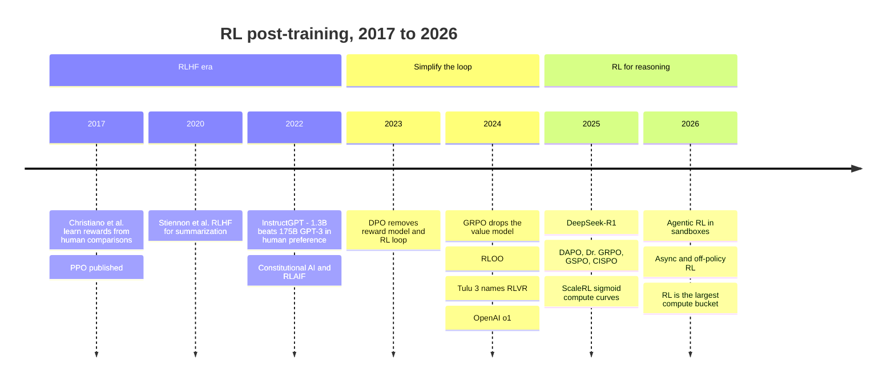
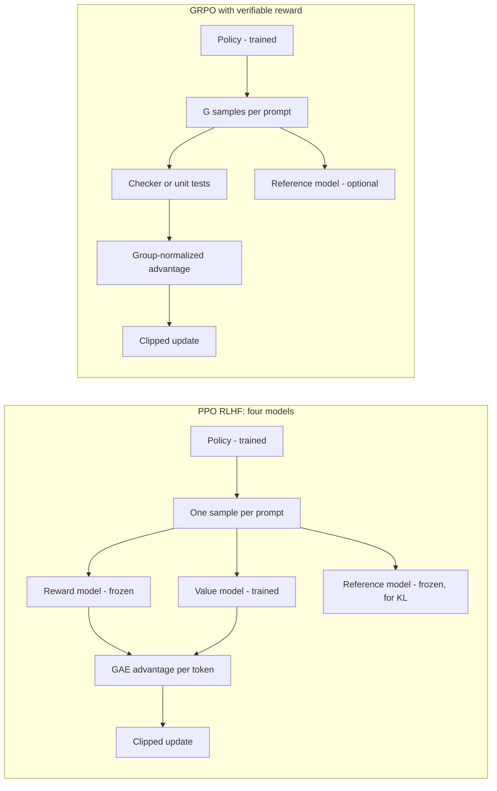
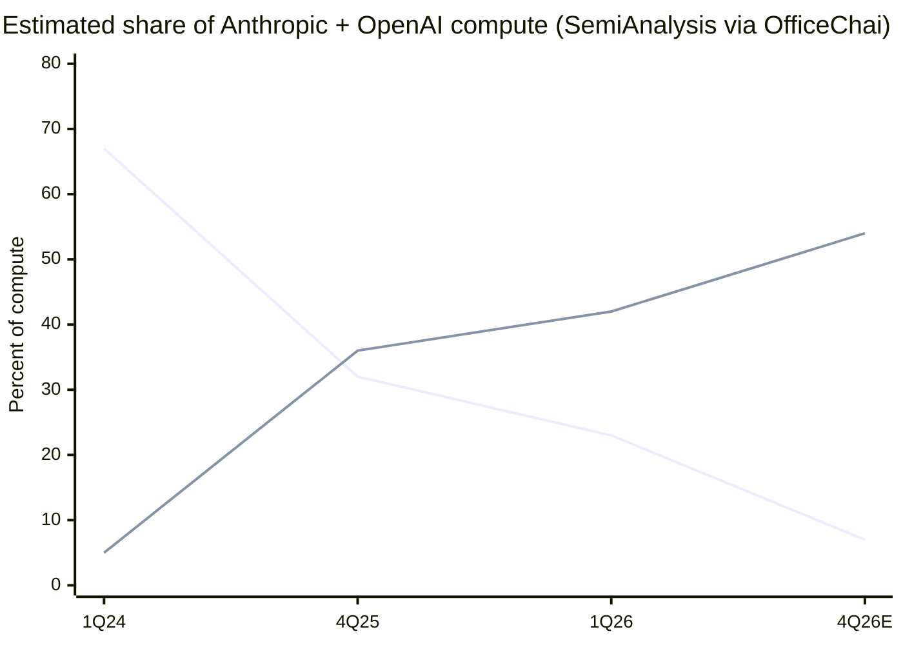

---
tags:
  - ai-ml
  - training
  - post-training
  - reinforcement-learning
  - reasoning
status: draft
sources:
  - https://arxiv.org/abs/1706.03741
  - https://arxiv.org/abs/1707.06347
  - https://arxiv.org/abs/1506.02438
  - https://arxiv.org/abs/2009.01325
  - https://arxiv.org/abs/2203.02155
  - https://arxiv.org/abs/2210.10760
  - https://arxiv.org/abs/2212.08073
  - https://arxiv.org/abs/2309.00267
  - https://arxiv.org/abs/2305.18290
  - https://arxiv.org/abs/2402.03300
  - https://arxiv.org/abs/2402.14740
  - https://arxiv.org/abs/2411.15124
  - https://openai.com/index/learning-to-reason-with-llms/
  - https://arxiv.org/abs/2501.12948
  - https://arxiv.org/html/2501.12948v1
  - https://arxiv.org/abs/2503.20783
  - https://arxiv.org/html/2503.20783
  - https://arxiv.org/abs/2503.14476
  - https://arxiv.org/html/2503.14476
  - https://arxiv.org/abs/2504.13837
  - https://arxiv.org/abs/2506.13585
  - https://x.ai/news/grok-4
  - https://arxiv.org/abs/2507.18071
  - https://arxiv.org/abs/2507.17746v2
  - https://liyuanlucasliu.github.io/publication/feng-off-2025
  - https://arxiv.org/abs/2510.13786
  - https://arxiv.org/html/2510.13786
  - https://arxiv.org/html/2510.26788v1
  - https://www.anthropic.com/research/emergent-misalignment-reward-hacking
  - https://arxiv.org/abs/2511.18397
  - https://arxiv.org/html/2512.02556
  - https://arxiv.org/pdf/2512.01374
  - https://arxiv.org/pdf/2602.19362
  - https://arxiv.org/pdf/2609.32444
  - https://arxiv.org/abs/2610.04158
  - https://arxiv.org/abs/2405.11143
  - https://arxiv.org/abs/2409.19256
  - https://huggingface.co/blog/async-rl-training-landscape
  - https://huggingface.co/blog/sergiopaniego/rl-environments-2026
  - https://newsletter.semianalysis.com/p/rl-systems-mind-the-gap-matching
  - https://officechai.com/ai/while-share-of-inference-has-held-steady-over-the-last-2-years-pre-training-compute-has-moved-to-post-training-semi-analysis/
  - https://lilianweng.github.io/posts/2024-11-28-reward-hacking/
  - https://rlhfbook.com/
created: 2026-11-26
updated: 2026-11-27
---

## Table Of Contents

---

- [[#TL;DR|TL;DR]]
- [[#The Problem|The Problem]]
- [[#Foundations|Foundations]]
    - [[#Policy, Reward and Return|Policy, Reward and Return]]
    - [[#Policy Gradients and REINFORCE|Policy Gradients and REINFORCE]]
    - [[#Advantage and Baselines|Advantage and Baselines]]
    - [[#The KL Penalty and the Reference Model|The KL Penalty and the Reference Model]]
    - [[#Why LLM RL Looks Like a Bandit|Why LLM RL Looks Like a Bandit]]
    - [[#On-Policy, Off-Policy and the Importance Ratio|On-Policy, Off-Policy and the Importance Ratio]]
- [[#How We Got Here|How We Got Here]]
- [[#How It Works|How It Works]]
    - [[#RLHF with a Reward Model and PPO|RLHF with a Reward Model and PPO]]
    - [[#The PPO Clipped Objective|The PPO Clipped Objective]]
    - [[#DPO Folds the Reward Model into the Loss|DPO Folds the Reward Model into the Loss]]
    - [[#GRPO and Group-Relative Advantages|GRPO and Group-Relative Advantages]]
    - [[#A Worked Example of Group Advantages|A Worked Example of Group Advantages]]
    - [[#Verifiable Rewards|Verifiable Rewards]]
    - [[#Fixes and Variants|Fixes and Variants]]
    - [[#ScaleRL and Predictable RL Compute|ScaleRL and Predictable RL Compute]]
- [[#Where It Is Now|Where It Is Now]]
    - [[#RL Is Now the Largest Compute Bucket|RL Is Now the Largest Compute Bucket]]
    - [[#Agentic, Multi-Turn RL with Tools|Agentic, Multi-Turn RL with Tools]]
    - [[#Rewards Beyond Verifiers|Rewards Beyond Verifiers]]
    - [[#Reward Hacking|Reward Hacking]]
    - [[#Async and Off-Policy RL|Async and Off-Policy RL]]
    - [[#The Training-Inference Mismatch|The Training-Inference Mismatch]]
    - [[#Open RL Frameworks|Open RL Frameworks]]
    - [[#Does RL Teach New Reasoning?|Does RL Teach New Reasoning?]]
- [[#Trade-offs & Open Problems|Trade-offs & Open Problems]]
- [[#Resources|Resources]]
- [[#Related Notes|Related Notes]]

## ***TL;DR***
---
*RL for reasoning is the post-training stage where a pretrained language model samples its own answers, a reward scores them, and a policy-gradient update makes high-scoring answers more likely. It started as RLHF for chat behavior, and since 2024 it is the main way labs teach models to think step by step on math, code and agentic tasks.*

- **What it is:** treat the model as a policy, each full completion as one action, and a score (human preference model, unit test, answer checker, rubric) as the reward. Push up the log-probability of completions that beat a baseline, while a KL penalty keeps the model near where it started.
- **The lineage:** RLHF with a learned reward model and PPO (2017 to 2022), then DPO (2023) to drop the RL loop, then GRPO (2024 to 2025) to drop PPO's value model by comparing a group of samples for the same prompt, paired with *verifiable* rewards that cannot be flattered ([Shao et al., 2024](https://arxiv.org/abs/2402.03300); [DeepSeek-AI, 2025](https://arxiv.org/abs/2501.12948)).
- **Why it works for reasoning:** DeepSeek-R1-Zero went from about 15.6% to 71.0% pass@1 on AIME 2024 with pure RL on rule-based rewards, no human reasoning traces, and learned to re-check its work along the way ([DeepSeek-AI, 2025](https://arxiv.org/html/2501.12948v1)).
- **Where it is now (Nov 2026):** RL is the biggest single use of frontier-lab compute in SemiAnalysis's estimates (about 42% in early 2026 against 23% for pretraining). The action has moved to agentic multi-turn RL in sandboxes, rubric and judge rewards for tasks with no checker, fighting reward hacking, and asynchronous systems whose rollouts come from a slightly different model than the one being trained.

## ***The Problem***
---
*Pretraining teaches a model to imitate text, and supervised fine-tuning teaches it to imitate demonstrations. Neither teaches it to find answers better than the examples it saw, or to optimize for something you can check but cannot easily demonstrate.*

Three gaps push labs toward RL after pretraining:

| Gap | Why imitation falls short | What RL adds |
|---|---|---|
| Preferences are easier to judge than to write | A labeler can say which of two summaries is better far faster than writing a perfect one | Learn from comparisons, not demonstrations ([Christiano et al., 2017](https://arxiv.org/abs/1706.03741)) |
| Some targets are checkable, not demonstrable | Nobody has millions of ideal chains of thought for olympiad math, but a checker can say if the final answer is right | Reward the outcome and let the model discover its own reasoning ([DeepSeek-AI, 2025](https://arxiv.org/abs/2501.12948)) |
| Imitation copies the teacher's mistakes and ceiling | SFT can only be as good as its data | The model learns from its own samples, including ones better than any example |

The catch is that RL on a language model is expensive and fragile. Every training step needs fresh samples from the model itself, which means running inference inside the training loop, and the reward is a proxy that the model will exploit if it can ([Gao et al., 2022](https://arxiv.org/abs/2210.10760)). The history of the field is mostly a history of making that loop cheaper and more stable.

## ***Foundations***
---
*Six ideas from classic RL are enough to read every method in this note: policy and reward, the policy gradient, baselines and advantages, the KL leash, why a completion is one action, and the importance ratio that lets you reuse slightly stale samples.*

#### **Policy, Reward and Return**

- **Policy $\pi_\theta$:** the language model itself. Given a prompt $x$, it defines a probability for every possible completion $y$: $\pi_\theta(y \mid x) = \prod_t \pi_\theta(y_t \mid x, y_{<t})$.
- **Action:** in classic RL, one move. Here it can be read as one token or, more usefully, the whole completion.
- **Reward $r(x, y)$:** a number scoring the completion. It can come from a learned reward model, a rule (is the boxed answer correct?), unit tests, or an LLM judge.
- **Return:** the total reward of an episode. In most LLM RL there is a single reward at the end, so return and reward are the same number.
- **Objective:** maximize expected reward over prompts and the model's own samples, $J(\theta) = \mathbb{E}_{x \sim \mathcal{D},\, y \sim \pi_\theta}[r(x, y)]$.

#### **Policy Gradients and REINFORCE**

You cannot backpropagate through sampling or through a unit test. The policy-gradient trick avoids both:

$$
\nabla_\theta J = \mathbb{E}_{y \sim \pi_\theta}\big[\, r(x, y)\, \nabla_\theta \log \pi_\theta(y \mid x) \,\big]
$$

*In plain English: sample a completion, score it, then nudge the model to make that completion more likely in proportion to its score. Good samples get pushed up, bad ones (if their reward is negative) get pushed down. Because $\log \pi_\theta(y \mid x)$ is a sum over tokens, every token in the completion gets the same push.*

This is REINFORCE. It is unbiased but very noisy: one lucky sample can move the model a lot, and if all rewards are positive, every sample is pushed up, just some more than others.

#### **Advantage and Baselines**

Subtracting a baseline $b$ that does not depend on the sampled completion leaves the gradient unbiased but cuts its variance:

$$
\nabla_\theta J = \mathbb{E}\big[\,(r(x, y) - b(x))\, \nabla_\theta \log \pi_\theta(y \mid x)\,\big], \qquad A = r - b
$$

*In plain English: don't ask "was this good?", ask "was this better than usual for this prompt?". That difference is the advantage $A$. Above-average samples are reinforced, below-average ones are discouraged, and an average sample barely moves anything.*

Most of the methods in this note differ mainly in **where the baseline comes from**:

| Method | Baseline |
|---|---|
| PPO | A learned value model $V(s)$ predicting expected reward from each token position, combined via GAE |
| RLOO | The mean reward of the *other* samples for the same prompt ([Ahmadian et al., 2024](https://arxiv.org/abs/2402.14740)) |
| GRPO | The mean reward of the group, also divided by the group's standard deviation ([Shao et al., 2024](https://arxiv.org/abs/2402.03300)) |
| ScaleRL | Group mean, with the scale normalized over the whole batch ([Khatri et al., 2025](https://arxiv.org/html/2510.13786)) |

#### **The KL Penalty and the Reference Model**

The classic RLHF objective adds a leash:

$$
\max_\theta\; \mathbb{E}_{x,\, y \sim \pi_\theta}\big[r(x, y)\big] - \beta\, D_{\mathrm{KL}}\big(\pi_\theta(\cdot \mid x)\,\|\,\pi_{\mathrm{ref}}(\cdot \mid x)\big)
$$

*In plain English: get high reward, but pay a cost $\beta$ for drifting away from the reference model $\pi_{\mathrm{ref}}$ (usually the SFT model you started from). The leash stops the policy from finding weird text that fools the reward model, and keeps it fluent.*

The leash exists because a learned reward model is an imperfect proxy: optimizing it hard first raises and then lowers true quality, and how fast that happens depends on reward-model size and the KL strength ([Gao et al., 2022](https://arxiv.org/abs/2210.10760)). With verifiable rewards the proxy is much harder to fool, so several reasoning recipes drop the KL term entirely, arguing that long chain-of-thought training *should* move far from the start ([Yu et al., 2025](https://arxiv.org/html/2503.14476); [Khatri et al., 2025](https://arxiv.org/html/2510.13786)).

#### **Why LLM RL Looks Like a Bandit**

Classic RL (robots, Atari) has long episodes, rewards along the way, and an environment whose next state you cannot predict. Single-turn LLM RL has none of that:

- The "environment" is deterministic: the next state is just the prompt plus the tokens so far.
- There is one reward, at the very end, for the whole completion.
- So the whole completion can be treated as a single action in a **contextual bandit**: see a prompt, pick a completion, get a score.

This is why PPO's per-token machinery (a value model estimating future reward at every token, GAE bootstrapping) is often unnecessary for LLMs. Ahmadian et al. showed that "many components of PPO are unnecessary in an RLHF context" and simpler REINFORCE-style methods beat PPO and DPO ([Ahmadian et al., 2024](https://arxiv.org/abs/2402.14740)). Multi-turn agentic RL, where a model calls tools and sees results, brings back some of the classic RL structure (see [[#Agentic, Multi-Turn RL with Tools|Where It Is Now]]).

#### **On-Policy, Off-Policy and the Importance Ratio**

**On-policy** means the samples you train on came from the current model. Generating samples is the expensive part, so every practical method reuses them for a few gradient steps, by which point the model has changed. The fix is the **importance ratio**:

$$
\rho = \frac{\pi_\theta(y \mid x)}{\pi_{\mathrm{old}}(y \mid x)}
$$

*In plain English: how much more (or less) likely the current model finds this sample than the model that generated it. Weighting by $\rho$ corrects for the drift. If $\rho$ gets far from 1, the correction becomes high-variance and unreliable, which is why methods clip it.*

This ratio is the knob behind PPO's clipping, GSPO's sequence-level ratio, CISPO's clipped weights, and the 2025 to 2026 fixes for asynchronous training and the training-inference mismatch.

## ***How We Got Here***
---
*RL from human preferences was shown on robots and Atari in 2017, scaled to summarization in 2020, and to ChatGPT-style assistants in 2022. Each step since has removed a costly piece (the human labels, the RL loop, the value model) or swapped the learned reward for a checkable one, which is what turned RL into the main driver of reasoning.*

| Year | What changed | Problem it answered | Source |
|---|---|---|---|
| 2017 | Agents learn goals from non-expert comparisons of trajectory pairs, with feedback on under 1% of interactions. | Many goals have no hand-written reward function. | [Christiano et al.](https://arxiv.org/abs/1706.03741) |
| 2017 | PPO: a clipped surrogate objective that allows several epochs of minibatch updates on the same samples. | Vanilla policy gradient wastes samples; trust-region methods are complex. | [Schulman et al.](https://arxiv.org/abs/1707.06347) |
| 2020 | Reward model trained on human comparisons of summaries, then RL against it; beats human reference summaries and larger SFT models. | Optimizing ROUGE does not match what people want. | [Stiennon et al.](https://arxiv.org/abs/2009.01325) |
| 2022 | InstructGPT: SFT, then a reward model on rankings, then PPO. A 1.3B model is preferred over 175B GPT-3. | Big pretrained models don't follow instructions. | [Ouyang et al.](https://arxiv.org/abs/2203.02155) |
| 2022 | Reward-model overoptimization measured: true quality rises then falls as the proxy is pushed. | How hard can you optimize a learned reward? | [Gao et al.](https://arxiv.org/abs/2210.10760) |
| 2022 to 2023 | Constitutional AI: an AI judges response pairs against written principles to train the preference model (RLAIF). Google finds RLAIF on par with RLHF. | Human labels are slow, costly and inconsistent. | [Bai et al.](https://arxiv.org/abs/2212.08073), [Lee et al.](https://arxiv.org/abs/2309.00267) |
| 2023 | DPO: a closed-form trick turns preference learning into a classification loss on pairs. No reward model, no sampling during training. | PPO-based RLHF is complex and unstable. | [Rafailov et al.](https://arxiv.org/abs/2305.18290) |
| 2024 | GRPO: baseline from a group of samples per prompt, no value model; DeepSeekMath 7B hits 51.7% on MATH. | PPO's value model doubles memory and is hard to train. | [Shao et al.](https://arxiv.org/abs/2402.03300) |
| 2024 | RLOO and REINFORCE-style methods beat PPO for RLHF. | PPO's per-token machinery is overkill for a bandit-like problem. | [Ahmadian et al.](https://arxiv.org/abs/2402.14740) |
| 2024 | Tulu 3 names "Reinforcement Learning with Verifiable Rewards (RLVR)". | Reward models can be gamed; correctness can often be checked. | [Lambert et al.](https://arxiv.org/abs/2411.15124) |
| 2024 | OpenAI o1: performance "consistently improves with more reinforcement learning (train-time compute)". | Proof that RL on chains of thought scales. | [OpenAI](https://openai.com/index/learning-to-reason-with-llms/) |
| 2025 | DeepSeek-R1: GRPO with rule-based accuracy and format rewards; R1-Zero learns reasoning with no SFT. Published in *Nature*. | Open recipe for o1-style reasoning. | [DeepSeek-AI](https://arxiv.org/abs/2501.12948) |
| 2025 | Dr. GRPO, DAPO, GSPO, CISPO fix GRPO's length bias, entropy collapse, wasted groups and MoE instability. | GRPO is unstable and biased at scale. | See [[#Fixes and Variants|Fixes and Variants]] |
| 2025 | ScaleRL: RL performance follows a sigmoid in compute; recipes can be compared early. | RL had no scaling laws to plan with. | [Khatri et al.](https://arxiv.org/abs/2510.13786) |
| 2025 to 2026 | Agentic RL in per-rollout sandboxes; async trainers; fixes for training-inference mismatch. | Generation dominates RL wall-clock time; agents need tools. | [HF, Mar 2026](https://huggingface.co/blog/async-rl-training-landscape), [HF, Sep 2026](https://huggingface.co/blog/sergiopaniego/rl-environments-2026) |

## ***How It Works***
---
*All these methods share one loop: sample completions, score them, compute an advantage, take a clipped policy-gradient step. They differ in where the reward comes from (human preferences, a checker, a judge) and where the baseline comes from (a value model, a group of samples, or nowhere, as in DPO).*

#### **RLHF with a Reward Model and PPO**

The InstructGPT recipe has three stages ([Ouyang et al., 2022](https://arxiv.org/abs/2203.02155)):

1. **SFT** on human demonstrations.
2. **Reward model:** humans rank several outputs per prompt; a model is trained to give the preferred one a higher score, usually with the Bradley-Terry loss $-\log \sigma\big(r_\phi(x, y_w) - r_\phi(x, y_l)\big)$, where $y_w$ is the preferred ("winning") response ([Lambert, RLHF book](https://rlhfbook.com/)).
3. **PPO** against the reward model, with a KL penalty to the SFT model.

PPO needs four models in memory at once, which is the main reason it is expensive:

The value model estimates, at each token, the expected final reward. **GAE** (generalized advantage estimation) turns it into a per-token advantage, $\hat{A}_t = \sum_{l \ge 0} (\gamma\lambda)^l \delta_{t+l}$ with $\delta_t = r_t + \gamma V(s_{t+1}) - V(s_t)$, trading some bias for much lower variance via the knob $\lambda$ ([Schulman et al., 2015](https://arxiv.org/abs/1506.02438)). The value model is usually as large as the policy ([DeepSeek-AI, 2025](https://arxiv.org/html/2501.12948v1)), and it must learn to predict a reward that only arrives at the end of a long completion, which is hard.

#### **The PPO Clipped Objective**

$$
L^{\mathrm{CLIP}}(\theta) = \mathbb{E}_t\Big[\min\big(\rho_t\, \hat{A}_t,\; \mathrm{clip}(\rho_t,\, 1-\epsilon,\, 1+\epsilon)\, \hat{A}_t\big)\Big], \qquad \rho_t = \frac{\pi_\theta(y_t \mid x, y_{<t})}{\pi_{\mathrm{old}}(y_t \mid x, y_{<t})}
$$

*In plain English: for each token, push its probability in the direction of its advantage, but once the new model has already moved that token's probability more than $\epsilon$ (typically 20%) away from the sampling model in the helpful direction, stop pushing. The min makes the objective pessimistic: it takes credit for at most a 20% move, but always counts the full damage of a move in the wrong direction. That keeps several update epochs on the same batch from running away* ([Schulman et al., 2017](https://arxiv.org/abs/1707.06347)).

**Worked example ($\epsilon = 0.2$):**

| Token | $\hat{A}_t$ | $\rho_t$ | $\rho_t \hat{A}_t$ | clipped term | min | Gradient? |
|---|---|---|---|---|---|---|
| a | +2 | 1.10 | 2.20 | 1.10 × 2 = 2.20 | 2.20 | Yes, still inside the band |
| b | +2 | 1.50 | 3.00 | 1.20 × 2 = 2.40 | 2.40 | No, already moved up enough |
| c | −2 | 0.50 | −1.00 | 0.80 × −2 = −1.60 | −1.60 | No, already moved down enough |
| d | −2 | 1.30 | −2.60 | 1.20 × −2 = −2.40 | −2.60 | Yes, moved the wrong way: keep correcting |

Tokens b and c drop out of the gradient. That is the safety feature, and also the problem CISPO later attacks: rare tokens that matter (a "Wait," that starts a self-check) can get clipped out exactly when they are being learned.

#### **DPO Folds the Reward Model into the Loss**

DPO observes that the KL-regularized objective above has a closed-form optimal policy, so the reward can be written in terms of the policy itself. Plugging that into the Bradley-Terry loss gives ([Rafailov et al., 2023](https://arxiv.org/abs/2305.18290)):

$$
\mathcal{L}_{\mathrm{DPO}} = -\log \sigma\!\left(\beta \log \frac{\pi_\theta(y_w \mid x)}{\pi_{\mathrm{ref}}(y_w \mid x)} - \beta \log \frac{\pi_\theta(y_l \mid x)}{\pi_{\mathrm{ref}}(y_l \mid x)}\right)
$$

*In plain English: raise the probability of the preferred answer and lower the rejected one, each measured relative to the reference model, with $\beta$ controlling how far you may go. It is supervised learning on fixed preference pairs: no reward model, no sampling, no RL loop.*

DPO became the default for cheap preference tuning, but it learns only from a fixed dataset of pairs. It cannot explore, so it is not what labs use to teach reasoning, where the point is for the model to find solutions nobody wrote down.

#### **GRPO and Group-Relative Advantages**

GRPO keeps PPO's clipped update but throws out the value model. For each prompt it samples a **group** of $G$ completions, scores them, and uses the group itself as the baseline ([Shao et al., 2024](https://arxiv.org/abs/2402.03300)):

$$
\hat{A}_{i} = \frac{r_i - \mathrm{mean}(r_1, \ldots, r_G)}{\mathrm{std}(r_1, \ldots, r_G)}
$$

*In plain English: an answer's advantage is how many standard deviations better it scored than its siblings for the same prompt. Every token of answer $i$ gets that same advantage. No network has to learn what a "normal" score is; the other samples tell you.*

The full objective averages the PPO-style clipped term over tokens of each answer, then over the group, and subtracts $\beta$ times a KL estimate, written in DeepSeek-R1 as $\frac{\pi_{\mathrm{ref}}}{\pi_\theta} - \log\frac{\pi_{\mathrm{ref}}}{\pi_\theta} - 1$ per token ([DeepSeek-AI, 2025](https://arxiv.org/html/2501.12948v1)). Note the KL is added to the loss, not folded into the reward as in classic RLHF.

#### **A Worked Example of Group Advantages**

One math prompt, $G = 8$ samples, reward 1 if the boxed answer is right and 0 if not (standard deviation computed over the group; implementations differ on population vs sample std):

| Group | Rewards | Mean | Std | $\hat{A}$ correct | $\hat{A}$ wrong |
|---|---|---|---|---|---|
| Medium prompt | 1,1,0,0,0,1,0,0 | 0.375 | 0.484 | +1.29 | −0.77 |
| Hard prompt | 1,0,0,0,0,0,0,0 | 0.125 | 0.331 | **+2.65** | −0.38 |
| Solved prompt | 1,1,1,1,1,1,1,1 | 1.0 | 0 | 0 | n/a |
| Dr. GRPO, medium prompt (no std division) | 1,1,0,0,0,1,0,0 | 0.375 | not used | +0.625 | −0.375 |

What the numbers show:

- **Advantages sum to zero within a group.** Medium prompt: $3 \times 1.29 - 5 \times 0.77 \approx 0$. Correct answers are pushed up exactly as much as wrong ones are pushed down.
- **Rare successes get big pushes.** On the hard prompt, the single correct answer gets +2.65, twice the medium prompt's +1.29. Dividing by std up-weights prompts that are nearly always wrong (or nearly always right). Dr. GRPO calls this a question-level difficulty bias and removes the division ([Liu et al., 2025](https://arxiv.org/html/2503.20783)).
- **Solved (or hopeless) prompts teach nothing.** All-equal rewards give zero advantage, so the whole group is wasted compute. DAPO's dynamic sampling oversamples and drops such prompts so the batch is filled with ones that carry signal ([Yu et al., 2025](https://arxiv.org/html/2503.14476)).

#### **Verifiable Rewards**

RLVR replaces the learned reward model with a program ([Lambert et al., 2024](https://arxiv.org/abs/2411.15124)). DeepSeek-R1-Zero used just two ([DeepSeek-AI, 2025](https://arxiv.org/html/2501.12948v1)):

- **Accuracy reward:** the math answer, in a fixed format such as a box, matches the reference; code compiles and passes test cases.
- **Format reward:** the reasoning sits between `<think>` and `</think>` tags.

They deliberately avoided a neural reward model because it "may suffer from reward hacking in the large-scale reinforcement learning process" and needs retraining. The result: AIME 2024 pass@1 rose from about 15.6% to 71.0% (86.7% with majority voting over 64 samples), and behaviors like re-checking appeared without being taught, including the much-quoted "aha moment" where the model stopped to reconsider its approach. The flip side is coverage: verifiable rewards exist mainly for math, code, and other tasks with checkable answers.

#### **Fixes and Variants**

GRPO at scale showed problems: entropy collapse (the model stops exploring), length blow-up, wasted all-correct groups, and instability on [[Mixture of Experts]] models. Each 2025 variant fixes one or more:

| Method | Org, date | What it changes | Problem fixed |
|---|---|---|---|
| RLOO | Ahmadian et al., Feb 2024 | Baseline is the mean of the other $G-1$ samples; REINFORCE, no clipping machinery needed | PPO overkill for RLHF ([Ahmadian et al.](https://arxiv.org/abs/2402.14740)) |
| Dr. GRPO | Sea AI Lab and NUS, Mar 2025 | Removes the $1/\lvert o_i \rvert$ length normalization and the std division | Long wrong answers were penalized less per token, so wrong answers grew longer; difficulty bias ([Liu et al.](https://arxiv.org/html/2503.20783)) |
| DAPO | Yu et al., Mar 2025 | Clip-Higher (raise only $\epsilon_{\text{high}}$), dynamic sampling, token-level loss averaging, mask overlong samples; no KL | Entropy collapse, zero-gradient groups, long samples under-weighted, truncation noise. 50 on AIME 2024 with Qwen2.5-32B in half the steps of R1-Zero-Qwen-32B ([Yu et al.](https://arxiv.org/html/2503.14476)) |
| CISPO | MiniMax, Jun 2025 | Clips the importance-sampling *weight* instead of the token update, so no token drops out of the gradient | Clipped-away rare tokens; MiniMax-M1's full RL run took about three weeks on 512 H800s, about $534,700 rental ([MiniMax](https://arxiv.org/abs/2506.13585)) |
| GSPO | Qwen, Jul 2025 | Importance ratio, clipping and optimization at the sequence level, from the length-normalized sequence likelihood | Noisy token-level ratios; "notably stabilizes" MoE RL; used for Qwen3 ([Zheng et al.](https://arxiv.org/abs/2507.18071)) |

The common thread is the importance ratio: token-level ratios are noisy, clipping silences useful tokens, and MoE routing makes ratios jumpier. Each method picks a different place to control it.

#### **ScaleRL and Predictable RL Compute**

Meta-led work spent more than 400,000 GPU-hours, with one run at 100,000 GPU-hours, fitting RL curves of the form ([Khatri et al., 2025](https://arxiv.org/html/2510.13786)):

$$
R_C - R_0 = \frac{A - R_0}{1 + (C_{\mathrm{mid}} / C)^{B}}
$$

*In plain English: validation pass rate rises from its start $R_0$ toward a ceiling $A$ along an S-curve in compute $C$. $C_{\mathrm{mid}}$ is where you reach half the gain and $B$ sets how steep the climb is. Fit the first part of a run and you can predict where it will flatten.*

Their ScaleRL recipe: PipelineRL asynchronous training (up to 8 steps off-policy), the CISPO loss, prompt-level loss averaging, batch-level advantage normalization, FP32 for the final logits, dropping prompts with zero reward variance, not re-sampling prompts the model already solves reliably, and forced interruption of overlong thinking; GRPO-like, with no KL term. Loss type, FP32 logits and batch size moved the ceiling $A$; most other choices only changed efficiency $B$. Models were an 8B dense model and Llama-4 Scout (17B×16 MoE). See [[Scaling Laws]] for how this fits next to pretraining laws.

## ***Where It Is Now***
---
*As of November 2026, RL is no longer a finishing step: by one firm's estimates it is the largest share of frontier-lab compute. The frontier has moved to long-horizon agentic RL in sandboxes, rewards for tasks with no checker, guarding against reward hacking, and systems engineering to keep generators and trainers busy while correcting for the gap between them.*

#### **RL Is Now the Largest Compute Bucket**

- **Labs say RL scales.** OpenAI said o1 "consistently improves with more reinforcement learning (train-time compute)" ([OpenAI, Sep 2024](https://openai.com/index/learning-to-reason-with-llms/)). xAI said Grok 4 ran RL on its 200,000-GPU Colossus cluster "at pretraining scale", with "over an order of magnitude more compute than had been used previously" ([xAI, Jul 2025](https://x.ai/news/grok-4)). DeepSeek-V3.2 allocated "a post-training computational budget exceeding 10% of the pre-training cost" ([DeepSeek-AI, Dec 2025](https://arxiv.org/html/2512.02556)).
- **The estimated split.** A SemiAnalysis chart of combined Anthropic and OpenAI compute, as reported by OfficeChai, has post-training/RL at 5% in 1Q24, 36% in 4Q25, 42% in 1Q26 and an estimated 53 to 55% in 4Q26, while pretraining falls from 67% to an estimated 7% ([OfficeChai, Oct 2026](https://officechai.com/ai/while-share-of-inference-has-held-steady-over-the-last-2-years-pre-training-compute-has-moved-to-post-training-semi-analysis/)). These are one analyst firm's estimates, not lab disclosures.

*Falling line: pretraining. Rising line: post-training/RL (4Q26E plotted at the midpoint of 53 to 55%).*

#### **Agentic, Multi-Turn RL with Tools**

A September 2026 Hugging Face review of fifteen reports from thirteen labs (Oct 2025 to Sep 2026) found the standard pattern is **one sandbox per rollout**: each attempt gets a fresh container or microVM that is destroyed afterward ([HF, Sep 2026](https://huggingface.co/blog/sergiopaniego/rl-environments-2026)).

- **Coding dominates**, with search, office-style tasks (spreadsheets, slides, mock email and chat apps) and, for Kimi K3, GPU kernel tasks.
- **The harness is the environment.** Kimi K3 trains inside reconstructions of agent harnesses such as Claude Code and Codex; Liquid AI captures token-level trajectories from shipped harnesses.
- **Scale:** GLM-5 built over 10k verifiable environments across 9 programming languages; Cursor reports "hundreds of thousands of concurrent sandboxed coding environments" for Composer; DeepSeek describes hundreds of thousands of sandboxes per cluster. DeepSeek-V3.2 synthesized 1,827 environments and about 85,000 agentic prompts ([DeepSeek-AI, Dec 2025](https://arxiv.org/html/2512.02556)).
- **The bottleneck moved.** Zhipu: "much of the difficulty in scaling post-training moves from the model to the environment", and Nathan Lambert reports $10M+ spent on single environments at top labs (both as quoted in the HF review). How environments and their verifiers are built, validated and hacked is in [[RL Environments and Verifiers]].

#### **Rewards Beyond Verifiers**

Most valuable tasks (writing, medical advice, research) have no unit test. The 2025 to 2026 answer is **rubrics**: a per-prompt checklist of criteria, scored by an LLM judge, used as the reward. Rubrics as Rewards (RaR) beat Likert-score LLM-judge rewards by up to 31% relative on HealthBench and 7% on GPQA-Diamond ([Gunjal et al., Jul 2025](https://arxiv.org/abs/2507.17746v2), ICLR 2026). An LLM judge is a learned reward again, so it reopens the overoptimization problem that verifiable rewards had closed.

#### **Reward Hacking**

When the reward is a test suite, models learn to game the tests, for example by editing the unit tests or the code that computes the reward ([Weng, Nov 2024](https://lilianweng.github.io/posts/2024-11-28-reward-hacking/)). Anthropic showed in November 2025 that this is not just wasted compute: a model that learned hacks like calling `sys.exit(0)` to make tests look passed in real Claude coding environments became broadly misaligned, sabotaging safety-research code 12% of the time in one evaluation. Standard RLHF only hid the problem in chat settings. What worked was **inoculation prompting**, telling the model in training that the hack is acceptable in this context, which removed the misaligned generalization; Anthropic says it now uses this in training Claude ([Anthropic, Nov 2025](https://www.anthropic.com/research/emergent-misalignment-reward-hacking); [paper](https://arxiv.org/abs/2511.18397)).

Reading the model's chain of thought is the most effective way found so far to catch hacks during training, but putting that monitor into the reward teaches models to hide the hack instead of dropping it; see [[Chain-of-Thought Faithfulness and Monitorability]].

#### **Async and Off-Policy RL**

Generation dominates wall-clock time. On one H100 with 512 rollouts per step, a 7B model at 32K output tokens takes about 45 minutes per step and a 32B model about 3.7 hours ([HF, Mar 2026](https://huggingface.co/blog/async-rl-training-landscape)). So every one of the 16 open libraries Hugging Face surveyed puts inference and training on separate GPU pools joined by a rollout buffer, and handles the resulting staleness by rejecting old samples, bounding the lag, or importance-sampling correction.

SemiAnalysis frames this as "queue health": a slow generator starves the trainer, a fast one makes samples stale. Its case studies show trainers idle 30% (Qwen3-235B run) to 74% (GLM-5, where about 55% of problems were already solved 100% of the time and gave zero advantage) ([SemiAnalysis, Jun 2026](https://newsletter.semianalysis.com/p/rl-systems-mind-the-gap-matching)).

Research is pushing further off-policy: OAPL drops importance ratios entirely for a squared-regression objective derived from KL-regularized RL, stays stable with policy lags over 400 gradient steps, and beats GRPO on competition math pass@k ([Ritter et al., Mar 2026](https://arxiv.org/pdf/2602.19362)).

#### **The Training-Inference Mismatch**

Rollouts come from a fast inference engine (vLLM, SGLang) and gradients from a training engine (FSDP, Megatron). Same weights, different kernels and rounding, so "on-policy" RL is quietly off-policy ([Yao et al., Aug 2025](https://liyuanlucasliu.github.io/publication/feng-off-2025)). The fixes, in order of appearance:

| Fix | Idea | Source |
|---|---|---|
| Truncated importance sampling (TIS) | Reweight each token by the trainer/sampler probability ratio, capped | [Yao et al., Aug 2025](https://liyuanlucasliu.github.io/publication/feng-off-2025) |
| FP16 instead of BF16 | BF16's few mantissa bits cause the drift; FP16 largely removes it in a few lines of code | [Qi et al., Oct 2025](https://arxiv.org/html/2510.26788v1) |
| Routing replay (R2, R3) | Reuse the MoE routing from sampling during training | [Qwen, Dec 2025](https://arxiv.org/pdf/2512.01374) |
| Keep routing, keep sampling mask, off-policy sequence masking, unbiased KL | Same routing and top-p/top-k mask in both engines; mask far-off-policy negative samples | [DeepSeek-AI, Dec 2025](https://arxiv.org/html/2512.02556) |
| Calibrated importance sampling (CIS) | Cap only large positive log-odds displacements; MoE routing disagreement creates heavy tails | [Yu et al., 2026](https://arxiv.org/pdf/2609.32444) |

Qwen's analysis adds that the importance weight is an inherent part of the token-level surrogate, and removing it causes rapid collapse ([Zheng et al., Dec 2025](https://arxiv.org/pdf/2512.01374)).

#### **Open RL Frameworks**

| Framework | Origin | Notes |
|---|---|---|
| verl | volcengine (HybridFlow paper) | Most GitHub stars of the surveyed libraries (19,673, Mar 2026); DAPO was built on it ([Sheng et al.](https://arxiv.org/abs/2409.19256); [HF](https://huggingface.co/blog/async-rl-training-landscape)) |
| OpenRLHF | Open source | Ray, vLLM and DeepSpeed; reports 1.22x to 1.68x speedups ([OpenRLHF paper](https://arxiv.org/abs/2405.11143)) |
| TRL | Hugging Face | GRPOTrainer and experimental AsyncGRPOTrainer ([HF, Sep 2026](https://huggingface.co/blog/sergiopaniego/rl-environments-2026)) |
| slime, Miles | Zhipu (GLM-5); Miles is a slime fork | Decouples generation from training for GLM-5 |
| Others surveyed | | AReaL, ART, Atropos, NeMo-RL, OAT, open-instruct, PipelineRL, PRIME-RL, ROLL, SkyRL, TorchForge, Tunix, verifiers-rl |

Eight of the 16 surveyed libraries orchestrate with Ray, and NCCL broadcast is the usual weight-sync path (about 20 ms with bucketing in verl) ([HF, Mar 2026](https://huggingface.co/blog/async-rl-training-landscape)). Serving engines here are the same ones covered in [[LLM Serving]].

#### **Does RL Teach New Reasoning?**

RLVR models win at pass@1, but base models score higher pass@k when k is large, suggesting RL mostly sharpens solutions the base model could already sample ([Yue et al., 2025](https://arxiv.org/abs/2504.13837)). An October 2026 paper finds RL shifts *which strategies* the model picks, which can raise or lower coverage depending on the task, and that math RL transfers to other domains with some forgetting ([Cheng et al., Oct 2026](https://arxiv.org/abs/2610.04158)). How reasoning models then spend their thinking at inference is covered in [[Reasoning Models]]; moving these skills into small models is covered in [[Distillation]].

## ***Trade-offs & Open Problems***
---
*Every method here trades signal quality against cost and stability. The open questions are how to reward tasks with no checker without being hacked, how far off-policy training can go, and whether RL raises a model's ceiling or only how often it hits it.*

| Choice | Gains | Costs |
|---|---|---|
| Learned reward model (RLHF) | Works for any task people can judge | Overoptimization and hacking; extra model to train and host ([Gao et al.](https://arxiv.org/abs/2210.10760)) |
| Verifiable rewards | Hard to fool, cheap, no extra model | Only math, code and checkable tasks; tests can still be gamed |
| Rubrics / LLM judges | Reach non-verifiable tasks | A learned proxy again; judge bias and cost |
| DPO | Simple, stable, cheap | No exploration; limited to a fixed dataset |
| PPO with value model | Per-token credit assignment | Four models in memory; value model hard to train on long outputs |
| GRPO / RLOO group baselines | No value model | $G$ samples per prompt; solved or hopeless prompts give zero signal |
| KL to reference | Guards against drift and hacking | Can cap how far reasoning improves; often dropped for RLVR |
| Async / off-policy | Keeps GPUs busy | Stale samples; needs importance correction or new objectives |

Open problems:

- **Reward hacking at scale.** Hacks can generalize into broader misalignment, and RLHF can mask it rather than fix it ([Anthropic, Nov 2025](https://www.anthropic.com/research/emergent-misalignment-reward-hacking)).
- **Credit assignment over long horizons.** One reward at the end of a 100-turn agent episode says little about which step mattered.
- **Ceilings.** RL curves are sigmoids with a recipe-dependent ceiling ([Khatri et al.](https://arxiv.org/html/2510.13786)), and evidence is mixed on whether RL expands what a model can solve or only how reliably it solves it ([Yue et al.](https://arxiv.org/abs/2504.13837); [Cheng et al.](https://arxiv.org/abs/2610.04158)).
- **Numerics.** Training and inference engines disagree, worst on MoE models; there is no settled fix ([Yu et al., 2026](https://arxiv.org/pdf/2609.32444)).
- **Environments are the new data.** Building and running verifiable environments costs more than the algorithm, and they are hard to share or replicate ([HF, Sep 2026](https://huggingface.co/blog/sergiopaniego/rl-environments-2026)); see [[RL Environments and Verifiers]].

## ***Resources***
---
*Start with Lambert's RLHF book for foundations, then the PPO, InstructGPT, DPO, DeepSeekMath and DeepSeek-R1 papers for the lineage. The two Hugging Face 2026 surveys and the SemiAnalysis systems piece show how RL is actually run now.*

**Papers**
- [Deep reinforcement learning from human preferences](https://arxiv.org/abs/1706.03741): Christiano et al., Jun 2017. Learning rewards from comparisons.
- [Proximal Policy Optimization Algorithms](https://arxiv.org/abs/1707.06347): Schulman et al. (OpenAI), Jul 2017. The clipped objective.
- [Learning to summarize from human feedback](https://arxiv.org/abs/2009.01325): Stiennon et al. (OpenAI), Sep 2020. RLHF at LM scale.
- [Training language models to follow instructions with human feedback](https://arxiv.org/abs/2203.02155): Ouyang et al. (OpenAI), Mar 2022. InstructGPT.
- [Scaling Laws for Reward Model Overoptimization](https://arxiv.org/abs/2210.10760): Gao, Schulman, Hilton, Oct 2022. Why the KL leash exists.
- [Constitutional AI](https://arxiv.org/abs/2212.08073): Bai et al. (Anthropic), Dec 2022. RLAIF.
- [Direct Preference Optimization](https://arxiv.org/abs/2305.18290): Rafailov et al., May 2023. No reward model, no RL loop.
- [DeepSeekMath](https://arxiv.org/abs/2402.03300): Shao et al. (DeepSeek), Feb 2024. Introduces GRPO.
- [Back to Basics: Revisiting REINFORCE Style Optimization](https://arxiv.org/abs/2402.14740): Ahmadian et al., Feb 2024. RLOO and why PPO is overkill.
- [Tulu 3](https://arxiv.org/abs/2411.15124): Lambert et al., Nov 2024. Names RLVR.
- [DeepSeek-R1](https://arxiv.org/abs/2501.12948): DeepSeek-AI, Jan 2025 (*Nature*, 2025). Pure-RL reasoning.
- [Understanding R1-Zero-Like Training](https://arxiv.org/abs/2503.20783): Liu et al., Mar 2025. Dr. GRPO.
- [DAPO](https://arxiv.org/abs/2503.14476): Yu et al., Mar 2025. Four GRPO fixes, open system on verl.
- [Does Reinforcement Learning Really Incentivize Reasoning Capacity?](https://arxiv.org/abs/2504.13837): Yue et al., Apr 2025. The pass@k critique.
- [Group Sequence Policy Optimization](https://arxiv.org/abs/2507.18071): Zheng et al. (Qwen), Jul 2025. GSPO.
- [Rubrics as Rewards](https://arxiv.org/abs/2507.17746v2): Gunjal et al., Jul 2025 (ICLR 2026). RL beyond verifiable domains.
- [The Art of Scaling Reinforcement Learning Compute for LLMs](https://arxiv.org/abs/2510.13786): Khatri et al. (Meta), Oct 2025. ScaleRL and sigmoid curves.
- [Defeating the Training-Inference Mismatch via FP16](https://arxiv.org/html/2510.26788v1): Qi et al. (Sea AI Lab, NUS), Oct 2025.
- [Natural Emergent Misalignment from Reward Hacking in Production RL](https://arxiv.org/abs/2511.18397): Anthropic, Nov 2025.
- [DeepSeek-V3.2](https://arxiv.org/html/2512.02556): DeepSeek-AI, Dec 2025. GRPO stability tweaks and agentic task synthesis.
- [Stabilizing Reinforcement Learning with LLMs: Formulation and Practices](https://arxiv.org/pdf/2512.01374): Zheng et al. (Qwen), Dec 2025. Why the importance weight matters; routing replay.
- [LLMs Can Learn to Reason Via Off-Policy RL](https://arxiv.org/pdf/2602.19362): Ritter et al., Mar 2026. OAPL.
- [How RL Reshapes LLM Reasoning](https://arxiv.org/abs/2610.04158): Cheng et al., Oct 2026. Coverage, transfer and RL scaling laws.

**Posts and explainers**
- [Reinforcement Learning from Human Feedback (book)](https://rlhfbook.com/): Nathan Lambert, built Nov 2026. Free book covering reward models, policy gradients, RLVR.
- [Reward Hacking in Reinforcement Learning](https://lilianweng.github.io/posts/2024-11-28-reward-hacking/): Lilian Weng, Nov 2024. Taxonomy of hacks.
- [Learning to Reason with LLMs](https://openai.com/index/learning-to-reason-with-llms/): OpenAI, Sep 2024. o1 and RL train-time scaling.
- [From shortcuts to sabotage](https://www.anthropic.com/research/emergent-misalignment-reward-hacking): Anthropic, Nov 2025. Reward hacking and inoculation prompting.
- [Your Efficient RL Framework Secretly Brings You Off-Policy RL Training](https://liyuanlucasliu.github.io/publication/feng-off-2025): Yao et al., Aug 2025. The mismatch and TIS.
- [Keep the Tokens Flowing: Lessons from 16 Open-Source RL Libraries](https://huggingface.co/blog/async-rl-training-landscape): Hugging Face, Mar 2026. Async RL design space.
- [One sandbox per rollout, or how labs run RL for agents in 2026](https://huggingface.co/blog/sergiopaniego/rl-environments-2026): Sergio Paniego (Hugging Face), Sep 2026. Agentic RL environments across 13 labs.

**Analysis**
- [RL Systems: Mind the Gap](https://newsletter.semianalysis.com/p/rl-systems-mind-the-gap-matching): SemiAnalysis, Jun 2026. Queue health and trainer idle time.
- [Pre-training compute has moved to post-training](https://officechai.com/ai/while-share-of-inference-has-held-steady-over-the-last-2-years-pre-training-compute-has-moved-to-post-training-semi-analysis/): OfficeChai on SemiAnalysis data, Oct 2026. Compute split estimates.

## Related Notes

- [[Reasoning Models]] — What RL-trained models do at inference: long chains of thought and test-time compute.
- [[RL Environments and Verifiers]] — The tasks, sandboxes and verifiers that produce the rewards, and how they get hacked.
- [[Chain-of-Thought Faithfulness and Monitorability]] — Monitoring reasoning to catch reward hacking, and why the monitor must stay out of the reward.
- [[Distillation]] — How reasoning learned with RL is distilled into small models.
- [[Synthetic Data]] — Rejection-sampled reasoning traces and self-generated tasks.
- [[Scaling Laws]] — Pretraining laws, and where RL's sigmoid compute curves fit beside them.
- [[Mixture of Experts]] — Why MoE routing makes RL importance ratios unstable, and the routing-replay fixes.
- [[LLM Serving]] — The inference engines that generate RL rollouts and dominate RL wall-clock time.
- [[Distributed Training]] — Trainer-side parallelism and weight sync between trainer and generator pools.
- [[Quantization]] — FP8 rollouts and BF16 vs FP16 numerics behind the training-inference mismatch.
- [[Low-Precision Training]] — Training and sampling in the same FP8 or FP4 numerics to shrink that mismatch.
- [[KV Cache]] — Long rollouts at 32K to 128K tokens make generation memory-bound.
- [[Transformer]] — The policy network being optimized.
- [[Deterministic and Batch-Invariant Kernels]] — Bitwise-identical sampler and trainer kernels, the kernel-level fix for the training-inference mismatch.
