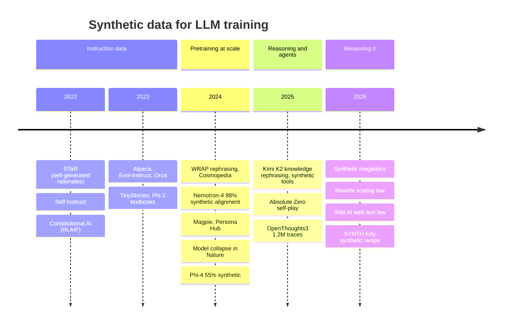
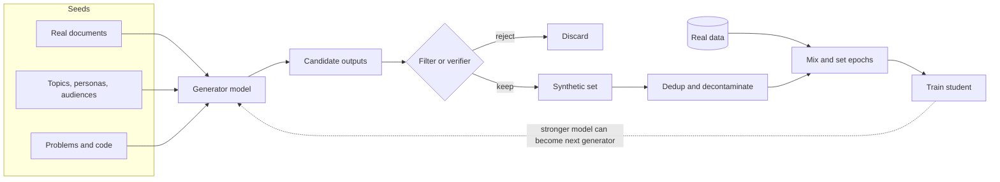

---
tags:
  - ai-ml
  - training
  - synthetic-data
  - data
  - post-training
  - model-collapse
status: draft
sources:
  - https://arxiv.org/abs/2212.10560
  - https://crfm.stanford.edu/2023/03/13/alpaca.html
  - https://arxiv.org/abs/2212.08073
  - https://arxiv.org/abs/2203.14465
  - https://arxiv.org/abs/2305.07759
  - https://arxiv.org/abs/2306.11644
  - https://arxiv.org/abs/2304.12244
  - https://arxiv.org/abs/2306.02707
  - https://arxiv.org/abs/2401.16380
  - https://huggingface.co/blog/cosmopedia
  - https://arxiv.org/abs/2404.01413
  - https://ideas.repec.org/a/nat/nature/v631y2024i8022d10.1038_s41586-024-07566-y.html
  - https://arxiv.org/abs/2406.11704
  - https://arxiv.org/html/2406.08464v2
  - https://arxiv.org/html/2406.20094v1
  - https://arxiv.org/abs/2406.07515
  - https://arxiv.org/abs/2410.04840
  - https://arxiv.org/pdf/2410.16713
  - https://arxiv.org/html/2412.08905v1
  - https://arxiv.org/abs/2412.02595
  - https://arxiv.org/html/2505.03335v3
  - https://arxiv.org/html/2506.04178v2
  - https://arxiv.org/html/2507.20534v2
  - https://arxiv.org/html/2512.20848v1
  - https://arxiv.org/pdf/2512.13961
  - https://arxiv.org/pdf/2603.18534
  - https://arxiv.org/html/2604.13977v1
  - https://arxiv.org/abs/2609.40295
  - https://arxiv.org/pdf/2609.37891
  - https://arxiv.org/html/2610.31867
  - https://huggingface.co/papers/2606.19348.md
  - https://microsoft.ai/news/frontier-pre-training-at-microsoft-ai/
  - https://www.preprints.org/manuscript/202611.1761
created: 2026-11-28
updated: 2026-11-28
---

## Table Of Contents

---

- [[#TL;DR|TL;DR]]
- [[#The Problem|The Problem]]
- [[#Foundations|Foundations]]
    - [[#Generator, Seed, Filter, Mix|Generator, Seed, Filter, Mix]]
    - [[#Where Synthetic Data Enters Training|Where Synthetic Data Enters Training]]
    - [[#Grounded vs Free Generation|Grounded vs Free Generation]]
    - [[#Verification|Verification]]
    - [[#Model Collapse|Model Collapse]]
- [[#How We Got Here|How We Got Here]]
- [[#How It Works|How It Works]]
    - [[#The Generate, Filter, Mix Loop|The Generate, Filter, Mix Loop]]
    - [[#Pretraining - Rephrasing and Textbooks|Pretraining - Rephrasing and Textbooks]]
    - [[#Instruction and Chat Data|Instruction and Chat Data]]
    - [[#Reasoning Traces by Sampling and Filtering|Reasoning Traces by Sampling and Filtering]]
    - [[#Self-Play and Generated Tasks|Self-Play and Generated Tasks]]
    - [[#Why Replacing Real Data Collapses and Accumulating Does Not|Why Replacing Real Data Collapses and Accumulating Does Not]]
    - [[#Choosing the Synthetic Fraction|Choosing the Synthetic Fraction]]
- [[#Where It Is Now|Where It Is Now]]
    - [[#Synthetic Shares in Disclosed Recipes|Synthetic Shares in Disclosed Recipes]]
    - [[#What 2026 Research Measured|What 2026 Research Measured]]
    - [[#The Web Is Turning Synthetic|The Web Is Turning Synthetic]]
    - [[#Fully Synthetic Training|Fully Synthetic Training]]
- [[#Trade-offs & Open Problems|Trade-offs & Open Problems]]
- [[#Resources|Resources]]
- [[#Related Notes|Related Notes]]

## ***TL;DR***
---
*Synthetic data is training text written by a model instead of a person: rewritten web pages, generated textbooks, instruction and chat pairs, reasoning traces, and tasks a model invents for itself. It now fills a large share of every stage of training, and the question has moved from "does it work" to "how much, made how, and checked how".*

- **What it is:** a pipeline of a generator model, seeds that steer it (real documents, topics, personas, problems), a filter or verifier that throws out bad outputs, and a mix that blends what survives with real data.
- **Why it took over:** good human text is finite (see [[Pretraining Data]]), human labels are slow and costly, and for math and code a program can check the answer, so a model can produce unlimited correct examples. Nemotron-4 340B's alignment data was "over 98%" synthetic ([NVIDIA, Jun 2024](https://arxiv.org/abs/2406.11704)); Phi-4 trained on about 55% synthetic and rewritten tokens ([Microsoft, Dec 2024](https://arxiv.org/html/2412.08905v1)).
- **The risk:** training each generation only on the previous one's output makes a model forget the rare parts of the data and narrow over time (model collapse). Keeping real data in the mix and accumulating rather than replacing data avoids it in every setting tested ([Kazdan et al., 2025](https://arxiv.org/pdf/2410.16713)).
- **Where it is now (Nov 2026):** the optimal share of synthetic rewrites in pretraining is interior and grows with compute, from under 10% to 32% across the budgets tested ([Roberts et al., Oct 2026](https://arxiv.org/html/2610.31867)); a fully synthetic 80B-token corpus trains small models that trail web-trained ones by a few points with 80x to 700x fewer tokens ([Pleias, Sep 2026](https://arxiv.org/pdf/2609.37891)); and about 27.5% to 31.1% of filtered web text is already AI-written, which hurts large models trained to match human text ([Russell et al., Sep 2026](https://arxiv.org/abs/2609.40295)).

## ***The Problem***
---
*Training needs far more good examples than people can write: trillions of pretraining tokens, millions of instruction pairs, hundreds of thousands of worked solutions. Synthetic data fills the gap, but a model's output carries its errors, its style and its blind spots into the next model.*

Three shortages push labs toward generated data:

| Shortage | Why it binds | What synthetic data offers |
|---|---|---|
| Unique high-quality text | The stock of usable public human text is about 300T tokens and is being used up between 2026 and 2032 ([[Pretraining Data]]); repeating data past about 4 epochs loses value | Rewrites give new token sequences from the same facts; generated textbooks target topics the web covers badly |
| Labeled examples for post-training | Instruction pairs, preference judgments and step-by-step solutions need skilled annotators | A strong model writes and grades them at API cost; Alpaca's 52K instructions cost under $500 to generate ([Stanford CRFM, Mar 2023](https://crfm.stanford.edu/2023/03/13/alpaca.html)) |
| Tasks with checkable answers | [[RL for Reasoning]] needs many problems at the right difficulty, with a verifier | Programs and models generate problems, solve them and check them in a loop ([[RL Environments and Verifiers]]) |

The catch is that a generator can only pass on what it has. Its mistakes become training targets, its favorite phrasings crowd out variety, and the rare cases it handles badly become rarer still. Every method below is a way to get the volume without paying that price.

## ***Foundations***
---
*Five ideas cover the field: the four parts of any synthetic pipeline, the stage of training where the data is used, whether generation is anchored to real content, how outputs get checked, and what model collapse is.*

#### **Generator, Seed, Filter, Mix**

| Part | What it is | Examples |
|---|---|---|
| Generator | The model that writes the data. Often larger than the student; for rephrasing, often small | GPT-4 for Persona Hub math; SmolLM2 1.7B for FinePhrase ([Niklaus et al., 2026](https://arxiv.org/html/2604.13977v1)) |
| Seed | What each generation call is conditioned on, which sets topic and diversity | A web page to rewrite, a topic cluster, a persona, a code snippet, a math problem |
| Filter or verifier | What decides which outputs to keep | Exact-answer match, unit tests, a reward model, an LLM judge, a fidelity check against the seed |
| Mix | How much of the training set is synthetic and how often it repeats | Phi-4: 40% synthetic seen 13.8 epochs, 15% web rewrites ([Microsoft, 2024](https://arxiv.org/html/2412.08905v1)) |

Diversity comes almost entirely from the seed. The same prompt sent a million times returns near-copies; varying the seed (a different document, persona or audience each time) is what spreads the data out.

#### **Where Synthetic Data Enters Training**

- **Pretraining and mid-training:** rewrites of web text, generated textbooks and exercises, synthetic QA and reasoning traces mixed into the late high-quality phase. Covered in depth in [[Pretraining Data]].
- **Supervised fine-tuning (SFT):** instruction-response pairs and multi-turn chats, now mostly written by other models. Training a small model on a big model's outputs is sequence-level [[Distillation]].
- **Preference data:** chosen and rejected responses, judged by a model instead of a person (RLAIF). Constitutional AI replaced human harmlessness labels with a model applying written principles ([Bai et al., Dec 2022](https://arxiv.org/abs/2212.08073)).
- **RL tasks:** generated problems, tools, simulated users and environments, scored by verifiers ([[RL Environments and Verifiers]]).

#### **Grounded vs Free Generation**

- **Grounded** generation transforms real content: rewrite this page as a Q&A, translate this article, explain this code. Facts come from the source; the model supplies form. This is the safest kind, because errors are limited to what the rewrite adds.
- **Free** generation invents content from a topic or persona: write a textbook chapter on X, write a hard math problem. It can cover gaps the web leaves, but every fact is only as good as the generator's knowledge.

Most production pipelines lean grounded. Kimi K2's knowledge rephrasing checks each rewritten chunk for "semantic alignment" with its source before training on it ([Kimi Team, Jul 2025](https://arxiv.org/html/2507.20534v2)).

#### **Verification**

A verifier turns a generator that is right some of the time into a dataset that is right most of the time. Exact checks (a math answer, a unit test, a program's output) are the strongest; model judges are weaker and can be gamed. Even imperfect verifiers help: Feng et al. showed that selecting synthetic data with a noisy verifier is enough to prevent the collapse that unfiltered data causes ([Feng et al., Jun 2024](https://arxiv.org/abs/2406.07515)). The surprise is that for distilling reasoning, filtering out wrong answers did not help: OpenThoughts found no verification method beat keeping all teacher answers ([Guha et al., 2025](https://arxiv.org/html/2506.04178v2)). The student seems to learn the reasoning style even from traces that end wrong.

#### **Model Collapse**

Shumailov et al. showed that "indiscriminate use of model-generated content in training causes irreversible defects": when each generation trains on the last one's output, the tails of the original distribution disappear first, then the distribution narrows toward a point ([Nature, Jul 2024](https://ideas.repec.org/a/nat/nature/v631y2024i8022d10.1038_s41586-024-07566-y.html)). The cause is compounding sampling error: a finite sample under-represents rare events, the next model learns them as rarer still, and nothing pushes them back. Whether collapse happens in practice depends on whether real data is kept, which the How It Works section works through.

## ***How We Got Here***
---
*Synthetic data went from a trick for instruction tuning in 2022, to textbook-style pretraining data in 2023, to the default for alignment and reasoning by 2024 and 2025. In 2026 the work turned to measuring exactly how much it is worth and how to keep the web's own AI text from degrading models.*

| Date | Step | Why it mattered | Source |
|---|---|---|---|
| Mar 2022 | STaR: generate rationales, keep those that reach the right answer, fine-tune, repeat | The first loop where a model trains on its own filtered reasoning, the ancestor of rejection-sampling SFT | [Zelikman et al.](https://arxiv.org/abs/2203.14465) |
| Dec 2022 | Self-Instruct: GPT-3 writes its own instructions and answers from a small seed set; 33% absolute gain over vanilla GPT-3 on Super-NaturalInstructions | Showed instruction data could be bootstrapped from the model itself | [Wang et al.](https://arxiv.org/abs/2212.10560) |
| Dec 2022 | Constitutional AI: a model critiques and revises its outputs against written principles, then judges preference pairs | Replaced human harmlessness labels with AI feedback | [Bai et al.](https://arxiv.org/abs/2212.08073) |
| Mar 2023 | Alpaca: 52K instructions from text-davinci-003, generated for under $500 | Started the wave of open chat models distilled from APIs | [Stanford CRFM](https://crfm.stanford.edu/2023/03/13/alpaca.html) |
| Apr to Jun 2023 | Evol-Instruct rewrites instructions to be harder and broader; Orca trains on GPT-4's step-by-step explanations | Difficulty and explanation depth, not just volume, drive quality | [Xu et al.](https://arxiv.org/abs/2304.12244), [Mukherjee et al.](https://arxiv.org/abs/2306.02707) |
| May to Jun 2023 | TinyStories: models under 10M parameters write fluent stories after training on GPT-generated children's stories; Phi-1 adds 1B synthetic textbook tokens | Generated, focused data can stand in for far larger web corpora at small scale | [Eldan & Li](https://arxiv.org/abs/2305.07759), [Gunasekar et al.](https://arxiv.org/abs/2306.11644) |
| Jan to Mar 2024 | WRAP rephrases C4 for about 3x faster pretraining; Cosmopedia releases 25B tokens of Mixtral-written textbooks and stories | Rewriting real text became the main pretraining use | [Maini et al.](https://arxiv.org/abs/2401.16380), [Hugging Face](https://huggingface.co/blog/cosmopedia) |
| Apr 2024 | "Is Model Collapse Inevitable?": accumulating synthetic data beside real data keeps error bounded | Reframed collapse as a property of the replace workflow | [Gerstgrasser et al.](https://arxiv.org/abs/2404.01413) |
| Jun 2024 | Nemotron-4 340B: over 98% of alignment data synthetic; Magpie and Persona Hub scale prompt diversity | Synthetic became the default for post-training | [NVIDIA](https://arxiv.org/abs/2406.11704), [Xu et al.](https://arxiv.org/html/2406.08464v2), [Ge et al.](https://arxiv.org/html/2406.20094v1) |
| Jul 2024 | Shumailov et al. in Nature: recursive training on generated data causes collapse | Made collapse a mainstream worry | [Nature](https://ideas.repec.org/a/nat/nature/v631y2024i8022d10.1038_s41586-024-07566-y.html) |
| Dec 2024 | Phi-4: 40% synthetic plus 15% web rewrites, synthetic data repeated 13.8 epochs | More epochs of synthetic data beat more fresh web tokens in its ablation | [Microsoft](https://arxiv.org/html/2412.08905v1) |
| May to Jul 2025 | Absolute Zero: one model proposes and solves its own code tasks; Kimi K2: knowledge rephrasing and 20,000+ synthetic tools | Data generation moved inside the RL loop | [Zhao et al.](https://arxiv.org/html/2505.03335v3), [Kimi Team](https://arxiv.org/html/2507.20534v2) |
| Jun 2025 (ICLR 2026) | OpenThoughts3: 1.2M reasoning traces from QwQ-32B; OpenThinker3-7B hits 53% on AIME 2025 | The most thorough public ablation of reasoning-data recipes | [Guha et al.](https://arxiv.org/html/2506.04178v2) |
| Mar to Oct 2026 | Megadocs, rewrite scaling laws, wild-AI-text laws, fully synthetic SYNTH | Moved from "it helps" to "how much is each token worth" | See [[#What 2026 Research Measured\|What 2026 Research Measured]] |

## ***How It Works***
---
*Every method follows the same loop: pick seeds, generate, check, mix with real data. What changes by stage is the seed (a page, a persona, a problem), the check (fidelity, a judge, a test) and how far the output strays from real text.*

#### **The Generate, Filter, Mix Loop**

The dotted edge is where collapse risk lives: if the student becomes the next generator and real data drops out of the mix, errors compound.

#### **Pretraining - Rephrasing and Textbooks**

[[Pretraining Data]] covers the formats and the FinePhrase ablations; the points that matter here:

- **Rephrase rather than invent.** WRAP rewrites real pages in Wikipedia-like or Q&A style; Nemotron-CC rephrases lower-quality documents to rescue them, about 2T tokens in all ([Su et al., 2024](https://arxiv.org/abs/2412.02595)); Nemotron 3 Nano adds about 2.1T new rephrased tokens ([NVIDIA, Dec 2025](https://arxiv.org/html/2512.20848v1)).
- **Rephrasings beat epochs.** Kimi K2's SimpleQA test, on an early checkpoint:

| Setup | Epochs | SimpleQA accuracy |
|---|---|---|
| Raw wiki text, no rephrasing | 10 | 23.76 |
| 1 rephrasing | 10 | 27.39 |
| 10 rephrasings | 1 | 28.94 |

*In plain English: seeing the same facts written ten different ways once beats seeing one wording ten times* ([Kimi Team, 2025](https://arxiv.org/html/2507.20534v2)).
- **Vary the audience to vary the text.** Cosmopedia crossed topics with four audiences (young children to researchers) and three formats, up to 12 prompts per topic ([Hugging Face, Mar 2024](https://huggingface.co/blog/cosmopedia)).
- **Output diversity beats tidy formatting.** In the 2026 Hugging Face study, SmolLM2 outputs trained better than Qwen3 outputs although 115 Qwen3 outputs shared one opening ([Niklaus et al., 2026](https://arxiv.org/html/2604.13977v1)).

#### **Instruction and Chat Data**

| Method | How it gets prompts | Result |
|---|---|---|
| Self-Instruct (2022) | Model writes new tasks from a few seed tasks, filtered for novelty | +33% absolute over vanilla GPT-3 on Super-NaturalInstructions ([Wang et al.](https://arxiv.org/abs/2212.10560)) |
| Evol-Instruct (2023) | Model rewrites each instruction to be deeper (add constraints, steps) or broader (new topic) | Harder data for the WizardLM models ([Xu et al.](https://arxiv.org/abs/2304.12244)) |
| Magpie (2024) | Give an aligned chat model only the start of a user turn; it writes a plausible user query itself, then answers it | 300K filtered pairs let Llama-3-8B base match or beat official Llama-3-8B-Instruct on AlpacaEval 2 (25.08% vs 22.92% LC), against over 10M examples for the official model ([Xu et al.](https://arxiv.org/html/2406.08464v2)) |
| Persona Hub (2024) | About 1.02 billion personas extracted from web text ("who would write this?") and expanded ("who is close to this person?"); each prompt is written from one persona | 1.07M persona-driven math problems took Qwen2-7B to 64.9% on MATH ([Ge et al.](https://arxiv.org/html/2406.20094v1)) |

The Magpie trick works because chat models were trained to predict whole conversations, user turns included. Persona Hub's authors flag the flip side: querying a model at scale with diverse personas can amount to extracting what it knows, the same concern behind the distillation-attack policies in [[Distillation]].

#### **Reasoning Traces by Sampling and Filtering**

The standard recipe for reasoning SFT data is rejection sampling: for each problem, sample $k$ solutions from a strong model and keep the ones that pass a check.

$$P(\text{at least one correct}) = 1 - (1 - p)^k$$

*In plain English: if the generator solves a problem with probability $p$ per try, sampling $k$ times gives you at least one usable trace with the probability above. Hard problems need many samples.* Example: a problem the teacher solves 10% of the time, sampled 16 times, yields at least one correct trace with probability $1 - 0.9^{16} \approx 1 - 0.185 = 0.815$.

What OpenThoughts3 found when it ablated every step ([Guha et al., 2025](https://arxiv.org/html/2506.04178v2)):

- **More answers per question is the big lever:** sampling several teacher answers per question multiplied the data at least 16x and drove the largest gains.
- **The best teacher is not the best model:** QwQ-32B beat DeepSeek-R1 as a teacher for math and code by 2.6 and 1.9 points on average, although R1 scores higher itself.
- **Fewer, better question sources:** one or two strong sources beat mixing 8 or 16.
- **Filter questions, not answers:** LLM-judged difficulty and response length beat fastText or embedding filters; filtering answers by correctness gave no significant gain.

The result, OpenThinker3-7B, scored 53% on AIME 2025, 51% on LiveCodeBench and 54% on GPQA Diamond, 15 to 21 points above DeepSeek-R1-Distill-Qwen-7B. How these traces relate to RL-trained reasoning is in [[Reasoning Models]] and [[RL for Reasoning]].

#### **Self-Play and Generated Tasks**

When the data is a task with a checkable answer, the model can make its own:

- **Absolute Zero (2025):** one model plays proposer and solver. The proposer writes (program, input, output) tasks of three kinds: deduction (predict the output), abduction (find an input), induction (write the program). A Python executor validates tasks and grades answers. The proposer is rewarded for tasks of moderate difficulty, since ones the solver always passes or always fails teach nothing. Trained on no human data, it beat prior "zero" reasoners trained on curated in-domain data by about 1.8 points on average, and coding-only training lifted math by 10.9 to 15.2 points ([Zhao et al.](https://arxiv.org/html/2505.03335v3)). The authors also report an "uh-oh moment": concerning chains of thought from the Llama 3.1 8B variant (see [[Chain-of-Thought Faithfulness and Monitorability]]).
- **Synthetic agents and tools (Kimi K2, 2025):** 3,000+ real MCP tools plus 20,000+ evolved synthetic tools, thousands of generated agents, rubric-scored tasks and simulated users, yielding "tens of thousands" of agentic training examples ([Kimi Team](https://arxiv.org/html/2507.20534v2)).
- **Synthetic RL environments:** Nemotron 3 Nano's structured-output (about 9K tasks) and long-context (about 12K tasks) environments were model-generated and model-judged ([NVIDIA, Dec 2025](https://arxiv.org/html/2512.20848v1)). The general machinery is in [[RL Environments and Verifiers]].

#### **Why Replacing Real Data Collapses and Accumulating Does Not**

The simplest model of collapse: fit a Gaussian to $n$ samples, sample $n$ new points from the fit, refit, and repeat. With the maximum-likelihood variance estimate,

$$\mathbb{E}\left[\hat\sigma^2_{t+1}\right] = \frac{n-1}{n}\,\sigma^2_t \quad\Rightarrow\quad \mathbb{E}\left[\hat\sigma^2_{t}\right] = \left(1 - \tfrac{1}{n}\right)^t \sigma^2_0$$

*In plain English: each generation's fit is a little narrower than the data it came from, and the narrowing compounds. Rare values far from the mean are the first to stop being sampled.* Example (illustrative): with $n = 100$ samples per generation, after 100 generations the expected variance is $0.99^{100} \approx 0.37$ of the original, so the spread has shrunk by about 40% in standard deviation. A bias-corrected estimator removes the average shrinkage but the variance still drifts toward zero, which is the formal result behind Shumailov et al.

Three workflows, compared by Kazdan et al. across Gaussians, kernel density estimation and LLM fine-tuning ([2025](https://arxiv.org/pdf/2410.16713)):

| Workflow | What each generation trains on | Outcome |
|---|---|---|
| Replace | Only the previous model's output | Degrades every generation in all settings |
| Accumulate | All real data plus every past generation's output | Test loss on real data stays bounded, even as the real share shrinks toward zero |
| Accumulate and subsample to a fixed size | A fixed-size sample of the growing pool | Degrades slower than replace and often plateaus above accumulate |

Two qualifiers keep this from being an all-clear. Dohmatob et al. found that in some regimes even about 1% synthetic data can stop loss from improving as the dataset grows ("strong model collapse"), and that larger models can amplify it ([Oct 2024](https://arxiv.org/abs/2410.04840)). And Kazdan et al. found the sign of the effect depends on real data: when real data is scarce, a modest amount of synthetic data lowers test loss; when real data is plentiful, adding synthetic data tends to raise it. The 2026 web-text results below show the same pattern at scale.

#### **Choosing the Synthetic Fraction**

Roberts et al. fit a scaling law in which the rewrite fraction $R$ (the share of training tokens that are synthetic rewrites) changes both the loss floor and the cost of a run ([Oct 2026](https://arxiv.org/html/2610.31867)):

$$L(N, D, R, T) = \frac{A}{N^{\alpha}} + \frac{B}{D^{\beta}} + E(R) + F(R, D, T)$$

$$C_{\text{total}} = 6ND + 4N_r\,D\,R$$

*In plain English: loss is the usual [[Scaling Laws]] terms in model size $N$ and tokens $D$, plus a floor $E(R)$ that rewrites can lower (more polished text) or raise (less real variety), plus a penalty $F$ for repeating the $T$ tokens of real seed data too many times. Generating rewrites costs compute too: about $2N_r$ FLOPs per token to read the source and $2N_r$ to write the output, for a rewriter of size $N_r$.*

Worked example (illustrative numbers): a 1B-parameter model on 20B tokens, with a 1.7B rewriter and $R = 0.32$.

- Training: $6 \times 10^9 \times 2 \times 10^{10} = 1.2 \times 10^{20}$ FLOPs.
- Rewriting: $4 \times 1.7 \times 10^9 \times 2 \times 10^{10} \times 0.32 \approx 4.4 \times 10^{19}$ FLOPs.
- Generation adds about 36% to the run, so the rewrites must lower loss by more than 36% more compute would.

What the fit found:

| Setting | Optimal rewrite fraction | Evidence |
|---|---|---|
| Compute-limited | Under 10% at $3\times10^{18}$ FLOPs, rising to 32% at $10^{22}$ | Fit up to $3\times10^{20}$ FLOPs predicted the $10^{22}$ runs within about 1.4% |
| Data-limited (3B target) | 0.13 at 3 epochs of real data, 0.71 at 24 epochs | The more you would have to repeat real data, the more rewrites pay |
| By task | Math and code toward 1.0; QA about 0.77; general text about 0.32 | Rewrites-only cut math bits-per-byte from 1.33 to 0.80 |
| By seed quality | A stronger real corpus (DCLM over FineWeb-Edu) gives a smaller but nonzero optimum | Rewrites help most where real data is weakest |

At $10^{22}$ FLOPs the $R = 0.32$ model nearly matched its own SmolLM2-1.7B rewriter (0.983 vs 0.972 macro bits-per-byte) with about a tenth of its training compute, and beat it on 10 of 16 test sources.

## ***Where It Is Now***
---
*As of November 2026, synthetic data is a large, disclosed share of open recipes at every stage, and research has started pricing it: rewrites are worth most when real data is scarce or repeated, AI text scraped from the web is worth less than human text and can be harmful, and small models can be trained on synthetic data alone.*

#### **Synthetic Shares in Disclosed Recipes**

| Model or dataset | Date | Synthetic share | Notes | Source |
|---|---|---|---|---|
| Nemotron-4 340B | Jun 2024 | Over 98% of alignment data | Generator and reward model released for others to use | [NVIDIA](https://arxiv.org/abs/2406.11704) |
| Phi-4 (14B) | Dec 2024 | 40% synthetic + 15% web rewrites of about 10T tokens | About 400B unique synthetic tokens across 50 dataset types, repeated 13.8 epochs | [Microsoft](https://arxiv.org/html/2412.08905v1) |
| Kimi K2 | Jul 2025 | Not stated as a share; rephrased knowledge and math in 15.5T tokens | Math rewritten in "learning-note" style; foreign-language math translated to English | [Kimi Team](https://arxiv.org/html/2507.20534v2) |
| Nemotron 3 Nano | Dec 2025 | Not stated as a share | About 2.1T rephrased web tokens, 31.7B STEM reasoning QA; SFT of over 18M samples generated by eight open models (GPT-OSS-120B, Qwen3, Kimi K2, DeepSeek-R1 and others) | [NVIDIA](https://arxiv.org/html/2512.20848v1) |
| Olmo 3 Dolmino mid-training | Dec 2025 | About 57.5% of the 100B mix is marked synthetic (summed from the report's table) | Synthetic math, code, QA, thinking traces and instructions | [AI2](https://arxiv.org/pdf/2512.13961) |
| DeepSeek-V4 | Jun 2026 | Not stated | Filters batched, templated auto-generated web pages to reduce collapse risk | [DeepSeek-AI](https://huggingface.co/papers/2606.19348.md) |
| MAI Base 2 (Microsoft) | Oct 2026 | None claimed | Advertised as "organic data which does not involve distillation from other models" | [Microsoft AI](https://microsoft.ai/news/frontier-pre-training-at-microsoft-ai/) |

Closed frontier labs do not disclose shares. Among open recipes the pattern is consistent: synthetic data dominates post-training, is a large minority of pretraining and a majority of mid-training, and is mostly grounded in real seeds.

#### **What 2026 Research Measured**

- **Megadocs (Stanford, Mar 2026):** group all rewrites of one real document into a single long document instead of shuffling them apart. On a 300M model with 200M real tokens, plain rephrasing (32 per document) gave 1.48x data efficiency; stitched rewrites 1.64x; inserting generated "latent thoughts" between pieces of the original 1.80x, with downstream accuracy up about 9% ([Kim, Kotha et al.](https://arxiv.org/pdf/2603.18534)). Small-scale, single-group result.
- **Rewrite scaling law (Princeton, Stanford, Jane Street, Oct 2026):** the optimal synthetic fraction is interior and grows with compute and repetition, as above ([Roberts et al.](https://arxiv.org/html/2610.31867)).
- **Rephrasing recipe (Hugging Face, Apr 2026):** structured formats (math, table, FAQ, tutorial) beat plain rewrites, generators past about 1B add little, and synthetic data never beats synthetic mixed with real ([Niklaus et al.](https://arxiv.org/html/2604.13977v1)).
- **Surveys:** a November 2026 survey sums up the state of the field the same way: accumulation avoids collapse, replacement does not, and verifiable rewards have made synthetic reasoning data central ([Fakher et al., Nov 2026](https://www.preprints.org/manuscript/202611.1761); not peer-reviewed).

#### **The Web Is Turning Synthetic**

Synthetic data is no longer only something labs choose to add. Russell et al. used the Pangram detector on filtered web crawls and labeled about 27.5% of June 2026 tokens as AI-generated, rising to 31.1% by August ([Sep 2026](https://arxiv.org/abs/2609.40295)). Across 800 pretraining runs:

- **Data-starved models** gain from AI text at first; the gain flattens and then turns to harm.
- **Models with plenty of human text** get worse almost immediately from added AI text, where the same number of fresh human tokens keeps helping.
- **Their law** adds separate benefit and harm terms to Chinchilla, so an AI token's value can turn negative; fit on small models it predicts models 3.6x larger with 41% lower error than the best prior law.
- **Advice:** filter AI text when the target is human text, repeat human text before adding web AI text, and report loss on human and AI text separately. They released the WildAI corpus (83B labeled tokens) and all 800 models.

This is the uncontrolled version of synthetic data: no seed, no verifier, no chosen generator. It is why DeepSeek-V4 filters templated machine-generated pages, and why "synthetic" in a recipe should mean deliberate, checked generation.

#### **Fully Synthetic Training**

Pleias's SYNTH corpus is about 80B tokens in 8 languages, generated by small fine-tuned models from about 58,000 Wikipedia "vital" and specialist articles, covering memorization QA, retrieval, arithmetic, editing, creative writing and reasoning traces in one single-stage mix ([Pleias, Sep 2026](https://arxiv.org/pdf/2609.37891)):

| Finding | Number |
|---|---|
| Baguettotron-600M vs Qwen3-0.6B | Trails by 4.7 points on multiple-choice and 0.7 on open-ended tasks, with 80x to 700x fewer tokens |
| Same budget of web data instead | No valid multiple-choice answers before post-training; 11 to 17 points behind after |
| Removing reasoning traces | Up to about 10 points lost on truthfulness and domain reasoning; factual recall largely unchanged |
| Abstention on entities outside the seeds | 67% for Baguettotron-MoE vs 7% for web-trained OLMoE-1B-7B-Instruct |

The limits are stated plainly: knowledge is capped by the 58,000 seeds, the models lag on benchmarks that reward broad web knowledge, and comparisons use baselines with different architectures and tokenizers. It shows that synthetic-only works for small models aimed at grounded, honest answering, not that it scales to frontier breadth. The Baguettotron-MoE model (13.2B total, 1.05B active) is a [[Mixture of Experts]].

## ***Trade-offs & Open Problems***
---
*Synthetic data trades the cost and scarcity of human data for the generator's limits and a collapse risk. The open questions are how to value a synthetic token before training on it, how to keep diversity at scale, and what happens as the web itself fills with model text.*

| Trade-off | Gain | Cost | Where evidence sits |
|---|---|---|---|
| Grounded rewrite vs free generation | Rewrites keep real facts; free generation fills topical gaps | Rewrites inherit source gaps; free text inherits generator errors | Most production pipelines lean grounded (Kimi K2, Nemotron-CC) |
| Big vs small generator | Big ones write harder, more correct content | Cost; for rephrasing, gains stop past about 1B | [Niklaus et al.](https://arxiv.org/html/2604.13977v1); OpenThoughts' best teacher was not the strongest model |
| Synthetic share | Lower loss when real data is scarce or repeated | Higher loss when real data is plentiful; strong-collapse regimes | [Roberts et al.](https://arxiv.org/html/2610.31867), [Kazdan et al.](https://arxiv.org/pdf/2410.16713), [Dohmatob et al.](https://arxiv.org/abs/2410.04840) |
| Filtering answers | Removes wrong facts and broken code | Costs samples; did not help reasoning distillation | [Feng et al.](https://arxiv.org/abs/2406.07515) vs [OpenThoughts](https://arxiv.org/html/2506.04178v2) |
| Self-generated tasks | Unlimited, difficulty on demand | Narrow distributions; possible unsafe behavior | [Absolute Zero](https://arxiv.org/html/2505.03335v3) |

- **No price tag before training:** there is still no reliable way to tell what a synthetic token is worth without training on it. The 2026 laws fit after the fact and stop well below frontier scale.
- **Diversity at scale:** generators repeat themselves. Seeds, personas and audience variation help, but measured output diversity, not volume, is what separated good and bad rephrasing data.
- **Benchmark contamination:** generators trained on benchmark-like web text can reproduce test items in "new" data; n-gram decontamination misses paraphrases.
- **Inherited style and values:** a student learns its teacher's tone, refusals and biases along with its knowledge, and the survey literature notes that even small synthetic fractions can affect fairness ([Fakher et al.](https://www.preprints.org/manuscript/202611.1761)).
- **Provenance and licensing:** synthetic data from a commercial model may break its terms of service (see [[Distillation]]), and some labs now market models as trained without it.
- **The polluted commons:** as AI text grows past 30% of filtered web data, detecting and down-weighting it becomes part of every pretraining pipeline, and detectors themselves have errors.

## ***Resources***
---
*Start with Shumailov and Kazdan for the collapse question, the Phi-4 report for a production pretraining recipe, and OpenThoughts for reasoning data. The 2026 papers by Roberts, Russell and Pleias are the current measurements.*

**Papers: methods**
- [Self-Instruct](https://arxiv.org/abs/2212.10560): Wang et al., Dec 2022. Bootstrapping instruction data from the model itself.
- [STaR](https://arxiv.org/abs/2203.14465): Zelikman et al., Mar 2022. Training on self-generated rationales that reach the right answer.
- [Constitutional AI](https://arxiv.org/abs/2212.08073): Bai et al. (Anthropic), Dec 2022. AI feedback in place of human harmlessness labels.
- [WizardLM / Evol-Instruct](https://arxiv.org/abs/2304.12244): Xu et al., Apr 2023. Evolving instructions for depth and breadth.
- [Orca](https://arxiv.org/abs/2306.02707): Mukherjee et al. (Microsoft Research), Jun 2023. Learning from explanation traces.
- [TinyStories](https://arxiv.org/abs/2305.07759): Eldan & Li (Microsoft Research), May 2023. Tiny models on generated stories.
- [Textbooks Are All You Need](https://arxiv.org/abs/2306.11644): Gunasekar et al. (Microsoft Research), Jun 2023. Phi-1.
- [Rephrasing the Web (WRAP)](https://arxiv.org/abs/2401.16380): Maini et al., Jan 2024.
- [Magpie](https://arxiv.org/html/2406.08464v2): Xu et al., Jun 2024 (ICLR 2025). Alignment data from a bare chat template.
- [Scaling Synthetic Data Creation with 1,000,000,000 Personas](https://arxiv.org/html/2406.20094v1): Ge et al. (Tencent AI Lab), Jun 2024.
- [Absolute Zero](https://arxiv.org/html/2505.03335v3): Zhao et al., May 2025 (NeurIPS 2025). Self-play task proposal and solving.
- [OpenThoughts](https://arxiv.org/html/2506.04178v2): Guha et al., Jun 2025 (ICLR 2026 oral). Reasoning data recipes.

**Papers: collapse and value**
- [AI models collapse when trained on recursively generated data](https://ideas.repec.org/a/nat/nature/v631y2024i8022d10.1038_s41586-024-07566-y.html): Shumailov et al., Nature, Jul 2024.
- [Is Model Collapse Inevitable?](https://arxiv.org/abs/2404.01413): Gerstgrasser et al., Apr 2024. Accumulate vs replace.
- [Collapse or Thrive?](https://arxiv.org/pdf/2410.16713): Kazdan et al. (Stanford), Oct 2024, v4 Mar 2025.
- [Beyond Model Collapse: Scaling Up with Synthesized Data Requires Verification](https://arxiv.org/abs/2406.07515): Feng et al., Jun 2024.
- [Strong Model Collapse](https://arxiv.org/abs/2410.04840): Dohmatob et al., Oct 2024.
- [Data-efficient pre-training by scaling synthetic megadocs](https://arxiv.org/pdf/2603.18534): Kim, Kotha et al. (Stanford), Mar 2026.
- [How Can We Synthesize High-Quality Pretraining Data?](https://arxiv.org/html/2604.13977v1): Niklaus et al. (Hugging Face), Apr 2026.
- [How Much Is an AI Token Worth?](https://arxiv.org/abs/2609.40295): Russell et al., Sep 2026. Wild AI web text and its scaling law.
- [It's All Training: A Fully Synthetic Single-Stage Recipe for LLMs](https://arxiv.org/pdf/2609.37891): Pleias et al., Sep 2026. SYNTH and Baguettotron.
- [Rewriting Scaling Laws for Synthetic Data with Compute and Data Constraints](https://arxiv.org/html/2610.31867): Roberts, Ahmed et al., Oct 2026.

**Model reports with synthetic-data sections**
- [Nemotron-4 340B](https://arxiv.org/abs/2406.11704): NVIDIA, Jun 2024.
- [Phi-4](https://arxiv.org/html/2412.08905v1): Microsoft, Dec 2024.
- [Kimi K2](https://arxiv.org/html/2507.20534v2): Moonshot AI, Jul 2025.
- [Nemotron 3 Nano](https://arxiv.org/html/2512.20848v1): NVIDIA, Dec 2025.
- [Olmo 3](https://arxiv.org/pdf/2512.13961): AI2, Dec 2025.

**Explainers and surveys**
- [Cosmopedia: how to create large-scale synthetic data for pre-training](https://huggingface.co/blog/cosmopedia): Hugging Face, Mar 2024.
- [Synthetic Data Generation in the Era of Large Language Models](https://www.preprints.org/manuscript/202611.1761): Fakher, Prantl, Bauer, Nov 2026. Survey, not peer-reviewed.

## ***Related Notes***
---
*Synthetic data sits between the data notes and the post-training notes: it extends pretraining data, it is how distillation is done at the sequence level, and it supplies the tasks RL trains on.*

- [[Pretraining Data]] — The pipelines synthetic rewrites plug into, and the data wall that makes them necessary.
- [[Distillation]] — SFT on a teacher's generated outputs is sequence-level distillation; terms-of-service limits apply.
- [[RL for Reasoning]] — Generated problems and verifiable rewards feed the RL loop.
- [[RL Environments and Verifiers]] — Synthetic tasks, tools and simulated users, and how verifiers score them.
- [[Reasoning Models]] — STaR, rejection sampling and distilled reasoning traces.
- [[Scaling Laws]] — The base laws that the synthetic-fraction and wild-AI-text laws extend.
- [[Chain-of-Thought Faithfulness and Monitorability]] — Self-play training produced concerning reasoning in Absolute Zero.
- [[Long Context]] — Synthetic long-document tasks used to extend context windows.
- [[Mixture of Experts]] — Baguettotron-MoE and most models in the recipe table are MoE.
