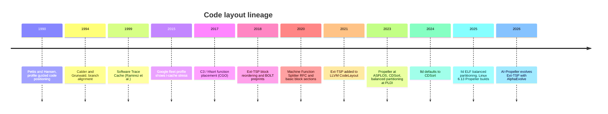
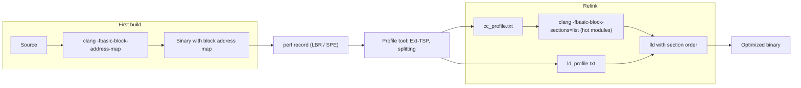

---
tags:
  - compilers
  - code-layout
  - basic-block-placement
  - function-ordering
  - hot-cold-splitting
  - ext-tsp
  - bolt
  - propeller
  - pgo
  - llvm
  - gcc
  - lld
status: complete
sources:
  - https://www.doi.org/10.1145/989393.989433
  - https://www.cs.cornell.edu/courses/cs6120/2019fa/blog/profile-guided-code-layout
  - https://cseweb.ucsd.edu/~calder/abstracts/ASPLOS-94.html
  - https://arxiv.org/pdf/1809.04676
  - https://research.facebook.com/blog/2021/12/improving-the-performance-of-large-scale-applications-via-basic-block-reordering/
  - https://research.facebook.com/publications/optimizing-function-placement-for-large-scale-data-center-applications-2/
  - https://research.fb.com/wp-content/uploads/2017/01/cgo2017-hfsort-final1.pdf
  - https://llvm.googlesource.com/lld/+/refs/heads/release_70/ELF/CallGraphSort.cpp
  - https://lists.llvm.org/pipermail/llvm-commits/Week-of-Mon-20230612/1168472.html
  - https://llvm.org/docs/doxygen/CodeLayout_8cpp_source.html
  - https://github.com/llvm/llvm-project/blob/main/llvm/lib/CodeGen/MachineBlockPlacement.cpp
  - https://github.com/llvm/llvm-project/blob/main/llvm/include/llvm/Transforms/Utils/CodeLayout.h
  - https://github.com/llvm/llvm-project/blob/main/lld/ELF/Options.td
  - https://github.com/llvm/llvm-project/blob/main/lld/docs/ld.lld.1
  - https://releases.llvm.org/23.1.0/tools/lld/docs/ReleaseNotes.html
  - https://releases.llvm.org/23.1.0/docs/ReleaseNotes.html
  - https://arxiv.org/abs/2211.09285
  - https://ar5iv.labs.arxiv.org/html/2211.09285
  - https://llvm.org/devmtg/2024-04/slides/TechnicalTalks/Hoag-TemporalProfiling-and-OrderfileOptimization-forMobileApps.pdf
  - https://lists.llvm.org/pipermail/llvm-commits/Week-of-Mon-20250203/1560571.html
  - https://lists.llvm.org/pipermail/llvm-dev/2020-August/144012.html
  - https://llvm.org/doxygen/MachineFunctionSplitter_8cpp_source.html
  - https://lists.llvm.org/pipermail/cfe-commits/Week-of-Mon-20260202/803637.html
  - https://llvm.org/docs/doxygen/BasicBlockSections_8cpp_source.html
  - https://gnu.googlesource.com/gcc/+/refs/heads/master/gcc/bb-reorder.cc
  - https://llvm.googlesource.com/llvm-project.git/+/refs/heads/main/bolt/docs/CommandLineArgumentReference.md
  - https://research.facebook.com/file/534990324471927/BOLT-A-Practical-Binary-Optimizer-for-Data-Centers-and-Beyond.pdf
  - https://research.google/pubs/propeller-a-profile-guided-relinking-optimizer-for-warehouse-scale-applications/
  - https://discourse.llvm.org/t/rfc-upstreaming-propeller-profile-conversion-tool/89173
  - https://docs.kernel.org/6.13/dev-tools/propeller.html
  - https://arxiv.org/html/2606.00131v1
  - https://research.google/pubs/ai-propeller-warehouse-scale-inter-procedural-code-layout-optimization-with-alphaevolve/
  - https://research.google/pubs/profiling-a-warehouse-scale-computer/
  - https://research.google/pubs/asmdb-understanding-and-mitigating-front-end-stalls-in-warehouse-scale-computers/
  - https://mail.openjdk.org/pipermail/hotspot-runtime-dev/2025-December/083350.html
  - https://learn.microsoft.com/en-us/dotnet/core/whats-new/dotnet-10/runtime
created: 2026-11-26
updated: 2026-11-27
---

## Table Of Contents

- [[#TL;DR|TL;DR]]
- [[#The Problem|The Problem]]
- [[#Foundations|Foundations]]
    - [[#Where Code Layout Costs Time|Where Code Layout Costs Time]]
    - [[#Three Granularities - Blocks, Functions, Fragments|Three Granularities - Blocks, Functions, Fragments]]
    - [[#Layout as a Graph Problem|Layout as a Graph Problem]]
    - [[#Chains, Density and Greedy Merging|Chains, Density and Greedy Merging]]
- [[#How We Got Here|How We Got Here]]
- [[#How It Works|How It Works]]
    - [[#Block Placement in LLVM|Block Placement in LLVM]]
    - [[#Ext-TSP - Scoring a Block Order|Ext-TSP - Scoring a Block Order]]
    - [[#Measured - GCC Hot and Cold Partitioning|Measured - GCC Hot and Cold Partitioning]]
    - [[#Hot and Cold Splitting|Hot and Cold Splitting]]
    - [[#Function Ordering - Pettis-Hansen, C3 and CDSort|Function Ordering - Pettis-Hansen, C3 and CDSort]]
    - [[#Measured - lld Call-Graph Sorting|Measured - lld Call-Graph Sorting]]
    - [[#Balanced Partitioning - Startup and Compressed Size|Balanced Partitioning - Startup and Compressed Size]]
    - [[#Post-Link Layout - BOLT and Propeller|Post-Link Layout - BOLT and Propeller]]
    - [[#AI-Propeller - Evolving the Heuristic|AI-Propeller - Evolving the Heuristic]]
    - [[#Layout in JITs|Layout in JITs]]
- [[#Where It Is Now|Where It Is Now]]
- [[#Trade-offs & Open Problems|Trade-offs & Open Problems]]
- [[#Resources|Resources]]
- [[#Related Notes|Related Notes]]

## ***TL;DR***
---
*Code layout decides where each basic block and each function sits in the final binary. The instructions are the same either way; what changes is how many taken branches the CPU executes, how many instruction-cache lines and pages the hot code touches, and, on phones, how many pages are faulted in at startup and how well the binary compresses.*

- **Three levels.** *Block placement* orders the blocks inside a function so the likely successor falls through; *hot/cold splitting* moves never-run blocks out of the function into a far-away section; *function ordering* puts functions that call each other often next to each other so hot code shares cache lines and pages.
- **All of it is graph ordering with profile weights.** Ordering blocks to maximize fall-throughs is the maximum traveling salesman problem, which is NP-hard. Every practical tool is a greedy *chain-merging* heuristic: Pettis and Hansen (PLDI 1990) for blocks and functions, C3/hfsort (CGO 2017) and CDSort (2023) for functions, Ext-TSP (2018) for blocks ([Newell and Pupyrev](https://arxiv.org/pdf/1809.04676)).
- **Gains are a few percent on large programs, near zero on small ones.** Pettis-Hansen function ordering gave 2.6% and C3 a further 2.9% on Facebook's data-center apps ([Ottoni and Maher](https://research.fb.com/wp-content/uploads/2017/01/cgo2017-hfsort-final1.pdf)); Ext-TSP gave 0.5 to 1% over earlier block heuristics in production and 2 to 4% on Clang ([Newell and Pupyrev](https://arxiv.org/pdf/1809.04676)); Google's Machine Function Splitter cut Clang's iTLB misses by 31.7% for a 2.33% speedup ([Kumar, 2020](https://lists.llvm.org/pipermail/llvm-dev/2020-August/144012.html)).
- **Measured here:** with a GCC 13 profile, a checked-sum loop's function shrank from 157 bytes to a 78-byte hot part, with the error path moved to `.text.unlikely`; with lld's call-graph sort, five hot functions went from spanning 24,014 bytes over 5 pages to 953 bytes on 1 page.
- **As of November 2026:** lld sorts by call graph with CDSort by default and offers balanced-partitioning orders for startup and compression; Ext-TSP block placement is still off by default inside LLVM's compiler pipeline but is the default in BOLT and Propeller; Google proposed upstreaming Propeller's profile tool in December 2025; and *AI-Propeller* (June 2026) used AlphaEvolve to evolve the Ext-TSP heuristic itself, gaining 1.6% on Clang over Propeller ([arXiv 2606.00131](https://arxiv.org/html/2606.00131v1)).

## ***The Problem***
---
*A CPU fetches instructions in cache lines and pages, and pays for every taken branch. Large programs execute a small hot fraction of their code, but a naive layout scatters that hot fraction among cold code, so the front end stalls on misses that better placement would avoid.*

Compilers emit code roughly in source order: blocks in the order the front end created them, functions in the order they appear in files, files in the order the linker sees them. That order says nothing about what runs. A function might be 60% error handling that never executes, sitting between the two halves of its own hot loop; two functions that call each other a billion times might end up megabytes apart because they live in different source files.

For a small program this does not matter: everything fits in the 32 to 64 KiB L1 instruction cache and a handful of TLB entries. For server binaries with hundreds of megabytes of text it matters a great deal. Google's fleet-wide study found that typical workloads "place significant stress on instruction caches" ([Kanev et al., ISCA 2015](https://research.google/pubs/profiling-a-warehouse-scale-computer/)); a follow-up described "frequent instruction cache misses and costs in the millions of dollars" from large instruction working sets ([AsmDB, ISCA 2019](https://research.google/pubs/asmdb-understanding-and-mitigating-front-end-stalls-in-warehouse-scale-computers/)). In the Machine Function Splitter RFC, Google reported that in roughly half of their hottest functions "more than 50% of the code bytes are never executed" ([Kumar, 2020](https://lists.llvm.org/pipermail/llvm-dev/2020-August/144012.html)).

Layout cannot remove an instruction. It can only:

| Lever | What it changes | Hardware it helps |
|---|---|---|
| **Fall-throughs** | The likely successor follows directly, so the common path takes no branch | Fetch bandwidth, branch target buffer, decoded-instruction cache |
| **Hot-code density** | Hot blocks and hot functions packed together, cold code moved away | L1i and L2 cache lines, iTLB entries |
| **Call distance** | Caller and callee in the same line or page | iTLB, prefetchers |
| **Startup order** | Functions first touched at startup placed together | Page faults on mobile and desktop cold start |
| **Similarity order** | Similar functions adjacent | LZ-style compression of the app download |

The difficulty is that layout needs to know what is hot, which is exactly what static compilation does not know. Code layout is the original consumer of [[Profile-Guided Optimization]], and it is why post-link optimizers like BOLT and Propeller exist (see [[Linking and LTO]]).

## ***Foundations***
---
*Four ideas carry the topic: which hardware structures layout affects, the three granularities at which it is done, the graph problem underneath, and the chain-merging heuristic that every tool uses to approximate it.*

### Where Code Layout Costs Time

*The front end of a modern core fetches aligned chunks, predicts branches, and translates addresses. Layout decides how often each of these goes wrong.*

- **Taken branches.** A fetch unit reads a block of bytes per cycle. A taken branch ends the useful part of that block and redirects fetch, even when predicted correctly. A fall-through costs nothing extra. So the common path should be a straight line.
- **Cache lines.** A 64-byte line holds about 15 to 20 x86 instructions. If a hot loop body shares its lines with cold error code, part of every line fetched is wasted, and the hot code needs more lines.
- **Pages and the iTLB.** Every 4 KiB page of code executed needs an instruction TLB entry. Spreading hot functions over many pages causes iTLB misses; this is why C3 limits clusters to a page and why BOLT can put hot text on 2 MiB huge pages (`--hugify`) ([BOLT options](https://llvm.googlesource.com/llvm-project.git/+/refs/heads/main/bolt/docs/CommandLineArgumentReference.md)).
- **Static prediction.** When a branch has no history, the classic static rule is to guess backward branches taken and forward branches not taken. Layout that puts the likely successor as the fall-through and cold code forward makes the static guess right.

Layout also shows up in performance models: tools that predict a block's throughput assume a layout, and see [[Microarchitectural Performance Models]] for how front-end costs are modeled.

### Three Granularities - Blocks, Functions, Fragments

*Layout decisions are made at three sizes, by different parts of the toolchain.*

| Granularity | Decision | Done by |
|---|---|---|
| **Basic blocks within a function** | Order of blocks; which successor falls through | Compiler back end (LLVM MachineBlockPlacement, GCC `bb-reorder`), BOLT |
| **Fragments of a function** | Split a function into a hot part and one or more cold parts in other sections | Compiler (GCC `-freorder-blocks-and-partition`, LLVM `-fsplit-machine-functions`), BOLT `--split-functions`, Propeller |
| **Functions within a binary** | Order of whole functions or fragments | Linker (`--symbol-ordering-file`, `--call-graph-profile-sort`, order files), BOLT `--reorder-functions` |

The compiler can only reorder inside one function. The linker sees every function but treats each as an opaque section. Post-link tools see the final machine code and can do all three at once, and Propeller's *basic block sections* let the linker reorder pieces of functions too ([BasicBlockSections.cpp](https://llvm.org/docs/doxygen/BasicBlockSections_8cpp_source.html)).

### Layout as a Graph Problem

*A control-flow graph with edge counts is a weighted directed graph; a layout is an ordering of its nodes; the quality of a layout is a sum over edges that depends on where each edge's endpoints landed.*

Given a [[Intermediate Representations|control-flow graph]] whose edges carry profile counts $w(s,t)$, the classic goal is to choose an order of blocks that maximizes the total weight of edges that become fall-throughs. Each block can fall through to at most one successor and be fallen into from at most one predecessor, so the fall-through edges form a set of disjoint paths. Maximizing their weight is a *maximum path cover*, equivalent to the maximum directed traveling salesman problem. Newell and Pupyrev note that Boesch and Gimpel had already cast it this way, and that TSP is "a widely studied NP-hard combinatorial optimization problem" ([Newell and Pupyrev](https://arxiv.org/pdf/1809.04676)).

The fall-through objective ignores everything except adjacency. Two refinements matter in practice:

- **Distance.** A short jump inside the same cache line is nearly as good as a fall-through; a jump 10 KiB away is not. Ext-TSP scores jumps by length.
- **Size.** A hot block that is large uses more cache than a hot block that is small, so ordering by *density* (count per byte) beats ordering by count.

For functions, the graph is the call graph and an edge's weight is the number of calls. Calls never "fall through", so the objective is purely about distance: keep frequent caller-callee pairs within a cache line or page.

### Chains, Density and Greedy Merging

*Every production algorithm builds chains of nodes and greedily merges the pair that gains most, then orders the remaining chains by density.*

The template, from Pettis and Hansen ([CS 6120 explainer](https://www.cs.cornell.edu/courses/cs6120/2019fa/blog/profile-guided-code-layout)):

1. Start with every block (or function) as its own chain.
2. Visit edges from heaviest to lightest. If the edge's source is the last node of one chain and its target is the first node of another, concatenate the chains.
3. When no more merges apply, order the chains, hottest or densest first, keeping the entry block's chain first.

Density is the sort key that keeps the hottest bytes together:

$$\text{density}(C) = \frac{\sum_{v \in C} \text{count}(v)}{\sum_{v \in C} \text{size}(v)}$$

**In plain English:** a chain's density is how much execution happens per byte of it. Sorting by density puts the code that earns the most execution per byte of cache first.

What later algorithms change is what "gain" means (fall-through weight, a distance-weighted score, a cache-miss estimate), how two chains may be joined (only end-to-start, or also by splitting one and inserting the other), and when to stop (a size limit, or when no merge improves the score).

## ***How We Got Here***
---
*The core algorithm is from 1990. What changed since is the objective (from fall-throughs to cache-aware scores), the scale (from single programs to fleets), and where layout runs (compiler, then linker, then post-link, now machine-searched heuristics).*



| Year | Work | What it added |
|---|---|---|
| 1990 | Pettis and Hansen, "Profile guided code positioning" ([PLDI '90](https://www.doi.org/10.1145/989393.989433)) | The three techniques still used: procedure ordering ("closest is best" on a weighted call graph), basic-block chaining, and procedure splitting of never-executed code |
| 1994 | Calder and Grunwald, "Reducing Branch Costs via Branch Alignment" ([ASPLOS VI](https://cseweb.ucsd.edu/~calder/abstracts/ASPLOS-94.html)) | Reordering blocks specifically to reduce branch cost on pipelined CPUs |
| 1999 | Ramirez, Larriba-Pey, Navarro, Torrellas, Valero, "Software Trace Cache" | Trace-building layout that also duplicates code; still GCC's block algorithm at -O2 and -Os (`-freorder-blocks-algorithm=stc`, checked with GCC 13) ([bb-reorder.cc](https://gnu.googlesource.com/gcc/+/refs/heads/master/gcc/bb-reorder.cc)) |
| 2015 | Kanev et al., "Profiling a warehouse-scale computer" ([ISCA](https://research.google/pubs/profiling-a-warehouse-scale-computer/)) | Fleet evidence that instruction caches, not just data, bottleneck server code |
| 2017 | Ottoni and Maher, C3 and hfsort ([CGO](https://research.fb.com/wp-content/uploads/2017/01/cgo2017-hfsort-final1.pdf)) | Directed call graph, page-sized clusters, selective huge pages; 2.6% (PH) and a further 2.9% (C3) |
| 2018 | Newell and Pupyrev, Ext-TSP ([arXiv](https://arxiv.org/pdf/1809.04676); IEEE TC 2020) | A distance-aware objective, chain splitting, and a near-optimal heuristic |
| 2019 | BOLT at CGO ([Panchenko et al.](https://research.facebook.com/file/534990324471927/BOLT-A-Practical-Binary-Optimizer-for-Data-Centers-and-Beyond.pdf)) | Layout applied to the final binary; see [[Linking and LTO]] |
| 2020 | Machine Function Splitter ([RFC](https://lists.llvm.org/pipermail/llvm-dev/2020-August/144012.html)); basic block sections | Profile-driven splitting late in codegen; linker-visible block clusters for Propeller |
| 2023 | Propeller ([ASPLOS](https://research.google/pubs/propeller-a-profile-guided-relinking-optimizer-for-warehouse-scale-applications/)); CDSort ([D152840](https://lists.llvm.org/pipermail/llvm-commits/Week-of-Mon-20230612/1168472.html)); Hoag et al. balanced partitioning ([PLDI](https://arxiv.org/abs/2211.09285)) | Relinking instead of rewriting; a cache-model function sort; layout for startup and compressed size |
| 2026 | AI-Propeller ([arXiv 2606.00131](https://arxiv.org/html/2606.00131v1)) | An LLM-driven evolutionary search rewrites the layout heuristic and tunes its constants |

Two shifts stand out. First, the objective moved from "count fall-throughs" to models of the cache: Ext-TSP rewards short jumps, CDSort estimates misses in a small cache of pages. Second, layout moved later in the pipeline because the profile is most accurate on the final binary, and later still into search, where the heuristic itself is the thing being optimized (see [[ML-Guided Optimization]]).

## ***How It Works***
---
*First block placement inside the compiler and the Ext-TSP objective, then a measured GCC example of hot and cold partitioning, splitting in LLVM, function ordering with a measured lld example, layout for startup and size, post-link tools, the 2026 machine-evolved heuristic, and what JITs do.*

### Block Placement in LLVM

*LLVM's MachineBlockPlacement builds chains loop by loop using branch probabilities, keeping the source order unless the profile says otherwise. Ext-TSP is available but still opt-in.*

The pass header describes its goals: it "strives to preserve the structure of the CFG (that is, retain a topological ordering of basic blocks) in the absence of a *strong* signal to the contrary from probabilities". It "works from the inner-most loop within a function outward", coalescing blocks "into sequential chains where allowed by the CFG (or demanded by heavy probabilities)" ([MachineBlockPlacement.cpp](https://github.com/llvm/llvm-project/blob/main/llvm/lib/CodeGen/MachineBlockPlacement.cpp)).

Without a profile, the probabilities come from static heuristics (`__builtin_expect`, loop back edges likely, calls to `noreturn` functions unlikely). With a profile, they come from counts. The same pass also performs *tail duplication during placement* (on by default, `tail-dup-placement`), which copies a small join block into its predecessors to create more fall-throughs, and loop alignment. Loop rotation, which moves the loop test to the bottom so the back edge is the only taken branch, is discussed in [[Loop Optimizations]].

Ext-TSP lives in `llvm/lib/Transforms/Utils/CodeLayout.cpp` and is used by BOLT and Propeller. Inside the normal compiler pipeline, `-enable-ext-tsp-block-placement` still defaults to `false` on LLVM main as read on 26 November 2026; there are knobs to cap it for huge functions (`ext-tsp-block-placement-max-blocks`) and to apply it when optimizing for size (`apply-ext-tsp-for-size`) ([CodeLayout.cpp](https://llvm.org/docs/doxygen/CodeLayout_8cpp_source.html); [MachineBlockPlacement.cpp](https://github.com/llvm/llvm-project/blob/main/llvm/lib/CodeGen/MachineBlockPlacement.cpp)).

### Ext-TSP - Scoring a Block Order

*Ext-TSP gives each profiled edge a score that is full for a fall-through, small and decreasing with distance for a short jump, and zero for a long one. The algorithm greedily merges chains, trying six ways to combine each pair.*

For an edge $s \to t$ with count $w(s,t)$, let $d$ be the jump distance in bytes from the end of $s$ to the start of $t$. The paper's objective is ([Newell and Pupyrev](https://arxiv.org/pdf/1809.04676)):

$$
\text{ExtTSP} = \sum_{(s,t)} w(s,t) \times
\begin{cases}
1 & d = 0 \text{ (fall-through)} \\
0.1\left(1 - \dfrac{d}{1024}\right) & 0 < d \le 1024,\ t \text{ after } s \\
0.1\left(1 - \dfrac{d}{640}\right) & 0 < d \le 640,\ t \text{ before } s \\
0 & \text{otherwise}
\end{cases}
$$

**In plain English:** a fall-through earns its full count; a jump forward of up to 1,024 bytes (16 cache lines) or backward of up to 640 bytes (10 lines) earns up to a tenth of its count, less the farther it goes; anything farther earns nothing. Maximizing the score makes hot edges fall through and keeps the rest close. Setting the jump coefficients to zero recovers plain TSP, which is why the problem stays NP-hard.

LLVM's implementation uses the same distances (1,024 and 640 bytes) and weights of 0.1 for jumps, but gives unconditional fall-throughs a weight of 1.05 against 1.0 for conditional ones, caps chains at 512 blocks, and only splits chains of up to 128 blocks ([CodeLayout.cpp](https://llvm.org/docs/doxygen/CodeLayout_8cpp_source.html)).

The heuristic differs from Pettis-Hansen in one important way. To merge chains $X$ and $Y$, it splits $X$ at every position into $X_1 X_2$ and tries all six orders of $X_1$, $X_2$ and $Y$, discarding any that do not keep the entry block first ([CodeLayout.cpp](https://llvm.org/docs/doxygen/CodeLayout_8cpp_source.html)). This lets it insert a hot inner path into the middle of an existing chain.

How close to optimal is it? The authors solved the exact problem as a mixed-integer program for 2,992 HHVM functions of at most 30 blocks. The solver proved optimality in 2,963 cases; Ext-TSP matched the optimum in 2,914 of those (98.3%), and in the other 49 it was on average 0.14% below. The exact solver averaged over 10 seconds per 30-block function; the heuristics took under a millisecond ([Newell and Pupyrev](https://arxiv.org/pdf/1809.04676)).

| Algorithm (in BOLT) | Ext-TSP score gain on HHVM vs. original order |
|---|---|
| Top-down Pettis-Hansen (`tsp`) | 27% |
| Bottom-up Pettis-Hansen (`ph`) | 29% |
| Chains sorted by density (`cache`) | 29% |
| Ext-TSP | 31% |

In production at Facebook, Ext-TSP was worth "close to 1% for Multifeed2 and around 0.5% for HHVM and Proxygen" over the earlier heuristics, and block reordering alone gave Clang "2%-4%" on top of PGO and LTO ([Newell and Pupyrev](https://arxiv.org/pdf/1809.04676)). The [[Profile-Guided Optimization]] note works through Ext-TSP scores for one function by hand.

### Measured - GCC Hot and Cold Partitioning

*A real build: GCC 13 at -O2 on x86-64, with and without an instrumented profile, on a loop that validates its input and never sees bad input in training.*

```c
__attribute__((noinline)) long checked_sum(const long *a, long n) {
  long s = 0;
  for (long i = 0; i < n; i++) {
    long v = a[i];
    if (v < 0) {                       /* rare: never true in training */
      report("negative", i, v);
      if (v < -1000) { report("very negative", i, v); abort(); }
      v = -v;
      s -= 1;
    }
    s += v;
  }
  return s;
}
```

Built with `gcc -O2 -fprofile-generate`, trained on 100,000 non-negative values, then rebuilt with `-fprofile-use` and linked with GNU ld. Symbol sizes from `nm -S`:

| Build | `checked_sum` | Cold part | Section of hot part |
|---|---|---|---|
| `-O2` | 157 bytes, one piece | none | `.text` |
| `-O2 -fprofile-use` | 78 bytes | `checked_sum.cold`, 87 bytes | `.text.hot` (cold part in `.text.unlikely`) |

The profile build's hot function, from `objdump -d` on the linked binary:

```
0000000000001270 <checked_sum>:
    1270:  endbr64
    1274:  push   %r14
    ...                                     ; 4 more pushes, setup
    127c:  test   %rsi,%rsi
    127f:  jle    10fd <checked_sum.cold>   ; n <= 0: cold
    ...
    1298:  mov    0x0(%rbp,%r13,8),%r14     ; v = a[i]
    129d:  test   %r14,%r14
    12a0:  js     1105 <checked_sum.cold+0x8>  ; v < 0: jump to cold part
    12a6:  add    $0x1,%r13                 ; i++
    12aa:  add    %r14,%r12                 ; s += v
    12ad:  cmp    %rbx,%r13
    12b0:  jne    1298 <checked_sum+0x28>   ; loop back
    12b2:  pop    %rbx
    ...
    12bd:  ret
```

What changed:

- **The error path left the function.** Both `report` calls, the `abort`, and the negation now live in `checked_sum.cold` in `.text.unlikely`. The never-called `report` helper also moved there, and so did a 29-byte `main.cold`. GNU ld's default script collects `*(.text.unlikely .text.*_unlikely .text.unlikely.*)` from every object at the start of `.text`, then `.text.startup`, then `.text.hot`, then ordinary `.text` (from `ld --verbose`), so in a large program all the cold fragments end up together, far from hot code.
- **The hot loop is a straight line.** Without a profile, GCC laid out the loop so the hot path took a backward `jns` every iteration and the cold block sat right after the loop body. With a profile, the rare branch is a forward `js` to another section, statically predicted not taken, and the only taken branch per iteration is the loop's own `jne`. Both versions take one branch per iteration; the gain here is footprint, not branch count.
- **Same answer.** Both binaries print `102274195200`.

A loop this small fits in the L1 cache either way, so no speedup should be expected here. The point is the mechanism: across a whole server binary, every function shedding its cold half is what cuts iTLB and i-cache misses.

### Hot and Cold Splitting

*Splitting moves cold blocks out of a function's body. LLVM has two ways to do it: an IR pass that outlines cold regions into new functions, and a late codegen pass that moves cold blocks into another section and jumps to them.*

| | HotColdSplitting (IR) | Machine Function Splitter (MFS) | GCC partitioning |
|---|---|---|---|
| **When** | Middle end, on LLVM IR | After register allocation | During `bb-reorder`, with a profile |
| **What moves** | Single-entry single-exit cold regions, extracted into new functions | Individual cold machine blocks | Cold blocks, into a `.cold` fragment |
| **Cost** | Call overhead, argument passing, possible spills | Only the jumps that already existed | Only jumps |
| **Flag** | `-mllvm -hot-cold-split` (off by default; verified with Clang 18) | `-fsplit-machine-functions` | `-freorder-blocks-and-partition` (enabled at -O2 in GCC 13; splits when blocks are known cold, e.g. from a profile) |

Kumar's MFS RFC argues for the late approach because outlining cold regions into functions can add spills, fills and setup and teardown code, while with MFS "No additional instructions are added to the function for setup/teardown". Cold blocks form one cluster per function in `.text.unlikely`. Results reported in the RFC: Clang bootstrap ran 2.33% faster with iTLB misses down from 1.28 to 0.87 per thousand instructions (31.7%); Google Search throughput improved 0.8 to 1.2% with 16 to 35% fewer iTLB misses on Skylake; SPEC CPU 2017 int rate gained 1.6% geomean on four benchmarks and lost 0.6% on the other four ([Kumar, 2020](https://lists.llvm.org/pipermail/llvm-dev/2020-August/144012.html)). With instrumented profiles, a block counts as cold if it falls below the profile summary's 99.995th percentile by default ([MachineFunctionSplitter.cpp](https://llvm.org/doxygen/MachineFunctionSplitter_8cpp_source.html)).

Splitting a function has costs beyond the jump. The cold fragment needs its own unwind information so exceptions and stack traces still work (see [[Stack Unwinding and Exception Tables]]); a fragment far away may need longer branch encodings or linker thunks on AArch64 and RISC-V; and debuggers and profilers must understand that one function now has two address ranges.

### Function Ordering - Pettis-Hansen, C3 and CDSort

*The linker sees each function as a section and can place them in any order. Three generations of algorithms decide the order from a weighted call graph.*

**Pettis-Hansen (1990).** Build an *undirected* call graph weighted by call counts. Repeatedly merge the two clusters joined by the heaviest edge, choosing among the four ways of joining two ordered lists the one that puts the two connected functions closest ("closest is best").

**C3, Call-Chain Clustering (2017).** Ottoni and Maher found "a fundamental weakness" in PH: "the call graph used by PH is undirected", so it does not distinguish callers from callees, which "can lead to sub-optimal results" ([CGO 2017](https://research.fb.com/wp-content/uploads/2017/01/cgo2017-hfsort-final1.pdf)). C3 uses the directed graph: visit functions from hottest down, and append each to the cluster of its most likely *caller*, so a callee is laid out right after the call site that reaches it. lld's implementation describes it as "Pick the highest weighted input section then add it to its most likely predecessor", refusing merges that would make the cluster's density more than 8 times worse (`MAX_DENSITY_DEGRADATION = 8`) or the cluster larger than 1 MiB, then sorting clusters by density ([lld CallGraphSort.cpp](https://llvm.googlesource.com/lld/+/refs/heads/release_70/ELF/CallGraphSort.cpp)). The paper itself sets the merge threshold to "the page size". Results: 2.6% average from PH, a further 2.9% "on top of PH" from C3, and a further 2.0% from mapping only the hot text onto huge pages; mapping all 133 MB of HHVM's text onto huge pages without sorting doubled iTLB misses and lost 1.15%.

$$\text{merge } C_{\text{callee}} \text{ into } C_{\text{caller}} \iff \text{density}(C_{\text{caller}} \cup C_{\text{callee}}) \ge \tfrac{1}{8}\,\text{density}(C_{\text{caller}}) \text{ and } |C_{\text{caller}}| + |C_{\text{callee}}| \le 1\,\text{MiB}$$

**In plain English:** attach a hot function to the cluster of the function that calls it most, unless that would dilute the cluster's hotness too much or make it too big to stay cache- and page-friendly. (This is lld's rule; the constants are lld's, not the paper's.)

**CDSort, Cache-Directed Sort (2023).** CDSort keeps the chain-merging skeleton but scores a merge with a model: a distance term, where each call contributes $\text{count} \times d^{-p}$ with $p = 0.25$, plus a frequency term that estimates misses in a small cache of 16 entries of 2,048 bytes ([CodeLayout.h](https://github.com/llvm/llvm-project/blob/main/llvm/include/llvm/Transforms/Utils/CodeLayout.h); [CodeLayout.cpp](https://llvm.org/docs/doxygen/CodeLayout_8cpp_source.html)). Its patch reported gains "on top of C^3" of 0.3% to 0.8% on Clang and 0.8% to 1.5% on RocksDB, both built with LTO and sampled PGO ([D152840](https://lists.llvm.org/pipermail/llvm-commits/Week-of-Mon-20230612/1168472.html)).

The profile reaches the linker through the object files: Clang records weighted caller-callee pairs from PGO in a `.llvm.call-graph-profile` section, or the user passes a text file with `--call-graph-ordering-file`. An explicit order from any tool can be given with `--symbol-ordering-file` (ELF) or `-order_file` (Mach-O).

### Measured - lld Call-Graph Sorting

*A real link: lld 18 with each sorting algorithm, on eight functions whose hot ones are separated by large cold ones in source order, and a hand-written call graph.*

```c
F(lex, 200)            /* hot */
F(usage_error, 4000)   /* cold */
F(parse, 300)          /* hot */
F(dump_stats, 6000)    /* cold */
F(eval, 250)           /* hot */
F(config_load, 5000)   /* startup only */
F(lookup, 150)         /* hot */
F(crash_report, 8000)  /* cold */
```

Each `F(name, n)` is a `noinline` function padded with `n` bytes of `nop`. Compiled with `clang -O2 -ffunction-sections`, linked with `-fuse-ld=lld -Wl,--call-graph-ordering-file=cg.txt -Wl,--call-graph-profile-sort=<alg>`, where `cg.txt` gives `parse lex 90000`, `eval lookup 80000`, `parse lookup 5000`, `main parse 1000`, `main eval 1000`, `main config_load 1` (hand-written weights, not a real profile). Addresses from `nm -n`:

| `none` (input order) | `hfsort` (C3) | `cdsort` (default) |
|---|---|---|
| `0x1790 lex` | `0x16a0 main` | `0x16a0 eval` |
| `0x1860 usage_error` | `0x16c0 eval` | `0x17a0 lookup` |
| `0x2810 parse` | `0x17c0 lookup` | `0x1840 main` |
| `0x2940 dump_stats` | `0x1860 parse` | `0x1860 parse` |
| `0x40c0 eval` | `0x1990 lex` | `0x1990 lex` |
| `0x41c0 config_load` | `0x1a60 config_load` | `0x1a60 config_load` |
| `0x5550 lookup` | `0x2ee0 usage_error` | `0x2ee0 usage_error` |
| `0x55f0 crash_report` | `0x3e90 dump_stats` | `0x3e90 dump_stats` |
| `0x7540 main` | `0x5610 crash_report` | `0x5610 crash_report` |

| Layout | Span of the five hot functions | 64-byte lines touched | 4 KiB pages touched |
|---|---|---|---|
| `none` | 24,014 bytes | 17 | 5 |
| `hfsort` | 953 bytes | 16 | 1 |
| `cdsort` | 953 bytes | 16 | 1 |

**In plain English:** both sorts pack the 934 bytes of hot code onto a single page, against five pages in source order. Cache lines barely change because each function already started on its own 16-byte-aligned address; the win is pages, which is iTLB pressure. The two algorithms differ only in where `main`, which is called once, goes. Functions missing from the profile (the cold ones) keep their input order after the sorted ones.

### Balanced Partitioning - Startup and Compressed Size

*On phones, the costs are page faults at cold start and the size of the compressed download. Both depend on function order, and both are solved by recursive balanced graph partitioning rather than chain merging.*

Hoag, Lee, Mestre and Pupyrev (Meta, PLDI 2023) target two goals: "the compressed code size and the cold start-up time of a mobile application" ([arXiv 2211.09285](https://arxiv.org/abs/2211.09285)).

- **Why order changes compressed size.** Lempel-Ziv compressors replace a repeated byte sequence with a pointer to an earlier copy, but only within a sliding window much smaller than the binary. Placing similar functions next to each other puts more repeats inside one window. Their proxy, the number of distinct k-mers per window, correlated with real compressed size at "ρ>0.95" ([PLDI 2023](https://ar5iv.labs.arxiv.org/html/2211.09285)).
- **Why order changes startup.** Functions first executed during startup, placed together, are faulted in with fewer pages. Temporal profiling records that first-execution order (see [[Profile-Guided Optimization]]).
- **The algorithm.** Build a bipartite graph of functions and *utility* vertices: for compression, one per instruction that appears in at least two functions; for startup, one per (trace, threshold) pair, connected to the functions that run within that prefix of the trace. Split the functions in half, then improve the split with Kernighan-Lin-style swaps to minimize a log-gap cost, and recurse on each half:

$$\text{cost} = \sum_{u \in U} \Big( -L_u \log(L_u + 1) - R_u \log(R_u + 1) \Big)$$

**In plain English:** $L_u$ and $R_u$ count how many of utility $u$'s functions ended up in the left and right halves. The cost is lowest when each utility's functions are concentrated on one side, so functions that share instructions, or that run together at startup, end up near each other at every level of the recursion.

Results: "up to 2% compressed size reduction and up to 3% start-up time improvement on top of the state-of-the-art approach", with the layout step 20 times faster on one app ([arXiv](https://arxiv.org/abs/2211.09285)). In lld these are the `--bp-startup-sort=function` (using `--irpgo-profile`) and `--bp-compression-sort` options, first in the Mach-O port and added to ELF in early 2025 ([commit 6ab034b](https://lists.llvm.org/pipermail/llvm-commits/Week-of-Mon-20250203/1560571.html); [Options.td](https://github.com/llvm/llvm-project/blob/main/lld/ELF/Options.td)).

### Post-Link Layout - BOLT and Propeller

*Post-link tools apply the same algorithms to the final binary, where the profile maps exactly to the code being laid out. The [[Linking and LTO]] note covers how each works; here is what each does for layout.*

| Layout step | BOLT option | Propeller |
|---|---|---|
| Block order | `--reorder-blocks=ext-tsp` (also `normal`, `branch-predictor`, `cache`, `cache+`) | Ext-TSP, per function |
| Splitting | `--split-functions` with `--split-strategy=profile2` (hot/cold) or `cdsplit` (hot/warm/cold) | Function splitting through basic block sections |
| Function order | `--reorder-functions=hfsort`, `cdsort`, `pettis-hansen`, `exec-count`, `user` | Linker order of block-cluster sections |
| Huge pages | `--hugify`, `--hot-text` | None |
| Data | `--reorder-data` (by read counts or by hot function) | None |

Options from the [BOLT command-line reference](https://llvm.googlesource.com/llvm-project.git/+/refs/heads/main/bolt/docs/CommandLineArgumentReference.md).

Propeller's trick is *basic block sections*: with `-fbasic-block-sections=list`, "every function may be split into clusters of basic blocks. Every cluster will be emitted into a separate section", with a symbol at its start "to allow the linker to reorder the sections in any arbitrary sequence", so "a global order of these sections would encapsulate the function layout" ([BasicBlockSections.cpp](https://llvm.org/docs/doxygen/BasicBlockSections_8cpp_source.html)). Layout becomes a linker problem over block clusters, and only the hot modules need re-codegen. Propeller reported 1.1% to 8% beyond PGO and ThinLTO, about 7% on Clang and 1% on MySQL, with 30% to 70% less memory than a binary rewriter ([ASPLOS 2023](https://research.google/pubs/propeller-a-profile-guided-relinking-optimizer-for-warehouse-scale-applications/)).



The profile tool's outputs are `cc_profile.txt` for the compiler and `ld_profile.txt` for lld, per Google's December 2025 RFC to upstream it into LLVM ([RFC](https://discourse.llvm.org/t/rfc-upstreaming-propeller-profile-conversion-tool/89173)).

### AI-Propeller - Evolving the Heuristic

*Instead of hand-tuning Ext-TSP, Google let an LLM-driven evolutionary search rewrite the layout code and a black-box tuner set its constants, scoring every candidate by real run time.*

AI-Propeller (Ananda, Gupta, Trofin, Grossman, Tallam, David Li and Yazdanbakhsh, UC Riverside and Google; June 2026) applies the Magellan framework, AlphaEvolve for code edits plus Vizier for parameters, to Propeller's block layout ([arXiv 2606.00131](https://arxiv.org/html/2606.00131v1); [Google Research](https://research.google/pubs/ai-propeller-warehouse-scale-inter-procedural-code-layout-optimization-with-alphaevolve/)). What the search changed:

| Knob | Ext-TSP | Evolved, for Clang |
|---|---|---|
| Chain split threshold | 0 | 213 |
| Forward jump window | 1,024 bytes | 3,059 bytes |
| Backward jump window | 680 bytes | 1,159 bytes |
| Ordering | Blocks sorted within each function | A global layout index, so blocks of different functions can interleave |

(The paper lists Propeller's backward window as 680 bytes; LLVM's default is 640.)

- **Results.** 1.6% faster Clang, which the paper says "further squeezes more than 20%" of Propeller's original 7.3% gain; 0.23% on Google Search over the deployed Ext-TSP; front-end stall share on Clang fell from 45% to 39% and on Redis from 49% to 34.2%.
- **Where the gain comes from.** Forcing each function's blocks back together cut Clang's gain from 1.6% to about 0.3%: about 80% of the speedup comes from *interleaving* hot blocks of different functions, the interprocedural layout Propeller had labeled future work.
- **Cost.** Training took 2.7 days on 100 Clang modules, with 12 AlphaEvolve iterations and 1,200 Vizier trials, measured on real Skylake hardware with turbo, SMT and ASLR off.

This is the same pattern as Magellan's inliner work in [[ML-Guided Optimization]]: the output is ordinary C++ heuristic code, but it is scored by benchmarks, not proved better (see the evaluator discussion in [[Program Synthesis]] and [[Reward Hacking in Code Benchmarks]]).

### Layout in JITs

*A JIT compiles code at different times into a shared code cache, so hot code ends up wherever free space was. JITs fight this with segmented code caches and, now, relocation of hot methods.*

A [[JIT Compilation|JIT]] lays out blocks within a compiled method like an ahead-of-time compiler, often with better profiles because they come from the running process. .NET 10's JIT replaced its reverse-postorder starting layout with a model of block reordering as "a reduction of the asymmetric Travelling Salesman Problem" solved with the 3-opt heuristic, to improve "hot path density" and reduce branch distances ([What's new in the .NET 10 runtime](https://learn.microsoft.com/en-us/dotnet/core/whats-new/dotnet-10/runtime)). Placement *across* methods is harder: methods arrive in compilation order, are freed by deoptimization or unloading, and leave holes. HotSpot splits its code cache into segments by tier, and a 2025 to 2026 OpenJDK change under review (JDK-8326205, Chad Rakoczy) adds an experimental `HotCodeHeap` segment: a sampling thread wakes every 300 seconds by default, samples for 120 seconds, and relocates the hottest C2-compiled methods and their callees together until they cover 80% of samples. The author reported "up to a 20% latency reduction" for an internal service with a 512 MB code cache ([hotspot-runtime-dev](https://mail.openjdk.org/pipermail/hotspot-runtime-dev/2025-December/083350.html)).

## ***Where It Is Now***
---
*As of November 2026: the algorithms are settled (Ext-TSP for blocks, CDSort or C3 for functions, balanced partitioning for mobile), the action is in getting accurate profiles to them on every platform, in interprocedural block layout, and in machine-searched heuristics.*

- **lld (LLVM 18 onward).** `--call-graph-profile-sort` accepts `none`, `hfsort` and `cdsort`, and "cdsort (default)" ([ld.lld.1](https://github.com/llvm/llvm-project/blob/main/lld/docs/ld.lld.1)); verified on lld 18 locally. ELF gained the balanced-partitioning options in early 2025, and lld 23.1 added `--bp-compression-sort-section=<glob>[=<layout_priority>[=<match_priority>]]`, replacing the older `--bp-compression-sort` modes and letting users group sections and run partitioning per group, in both ELF and Mach-O ([lld 23.1 notes](https://releases.llvm.org/23.1.0/tools/lld/docs/ReleaseNotes.html)).
- **LLVM codegen.** Ext-TSP block placement remains opt-in (`-enable-ext-tsp-block-placement=false` on main, read 26 November 2026). A February 2026 patch proposes `-fsplit-machine-functions` for Mach-O on Arm64, placing cold blocks in `__TEXT,__text_cold` ([PR 179449](https://lists.llvm.org/pipermail/cfe-commits/Week-of-Mon-20260202/803637.html)).
- **BOLT (LLVM 23.1).** Block reordering, function splitting and branch inversion for the Armv9.6-A compare-and-branch instructions under a compact code model, plus AArch64 profiles from Arm SPE and BRBE ([LLVM 23.1 notes](https://releases.llvm.org/23.1.0/docs/ReleaseNotes.html)). Arm hardware branch sampling is what makes post-link layout practical off x86.
- **Propeller.** The Clang and lld halves are upstream; Google proposed upstreaming the roughly 10,000-line profile tool as `llvm-propeller` (name provisional) in December 2025 ([RFC](https://discourse.llvm.org/t/rfc-upstreaming-propeller-profile-conversion-tool/89173)). The Linux kernel has had a Propeller build option since 6.13 ([kernel docs](https://docs.kernel.org/6.13/dev-tools/propeller.html)).
- **GCC.** Block reordering still uses the Software Trace Cache algorithm, with hot and cold partitioning into `.text.unlikely` when a profile is present ([bb-reorder.cc](https://gnu.googlesource.com/gcc/+/refs/heads/master/gcc/bb-reorder.cc)); GNU ld's default script groups `.text.unlikely`, `.text.startup` and `.text.hot` (verified locally with GCC 13).
- **Research.** AI-Propeller (June 2026) shows interprocedural block interleaving is worth most of the remaining gain and that an evolved heuristic can beat hand-tuned Ext-TSP by 0.23% to 1.6% ([arXiv](https://arxiv.org/html/2606.00131v1)). Stale-profile matching, so layout survives code changes, is covered in [[Profile-Guided Optimization]].
- **JITs.** HotSpot's hot-code grouping is under review as an experimental feature (JDK-8326205), not yet in a release as far as the mailing list shows.

## ***Trade-offs & Open Problems***
---
*Layout is cheap to apply and hard to get right: it depends entirely on profile quality, gains are a few percent, and splitting code apart has costs that show up elsewhere in the toolchain.*

- **Profile dependence.** Without a profile, layout falls back to static guesses and can only do modest things. With a stale or unrepresentative profile, it can make the common case slower, because what it moved away as cold is now hot.
- **Small, noisy gains.** Typical wins are 0.5% to 3% per technique on large binaries and nothing on small ones. Measuring them needs quiet machines and many runs; AI-Propeller disabled turbo, SMT and ASLR to get 0.02% to 0.04% run-to-run variance.
- **Intra versus interprocedural.** The compiler sees one function; the linker sees opaque functions. Interleaving blocks of different functions, where AI-Propeller found most of its gain, needs basic block sections or binary rewriting, and breaks the assumption that a function is one contiguous range.
- **Tooling costs of splitting.** Every fragment needs unwind tables, debug ranges and symbol names (`foo.cold`, `foo.__part.1`); far fragments need long branches or thunks; profilers and crash reporters must map fragments back to functions.
- **Competing goals.** Speed wants hot code dense; mobile startup wants first-touched code together; download size wants similar code together. lld's priority groups in 23.1 let a build mix these per section group, but there is no single objective.
- **Reproducibility.** A profile-dependent layout means the same source gives different binaries depending on the training run; see [[Reproducible Builds]].
- **Huge pages are not free.** C3's authors found that putting all of HHVM's 133 MB of text on huge pages without sorting doubled iTLB misses; only hot, sorted text benefits.
- **Open:** cheap interprocedural block layout at fleet scale; layouts that adapt as the hot set shifts (the JIT approach, for AOT binaries); joint code and data layout; and whether learned or evolved heuristics stay ahead once hand-tuned ones absorb their tricks.

## ***Resources***
---
*Read Pettis and Hansen for the template, Ottoni and Maher for function ordering at scale, Newell and Pupyrev for the modern block objective, then the Propeller, MFS and balanced-partitioning work for where layout lives today. LLVM's CodeLayout.cpp is short and readable.*

**Primary papers**
- [Profile guided code positioning](https://www.doi.org/10.1145/989393.989433): Pettis and Hansen, PLDI 1990.
- [Optimizing Function Placement for Large-Scale Data-Center Applications](https://research.fb.com/wp-content/uploads/2017/01/cgo2017-hfsort-final1.pdf): Ottoni and Maher, CGO 2017 ([publication page](https://research.facebook.com/publications/optimizing-function-placement-for-large-scale-data-center-applications-2/)).
- [Improved Basic Block Reordering](https://arxiv.org/pdf/1809.04676): Newell and Pupyrev, IEEE Transactions on Computers 2020; [Meta blog summary](https://research.facebook.com/blog/2021/12/improving-the-performance-of-large-scale-applications-via-basic-block-reordering/).
- [Optimizing Function Layout for Mobile Applications](https://arxiv.org/abs/2211.09285): Hoag, Lee, Mestre, Pupyrev, PLDI 2023.
- [BOLT](https://research.facebook.com/file/534990324471927/BOLT-A-Practical-Binary-Optimizer-for-Data-Centers-and-Beyond.pdf): Panchenko, Auler, Nell, Ottoni, CGO 2019.
- [Propeller](https://research.google/pubs/propeller-a-profile-guided-relinking-optimizer-for-warehouse-scale-applications/): Shen et al., ASPLOS 2023.
- [AI-PROPELLER](https://arxiv.org/html/2606.00131v1): Ananda et al., arXiv June 2026.
- [Profiling a warehouse-scale computer](https://research.google/pubs/profiling-a-warehouse-scale-computer/) (Kanev et al., ISCA 2015) and [AsmDB](https://research.google/pubs/asmdb-understanding-and-mitigating-front-end-stalls-in-warehouse-scale-computers/) (Ayers et al., ISCA 2019): why the front end matters.

**Source code and documentation**
- [LLVM CodeLayout.cpp](https://llvm.org/docs/doxygen/CodeLayout_8cpp_source.html) (Ext-TSP and CDSort) and [CodeLayout.h](https://github.com/llvm/llvm-project/blob/main/llvm/include/llvm/Transforms/Utils/CodeLayout.h).
- [LLVM MachineBlockPlacement.cpp](https://github.com/llvm/llvm-project/blob/main/llvm/lib/CodeGen/MachineBlockPlacement.cpp), [MachineFunctionSplitter.cpp](https://llvm.org/doxygen/MachineFunctionSplitter_8cpp_source.html), [BasicBlockSections.cpp](https://llvm.org/docs/doxygen/BasicBlockSections_8cpp_source.html).
- [lld CallGraphSort.cpp](https://llvm.googlesource.com/lld/+/refs/heads/release_70/ELF/CallGraphSort.cpp) (C3), [lld ELF Options.td](https://github.com/llvm/llvm-project/blob/main/lld/ELF/Options.td), [ld.lld man page](https://github.com/llvm/llvm-project/blob/main/lld/docs/ld.lld.1).
- [GCC bb-reorder.cc](https://gnu.googlesource.com/gcc/+/refs/heads/master/gcc/bb-reorder.cc) (Software Trace Cache and partitioning).
- [BOLT command-line reference](https://llvm.googlesource.com/llvm-project.git/+/refs/heads/main/bolt/docs/CommandLineArgumentReference.md).
- [Linux kernel Propeller guide](https://docs.kernel.org/6.13/dev-tools/propeller.html).

**Proposals, talks and posts**
- [RFC: Machine Function Splitter](https://lists.llvm.org/pipermail/llvm-dev/2020-August/144012.html): Snehasish Kumar, 2020.
- [D152840: CDSort](https://lists.llvm.org/pipermail/llvm-commits/Week-of-Mon-20230612/1168472.html): Sergey Pupyrev, 2023.
- [Temporal Profiling and Orderfile Optimization for Mobile Apps](https://llvm.org/devmtg/2024-04/slides/TechnicalTalks/Hoag-TemporalProfiling-and-OrderfileOptimization-forMobileApps.pdf): Ellis Hoag, EuroLLVM 2024.
- [RFC: Upstreaming Propeller Profile Conversion Tool](https://discourse.llvm.org/t/rfc-upstreaming-propeller-profile-conversion-tool/89173): December 2025.
- [Profile-guided code layout in Bril](https://www.cs.cornell.edu/courses/cs6120/2019fa/blog/profile-guided-code-layout): Cornell CS 6120 student post implementing Pettis-Hansen chaining and C3.
- [JDK-8326205: Grouping frequently called C2 nmethods in CodeCache](https://mail.openjdk.org/pipermail/hotspot-runtime-dev/2025-December/083350.html): HotSpot review thread.
- Release notes: [LLVM 23.1](https://releases.llvm.org/23.1.0/docs/ReleaseNotes.html), [lld 23.1](https://releases.llvm.org/23.1.0/tools/lld/docs/ReleaseNotes.html).

## ***Related Notes***
---
*Where the profiles come from, the tools that apply layout, the passes it interacts with, and the hardware and runtime context.*

- [[Profile-Guided Optimization]] — Where the counts come from; temporal profiling, stale-profile matching and a hand-worked Ext-TSP example.
- [[Linking and LTO]] — How linkers, BOLT and Propeller work; layout is one of their main jobs.
- [[LLVM]] — MachineBlockPlacement, CodeLayout, MFS, lld and BOLT all live in the LLVM project.
- [[Instruction Scheduling]] — Orders instructions within a block, after layout has fixed the block order.
- [[Register Allocation]] — Spill placement uses the same block frequencies; splitting runs after allocation in MFS.
- [[Loop Optimizations]] — Loop rotation and alignment shape the blocks that placement orders.
- [[Classic Optimizations]] — Tail duplication and branch folding create and remove fall-through opportunities.
- [[Intermediate Representations]] — The control-flow graph that block placement orders.
- [[Compiler Pipeline]] — Layout runs at the end of codegen, in the linker and after linking.
- [[JIT Compilation]] — Code caches, tiering, and hot-code grouping in HotSpot.
- [[ML-Guided Optimization]] — MLGO, Magellan and AI-Propeller: learned and evolved compiler heuristics.
- [[Program Synthesis]] — AlphaEvolve as evaluator-scored program search.
- [[Microarchitectural Performance Models]] — Models of the front-end costs that layout reduces; uiCA's alignment-sensitive predictions.
- [[Stack Unwinding and Exception Tables]] — Planned: the unwind metadata every split fragment needs.
- [[Reproducible Builds]] — Planned: why profile-dependent layout complicates bit-identical builds.
- [[Reward Hacking in Code Benchmarks]] — The risks of scoring evolved heuristics by benchmarks.
- [[Calling Conventions and ABIs]] — Planned: cross-fragment and cross-function jumps must still respect the ABI.
