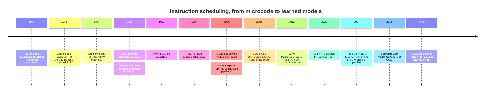
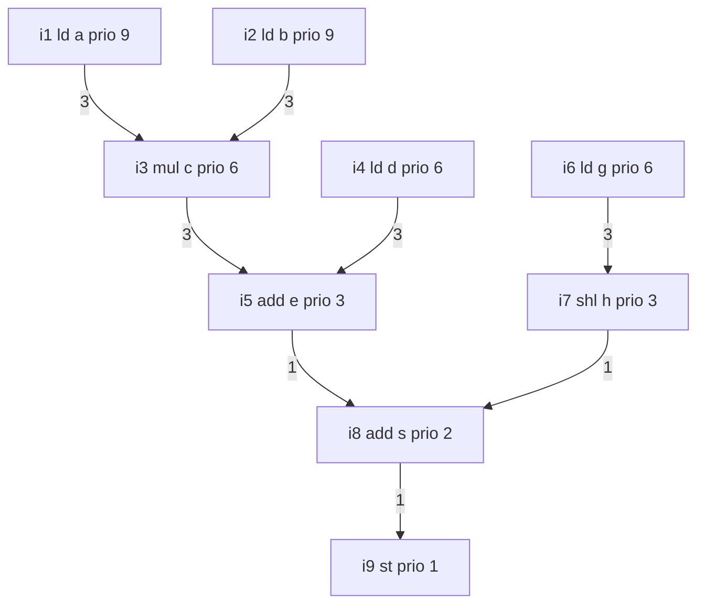

---
tags:
  - compilers
  - instruction-scheduling
  - code-generation
  - backend
  - list-scheduling
  - software-pipelining
  - modulo-scheduling
  - machine-models
status: complete
sources:
  - https://www.cs.cmu.edu/afs/cs/academic/class/15411-f19/www/lec/23-scheduling.pdf
  - https://www.cs.cornell.edu/courses/cs6120/2019fa/blog/instruction-scheduling
  - https://research.cs.wisc.edu/arch/uwarch-wiki2/index.php/PubsUWArch/B2hd-DBLPconficsGoodmanH88
  - https://web.eecs.umich.edu/~mahlke/courses/583f23/reading/chang-tc95.pdf
  - https://en.wikipedia.org/wiki/Trace_scheduling
  - https://en.wikipedia.org/wiki/Multiflow
  - https://www.doi.org/10.1007/BF01205182
  - https://web.eecs.umich.edu/~mahlke/courses/583f21/reading/hwu_jsuper93.pdf
  - https://fg-kastens.cs.uni-paderborn.de/lehre/pgrekonf/seminar/Lam1988.pdf
  - https://american.cs.ucdavis.edu/Micro27/html/abst7.html
  - https://web.eecs.umich.edu/~mahlke/courses/583f18/lectures/583L13.pdf
  - https://web.eecs.umich.edu/~mahlke/courses/583f18/lectures/583L14.pdf
  - https://core.ac.uk/download/87638302.pdf
  - https://cs.utexas.edu/~less/reading/spring00/ruttenberg.pdf
  - https://gnu.org/software/gcc/news/dfa.html
  - https://snapshots.sourceware.org/gcc/docs/latest/gccint/Processor-pipeline-description.html
  - https://gcc.opensuse.org/gcc-doxygen/haifa-sched_8cc.html
  - https://gcc.gnu.org/onlinedocs/gcc/Optimize-Options.html
  - https://gcc.gnu.org/gcc-16/changes.html
  - https://LLVM.org/devmtg/2012-11/Larin-Trick-Scheduling.pdf
  - https://llvm.org/devmtg/2025-10/slides/tutorials/hsu.pdf
  - https://llvm.swoogo.com/2025devmtg/session/3366622/scheduling-model-in-llvm-past-present-and-future
  - https://llvm.org/devmtg/2025-10/slides/technical_talks/hickey.pdf
  - https://llvm.org/docs/CommandGuide/llvm-mca.html
  - https://github.com/llvm/llvm-project/blob/main/llvm/lib/CodeGen/MachineScheduler.cpp
  - https://github.com/llvm/llvm-project/blob/main/llvm/include/llvm/CodeGen/MachineScheduler.h
  - https://github.com/llvm/llvm-project/blob/main/llvm/lib/CodeGen/TargetPassConfig.cpp
  - https://chromium.googlesource.com/external/github.com/emscripten-core/emscripten-fastcomp/+/2a333e6b14e94de7fa32dd0a772886d028515708/lib/CodeGen/MachinePipeliner.cpp
  - https://github.com/llvm/llvm-project/blob/main/llvm/lib/Target/Hexagon/HexagonTargetMachine.cpp
  - https://github.com/llvm/llvm-project/blob/main/llvm/lib/Target/ARM/ARMTargetMachine.cpp
  - https://github.com/llvm/llvm-project/blob/main/llvm/lib/Target/RISCV/RISCVSubtarget.cpp
  - https://github.com/llvm/llvm-project/blob/main/llvm/lib/Target/RISCV/RISCVSubtarget.h
  - https://github.com/llvm/llvm-project/blob/main/llvm/lib/Target/AArch64/AArch64Subtarget.cpp
  - https://github.com/llvm/llvm-project/blob/main/llvm/lib/Target/RISCV/RISCVSchedSiFiveP800.td
  - https://github.com/llvm/llvm-project/pull/79589
  - https://lists.llvm.org/pipermail/llvm-commits/Week-of-Mon-20241216/1528364.html
  - https://github.com/llvm/llvm-project/blob/main/llvm/lib/Target/RISCV/RISCVSchedSpacemitX60.td
  - https://github.com/llvm/llvm-project/blob/main/llvm/lib/Target/RISCV/RISCVSchedXiangShanKunMingHu.td
  - https://github.com/llvm/llvm-project/blob/main/llvm/lib/Target/AArch64/AArch64SchedOlympus.td
  - https://github.com/llvm/llvm-project/blob/main/llvm/lib/Target/Hexagon/HexagonGlobalScheduler.cpp
  - https://github.com/llvm/llvm-project/blob/main/llvm/lib/Target/SystemZ/SystemZMachineScheduler.cpp
  - https://discourse.llvm.org/t/rfc-tablegen-driven-macrofusion-predicators-generator/74912
  - https://github.com/llvm/llvm-project/blob/main/llvm/lib/Target/RISCV/RISCVMacroFusion.td
  - https://github.com/llvm/llvm-project/blob/main/llvm/lib/CodeGen/MacroFusion.cpp
  - https://easyperf.net/blog/2018/02/23/MacroFusion-in-Intel-CPUs
  - https://dougallj.github.io/applecpu/firestorm.html
  - https://releases.llvm.org/23.1.0/docs/ReleaseNotes.html
  - https://lists.llvm.org/pipermail/llvm-commits/Week-of-Mon-20251103/1774413.html
  - https://blogs.igalia.com/compilers/2025/11/22/unlocking-15-more-performance-a-case-study-in-llvm-optimization-for-risc-v/
  - https://www.tugraz.at/fileadmin/user_upload/Institute/ITI/world-risc-v-days/2026/7_presentation_llvm_scheduling.pdf
  - https://github.com/llvm/llvm-project/blob/main/llvm/lib/Target/AMDGPU/GCNSchedStrategy.h
  - https://www.llvm.org/doxygen/GCNCreateVOPD_8cpp_source.html
  - https://www.tomshardware.com/pc-components/gpus/amds-upcoming-rdna-5-gpus-might-improve-dual-issue-execution-and-use-shader-units-more-efficiently-llvm-patch-adds-new-fma-instruction-to-ease-compiling
  - https://lists.llvm.org/pipermail/llvm-commits/Week-of-Mon-20251201/1789963.html
  - https://arxiv.org/pdf/1804.06826
  - https://arxiv.org/abs/2503.20481v1
  - https://arxiv.org/pdf/2501.08071
  - https://arxiv.org/abs/1808.07412v1
  - https://ar5iv.arxiv.org/html/2107.14210
  - https://ar5iv.labs.arxiv.org/html/2210.03894
  - https://github.com/google/gematria
created: 2026-11-26
updated: 2026-11-27
---

## Table Of Contents

- [[#TL;DR|TL;DR]]
- [[#The Problem|The Problem]]
    - [[#Why Order Matters|Why Order Matters]]
    - [[#In-Order versus Out-of-Order Cores|In-Order versus Out-of-Order Cores]]
- [[#Foundations|Foundations]]
    - [[#The Dependence DAG|The Dependence DAG]]
    - [[#Critical Path and Lower Bounds|Critical Path and Lower Bounds]]
    - [[#What a Machine Model Must Say|What a Machine Model Must Say]]
- [[#How We Got Here|How We Got Here]]
- [[#How It Works|How It Works]]
    - [[#List Scheduling, Worked Example|List Scheduling, Worked Example]]
    - [[#Real Compiler Output|Real Compiler Output]]
    - [[#The Tension with Register Allocation|The Tension with Register Allocation]]
    - [[#Beyond the Basic Block: Traces, Superblocks and VLIW|Beyond the Basic Block: Traces, Superblocks and VLIW]]
    - [[#Software Pipelining and Modulo Scheduling|Software Pipelining and Modulo Scheduling]]
    - [[#Machine Models: TableGen SchedModel and GCC Automata|Machine Models: TableGen SchedModel and GCC Automata]]
    - [[#LLVM's Scheduling Stack|LLVM's Scheduling Stack]]
    - [[#Macro-Fusion and Clustering|Macro-Fusion and Clustering]]
- [[#Where It Is Now|Where It Is Now]]
    - [[#Wide Out-of-Order Cores|Wide Out-of-Order Cores]]
    - [[#RISC-V and In-Order Cores|RISC-V and In-Order Cores]]
    - [[#GPUs|GPUs]]
    - [[#Learned Latency and Cost Models|Learned Latency and Cost Models]]
- [[#Trade-offs & Open Problems|Trade-offs & Open Problems]]
- [[#Resources|Resources]]
- [[#Related Notes|Related Notes]]

## ***TL;DR***
---
*Instruction scheduling reorders machine instructions, without changing what they compute, so the hardware spends fewer cycles waiting on results or busy units. It matters most where the hardware won't reorder for you (in-order cores, VLIW, GPUs) and least on wide out-of-order cores, where its job shifts to register pressure, fusion and clustering.*

- **The job.** Given a block of instructions and a model of the target's latencies and units, pick an order (and on VLIW, a packing into bundles) that respects every dependence and finishes soonest. Even the basic-block version is NP-complete, so every production compiler uses heuristics ([CMU 15-411](https://www.cs.cmu.edu/afs/cs/academic/class/15411-f19/www/lec/23-scheduling.pdf)).
- **The workhorse.** *List scheduling*: build a dependence DAG, compute a priority for each node (usually its latency-weighted distance to the end of the block, the critical path), then fill each cycle with the highest-priority ready instruction ([Gibbons & Muchnick, PLDI 1986](https://www.cs.cornell.edu/courses/cs6120/2019fa/blog/instruction-scheduling)).
- **The tension.** Scheduling for latency stretches value lifetimes and raises register pressure; allocating registers first adds false (anti and output) dependences that pin the order. Compilers schedule before allocation with a pressure-aware heuristic, then again after ([[Register Allocation]]).
- **Loops and VLIW.** Trace scheduling (Fisher, 1981) and superblocks (Hwu et al., 1993) widen the scope past branches; *modulo scheduling* (Rau 1994, Swing Modulo Scheduling 1996) overlaps loop iterations so a new one starts every II cycles. LLVM's MachinePipeliner implements SMS and is on by default for Hexagon.
- **As of November 2026.** LLVM schedules with TableGen machine models feeding MachineScheduler (pre-RA) and PostMachineScheduler; llvm-mca reuses the same models. RISC-V gained measured in-order models (SpacemiT X60: 4.75% SPEC CPU 2017 geomean, now the `-mtune=generic` model in LLVM 23); GPU backends schedule for occupancy and dual issue; learned throughput models (Ithemal, GRANITE) and RL schedulers (CuAsmRL) remain research tools beside hand-written models.

## ***The Problem***
---
*A processor overlaps many instructions at once, and a result is not usable the instant its instruction starts. If the next instruction needs that result, something has to wait, and the order of instructions decides how much waiting happens.*

### Why Order Matters

*Pipelines, multi-cycle latencies, limited functional units and fixed issue width all turn a bad order into idle cycles.*

- **Pipelines and latency.** A load may take three or more cycles before its value can be read; a multiply several more. An instruction that reads the result too early stalls the pipeline (hardware interlock), or on machines with exposed delay slots (delayed loads) the compiler itself must put something useful, or a `nop`, in between. Gibbons and Muchnick's 1986 scheduler targeted exactly these load-use and load/store hazards on an interlocked pipeline ([CS 6120 summary](https://www.cs.cornell.edu/courses/cs6120/2019fa/blog/instruction-scheduling)).
- **Structural hazards.** One divider, one load/store port, one branch unit: two instructions that want the same unit in the same cycle cannot both go.
- **Issue width.** A dual-issue core can start two instructions per cycle only if two independent ones are adjacent and fit the units. Ordering decides whether the second slot is ever used.
- **Register pressure.** Moving a load early hides its latency but keeps its destination register busy longer. Push too far and the allocator spills, which costs more than the stall saved.

### In-Order versus Out-of-Order Cores

*The more reordering the hardware does, the less the compiler's order matters, but it never stops mattering entirely.*

| Core style | Who reorders | What the compiler's schedule buys |
|---|---|---|
| In-order scalar or dual-issue (Cortex-A55, SiFive U74, SpacemiT X60, CV32E40P) | Nobody | Directly sets stalls and dual-issue pairing; big wins |
| VLIW / packetized (Multiflow TRACE, Hexagon) | Nobody; the compiler also packs bundles | Everything: the schedule *is* the parallelism |
| Out-of-order superscalar (x86, Neoverse, Apple P-cores) | Hardware, within its window | Helps at window edges, after mispredicts, with front-end limits; mostly matters for register pressure, fusion and clustering |
| GPU SIMT (NVIDIA, AMD) | Mostly in-order per warp; other warps hide latency | Latency hiding vs occupancy; on NVIDIA the compiler also encodes stall counts and barriers ([Jia et al.](https://arxiv.org/pdf/1804.06826)) |

LLVM encodes this split in each resource's `BufferSize`: 0 means in-order (the scheduler checks data hazards, structural hazards and issue width), larger values model an out-of-order buffer, and the scheduler "makes minimal attempts to predict hazards for out-of-order cores" because compile-time prediction is hard there ([Hsu, LLVM Dev Meeting 2025](https://llvm.org/devmtg/2025-10/slides/tutorials/hsu.pdf)).

## ***Foundations***
---
*Three ideas carry every scheduler: a DAG that says what must stay ordered, a priority that says what is urgent, and a machine model that says how long things take and what they occupy.*

### The Dependence DAG

*Nodes are instructions; an edge from A to B means B must come after A, weighted by how many cycles B must wait.*

| Dependence | Pattern | Classic name | Edge latency | Removable? |
|---|---|---|---|---|
| **True (flow)** | A writes r, B reads r | RAW | A's latency | No: it is the data flow |
| **Anti** | A reads r, B writes r | WAR | ~0 (B just can't overtake A) | Yes, by renaming |
| **Output** | A writes r, B writes r | WAW | small (last writer must win) | Yes, by renaming |
| **Memory** | A and B touch memory that may alias, at least one a store | any of the above via memory | load/store dependent | Only if alias analysis proves no overlap |
| **Control / side effect** | calls, barriers, volatile, terminators | | 0 | No |

The CMU 15-411 notes call these flow, anti and output dependences and stress that renaming removes the last two, "sometimes done by the hardware, to a limited extent" ([CMU 15-411](https://www.cs.cmu.edu/afs/cs/academic/class/15411-f19/www/lec/23-scheduling.pdf)). GCC's pipeline description makes the latency rule explicit: the reservation latency applies to true dependences only; anti dependences cost zero; output dependences cost the difference between the two writers' latencies, never negative ([GCC Internals](https://snapshots.sourceware.org/gcc/docs/latest/gccint/Processor-pipeline-description.html)).

Memory edges are where [[Pointer and Alias Analysis]] pays off: two loads never conflict, but a store and a load conflict unless alias analysis proves otherwise. Before register allocation, values live in virtual registers in (or close to) [[SSA Form]], so almost all register edges are true dependences. After allocation, physical register reuse adds anti and output edges, which is the root of the scheduling/allocation tension.

### Critical Path and Lower Bounds

*The longest latency-weighted path through the DAG bounds how fast the block can run, and it is the standard priority for picking what to schedule next.*

$$
\mathit{prio}(n) = \mathit{lat}(n) + \max_{s \,\in\, \mathit{succ}(n)} \mathit{prio}(s), \qquad \mathit{prio}(\text{leaf}) = \mathit{lat}(\text{leaf})
$$

**In plain English:** an instruction's priority is how many cycles must still pass, at minimum, from when it issues until the whole block can finish. Instructions on the longest chain get scheduled first, because any delay to them delays everything.

$$
T_{\min} \;\geq\; \max\Big(\ \max_{\text{paths}} \textstyle\sum \mathit{lat},\ \ \max_{r} \Big\lceil \frac{\mathit{uses}(r)}{\mathit{units}(r)} \Big\rceil,\ \ \Big\lceil \frac{n}{\mathit{issue\ width}} \Big\rceil \Big)
$$

**In plain English:** no schedule beats the longest dependence chain, the busiest resource, or the issue width. When the list scheduler hits one of these bounds, it is optimal for that block.

Heuristics differ mainly in tie-breaking. Gibbons and Muchnick ranked candidates by (1) whether they interlock with an immediate successor, (2) number of successors, (3) height of the DAG below them, and kept the whole algorithm $O(n^2)$ by refusing lookahead ([CS 6120](https://www.cs.cornell.edu/courses/cs6120/2019fa/blog/instruction-scheduling)). Scheduling can run *top-down* (from the block's start, natural for latency) or *bottom-up* (from its end, natural for shortening live ranges); LLVM's MachineScheduler does both at once and picks from whichever boundary looks better ([Larin & Trick, 2012](https://LLVM.org/devmtg/2012-11/Larin-Trick-Scheduling.pdf)).

### What a Machine Model Must Say

*A scheduler is only as good as its model of the target: latencies, which units each instruction occupies and for how long, issue width, and buffer depths.*

At minimum a model gives, per instruction class: **latency** (when the result is ready), **resources** (which units it uses), **occupancy** (how many cycles it blocks them; an unpipelined divider occupies its unit for nearly its whole latency), and per core: **issue width**, **buffer sizes**, **load latency** and **mispredict penalty**. Bypass exceptions (a result forwarded early to a specific consumer) need their own entries, such as GCC's `define_bypass`. The details of how LLVM and GCC write this down are in [[#Machine Models: TableGen SchedModel and GCC Automata|How It Works]].

## ***How We Got Here***
---
*Scheduling started as microcode compaction for wide machines, became list scheduling for pipelined RISCs, grew global and loop techniques for VLIW, and then settled into table-driven machine models as out-of-order cores took over desktops and servers.*



| Year | Milestone | Why it mattered |
|---|---|---|
| 1981 | **Trace scheduling** (Fisher, IEEE TC) | Treat the most likely path through many blocks as one long block, schedule it, and patch the off-trace paths with *compensation code*. Built for VLIW ([Wikipedia](https://en.wikipedia.org/wiki/Trace_scheduling)). |
| 1984-1990 | **Multiflow** | Fisher, Ruttenberg and O'Donnell's company built 7-, 14- and 28-operation-wide VLIWs (256- to 1024-bit instructions) around a trace-scheduling compiler. The company folded in 1990, but the compiler was licensed by Intel, HP, DEC and others and its descendants lived on in Intel's compiler ([Wikipedia](https://en.wikipedia.org/wiki/Multiflow); [Lowney et al., J. Supercomputing 1993](https://www.doi.org/10.1007/BF01205182)). |
| 1986 | **List scheduling for pipelines** (Gibbons & Muchnick, PLDI) | Post-allocation, assembly-to-assembly block scheduling in $O(n^2)$; the template most later list schedulers follow ([CS 6120](https://www.cs.cornell.edu/courses/cs6120/2019fa/blog/instruction-scheduling)). |
| 1988 | **Software pipelining** (Lam, PLDI) and **integrated prepass scheduling** (Goodman & Hsu, ICS) | Lam's Warp compiler scheduled 75% of loops at the theoretical II lower bound and introduced modulo variable expansion ([Lam, 1988](https://fg-kastens.cs.uni-paderborn.de/lehre/pgrekonf/seminar/Lam1988.pdf)); Goodman and Hsu tracked available registers while scheduling before allocation ([ICS '88 record](https://research.cs.wisc.edu/arch/uwarch-wiki2/index.php/PubsUWArch/B2hd-DBLPconficsGoodmanH88)). |
| 1993 | **Superblock** (Hwu et al., J. Supercomputing) | A trace with no side entrances, made by tail duplication, so no join bookkeeping ([Hwu et al.](https://web.eecs.umich.edu/~mahlke/courses/583f21/reading/hwu_jsuper93.pdf)). |
| 1994 | **Iterative modulo scheduling** (Rau, MICRO-27) | A practical, backtracking modulo scheduler for realistic machine models ([abstract](https://american.cs.ucdavis.edu/Micro27/html/abst7.html)). |
| 1996 | **Swing modulo scheduling** (Llosa et al., PACT) and the **SGI showdown** (Ruttenberg et al., PLDI) | SMS orders nodes to keep lifetimes short ([Llosa et al.](https://core.ac.uk/download/87638302.pdf)); SGI found a heuristic pipeliner matched an ILP-optimal one in II on all but one loop at a tiny fraction of the compile time ([Ruttenberg et al.](https://cs.utexas.edu/~less/reading/spring00/ruttenberg.pdf)). |
| 2002 | **GCC DFA hazard recognizer** (Makarov, Red Hat) | Structural hazards recognized by a generated finite automaton, fast enough to try many schedules and able to model VLIW/EPIC packing ([GCC news](https://gnu.org/software/gcc/news/dfa.html)). |
| 2012 | **LLVM MachineScheduler** (Trick, Larin) | A bidirectional list scheduler on machine instructions with register-pressure tracking, plus a per-opcode resource/latency model, to "remove all dependence on SelectionDAG scheduling" ([Larin & Trick](https://LLVM.org/devmtg/2012-11/Larin-Trick-Scheduling.pdf)). |

## ***How It Works***
---
*Build the DAG, prioritize, fill cycles; then the variations: what to do about registers, how to see past branches, how to overlap loop iterations, and how to describe the machine.*

### List Scheduling, Worked Example

*One small block, scheduled by hand with critical-path priority, goes from 15 cycles to 10, which is provably optimal for this machine.*

**Hand sketch.** A single-issue, in-order machine with one memory port. Latencies: load 3, multiply 3, add/shift 1, store 1. The block computes `*r = (p[0]*p[1] + q[0]) + (q[1] << 2)` in SSA-style virtual registers:

```
i1: ld   a, [p]        lat 3
i2: ld   b, [p+8]      lat 3
i3: mul  c, a, b       lat 3   needs i1, i2
i4: ld   d, [q]        lat 3
i5: add  e, c, d       lat 1   needs i3, i4
i6: ld   g, [q+8]      lat 3
i7: shl  h, g, 2       lat 1   needs i6
i8: add  s, e, h       lat 1   needs i5, i7
i9: st   s, [r]        lat 1   needs i8
```



Priorities come from the critical-path formula: `i1` and `i2` sit at the head of the 3 + 3 + 1 + 1 + 1 = 9-cycle chain through the multiply. **Source order** issues `i1` at cycle 0, `i2` at 1, then waits for `b` (ready at 4) to issue `i3`, waits again for `c` (ready at 7)... and the store issues at cycle 14: **15 cycles**.

**List schedule**, ties broken by source order (computed with a small script; the same rules a production scheduler would apply):

| Cycle | Ready list (by priority) | Issued | Why |
|---|---|---|---|
| 0 | i1, i2, i4, i6 | i1 | highest priority (9) |
| 1 | i2, i4, i6 | i2 | priority 9 |
| 2 | i4, i6 | i4 | tie at 6, source order |
| 3 | i6 | i6 | only memory op left |
| 4 | i3 | i3 | `a`, `b` ready at 3 and 4 |
| 5 | (none) | stall | `g` ready at 6, `c` at 7 |
| 6 | i7 | i7 | |
| 7 | i5 | i5 | `c` ready |
| 8 | i8 | i8 | |
| 9 | i9 | i9 | done: **10 cycles** |

**Why 10 is optimal:** the two loads feeding the multiply need two cycles on one memory port, so the multiply can't issue before cycle 4, and the chain mul (3), add (1), add (1), store (1) puts the store at cycle 9 at the earliest. The scheduler met the critical-path bound, so no reordering can do better. The one idle cycle (5) is unavoidable: everything left is waiting on a load.

### Real Compiler Output

*The same effect in real code: Clang's scheduler moves loads to the top for an in-order RISC-V core, and llvm-mca, using the same machine model, counts 13 cycles versus 10.*

Real output, Clang/LLVM 18.1.3 (`clang --target=riscv64-linux-gnu -march=rv64gc -mcpu=sifive-u74 -O2 -S`), compiled with the scheduler on and with `-mllvm -enable-misched=false -mllvm -enable-post-misched=false`:

```c
long f(long *p, long *q, long x) {
  long a = p[0] * x;
  long b = a + q[0];
  long c = p[1] * q[1];
  return b + c;
}
```

```
# schedulers off                  # schedulers on (default); shown side by side
ld   a3, 0(a0)                    ld   a3, 0(a0)
mul  a2, a3, a2                   ld   a0, 8(a0)
ld   a3, 0(a1)                    ld   a4, 8(a1)
add  a2, a2, a3                   mul  a2, a3, a2
ld   a0, 8(a0)                    ld   a1, 0(a1)
ld   a1, 8(a1)                    add  a1, a1, a2
mul  a0, a1, a0                   mul  a0, a4, a0
add  a0, a0, a2                   add  a0, a0, a1
```

Real llvm-mca output (`llvm-mca -mtriple=riscv64 -mcpu=sifive-u74 -iterations=1 -timeline`) on the scheduled version, an in-order dual-issue model; the unscheduled version reports `Total Cycles: 13`:

```
Iterations:        1
Instructions:      8
Total Cycles:      10
Dispatch Width:    2
IPC:               0.80

Timeline view:
Index     0123456789

[0,0]     DeeE .   .   ld	a3, 0(a0)
[0,1]     .DeeE.   .   ld	a0, 8(a0)
[0,2]     . DeeE   .   ld	a4, 8(a1)
[0,3]     .  DeeE  .   mul	a2, a3, a2
[0,4]     .  DeeE  .   ld	a1, 0(a1)
[0,5]     .   DeeE .   add	a1, a1, a2
[0,6]     .    DeeE.   mul	a0, a4, a0
[0,7]     .    .DeeE   add	a0, a0, a1
```

`D` is dispatch, `e` executing, `E` executed ([llvm-mca docs](https://llvm.org/docs/CommandGuide/llvm-mca.html)). Running both versions through LLVM 18's out-of-order `sifive-p450` model gives 14 versus 13 cycles: the hardware's own reordering recovers almost all of the difference, which is the in-order/out-of-order split in miniature. On AArch64 the same source shows a second effect: with the scheduler on, Clang clusters the four loads into two `ldp` pairs for both `cortex-a55` and `neoverse-v2`, while with it off one pair stays split as two `ldr`s (see [[#Macro-Fusion and Clustering|clustering]]).

Look also at `ld a1, 0(a1)` in the scheduled code: after allocation it overwrites `a1`, which `ld a4, 8(a1)` read two instructions earlier. That is an anti dependence created by register reuse, and it forbids a post-RA scheduler from hoisting the later load above the earlier one.

### The Tension with Register Allocation

*Schedule first and you may create spills; allocate first and you inherit false dependences. Production compilers schedule twice and make the first pass pressure-aware.*

- **Pre-RA scheduling** sees only true dependences (virtual registers), so it has the most freedom, but it decides lifetimes: hoisting four loads to the top means four values live at once. On a machine with few registers, that can turn a stall into a spill.
- **Post-RA scheduling** sees the final instruction stream (spill code, prologue, epilogue, expanded pseudos) and exact register names, but every reused register adds anti and output edges.
- **Evidence it matters:** for control-heavy C on superscalar and superpipelined machines, Chang et al. found prepass scheduling added under 4% at issue rate 4 with restricted code motion, but about 26% once speculative loads were allowed, and that the advantage held with 32 or more registers and broke down at 16 ([Chang et al.](https://web.eecs.umich.edu/~mahlke/courses/583f23/reading/chang-tc95.pdf)).
- **Pressure-aware scheduling:** Goodman and Hsu's integrated prepass scheduler switched between latency and register-saving goals as available registers ran low ([ICS '88](https://research.cs.wisc.edu/arch/uwarch-wiki2/index.php/PubsUWArch/B2hd-DBLPconficsGoodmanH88)). LLVM's `GenericScheduler` puts register pressure ahead of latency in its comparison chain (below); GCC offers `-fsched-pressure` and an option to shrink live ranges ([GCC options](https://gcc.gnu.org/onlinedocs/gcc/Optimize-Options.html)).


That pass order is read from LLVM's `TargetPassConfig`: the pipeliner runs before `addPreRegAlloc`, `MachineScheduler` runs after register coalescing inside the optimized-regalloc pipeline, and after `ExpandPostRAPseudos` the second scheduler is either `PostMachineScheduler` or the older `PostRAScheduler`, chosen by an option ([TargetPassConfig.cpp](https://github.com/llvm/llvm-project/blob/main/llvm/lib/CodeGen/TargetPassConfig.cpp)). See [[Instruction Selection]] for the stage before and [[Register Allocation]] for the one in the middle.

### Beyond the Basic Block: Traces, Superblocks and VLIW

*Basic blocks in branchy code are short, too short to fill a wide machine, so global schedulers merge blocks along hot paths and repair the cold paths.*

- **Trace scheduling.** Pick the most frequent path (a *trace*) using profile data or static prediction, schedule it as one block, then insert compensation code at side exits and side entrances so off-trace paths still compute the right thing. Code growth and input-dependent performance are the known costs ([Wikipedia](https://en.wikipedia.org/wiki/Trace_scheduling)). This is where [[Profile-Guided Optimization]] first became essential.
- **Superblocks.** Hwu et al. remove side entrances first by *tail duplication*: copy the trace's tail from the first side entrance onward and redirect the side entrances to the copy. The result is single-entry, multiple-exit, so code only moves past exits, never joins, which simplifies the scheduler. Combined with unrolling, renaming and accumulator expansion, they report 53% to 293% gains at 4-issue over base compilation in simulation, and note that without such techniques superscalar processors gain little over a scalar one ([Hwu et al., 1993](https://web.eecs.umich.edu/~mahlke/courses/583f21/reading/hwu_jsuper93.pdf)).
- **VLIW.** The compiler emits explicit bundles; the hardware checks nothing. Multiflow's TRACE machines issued 7, 14 or 28 operations per instruction ([Wikipedia](https://en.wikipedia.org/wiki/Multiflow)). The Hexagon DSP is today's mainstream LLVM example: the `{ ... }` groups in the Hexagon output below are packets the backend formed.

GCC still carries an experimental `-fsched2-use-superblocks` for its post-RA pass and an alternative "selective scheduling" pass that can replace the first scheduler ([GCC options](https://gcc.gnu.org/onlinedocs/gcc/Optimize-Options.html)).

### Software Pipelining and Modulo Scheduling

*Instead of finishing one iteration before starting the next, start a new iteration every II cycles and overlap them, like an assembly line; modulo scheduling finds the smallest II that fits.*

The lower bound on II comes from resources and from loop-carried recurrences ([EECS 583 L13](https://web.eecs.umich.edu/~mahlke/courses/583f18/lectures/583L13.pdf)):

$$
\mathit{MII} = \max(\mathit{ResMII}, \mathit{RecMII}),\quad
\mathit{ResMII} = \max_r \Big\lceil \frac{\mathit{uses}(r)}{\mathit{count}(r)} \Big\rceil,\quad
\mathit{RecMII} = \max_{c} \Big\lceil \frac{\mathit{delay}(c)}{\mathit{distance}(c)} \Big\rceil
$$

**In plain English:** you can't start iterations faster than the busiest unit can serve them, nor faster than a value computed in one iteration can feed the next (total latency around a cycle of dependences divided by how many iterations the cycle spans).

**Modulo reservation table.** An operation at time $t$ needing unit $r$ fits only if row $r$, column $t \bmod \mathit{II}$ is free, since every later iteration repeats the same pattern shifted by II ([EECS 583 L13](https://web.eecs.umich.edu/~mahlke/courses/583f18/lectures/583L13.pdf)).

**Rau's iterative modulo scheduling (1994):** start at II = MII; pick the unscheduled op with the highest height-based priority; search a window of II slots starting at its earliest legal time; if none is free, place it anyway and *unschedule* every op it conflicts with; give up on this II when a budget (a ratio times the op count) runs out, then try II + 1 ([EECS 583 L14](https://web.eecs.umich.edu/~mahlke/courses/583f18/lectures/583L14.pdf)). Total time for $N$ iterations is $\mathit{II}\cdot(N + \mathit{SC} - 1)$, where SC is the stage count.

**Swing modulo scheduling (1996)** keeps the II search but changes the order: recurrences first (highest RecMII first), then alternating upward and downward sweeps so each op lands next to its already-placed neighbors, as early as possible if only predecessors are placed and as late as possible if only successors are. Shorter lifetimes mean lower MaxLive; on small loops SMS hit the optimal II every time with about 5% more registers than an ILP optimum ([Llosa et al.](https://core.ac.uk/download/87638302.pdf)).

**Hand sketch, II = 2.** Loop `y[i] = (x[i]*a + b) * x[i]` with post-increment addressing on a machine with one memory unit, one multiplier and one ALU (load 3, mul 3, add 1). Two memory ops and two multiplies give ResMII = 2; the pointer increments give RecMII = 1; so MII = 2.

| Op | Time | Stage ($\lfloor t/2 \rfloor$) | Unit | Slot ($t \bmod 2$) |
|---|---|---|---|---|
| `ld x` | 0 | 0 | MEM | 0 |
| `mul t = x*a` | 3 | 1 | MUL | 1 |
| `add u = t+b` | 6 | 3 | ALU | 0 |
| `mul y = u*x` | 8 (7 collides with the first mul in slot 1) | 4 | MUL | 0 |
| `st y` | 11 | 5 | MEM | 1 |

One iteration spans 12 cycles, so SC = 6, but a new iteration starts every 2 cycles: 100 iterations take $2 \cdot (100 + 5) = 210$ cycles instead of about 1200. The catch is registers: `x` is live from cycle 3 to cycle 8, longer than II, so about three iterations' copies of `x` coexist. Without rotating registers, the compiler unrolls the kernel and renames (Lam's *modulo variable expansion*).

**Real output: LLVM's MachinePipeliner on Hexagon.** The pass "is an implementation of the Swing Modulo Scheduling (SMS) software pipeliner," computes MII, orders nodes, and raises II by one until a schedule fits ([MachinePipeliner.cpp](https://chromium.googlesource.com/external/github.com/emscripten-core/emscripten-fastcomp/+/2a333e6b14e94de7fa32dd0a772886d028515708/lib/CodeGen/MachinePipeliner.cpp)). Compiling that loop with LLVM 18.1.3 (`clang --target=hexagon -O2 -fno-unroll-loops -Rpass-analysis=pipeliner`):

```
remark: Schedule found with Initiation Interval: 2, MaxStageCount: 2
remark: Pipelined succesfully!
```

```
// kernel (pipelined): 2 packets per iteration
.LBB0_3:
	{
		r5 = mpyi(r6,r5)           // finish iteration i
		r6 = r2
		memw(r4++#4) = r5.new      // store iteration i
	}
	{
		r6 += mpyi(r0,r1)          // start iteration i+1
		r5 = r0
		r0 = memw(r3++#4)          // load for iteration i+2
	} :endloop0

// same loop with -mllvm -enable-pipeliner=false: 3 packets per iteration
// (each packet condensed onto one line here)
	{ r5 = r2;  r0 = memw(r3++#4) }
	{ r5 += mpyi(r0,r1) }
	{ r0 = mpyi(r5,r0);  memw(r4++#4) = r0.new } :endloop0
```

The full output also has a prologue (two loads and the first multiply-add before the loop), an epilogue, and a separate path for a single trip. The comments are mine; the instructions are LLVM's. The `r5 = r0` copy appears to be the renaming the pipeliner needs: it saves the in-flight `x` before the packet's load overwrites `r0`, so the next kernel pass can still multiply by it.

### Machine Models: TableGen SchedModel and GCC Automata

*LLVM describes each core as resources plus per-instruction-class writes in TableGen; GCC describes it as reservation regular expressions compiled into a finite automaton.*

**LLVM.** The current model (successor to the legacy stage-by-stage *itinerary* model) maps each instruction's scheduling class (a `SchedWrite`) to processor resources with a latency and per-resource occupancy (`ReleaseAtCycles`); `ProcResGroup` names interchangeable units; `MicroOpBufferSize` and per-resource `BufferSize` say in-order versus out-of-order ([Hsu, 2025](https://llvm.org/devmtg/2025-10/slides/tutorials/hsu.pdf)). A real excerpt from the SpacemiT X60 model on LLVM main:

```tablegen
def SpacemitX60Model : SchedMachineModel {
  let IssueWidth        = 2; // dual-issue
  let MicroOpBufferSize = 0; // in-order
  let LoadLatency       = 3; // worse case: >= 3
  let MispredictPenalty = 9; // nine-stage
  ...
}
let BufferSize = 0 in {
  def SMX60_IEUA : ProcResource<1>;
  def SMX60_IEUB : ProcResource<1>;
  def SMX60_IEU : ProcResGroup<[SMX60_IEUA, SMX60_IEUB]>;
  ...
}
def : WriteRes<WriteIMul, [SMX60_IEU]>  { let Latency = 6; }
let Latency = 20, ReleaseAtCycles = [20] in {
  def : WriteRes<WriteIDiv, [SMX60_IEUA]>;   // unpipelined divider
}
```

([RISCVSchedSpacemitX60.td](https://github.com/llvm/llvm-project/blob/main/llvm/lib/Target/RISCV/RISCVSchedSpacemitX60.td)). The same tables feed MachineScheduler, MachinePipeliner, MachineCombiner, MachineTraceMetrics and if-conversion ([Hsu, 2025](https://llvm.org/devmtg/2025-10/slides/tutorials/hsu.pdf)), and **llvm-mca**, which simulates dispatch, issue, write-back and retire from them. llvm-mca does not model fetch or decode, branch prediction or caches, so its accuracy is the model's accuracy ([llvm-mca docs](https://llvm.org/docs/CommandGuide/llvm-mca.html)).

**GCC.** `define_cpu_unit` declares units (optionally split across several `define_automaton`s to keep each small), and `define_insn_reservation` gives a name, a default latency, a condition selecting RTL insns, and a regular expression of unit reservations: comma advances a cycle, `|` is alternatives, `+` is simultaneous use, `*` repeats. The documented example ([GCC Internals](https://snapshots.sourceware.org/gcc/docs/latest/gccint/Processor-pipeline-description.html)):

```lisp
(define_insn_reservation "simple" 2 (eq_attr "type" "int")
  "(i0_pipeline | i1_pipeline), (port0 | port1)")
```

That is: integer insns have latency 2, take either integer pipe in the first cycle and either port in the second. GCC compiles all reservations into a DFA, so "can this insn issue now?" is a single state transition whose speed doesn't depend on how complex the processor is; `define_bypass` overrides latency between specific producer/consumer pairs, and presence/absence sets express VLIW slot rules. The schedulers themselves live in `haifa-sched.cc` (generic list scheduling, priorities over the dependence graph) driven from `sched-rgn.cc` ([GCC doxygen](https://gcc.opensuse.org/gcc-doxygen/haifa-sched_8cc.html)). GCC runs them as `-fschedule-insns` (before allocation; target-dependent, "on x86, it is disabled at all levels, while on AArch64, it is enabled only at `-O3`") and `-fschedule-insns2` (after allocation, on at `-O2`); `-fmodulo-sched` runs swing modulo scheduling before the first pass ([GCC options](https://gcc.gnu.org/onlinedocs/gcc/Optimize-Options.html)).

### LLVM's Scheduling Stack

*One framework (ScheduleDAGInstrs) with swappable strategies; GenericScheduler's decision is a fixed chain of tie-breakers in which register pressure outranks latency.*

The `MachineScheduler` pass "is only responsible for choosing the regions to be scheduled"; the default `ScheduleDAGMILive` builds the DAG and runs list scheduling while updating register pressure and live intervals; targets plug in a `MachineSchedStrategy`, add *DAG mutations* (extra edges for fusion or clustering), or override the policy per region ([MachineScheduler.h](https://github.com/llvm/llvm-project/blob/main/llvm/include/llvm/CodeGen/MachineScheduler.h)). `GenericScheduler::tryCandidate` compares the current best candidate against a new one in this order, returning at the first difference ([MachineScheduler.cpp](https://github.com/llvm/llvm-project/blob/main/llvm/lib/CodeGen/MachineScheduler.cpp)):

1. Bias physical-register copies toward their uses or defs.
2. Avoid exceeding a pressure set's limit (`RegExcess`).
3. Avoid raising the region's max *critical* pressure (`RegCritical`).
4. In loops limited by an acyclic latency path, schedule for latency first; then prefer the candidate with fewer stall cycles on unbuffered (in-order) resources.
5. Keep clustered nodes together (`Cluster`), honor weak edges.
6. Avoid raising the region's overall max pressure (`RegMax`).
7. Reduce critical-resource use, then prefer resources that are in demand.
8. Avoid serializing long-latency chains (`tryLatency`).
9. Fall back to original order.

The post-RA `PostGenericScheduler` keeps only stall cycles, clustering, resource balance, latency and node order: registers are fixed by then. It can now run top-down, bottom-up or bidirectionally, and RISC-V keeps a post-RA direction per subtarget ([MachineScheduler.cpp](https://github.com/llvm/llvm-project/blob/main/llvm/lib/CodeGen/MachineScheduler.cpp); [RISCVSubtarget.h](https://github.com/llvm/llvm-project/blob/main/llvm/lib/Target/RISCV/RISCVSubtarget.h)). Before either, SelectionDAG linearizes each block's DAG with its own simpler list scheduler, which the 2012 MachineScheduler work set out to make unimportant ([Larin & Trick](https://LLVM.org/devmtg/2012-11/Larin-Trick-Scheduling.pdf)).

**Pipeliner enablement (LLVM main, November 2026).** `isMachinePipelinerEnabled()` defaults to false; Hexagon turns it on at `-O2` and above, ARM at `-O3` for subtargets with the `use-mipipeliner` feature ([HexagonTargetMachine.cpp](https://github.com/llvm/llvm-project/blob/main/llvm/lib/Target/Hexagon/HexagonTargetMachine.cpp); [ARMTargetMachine.cpp](https://github.com/llvm/llvm-project/blob/main/llvm/lib/Target/ARM/ARMTargetMachine.cpp)). AArch64 and RISC-V implement the hooks (any subtarget with a scheduling model qualifies) but need `-enable-pipeliner` ([AArch64Subtarget.cpp](https://github.com/llvm/llvm-project/blob/main/llvm/lib/Target/AArch64/AArch64Subtarget.cpp); [RISCVSubtarget.cpp](https://github.com/llvm/llvm-project/blob/main/llvm/lib/Target/RISCV/RISCVSubtarget.cpp)). The AArch64 port reported 6% to 16% gains on five llvm-test-suite benchmarks on Neoverse V1, with significant regressions elsewhere, which is why it stayed off by default ([PR #79589](https://github.com/llvm/llvm-project/pull/79589); [RISC-V PR #117546 discussion](https://lists.llvm.org/pipermail/llvm-commits/Week-of-Mon-20241216/1528364.html)).

### Macro-Fusion and Clustering

*Some cores execute an adjacent pair of instructions as one operation, but only if the pair stays adjacent; the scheduler must glue them together rather than pull them apart.*

On Intel cores, a flag-setting ALU instruction followed immediately by a conditional jump decodes into one micro-op; a `nop` between them breaks fusion ([Bakhvalov](https://easyperf.net/blog/2018/02/23/MacroFusion-in-Intel-CPUs)). Apple's Firestorm fuses `cmp`/`adds`/`tst` + `b.cc`, ALU op + `cbz`/`cbnz`, and `aese` + `aesmc`, but not `adrp` + `add` or `mov` + `movk` ([Dougall Johnson](https://dougallj.github.io/applecpu/firestorm.html)). RISC-V cores advertise pairs such as `lui` + `addi` (build a 32-bit constant) or `slli` + `srli` (zero-extend).

LLVM handles this with a DAG mutation that adds an `SDep::Cluster` edge between the pair, which the tie-breaker chain then honors ([MacroFusion.cpp](https://github.com/llvm/llvm-project/blob/main/llvm/lib/CodeGen/MacroFusion.cpp)). Since a 2023 RFC, fusions can be declared in TableGen instead of hand-written C++ predicates; RISC-V's file now lists around twenty ([RFC](https://discourse.llvm.org/t/rfc-tablegen-driven-macrofusion-predicators-generator/74912); [RISCVMacroFusion.td](https://github.com/llvm/llvm-project/blob/main/llvm/lib/Target/RISCV/RISCVMacroFusion.td)):

```tablegen
// Fuse LUI followed by ADDI or ADDIW:
//   rd = imm[31:0] which decomposes to
//   lui rd, imm[31:12]
//   addi(w) rd, rd, imm[11:0]
def : SimpleFusionFor<TuneLUIADDIFusion,
                      CheckOpcode<[LUI]>,
                      CheckOpcode<[ADDI, ADDIW]>>;
```

*Load/store clustering* is the same mechanism for memory: keep adjacent-address accesses together so a later pass can merge them (the `ldp` pairs in the AArch64 output above) or so they hit the same cache line back to back. The `tryCandidate` comment calls clustering "a best effort to set things up for a post-RA pass."

## ***Where It Is Now***
---
*As of November 2026, scheduling research and engineering have shifted from algorithms to models: getting latencies and resources right per core, deciding what "generic" should mean, and scheduling GPUs for occupancy and dual issue. Learned models are mature as analysis tools but not yet inside production schedulers.*

### Wide Out-of-Order Cores

*On an eight-wide core with a window of hundreds of instructions, the scheduler's latency work matters less; pressure, fusion, clustering and front-end effects matter more.*

Apple's Firestorm P-core (M1) handles up to 8 µops per cycle and, by Dougall Johnson's measurements, can keep just over 1000 instructions in flight ([Firestorm](https://dougallj.github.io/applecpu/firestorm.html)). Against a window that size, the order inside one basic block rarely limits throughput, which matches both the LLVM design ("minimal attempts to predict hazards for out-of-order cores," [Hsu, 2025](https://llvm.org/devmtg/2025-10/slides/tutorials/hsu.pdf)) and the out-of-order llvm-mca result above (14 versus 13 cycles). What still pays on such cores: not spilling (pressure heuristics), keeping fusible pairs adjacent, forming paired loads, and getting throughput numbers right for the passes that use the model as a cost oracle. GCC's choices point the same way: x86 skips pre-RA scheduling entirely and AArch64 runs it only at `-O3` ([GCC options](https://gcc.gnu.org/onlinedocs/gcc/Optimize-Options.html)); GCC 16's notable AArch64 scheduling news is an improved tuning model for Arm's Olympus core ([GCC 16 changes](https://gcc.gnu.org/gcc-16/changes.html)), which also gained an LLVM scheduling model ([AArch64SchedOlympus.td](https://github.com/llvm/llvm-project/blob/main/llvm/lib/Target/AArch64/AArch64SchedOlympus.td)).

A 2025 NVIDIA talk argued the opposite direction too: that IR-level cost modelling (TTI) should *reuse* scheduling models, costing a block as its critical path after virtual lowering rather than as a sum of per-instruction guesses ([Gokhale, Amilkanthwar & Hickey, LLVM Dev Meeting 2025](https://llvm.org/devmtg/2025-10/slides/technical_talks/hickey.pdf)). Hsu's tutorial lists the same idea, plus model-guided "software pipelining lite" unrolling, as future work.

### RISC-V and In-Order Cores

*Many RISC-V cores in the field are in-order, so measured scheduling models are buying real single-digit to double-digit speedups, and the community has started defining a shared "generic" model.*

- **SpacemiT X60 (2025).** Igalia measured latency for 201 scalar, 82 FP and 9,185 RVV instruction configurations on the in-order, dual-issue X60 and upstreamed a full model. SPEC CPU 2017 improved by a 4.75% geometric mean (up to 16.8% on 538.imagick_r) for scalar code and 3.28% (up to 16%) with vectors, with no regressions ([Gadelha, Igalia, Nov 2025](https://blogs.igalia.com/compilers/2025/11/22/unlocking-15-more-performance-a-case-study-in-llvm-optimization-for-risc-v/)).
- **A generic model.** After RISC-V roundtables at the 2025 LLVM Dev Meeting, `-mtune=generic` was pointed at the X60 model as a first step toward a standalone generic model; for comparison, x86 maps its generic tuning to Sandy Bridge and AArch64 to Cortex-A510 ([PR #167008](https://lists.llvm.org/pipermail/llvm-commits/Week-of-Mon-20251103/1774413.html)). LLVM 23's release notes record it: "`-mtune=generic` now uses the scheduling model from SpacemiT X60 instead of an empty scheduling model" ([LLVM 23 notes](https://releases.llvm.org/23.1.0/docs/ReleaseNotes.html)).
- **More models.** LLVM main now carries models for SiFive's P800 series and XiangShan KunMingHu among others ([RISCVSchedSiFiveP800.td](https://github.com/llvm/llvm-project/blob/main/llvm/lib/Target/RISCV/RISCVSchedSiFiveP800.td); [RISCVSchedXiangShanKunMingHu.td](https://github.com/llvm/llvm-project/blob/main/llvm/lib/Target/RISCV/RISCVSchedXiangShanKunMingHu.td)). Embedded work shows the same story: a pipeline model for the in-order CV32E40P cut runtime by up to 18% on a subset of Embench-IoT with no source changes ([Schumm, World RISC-V Days, Feb 2026](https://www.tugraz.at/fileadmin/user_upload/Institute/ITI/world-risc-v-days/2026/7_presentation_llvm_scheduling.pdf)).
- **Other backends in LLVM 23.** SystemZ added its own pre-RA scheduling strategy with latency-aware heuristics ([SystemZMachineScheduler.cpp](https://github.com/llvm/llvm-project/blob/main/llvm/lib/Target/SystemZ/SystemZMachineScheduler.cpp)), and Hexagon added `HexagonGlobalScheduler`, a global scheduling and "pull-up" pass run at the very end of code generation to recover lost opportunities ([LLVM 23 notes](https://releases.llvm.org/23.1.0/docs/ReleaseNotes.html); [HexagonGlobalScheduler.cpp](https://github.com/llvm/llvm-project/blob/main/llvm/lib/Target/Hexagon/HexagonGlobalScheduler.cpp)). LLVM main also has an opt-in `SSAMachineScheduler` that runs before PHI elimination, earlier than the classic pre-RA slot ([TargetPassConfig.cpp](https://github.com/llvm/llvm-project/blob/main/llvm/lib/CodeGen/TargetPassConfig.cpp)).

### GPUs

*GPU schedulers juggle per-wave latency hiding against occupancy (more registers per thread means fewer resident waves), and on recent AMD and NVIDIA parts the compiler also decides dual issue and encodes hazards.*

- **AMD (LLVM AMDGPU).** `GCNSchedStrategy` runs a function through several stages: an occupancy-first initial schedule, rescheduling of high-pressure regions without clustering, rescheduling at low occupancy with clustering, pre-RA rematerialization to cut spills or gain a wave, plus ILP-first and memory-clause strategies and (on main) an MFMA-form rewrite stage and a live-interval pressure stage ([GCNSchedStrategy.h](https://github.com/llvm/llvm-project/blob/main/llvm/lib/Target/AMDGPU/GCNSchedStrategy.h)). See [[Occupancy and Latency Hiding]]. An `amdgpu-workload-type=ml` strategy for ML kernels was proposed in December 2025 ([PR #169616](https://lists.llvm.org/pipermail/llvm-commits/Week-of-Mon-20251201/1789963.html)); I could not confirm it merged.
- **AMD dual issue.** RDNA 3 can issue two VALU ops as one VOPD instruction in wave32 mode. LLVM's post-RA scheduler "puts likely component pairs next to each other," then `GCNCreateVOPD` checks physical-register constraints and forms the pairs ([GCNCreateVOPD.cpp](https://www.llvm.org/doxygen/GCNCreateVOPD_8cpp_source.html)). Strict pairing rules limited how often compilers managed it; a March 2026 LLVM patch for gfx13 (reported as RDNA 5) adds a looser VOPD3 format that covers three-operand ops such as FMA ([Tom's Hardware](https://www.tomshardware.com/pc-components/gpus/amds-upcoming-rdna-5-gpus-might-improve-dual-issue-execution-and-use-shader-units-more-efficiently-llvm-patch-adds-new-fma-instruction-to-ease-compiling)).
- **NVIDIA.** Since Volta, each 128-bit SASS instruction carries control bits set by the assembler: a 4-bit stall count (cycles before the next instruction issues), a yield flag, read/write barrier indices for variable-latency ops, a wait mask, and operand-reuse flags. Pascal and Maxwell could dual-issue; Jia et al. saw no dual issue on Volta ([Jia et al., 2018](https://arxiv.org/pdf/1804.06826)). Huerta et al. (2025) reverse-engineered newer cores and report that this software-managed dependence handling beats a hardware scoreboard in both performance and area ([arXiv 2503.20481](https://arxiv.org/abs/2503.20481v1)). So `ptxas` is, among other things, a static scheduler; see [[PTX and SASS]].
- **RL on SASS.** CuAsmRL (CGO 2025) lets a PPO agent move loads and stores up or down in Triton-generated SASS, masked by register, barrier and stall-count constraints, and reports up to 26% (9% average) speedups over existing specialized LLM kernels on an A100 ([He & Yoneki](https://arxiv.org/pdf/2501.08071)). See [[Triton]] and [[GPU Kernel Compilers]].

### Learned Latency and Cost Models

*Learned models predict basic-block throughput better than hand-written tables on the cores they were trained on, but production schedulers still consume TableGen models.*

| Tool | Approach | Reported accuracy |
|---|---|---|
| llvm-mca (LLVM 10) | Simulates LLVM scheduling models | 15.61% MAPE on BHive's "U" set, Skylake |
| Ithemal (2018/19) | Two-level LSTM over tokenized instructions ([arXiv](https://arxiv.org/abs/1808.07412v1)) | 8.28% on the same set |
| uiCA (2021) | Detailed reverse-engineered simulation of Intel front and back ends | 0.45% on the same set, about 1% across Intel generations ([Abel & Reineke](https://ar5iv.arxiv.org/html/2107.14210)) |
| GRANITE (2022) | Graph neural network over a dependency graph of instructions and values | 6.5% to 7.6% MAPE on the Ithemal dataset, below Ithemal's 8.3% to 9.9% ([Sýkora et al.](https://ar5iv.labs.arxiv.org/html/2210.03894)) |

uiCA's authors attribute llvm-mca's error to what LLVM models omit: front-end bottlenecks, micro- and macro-fusion, move elimination. Google's Gematria packages GRANITE and Ithemal and has a CMake subset (`llvm-granite`, `llvm-cm`) that its maintainers plan to merge into the LLVM monorepo ([Gematria](https://github.com/google/gematria)). The practical route into compilers so far is indirect: measure better, write better TableGen (the Igalia X60 work), and use learned models to audit them. See [[ML-Guided Optimization]] and, for how these predictors work and how they compare, [[Microarchitectural Performance Models]].

## ***Trade-offs & Open Problems***
---
*Scheduling is cheap and well understood for one block; the open problems are at the edges: models that are wrong, interactions with allocation, scope beyond the block, and hardware that changes what "good" means.*

| Approach | Scope | Cost | Where used |
|---|---|---|---|
| List scheduling (top-down / bottom-up / bidirectional) | Basic block or region | $O(n^2)$, fast | LLVM MachineScheduler, GCC haifa-sched, nearly everyone |
| Pressure-aware list scheduling | Block, pre-RA | A bit more bookkeeping | LLVM GenericScheduler, GCC `-fsched-pressure`, AMDGPU stages |
| Trace / superblock scheduling | Hot paths across blocks | Code growth, needs profiles | Multiflow heritage, VLIW compilers, GCC's experimental superblock mode |
| Modulo scheduling (IMS, SMS) | Innermost loops | II search, extra registers, prologue/epilogue code | Hexagon, ARM at -O3, GCC `-fmodulo-sched`, opt-in elsewhere |
| ILP / constraint programming | Block or loop | Exponential worst case | Research, measuring heuristics ([Ruttenberg et al.](https://cs.utexas.edu/~less/reading/spring00/ruttenberg.pdf)) |
| RL / learned search | Kernel or block | Training plus measurement | Research (CuAsmRL) |

- **Models are approximations.** A wrong latency or missing fusion rule misleads every pass that reads the model, and validating models is manual work (llvm-mca timelines, microbenchmarks). The gap between llvm-mca and uiCA on the same blocks is a measure of how much is missing.
- **Phase ordering with allocation.** Pre-RA scheduling guesses at pressure; post-RA scheduling inherits false dependences. Combinatorial approaches solve both together but are too slow for production; see [[Register Allocation]] and [[Superoptimization]].
- **Pipelining's mixed record.** Even on SGI's production compiler, the heuristic and the ILP-optimal pipeliner differed in II on only one loop, and short trip counts and large loops under register pressure were left open ([Ruttenberg et al.](https://cs.utexas.edu/~less/reading/spring00/ruttenberg.pdf)). On out-of-order AArch64, the same pass gives double-digit wins on some loops and regressions on others, so it stays opt-in.
- **"Generic" is a policy choice.** A single binary may run on in-order and out-of-order cores; which model `-mtune=generic` uses decides who pays. RISC-V's move to the X60 model is a bet on in-order cores ([PR #167008](https://lists.llvm.org/pipermail/llvm-commits/Week-of-Mon-20251103/1774413.html)).
- **Memory dependences.** Without strong [[Pointer and Alias Analysis]], every store fences every load and the DAG is mostly a chain.
- **GPUs move the target.** Occupancy, dual-issue pairing rules, and compiler-encoded stall counts change per generation; NVIDIA's are undocumented, so open tools reverse-engineer them, and an RL agent needs a hand-measured stall table just to stay correct ([He & Yoneki](https://arxiv.org/pdf/2501.08071)).
- **Correctness.** Reordering past a missed dependence (an aliasing store, a volatile access, a barrier) is a miscompile that shows up only under specific inputs, which is why schedulers default to conservative edges; see [[Compiler Testing and Fuzzing]].

## ***Resources***
---
*Primary papers for the algorithms, LLVM and GCC sources for how production does it, and the 2025-2026 talks for where it is going.*

**Primary papers**
- [Trace Scheduling: A Technique for Global Microcode Compaction](https://en.wikipedia.org/wiki/Trace_scheduling): Fisher, IEEE Transactions on Computers, 1981 (Wikipedia overview).
- [Efficient Instruction Scheduling for a Pipelined Architecture](https://www.cs.cornell.edu/courses/cs6120/2019fa/blog/instruction-scheduling): Gibbons & Muchnick, PLDI 1986 (CS 6120 summary).
- [Software Pipelining: An Effective Scheduling Technique for VLIW Machines](https://fg-kastens.cs.uni-paderborn.de/lehre/pgrekonf/seminar/Lam1988.pdf): Lam, PLDI 1988.
- [Code Scheduling and Register Allocation in Large Basic Blocks](https://research.cs.wisc.edu/arch/uwarch-wiki2/index.php/PubsUWArch/B2hd-DBLPconficsGoodmanH88): Goodman & Hsu, ICS 1988.
- [The Multiflow Trace Scheduling Compiler](https://www.doi.org/10.1007/BF01205182): Lowney et al., Journal of Supercomputing, 1993.
- [The Superblock: An Effective Technique for VLIW and Superscalar Compilation](https://web.eecs.umich.edu/~mahlke/courses/583f21/reading/hwu_jsuper93.pdf): Hwu et al., Journal of Supercomputing, 1993.
- [Iterative Modulo Scheduling](https://american.cs.ucdavis.edu/Micro27/html/abst7.html): Rau, MICRO-27, 1994.
- [The Importance of Prepass Code Scheduling for Superscalar and Superpipelined Processors](https://web.eecs.umich.edu/~mahlke/courses/583f23/reading/chang-tc95.pdf): Chang, Lavery, Mahlke, Chen & Hwu.
- [Swing Modulo Scheduling: A Lifetime-Sensitive Approach](https://core.ac.uk/download/87638302.pdf): Llosa, González, Ayguadé & Valero, PACT 1996.
- [Software Pipelining Showdown: Optimal vs. Heuristic Methods in a Production Compiler](https://cs.utexas.edu/~less/reading/spring00/ruttenberg.pdf): Ruttenberg, Gao, Stoutchinin & Lichtenstein, PLDI 1996.

**Recent research**
- [CuAsmRL: Optimizing GPU SASS Schedules via Deep Reinforcement Learning](https://arxiv.org/pdf/2501.08071): He & Yoneki, CGO 2025.
- [Analyzing Modern NVIDIA GPU cores](https://arxiv.org/abs/2503.20481v1): Huerta et al., 2025. Compiler-managed dependences versus scoreboards.
- [Dissecting the NVIDIA Volta GPU Architecture via Microbenchmarking](https://arxiv.org/pdf/1804.06826): Jia et al., 2018. SASS control bits.
- [uiCA](https://ar5iv.arxiv.org/html/2107.14210): Abel & Reineke, 2021; [GRANITE](https://ar5iv.labs.arxiv.org/html/2210.03894): Sýkora et al., 2022; [Ithemal](https://arxiv.org/abs/1808.07412v1): Mendis et al.; [Gematria](https://github.com/google/gematria).

**LLVM and GCC**
- [Past, Present, and Future Scheduling Model in LLVM](https://llvm.org/devmtg/2025-10/slides/tutorials/hsu.pdf): Min Hsu, LLVM Dev Meeting 2025 tutorial ([session page](https://llvm.swoogo.com/2025devmtg/session/3366622/scheduling-model-in-llvm-past-present-and-future)). The best current overview of SchedModel.
- [Instruction Scheduling for Superscalar and VLIW Platforms](https://LLVM.org/devmtg/2012-11/Larin-Trick-Scheduling.pdf): Trick & Larin, LLVM Dev Meeting 2012. The MachineScheduler design.
- [Instruction Cost Modelling: Can we do better?](https://llvm.org/devmtg/2025-10/slides/technical_talks/hickey.pdf): Gokhale, Amilkanthwar & Hickey, LLVM Dev Meeting 2025.
- [llvm-mca](https://llvm.org/docs/CommandGuide/llvm-mca.html) docs; sources: [MachineScheduler.cpp](https://github.com/llvm/llvm-project/blob/main/llvm/lib/CodeGen/MachineScheduler.cpp), [MachineScheduler.h](https://github.com/llvm/llvm-project/blob/main/llvm/include/llvm/CodeGen/MachineScheduler.h), [TargetPassConfig.cpp](https://github.com/llvm/llvm-project/blob/main/llvm/lib/CodeGen/TargetPassConfig.cpp), [MacroFusion.cpp](https://github.com/llvm/llvm-project/blob/main/llvm/lib/CodeGen/MacroFusion.cpp), [GCNSchedStrategy.h](https://github.com/llvm/llvm-project/blob/main/llvm/lib/Target/AMDGPU/GCNSchedStrategy.h).
- [GCC processor pipeline description](https://snapshots.sourceware.org/gcc/docs/latest/gccint/Processor-pipeline-description.html), [DFA hazard recognizer announcement](https://gnu.org/software/gcc/news/dfa.html), [haifa-sched.cc](https://gcc.opensuse.org/gcc-doxygen/haifa-sched_8cc.html), [optimize options](https://gcc.gnu.org/onlinedocs/gcc/Optimize-Options.html).

**Practitioners and case studies**
- [Unlocking 15% More Performance: A Case Study in LLVM Optimization for RISC-V](https://blogs.igalia.com/compilers/2025/11/22/unlocking-15-more-performance-a-case-study-in-llvm-optimization-for-risc-v/): Gadelha, Igalia, 2025. How a scheduling model is measured and built.
- [Firestorm microarchitecture notes](https://dougallj.github.io/applecpu/firestorm.html): Dougall Johnson. Widths, window and fusion rules of Apple's P-core.
- [MacroFusion in Intel CPUs](https://easyperf.net/blog/2018/02/23/MacroFusion-in-Intel-CPUs): Denis Bakhvalov, 2018.

**Courses**
- [CMU 15-411 scheduling lecture](https://www.cs.cmu.edu/afs/cs/academic/class/15411-f19/www/lec/23-scheduling.pdf); [EECS 583 modulo scheduling, part 1](https://web.eecs.umich.edu/~mahlke/courses/583f18/lectures/583L13.pdf) and [part 2](https://web.eecs.umich.edu/~mahlke/courses/583f18/lectures/583L14.pdf) (Mahlke, Michigan).


## Related Notes

- [[Register Allocation]] — The phase-ordering partner: pressure versus latency, false dependences after allocation.
- [[Instruction Selection]] — Produces the DAG and machine instructions the scheduler orders; why LLVM defers `madd` fusion to a latency-aware pass.
- [[Compiler Pipeline]] — Where pre-RA and post-RA scheduling sit in the backend.
- [[Loop Optimizations]] — Unrolling feeds the scheduler; modulo scheduling and the polyhedral notion of a schedule.
- [[LLVM]] — MachineScheduler, MachinePipeliner, TableGen models and llvm-mca.
- [[SSA Form]] — Why pre-RA dependence DAGs have almost no anti or output edges.
- [[Dataflow Analysis]] — Liveness, which register-pressure tracking is built on.
- [[Pointer and Alias Analysis]] — Planned: decides which memory edges the DAG must keep.
- [[Profile-Guided Optimization]] — Planned: trace and superblock selection need branch profiles.
- [[Vectorization]] — Vector instructions bring their own latencies and resource classes into the model.
- [[GPU Kernel Compilers]] — Scheduling for occupancy, dual issue and latency hiding on GPUs.
- [[Occupancy and Latency Hiding]] — The GPU trade-off AMDGPU's scheduling stages optimize.
- [[PTX and SASS]] — NVIDIA's ptxas encodes stall counts and barriers in SASS control bits.
- [[Microarchitectural Performance Models]] — llvm-mca, uiCA, OSACA and learned models built on (or checked against) the same machine models.
- [[GPU Architecture Basics]] — Warps, issue slots and why GPUs hide latency with parallelism.
- [[Triton]] — CuAsmRL rewrites Triton-generated SASS schedules.
- [[ML-Guided Optimization]] — Learned throughput models and RL schedulers.
- [[Superoptimization]] — Exhaustive search, the extreme end of finding optimal short sequences.
- [[Compiler Testing and Fuzzing]] — Missed dependences in schedulers are a classic miscompile source.
- [[Transient Execution Attacks and Mitigations]] — The out-of-order, speculative hardware that does dynamic scheduling.
- [[AI Accelerators]] — Statically scheduled, VLIW-like datapaths where compiler scheduling is everything.
