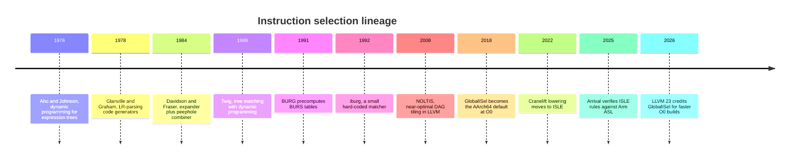
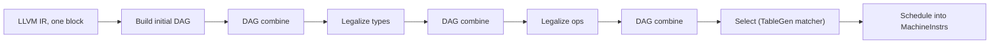

---
tags:
  - compilers
  - instruction-selection
  - code-generation
  - backend
  - llvm
  - globalisel
  - cranelift
status: complete
sources:
  - https://llvm.org/docs/GlobalISel/index.html
  - https://llvm.org/docs/GlobalISel/Pipeline.html
  - https://llvm.org/docs/CodeGenerator.html
  - https://releases.llvm.org/23.1.0/docs/ReleaseNotes.html
  - https://releases.llvm.org/22.1.0/docs/ReleaseNotes.html
  - https://developer.arm.com/community/arm-community-blogs/b/tools-software-ides-blog/posts/what-is-new-in-llvm-23
  - https://discourse.llvm.org/t/whats-the-current-status-of-globalisel-2026/90440
  - https://discourse.llvm.org/t/status-on-enabling-globalisel-by-default-on-clang-on-aarch64/89964
  - https://discourse.llvm.org/t/instruction-selection-globalisel-vs-selectiondag-in-2025/87602
  - https://lists.llvm.org/pipermail/llvm-dev/2017-March/111586.html
  - https://lists.llvm.org/pipermail/llvm-commits/Week-of-Mon-20180115/517073.html
  - https://reviews.llvm.org/D137269
  - https://lists.llvm.org/pipermail/llvm-commits/Week-of-Mon-20260216/1850707.html
  - https://github.com/llvm/llvm-project/blob/main/llvm/lib/Target/AArch64/AArch64InstrInfo.td
  - https://github.com/llvm/llvm-project/blob/main/llvm/lib/Target/AArch64/AArch64InstrFormats.td
  - https://github.com/llvm/llvm-project/blob/main/llvm/lib/Target/X86/X86InstrFragments.td
  - https://cfallin.org/blog/2023/01/20/cranelift-isle/
  - https://github.com/bytecodealliance/wasmtime/blob/main/cranelift/codegen/src/isa/aarch64/lower.isle
  - https://www.contrib.andrew.cmu.edu/~bparno/papers/arrival.pdf
  - https://gcc.gnu.org/onlinedocs/gccint/Patterns.html
  - https://gcc.gnu.org/onlinedocs/gccint/RTL-passes.html
  - https://github.com/gcc-mirror/gcc/blob/master/gcc/config/aarch64/aarch64.md
  - https://github.com/golang/go/blob/master/src/cmd/compile/internal/ssa/_gen/AMD64.rules
  - https://github.com/golang/go/blob/master/src/cmd/compile/internal/ssa/_gen/rulegen.go
  - https://arxiv.org/abs/1306.4898
  - https://projects.csail.mit.edu/jacm/References/ahoj1976:488.html
  - https://www.cs.princeton.edu/~appel/papers/80.pdf
  - https://www.complang.tuwien.ac.at/ublu/tools/doc/burg.pdf
  - https://www.cs.princeton.edu/research/techreps/TR-386-92
  - https://llvm.googlesource.com/llvm/+/refs/heads/release_1/utils/Burg/Doc/doc.tex
  - https://llvm.org/pubs/2008-CGO-DagISel.html
  - https://www.cs.cmu.edu/~dkoes/research/CGO08-NOLTIS.pdf
  - https://db.in.tum.de/teaching/ws2324/codegen/prs07.pdf
  - https://db.in.tum.de/~drescher/paper-isel-syn.pdf
  - https://arxiv.org/abs/2405.06127
  - https://hydride.cs.illinois.edu
  - https://arxiv.org/abs/2510.09932
  - https://arxiv.org/abs/2505.22610
  - https://arxiv.org/abs/2511.01183
created: 2026-11-26
updated: 2026-11-26
---

## Table Of Contents

- [[#TL;DR|TL;DR]]
- [[#The Problem|The Problem]]
- [[#Foundations|Foundations]]
    - [[#Tiles, Covers and Costs|Tiles, Covers and Costs]]
    - [[#Macro Expansion|Macro Expansion]]
    - [[#Dynamic Programming on Trees|Dynamic Programming on Trees]]
    - [[#Why DAGs Are Hard|Why DAGs Are Hard]]
- [[#How We Got Here|How We Got Here]]
- [[#How It Works|How It Works]]
    - [[#Worked Example - Tiling a Small Tree|Worked Example - Tiling a Small Tree]]
    - [[#LLVM SelectionDAG|LLVM SelectionDAG]]
    - [[#TableGen Patterns|TableGen Patterns]]
    - [[#FastISel|FastISel]]
    - [[#GlobalISel|GlobalISel]]
    - [[#GCC RTL and Machine Descriptions|GCC RTL and Machine Descriptions]]
    - [[#Cranelift ISLE|Cranelift ISLE]]
    - [[#Go SSA Rules Files|Go SSA Rules Files]]
- [[#Where It Is Now|Where It Is Now]]
    - [[#GlobalISel Per Target|GlobalISel Per Target]]
    - [[#Cranelift and Verified Lowering|Cranelift and Verified Lowering]]
    - [[#Synthesized and Learned Selectors|Synthesized and Learned Selectors]]
- [[#Trade-offs & Open Problems|Trade-offs & Open Problems]]
- [[#Resources|Resources]]
- [[#Related Notes|Related Notes]]

## ***TL;DR***
---
*Instruction selection turns a compiler's generic operations into a specific machine's instructions. The hard part is that one machine instruction often does the work of several IR operations, so the selector has to choose which groups of operations to fuse, and that choice decides code size and speed.*

- **What it is.** The backend stage after [[Intermediate Representations|IR]] optimization and before [[Register Allocation]] and scheduling (see [[Compiler Pipeline]]). It maps IR like `add(shl(x, 3), y)` onto, for example, x86-64 `lea (%y,%x,8)` or AArch64 `add y, x, lsl #3`.
- **The classic model.** Treat each instruction as a *tile* (a small tree pattern with a cost) and cover the IR with tiles. On trees, optimal covering is linear-time dynamic programming (Aho and Johnson 1976, twig, BURG, iburg). On DAGs, least-cost covering is NP-complete ([Koes and Goldstein, CGO 2008](https://llvm.org/pubs/2008-CGO-DagISel.html)), so production compilers use heuristics.
- **What production compilers do.** LLVM's SelectionDAG builds one DAG per basic block, legalizes types and operations, runs DAG combines, matches patterns generated from TableGen, then schedules back into machine instructions ([LLVM, Code Generator docs](https://llvm.org/docs/CodeGenerator.html)). GCC expands GIMPLE into RTL and lets its `combine` pass fuse instructions that match `define_insn` patterns ([GCC Internals](https://gcc.gnu.org/onlinedocs/gccint/RTL-passes.html)). Cranelift writes lowering rules in its ISLE DSL; Go writes them in `.rules` files.
- **The newer LLVM path.** GlobalISel works on the whole function, directly on machine IR, as a pipeline of separate passes ([LLVM, GlobalISel](https://llvm.org/docs/GlobalISel/index.html)). It has been the AArch64 default at `-O0` since January 2018, and LLVM 23 (August 26, 2026) credits it for 15% faster `-O0 -g` builds on CTMark ([Arm, Oct 2026](https://developer.arm.com/community/arm-community-blogs/b/tools-software-ides-blog/posts/what-is-new-in-llvm-23)). At `-O2` and above, SelectionDAG is still the default on AArch64, x86 and the other major CPU targets.
- **Where research is going.** Generating rules from formal ISA specifications ([Drescher and Engelke, 2025](https://db.in.tum.de/~drescher/paper-isel-syn.pdf); [Hydride](https://hydride.cs.illinois.edu)) and verifying hand-written rules against vendor ISA semantics ([Arrival, OOPSLA 2025](https://www.contrib.andrew.cmu.edu/~bparno/papers/arrival.pdf)).

## ***The Problem***
---
*IR operations are small and uniform; real instructions are irregular and do several things at once. A selector that maps one IR operation to one instruction is correct but wastes the machine's best instructions.*

The source line `return a[i]*4 + b;` (with `long *a`) becomes, after optimization, five IR operations: a multiply-by-8 for the index, a pointer add, a load, a shift by 2 and an add. A naive one-to-one translation emits five instructions. Clang 18 at `-O2` emits two on each target (compiled locally for this note):

```asm
# x86-64                               // AArch64
movq  (%rdi,%rsi,8), %rax              ldr  x8, [x0, x1, lsl #3]
leaq  (%rdx,%rax,4), %rax              add  x0, x2, x8, lsl #2
```

Each instruction absorbs several IR nodes. The features that make this possible are exactly what makes selection hard:

| Machine feature | Example | What the selector must notice |
|---|---|---|
| **Addressing modes** | x86 `base + index*scale + disp`; AArch64 `[xn, xm, lsl #3]` | A shift, an add and a load are one instruction |
| **Shifted or extended operands** | AArch64 `add x0, x2, x8, lsl #2`; `add w0, w1, w2, sxtw` | A shift or sign-extension folds into its user |
| **Fused multiply-add** | AArch64 `madd`, `fmadd`; x86 FMA3 | `a*b + c` is one instruction (but rounding differs for floats, so the IR must permit it) |
| **`lea` as arithmetic** | `lea (%rdi,%rdx)` computes `x + y` without touching flags | An address-computation instruction doubles as a 3-operand add |
| **Condition flags** | x86 EFLAGS, AArch64 NZCV | Comparisons produce no value; the branch or `cset` that reads the flags must be placed right after |
| **Missing operations** | No 128-bit divide, no `i1` registers | Something must be expanded into a sequence or a library call before matching |

So the problem has two halves: **legalization** (make every operation and type something the target can do at all) and **selection** (among the many legal instruction sequences, pick a cheap one). The [Hjort Blindell survey](https://arxiv.org/abs/1306.4898) calls instruction selection one of the three core backend problems, beside [[Register Allocation]] and instruction scheduling, and they interact: a fused instruction can lengthen a dependency chain or raise register pressure.

## ***Foundations***
---
*Almost every selector is a variation on one idea: describe each instruction as a pattern over IR with a cost, then cover the program with patterns. The algorithms differ in what shape they cover (trees, DAGs, whole functions) and how hard they search.*

### Tiles, Covers and Costs

*A tile is a pattern for one instruction; a cover assigns every IR node to exactly one tile's interior or root.*

Write the IR for a basic block as expression trees. A **tile** is a tree pattern whose leaves are either constants or *nonterminals* such as `reg` or `addr` (a value already computed into a register, or an addressing-mode operand). A **cover** places tiles so that every IR node is inside some tile, and each tile's leaves line up with the roots of other tiles. Each tile emits one instruction (or a short fixed sequence), so the cost of a cover is the sum of its tiles' costs. Twig, BURG and iburg write tiles as a tree grammar with costs ([Fraser, Henry and Proebsting, 1991](https://www.complang.tuwien.ac.at/ublu/tools/doc/burg.pdf)):

```text
reg:  LOAD(addr)              cost 1   # mov  r, [addr]
reg:  ADD(reg, reg)           cost 1   # add  r, r
reg:  SHL(reg, con)           cost 1   # shl  r, k
addr: reg                     cost 0   # [r]
addr: ADD(reg, SHL(reg, k))   cost 0   # [r + r*2^k], k in 0..3
reg:  addr                    cost 1   # lea  r, [addr]
```

The last line is a **chain rule**: it converts one nonterminal into another without consuming an IR node. Chain rules are how `lea` becomes an arithmetic instruction: anything that fits an addressing mode can be materialized into a register for the price of one `lea`.

### Macro Expansion

*The oldest method: expand each IR operation into a fixed instruction template, one at a time.*

Macro expansion is the late-1960s approach and is still the fastest ([Hjort Blindell](https://arxiv.org/abs/1306.4898)). Each IR operation has a template; the selector walks the IR and pastes templates. It cannot fuse operations, so a shift feeding an add stays two instructions. Two things keep it alive. First, it is what you want when compile time matters most: LLVM's FastISel is essentially macro expansion with a few local folds ([TUM lecture, 2023](https://db.in.tum.de/teaching/ws2324/codegen/prs07.pdf)). Second, Davidson and Fraser (1984) showed that a naive expander followed by a **peephole combiner** that merges adjacent instructions recovers much of the lost quality; the survey lists GCC among the compilers that took that design. GCC's RTL `combine` pass is its direct descendant.

### Dynamic Programming on Trees

*Bottom-up, compute for every node and every nonterminal the cheapest way to produce that node as that nonterminal. Then walk top-down to emit the winning tiles.*

The simpler alternative is **maximal munch**: start at the root, take the matching tile that covers the most nodes, and recurse into the subtrees left at its leaves. It is fast and easy but can be non-optimal, because the biggest tile at the root may force poor tiles below it ([TUM lecture](https://db.in.tum.de/teaching/ws2324/codegen/prs07.pdf)). Dynamic programming fixes that.

Aho and Johnson used dynamic programming for optimal code on expression trees with complex addressing modes in 1976 ([JACM bibliography](https://projects.csail.mit.edu/jacm/References/ahoj1976:488.html); [Hjort Blindell](https://arxiv.org/abs/1306.4898)). Twig turned it into a code-generator generator: "Working from the bottom up, the cost of matching each node to each nonterminal symbol is computed" ([Appel, on Twig](https://www.cs.princeton.edu/~appel/papers/80.pdf)).

$$
\text{cost}(n, A) \;=\; \min_{\substack{\text{rule } A \to p \\ p \text{ matches at } n}} \Big( c(A \to p) \;+\; \sum_{(m,\,B)\,\in\,\text{leaves}(p,\,n)} \text{cost}(m, B) \Big)
$$

**In plain English:** to compute node $n$ as nonterminal $A$ (say, "into a register"), try every rule for $A$ whose pattern fits at $n$. A rule's price is its own cost plus the cheapest way to produce each of its leaves, where each leaf $m$ must be produced as the nonterminal $B$ the pattern asks for. Keep the minimum. Chain rules are applied repeatedly at each node until costs stop improving.

Because every node is visited once and the grammar is fixed, the work is linear in tree size. The tools differ in *when* the dynamic programming happens:

| Tool | Matching approach | Trade-off |
|---|---|---|
| **Twig** (Aho, Ganapathi, Tjiang) | Tree pattern matching plus dynamic programming at compile time | The first widely used generator; matchers slower than its successors |
| **BURG** (Fraser, Henry, Proebsting) | BURS: "does the dynamic programming at compile-compile time", producing state tables | Very fast labelling, but costs must be constants ([BURG, 1991](https://www.complang.tuwien.ac.at/ublu/tools/doc/burg.pdf)) |
| **iburg** (Fraser, Hanson, Proebsting) | Hard-coded matcher, dynamic programming at compile time | "200--700 lines of Icon versus 3000 lines of C for Twig and 5000 for burg"; up to 25× faster than Twig, slower than BURG ([Princeton TR-386-92](https://www.cs.princeton.edu/research/techreps/TR-386-92)) |

### Why DAGs Are Hard

*Real code shares values. Once a node has two users, a tile that swallows it either duplicates the work or blocks fusion, and finding the best cover becomes NP-complete.*

"Although instruction selection on tree expressions is a well understood and easily solved problem, instruction selection on directed acyclic graphs is NP-complete" ([Koes and Goldstein, CGO 2008](https://llvm.org/pubs/2008-CGO-DagISel.html)). The classic workaround is to cut the DAG into trees at every shared node (store shared values in registers, then tile each tree optimally), which gives up fusion across the cut. Koes and Goldstein's NOLTIS runs tree DP on the DAG while pretending shared nodes are duplicated, then decides which shared nodes to "fix" as tile roots and reruns. It matched an ILP-optimal tiling for 99.7% of nearly half a million functions and cut code size by 5.1% on average versus tree decomposition, in LLVM 2.1 on x86 ([NOLTIS slides](https://www.cs.cmu.edu/~dkoes/research/CGO08-NOLTIS.pdf)).

## ***How We Got Here***
---
*Selection moved from hand-written templates, to grammar-driven tree parsers in the 1970s to 1990s, to graph-based matchers generated from target descriptions, and now toward whole-function selectors and rules synthesized from formal ISA specifications.*



- **Selection as parsing (1978).** Glanville and Graham treated the linearized IR as a sentence and the instruction set as an LR grammar, which the survey calls a seminal breakthrough: selectors became generated rather than hand-written ([Hjort Blindell](https://arxiv.org/abs/1306.4898)).
- **Tree grammars with costs (1989 to 1992).** Twig, BURG and iburg made optimal tree tiling practical and compact. LLVM's own `release_1` source tree still carried a copy of BURG under `utils/Burg` ([LLVM release_1](https://llvm.googlesource.com/llvm/+/refs/heads/release_1/utils/Burg/Doc/doc.tex)).
- **Whole-function selection (2017 onward).** GlobalISel was offered for AArch64 `-O0` testing in March 2017, with 100% pass rate on iOS test suites and about 5% of functions falling back to SelectionDAG ([llvm-dev, Mar 2017](https://lists.llvm.org/pipermail/llvm-dev/2017-March/111586.html)). It became the AArch64 `-O0` default on January 2, 2018 ([r321655](https://lists.llvm.org/pipermail/llvm-commits/Week-of-Mon-20180115/517073.html)).
- **Rule DSLs outside LLVM.** Cranelift replaced deeply nested hand-written Rust lowering with ISLE, about 27k lines of rules for four targets ([Fallin, Jan 2023](https://cfallin.org/blog/2023/01/20/cranelift-isle/)). Go's SSA backend writes its lowering as rewrite-rule files, with a generator dating from 2015 that credits ideas from the Swift Java compiler ([rulegen.go](https://github.com/golang/go/blob/master/src/cmd/compile/internal/ssa/_gen/rulegen.go)).

## ***How It Works***
---
*Every production selector has the same skeleton: lower the IR into a target-shaped form, make it legal, run pattern rewrites, match instruction patterns, and leave cleanup to later passes. What differs is the data structure and how the patterns are written.*

### Worked Example - Tiling a Small Tree

*Applying the grammar above to `a[i]*4 + b` gives exactly the two instructions Clang emits on x86-64.*

After [[Classic Optimizations|optimization]], the expression is the tree `ADD(b, SHL(LOAD(ADD(a, SHL(i, 3))), 2))`. Leaves `a`, `i`, `b` are already in registers (cost 0 as `reg`). Bottom-up costs, using the grammar from Tiles, Covers and Costs:

| Node | As `addr` | As `reg` | Winning rule for `reg` |
|---|---|---|---|
| n1 = `SHL(i, 3)` | 1 (`addr: reg`) | 1 | `shl` |
| n2 = `ADD(a, n1)` | **0** (`addr: ADD(reg, SHL(reg,3))`) | 1 | `lea` via chain rule, vs `add` at 1 + 1 = 2 |
| n3 = `LOAD(n2)` | 1 | **1** | `mov r, [a + i*8]` (1 + addr cost 0) |
| n4 = `SHL(n3, 2)` | 2 | 2 | `shl` (1 + 1) |
| n5 = `ADD(b, n4)` | **1** (`addr: ADD(reg, SHL(reg,2))` = reg(b) 0 + reg(n3) 1) | **2** | `lea` via chain rule, vs `add` at 1 + 2 = 3 |

The top-down walk from n5 picks `lea r, [b + n3*4]`, which needs n3 in a register, which picks `mov r, [a + i*8]`. Total cost 2. n1, n2 and n4 never become instructions: they live inside the addressing modes. LLVM's real output after selection, in machine IR, is the same cover (local `llc -stop-after=finalize-isel`):

```text
%3:gr64_nosp = MOV64rm %0, 8, %1, 0, $noreg        ; load [a + i*8]
%4:gr64      = nsw LEA64r %2, 4, killed %3, 0, $noreg ; b + t*4
```

On AArch64 the same DP with different tiles picks `ldr` with a shifted register offset and `add` with a shifted operand. Maximal munch would find the same answer here; it loses on trees where the largest root tile forces expensive leaves.

### LLVM SelectionDAG

*Build a DAG per basic block, combine and legalize it several times, match TableGen patterns, then schedule the selected DAG into a straight-line list of machine instructions.*

The LLVM docs list eight steps ([LLVM Code Generator](https://llvm.org/docs/CodeGenerator.html)):



- **Build.** `SelectionDAGBuilder` "naïvely peephole expand[s]" IR into `SDNode`s. Each block becomes its own DAG, so nothing is fused across blocks; values used in other blocks go through virtual registers ([TUM lecture](https://db.in.tum.de/teaching/ws2324/codegen/prs07.pdf)). That boundary is the main limitation GlobalISel was built to remove.
- **Legalize types.** Convert the DAG "to only use the types that are natively supported by the target": promote small integers to larger ones, expand wide ones into pieces, split or widen vectors.
- **Legalize ops.** Convert to "only use the operations that are natively supported", by expanding into sequences, promoting, or calling a target's *custom* hook.
- **DAG combine.** Target-independent and target-specific rewrites (canonicalization, folding, forming target nodes) run between each step, because legalization creates new opportunities.
- **Select.** A matcher generated by TableGen "pattern matches the instructions supported by the target to this DAG", with C++ for what patterns cannot express. On DAGs it is greedy: Koes and Goldstein describe LLVM's default as taking the largest tile in a top-down walk, with no search for an optimal cover ([NOLTIS slides](https://www.cs.cmu.edu/~dkoes/research/CGO08-NOLTIS.pdf)).
- **Schedule.** The selected DAG is linearized into `MachineInstr`s, using a scheduler that can optimize for latency or register pressure. See [[Register Allocation]] for what comes next.

### TableGen Patterns

*Targets describe instructions and selection patterns in `.td` files; TableGen turns them into the matcher tables for SelectionDAG and, through importers, GlobalISel.*

AArch64's multiply patterns show the style. Plain `mul` is selected as `madd` with the zero register as the addend ([AArch64InstrInfo.td](https://github.com/llvm/llvm-project/blob/main/llvm/lib/Target/AArch64/AArch64InstrInfo.td)):

```tablegen
let AddedComplexity = 5 in {
defm MADD : MulAccum<0, "madd">;
defm MSUB : MulAccum<1, "msub">;

def : Pat<(i64 (mul GPR64:$Rn, GPR64:$Rm)),
          (MADDXrrr GPR64:$Rn, GPR64:$Rm, XZR)>;
}
```

Notice what is *missing*: no pattern for `add(mul(a, b), c)`. The instruction definition says "MADD/MSUB generation is decided by MachineCombiner.cpp" ([AArch64InstrFormats.td](https://github.com/llvm/llvm-project/blob/main/llvm/lib/Target/AArch64/AArch64InstrFormats.td)). Fusing at selection time would always lengthen the critical path through the addend, so LLVM selects `mul` and `add` separately and lets a later pass fuse them when the schedule model says it pays. Later peepholes and [[Superoptimization|superoptimizer]]-found rewrites clean up what local selection misses. Locally, for `x*y + z`:

```text
; after SelectionDAG                    ; after machine-combiner
%3 = nsw MADDXrrr %1, %0, $xzr          %4 = nsw MADDXrrr %1, %0, %2
%4 = nsw ADDXrr killed %3, %2
```

x86's `lea` uses a **ComplexPattern**: a C++ function that matches an arbitrary subtree of `add`, `shl`, `mul` and so on, and returns the five address operands ([X86InstrFragments.td](https://github.com/llvm/llvm-project/blob/main/llvm/lib/Target/X86/X86InstrFragments.td)):

```tablegen
def lea64addr : ComplexPattern<i64, 5, "selectLEAAddr",
                        [add, sub, mul, X86mul_imm, shl, or, xor, frameindex,
                         X86WrapperRIP], []>;
def LEA64r : RI<0x8D, MRMSrcMem, (outs GR64:$dst), (ins lea64mem:$src),
                "lea{q}\t{$src|$dst}, {$dst|$src}",
                [(set GR64:$dst, lea64addr:$src)]>;
```

`AddedComplexity` biases the matcher toward a pattern; otherwise larger patterns win. Addressing modes are almost always ComplexPatterns, because "which nodes fit an address" depends on constant ranges and on whether the value has other users.

### FastISel

*A macro-expansion selector for unoptimized builds: one IR instruction at a time, straight to machine instructions, with SelectionDAG as a fallback.*

FastISel skips the DAG entirely. It handles common cases with low compile time and poorer code, and falls back to SelectionDAG for anything it does not support ([TUM lecture](https://db.in.tum.de/teaching/ws2324/codegen/prs07.pdf)). It is LLVM's traditional `-O0` selector on targets that implement it. Its cost is duplication: FastISel and SelectionDAG "are radically different and share very little code" ([LLVM, GlobalISel](https://llvm.org/docs/GlobalISel/index.html)), so each target maintains two selectors.

### GlobalISel

*GlobalISel replaces both with one pipeline of ordinary machine-function passes over generic machine IR, covering the whole function.*

The design answers three problems the docs name ([LLVM, GlobalISel](https://llvm.org/docs/GlobalISel/index.html)): **performance** ("SelectionDAG introduces a dedicated intermediate representation, which has a compile-time cost"), **granularity** (SelectionDAG and FastISel work per block; "GlobalISel operates on the whole function"), and **modularity** (one framework, shared code, testable passes). Its core passes ([Pipeline](https://llvm.org/docs/GlobalISel/Pipeline.html)):

| Pass | Job | Invariant after |
|---|---|---|
| **IRTranslator** | LLVM IR to generic MIR (gMIR): `G_ADD`, `G_LOAD`, `G_PTR_ADD` on typed virtual registers like `s64`, `p0` | Code is gMIR |
| **Combiner** (optional, several points) | Pattern rewrites, written in TableGen as combine rules | |
| **Legalizer** | "Replaces unsupported operations with supported ones" (widen, narrow, lower, libcall) | No illegal operations |
| **RegBankSelect** | "Binds virtual registers to register banks" (general-purpose vs FP/SIMD), minimizing cross-bank copies | Every vreg has a bank |
| **InstructionSelect** | Matches gMIR to target instructions, mostly with patterns imported from the SelectionDAG `.td` files | No gMIR remains |

Here is `a[i]*4 + b` going through it on AArch64 (local `llc -global-isel -stop-after=...`, LLVM 18):

```text
; after IRTranslator
%4:_(s64) = G_MUL %1, %3            ; i * 8
%5:_(p0)  = G_PTR_ADD %0, %4(s64)
%7:_(s64) = G_LOAD %6(p0)
%9:_(s64) = nsw G_SHL %7, %8(s64)   ; * 4
%10:_(s64) = nsw G_ADD %9, %2       ; + b

; after Legalizer (combines turned the multiply into a shift)
%4:_(s64) = G_SHL %1, %11(s64)      ; %11 = G_CONSTANT 3

; after InstructionSelect
%7:gpr64  = LDRXroX %0, %1, 0, 1    ; ldr x, [a, i, lsl #3]
%10:gpr64 = nsw ADDXrs %2, %7, 2    ; add x, b, t, lsl #2
```

Because each stage is a normal pass over MIR, its state can be serialized and each pass unit-tested, unlike SelectionDAG's "black box" ([Pipeline](https://llvm.org/docs/GlobalISel/Pipeline.html)). The catch is that every DAG combine a target relies on has to be ported to GlobalISel's combiner to reach parity.

### GCC RTL and Machine Descriptions

*GCC expands GIMPLE into RTL using named patterns, then fuses instructions with a combiner that only accepts results that match an instruction pattern.*

A machine description (`.md`) file lists `define_insn` patterns. Each has "an optional name", "the RTL template", "the condition" (a C expression), "the output template", and optional attributes ([GCC Internals](https://gcc.gnu.org/onlinedocs/gccint/Patterns.html)). AArch64's multiply-add ([aarch64.md](https://github.com/gcc-mirror/gcc/blob/master/gcc/config/aarch64/aarch64.md)):

```lisp
(define_insn "madd<mode>"
  [(set (match_operand:GPI 0 "register_operand" "=r")
        (plus:GPI (mult:GPI (match_operand:GPI 1 "register_operand" "r")
                            (match_operand:GPI 2 "register_operand" "r"))
                  (match_operand:GPI 3 "register_operand" "r")))]
  ""
  "madd\\t%<w>0, %<w>1, %<w>2, %<w>3"
  [(set_attr "type" "mla")]
)
```

Selection is split. RTL expansion emits instructions through *standard names* such as `addsi3` or `maddsidi4`. Then `combine` "attempts to combine groups of two or three instructions that are related by data flow into single instructions" by substituting one RTL expression into another and keeping the result only if some `define_insn` recognizes it; a newer late-combine pass does more of the same after `combine` ([GCC RTL passes](https://gcc.gnu.org/onlinedocs/gccint/RTL-passes.html)). Unlike LLVM, GCC can form `madd` in combine directly from this pattern. The `"r"` strings are register constraints, which the register allocator reads, so GCC's patterns describe selection and allocation at once.

### Cranelift ISLE

*ISLE is a typed term-rewriting DSL: left-hand sides match IR through extractor functions, right-hand sides build machine instructions through constructors, and the compiler checks for overlapping and unreachable rules.*

Cranelift built ISLE because its hand-written lowering had become "tedious", hard to refactor and hard to keep correct ([Fallin, Jan 2023](https://cfallin.org/blog/2023/01/20/cranelift-isle/)). Terms are backed by Rust functions supplied by the backend, so ISLE knows nothing about the IR itself. Rules carry optional priorities; two rules that could fire on the same input may not share a priority, and the checker reports rules shadowed by higher-priority ones. The AArch64 backend's `madd` and shifted-operand rules ([lower.isle](https://github.com/bytecodealliance/wasmtime/blob/main/cranelift/codegen/src/isa/aarch64/lower.isle)):

```lisp
;; Fold an `iadd` and `imul` combination into a `madd` instruction.
(rule iadd_imul_right 7 (lower (iadd (ty_int_ref_scalar_64_extract ty) x (imul _ y z)))
      (madd ty y z x))

;; Fold a constant shift into the add.
(rule iadd_ishl_right 7 (lower (iadd (ty_int_ref_scalar_64_extract ty) x (ishl _ y (iconst _ k))))
      (if-let amt (lshl_from_imm64 ty k))
      (add_shift ty x y amt))
```

The `7` is the priority; `if-let` is a fallible guard (the shift amount must fit the encoding). ISLE compiles to Rust that calls extractors in sequence and turns enum matches into Rust `match` expressions. The same language also drives Cranelift's machine-independent mid-end rewrites ([Fallin](https://cfallin.org/blog/2023/01/20/cranelift-isle/)).

### Go SSA Rules Files

*Go writes lowering and peepholes as s-expression rewrite rules that a generator turns into Go code, applied to a fixed point over SSA values.*

The syntax is `sexpr [&& extra conditions] => sexpr`, and "If multiple rules match, the first one in file order is selected" ([rulegen.go](https://github.com/golang/go/blob/master/src/cmd/compile/internal/ssa/_gen/rulegen.go)). Lowering and fusion live in the same file ([AMD64.rules](https://github.com/golang/go/blob/master/src/cmd/compile/internal/ssa/_gen/AMD64.rules)):

```lisp
(Add(64|32|16|8) ...) => (ADD(Q|L|L|L) ...)                  ; lowering, one-to-one
(ADD(L|Q) x (SHL(L|Q)const [3] y)) => (LEA(L|Q)8 x y)       ; fusion into lea
```

The first rule is macro expansion; the second is a peephole on already-lowered [[SSA Form|SSA]]. Generic and target rules both go through this rewriting, so Go has no separate tiling algorithm at all.

## ***Where It Is Now***
---
*As of November 2026: GlobalISel is the default only for unoptimized AArch64 builds and still trails SelectionDAG on optimized code, Cranelift's ISLE rules are being formally verified against Arm's own specifications, and research has made rule synthesis from ISA specs fast enough to try inside LLVM.*

### GlobalISel Per Target

*AArch64 and AMDGPU are furthest along; most in-tree targets still use SelectionDAG.*

| Target | Status, Nov 2026 |
|---|---|
| **AArch64** | Default at `-O0` since Jan 2018 ([r321655](https://lists.llvm.org/pipermail/llvm-commits/Week-of-Mon-20180115/517073.html)); a local `clang -O0 --target=aarch64` pass dump shows IRTranslator, Legalizer, RegBankSelect and InstructionSelect. Not default at `-O2`/`-O3`: a 2022 attempt for Darwin ([D137269](https://reviews.llvm.org/D137269)) was reverted, and in Feb 2026 a GlobalISel maintainer said that after 2022 it "fell behind SelectionDAG" on code size and performance, with Arm engineers adding the missing optimizations ([Discourse, Feb 2026](https://discourse.llvm.org/t/status-on-enabling-globalisel-by-default-on-clang-on-aarch64/89964)). A Feb 2026 patch proposed using GlobalISel for `optnone` functions; it was still in review when seen ([PR 174746](https://lists.llvm.org/pipermail/llvm-commits/Week-of-Mon-20260216/1850707.html)). |
| **AMDGPU** | Named with AArch64 as the most complete GlobalISel target ([Discourse, Apr 2026](https://discourse.llvm.org/t/whats-the-current-status-of-globalisel-2026/90440)). |
| **SPIR-V** | Built on GlobalISel from the start ([Discourse, 2025](https://discourse.llvm.org/t/instruction-selection-globalisel-vs-selectiondag-in-2025/87602)). |
| **X86, RISC-V, WebAssembly** | "Being incrementally retrofitted"; "not as far along" ([Discourse, Apr 2026](https://discourse.llvm.org/t/whats-the-current-status-of-globalisel-2026/90440)). |
| **Out-of-tree** | Several GPU and accelerator backends are GlobalISel-only, including an NVIDIA GPU backend planned for upstreaming ([Discourse, 2025](https://discourse.llvm.org/t/instruction-selection-globalisel-vs-selectiondag-in-2025/87602)). |

**LLVM 22 and 23.** LLVM 22's release notes list no GlobalISel or SelectionDAG changes. LLVM 23 (released August 26, 2026) renamed `G_CTLZ_ZERO_UNDEF`/`G_CTTZ_ZERO_UNDEF` to `..._ZERO_POISON`, taught the IRTranslator the new IR byte type, and removed `TypePromoteFloat` legalization from SelectionDAG ([LLVM 23 release notes](https://releases.llvm.org/23.1.0/docs/ReleaseNotes.html)). It also added AArch64 combines that clean up after selection, such as folding `cset w8, eq; tbnz w8, #0, L` into `b.eq L`. Arm reports `-O0 -g` builds 15% faster on CTMark (SQLite almost 25%) and `-O3` 8.7% faster, "largely due to extensive improvements in GlobalISel, the default instruction selector at -O0" ([Arm, Oct 2026](https://developer.arm.com/community/arm-community-blogs/b/tools-software-ides-blog/posts/what-is-new-in-llvm-23)).

**Known gaps** from the 2025 maintainer discussion: fewer combines than DAGCombine, no floating-point types in gMIR (so BF16 is a gap), flag-setting operations like `G_UADDO` that fall outside generic optimizations once custom-lowered ([Discourse, Apr 2026](https://discourse.llvm.org/t/whats-the-current-status-of-globalisel-2026/90440)), and on AArch64 the localizer pass costs about 0.5% geomean code size ([Discourse, 2025](https://discourse.llvm.org/t/instruction-selection-globalisel-vs-selectiondag-in-2025/87602)). A separate push for fast unoptimized builds, TPDE, compiles LLVM IR with its own back-end framework and appears at CGO 2026 ([arXiv 2505.22610](https://arxiv.org/abs/2505.22610)).

### Cranelift and Verified Lowering

*ISLE's declarative rules made Cranelift's selector checkable by machine.*

Arrival ([McLoughlin et al., OOPSLA 2025](https://www.contrib.andrew.cmu.edu/~bparno/papers/arrival.pdf)) verifies Cranelift's AArch64 ISLE rules reachable from WebAssembly 1.0 core opcodes against machine specs derived from Arm's machine-readable ASL. It chains rules automatically and proves 10,807 lowering paths free of miscompilation (27 timed out), covering 3.3× more rules than the earlier Crocus verifier. It found a new bug: the 8- and 16-bit signed-division overflow check used a 32-bit operand size, so code that should trap computed a wrong answer. The paper cites CVE-2023-26489, a Wasmtime sandbox escape from an earlier selection error, as motivation. This fits [[WebAssembly]] runtimes, where a selector bug is a security hole; see also [[Verified Compilers]].

### Synthesized and Learned Selectors

*Instead of writing patterns by hand, derive them from formal semantics of the IR and the ISA.*

| Work | What it generates | Result |
|---|---|---|
| **Drescher and Engelke** (TUM, 2025) ([PDF](https://db.in.tum.de/~drescher/paper-isel-syn.pdf)) | GlobalISel TableGen rules (up to two-instruction sequences) from Sail/ISLA ISA specs and formalized gMIR | Over 12,000 AArch64 rules in about 2 hours, about 8,000 RISC-V rules in under 40 minutes; SPEC CPU 2017 Integer under 4% slower than hand-written GlobalISel on AArch64, about 2% on RISC-V |
| **Daly et al.** (Stanford, 2024) ([arXiv](https://arxiv.org/abs/2405.06127)) | Many-to-many rewrite rules via SMT synthesis | Skipping duplicate and higher-cost rules gives up to 4004× faster synthesis on small ISAs |
| **Hydride** (ASPLOS 2024) ([site](https://hydride.cs.illinois.edu)) | A shared IR and selectors from vendor pseudocode for x86, Hexagon HVX and Arm NEON | 3,557 instructions summarized by 397 parameterized IR ops; Halide on Hydride beats Halide's LLVM backend by 12% (x86), 100% (HVX), 26% (Arm) |
| **ACT** (UIUC, 2026) ([arXiv](https://arxiv.org/abs/2510.09932)) | XLA backends for tensor accelerators; one rewrite per instruction, selected by [[E-Graphs and Equality Saturation|equality saturation]] | Compiled all 1,055 TPUGraphs kernels for AWS Trainium, 2.3× the coverage of the vendor compiler |

Learned approaches that translate IR straight to assembly with LLMs are appearing too, e.g. QiMeng-NeuComBack ([arXiv, Nov 2025](https://arxiv.org/abs/2511.01183)), but nothing like them is in a production backend; see [[ML-Guided Optimization]] and [[ML Compilers]] for the [[AI Accelerators|accelerator]] side.

## ***Trade-offs & Open Problems***
---
*Every selector trades compile time, code quality and maintainability. The open problems are getting whole-function selection to beat a mature per-block selector, and making rule sets trustworthy without hand-writing tens of thousands of them.*

| Choice | You get | You pay |
|---|---|---|
| Macro expansion (FastISel, Go lowering) | Fastest compile; trivial to write | No fusion unless peepholes recover it |
| Tree DP (BURG, iburg) | Optimal per tree, linear time | Cuts at shared values; costs are static guesses |
| DAG greedy matching (SelectionDAG) | Fusion across shared nodes, mature combines | Per-block only; separate IR costs compile time; hard to test |
| Whole-function gMIR (GlobalISel) | Cross-block selection, modular passes, one framework for all levels | Years of porting combines; still behind at `-O2` on AArch64 |
| Rule DSL with checks (ISLE) | Overlap detection, verification-friendly | Another language to learn; rule count grows fast |
| Synthesized rules | Correct by construction from ISA specs | Small windows; a few percent slower; FP and vectors harder |

**Open problems.**

- **Optimal versus fast.** DAG covering is NP-complete; ILP and constraint-programming selectors exist in research ([Hjort Blindell](https://arxiv.org/abs/1306.4898)) but are too slow for production, and costs are only estimates of what the scheduler and allocator will do.
- **Phase ordering.** Fusing `madd` early lengthens chains; LLVM defers it to the machine combiner. Selection, [[Register Allocation|allocation]] and scheduling are still solved one after another.
- **Parity before switching.** GlobalISel must match SelectionDAG on code quality before AArch64 flips `-O2`, and every DAG combine has to be re-written to get there.
- **Vector and accelerator ISAs.** Thousands of SIMD and matrix instructions make hand-written patterns impractical, which is why Hydride- and ACT-style generation matters for [[Vectorization]] and [[GPU Kernel Compilers]].
- **Trust.** Selector bugs are miscompilations and, in sandboxes, security bugs. Verification (Arrival) and [[Compiler Testing and Fuzzing|fuzzing]] of backends are catching up but cover only parts of each ISA.

## ***Resources***
---
*Start with the TUM lecture and the LLVM Code Generator page for the mechanics, the iburg note for tree DP, then Fallin's ISLE post and the GlobalISel docs for modern designs. The 2025 and 2026 Discourse threads are the best snapshot of GlobalISel's real status.*

**Papers**
- Classics: [Hjort Blindell survey, 2013](https://arxiv.org/abs/1306.4898); [Aho and Johnson, JACM 1976](https://projects.csail.mit.edu/jacm/References/ahoj1976:488.html); [Appel on Twig](https://www.cs.princeton.edu/~appel/papers/80.pdf); [BURG, 1991](https://www.complang.tuwien.ac.at/ublu/tools/doc/burg.pdf); [iburg, Princeton TR-386-92](https://www.cs.princeton.edu/research/techreps/TR-386-92); [BURG in LLVM release_1](https://llvm.googlesource.com/llvm/+/refs/heads/release_1/utils/Burg/Doc/doc.tex).
- DAGs: [Near-Optimal Instruction Selection on DAGs](https://llvm.org/pubs/2008-CGO-DagISel.html) and [slides](https://www.cs.cmu.edu/~dkoes/research/CGO08-NOLTIS.pdf), Koes and Goldstein, CGO 2008.
- [Scaling Instruction-Selection Verification against Authoritative ISA Semantics (Arrival)](https://www.contrib.andrew.cmu.edu/~bparno/papers/arrival.pdf): McLoughlin et al., OOPSLA 2025.
- Synthesis: [Drescher and Engelke, 2025](https://db.in.tum.de/~drescher/paper-isel-syn.pdf); [Daly et al., 2024](https://arxiv.org/abs/2405.06127); [Hydride, ASPLOS 2024](https://hydride.cs.illinois.edu); [ACT, 2026](https://arxiv.org/abs/2510.09932); [QiMeng-NeuComBack, 2025](https://arxiv.org/abs/2511.01183).
- [TPDE: A Fast Adaptable Compiler Back-End Framework](https://arxiv.org/abs/2505.22610): CGO 2026.

**Docs and code**
- LLVM: [Code Generator](https://llvm.org/docs/CodeGenerator.html), [GlobalISel](https://llvm.org/docs/GlobalISel/index.html), [GlobalISel pipeline](https://llvm.org/docs/GlobalISel/Pipeline.html), [AArch64InstrInfo.td](https://github.com/llvm/llvm-project/blob/main/llvm/lib/Target/AArch64/AArch64InstrInfo.td), [AArch64InstrFormats.td](https://github.com/llvm/llvm-project/blob/main/llvm/lib/Target/AArch64/AArch64InstrFormats.td), [X86InstrFragments.td](https://github.com/llvm/llvm-project/blob/main/llvm/lib/Target/X86/X86InstrFragments.td).
- GCC: [machine description patterns](https://gcc.gnu.org/onlinedocs/gccint/Patterns.html), [RTL passes](https://gcc.gnu.org/onlinedocs/gccint/RTL-passes.html), [aarch64.md](https://github.com/gcc-mirror/gcc/blob/master/gcc/config/aarch64/aarch64.md).
- Cranelift and Go: [aarch64 lower.isle](https://github.com/bytecodealliance/wasmtime/blob/main/cranelift/codegen/src/isa/aarch64/lower.isle), [AMD64.rules](https://github.com/golang/go/blob/master/src/cmd/compile/internal/ssa/_gen/AMD64.rules), [rulegen.go](https://github.com/golang/go/blob/master/src/cmd/compile/internal/ssa/_gen/rulegen.go).

**Courses, posts and LLVM history**
- [TUM Instruction Selection lecture, 2023/24](https://db.in.tum.de/teaching/ws2324/codegen/prs07.pdf); [Chris Fallin on ISLE, Jan 2023](https://cfallin.org/blog/2023/01/20/cranelift-isle/); [Arm, What is new in LLVM 23](https://developer.arm.com/community/arm-community-blogs/b/tools-software-ides-blog/posts/what-is-new-in-llvm-23).
- Release notes: [LLVM 22.1](https://releases.llvm.org/22.1.0/docs/ReleaseNotes.html), [LLVM 23.1](https://releases.llvm.org/23.1.0/docs/ReleaseNotes.html).
- Discourse: [GlobalISel vs SelectionDAG in 2025](https://discourse.llvm.org/t/instruction-selection-globalisel-vs-selectiondag-in-2025/87602), [GlobalISel status 2026](https://discourse.llvm.org/t/whats-the-current-status-of-globalisel-2026/90440), [GlobalISel by default on AArch64](https://discourse.llvm.org/t/status-on-enabling-globalisel-by-default-on-clang-on-aarch64/89964).
- GlobalISel milestones: [O0 call for testing, 2017](https://lists.llvm.org/pipermail/llvm-dev/2017-March/111586.html), [r321655, 2018](https://lists.llvm.org/pipermail/llvm-commits/Week-of-Mon-20180115/517073.html), [D137269](https://reviews.llvm.org/D137269), [PR 174746](https://lists.llvm.org/pipermail/llvm-commits/Week-of-Mon-20260216/1850707.html).

## Related Notes

- [[Compiler Pipeline]] — Where selection sits between IR optimization and register allocation.
- [[Intermediate Representations]] — The IRs selectors consume (LLVM IR, GIMPLE, CLIF) and produce (MIR, RTL).
- [[SSA Form]] — Go's rules and GlobalISel's gMIR both work on SSA values.
- [[Register Allocation]] — The next stage; fusion choices change register pressure.
- [[Instruction Scheduling]] — Planned: linearizing selected DAGs and the latency trade-off behind deferring `madd`.
- [[Vectorization]] — Vector ISAs are where hand-written patterns break down.
- [[LLVM]] — SelectionDAG, FastISel, GlobalISel and TableGen in context.
- [[WebAssembly]] — Cranelift and Wasmtime, where selector bugs are sandbox escapes.
- [[Superoptimization]] — Searching for better instruction sequences and missing peepholes.
- [[E-Graphs and Equality Saturation]] — ACT selects accelerator instructions by equality saturation.
- [[Verified Compilers]] — Arrival and Crocus as partial verification of a production selector.
- [[Compiler Testing and Fuzzing]] — Finding backend miscompilations without proofs.
- [[ML Compilers]] — Lowering tensor programs to accelerator instructions.
- [[GPU Kernel Compilers]] — GlobalISel-only GPU backends and SPIR-V.
- [[Compiler, Assembler, Linker, and Loader]] — What happens to the selected instructions afterward.
