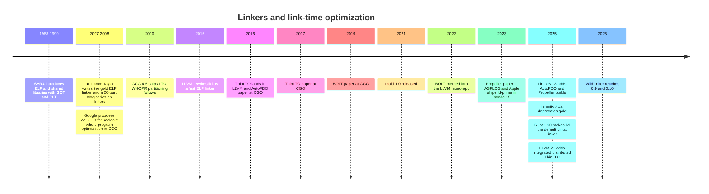
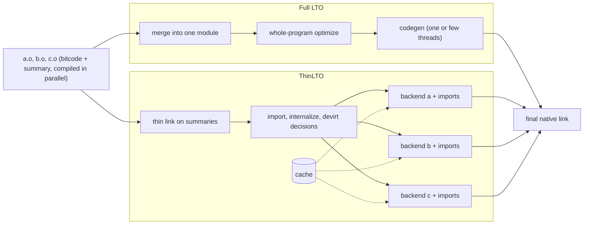

---
tags:
  - compilers
  - linking
  - lto
  - pgo
  - post-link-optimization
  - elf
  - toolchain
status: draft
sources:
  - https://maskray.me/blog/2021-08-29-all-about-global-offset-table
  - https://maskray.me/blog/2021-09-19-all-about-procedure-linkage-table
  - https://maskray.me/blog/2021-07-25-comdat-and-section-group
  - https://maskray.me/blog/2021-04-25-weak-symbol
  - https://maskray.me/blog/2023-02-19-linker-notes-on-x86
  - https://ucw.cz/~hubicka/papers/abi/node19.html
  - https://cs.miami.edu/~burt/learning/Csc521.091/docs/dsohowto.pdf
  - https://www.airs.com/blog/?p=38
  - https://www.wingolog.org/archives/2012/05/23/list-of-ian-lance-taylors-linker-articles
  - https://research.google/pubs/pub34417/
  - https://blog.llvm.org/2015/11/new-elf-linker-from-llvm-project.html
  - https://lld.llvm.org/NewLLD.html
  - https://github.com/rui314/mold/blob/main/docs/design.md
  - https://raw.githubusercontent.com/rui314/mold/main/README.md
  - https://github.com/wild-linker/wild
  - https://davidlattimore.github.io/posts/2024/11/19/designing-wilds-incremental-linking.html
  - https://davidlattimore.github.io/posts/2026/05/24/wild-update-0.9.0.html
  - https://phoronix.com/news/Wild-Linker-0.10
  - https://goals.rust-lang.org/2026/roadmap-fast-builds.html
  - https://developer.apple.com/wwdc23/10268
  - https://sourceware.org/pipermail/binutils/2025-February/139195.html
  - https://www.fedoraproject.org/wiki/Changes/DeprecateGoldLinker
  - https://blog.rust-lang.org/2024/05/17/enabling-rust-lld-on-linux/
  - https://blog.rust-lang.org/2025/09/01/rust-lld-on-1.90.0-stable
  - https://blog.rust-lang.org/2025/09/18/Rust-1.90.0/
  - https://arxiv.org/abs/1010.2196
  - https://opensource.googleblog.com/2008/11/whopr-scalable-whole-program-optimizer.html
  - https://research.google/pubs/thinlto-scalable-and-incremental-lto/
  - https://blog.llvm.org/2016/06/thinlto-scalable-and-incremental-lto.html
  - https://clang.llvm.org/docs/ThinLTO.html
  - https://releases.llvm.org/21.1.0/tools/lld/docs/ReleaseNotes.html
  - https://archive.fosdem.org/2025/schedule/event/fosdem-2025-5378-incremental-lto-in-gcc/
  - https://llvm.org/docs/TypeMetadata.html
  - https://research.google/pubs/safe-icf-pointer-safe-and-unwinding-aware-identical-code-folding-in-gold/
  - https://research.google/pubs/pub45290/
  - https://htyu.github.io/paper/Revamping_Sampling_based_PGO_with_Context_sensitivity_and_Pseudo_instrumentation_preprint.pdf
  - https://llvm.org/devmtg/2024-04/slides/TechnicalTalks/He-Yu-Wang-Oh-RevampingSamplingBasedPGO.pdf
  - https://discourse.llvm.org/t/rfc-temporal-profiling-extension-for-irpgo/68068
  - https://llvm.org/devmtg/2024-04/slides/TechnicalTalks/Hoag-TemporalProfiling-and-OrderfileOptimization-forMobileApps.pdf
  - https://arxiv.org/abs/1807.06735
  - https://lists.llvm.org/pipermail/llvm-dev/2022-January/154668.html
  - https://research.google/pubs/propeller-a-profile-guided-relinking-optimizer-for-warehouse-scale-applications/
  - https://arxiv.org/pdf/2606.00131
  - https://docs.kernel.org/6.13/dev-tools/autofdo.html
  - https://docs.kernel.org/6.13/dev-tools/propeller.html
  - https://blog.chromium.org/2020/08/chrome-just-got-faster-with-profile.html
  - https://fedoraproject.org/wiki/LTOByDefault
  - https://phoronix.com/news/Fedora-47-Considers-Thin-LTO
  - https://canonical.com/blog/profile-guided-optimization-a-case-study
  - https://phoronix.com/news/Ubuntu-PGO-Praises-Performance
  - https://discourse.ubuntu.com/t/link-time-optimization-lto-by-default-for-rust-packages-in-ubuntu/80114
  - https://kobzol.github.io/rust/rustc/2022/10/27/speeding-rustc-without-changing-its-code.html
  - https://rustc-dev-guide.rust-lang.org/building/optimized-build.html
created: 2026-11-26
updated: 2026-11-26
---

## Table Of Contents

- [[#TL;DR|TL;DR]]
- [[#The Problem|The Problem]]
- [[#Foundations|Foundations]]
    - [[#What a Linker Does|What a Linker Does]]
    - [[#Relocations|Relocations]]
    - [[#Symbols, Binding and Visibility|Symbols, Binding and Visibility]]
    - [[#Static vs Dynamic Linking|Static vs Dynamic Linking]]
- [[#How We Got Here|How We Got Here]]
- [[#How It Works|How It Works]]
    - [[#Worked Example, a Relocation Before and After|Worked Example, a Relocation Before and After]]
    - [[#PIC, PIE and the GOT|PIC, PIE and the GOT]]
    - [[#Worked Example, a PLT Call and Lazy Binding|Worked Example, a PLT Call and Lazy Binding]]
    - [[#COMDAT, Weak Symbols and C++ Dedup|COMDAT, Weak Symbols and C++ Dedup]]
    - [[#Why Linking Got Slow and How mold Fixed It|Why Linking Got Slow and How mold Fixed It]]
    - [[#Full LTO|Full LTO]]
    - [[#ThinLTO|ThinLTO]]
    - [[#Worked Example, What LTO Removes|Worked Example, What LTO Removes]]
    - [[#Whole-Program Devirtualization|Whole-Program Devirtualization]]
    - [[#Dead Stripping and Identical Code Folding|Dead Stripping and Identical Code Folding]]
    - [[#Profile-Guided Optimization|Profile-Guided Optimization]]
    - [[#Post-Link Optimization with BOLT and Propeller|Post-Link Optimization with BOLT and Propeller]]
    - [[#How Much Each Buys|How Much Each Buys]]
- [[#Where It Is Now|Where It Is Now]]
    - [[#Linkers|Linkers]]
    - [[#LTO|LTO]]
    - [[#PGO and Post-Link in Production|PGO and Post-Link in Production]]
- [[#Trade-offs & Open Problems|Trade-offs & Open Problems]]
- [[#Resources|Resources]]
- [[#Related Notes|Related Notes]]

## ***TL;DR***
---
*The linker turns many object files into one program by resolving symbols, merging sections and patching addresses. Over the last fifteen years it has also become the place where whole-program optimization happens: LTO, profile-driven layout and post-link rewriting all hang off the link step.*

- **Core job.** Resolve every undefined symbol to one definition, lay out sections into segments, then apply *relocations*: patch each placeholder in the code with a final address computed by a formula such as $S + A - P$. The owner's [[Compiler, Assembler, Linker, and Loader]] note covers the build stages and ELF sections; this note goes past that.
- **Dynamic linking** defers part of that work to load time. Position-independent code reaches other modules through the **GOT** (a table of addresses) and the **PLT** (small stubs), optionally resolving functions lazily on first call ([MaskRay, GOT](https://maskray.me/blog/2021-08-29-all-about-global-offset-table); [MaskRay, PLT](https://maskray.me/blog/2021-09-19-all-about-procedure-linkage-table)).
- **Speed.** GNU ld was single-threaded and slow on multi-GB C++ binaries; gold (2008), lld (2015) and mold (2021) each cut link times sharply, mold by parallelizing every pass. Rust switched its default Linux linker to lld in 1.90 (September 2025) ([Rust blog, 2025](https://blog.rust-lang.org/2025/09/01/rust-lld-on-1.90.0-stable)), and GNU binutils deprecated gold in 2.44 (February 2025) ([binutils 2.44](https://sourceware.org/pipermail/binutils/2025-February/139195.html)).
- **LTO** ships compiler IR instead of machine code in `.o` files so the optimizer sees the whole program at link time. Full LTO merges everything into one module; **ThinLTO** keeps modules separate, links small summaries, and optimizes modules in parallel with cross-module imports and caching ([Johnson et al., CGO 2017](https://research.google/pubs/thinlto-scalable-and-incremental-lto/)).
- **Profiles then layout.** PGO (instrumented or sampled, e.g. AutoFDO) feeds real branch and call frequencies to the optimizer; post-link optimizers **BOLT** and **Propeller** reorder the final machine code. BOLT reported up to 7.0% on top of PGO+LTO for Facebook services and up to 20.4% for GCC and Clang binaries ([Panchenko et al., CGO 2019](https://arxiv.org/abs/1807.06735)).

## ***The Problem***
---
*Separate compilation makes builds incremental and parallel, but it hides the rest of the program from the compiler and leaves a large, serial assembly job at the end.*

Compiling each `.c` file alone has three costs:

1. **Unknown addresses.** The compiler of `main.c` cannot know where `add` or `counter` will live, so it emits holes plus notes (relocations) for someone else to fill in.
2. **Lost optimization.** Without the body of `add`, the compiler cannot inline it, constant-fold `add(2, 3)` into `5`, or delete a global nobody reads. Interprocedural passes (inlining, devirtualization, dead-code elimination; see [[Classic Optimizations]]) stop at file boundaries.
3. **A serial tail.** Every edit to any file ends with a full relink. For a browser or a compiler with debug info, the linker reads gigabytes of input; at that size a single-threaded linker becomes the slowest part of an edit-compile-run loop.

The linker therefore carries two separate jobs: be **correct and fast** at gluing code together, and act as the **one point that sees the whole program** so that optimizations need not stop at file boundaries.

## ***Foundations***
---
*Four ideas recur everywhere below: what a linker does in order, how relocations encode "fill this in later", how symbols are chosen when there are several, and what changes when some linking happens at load time.*

### What a Linker Does

*Read inputs, pick definitions, lay out, patch, write.*

| Pass | What happens | Notes |
|---|---|---|
| 1. Read inputs | Parse `.o` files; scan `.a` archives and pull in only members that define a still-undefined symbol | Archive order matters for GNU ld; lld and mold remember all archive symbols, so order rarely matters |
| 2. Symbol resolution | Build a global symbol table; each name gets one winner (strong beats weak, first COMDAT wins) | Errors: undefined symbol, duplicate definition |
| 3. Garbage collection | With `--gc-sections`, keep only sections reachable from roots (entry point, exported symbols) | Needs `-ffunction-sections -fdata-sections` to be fine-grained |
| 4. Layout | Merge like input sections (`.text` from every file into one output `.text`), merge strings, assign addresses, group into loadable segments | Linker scripts control this |
| 5. Synthetic sections | Create GOT, PLT, `.dynamic`, `.dynsym`, `.rela.dyn`, `.eh_frame_hdr` | Only as many entries as needed |
| 6. Relocate and write | Apply every relocation, write the file | Usually the most parallel step |

**Linker scripts** control the layout pass: which input sections go into which output sections, at what addresses. Every GNU-compatible linker has a default one; kernels, bootloaders and firmware write their own, e.g. `SECTIONS { . = 0x80000; .text : { KEEP(*(.text.boot)) *(.text*) } }` to put boot code first at a fixed address (see [[The Boot Process]]). The language is sequential (location counters, symbol assignments evaluated in order), one reason linkers are hard to parallelize.

The three object formats share this model: **ELF** on Linux and BSDs, **Mach-O** on Apple platforms (sections inside segments, two-level namespace for dynamic symbols), and **PE/COFF** on Windows (import tables and thunks instead of a PLT).

### Relocations

*A relocation says "at this offset, write this function of the symbol's address."*

On x86-64 the psABI defines each relocation type by a formula ([x86-64 ABI, relocation types](https://ucw.cz/~hubicka/papers/abi/node19.html)). The two in the example below are:

$$
\texttt{R\_X86\_64\_PC32}: \quad V = S + A - P \qquad \texttt{R\_X86\_64\_PLT32}: \quad V = L + A - P
$$

**In plain English:** $S$ is the final address of the symbol, $A$ is a constant addend stored in the relocation (often $-4$ because x86 measures PC-relative offsets from the end of the 4-byte field), $P$ is the address of the field being patched, and $L$ is the address of the symbol's PLT entry (or the symbol itself if no PLT is needed). The result $V$ is the 32-bit displacement written into the instruction.

Other common kinds: absolute 64-bit (`R_X86_64_64`, $S + A$), GOT-relative (`R_X86_64_GOTPCRELX`, address of the GOT slot), and dynamic ones the loader applies at run time (`RELATIVE`, `GLOB_DAT`, `JUMP_SLOT`, `COPY`). The `X` in `GOTPCRELX` marks a *relaxable* relocation: if the symbol turns out to be local, the linker can rewrite `mov foo@GOTPCREL(%rip), %rax` into `lea foo(%rip), %rax` and skip the GOT load ([MaskRay, x86 notes](https://maskray.me/blog/2023-02-19-linker-notes-on-x86)).

### Symbols, Binding and Visibility

*Binding decides who wins at link time; visibility decides who can see the winner at run time.*

| Attribute | Values | Effect |
|---|---|---|
| Binding | `LOCAL`, `GLOBAL`, `WEAK` | A global definition overrides a weak one; an undefined weak reference resolves to 0 instead of an error ([MaskRay, weak symbol](https://maskray.me/blog/2021-04-25-weak-symbol)) |
| Visibility | `DEFAULT`, `PROTECTED`, `HIDDEN`, `INTERNAL` | `DEFAULT` symbols are exported from a shared library and can be *interposed* (replaced by an earlier definition, as `LD_PRELOAD` does). `HIDDEN` symbols stay inside the module |

Interposition is why code in a shared library must call its own exported functions through the PLT and read its own exported globals through the GOT: another module might replace them. Building with `-fvisibility=hidden` and exporting only an explicit API lets the compiler use direct PC-relative access, shrinks `.dynsym`, and speeds up loading. Drepper's guide is still the standard reference ([Drepper, How To Write Shared Libraries](https://cs.miami.edu/~burt/learning/Csc521.091/docs/dsohowto.pdf)).

### Static vs Dynamic Linking

*Static linking resolves everything once at build time; dynamic linking splits the work between the static linker and the loader.*

| | Static | Dynamic |
|---|---|---|
| Symbol resolution | Build time | Partly at load time by `ld.so`, `dyld` or the Windows loader |
| Calls into libraries | Direct `call` | Through the PLT (ELF), stubs (Mach-O), or import address table (PE) |
| Memory and updates | Private copy per process; relink to update | Library pages shared; replace the `.so` to update |
| Startup | Fast | Pays for symbol lookup and relocation; hidden visibility reduces it |
| Typical use | Go, Rust crates, containers, embedded | System libraries, plugins, most distro packages |

## ***How We Got Here***
---
*Linkers were long treated as solved plumbing. Two pressures changed that: C++ binaries grew into gigabytes, and compilers wanted whole-program views. The result was a wave of new linkers and of link-time and post-link optimizers.*



- **gold.** Ian Lance Taylor's gold was ELF-only, written in C++, and designed for speed; his blog series remains the clearest introduction to linkers ([Taylor, Linkers part 1](https://www.airs.com/blog/?p=38); [A New ELF Linker](https://research.google/pubs/pub34417/)).
- **GCC LTO.** Google's 2008 WHOPR proposal split whole-program optimization into a serial analysis over summaries and parallel per-partition code generation ([Google Open Source Blog, 2008](https://opensource.googleblog.com/2008/11/whopr-scalable-whole-program-optimizer.html)). Glek and Hubička then showed GCC LTO building Firefox ([Glek & Hubička, 2010](https://arxiv.org/abs/1010.2196)).
- **lld.** LLVM restarted lld in 2015 with a simple, data-oriented design that treats sections as the unit of work ([LLVM blog, 2015](https://blog.llvm.org/2015/11/new-elf-linker-from-llvm-project.html); [lld docs](https://lld.llvm.org/NewLLD.html)). Rui Ueyama, its main author, later wrote mold.
- **Profiles and post-link.** Google's AutoFDO (sampling-based PGO) and ThinLTO, then Facebook's BOLT and Google's Propeller, moved optimization later and later in the pipeline.

## ***How It Works***
---
*First the mechanics of static and dynamic linking, shown on real objdump output; then linker speed; then the three layers of whole-program optimization: LTO, PGO and post-link layout.*

### Worked Example, a Relocation Before and After

*Compile two files separately, look at the holes, then link and check the arithmetic.*

```c
// main.c                                 // lib.c
extern int counter;                       int counter;
int add(int a, int b);                    int add(int a, int b) { return a + b; }
int main(void) { counter = add(2, 3); return counter; }
```

Compiled with GCC 13.3 (`gcc -O1 -fno-pie -c`), `main.o` has zeroed displacements and two relocation records:

```asm
0000000000000000 <main>:
   8:  be 03 00 00 00        mov    $0x3,%esi
   d:  bf 02 00 00 00        mov    $0x2,%edi
  12:  e8 00 00 00 00        call   17 <main+0x17>
                     13: R_X86_64_PLT32   add-0x4
  17:  89 05 00 00 00 00     mov    %eax,0x0(%rip)
                     19: R_X86_64_PC32    counter-0x4
```

After `gcc -no-pie main.o lib.o -o prog` (GNU ld 2.42), `add` sits at `0x401128` and `counter` at `0x404014`:

```asm
0000000000401106 <main>:
  401118:  e8 0b 00 00 00        call   401128 <add>
  40111d:  89 05 f1 2e 00 00     mov    %eax,0x2ef1(%rip)   # 404014 <counter>
```

Check with $V = S + A - P$:

- Call: field at $P = \texttt{0x401119}$, so $V = \texttt{0x401128} - 4 - \texttt{0x401119} = \texttt{0xb}$. The bytes `0b 00 00 00` match. Because `add` is defined in the same executable, the linker resolved the `PLT32` relocation straight to `add`, with no PLT entry.
- Store: field at $P = \texttt{0x40111f}$, so $V = \texttt{0x404014} - 4 - \texttt{0x40111f} = \texttt{0x2ef1}$. Matches `f1 2e 00 00`.

### PIC, PIE and the GOT

*Code that can load at any address reaches unknown addresses through a table the loader fills in.*

Shared libraries load at a different address in each process, and PIE executables do too (for ASLR). The code stays read-only and shared, so it cannot be patched per process. Instead, each absolute address it needs goes into a writable **Global Offset Table**, and code reads the GOT with a PC-relative load. Compiling a library function that reads the exported global `counter` with `-fPIC`:

```asm
; default visibility: counter may be interposed, so load its address from the GOT
   8:  48 8b 05 00 00 00 00   mov    0x0(%rip),%rax     R_X86_64_REX_GOTPCRELX counter-0x4
   f:  8b 38                  mov    (%rax),%edi
; with -fvisibility=hidden: direct PC-relative load, no GOT
   d:  8b 3d 00 00 00 00      mov    0x0(%rip),%edi     R_X86_64_PC32 counter-0x4
```

The loader fills GOT slots using `GLOB_DAT` relocations. After that, full RELRO (`-z relro -z now`) makes the GOT read-only so an attacker cannot overwrite it. When the main executable links against `counter` defined in a shared library, the linker may instead emit a **copy relocation** (`R_X86_64_COPY`): it reserves space for `counter` in the executable's own `.bss`, and the loader copies the library's initial value there. That is what happened when the PIE `main` below was linked against `libadd.so`: `readelf -r` lists `R_X86_64_COPY counter`. It saves a GOT load in the executable at the cost of tying the executable to the variable's size ([MaskRay, GOT](https://maskray.me/blog/2021-08-29-all-about-global-offset-table)).

### Worked Example, a PLT Call and Lazy Binding

*The PLT is a stub per external function that jumps through a GOT slot; with lazy binding the slot first points back into the resolver.*

Link `main.o` as a PIE against `libadd.so` with lazy binding (`-Wl,-z,lazy`). The call becomes a call to a stub (this Ubuntu toolchain splits the PLT into `.plt` and `.plt.sec` for Intel CET):

```asm
0000000000001149 <main>:
    115b:  e8 f0 fe ff ff        call   1050 <add@plt>

0000000000001050 <add@plt>:                        ; .plt.sec
    1054:  ff 25 9e 22 00 00     jmp    *0x229e(%rip)     # 32f8, GOT slot for add

0000000000001020 <.plt>:                           ; PLT0 + lazy stub
    1020:  ff 35 c2 22 00 00     push   0x22c2(%rip)      # GOT+0x8, link_map
    1026:  ff 25 c4 22 00 00     jmp    *0x22c4(%rip)     # GOT+0x10, _dl_runtime_resolve
    1030:  f3 0f 1e fa           endbr64
    1034:  68 00 00 00 00        push   $0x0              # relocation index of add
    1039:  e9 e2 ff ff ff        jmp    1020
```

`readelf -r` shows `R_X86_64_JUMP_SLOT add` at `0x32f8`, and `objdump -s -j .got.plt` shows that slot's initial content is `0x1030`, the lazy stub. So:

1. **First call.** `main` calls `add@plt`, which jumps through the slot to `0x1030`; that pushes index 0 and jumps to PLT0, which pushes the module's `link_map` and enters `_dl_runtime_resolve` in `ld.so`.
2. **Resolve.** The resolver looks up `add` in the loaded libraries, writes its real address into slot `0x32f8`, and jumps to `add`.
3. **Later calls.** `add@plt` now jumps straight to `add`: one indirect jump per call.

Lazy binding trades a slower first call for faster startup when a program uses few of its imports. Many distros now link with `-z now` (bind everything at load) for full RELRO. `-fno-plt` goes further: the compiler emits `call *add@GOTPCREL(%rip)` (we saw `ff 15 ...` with `R_X86_64_GOTPCRELX` in our build), skipping the stub entirely ([MaskRay, PLT](https://maskray.me/blog/2021-09-19-all-about-procedure-linkage-table)).

### COMDAT, Weak Symbols and C++ Dedup

*C++ emits the same inline functions, templates and vtables in many object files; the linker keeps one copy.*

Two C++ files that both include `inline int sq(int x)` and use it each emit a copy at `-O0`. GCC places each copy in its own **COMDAT section group** and marks the symbol weak:

```text
$ readelf -g a.o
COMDAT group section [    1] `.group' [_Z2sqi] contains 1 sections:
   [    6]   .text._Z2sqi
$ nm -C a.o b.o | grep sq
0000000000000000 W sq(int)
0000000000000000 W sq(int)
$ ld.lld -shared a.o b.o -o libab.so && nm -C libab.so | grep sq
000000000000140a W sq(int)
```

The linker keeps the first group with a given signature and discards later ones whole, including their relocations and debug info. COMDAT is the mechanism behind template instantiation, inline functions, vtables and typeinfo in ELF and COFF; Mach-O gets the same effect with weak definitions ([MaskRay, COMDAT](https://maskray.me/blog/2021-07-25-comdat-and-section-group)). The cost is that every translation unit still compiles and emits those copies. Duplicated template code is a large share of C++ object-file bytes and therefore of link input.

### Why Linking Got Slow and How mold Fixed It

*Inputs grew to gigabytes and builds became incremental everywhere except the link; mold showed every phase can run in parallel.*

Three trends made the link the slow step. Big C++ programs (Chrome, Clang, game engines) produce thousands of object files and gigabytes of debug info. Distributed and cached compilation (ccache, distcc, Bazel remote execution) made the compile step fast and incremental, but the final link still runs from scratch on one machine. And LTO moved optimization and code generation *into* the link.

The generations differ mostly in data structures and parallelism:

| Linker | Year | Language | Formats | Design |
|---|---|---|---|---|
| GNU ld (BFD) | 1980s-90s | C | Many, via BFD | Generic BFD library, mostly single-threaded |
| gold | 2008 | C++ | ELF | ELF-only, faster symbol tables, some threading; deprecated in binutils 2.44 |
| lld | 2015+ | C++ | ELF, COFF, Mach-O, Wasm | Section-oriented, parallel relocation and output writing ([lld docs](https://lld.llvm.org/NewLLD.html)) |
| mold | 2021+ | C++ | ELF | Parallel at every phase |
| ld-prime | 2023 | C++ | Mach-O | Apple's rewrite of ld64, multithreaded ([WWDC23](https://developer.apple.com/wwdc23/10268)) |
| wild | 2024+ | Rust | ELF | Parallel, aiming at incremental linking ([wild](https://github.com/wild-linker/wild)) |

mold's design document describes how each phase is parallelized ([mold design](https://github.com/rui314/mold/blob/main/docs/design.md)):

- **Input reading and parsing** run in parallel per file, using `mmap`.
- **Symbol resolution** uses a concurrent hash map. Each file's defined symbols are inserted in parallel, then a parallel pass picks winners by fixed priority, so the result is deterministic.
- **Mergeable strings** (`SHF_MERGE`, e.g. string literals and debug strings) are deduplicated through a concurrent hash table instead of serially.
- **Layout** computes every output offset up front with parallel prefix sums, so each thread can then write its own chunk of the output file independently.
- **Relocation and writing** is embarrassingly parallel once addresses are known.
- **Hiding latency.** mold forks a child to do the work, the parent exits once the output is complete, and the child cleans up afterwards.

The README states mold is "several times quicker than the LLVM lld linker" ([mold README](https://raw.githubusercontent.com/rui314/mold/main/README.md)). lld's advantage is reach: it ships with every LLVM toolchain and covers ELF, COFF, Mach-O and Wasm, which is why toolchains such as Rust bundle it.

### Full LTO

*Emit IR instead of machine code, merge all of it at link time, optimize the whole program as one module.*

With `-flto`, each `.o` holds compiler IR (LLVM bitcode, or GIMPLE in GCC). The linker loads a plugin (`LLVMgold.so`, `liblto_plugin.so`) or has LTO built in (lld), performs symbol resolution as usual, and tells the compiler which symbols must stay visible. The compiler then **internalizes** everything else, which unlocks interprocedural optimizations: inlining across files, interprocedural constant propagation, dead global elimination, and whole-program devirtualization. Then it generates machine code. See [[Intermediate Representations]] and [[LLVM]].

The catch is scale. LLVM's full LTO links everything into one module, so memory and time grow with the whole program, and any change re-optimizes everything. GCC's design avoids the single module: in **WHOPR** mode, a serial *WPA* (whole-program analysis) step works on summaries and the call graph, decides inlining and other IPA transforms, then splits the program into partitions (*LTRANS* units) that are optimized and compiled in parallel ([Glek & Hubička, 2010](https://arxiv.org/abs/1010.2196)). `-flto=auto` uses the available CPUs or the make jobserver.

### ThinLTO

*Link summaries, not IR; then optimize each module in parallel with just the functions it needs imported from elsewhere.*

ThinLTO (Johnson, Amini and Li; in LLVM since 2016) has three phases ([Johnson et al., CGO 2017](https://research.google/pubs/thinlto-scalable-and-incremental-lto/); [LLVM blog, 2016](https://blog.llvm.org/2016/06/thinlto-scalable-and-incremental-lto.html); [Clang ThinLTO docs](https://clang.llvm.org/docs/ThinLTO.html)):

1. **Compile.** Each file is optimized as usual and emitted as bitcode plus a compact **module summary**: for each function, its size, call edges (with profile counts when available), references to globals, and flags such as whether it can be imported.
2. **Thin link.** The linker merges only the summaries into a combined index. Serial but cheap, it decides which functions each module should **import** (for cross-module inlining, by size thresholds that decay along call chains), which symbols to internalize, which weak and COMDAT copies win, and which virtual calls can be devirtualized.
3. **Parallel backends.** Each module is optimized and code-generated independently, after importing copies of the selected functions from other modules. Each backend's output is **cached** under a key that hashes the module, its imports, and the decisions affecting it, so an incremental rebuild redoes only modules whose inputs changed.



Since the backends are independent, they can also run on a build farm (*distributed ThinLTO*). LLVM 21 added *integrated* distributed ThinLTO (DTLTO), where lld hands backend jobs to an external distributor named on the command line ([lld 21 release notes](https://releases.llvm.org/21.1.0/tools/lld/docs/ReleaseNotes.html)).

### Worked Example, What LTO Removes

*The same two files as before, with and without LTO.*

```bash
clang -O2 -flto=thin -c main.c lib.c     # file main.o -> "LLVM IR bitcode"
clang -O2 -flto=thin -fuse-ld=lld main.o lib.o -o prog
```

```asm
; without LTO (gcc -O2)                 ; with ThinLTO (clang 18 + lld) or gcc -flto
main:                                    main:
  sub    $0x8,%rsp                         mov    $0x5,%eax
  mov    $0x3,%esi                         ret
  mov    $0x2,%edi
  call   add
  mov    %eax,counter(%rip)
  add    $0x8,%rsp
  ret
```

Two whole-program facts made this possible. `add` was imported into `main`'s module and inlined, so `add(2, 3)` folded to `5`. And the linker reported that nothing outside the program can see `counter`, so it was internalized; since its only read is the `return` that now uses the constant, the store is dead and was deleted. Neither step is legal when compiling `main.c` alone.

### Whole-Program Devirtualization

*If the linker proves which classes exist, a virtual call with one possible target becomes a direct call.*

In C++ an indirect call through a vtable blocks inlining. With LTO and `-fwhole-program-vtables`, Clang attaches **type metadata** to vtables and to the loaded function pointers at call sites, recording which class hierarchy each belongs to ([LLVM type metadata](https://llvm.org/docs/TypeMetadata.html)). At link time the WholeProgramDevirt pass sees every vtable for a hierarchy and can:

- **Single-implementation devirtualization.** Replace the call with a direct call when only one function can be the target.
- **Virtual constant propagation.** When every implementation returns a constant for given constant arguments, store those constants next to the vtables and replace the call with a load.
- **Uniform return value.** When all targets return the same constant, drop the call.

This is unsound if code outside the LTO unit (a shared library, a plugin) can add subclasses, so it needs either the whole hierarchy to have hidden visibility or an explicit promise from the build. The same type metadata powers Clang's control-flow integrity checks.

### Dead Stripping and Identical Code Folding

*Remove what nothing reaches; merge what is byte-for-byte identical.*

- **Section GC.** With `-ffunction-sections -fdata-sections` each function and global gets its own section, and `--gc-sections` (ELF), `-dead_strip` (Mach-O) or `/OPT:REF` (COFF) drops sections unreachable from the roots. LTO subsumes much of this, since internalized unused functions simply never get code-generated.
- **ICF.** Template instantiations often compile to identical machine code (`vector<int*>` and `vector<long*>` on 64-bit). The linker hashes candidate sections, compares contents and relocation targets iteratively until a fixed point, and folds equal ones into one copy. `--icf=all` (lld, gold) and `/OPT:ICF` (MSVC) fold everything, which breaks programs that compare function addresses. `--icf=safe` folds only functions whose address is never taken, which gold's authors argued is the correct default for C++ ([Tallam et al., Safe ICF](https://research.google/pubs/safe-icf-pointer-safe-and-unwinding-aware-identical-code-folding-in-gold/)).

### Profile-Guided Optimization

*Static heuristics guess which branches are hot; a profile tells the compiler.*

PGO (also called FDO) feeds measured counts back into inlining, block layout, function splitting into hot and cold parts, register allocation spill placement, and indirect-call promotion (turning a hot indirect call into `if (p == likely) likely(); else (*p)();`).

| Method | How the profile is collected | Accuracy | Deployment cost |
|---|---|---|---|
| **Instrumented** (`-fprofile-generate`, `-fprofile-instr-generate`) | Compiler inserts counters; run a training workload | Exact counts for that workload | Separate instrumented build, slow training runs, representative workload needed |
| **Sampling, AutoFDO** | `perf` samples on production machines with LBR branch records, mapped to source lines through debug info | Approximate; degrades after optimizations reshape code | Profile production directly; no special build |
| **CSSPGO** | Sampling plus *pseudo-probes* (instrumentation markers that cost nothing at run time) and context-sensitive call stacks | Close to instrumented on Meta's workloads | Requires probe-enabled builds |
| **Temporal profiling** | Records the *order* in which functions are first executed | Not counts but startup order | Lightweight instrumentation |

AutoFDO made PGO practical for Google's fleet by profiling production binaries continuously instead of running training builds ([Chen et al., CGO 2016](https://research.google/pubs/pub45290/)). CSSPGO, from Meta, fixes AutoFDO's two main weaknesses (losing correlation after optimization, and merging profiles of a function across all callers) ([He et al., preprint](https://htyu.github.io/paper/Revamping_Sampling_based_PGO_with_Context_sensitivity_and_Pseudo_instrumentation_preprint.pdf); [EuroLLVM 2024 talk](https://llvm.org/devmtg/2024-04/slides/TechnicalTalks/He-Yu-Wang-Oh-RevampingSamplingBasedPGO.pdf)). Temporal profiling, added to LLVM's IR PGO in 2023, targets mobile app *startup*: the linker orders functions in first-use order so startup touches fewer pages ([RFC, 2023](https://discourse.llvm.org/t/rfc-temporal-profiling-extension-for-irpgo/68068); [Hoag, EuroLLVM 2024](https://llvm.org/devmtg/2024-04/slides/TechnicalTalks/Hoag-TemporalProfiling-and-OrderfileOptimization-forMobileApps.pdf)).

### Post-Link Optimization with BOLT and Propeller

*After the compiler is done, rearrange the machine code itself using a profile of the final binary.*

Large server binaries are limited by the instruction cache and iTLB, not by arithmetic. Profiles collected on the *final* binary are exact about which basic blocks are hot, with nothing reshaping the code afterwards. Both tools use that to reorder basic blocks within functions, split hot and cold parts, and reorder functions so hot code shares pages.

| | BOLT (Meta) | Propeller (Google) |
|---|---|---|
| Input | Final linked binary, plus `perf` LBR profile | Profile mapped back via basic-block address map; relinks from cached objects |
| Mechanism | Disassembles, builds CFGs, rewrites the binary | Compiler emits each basic block in its own section; the linker reorders sections |
| Scaling | Whole binary in one process; Lightning BOLT parallelized it | Distributed: only hot modules are recompiled, the rest come from cache |
| Status | In LLVM monorepo since 2022 ([llvm-dev, 2022](https://lists.llvm.org/pipermail/llvm-dev/2022-January/154668.html)) | Paper at ASPLOS 2023 ([Shatalin et al.](https://research.google/pubs/propeller-a-profile-guided-relinking-optimizer-for-warehouse-scale-applications/)); basic-block sections in LLVM |

BOLT's paper reports speedups of up to 7.0% on top of PGO and LTO for Facebook data-center services and up to 20.4% for the GCC and Clang compilers ([Panchenko et al., CGO 2019](https://arxiv.org/abs/1807.06735)). Propeller's argument is about the cost of BOLT's approach at warehouse scale: disassembling a multi-GB binary in one process needs a lot of memory, while relinking from cached objects fits distributed builds.

### How Much Each Buys

*Rough orders of magnitude; the real number depends on how front-end-bound the program is.*

| Technique | Typical gain reported | Source |
|---|---|---|
| ThinLTO vs no LTO | Most of full LTO's gain, at near non-LTO build cost | [Johnson et al., CGO 2017](https://research.google/pubs/thinlto-scalable-and-incremental-lto/) |
| PGO in Chrome | Up to 10% faster page loads (Chrome 85, Windows and Mac) | [Chromium blog, 2020](https://blog.chromium.org/2020/08/chrome-just-got-faster-with-profile.html) |
| PGO in Ubuntu packages | 5 to 7% in Canonical's case study, as reported by Phoronix | [Canonical](https://canonical.com/blog/profile-guided-optimization-a-case-study); [Phoronix](https://phoronix.com/news/Ubuntu-PGO-Praises-Performance) |
| AutoFDO vs instrumented PGO | Most of the instrumented gain without training builds | [Chen et al., CGO 2016](https://research.google/pubs/pub45290/) |
| BOLT on top of PGO+LTO | Up to 7.0% (services), up to 20.4% (compilers) | [Panchenko et al., CGO 2019](https://arxiv.org/abs/1807.06735) |
| PGO + BOLT for rustc | Compile-time wins across rustc's benchmark suite with no source changes | [Beránek, 2022](https://kobzol.github.io/rust/rustc/2022/10/27/speeding-rustc-without-changing-its-code.html) |

The gains stack because each layer works with information the earlier ones lacked: LTO adds *scope*, PGO adds *frequencies*, and post-link adds *exact final layout*.

## ***Where It Is Now***
---
*As of November 2026: lld is the default linker for Rust on Linux and for most LLVM-based toolchains, gold is deprecated, mold is mature and wild is the new contender; ThinLTO is the standard large-scale LTO; and PGO plus post-link layout is routine for browsers, compilers and now the Linux kernel.*

### Linkers

- **Rust uses lld.** Rust 1.90 (September 2025) made the bundled `rust-lld` the default linker for `x86_64-unknown-linux-gnu`, after testing on nightly since May 2024 ([Rust blog, Sept 2025](https://blog.rust-lang.org/2025/09/01/rust-lld-on-1.90.0-stable); [Rust 1.90](https://blog.rust-lang.org/2025/09/18/Rust-1.90.0/); [Rust blog, May 2024](https://blog.rust-lang.org/2024/05/17/enabling-rust-lld-on-linux/)). Other targets still use the system linker by default.
- **gold is on its way out.** GNU binutils 2.44 (February 2025) deprecated gold ([binutils 2.44](https://sourceware.org/pipermail/binutils/2025-February/139195.html)), and Fedora proposed deprecating it distro-wide for Fedora 43 ([Fedora change](https://www.fedoraproject.org/wiki/Changes/DeprecateGoldLinker)). GNU ld (BFD) stays the default on most Linux distributions.
- **mold** is a mature, widely packaged ELF linker under the MIT license ([mold README](https://raw.githubusercontent.com/rui314/mold/main/README.md)).
- **wild**, David Lattimore's linker in Rust, released 0.9 in May 2026 and then 0.10, which Phoronix reports adds GDB index support and a mitigation for Btrfs performance ([wild 0.9 post](https://davidlattimore.github.io/posts/2026/05/24/wild-update-0.9.0.html); [Phoronix, wild 0.10](https://phoronix.com/news/Wild-Linker-0.10)). Its stated long-term goal is incremental linking, so that relinking after a small edit costs time proportional to the edit ([Lattimore, 2024](https://davidlattimore.github.io/posts/2024/11/19/designing-wilds-incremental-linking.html)). The Rust project's 2026 roadmap lists fast builds as a goal ([Rust goals, Fast Builds](https://goals.rust-lang.org/2026/roadmap-fast-builds.html)).
- **Apple** replaced ld64 with the multithreaded ld-prime in Xcode 15 (2023) and added *mergeable libraries*, which are dynamic libraries in debug builds and are statically merged into the app for release ([WWDC23, Meet mergeable libraries](https://developer.apple.com/wwdc23/10268)).

### LTO

- **LLVM 21** (2025) added integrated distributed ThinLTO to lld for ELF and COFF ([lld 21 notes](https://releases.llvm.org/21.1.0/tools/lld/docs/ReleaseNotes.html)).
- **GCC** gained incremental LTO, presented by Michal Jireš at FOSDEM 2025, which caches LTRANS partitions between builds ([FOSDEM 2025](https://archive.fosdem.org/2025/schedule/event/fosdem-2025-5378-incremental-lto-in-gcc/)).
- **Distributions.** Fedora has built packages with GCC LTO by default since 2020 ([Fedora LTOByDefault](https://fedoraproject.org/wiki/LTOByDefault)); a 2026 proposal reported by Phoronix considers ThinLTO-style builds for Fedora 47 ([Phoronix](https://phoronix.com/news/Fedora-47-Considers-Thin-LTO)). Ubuntu is discussing LTO by default for its Rust packages ([Ubuntu Discourse](https://discourse.ubuntu.com/t/link-time-optimization-lto-by-default-for-rust-packages-in-ubuntu/80114)).

### PGO and Post-Link in Production

- **Linux kernel.** Linux 6.13 added build support for AutoFDO and Propeller with Clang, documented in the kernel's dev-tools guides ([AutoFDO](https://docs.kernel.org/6.13/dev-tools/autofdo.html); [Propeller](https://docs.kernel.org/6.13/dev-tools/propeller.html)).
- **Browsers and compilers.** Chrome has shipped with PGO since Chrome 85 on Windows and Mac ([Chromium blog, 2020](https://blog.chromium.org/2020/08/chrome-just-got-faster-with-profile.html)). The Rust compiler's Linux builds use PGO for rustc and LLVM and BOLT for LLVM ([rustc dev guide](https://rustc-dev-guide.rust-lang.org/building/optimized-build.html)).
- **Distros** are measuring PGO on ordinary packages; Canonical published a case study in this direction ([Canonical](https://canonical.com/blog/profile-guided-optimization-a-case-study)).
- **Machine-learned layout.** A June 2026 arXiv preprint, *AI-PROPELLER*, applies AlphaEvolve to warehouse-scale interprocedural code layout ([arXiv 2606.00131](https://arxiv.org/pdf/2606.00131)); see [[ML-Guided Optimization]].

## ***Trade-offs & Open Problems***
---
*Every layer of whole-program optimization trades build time, memory, reproducibility and debuggability for run-time speed.*

| Choice | You get | You pay |
|---|---|---|
| Static linking | No load-time cost, one file | Larger binaries; security fixes need a relink |
| Dynamic linking | Shared pages, swappable libraries | PLT/GOT indirection; interposition blocks optimization |
| Lazy binding | Faster startup when few imports are used | Writable GOT (no full RELRO), first-call latency |
| Full LTO | Maximum optimization scope | Memory and time grow with the whole program; no incrementality |
| ThinLTO | Parallel, cached, scalable | Slightly less optimization; summaries may miss facts |
| `--icf=all` | Smaller code | Breaks function-pointer equality |
| Instrumented vs sampling PGO | Exact counts vs production profiles | Unrepresentative training runs vs approximate, debug-info-dependent counts |
| Post-link (BOLT, Propeller) | Exact final layout | Another build stage and profile pipeline; binary rewriting risk |

**Open problems.**

- **Incremental linking.** Relinking after a one-line change still costs time proportional to the whole program in most linkers; wild is betting on fixing that, and MSVC has long had incremental linking for debug builds.
- **Staleness.** Profiles go stale as code changes; matching old profiles to new code (stale profile matching in BOLT and LLVM) is active work.
- **Reproducibility and debugging.** LTO and PGO make output depend on profiles and on decisions across modules, which complicates reproducible builds, bisection and debugging. Miscompiles that only appear with LTO are hard to reduce; see [[Compiler Testing and Fuzzing]].
- **Language boundaries.** Cross-language LTO (Rust and C++ in Chrome or Firefox) needs both compilers to use the same LLVM version.
- **Linker speed vs features.** Linker scripts, exotic relocations and many targets limit how far a fast linker can simplify; mold and wild stay ELF-only partly for this reason.

## ***Resources***
---
*Start with Ian Lance Taylor's series and MaskRay's blog for mechanics, then read the ThinLTO, AutoFDO, BOLT and Propeller papers. Try the examples above with `objdump -dr` and `readelf -rW`.*

**Linking mechanics and linkers**
- Ian Lance Taylor's [Linkers series](https://www.airs.com/blog/?p=38) ([index](https://www.wingolog.org/archives/2012/05/23/list-of-ian-lance-taylors-linker-articles)) and [A New ELF Linker](https://research.google/pubs/pub34417/) (gold, 2008).
- Ulrich Drepper, [How To Write Shared Libraries](https://cs.miami.edu/~burt/learning/Csc521.091/docs/dsohowto.pdf); the [x86-64 psABI relocation table](https://ucw.cz/~hubicka/papers/abi/node19.html).
- MaskRay (Fangrui Song) on the [GOT](https://maskray.me/blog/2021-08-29-all-about-global-offset-table), [PLT](https://maskray.me/blog/2021-09-19-all-about-procedure-linkage-table), [COMDAT](https://maskray.me/blog/2021-07-25-comdat-and-section-group), [weak symbols](https://maskray.me/blog/2021-04-25-weak-symbol) and [x86 linker details](https://maskray.me/blog/2023-02-19-linker-notes-on-x86).
- [lld design](https://lld.llvm.org/NewLLD.html); [mold design](https://github.com/rui314/mold/blob/main/docs/design.md); [wild](https://github.com/wild-linker/wild) and [its incremental design](https://davidlattimore.github.io/posts/2024/11/19/designing-wilds-incremental-linking.html); Apple's [Meet mergeable libraries](https://developer.apple.com/wwdc23/10268).

**LTO**
- [Optimizing real world applications with GCC LTO](https://arxiv.org/abs/1010.2196) (Glek and Hubička, 2010) and the [WHOPR proposal](https://opensource.googleblog.com/2008/11/whopr-scalable-whole-program-optimizer.html) (2008).
- [ThinLTO](https://research.google/pubs/thinlto-scalable-and-incremental-lto/) (Johnson, Amini, Li, CGO 2017), with the [LLVM blog post](https://blog.llvm.org/2016/06/thinlto-scalable-and-incremental-lto.html) and [Clang docs](https://clang.llvm.org/docs/ThinLTO.html).
- [Type Metadata](https://llvm.org/docs/TypeMetadata.html) for whole-program devirtualization; [Safe ICF](https://research.google/pubs/safe-icf-pointer-safe-and-unwinding-aware-identical-code-folding-in-gold/) (Tallam et al.).

**PGO and post-link**
- [AutoFDO](https://research.google/pubs/pub45290/) (Chen, Li, Moseley, CGO 2016); [CSSPGO](https://htyu.github.io/paper/Revamping_Sampling_based_PGO_with_Context_sensitivity_and_Pseudo_instrumentation_preprint.pdf) (He, Yu, Wang, Oh); [temporal profiling](https://llvm.org/devmtg/2024-04/slides/TechnicalTalks/Hoag-TemporalProfiling-and-OrderfileOptimization-forMobileApps.pdf) (Hoag, EuroLLVM 2024).
- [BOLT](https://arxiv.org/abs/1807.06735) (Panchenko, Auler, Nell, Ottoni, CGO 2019); [Propeller](https://research.google/pubs/propeller-a-profile-guided-relinking-optimizer-for-warehouse-scale-applications/) (Shatalin et al., ASPLOS 2023).
- Kernel guides for [AutoFDO](https://docs.kernel.org/6.13/dev-tools/autofdo.html) and [Propeller](https://docs.kernel.org/6.13/dev-tools/propeller.html); Jakub Beránek, [Speeding up the Rust compiler without changing its code](https://kobzol.github.io/rust/rustc/2022/10/27/speeding-rustc-without-changing-its-code.html).

## Related Notes

- [[Compiler, Assembler, Linker, and Loader]] — The owner's basic note on build stages, ELF/COFF and sections that this note builds on.
- [[Compiler Pipeline]] — Where linking sits after code generation, and where LTO moves the optimizer.
- [[Intermediate Representations]] — The bitcode and GIMPLE that LTO object files carry.
- [[LLVM]] — lld, ThinLTO, WholeProgramDevirt, BOLT and PGO all live in the LLVM project.
- [[Classic Optimizations]] — Inlining, constant propagation and dead-code elimination that LTO extends across files.
- [[Register Allocation]] — PGO-guided spill placement and hot/cold splitting.
- [[JIT Compilation]] — JITs link code at run time and use live profiles, the in-process cousin of PGO.
- [[WebAssembly]] — lld's Wasm port and a different, module-level linking model.
- [[ML-Guided Optimization]] — Learned inlining and code-layout heuristics such as MLGO and AI-PROPELLER.
- [[Compiler Testing and Fuzzing]] — Finding LTO-only and linker miscompiles.
- [[Profile-Guided Optimization]] — Planned: a deeper note on instrumentation, sampling and profile matching.
- [[The Boot Process]] — Linker scripts place kernels and bootloaders at fixed addresses.
