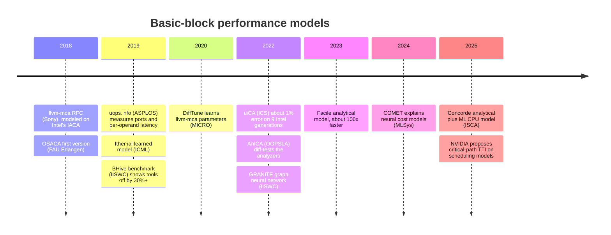
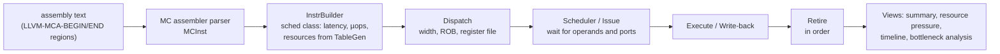
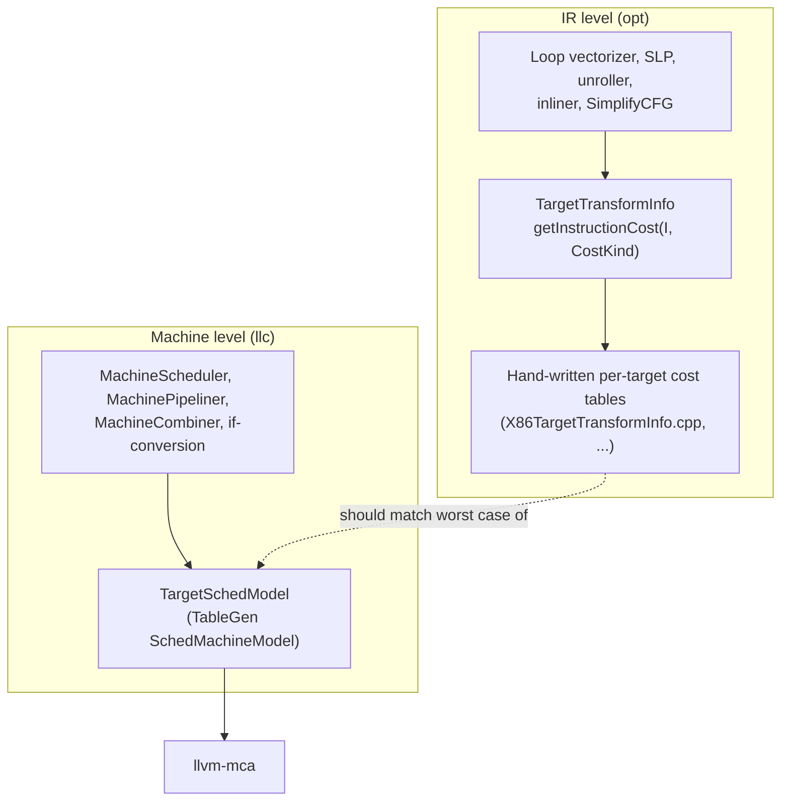
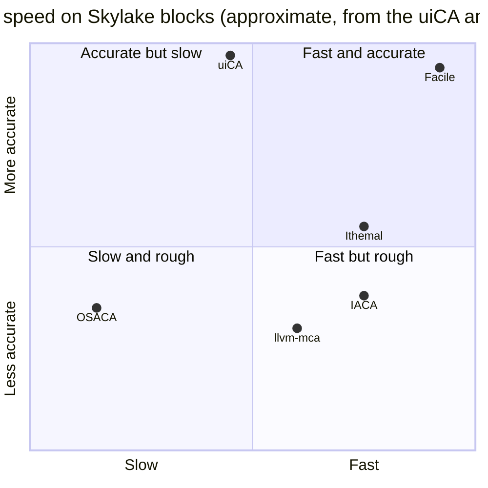

---
tags:
  - compilers
  - backend
  - code-generation
  - performance-models
  - llvm-mca
  - uica
  - osaca
  - cost-models
  - throughput-prediction
status: complete
sources:
  - https://llvm.org/docs/CommandGuide/llvm-mca.html
  - https://lists.llvm.org/pipermail/llvm-dev/2018-March/121490.html
  - https://llvm.org/docs/CommandGuide/llvm-exegesis.html
  - https://www.intel.com/content/www/us/en/developer/archive/tools/architecture-code-analyzer.html
  - https://ar5iv.arxiv.org/html/2107.14210
  - https://publikationen.sulb.uni-saarland.de/handle/20.500.11880/33280?locale=en
  - https://github.com/andreas-abel/uiCA
  - https://ar5iv.labs.arxiv.org/html/1810.04610
  - https://ar5iv.labs.arxiv.org/html/1911.03282
  - https://arxiv.org/abs/2310.13212
  - https://arxiv.org/html/2310.13212
  - https://arxiv.org/abs/1809.00912v1
  - https://ar5iv.labs.arxiv.org/html/1910.00214
  - https://github.com/RRZE-HPC/OSACA
  - https://ar5iv.arxiv.org/html/1808.07412
  - https://dspace.mit.edu/handle/1721.1/128755
  - https://github.com/ithemal/bhive
  - https://ar5iv.labs.arxiv.org/html/2010.04017
  - https://dspace.mit.edu/handle/1721.1/142895
  - https://arxiv.org/html/2210.03894v2
  - https://github.com/google/gematria
  - https://arxiv.org/pdf/2209.05994
  - https://arxiv.org/html/2302.06836v3
  - https://arxiv.org/html/2503.23076v1
  - https://dspace.mit.edu/handle/1721.1/162664
  - https://llvm.org/doxygen/classllvm_1_1TargetTransformInfo.html
  - https://llvm.org/docs/doxygen/X86TargetTransformInfo_8cpp_source.html
  - https://llvm.org/devmtg/2025-10/slides/technical_talks/hickey.pdf
  - https://llvm.org/devmtg/2025-10/slides/tutorials/hsu.pdf
  - https://releases.llvm.org/23.1.0/docs/ReleaseNotes.html
  - https://lists.llvm.org/pipermail/llvm-commits/Week-of-Mon-20251215/1800518.html
  - https://lists.llvm.org/pipermail/llvm-commits/Week-of-Mon-20250224/1576275.html
created: 2026-11-27
updated: 2026-11-27
---

## Table Of Contents

- [[#TL;DR|TL;DR]]
- [[#The Problem|The Problem]]
    - [[#Who Asks the Question|Who Asks the Question]]
    - [[#Why It Is Hard|Why It Is Hard]]
- [[#Foundations|Foundations]]
    - [[#What Throughput Means|What Throughput Means]]
    - [[#Four Lower Bounds|Four Lower Bounds]]
    - [[#Where the Numbers Come From|Where the Numbers Come From]]
    - [[#Three Kinds of Model|Three Kinds of Model]]
- [[#How We Got Here|How We Got Here]]
- [[#How It Works|How It Works]]
    - [[#Worked Example: A Dot Product in llvm-mca|Worked Example: A Dot Product in llvm-mca]]
    - [[#Inside llvm-mca|Inside llvm-mca]]
    - [[#The Front End: What uiCA Adds|The Front End: What uiCA Adds]]
    - [[#OSACA: Bounds, Critical Path and Loop-Carried Chains|OSACA: Bounds, Critical Path and Loop-Carried Chains]]
    - [[#Facile: The Bounds Made Precise|Facile: The Bounds Made Precise]]
    - [[#Learned Models|Learned Models]]
    - [[#Inside the Compiler: TTI and the Scheduling Model|Inside the Compiler: TTI and the Scheduling Model]]
    - [[#Checking the Models|Checking the Models]]
- [[#Where It Is Now|Where It Is Now]]
- [[#Trade-offs & Open Problems|Trade-offs & Open Problems]]
- [[#Resources|Resources]]
- [[#Related Notes|Related Notes]]

## ***TL;DR***
---
*A microarchitectural performance model predicts how many cycles a short piece of machine code (usually a basic block or loop body) takes per iteration on a given CPU, without running it, and ideally says why. Compilers use cruder versions of the same idea to decide what code to emit; performance engineers use the detailed tools to find bottlenecks.*

- **The question.** "In steady state, how many cycles does one iteration of this block cost on core X, and what limits it?" The answer is the largest of a few lower bounds: front-end delivery, issue width, execution-port contention, and loop-carried dependency chains.
- **The tools.** `llvm-mca` (LLVM, 2018) simulates the out-of-order back end from the same TableGen scheduling models the compiler uses ([[Instruction Scheduling]]). **uiCA** (Abel & Reineke, ICS 2022) also simulates the Intel front end and port assignment and lands within about 1% of measurements on nine Intel generations. **OSACA** (FAU Erlangen) computes port pressure, critical path and loop-carried dependencies for x86 and AArch64. **Facile** (IISWC 2023) gets uiCA-level accuracy analytically, about two orders of magnitude faster. Intel's IACA is discontinued.
- **Learned models.** Ithemal (2019) and GRANITE (2022) learn throughput from measurements; DiffTune (MICRO 2020) learns llvm-mca's parameter tables. On BHive, learned models beat llvm-mca, but precise analytical models beat both ([uiCA](https://ar5iv.arxiv.org/html/2107.14210)).
- **Inside compilers.** LLVM's IR passes ask `TargetTransformInfo` (TTI) for per-instruction costs from hand-written tables, while machine passes read the scheduling model directly. A 2025 NVIDIA proposal would cost IR by its critical path on the scheduling model instead.
- **As of November 2026.** llvm-mca is the open default and the tool Intel's archived IACA page points to; uiCA's public version covers Intel cores through Rocket Lake; OSACA covers Zen 1 to Zen 5, Sapphire and Granite Rapids, Neoverse V2 and Apple M1. Models still disagree on simple loops: in this run's test, five LLVM 18 CPU models predicted 2 to 8 cycles for the same one-instruction FMA recurrence.

## ***The Problem***
---
*A modern core overlaps hundreds of instructions, so the cost of a block is not the sum of its instructions' costs. Something has to predict the overlap, cheaply and before the code runs, and it has to be right often enough that the compiler or the engineer can trust it.*

### Who Asks the Question

*Several different consumers need a throughput estimate, and each tolerates a different trade between speed, accuracy and detail.*

| Consumer | Question it asks | What it uses |
|---|---|---|
| Loop and SLP vectorizer ([[Vectorization]]) | Is the vector loop at width 8 cheaper per scalar iteration than width 4 or scalar? | TTI per-instruction cost tables |
| Unroller, inliner, if-conversion | Will this transformation pay for its code growth? | TTI costs, thresholds tied to scheduling-model buffer sizes |
| Scheduler, MachineCombiner, MachinePipeliner ([[Instruction Scheduling]]) | Which order or which instruction mix shortens the critical path? | TableGen scheduling model |
| Superoptimizers ([[Superoptimization]]) | Is this verified-equivalent sequence actually faster? | llvm-mca (Minotaur uses it as its cost) |
| ML search and autotuners ([[ML-Guided Optimization]]) | Which candidate should I measure next? | Learned cost models |
| Performance engineers | Why is this hot loop slow, and which change fixes it? | llvm-mca, uiCA, OSACA, with bottleneck reports |

Measuring instead of predicting is often impossible (the code is a candidate that doesn't exist yet), slow (thousands of candidates per function), noisy (shared machines, frequency scaling), or needs hardware nobody on the team has.

### Why It Is Hard

*Every stage of an out-of-order core can be the limit, and the stages interact.*

- **Front end.** Instructions must be fetched, length-decoded and decoded into micro-ops (µops), or served from a µop cache or loop buffer. A single awkward encoding can stall decoding for several cycles.
- **Rename and issue.** A fixed number of µops per cycle enter the out-of-order window; some (register moves, zeroing idioms) are handled here and never execute.
- **Execution ports.** Each µop may run only on certain ports. Which port the hardware actually picks, cycle by cycle, decides whether a port becomes a bottleneck.
- **Dependencies.** A value carried from one iteration to the next (an accumulator, a pointer chase) forms a recurrence whose latency no amount of parallel hardware can hide.
- **Memory.** Load latency depends on the cache level; stores can forward to loads; two addresses may or may not alias.
- **Undocumented behavior.** Vendors publish partial latency tables and rarely publish port-assignment policies, fusion rules or front-end details, so models are reverse-engineered.

Most tools therefore narrow the question: one basic block or loop body, run many times, all data in L1, branches perfectly predicted. That narrowing is what makes the problem tractable and also what limits every tool in this note.

## ***Foundations***
---
*Throughput prediction rests on a precise definition of throughput, a handful of lower bounds that any execution must respect, and per-instruction tables (latency, µops, ports) measured on real hardware.*

### What Throughput Means

*"Throughput" here means average cycles per iteration in steady state, and whether the block is unrolled or looped changes the answer.*

Block throughput is the number of cycles one iteration takes on average once the pipeline is in steady state, measured over many iterations. (Note the inversion: it is a cost in cycles, the reciprocal of iterations per cycle. Ithemal's paper flags the same convention, [Mendis et al.](https://ar5iv.arxiv.org/html/1808.07412).) Abel and Reineke separate two variants ([uiCA](https://ar5iv.arxiv.org/html/2107.14210)):

- **TP_U (unrolled).** The block is repeated back to back with no branch. Every µop goes through the legacy decoders. BHive's measurements effectively use this.
- **TP_L (loop).** The block ends in a taken branch back to its start. Its µops are often served from the µop cache (DSB) or loop stream detector (LSD) instead of the decoders. IACA, OSACA and CQA predict this.

The difference is not academic. On Skylake, `add ax, 0x1234; dec r15` takes about 3.44 cycles per iteration unrolled, because the 16-bit immediate makes a *length-changing prefix* that stalls the predecoder; adding `jnz` to make it a loop brings it to about 1 cycle, because the µops now come from the µop cache ([uiCA](https://ar5iv.arxiv.org/html/2107.14210)). Earlier tool comparisons mixed the two definitions, which inflated some tools' measured error.

### Four Lower Bounds

*Each part of the core imposes its own minimum cycles per iteration; the real throughput is at least the largest of them, and good models are largely about computing each bound correctly.*

For a block executed in a loop:

$$
TP \;\ge\; \max\Big(\, B_{\text{front}},\;\; \frac{U_{\text{fused}}}{W_{\text{issue}}},\;\; \max_{P \subseteq \text{Ports}} \frac{n(P)}{|P|},\;\; \max_{\text{cycles } C} \frac{\sum_{e \in C} \text{lat}(e)}{\sum_{e \in C} \text{dist}(e)} \Big)
$$

- **Front end** $B_{\text{front}}$: cycles the predecoder, decoders, µop cache or loop buffer need to deliver one iteration's µops.
- **Issue**: fused-domain µops per iteration divided by rename/issue width.
- **Ports**: for every set $P$ of execution ports, let $n(P)$ be the µops that can *only* run on ports inside $P$; those µops need at least $n(P)/|P|$ cycles. If µops could be split fractionally between their allowed ports, the worst such set gives exactly the best achievable port time (a max-flow argument). Real hardware assigns whole µops greedily, so it can do worse.
- **Dependencies**: in the dependence graph, each edge carries a latency and an iteration distance (0 within an iteration, 1 for a value carried to the next). Every cycle $C$ in that graph is a recurrence; its total latency divided by its total distance is the minimum cycles per iteration that chain allows. The maximum over all cycles is the *maximum cycle ratio*.

**In plain English:** a loop can't go faster than its slowest stage. If decoding needs 3 cycles, or the two load ports need 4 cycles to do 8 loads, or the accumulator's add takes 4 cycles and every iteration waits for the previous one, that number is the floor. Simple models compute some of these bounds; detailed models compute all of them and also capture how stages interfere, which is why they can predict *above* the largest bound.

The same max-of-bounds idea underlies roofline-style reasoning at the level of whole kernels and memory bandwidth ([[Roofline Model and Arithmetic Intensity]]).

### Where the Numbers Come From

*Every model needs per-instruction latency, µop count and port usage, and the trustworthy sources are measurements, not vendor manuals.*

- **Vendor manuals** list latency and throughput only for commonly used instructions and omit µop decomposition and ports ([uops.info, ASPLOS 2019](https://ar5iv.labs.arxiv.org/html/1810.04610)).
- **Hand-made tables** such as Agner Fog's have long been the practitioner's reference, but uops.info documents missing memory-operand latencies and imprecise port usage in them (for example `ADC` on Haswell: $2{*}p0156$ versus the measured $1{*}p0156 + 1{*}p06$).
- **uops.info** (Abel & Reineke) measures instructions automatically. To find which ports a µop may use, it fills those ports with *blocking instructions* (cheap single-µop instructions that can run only on a known port set), then runs the target and sees which counters move. Latency is measured *per pair of operands*, `lat(source, destination)`, because one number per instruction overstates real chains. The site holds more than 800,000 pages of results ([uops.info](https://ar5iv.labs.arxiv.org/html/1810.04610)), measured with the low-overhead **nanoBench** harness ([nanoBench](https://ar5iv.labs.arxiv.org/html/1911.03282)).
- **llvm-exegesis** does the same inside LLVM: it generates snippets that make an opcode's execution "as serial (resp. as parallel) as possible," runs them under performance counters in `latency`, `uops` or `inverse_throughput` mode, and in analysis mode clusters the results and reports where they contradict LLVM's scheduling model ([llvm-exegesis docs](https://llvm.org/docs/CommandGuide/llvm-exegesis.html)).

### Three Kinds of Model

*Analytical models compute bounds, simulators step a model pipeline cycle by cycle, and learned models fit a function from block to cycles; each trades speed, accuracy and explanation differently.*

| Kind | How it predicts | Explains its answer? | Examples |
|---|---|---|---|
| Analytical | Computes port, issue and dependency bounds and combines them | Yes, by naming the binding bound | OSACA, Facile, a simple "instructions / issue width" baseline |
| Simulation | Steps a model pipeline (dispatch, issue, execute, retire, sometimes front end) | Partly: timelines and stall counters | llvm-mca, uiCA, IACA (closed) |
| Learned | Neural network trained on measured blocks | Not directly (needs tools like COMET) | Ithemal, GRANITE, Concorde (whole-program CPI) |
| Hybrid | Learns a simulator's parameters or fuses analytical features with ML | Through the underlying model | DiffTune, Concorde |

## ***How We Got Here***
---
*Vendor tools came first, then an open simulator built on compiler data, then a burst of measurement work around 2019 that exposed how inaccurate everyone was, and then precise reverse-engineered models.*



- **IACA (Intel).** Intel's Architecture Code Analyzer reported port pressure and throughput for marked regions of Intel code. It was closed source and Intel-only, dropped latency analysis in v2.2, and lagged new cores ([uops.info](https://ar5iv.labs.arxiv.org/html/1810.04610)). Intel's archive page now says it "has been discontinued" and points to LLVM-MCA as a similar product ([Intel](https://www.intel.com/content/www/us/en/developer/archive/tools/architecture-code-analyzer.html)).
- **llvm-mca (2018).** Andrea Di Biagio (Sony) proposed it on llvm-dev in March 2018: "The analysis and reporting style were inspired by the IACA tool from Intel." It reused LLVM's scheduling models, so any target with a model got an analyzer for free, and in turn it became the main way to find bugs in those models ([RFC](https://lists.llvm.org/pipermail/llvm-dev/2018-March/121490.html)).
- **OSACA (2018 to 2019).** From the HPC group at FAU Erlangen, it started as an open IACA alternative for Intel and AMD ([PMBS 2018](https://arxiv.org/abs/1809.00912v1)) and grew critical-path and loop-carried-dependency analysis and AArch64 support ([Laukemann et al., 2019](https://ar5iv.labs.arxiv.org/html/1910.00214)).
- **The measurement turn (2019).** uops.info made port and latency data reproducible. BHive (MIT and Google) collected basic blocks from real programs, including Google's Spanner and Dremel, and a harness to time them, and found that IACA and llvm-mca "have not been systematically validated" and had been reported to deviate from measurements by more than 30% ([BHive](https://dspace.mit.edu/handle/1721.1/128755)). Ithemal, trained on such measurements, had less than half the error of llvm-mca and IACA ([Ithemal](https://ar5iv.arxiv.org/html/1808.07412)).
- **Precise models (2021 to 2023).** uiCA showed that a carefully reverse-engineered simulator of the front end, renamer and port assignment could get under 1% error, far ahead of learned models ([uiCA](https://ar5iv.arxiv.org/html/2107.14210)); Facile then showed the same accuracy could be had analytically and fast ([Facile](https://arxiv.org/abs/2310.13212)).

## ***How It Works***
---
*A worked example first, then each tool's machinery: what llvm-mca simulates, what uiCA adds in the front end, how OSACA and Facile compute bounds, how learned models fit in, and how compilers consume cheaper versions of the same information.*

### Worked Example: A Dot Product in llvm-mca

*A one-accumulator dot product is limited by the floating-point recurrence, not by the hardware's width; llvm-mca shows that in its numbers, and splitting the accumulator shows the fix.*

The source, compiled with Clang 18 for Skylake (`-O2 -march=skylake -fno-unroll-loops -fno-vectorize`; Clang contracts the multiply-add into an FMA):

```c
float dot(const float *a, const float *b, long n) {
  float s = 0.0f;
  for (long i = 0; i < n; i++) s += a[i] * b[i];
  return s;
}
```

The loop body:

```asm
.LBB0_2:
    vmovss      (%rdi,%rax,4), %xmm1
    vfmadd231ss (%rsi,%rax,4), %xmm1, %xmm0   # s += a[i]*b[i]
    incq        %rax
    cmpq        %rax, %rdx
    jne         .LBB0_2
```

Real output of `llvm-mca -mtriple=x86_64 -mcpu=skylake -iterations=100 -bottleneck-analysis` (LLVM 18.1.3, run for this note):

```text
Iterations:        100
Instructions:      500
Total Cycles:      408
Total uOps:        600

Dispatch Width:    6
uOps Per Cycle:    1.47
IPC:               1.23
Block RThroughput: 1.0

Cycles with backend pressure increase [ 21.57% ]
Throughput Bottlenecks:
  Resource Pressure       [ 0.00% ]
  Data Dependencies:      [ 21.57% ]
  - Register Dependencies [ 21.57% ]
  - Memory Dependencies   [ 0.00% ]

Resource pressure per iteration:
[0]    [1]    [2]    [3]    [4]    [5]    [6]    [7]    [8]    [9]
 -      -     1.08   1.09   1.00   1.00    -     0.91   0.92    -
```

Reading it against the four bounds:

| Bound | Skylake model | Cycles per iteration |
|---|---|---|
| Ports | Two loads on ports 2 and 3 take 1 cycle; FMA, inc, cmp, jne fit in ports 0, 1, 5, 6 | 1.0 (the "Block RThroughput") |
| Issue | 6 µops at dispatch width 6 | 1.0 |
| Dependency | `%xmm0` feeds the next iteration's FMA; accumulator-to-result latency 4 | **4.0** |
| Front end | Not modeled by llvm-mca | n/a |

The simulation lands at 4.08 cycles per iteration (408 / 100): the FMA recurrence decides everything, and the hardware sits mostly idle. One caution: the "critical sequence" printout in the same report showed the `%rax` increment chain, a 1-cycle recurrence; the arithmetic says the binding chain is `%xmm0`. Read the cycle count, then check the chain yourself.

The fix is to break the recurrence. With four accumulators (`s0`..`s3`, the reassociation that `-ffast-math` would license), the body becomes four independent `vfmadd231ss` chains plus eight loads per iteration of four elements:

| Same loop, LLVM 18 llvm-mca models | 1 accumulator, cycles per element | 4 accumulators, cycles per element |
|---|---|---|
| `skylake` | 4.0 | 1.0 (loads now tie the FMA chains: 8 loads / 2 ports = 4 cycles per 4 elements) |
| `sapphirerapids` | 5.0 | 1.25 |
| `znver4` | 4.0 | 1.0 |
| `neoverse-v2` (AArch64 build) | 2.0 | 0.5 |
| `apple-m1` (AArch64 build) | 8.0 | 2.0 |

Timed on this run's cloud machine (an Intel Xeon reporting family 6 model 207, Emerald Rapids), the four-accumulator version ran 3.8x to 5.0x faster per element across runs, consistent with the predicted 4x; the machine is a shared VM with a varying clock, so absolute cycle counts could not be pinned down.

Two lessons. First, the model's job is often not the number but the *diagnosis*: "latency bound, not port bound" tells you to add accumulators or vectorize, not to reduce instructions. Second, the models disagree by a factor of four on a single FMA recurrence. Each CPU model encodes a different accumulator latency (the M1 model's `fmadd` latency is 8 cycles; the Neoverse V2 model's recurrence costs 2). Which number is right is exactly what model validation (below) has to settle, and I did not check the AArch64 numbers on hardware.

### Inside llvm-mca

*llvm-mca parses assembly into LLVM's machine-code layer, looks up each instruction's scheduling class, and simulates an out-of-order back end; it inherits every strength and gap of the scheduling model.*



- **Pipeline.** The default out-of-order pipeline has dispatch (limited by dispatch width, reorder buffer, physical registers and scheduler space), issue (out of order, when operands and resources are ready), write-back and in-order retire. An in-order pipeline has a single `InOrderIssue` stage then retire ([llvm-mca docs](https://llvm.org/docs/CommandGuide/llvm-mca.html)).
- **Inputs.** It reads the target's `SchedMachineModel` (issue width, `MicroOpBufferSize`, load latency) and per-instruction `WriteRes` entries (latency, resources, `ReleaseAtCycles`): exactly the tables shown in [[Instruction Scheduling]]. That shared data is the point: the analyzer and the compiler's scheduler see the same machine ([Hsu, LLVM Dev Meeting 2025](https://llvm.org/devmtg/2025-10/slides/tutorials/hsu.pdf)).
- **Metrics.** IPC is simulated instructions divided by simulated cycles. *Block RThroughput* is the resource-only bound, ignoring loop-carried dependencies; the gap between it and the simulated cycles per iteration is the dependency cost.
- **Regions and instruments.** `# LLVM-MCA-BEGIN name` / `# LLVM-MCA-END` comments mark regions analyzed separately. `LLVM-MCA-LATENCY <n>` overrides a latency (to model a cache miss), and RISC-V uses `LLVM-MCA-RISCV-LMUL` so a vector instruction gets the scheduling class for its register-group size. A target's `CustomBehaviour::checkCustomHazard()` can add stalls the model can't express; it currently works only in the in-order pipeline.
- **What it leaves out.** Fetch and decode (so no front-end bottlenecks), branch prediction, and the cache hierarchy (loads assume optimistic L1 hits) ([llvm-mca docs](https://llvm.org/docs/CommandGuide/llvm-mca.html)). The 2018 RFC also listed macro-fusion, zero idioms, partial-register updates and conservative load/store aliasing as gaps ([RFC](https://lists.llvm.org/pipermail/llvm-dev/2018-March/121490.html)).

The front-end gap is easy to show. The length-changing-prefix block from Foundations, run through llvm-mca for Skylake:

```text
$ llvm-mca -mtriple=x86_64 -mcpu=skylake -iterations=1000 lcp.s   # add ax, 0x1234; dec r15
Iterations:        1000
Total Cycles:      1003
Block RThroughput: 0.5
```

llvm-mca predicts about 1.0 cycle per iteration (the 16-bit add's 1-cycle self-dependence); the measured unrolled throughput reported in the uiCA paper is about 3.44, all of it predecoder stall.

### The Front End: What uiCA Adds

*uiCA's accuracy comes from modeling the parts other tools skip: predecoding, the decoders, the µop cache, the loop buffer, move elimination, and the exact rule the renamer uses to pick ports.*

uiCA (Abel & Reineke, [ICS 2022](https://publikationen.sulb.uni-saarland.de/handle/20.500.11880/33280?locale=en)) is a Python cycle-level simulator for Intel Core cores from Sandy Bridge to Rocket Lake ([uiCA](https://ar5iv.arxiv.org/html/2107.14210)):

- **Predecoder.** Reads aligned 16-byte blocks, at most one per cycle, predecodes at most 5 instructions per cycle; a length-changing prefix costs 3 cycles.
- **Decoders.** One complex decoder (up to 4 µops, always takes the first instruction) and three simple ones (single-µop instructions only).
- **µop cache (DSB).** Before Ice Lake, up to 3 lines of 6 µops per 32-byte block; Ice Lake uses 64-byte blocks with up to 6 lines. Switching from decoders to the DSB happens only after a branch, and switching to or from the microcode sequencer stalls for 2 cycles (4 before Skylake). On Skylake, the jump-conditional-code (JCC) erratum mitigation changes what can be cached.
- **Loop stream detector.** Streams small loops from the µop queue and can unroll them; Skylake's was disabled by a microcode update.
- **Renamer.** Handles zero and one idioms and register moves without execution. Move elimination uses limited "elimination slots" that free only when the aliased registers are overwritten, and is disabled for general-purpose registers on Tiger Lake and newer Ice Lake microcode.
- **Port assignment.** For each group of up to four µops issued in a cycle, it finds the least-used eligible port and the second least-used; issue slots 0 and 2 go to the first, slots 1 and 3 to the second (ties to the higher-numbered port; if the usage gap is at least 3, both go to the least used). Loads alternate between ports 2 and 3.

That last rule matters a lot: replacing it with random assignment raised uiCA's error about 5x on unrolled blocks and 17x on loops. Accuracy on BHive's improved measurements (mean absolute percentage error, MAPE):

| Skylake | BHive unrolled (TP_U) | BHive loop (TP_L) |
|---|---|---|
| uiCA | **0.45%** | **0.38%** |
| CQA | n/a | 7.44% |
| Ithemal | 8.28% | 13.66% |
| IACA 3.0 | 13.49% | 14.26% |
| OSACA | 14.95% | 11.25% |
| llvm-mca 10 | 15.61% | 12.01% |
| Simple baseline (µops / width, loads / 2, stores / 1) | 17.28% | 10.03% |
| DiffTune | 24.48% | 104.88% |

Across all nine generations uiCA stays at or under about 2% (worst: Sandy Bridge, 1.91% unrolled). Note the baseline: a three-line analytical bound is competitive with several complex tools ([uiCA](https://ar5iv.arxiv.org/html/2107.14210)). Usage is one command, e.g. `./uiCA.py test.o -arch SKL`, with `-trace out.html` for a cycle-by-cycle table and `-alignmentOffset` to test code placement (the tool is AGPL-3.0; [GitHub](https://github.com/andreas-abel/uiCA)). Alignment sensitivity is one reason [[Code Layout]] matters even inside a single loop.

### OSACA: Bounds, Critical Path and Loop-Carried Chains

*OSACA reports three numbers that bracket the truth: a port-pressure lower bound, a loop-carried dependency bound, and a critical-path upper bound for one iteration.*

OSACA ([Laukemann et al.](https://ar5iv.labs.arxiv.org/html/1910.00214)) splits each instruction into µops on ports. Where several ports can run a µop it assumes a fixed, even split (an `add` that can use four ports costs 0.25 cycles on each), which yields an optimistic throughput bound. It then builds a dependence DAG weighted by latency: the longest path is the **critical path (CP)**, an upper bound for one iteration in isolation; and a DAG over two back-to-back copies of the body exposes **loop-carried dependencies (LCD)**, a lower bound whenever a chain crosses iterations.

On a Gauss-Seidel kernel, OSACA's LCD predictions of 18.00, 14.00 and 11.50 cycles per iteration on ThunderX2, Cascade Lake and Zen sat next to measured 18.50, 14.02 and 11.83; llvm-mca matched Cascade Lake but overestimated Zen by almost 50% and had no ThunderX2 model at the time. Its instruction data comes from its own `ibench` microbenchmarks, uops.info and Agner Fog's tables. The current release covers Intel Sandy Bridge through Granite Rapids, AMD Zen 1 to Zen 5, and AArch64 cores including Neoverse N1 and V2 (Grace), A64FX and Apple M1 Firestorm, and can export the dependency graph with the CP and LCDs highlighted ([OSACA](https://github.com/RRZE-HPC/OSACA)).

### Facile: The Bounds Made Precise

*Facile computes each bound separately and analytically, takes the maximum, and so names the bottleneck directly, at uiCA's accuracy and a fraction of its cost.*

Facile ([Abel, Sharma & Reineke, IISWC 2023](https://arxiv.org/abs/2310.13212)) models predecoder, decoders, µop cache, loop stream detector, issue, ports (contention computed over port combinations) and *precedence* (loop-carried chains, via a cycle-ratio computation on the dependence graph), and combines them ([Facile](https://arxiv.org/html/2310.13212)):

$$
TP_U = \max\{\text{Predec}, \text{Dec}, \text{Issue}, \text{Ports}, \text{Precedence}\}, \qquad TP_L = \max\{\text{FE}, \text{Issue}, \text{Ports}, \text{Precedence}\}
$$

where the front-end term FE is the decoder bound for blocks hit by the JCC erratum, the loop stream detector when it is enabled and the loop fits, and the µop cache otherwise.

**In plain English:** this is the four-bound formula from Foundations with each bound modeled properly. Because the answer is a maximum, the winning term *is* the explanation. Facile's MAPE on Skylake is 0.69% unrolled and 1.08% looped, close to uiCA, and it runs more than 100x faster than uiCA, fast enough to sit inside a compiler's search loop.

### Learned Models

*Learned models replace hand-built tables with networks trained on measured blocks; they beat llvm-mca but not precise analytical models, and they need extra machinery to explain themselves.*

- **Ithemal** (Mendis et al., 2019). A token-level LSTM turns each instruction into a vector, a second LSTM turns the instruction sequence into a block vector, and a linear layer predicts cycles. Trained on about 1.4 million unique Haswell blocks, it reported average error 0.089 on Haswell against 0.200 for llvm-mca and 0.209 for IACA ([Ithemal](https://ar5iv.arxiv.org/html/1808.07412)). See [[ML-Guided Optimization]] for how it fits the wider learned-cost-model story.
- **GRANITE** (Google, IISWC 2022). A graph neural network over nodes for mnemonics, prefixes and values (registers, immediates, addresses, memory) with operand and structural edges, eight message-passing rounds, and one decoder head per microarchitecture. On the Ithemal dataset it scored 6.47% to 7.61% MAPE against Ithemal's 8.30% to 9.90%, and trained about 3x faster on a GPU ([GRANITE](https://arxiv.org/html/2210.03894v2)). Google's Gematria repository packages GRANITE and Ithemal and an `llvm-cm` tool, a subset of which its authors "eventually plan to merge in the LLVM monorepo" ([Gematria](https://github.com/google/gematria)).
- **DiffTune** (MIT, MICRO 2020). Instead of replacing llvm-mca, it learns llvm-mca's 11,265 x86 parameters (dispatch width, ROB size, and per-instruction µops, latency, read-advance cycles and port map). It trains a differentiable surrogate network to imitate llvm-mca on random parameter tables, then runs gradient descent on the parameters against measured timings. Average error over four cores fell from 30.0% to 24.6%, but some learned values did not correspond to "reasonable physical values on the CPU" ([DiffTune](https://ar5iv.labs.arxiv.org/html/2010.04017); [venue](https://dspace.mit.edu/handle/1721.1/142895)).
- **COMET** (MLSys 2024). Explains a cost model's prediction by finding a small set of block features (specific instructions, dependencies between pairs, instruction count) that keep the prediction nearly unchanged. Ithemal's explanations leaned on instruction count; uiCA's named the actual division instruction and dependency, and lower-error models relied on finer features ([COMET](https://arxiv.org/html/2302.06836v3)).
- **Concorde** (Google and collaborators, ISCA 2025). Scales the idea up from blocks to program regions: simple per-resource analytical models (ROB, load queue and so on, each assuming the rest is unlimited) produce throughput-bound distributions over windows of a few hundred instructions, and a small MLP turns those plus microarchitecture parameters into CPI. About 2% average CPI error, about five orders of magnitude faster than the reference cycle-level simulator on 1M-instruction regions, which lets it attribute performance to core components with Shapley values over 143 million evaluations in about an hour ([Concorde](https://arxiv.org/html/2503.23076v1); [venue](https://dspace.mit.edu/handle/1721.1/162664)). It is a hardware design tool more than a compiler tool, but it shows where the analytical-plus-learned hybrid is heading.

### Inside the Compiler: TTI and the Scheduling Model

*LLVM keeps two cost views: IR passes ask TargetTransformInfo for per-instruction costs in four flavors, and machine passes read the scheduling model directly. The two are meant to agree and often don't.*



- **Cost kinds.** `getInstructionCost` estimates "the cost of a given IR user when lowered" under one of four kinds: `TCK_RecipThroughput`, `TCK_Latency`, `TCK_CodeSize`, `TCK_SizeAndLatency` ([TTI reference](https://llvm.org/doxygen/classllvm_1_1TargetTransformInfo.html)). The vectorizer uses reciprocal throughput; size-oriented passes use the others.
- **Where the numbers come from.** On x86 they are tables of `{ throughput, latency, size, size-and-latency }` per operation and type, e.g. `{ ISD::SHL, MVT::v16i8, { 1, 6, 1, 2 } }, // gf2p8affineqb`. The file's header states the contract: "TCK_RecipThroughput and TCK_Latency should try to match the worst case values reported by the CPU scheduler models (and llvm-mca)," and size-and-latency should match µop counts so it stays compatible with the `MicroOpBufferSize` and `LoopMicroOpBufferSize` thresholds that use it ([X86TargetTransformInfo.cpp](https://llvm.org/docs/doxygen/X86TargetTransformInfo_8cpp_source.html)). So llvm-mca is how cost-table entries are checked.
- **The proposal.** A 2025 NVIDIA talk called the status quo a sum of per-IR-instruction guesses that "doesn't model modern complex hardware," tuned by hand over time (an AArch64 `v32i1` reduction cost dropped from 91 to 3 after codegen improved), more than 100,000 lines, 563 call sites, and integer-grained enough that RISC-V scales costs by 100. It proposes *virtual lowering*: run the IR through instruction selection without emitting it, then cost the block as its critical path on the scheduling model, which naturally accounts for fusion (a `mul`/`add`/`load` that becomes one `ldr` with a shifted index) and parallelism. As of the talk it was a vision with open problems (mapping assembly back to IR, context-dependent costs, compile time), with a JSON override file as the near-term step ([Gokhale, Amilkanthwar & Hickey](https://llvm.org/devmtg/2025-10/slides/technical_talks/hickey.pdf)).

### Checking the Models

*Because every consumer trusts the model, the field built benchmarks, differential testers and microbenchmark generators to catch model errors.*

- **BHive** supplies real basic blocks and a timing harness that runs each block unrolled at two factors and takes the difference, mapping many virtual pages onto a few physical ones so arbitrary memory operands don't fault ([BHive repo](https://github.com/ithemal/bhive)).
- **AnICA** (Ritter & Hack, OOPSLA 2022) differential-tests pairs of analyzers on random blocks, then uses abstract interpretation to generalize each disagreement into an "abstract block" describing a whole class of inputs. On Haswell it compared IACA, llvm-mca 9 and 13, OSACA, uiCA, Ithemal and DiffTune. Findings: llvm-mca 9 predicted as if all memory accesses aliased; a two-instruction `FXRSTOR` block crashed llvm-mca (fixed in LLVM 13); uiCA and OSACA assume identical memory operands alias while IACA and default llvm-mca don't, changing some predictions by 2x or more; llvm-mca's Zen+ model gave many microcoded instructions a flat 100-cycle latency (reported and fixed); Ithemal predicted different throughput for blocks differing only in register names ([AnICA](https://arxiv.org/pdf/2209.05994)).
- **llvm-exegesis** measures the host and flags scheduling-model entries its clusters contradict ([docs](https://llvm.org/docs/CommandGuide/llvm-exegesis.html)); Igalia's RISC-V model work used measured latencies the same way (see [[Instruction Scheduling]]).

## ***Where It Is Now***
---
*As of November 2026, precise analytical and simulation models exist for older Intel cores, llvm-mca is the cross-target default because it rides on the compiler's models, and the open questions are coverage of new cores and getting better models into the compiler's own cost decisions.*

- **Tool landscape.** IACA is discontinued, and Intel's archived page points to LLVM-MCA ([Intel](https://www.intel.com/content/www/us/en/developer/archive/tools/architecture-code-analyzer.html)). llvm-mca works for every LLVM target with a scheduling model, including in-order RISC-V cores with LMUL-aware vector instruments ([llvm-mca docs](https://llvm.org/docs/CommandGuide/llvm-mca.html)). uiCA's public repository lists Intel cores from Sandy Bridge to Rocket Lake, and no hybrid-era Intel cores ([uiCA](https://github.com/andreas-abel/uiCA)). OSACA is the broadest of the detailed tools, through Zen 5, Granite Rapids and Neoverse V2 ([OSACA](https://github.com/RRZE-HPC/OSACA)).
- **Model coverage lags silicon.** New scheduling models arrive per core and are measured by hand or with llvm-exegesis. Zen 5 is an example: a scheduling model was proposed in February 2025 ([PR #128822](https://lists.llvm.org/pipermail/llvm-commits/Week-of-Mon-20250224/1576275.html)), and a later Znver5 scheduler description (PR #172370) was converted to draft in December 2025 ([thread](https://lists.llvm.org/pipermail/llvm-commits/Week-of-Mon-20251215/1800518.html)); I could not confirm a dedicated Zen 5 model has merged. On RISC-V, LLVM 23 made `-mtune=generic` use the SpacemiT X60 model instead of an empty one and added several new cores ([LLVM 23 notes](https://releases.llvm.org/23.1.0/docs/ReleaseNotes.html)).
- **Compiler cost models.** LLVM 23's notes record cost-model work for SystemZ auto-vectorization and PowerPC vector-predicated loads and stores, still in the hand-tuned TTI style ([LLVM 23 notes](https://releases.llvm.org/23.1.0/docs/ReleaseNotes.html)). The critical-path-on-scheduling-model approach remains a proposal ([NVIDIA talk](https://llvm.org/devmtg/2025-10/slides/technical_talks/hickey.pdf)).
- **Learned models.** GRANITE and Ithemal are available as open code in Gematria, with `llvm-cm` intended for upstream LLVM, but no production LLVM pass consumes a learned throughput model as of this writing. Research has moved toward explanation (COMET) and toward hybrid analytical-plus-learned models for whole regions (Concorde). See [[ML-Guided Optimization]] for where learned cost models *are* in production (tensor-compiler autotuners).
- **Uses that grew.** Superoptimizers such as Minotaur use llvm-mca µop estimates as their cost because they predicted speed better than cycle counts ([[Superoptimization]]); and LLM-driven kernel search increasingly needs a cheap, trustworthy cost signal before it measures ([[LLM-Written Kernels]]).

## ***Trade-offs & Open Problems***
---
*Every model buys speed by narrowing the question (one block, L1 hits, perfect branches) and buys accuracy by encoding undocumented hardware; the open problems are where those narrowings and encodings break.*

| Tool | Kind | Targets | Speed (Skylake, per block) | Skylake BHive MAPE (U / L) | Explains? |
|---|---|---|---|---|---|
| llvm-mca 10 | Back-end simulation on compiler models | Every LLVM target with a model | about 36 ms | 15.61% / 12.01% | Timeline, resource pressure, bottleneck report |
| uiCA | Full front- and back-end simulation | Intel SNB to RKL | about 105 ms (Python) | 0.45% / 0.38% | Cycle-by-cycle trace |
| Facile | Analytical bounds | Intel SNB to RKL | more than 100x faster than uiCA | 0.69% / 1.08% | Names the binding bound |
| OSACA | Analytical (ports, CP, LCD) | x86 and AArch64 | about 1300 ms | 14.95% / 11.25% | Bounds and dependency graph |
| IACA 3.0 | Closed simulation | Intel (discontinued) | about 10 ms | 13.49% / 14.26% | Port pressure |
| Ithemal | Learned (LSTM) | Trained cores | about 10 ms | 8.28% / 13.66% | Needs COMET-style tools |

Speeds and errors are from the uiCA and Facile papers ([uiCA](https://ar5iv.arxiv.org/html/2107.14210); [Facile](https://arxiv.org/html/2310.13212)) and are for older tool versions.



- **The basic-block box.** Caches, branch mispredictions and memory bandwidth are outside these models (llvm-mca assumes L1 hits). That is fine for compute-bound inner loops and misleading elsewhere; whole-program models such as Concorde or roofline analysis cover different ground ([[Roofline Model and Arithmetic Intensity]]).
- **Definitions and measurements.** Unrolled versus looped throughput can differ by 3x for the same instructions, and BHive's original measurements contained values below the physical limit; re-measuring them changed results by up to 4.4% MAPE ([uiCA](https://ar5iv.arxiv.org/html/2107.14210)). A tool's reported accuracy is only as good as the ground truth.
- **Port assignment and other secrets.** The biggest single source of uiCA's accuracy is reproducing Intel's port-assignment rule; vendors don't document it, so every new core needs reverse engineering, and precise tools lag new silicon by years.
- **Compiler models must be cheap and general.** A scheduling model has to cover every instruction on every subtarget, and TTI has to answer in microseconds for IR that hasn't been lowered yet. That is why compilers sum table entries instead of simulating, and why the NVIDIA proposal's compile-time cost is an open question.
- **Models disagree, silently.** Aliasing assumptions differ between tools, and per-core models differ wildly on simple recurrences (the 2 to 8 cycle spread in the worked example). Differential testing (AnICA) and measurement (llvm-exegesis) find these, but someone has to run them per core.
- **Learned models and trust.** Learned predictors depend on their training distribution, can't easily say *why*, and fitted parameters (DiffTune) may stop meaning anything physical, which makes them hard to maintain inside a compiler. Explanation tools help, but the analytical models currently win on both accuracy and explanation where they exist.
- **Beyond x86.** The precise work concentrates on Intel. AArch64 and RISC-V models are mostly LLVM and OSACA tables, and GPU instruction-level models are largely reverse-engineered (see [[PTX and SASS]]).

## ***Resources***
---
*Start with the llvm-mca docs and the uiCA paper; the rest fills in measurement, learned models and the compiler side.*

**Tools and docs**
- [llvm-mca](https://llvm.org/docs/CommandGuide/llvm-mca.html): LLVM Machine Code Analyzer documentation.
- [llvm-mca RFC](https://lists.llvm.org/pipermail/llvm-dev/2018-March/121490.html): Andrea Di Biagio (Sony), llvm-dev, March 2018. Design, scope and the original list of gaps.
- [llvm-exegesis](https://llvm.org/docs/CommandGuide/llvm-exegesis.html): measuring latency, µops and inverse throughput on the host and checking scheduling models.
- [uiCA on GitHub](https://github.com/andreas-abel/uiCA) and [OSACA on GitHub](https://github.com/RRZE-HPC/OSACA).
- [Intel Architecture Code Analyzer (archived)](https://www.intel.com/content/www/us/en/developer/archive/tools/architecture-code-analyzer.html).
- [Gematria](https://github.com/google/gematria): Google's GRANITE and Ithemal implementations and `llvm-cm`.

**Primary papers**
- [uiCA: Accurate Throughput Prediction of Basic Blocks on Recent Intel Microarchitectures](https://ar5iv.arxiv.org/html/2107.14210): Abel & Reineke, ICS 2022. The front-end and port-assignment model, and the cleanest comparison of all tools.
- [Facile: Fast, Accurate, and Interpretable Basic-Block Throughput Prediction](https://arxiv.org/abs/2310.13212): Abel, Sharma & Reineke, IISWC 2023.
- [uops.info: Characterizing Latency, Throughput, and Port Usage of Instructions on Intel Microarchitectures](https://ar5iv.labs.arxiv.org/html/1810.04610): Abel & Reineke, ASPLOS 2019; [nanoBench](https://ar5iv.labs.arxiv.org/html/1911.03282).
- [Automatic Throughput and Critical Path Analysis of x86 and ARM Assembly Kernels](https://ar5iv.labs.arxiv.org/html/1910.00214): Laukemann, Hammer, Hager & Wellein, 2019 (OSACA); [first OSACA paper, PMBS 2018](https://arxiv.org/abs/1809.00912v1).
- [BHive](https://dspace.mit.edu/handle/1721.1/128755): Chen et al., IISWC 2019 ([repo](https://github.com/ithemal/bhive)).
- [Ithemal](https://ar5iv.arxiv.org/html/1808.07412): Mendis, Renda, Amarasinghe & Carbin, ICML 2019.
- [DiffTune](https://ar5iv.labs.arxiv.org/html/2010.04017): Renda, Chen, Mendis & Carbin, MICRO 2020.
- [GRANITE](https://arxiv.org/html/2210.03894v2): Sýkora, Phothilimthana, Mendis & Yazdanbakhsh, IISWC 2022.
- [AnICA: Analyzing Inconsistencies in Microarchitectural Code Analyzers](https://arxiv.org/pdf/2209.05994): Ritter & Hack, OOPSLA 2022.
- [COMET: Neural Cost Model Explanation Framework](https://arxiv.org/html/2302.06836v3): MLSys 2024.
- [Concorde: Fast and Accurate CPU Performance Modeling with Compositional Analytical-ML Fusion](https://arxiv.org/html/2503.23076v1): ISCA 2025.

**Compiler side**
- [TargetTransformInfo reference](https://llvm.org/doxygen/classllvm_1_1TargetTransformInfo.html) and [X86TargetTransformInfo.cpp](https://llvm.org/docs/doxygen/X86TargetTransformInfo_8cpp_source.html) (the cost-kind contract in its header).
- [Instruction Cost Modelling: Can we do better?](https://llvm.org/devmtg/2025-10/slides/technical_talks/hickey.pdf): Gokhale, Amilkanthwar & Hickey (NVIDIA), LLVM Dev Meeting 2025.
- [Past, Present, and Future Scheduling Model in LLVM](https://llvm.org/devmtg/2025-10/slides/tutorials/hsu.pdf): Min Hsu, LLVM Dev Meeting 2025 tutorial.

## Related Notes

- [[Instruction Scheduling]] — The TableGen scheduling models llvm-mca simulates, and the scheduler that consumes them.
- [[Vectorization]] — The biggest consumer of TTI throughput costs when choosing vector width and interleave.
- [[Code Layout]] — Alignment and µop-cache effects that only front-end-aware models like uiCA capture.
- [[ML-Guided Optimization]] — Ithemal and learned cost models in the wider ML-in-compilers picture.
- [[Superoptimization]] — Minotaur uses llvm-mca as the cost of candidate rewrites.
- [[LLVM]] — TableGen, the MC layer llvm-mca parses with, and TTI.
- [[Instruction Selection]] — What virtual lowering would reuse to cost IR by its machine code.
- [[Loop Optimizations]] — Unrolling and accumulator splitting, the fixes a latency-bound diagnosis points to.
- [[Register Allocation]] — Spills add loads and stores that every model then has to price.
- [[Roofline Model and Arithmetic Intensity]] — The same max-of-bounds idea at kernel and memory-bandwidth scale.
- [[PTX and SASS]] — Reverse-engineered GPU latencies, the GPU analogue of uops.info.
- [[LLM-Written Kernels]] — Search loops that need a cheap cost signal before measuring.
- [[Floating-Point Semantics]] — Why splitting a float accumulator needs reassociation permission.
- [[Spectre Mitigations in Compilers]] — Planned: microarchitectural behavior that changes what code is safe, not just how fast it is.
