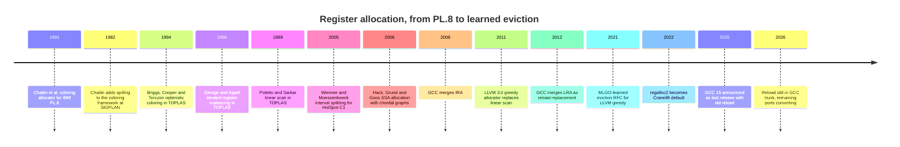
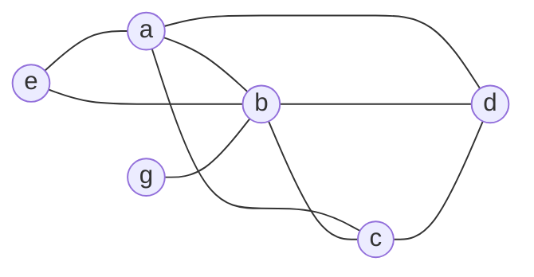

---
tags:
  - compilers
  - register-allocation
  - code-generation
  - backend
  - graph-coloring
  - linear-scan
  - liveness
status: complete
sources:
  - https://web.eecs.umich.edu/~mahlke/courses/583f18/reading/chaitin82.pdf
  - https://en.wikipedia.org/wiki/Chaitin%27s_algorithm
  - https://www.cs.princeton.edu/research/techreps/TR-498-95
  - https://www.cs.purdue.edu/homes/hosking/502/george.pdf
  - https://www.cse.iitm.ac.in/~krishna/cs3300/linearscan.pdf
  - https://www.cs.tufts.edu/~nr/cs257/archive/mike-smith/pldi98-binpack.pdf
  - https://oberon.ssw.jku.at/Research/Papers/Wimmer05
  - https://link.springer.com/doi/10.1007/11688839_20
  - https://compilers.cs.uni-saarland.de/projects/ssara/
  - https://www.cs.princeton.edu/~appel/papers/spill.pdf
  - https://blog.llvm.org/2011/09/greedy-register-allocation-in-llvm-30.html
  - https://lists.llvm.org/pipermail/llvm-dev/2021-November/153639.html
  - https://llvm.org/docs/MLGO.html
  - https://llvm.googlesource.com/llvm-project/+/refs/heads/main/llvm/lib/CodeGen/MLRegAllocPriorityAdvisor.cpp
  - https://src.rcs.uwaterloo.ca/source/history/llvm-project/llvm/lib/CodeGen/RegAllocGreedy.cpp
  - https://src.rcs.uwaterloo.ca/source/xref/llvm-project/llvm/lib/CodeGen/RegAllocPBQP.cpp
  - https://cfallin.org/blog/2022/06/09/cranelift-regalloc2/
  - https://docs.rs/crate/regalloc2/0.15.1/source/doc/FASTALLOC.md
  - https://docs.wasmtime.dev/api/wasmtime/enum.RegallocAlgorithm.html
  - https://bytecodealliance.github.io/zulip-archive/stream/225357-git-wasmtime/topic/wasmtime.20.2F.20PR.20.239611.20Cranelift.3A.20add.20option.20to.20use.20new.20sing.2E.2E.2E.html
  - https://gcc.gnu.org/wiki/LRAIsDefault
  - https://gnu.googlesource.com/gcc.git/+/refs/heads/trunk/gcc/ira.cc
  - https://gcc.gnu.org/gcc-15/changes.html
  - https://gcc.gnu.org/gcc-16/changes.html
  - https://gnu.googlesource.com/gcc.git/+/refs/heads/trunk/gcc/reload1.cc
  - https://www.mikrocontroller.net/topic/577978
  - https://gcc.gnu.org/pipermail/gcc-bugs/2025-August/924759.html
  - https://gcc.gnu.org/pipermail/gcc-bugs/2026-July/965876.html
  - https://gcc.gnu.org/pipermail/gcc-patches/2008-August/247278.html
  - https://gcc.gnu.org/gcc-4.8/changes.html
  - https://gcc.gnu.org/pipermail/gcc-patches/2016-September/456695.html
  - https://gcc.gnu.org/backends.html
  - https://releases.llvm.org/21.1.0/docs/ReleaseNotes.html
  - https://releases.llvm.org/22.1.0/docs/ReleaseNotes.html
  - https://releases.llvm.org/23.1.0/docs/ReleaseNotes.html
  - https://llvm.org/doxygen/SpillPlacement_8h_source.html
  - https://docs.rs/crate/cranelift-codegen-meta/0.134.3/source/src/shared/settings.rs
  - https://bytecodealliance.github.io/zulip-archive/stream/225357-git-wasmtime/topic/wasmtime.20.2F.20PR.20.2310554.20Cranelift.2FWasmtime.3A.20disable.20fastallo.2E.2E.2E.html
  - https://bytecodealliance.github.io/zulip-archive/stream/217126-wasmtime/topic/single-pass.20regalloc.20production.20readiness.html
  - https://lua-users.org/lists/lua-l/2011-05/msg00367.html
  - https://grok.dragonflybsd.org/xref/dports/sysutils/fluent-bit/fluent-bit-1.8.11/lib/luajit-2.1.0-1e66d0f/src/lj_asm.c
  - https://chrisfls.github.io/luajit-wiki/Optimizations
  - https://arxiv.org/abs/2505.22610
  - https://2026.cgo.org/details/cgo-2026-papers/43/TPDE-A-Fast-Adaptable-Compiler-Back-End-Framework
  - https://discourse.llvm.org/t/tpde-llvm-10-20x-faster-llvm-o0-back-end/86664
  - https://arxiv.org/html/2506.17506v1
  - https://arxiv.org/pdf/2204.02013
  - https://bernsteinbear.com/blog/linear-scan/
  - https://bernsteinbear.com/blog/linear-scan-lifetime-holes/
  - https://www.cs.cornell.edu/courses/cs4120/2022sp/notes/regalloc
  - https://android.googlesource.com/platform/libcore/+/b7d483c7d5f/src/hotspot/share/c1/c1_LinearScan.hpp
  - https://chromium.googlesource.com/external/v8/+/refs/heads/master/src/compiler/register-allocator.cc
created: 2026-11-26
updated: 2026-11-26
---

## Table Of Contents

- [[#TL;DR|TL;DR]]
- [[#The Problem|The Problem]]
    - [[#What Makes Real Machines Harder|What Makes Real Machines Harder]]
- [[#Foundations|Foundations]]
    - [[#Liveness and Live Ranges|Liveness and Live Ranges]]
    - [[#Interference and Coloring|Interference and Coloring]]
    - [[#Spill Cost|Spill Cost]]
- [[#How We Got Here|How We Got Here]]
- [[#How It Works|How It Works]]
    - [[#Chaitin-Briggs Graph Coloring|Chaitin-Briggs Graph Coloring]]
    - [[#Coalescing|Coalescing]]
    - [[#Linear Scan|Linear Scan]]
    - [[#SSA-Based Allocation|SSA-Based Allocation]]
    - [[#Splitting, Eviction and Backtracking|Splitting, Eviction and Backtracking]]
    - [[#Spill Placement and Rematerialization|Spill Placement and Rematerialization]]
    - [[#Optimal and ILP Approaches|Optimal and ILP Approaches]]
    - [[#Worked Example|Worked Example]]
- [[#Where It Is Now|Where It Is Now]]
    - [[#LLVM|LLVM]]
    - [[#GCC|GCC]]
    - [[#Cranelift and regalloc2|Cranelift and regalloc2]]
    - [[#JITs|JITs]]
    - [[#Research in 2025 and 2026|Research in 2025 and 2026]]
- [[#Trade-offs & Open Problems|Trade-offs & Open Problems]]
- [[#Resources|Resources]]
- [[#Related Notes|Related Notes]]

## ***TL;DR***
---
*Register allocation maps a function's unbounded supply of virtual registers onto the handful of physical registers a CPU has, and decides what goes to memory (spills) when they don't fit. It is one of the backend passes with the largest effect on generated code quality, and every production compiler picks a different point on the speed-versus-quality curve.*

- **The job.** After [[Instruction Selection]], code uses virtual registers (`%v1`, `%v2`, ...). The allocator assigns each one a physical register or a stack slot, inserts loads, stores and copies, and respects the [[#What Makes Real Machines Harder|calling convention and instruction constraints]].
- **The model.** Two values *interfere* if both are live at the same point, so they need different registers. Allocation then looks like coloring an interference graph with $k$ colors (Chaitin, 1981/82), which is NP-complete in general ([Chaitin, 1982](https://web.eecs.umich.edu/~mahlke/courses/583f18/reading/chaitin82.pdf)).
- **The two classic families.** *Graph coloring* (Chaitin, Briggs, George & Appel) gives good code but builds a large graph. *Linear scan* (Poletto & Sarkar, 1999) walks sorted live intervals once and is fast enough for JITs ([Poletto & Sarkar, 1999](https://www.cse.iitm.ac.in/~krishna/cs3300/linearscan.pdf)).
- **The modern shape.** Production allocators are hybrids built around *live range splitting*: LLVM's greedy allocator (default since LLVM 3.0, 2011) and Cranelift's regalloc2 both assign ranges in priority order, *evict* cheaper ranges and *split* ranges that don't fit ([Olesen, 2011](https://blog.llvm.org/2011/09/greedy-register-allocation-in-llvm-30.html); [Fallin, 2022](https://cfallin.org/blog/2022/06/09/cranelift-regalloc2/)).
- **The SSA insight.** In strict [[SSA Form]], the interference graph is *chordal*, so it can be colored optimally in polynomial time with as many colors as the maximum number of simultaneously live values. That splits the problem into "spill until pressure ≤ k", then "color" ([Hack, Grund & Goos, 2006](https://link.springer.com/doi/10.1007/11688839_20)).
- **As of November 2026.** LLVM ships greedy plus optional ML-trained eviction and priority advisors (MLGO); GCC uses IRA + LRA, and the old `reload` pass, announced for removal in GCC 16, is still in the trunk tree after GCC 16 shipped; Cranelift defaults to regalloc2's backtracking allocator, with a single-pass "fastalloc" as an opt-in that Wasmtime still labels not production-ready ([Cranelift settings](https://docs.rs/crate/cranelift-codegen-meta/0.134.3/source/src/shared/settings.rs); [Wasmtime API](https://docs.wasmtime.dev/api/wasmtime/enum.RegallocAlgorithm.html)).

## ***The Problem***
---
*Registers are the fastest storage a program has, and there are very few of them. Every value that doesn't get one costs a memory access, and the allocator has to decide which values pay that cost.*

Earlier passes assume infinitely many registers so they can name every intermediate value freely. Real machines have 16 general-purpose integer registers on x86-64 and 31 on AArch64 and RISC-V, and some are reserved (stack pointer, frame pointer, zero register). The allocator must **assign** each virtual register a physical register wherever it is live, **spill** values that can't fit (store to a stack slot, reload before uses), and **insert copies** where a value must move between registers (at block edges, around calls, to satisfy constraints).

A spill costs at least a store plus a load per use. In a hot loop, one bad spill can dominate runtime, which is why allocators weigh spill cost by estimated execution frequency rather than by count of uses.

### What Makes Real Machines Harder

*The textbook problem is graph coloring; the real problem adds constraints that coloring alone doesn't model.*

| Constraint | What it means | Typical handling |
|---|---|---|
| **Calling conventions** | Arguments and return values live in fixed registers (x86-64 SysV: `rdi`, `rsi`, ...; return in `rax`) | *Pre-colored* nodes: virtual registers fixed to a physical one before allocation |
| **Caller-saved vs callee-saved** | A call clobbers caller-saved registers; callee-saved ones must be restored by any function that uses them | Values live across a call either go to callee-saved registers (one save/restore in prologue/epilogue) or are spilled around the call |
| **Register classes** | Integer vs float/vector registers; subregisters (`eax` inside `rax`); register pairs | Separate allocation per class, or an allocator that knows aliasing (LLVM's register units) |
| **Two-address instructions** | x86 `add rax, rbx` overwrites its first operand | Constraint "output reuses input 0's register"; may force a copy if the input is still live |
| **Fixed-register instructions** | x86 `div` uses `rdx:rax`; variable shifts use `cl` | Pre-colored operands; short live ranges pinned to one register |
| **Early-clobber operands** | An output is written before all inputs are read, so it can't share an input's register | Operand "early/late" positions (regalloc2 models this directly) |

Regalloc2's input format shows how these appear to an allocator: each operand carries a constraint (any register, a fixed register, reuse an input's register, or stack) and a position (early or late in the instruction) ([Fallin, 2022](https://cfallin.org/blog/2022/06/09/cranelift-regalloc2/)).

## ***Foundations***
---
*Three ideas carry every allocator: liveness tells you which values coexist, interference turns that into a graph or a set of intervals, and spill cost tells you which value to give up when they don't fit.*

### Liveness and Live Ranges

*A value is live from its definition to its last use along some path; liveness is the backward dataflow problem from [[Dataflow Analysis]].*

$$
\mathit{LiveIn}(B) = \mathit{Use}(B) \cup \big(\mathit{LiveOut}(B) \setminus \mathit{Def}(B)\big),\qquad
\mathit{LiveOut}(B) = \bigcup_{S \in \mathit{succ}(B)} \mathit{LiveIn}(S)
$$

**In plain English:** a value is live entering a block if the block reads it before writing it, or if it is live leaving the block and the block doesn't overwrite it. It is live leaving a block if any successor needs it.

Allocators use two shapes built from liveness:

- **Live range (graph view):** the set of program points where a value is live. Chaitin's *webs* join definitions and uses that reach each other into one allocatable unit.
- **Live interval (linear view):** number the instructions in some linear order (usually reverse post-order of blocks) and record the value as one or more `[start, end)` ranges. The gaps inside an interval are *lifetime holes*, places where the value is dead but will be live again later ([Wimmer & Mössenböck, 2005](https://oberon.ssw.jku.at/Research/Papers/Wimmer05)). Max Bernstein's posts walk through computing these on SSA, holes included ([Bernstein](https://bernsteinbear.com/blog/linear-scan-lifetime-holes/)).

The maximum number of values live at any single point is the **register pressure** (MaxLive). If MaxLive ≤ k at every point, no spill is strictly necessary; whether an allocator achieves that depends on its algorithm.

### Interference and Coloring

*Two values that are live at the same point interfere and need different registers; with k registers, the allocator looks for a k-coloring of the interference graph.*

Chaitin's formulation: vertices are live ranges, edges join ranges live at the same time, colors are registers. Finding a k-coloring is NP-complete for arbitrary graphs, and Chaitin et al. showed any graph can arise as an interference graph of some program, so there's no general shortcut ([Chaitin's algorithm](https://en.wikipedia.org/wiki/Chaitin%27s_algorithm)). The workhorse observation: a node with fewer than k neighbors can always be colored, whatever its neighbors get, so remove it, color the rest, and put it back. That *simplify* rule turns coloring into a greedy elimination order, and it only gets stuck when every remaining node has degree ≥ k.

### Spill Cost

*When the graph won't color, pick the value whose spill costs least relative to how much it relieves pressure.*

$$
\mathit{cost}(v) = \sum_{p \,\in\, \mathit{defs}(v)\,\cup\,\mathit{uses}(v)} \mathit{freq}(p)
\qquad\qquad
\text{spill candidate} = \arg\min_v \frac{\mathit{cost}(v)}{\deg(v)}
$$

**In plain English:** a value's spill cost is how often its loads and stores would execute (classically $10^{\text{loop depth}}$ per reference, now profile or block-frequency estimates). Divide by its degree, because spilling a node with many neighbors frees up more of the graph. Spill the cheapest per unit of relief. LLVM's greedy allocator uses a related *spill weight*, roughly use density (frequency-weighted uses divided by range size), so short, busy ranges get high weights and are rarely spilled ([Olesen, 2011](https://blog.llvm.org/2011/09/greedy-register-allocation-in-llvm-30.html)).

## ***How We Got Here***
---
*The field moved from global graph coloring (quality first), to linear scan (speed first, for JITs), to SSA theory and splitting-centric hybrids that most production compilers use today.*



- **Chaitin (1981/82).** Built for IBM's PL.8 compiler; the 1982 SIGPLAN paper adds spilling: build the graph, simplify, and if stuck, pick a spill by cost/degree, insert spill code, and rebuild ([Chaitin, 1982](https://web.eecs.umich.edu/~mahlke/courses/583f18/reading/chaitin82.pdf)).
- **Briggs (1989-1994).** Chaitin spills as soon as simplify gets stuck. Briggs's *optimistic* coloring pushes the stuck node anyway and only spills if no color is actually free when it is popped, since a high-degree node's neighbors often share colors (summarized in [George & Appel](https://www.cs.purdue.edu/homes/hosking/502/george.pdf)).
- **George & Appel (1996).** *Iterated register coalescing* interleaves simplify with conservative coalescing so copies are removed without causing spills ([George & Appel, TR-498-95](https://www.cs.princeton.edu/research/techreps/TR-498-95)). It is the version taught in Appel's *Modern Compiler Implementation*.
- **SSA allocation (2005-2006).** Three groups (Hack et al.; Brisk et al.; Bouchez et al.) independently showed SSA interference graphs are chordal ([Saarland SSA-RA project](https://compilers.cs.uni-saarland.de/projects/ssara/)).

## ***How It Works***
---
*Each family answers the same questions differently: how to represent interference, in what order to assign, and what to do when a value doesn't fit. Splitting, not whole-range spilling, is where modern allocators win.*

### Chaitin-Briggs Graph Coloring

*Build, coalesce, simplify, spill, select, repeat until it colors.*

The loop is **build** the interference graph → **coalesce** copies → **simplify** (push every node of degree < k onto a stack) → if stuck, **choose a spill candidate** by cost/degree and push it optimistically → **select** colors by popping the stack → if any node found no free color, **insert spill code and rebuild**.

The *select* phase pops nodes in reverse order and gives each the lowest color not used by already-colored neighbors. Under Briggs's optimism, a node pushed as a "potential spill" becomes an *actual spill* only if all k colors are taken when it is popped. Spilled values get short new live ranges around each use, so the rebuild converges, usually in one or two rounds. Building the graph is $O(n^2)$ in the worst case (dense bit matrix plus adjacency lists), and the rebuild loop repeats the whole thing. That is fine for an ahead-of-time compiler and too slow for most JITs.

### Coalescing

*A copy `b = a` costs nothing if a and b get the same register; coalescing merges their nodes, but merging can make the graph harder to color.*

- **Aggressive coalescing (Chaitin):** merge every non-interfering copy-related pair. Removes the most copies but can create high-degree nodes that force spills.
- **Conservative coalescing (Briggs):** merge $a$ and $b$ only if the merged node has fewer than $k$ neighbors of significant degree ($\geq k$). The merged node is then still guaranteed to simplify.
- **George's test:** merge $a$ into $b$ if every neighbor $t$ of $a$ either already interferes with $b$ or has degree $< k$. Good for pre-colored nodes, whose adjacency lists are not stored.
- **Iterated coalescing (George & Appel):** alternate simplify and conservative coalescing; simplifying low-degree nodes lowers degrees, which unlocks more safe coalesces; *freeze* a copy-related node (give up on coalescing it) when nothing else progresses ([George & Appel](https://www.cs.purdue.edu/homes/hosking/502/george.pdf)).

$$
\text{Briggs: } \big|\{\,t \in N(a)\cup N(b) : \deg(t) \ge k\,\}\big| < k
\qquad
\text{George: } \forall t \in N(a):\ t \in N(b) \,\lor\, \deg(t) < k
$$

**In plain English:** Briggs merges only if the combined node will still have fewer than k "hard" neighbors; George merges only if a's neighbors are already b's problem or are easy anyway. Both guarantee coalescing never turns a colorable graph into an uncolorable one under simplify.

Coalescing matters because SSA destruction, calling conventions and two-address constraints all generate copies; without coalescing, much of the allocator's output would be `mov`s.

### Linear Scan

*Sort live intervals by start point, walk them once, keep an "active" list, and when registers run out spill the interval that ends furthest away.*

Poletto & Sarkar's algorithm ([1999](https://www.cse.iitm.ac.in/~krishna/cs3300/linearscan.pdf)):

```python
def linear_scan(intervals, k):
    active = []                                  # live now, sorted by end point
    for cur in sorted(intervals, key=lambda iv: iv.start):
        expire(active, cur.start)                # free registers of ended intervals
        if len(active) < k:
            assign_free_register(cur, active)
        else:                                    # spill whichever ends last
            victim = max(active + [cur], key=lambda iv: iv.end)
            spill(victim); reuse_register(cur, victim, active)
```

It runs in roughly $O(n \log k)$ for $n$ intervals and avoids building any graph, which is why JITs adopted it. The weaknesses: a single interval per value ignores lifetime holes, and a spilled interval is spilled everywhere, including in hot loops where it was cheap to keep. The refinements fix both, and HotSpot C1 and V8 use descendants of them (see [[#JITs|JITs]]):

- **Second-chance binpacking** (Traub et al., 1998) lets a spilled value get a register again later in the scan, with resolution code at block boundaries ([PLDI 1998](https://www.cs.tufts.edu/~nr/cs257/archive/mike-smith/pldi98-binpack.pdf)).
- **Interval splitting with lifetime holes** (Wimmer & Mössenböck, 2005) splits an interval at a chosen position, gives the pieces different locations, and lets another interval live inside a hole. Split positions are chosen to sit outside loops where possible, and a *resolution* pass inserts moves where control flow joins pieces in different locations ([Wimmer & Mössenböck](https://oberon.ssw.jku.at/Research/Papers/Wimmer05)).

### SSA-Based Allocation

*In SSA, the interference graph is chordal, so spilling and coloring can be separated and coloring becomes easy.*

In strict SSA every value has one definition that dominates its uses. Hack, Grund and Goos proved the resulting interference graphs are *chordal* (every cycle of length ≥ 4 has a shortcut edge) ([Hack et al., CC 2006](https://link.springer.com/doi/10.1007/11688839_20)). For chordal graphs:

$$
\chi(G) = \omega(G) = \max_{p}\ \big|\mathit{Live}(p)\big|
$$

**In plain English:** the minimum number of colors equals the largest clique, which equals the maximum number of values live at any one point. If you can get MaxLive ≤ k everywhere, a k-coloring exists and you can find it in linear time by coloring values in dominance order (a *perfect elimination order* falls out of the dominator tree).

That splits allocation into two clean phases:

1. **Spill** until MaxLive ≤ k at every point (heuristics such as Belady-style "evict the value used furthest in the future", applied per block).
2. **Color** in dominance order, guaranteed to succeed with no further spills.

The catch is getting *out* of SSA afterwards: φ-functions become parallel copies, and coalescing those copies while keeping the coloring is itself NP-complete, so practical SSA allocators lean on heuristic coalescing ([Saarland SSA-RA project](https://compilers.cs.uni-saarland.de/projects/ssara/)). The [[SSA Form]] note covers SSA destruction. Many production allocators (V8, regalloc2) take SSA input and use the "one definition" property to simplify liveness without being chordal-coloring allocators.

### Splitting, Eviction and Backtracking

*Instead of spilling a whole range, cut it into pieces so each piece can get a register where it matters, and let more important ranges kick out less important ones.*

LLVM's **greedy** allocator, written by Jakob Stoklund Olesen ([LLVM blog, 2011](https://blog.llvm.org/2011/09/greedy-register-allocation-in-llvm-30.html)):

- A priority queue of live ranges, **largest first**, so small ranges can fill gaps later.
- Interference is checked against per-physical-register *live interval unions* (B+ trees of assigned segments) rather than a global graph.
- If no register is free, try **eviction**: take a register from ranges whose spill weight is lower than the current range's; evicted ranges go back on the queue.
- If eviction fails, **split**: around hot loops and busy regions (using block frequencies and a min-cut style spill placement), into per-block pieces, or locally within a block. Pieces re-enter the queue.
- Only when splitting doesn't help does it **spill**. Olesen reported greedy code 1-2% smaller and up to 10% faster than linear scan, and its rewriter shrank from about 2,600 lines to 85.

Cranelift's **regalloc2** follows the same "backtracking" pattern, inspired by Firefox's IonMonkey allocator ([Fallin, 2022](https://cfallin.org/blog/2022/06/09/cranelift-regalloc2/)):

- Compute precise live ranges from SSA (or non-SSA) input; merge related ranges into **bundles** (for example, all ranges connected by block parameters or move-like constraints).
- Allocate bundles from a priority queue; evict a lower-spill-cost bundle or split the current one.
- After assignment, emit moves at split points and block edges as **parallel moves**, breaking cycles with a scratch register, or a stack slot if none is free.

### Spill Placement and Rematerialization

*Where you put a spill matters as much as which value you spill; and some values are cheaper to recompute than to reload.*

- **Spill everywhere vs split and place.** Chaitin stores after every def and loads before every use: simple, often wasteful. Better: keep the value in a register in cold code and spill only across the hot region that needs the register; put stores and reloads on the coldest edges. LLVM's `SpillPlacement` analysis solves this as a graph problem over edge bundles weighted by block frequency ([SpillPlacement.h](https://llvm.org/doxygen/SpillPlacement_8h_source.html)).
- **Rematerialization:** if a value is a constant, an address computation, or a cheap function of values still in registers, recompute it at the use instead of loading it. No store, no stack slot.
- **Memory operands:** on x86, a spilled value can often be used directly as a memory operand (`add rax, [rsp+8]`), which is cheaper than a separate reload. Appel & George built their optimal spilling model around this for CISC machines ([Appel & George, PLDI 2001](https://www.cs.princeton.edu/~appel/papers/spill.pdf)).
- **Callee-saved splitting:** using a callee-saved register costs a save/restore in the prologue/epilogue, so allocators charge a one-time cost for first use of each, and *shrink-wrapping* moves those saves off the fast path.

### Optimal and ILP Approaches

*Exact formulations show how far heuristics are from optimal, but they are too slow to be the default.*

- **ILP spilling (Appel & George, 2001):** split allocation into an optimal spill decision, solved as an integer linear program over program points, and a separate coalescing/coloring phase that assumes enough registers remain ([Appel & George](https://www.cs.princeton.edu/~appel/papers/spill.pdf)).
- **PBQP (Scholz & Eckstein, 2002):** model each virtual register's choice as a vector of costs (one per register plus spill) and each interference as a cost matrix, then solve a *partitioned boolean quadratic problem*. Good at irregular architectures with register pairs and odd constraints. LLVM includes a PBQP allocator (`-regalloc=pbqp`) ([RegAllocPBQP.cpp](https://src.rcs.uwaterloo.ca/source/xref/llvm-project/llvm/lib/CodeGen/RegAllocPBQP.cpp)).
- **Combinatorial (constraint programming)** approaches solve allocation together with [[Instruction Scheduling]]; proven-optimal on small functions but far slower, they mostly serve to measure heuristics, much like [[Superoptimization]] does for instruction sequences.

### Worked Example

*One function, three registers, one spill: follow it through liveness, the interference graph, coloring and final RISC-V assembly.*

Pretend a RISC-V-like machine has only three allocatable registers, `a0`, `a1`, `a2`, with arguments in `a0`, `a1` and the result in `a0`.

```c
long f(long a, long b) {
    long c = a + 1;     // 1
    long d = a * c;     // 2
    long e = c - d;     // 3
    long g = e * a;     // 4
    return g + b;       // 5
}
```

**Liveness** (values live just *after* each line):

| Point | Live after | Count |
|---|---|---|
| 0 (entry) | a, b | 2 |
| 1 `c = a + 1` | a, b, c | 3 |
| 2 `d = a * c` | a, b, c, d | **4** |
| 3 `e = c - d` | a, b, e | 3 |
| 4 `g = e * a` | b, g | 2 |
| 5 `return g + b` | (none) | 0 |

MaxLive is 4 at point 2, with k = 3, so something must spill. The intervals are a `[0,4]`, b `[0,5]`, c `[1,3]`, d `[2,3]`, e `[3,4]`, g `[4,5]`.

**Interference graph.** a, b, c, d form a 4-clique (a K₄, which needs 4 colors); e touches a and b; g touches b.



**Simplify with k = 3.** Remove g (degree 1), then e (degree 2). Now a, b, c, d each have degree 3, so simplify is stuck. Choose a spill candidate by cost/degree (no loops, so each reference costs 1; parameters count their incoming definition):

| Value | Refs (defs + uses) | Degree | Cost / degree |
|---|---|---|---|
| a | 4 | 4 | 1.00 |
| **b** | **2** | **5** | **0.40** |
| c | 3 | 3 | 1.00 |
| d | 2 | 3 | 0.67 |

Spill **b**: long-lived, used once, high degree, exactly the value you want in memory. Linear scan reaches the same decision: at point 2, active = {a, b, c} and d needs a register; the active interval ending furthest away is b (ends at 5), so b is spilled. (Spilling d would not help at all, since d would still need a register for its own short range.)

**Rewrite and recolor.** b becomes b₀ (arrives in `a1`, stored immediately) and b₁ (reloaded just before line 5). The new graph has a, c, d as a triangle, e–a, and b₁–g, so it is 3-colorable: a = `a0` (pre-colored), c = `a1`, d = `a2`, e reuses `a1` (c and d die at line 3), g = `a0` (a dies at line 4, and `a0` is where the result must go), b₁ = `a1`.

```asm
f:                          # a in a0, b in a1
    addi  sp, sp, -16
    sd    a1, 8(sp)         # spill b
    addi  a1, a0, 1         # c = a + 1
    mul   a2, a0, a1        # d = a * c
    sub   a1, a1, a2        # e = c - d
    mul   a0, a1, a0        # g = e * a   (already in the return register)
    ld    a1, 8(sp)         # reload b
    add   a0, a0, a1        # return g + b
    addi  sp, sp, 16
    ret
```

With RISC-V's real register file, a compiler would keep everything in registers; the point is the mechanism. Note the choice of g = `a0` is a coalescing win: it removes a final `mv a0, ...` copy into the return register.

## ***Where It Is Now***
---
*As of November 2026, the big three native compilers each run a splitting-centric global allocator, with machine learning entering through LLVM's eviction and priority hooks, and GCC still finishing its decade-long move off reload.*

### LLVM

*Greedy is the default at -O1 and above; fast for -O0; basic and PBQP remain selectable.*

- **Four allocators, chosen with `-regalloc=`.** `fast` (the -O0 default) works block by block and spills values live at block ends; `basic` is a priority queue by spill weight with no splitting or backtracking, kept mainly as a test baseline ([Olesen, 2011](https://blog.llvm.org/2011/09/greedy-register-allocation-in-llvm-30.html)); `greedy` adds eviction, region/block/local splitting and last-chance recoloring and is the default when optimizing; `pbqp` solves the PBQP formulation for irregular targets ([RegAllocPBQP.cpp](https://src.rcs.uwaterloo.ca/source/xref/llvm-project/llvm/lib/CodeGen/RegAllocPBQP.cpp)).
- **ML-guided eviction (MLGO).** Google's 2021 RFC moved greedy's eviction decision behind a `RegAllocEvictionAdvisor` interface, with a learned policy as an opt-in alternative to the default heuristic; it reported 0.3-1.5% QPS gains on internal ThinLTO + FDO datacenter applications ([Trofin et al., llvm-dev 2021](https://lists.llvm.org/pipermail/llvm-dev/2021-November/153639.html)). A matching ML *priority* advisor decides the order ranges are allocated ([MLRegAllocPriorityAdvisor.cpp](https://llvm.googlesource.com/llvm-project/+/refs/heads/main/llvm/lib/CodeGen/MLRegAllocPriorityAdvisor.cpp)). Policies are trained in a "development mode" with Google's `ml-compiler-opt` tooling and shipped in a "release mode" that embeds the pre-trained policy without new runtime dependencies ([RFC](https://lists.llvm.org/pipermail/llvm-dev/2021-November/153639.html); [LLVM MLGO docs](https://llvm.org/docs/MLGO.html)). See [[ML-Guided Optimization]].
- **Recent upstream work.** From July 2024 to January 2025 the commit log for `RegAllocGreedy.cpp` is dominated by porting the allocator's analyses (SlotIndexes, LiveIntervals, VirtRegMap, LiveRegMatrix, SpillPlacement, LiveStacks, the spiller) to the new pass manager, plus a use-after-free fix in last-chance recoloring and a "dummy" priority advisor for MIR tests (January 2025) ([commit history](https://src.rcs.uwaterloo.ca/source/history/llvm-project/llvm/lib/CodeGen/RegAllocGreedy.cpp)). The release notes for LLVM 21.1 and 22.1 list no register-allocation changes (their CodeGen infrastructure sections are empty), and LLVM 23.1's only allocation-related item is a target one, SystemZ enabling scalar load rematerialization ([LLVM 21.1](https://releases.llvm.org/21.1.0/docs/ReleaseNotes.html); [LLVM 22.1](https://releases.llvm.org/22.1.0/docs/ReleaseNotes.html); [LLVM 23.1](https://releases.llvm.org/23.1.0/docs/ReleaseNotes.html)). Smaller greedy commits after January 2025 that release notes don't mention were not reviewed here. LLVM's doxygen for `main` reads 24.0.0git in November 2026.

### GCC

*IRA does global coloring; LRA does the constraint-heavy rewrite; old reload is on its way out but not yet gone.*

- **IRA** (Integrated Register Allocator, Vladimir Makarov, merged into trunk in August 2008 ([gcc-patches](https://gcc.gnu.org/pipermail/gcc-patches/2008-August/247278.html))): regional Chaitin-Briggs coloring over a tree of regions (loops), with cost-based register class choice and coalescing ([ira.cc](https://gnu.googlesource.com/gcc.git/+/refs/heads/trunk/gcc/ira.cc)).
- **LRA** (Local Register Allocator): replaces `reload`, the pass that fixes up instructions whose operand constraints the global allocation didn't satisfy, inserting spills and reloads and doing rematerialization. It landed for GCC 4.8, whose release notes describe it as replacing "the 26 year old reload pass", initially active only on IA-32 and x86-64 ([GCC 4.8 changes](https://gcc.gnu.org/gcc-4.8/changes.html)). Each port chooses LRA or old reload through the `TARGET_LRA_P` hook; a 2016 patch series aimed to make LRA the default so new ports would not start on reload ([gcc-patches, 2016](https://gcc.gnu.org/pipermail/gcc-patches/2016-September/456695.html); [GCC wiki](https://gcc.gnu.org/wiki/LRAIsDefault)).
- **Reload removal.** The GCC 15 release notes say GCC 15 is "the last release supporting the old `reload`" and that it "will be removed for GCC 16", taking any non-LRA targets with it ([GCC 15 changes](https://gcc.gnu.org/gcc-15/changes.html)). AVR switched to LRA by default by late June 2025 ([mikrocontroller.net thread](https://www.mikrocontroller.net/topic/577978)), with a follow-up bug to remove its "last remains of reload" ([PR121359](https://gcc.gnu.org/pipermail/gcc-bugs/2025-August/924759.html)). **As of November 2026**, however, `reload1.cc` is still in GCC's trunk (copyright line 1987-2026) ([trunk source](https://gnu.googlesource.com/gcc.git/+/refs/heads/trunk/gcc/reload1.cc)), the GCC 16 release notes (16.1 and 16.2 are out) say nothing about reload ([GCC 16 changes](https://gcc.gnu.org/gcc-16/changes.html)), and work on m68k LRA bugs was still going on in July 2026 ([PR120165](https://gcc.gnu.org/pipermail/gcc-bugs/2026-July/965876.html)). The removal is therefore still in progress. GCC's hand-maintained backend table (last modified August 2026) still lists about two dozen ports, among them alpha, ia64, m68k, pa, sh and vax, without the "uses LRA by default" mark, though it may lag the source ([GCC backends](https://gcc.gnu.org/backends.html)).

### Cranelift and regalloc2

*A backtracking allocator in Rust, fuzzed against a symbolic checker, with a single-pass alternative for fast compiles.*

- **regalloc2** replaced `regalloc.rs` and became the default in Cranelift 0.84 / Wasmtime 0.37 (2022), cutting compile time by roughly 20% and improving runtime by up to 10-20% on register-pressure-heavy Wasm benchmarks; no miscompiles had been traced to it at the time of writing thanks to fuzzing against a symbolic allocation checker ([Fallin, 2022](https://cfallin.org/blog/2022/06/09/cranelift-regalloc2/)). Its main allocator lives in the `ion` module, a nod to IonMonkey.
- **fastalloc.** regalloc2 also ships a single-pass allocator documented in `FASTALLOC.md` ([regalloc2 docs](https://docs.rs/crate/regalloc2/0.15.1/source/doc/FASTALLOC.md)). Cranelift added an opt-in option to use it in November 2024; the PR measured `spidermonkey.wasm` compiling about 23% faster and a Fibonacci benchmark running about 67% slower ([Wasmtime PR 9611](https://bytecodealliance.github.io/zulip-archive/stream/225357-git-wasmtime/topic/wasmtime.20.2F.20PR.20.239611.20Cranelift.3A.20add.20option.20to.20use.20new.20sing.2E.2E.2E.html)). In April 2025 Wasmtime disabled it after a fuzz bug showed it could fail when it ran out of registers around exception-handling call sites ([Wasmtime PR 10554](https://bytecodealliance.github.io/zulip-archive/stream/225357-git-wasmtime/topic/wasmtime.20.2F.20PR.20.2310554.20Cranelift.2FWasmtime.3A.20disable.20fastallo.2E.2E.2E.html)); by May 2026 that bug was closed and turning fuzzing back on was under discussion ([Zulip thread](https://bytecodealliance.github.io/zulip-archive/stream/217126-wasmtime/topic/single-pass.20regalloc.20production.20readiness.html)). Wasmtime exposes the choice as `RegallocAlgorithm` (`Backtracking` or `SinglePass`), and its current docs say SinglePass "is not yet production-ready" and is not covered by security advisories ([Wasmtime API](https://docs.wasmtime.dev/api/wasmtime/enum.RegallocAlgorithm.html)). Cranelift's `regalloc_algorithm` setting defaults to `backtracking` ([Cranelift settings](https://docs.rs/crate/cranelift-codegen-meta/0.134.3/source/src/shared/settings.rs)). As of November 2026 the crate on docs.rs is at 0.15.x. See [[WebAssembly]].

### JITs

*JITs pay for allocation on every compile, so they favor linear scan and its splitting variants.*

- **HotSpot C1:** Wimmer-style linear scan with interval splitting ([c1_LinearScan.hpp](https://android.googlesource.com/platform/libcore/+/b7d483c7d5f/src/hotspot/share/c1/c1_LinearScan.hpp)). The optimizing C2 tier, which can afford more compile time, uses graph coloring.
- **V8 TurboFan:** linear scan with live range splitting over SSA-style instruction sequences ([register-allocator.cc](https://chromium.googlesource.com/external/v8/+/refs/heads/master/src/compiler/register-allocator.cc)).
- **LuaJIT:** its trace compiler folds register allocation into code generation. The assembler walks the trace's SSA IR *backwards*, emitting machine code from the end (its code pointer "grows down"), so each value's last use is seen first; registers are picked on demand, the lowest-cost register is evicted when none is free, and constants are rematerialized rather than spilled ([Pall, lua-l 2011](https://lua-users.org/lists/lua-l/2011-05/msg00367.html); [lj_asm.c](https://grok.dragonflybsd.org/xref/dports/sysutils/fluent-bit/fluent-bit-1.8.11/lib/luajit-2.1.0-1e66d0f/src/lj_asm.c)). LuaJIT's wiki files this under "Linear-Scan Register Allocation" and "Reverse Code Generation" ([wiki mirror](https://chrisfls.github.io/luajit-wiki/Optimizations)). See [[JIT Compilation]] for tiering.

### Research in 2025 and 2026

*Two threads: much faster baseline backends, and learned or LLM-assisted allocation.*

- **TPDE (2025):** a fast, adaptable back-end framework by Schwarz, Kamm and Engelke that works on existing SSA IRs: after one analysis pass it compiles in a single pass that combines instruction selection, register allocation and instruction encoding, instead of running a separate global allocator ([arXiv 2505.22610](https://arxiv.org/abs/2505.22610)). The paper's LLVM back-end for x86-64 and AArch64 compiles SPECint 2017 8-24x faster than LLVM -O0 with comparable run-time performance, and the Discourse announcement summarized it as "10-20x faster" ([LLVM Discourse, 2025](https://discourse.llvm.org/t/tpde-llvm-10-20x-faster-llvm-o0-back-end/86664)); the paper appears at CGO 2026 ([CGO 2026](https://2026.cgo.org/details/cgo-2026-papers/43/TPDE-A-Fast-Adaptable-Compiler-Back-End-Framework)). It targets the same niche as LLVM's `fast` allocator and regalloc2's fastalloc: debug builds and JITs such as WebAssembly and database query compilation.
- **VeriLocc (2025):** "End-to-End Cross-Architecture Register Allocation via LLM" (Jin, Ruan, Mai and Shang; EMNLP 2025). It fine-tunes an LLM to turn machine IR into register assignments for AMD and NVIDIA GPUs, and checks each answer with a Z3-based verifier, resampling until one passes. It reports 85-99% single-shot accuracy on GEMM and multi-head attention kernels, and a case study beating rocBLAS by over 10% ([arXiv 2506.17506](https://arxiv.org/html/2506.17506v1)). GPU allocation trades spills against *occupancy*, since registers per thread limit how many threads run at once; see [[GPU Kernel Compilers]].
- **RL4ReAl (2022/23):** reinforcement learning that colors LLVM's interference graphs, an earlier point of comparison for learned allocators ([arXiv 2204.02013](https://arxiv.org/pdf/2204.02013)).

## ***Trade-offs & Open Problems***
---
*Every allocator trades compile time against code quality, and the hard parts are less about coloring than about splitting, constraints, and copies.*

| Approach | Compile time | Code quality | Where used |
|---|---|---|---|
| Local / fast | Linear, tiny | Poor across blocks | LLVM -O0, baseline JITs |
| Linear scan + splitting | Near-linear | Good | HotSpot C1, V8, many JITs |
| Graph coloring (IRC) | Quadratic worst case, rebuild loops | Very good, best at coalescing | GCC IRA, HotSpot C2, textbooks |
| Greedy / backtracking | Moderate, outlier-prone | Very good with splitting | LLVM, Cranelift |
| SSA two-phase | Linear coloring | Good, hinges on spill heuristic | Research (libFirm) |
| ILP / PBQP / CP | Exponential worst case | Optimal or near | Research, irregular DSPs |

- **Splitting is the real problem.** Where to split, and where to put the resulting moves, now decides quality more than coloring. Splits interact with block frequencies, loop structure and later passes like [[Instruction Scheduling]].
- **Phase ordering.** Scheduling for latency raises register pressure; allocating first constrains scheduling. Most compilers run pre-RA scheduling, allocation, then post-RA scheduling, and live with the mismatch.
- **Copies from SSA destruction and constraints.** Optimal coalescing is NP-complete even on chordal graphs; heuristics leave residual `mov`s that only show up in hot loops.
- **Compile-time outliers.** Huge generated functions (Wasm, machine-generated C) can blow up eviction and splitting loops; Fallin counts having fewer compile-time outliers than the previous allocator among regalloc2's most important gains ([Fallin, 2022](https://cfallin.org/blog/2022/06/09/cranelift-regalloc2/)).
- **Correctness.** Allocators are a classic source of miscompiles. Cranelift's symbolic checker and fuzzing approach is one answer ([[Compiler Testing and Fuzzing]]); [[Translation Validation|translation validation]] and verified allocators such as CompCert's (which checks a coloring after the fact) are another ([[Verified Compilers]]).

## ***Resources***
---
*Primary papers first, then the engineering write-ups that explain what production allocators actually do.*

**Primary papers**
- [Register Allocation & Spilling via Graph Coloring](https://web.eecs.umich.edu/~mahlke/courses/583f18/reading/chaitin82.pdf): Chaitin, SIGPLAN 1982.
- [Iterated Register Coalescing](https://www.cs.princeton.edu/research/techreps/TR-498-95): George & Appel, TOPLAS 1996 ([PDF](https://www.cs.purdue.edu/homes/hosking/502/george.pdf)).
- [Quality and Speed in Linear-scan Register Allocation](https://www.cs.tufts.edu/~nr/cs257/archive/mike-smith/pldi98-binpack.pdf): Traub, Holloway & Smith, PLDI 1998.
- [Linear Scan Register Allocation](https://www.cse.iitm.ac.in/~krishna/cs3300/linearscan.pdf): Poletto & Sarkar, TOPLAS 1999.
- [Optimal Spilling for CISC Machines with Few Registers](https://www.cs.princeton.edu/~appel/papers/spill.pdf): Appel & George, PLDI 2001.
- [Optimized Interval Splitting in a Linear Scan Register Allocator](https://oberon.ssw.jku.at/Research/Papers/Wimmer05): Wimmer & Mössenböck, VEE 2005.
- [Register Allocation for Programs in SSA-Form](https://link.springer.com/doi/10.1007/11688839_20): Hack, Grund & Goos, CC 2006; [Saarland SSA-RA project page](https://compilers.cs.uni-saarland.de/projects/ssara/).
- [TPDE: A Fast Adaptable Compiler Back-End Framework](https://arxiv.org/abs/2505.22610): Schwarz, Kamm & Engelke, 2025 (CGO 2026).
- [VeriLocc](https://arxiv.org/html/2506.17506v1): Jin et al., EMNLP 2025; [RL4ReAl](https://arxiv.org/pdf/2204.02013): 2022.

**Engineering write-ups**
- [Greedy Register Allocation in LLVM 3.0](https://blog.llvm.org/2011/09/greedy-register-allocation-in-llvm-30.html): Olesen, LLVM blog, 2011.
- [Cranelift, Part 4: A New Register Allocator](https://cfallin.org/blog/2022/06/09/cranelift-regalloc2/): Fallin, 2022.
- [MLGO Regalloc RFC](https://lists.llvm.org/pipermail/llvm-dev/2021-November/153639.html): Trofin et al., 2021; [LLVM MLGO docs](https://llvm.org/docs/MLGO.html).
- [LRA is the default](https://gcc.gnu.org/wiki/LRAIsDefault): GCC wiki; [GCC 15 changes](https://gcc.gnu.org/gcc-15/changes.html) (reload deprecation); [GCC backends table](https://gcc.gnu.org/backends.html) (which ports use LRA).
- [Mike Pall on LuaJIT's IR and backward assembly](https://lua-users.org/lists/lua-l/2011-05/msg00367.html): lua-l, 2011.
- [Wasmtime PR 10554](https://bytecodealliance.github.io/zulip-archive/stream/225357-git-wasmtime/topic/wasmtime.20.2F.20PR.20.2310554.20Cranelift.2FWasmtime.3A.20disable.20fastallo.2E.2E.2E.html): disabling fastalloc in Wasmtime, 2025.

**Explainers and courses**
- [Linear scan register allocation on SSA](https://bernsteinbear.com/blog/linear-scan/) and [Linear scan with lifetime holes](https://bernsteinbear.com/blog/linear-scan-lifetime-holes/): Max Bernstein.
- [Cornell CS 4120 register allocation notes](https://www.cs.cornell.edu/courses/cs4120/2022sp/notes/regalloc); [Chaitin's algorithm](https://en.wikipedia.org/wiki/Chaitin%27s_algorithm) (Wikipedia overview).
- Source code: LLVM [RegAllocGreedy history](https://src.rcs.uwaterloo.ca/source/history/llvm-project/llvm/lib/CodeGen/RegAllocGreedy.cpp), GCC [ira.cc](https://gnu.googlesource.com/gcc.git/+/refs/heads/trunk/gcc/ira.cc), regalloc2 [FASTALLOC.md](https://docs.rs/crate/regalloc2/0.15.1/source/doc/FASTALLOC.md), HotSpot [c1_LinearScan.hpp](https://android.googlesource.com/platform/libcore/+/b7d483c7d5f/src/hotspot/share/c1/c1_LinearScan.hpp).


## Related Notes

- [[Dataflow Analysis]] — Liveness, the backward dataflow problem every allocator starts from.
- [[SSA Form]] — Chordal interference, φ-copies and SSA destruction.
- [[Instruction Selection]] — The pass that produces virtual-register code and operand constraints.
- [[Compiler Pipeline]] — Where allocation sits between selection, scheduling and emission.
- [[Intermediate Representations]] — Machine IR forms (LLVM MIR, GCC RTL, Cranelift VCode) that allocators work on.
- [[Loop Optimizations]] — Hoisting and unrolling raise pressure; loop depth drives spill cost.
- [[LLVM]] — Greedy, fast, basic and PBQP allocators.
- [[JIT Compilation]] — Why JITs favor linear scan.
- [[WebAssembly]] — Cranelift and regalloc2 in Wasmtime.
- [[ML-Guided Optimization]] — MLGO's learned eviction and priority advisors.
- [[GPU Kernel Compilers]] — Register pressure versus occupancy on GPUs.
- [[Compiler Testing and Fuzzing]] — Symbolic checkers and fuzzing for allocators.
- [[Verified Compilers]] — CompCert's validated register allocation.
- [[Compiler, Assembler, Linker, and Loader]] — The C build stages where this pass's output becomes assembly.
- [[Instruction Scheduling]] — Planned: the phase-ordering partner of register allocation.
- [[Translation Validation]] — Checking each compiler run instead of proving the compiler.
- [[Safepoints and Stack Maps]] — Where live GC references sit at each safepoint, recorded after allocation.
