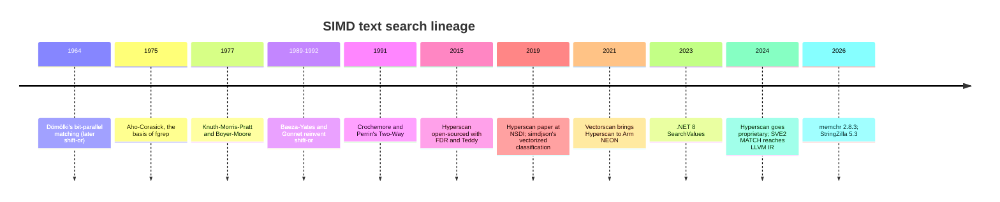
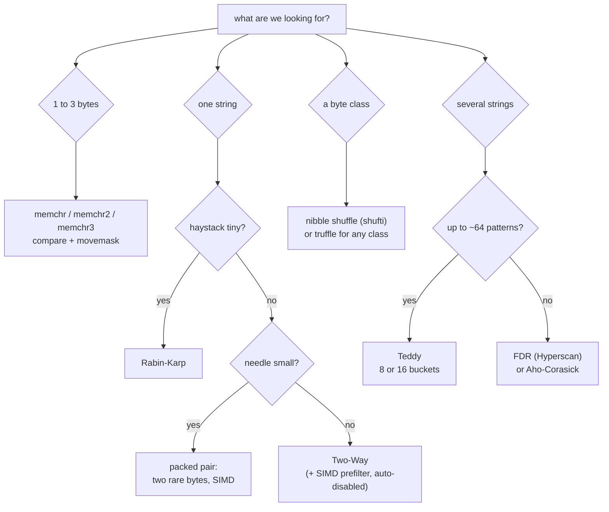
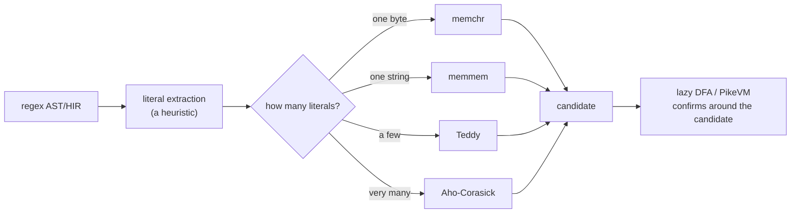

---
tags:
  - compilers
  - simd
  - string-matching
  - memchr
  - two-way
  - teddy
  - fdr
  - hyperscan
  - regular-expressions
  - prefilters
status: complete
sources:
  - https://docs.rs/crate/memchr/latest
  - https://docs.rs/crate/memchr/2.6.3
  - https://docs.rs/crate/memchr/2.8.2/source/src/arch/generic/packedpair.rs
  - https://burntsushi.net/regex-internals/
  - https://docs.rs/crate/teddy/0.1.0/source/README.md
  - https://docs.rs/crate/aho-corasick/0.7.6/source/DESIGN.md
  - https://codebrowser.dev/rust/crates/aho_corasick/src/packed/teddy/builder.rs.html
  - https://docs.rs/crate/regex-automata/0.4.11/source/src/dfa/accel.rs
  - https://en.wikipedia.org/wiki/Two-way_string-matching_algorithm
  - https://en.wikipedia.org/wiki/Bitap_algorithm
  - https://en.wikipedia.org/wiki/Aho%E2%80%93Corasick_algorithm
  - https://en.wikipedia.org/wiki/Boyer%E2%80%93Moore_string-search_algorithm
  - https://sources.debian.org/src/glibc/2.41-9/string/str-two-way.h
  - https://usenix.org/system/files/nsdi19-wang-xiang.pdf
  - https://grok.dragonflybsd.org/xref/dports/devel/hyperscan/hyperscan-5.4.0/src/nfa/accel_dfa_build_strat.cpp
  - https://haoxufd.github.io/files/Harry.pdf
  - https://haoxufd.github.io/files/ReinforcedTeddy.pdf
  - https://arxiv.org/html/1902.08318v7
  - https://arxiv.org/pdf/2010.03090
  - http://validark.dev/posts/eine-kleine-vectorized-classification/
  - https://github.com/p-ranav/sse4-strstr
  - https://awesome.ecosyste.ms/projects/github.com%2Fwojciechmula%2Fsse4-strstr
  - https://en.algorithmica.org/hpc/simd/shuffling/
  - https://sourceware.org/pipermail/libc-alpha/2024-February/154901.html
  - https://developer.arm.com/community/arm-community-blogs/b/architectures-and-processors-blog/posts/multi-token-search-strings-svmatch-instruction
  - https://github.com/llvm/llvm-project/commit/e52238b59f25
  - https://lists.llvm.org/pipermail/llvm-commits/Week-of-Mon-20241021/1484573.html
  - https://lists.llvm.org/pipermail/llvm-commits/Week-of-Mon-20241118/1508166.html
  - https://endjin.com/blog/dotnet-8-searchvalues-string-search-performance-boost
  - https://github.com/dotnet/runtime/pull/98791
  - https://developer.arm.com/community/arm-community-blogs/b/servers-and-cloud-computing-blog/posts/accelerating-deep-packet-inspection-with-neon-on-arm-neoverse
  - https://pipedot.org/6MPZT
  - https://simple-repository.app.cern.ch/project/stringzilla
  - https://packages.fedoraproject.org/pkgs/rust-memchr/rust-memchr-devel/fedora-rawhide.html
created: 2026-11-28
updated: 2026-11-28
---

## Table Of Contents

- [[#TL;DR|TL;DR]]
- [[#The Problem|The Problem]]
- [[#Foundations|Foundations]]
    - [[#The SIMD Search Pattern - Compare, Movemask, Count Zeros|The SIMD Search Pattern - Compare, Movemask, Count Zeros]]
    - [[#Periods and Critical Factorizations|Periods and Critical Factorizations]]
    - [[#Shift-Or - Matching as Bit Arithmetic|Shift-Or - Matching as Bit Arithmetic]]
    - [[#PSHUFB as a 16-Entry Lookup Table|PSHUFB as a 16-Entry Lookup Table]]
- [[#How We Got Here|How We Got Here]]
- [[#How It Works|How It Works]]
    - [[#memchr - One Byte|memchr - One Byte]]
    - [[#memmem - One String|memmem - One String]]
    - [[#Two-Way - The Worst-Case Backstop|Two-Way - The Worst-Case Backstop]]
    - [[#Byte Classes - Nibble Shuffles|Byte Classes - Nibble Shuffles]]
    - [[#Teddy - A Few Strings|Teddy - A Few Strings]]
    - [[#FDR - Hundreds to Thousands of Strings|FDR - Hundreds to Thousands of Strings]]
    - [[#Prefilters Inside Regex Engines|Prefilters Inside Regex Engines]]
    - [[#What the Compiler Can and Cannot Do|What the Compiler Can and Cannot Do]]
- [[#Where It Is Now|Where It Is Now]]
- [[#Trade-offs & Open Problems|Trade-offs & Open Problems]]
- [[#Resources|Resources]]
- [[#Related Notes|Related Notes]]

---

## ***TL;DR***

---

*Most of the speed of a modern grep or regex engine comes not from the automaton but from a handful of hand-written SIMD routines that find candidate positions for literal text. Knowing those routines (memchr, memmem, Two-Way, nibble shuffles, Teddy, FDR) explains why some patterns search at gigabytes per second and others crawl.*

- **The shape of every routine.** Load 16 to 64 bytes, compare them all at once, squash the comparison into a bitmask, and jump to the first set bit. Only candidate positions get the slow, exact check ([memchr packed pair source](https://docs.rs/crate/memchr/2.8.2/source/src/arch/generic/packedpair.rs)).
- **One byte: `memchr`.** Broadcast the byte into a vector, compare, movemask. Rust's `memchr` crate uses SSE2 or AVX2 on x86-64, SIMD on aarch64 and wasm32, and SWAR (bit tricks on 64-bit words) elsewhere ([memchr README](https://docs.rs/crate/memchr/latest)).
- **One string: `memmem`.** Rabin-Karp for tiny haystacks, a SIMD search on two heuristically "rare" bytes of the needle for small needles, and **Two-Way** for everything else, which guarantees $O(n)$ time and $O(1)$ space ([memchr README](https://docs.rs/crate/memchr/latest); [Gallant](https://burntsushi.net/regex-internals/)).
- **Byte classes: nibble shuffles.** Split each byte into two 4-bit halves, look each half up in a 16-entry table with one `PSHUFB`, AND the results. Two instructions classify 16 or 32 bytes into up to 8 sets. simdjson classifies JSON structure this way ([Langdale and Lemire](https://arxiv.org/html/1902.08318v7)); Hyperscan calls it **shufti**.
- **A few strings: Teddy.** The same nibble trick on the first 1 to 4 bytes of each pattern, with patterns grouped into 8 or 16 "buckets", followed by exact verification. Rust's version refuses more than 64 patterns ([aho-corasick builder](https://codebrowser.dev/rust/crates/aho_corasick/src/packed/teddy/builder.rs.html)).
- **Many strings: FDR.** Hyperscan's SIMD shift-or over 8 buckets of patterns, with 9 to 15-bit "super characters" and hash-table verification; 3.2 to 8.2x faster than Aho-Corasick on real traffic ([Wang et al., NSDI 2019](https://usenix.org/system/files/nsdi19-wang-xiang.pdf)).
- **As of November 2026.** `memchr` is at 2.8.3 (8 July 2026); .NET has `SearchValues` (since .NET 8) with Teddy behind `SearchValues<string>`; Arm SVE2 adds a `MATCH` instruction that does the "is this byte in a set of 16" test in hardware, and LLVM has an `llvm.experimental.vector.match` intrinsic for it; Hyperscan went proprietary in 2024 and the open fork Vectorscan carries the code on Arm.

---

## ***The Problem***

---

*Scanning text one byte at a time with a branch per byte tops out far below what memory and SIMD units can deliver. The fast path has to look at many bytes per instruction, but text search is full of early exits and data-dependent control flow that compilers cannot vectorize on their own.*

A loop like `for (i = 0; i < n; i++) if (s[i] == c) return i;` does one load, one compare and one branch per byte. A modern core can compare 32 or 64 bytes in one instruction. The gap between a regex engine that walks an automaton byte by byte and a literal scanner that compares a vector at a time is often "at least one order of magnitude", in Andrew Gallant's experience building Rust's regex crate ([Gallant, 2023](https://burntsushi.net/regex-internals/)).

Three things make this hard for a compiler to deliver automatically, and they shape every algorithm in this note:

- **Early exit.** Search stops at the first match. [[Vectorization|Vectorizers]] historically rejected loops with a `break`; GCC and LLVM only recently learned to vectorize single early-exit loops.
- **Reading past the end.** A vector load starting near the end of the buffer reads bytes that are not part of it. That is fine in assembly as long as the load stays inside a mapped page, but it is out-of-bounds in C and C++ semantics (see [[Undefined Behavior and Compiler Semantics]]). Hand-written routines either avoid page-crossing loads ([glibc memmem-avx2 patch](https://sourceware.org/pipermail/libc-alpha/2024-February/154901.html)) or redo the last full vector with an overlapping load ([memchr packed pair](https://docs.rs/crate/memchr/2.8.2/source/src/arch/generic/packedpair.rs)).
- **The good algorithm is a heuristic.** Which bytes of a needle to search for, whether a prefilter is paying for itself, and which multi-pattern matcher to build depend on the data. No dependence analysis will invent a byte-frequency table.

So text search is one of the places where library authors still beat compilers, and where the "compiler" that matters is the one inside a regex engine choosing which routine to call (see [[Regular Expression Engines]]).

---

## ***Foundations***

---

*Four ideas carry the rest of the note: the compare-movemask-count-zeros pattern every SIMD scanner uses, string periodicity (the math behind Two-Way), shift-or (the math behind FDR), and the byte shuffle used as a tiny lookup table (the trick behind shufti and Teddy).*

### The SIMD Search Pattern - Compare, Movemask, Count Zeros

*Almost every routine here is a variation on four steps: broadcast, compare, compress to a bitmask, find the lowest set bit.*

| Step | x86 (SSE2/AVX2) | What it does |
|---|---|---|
| Broadcast | `_mm_set1_epi8(c)` | Put the target byte in every lane |
| Compare | `pcmpeqb` | Each lane becomes `0xFF` if equal, else `0x00` |
| Compress | `pmovmskb` | Take the top bit of each lane into a 16 or 32-bit integer |
| Locate | `tzcnt` / `__builtin_ctz` | Index of the lowest set bit is the offset of the first match |

The candidate test can be anything that produces a per-lane mask: equality with one byte, equality at two needle offsets ANDed together, or a table lookup. Everything after the mask is ordinary scalar code that runs only when a lane fires. That split (cheap vector filter, rare scalar verification) is the whole design philosophy ([memchr packed pair](https://docs.rs/crate/memchr/2.8.2/source/src/arch/generic/packedpair.rs)).

Arm NEON has no direct `movemask`; ports such as Vectorscan rebuilt Hyperscan's SIMD layer as a separate portable library for this reason ([Arm, 2021](https://developer.arm.com/community/arm-community-blogs/b/servers-and-cloud-computing-blog/posts/accelerating-deep-packet-inspection-with-neon-on-arm-neoverse)).

### Periods and Critical Factorizations

*Two-Way's linear-time guarantee rests on one fact about strings: every needle can be cut at a point where the local repetition structure equals the global one.*

A number $p$ is a **period** of a string $x$ of length $m$ when

$$
x[i] = x[i+p] \quad \text{for all } 0 \le i < m - p .
$$

*In words: sliding the string $p$ places against itself, every overlapping character agrees.* Every string has the trivial period $m$; the smallest period is written $\text{per}(x)$.

A **factorization** cuts $x$ into $u \cdot v$. Its **local period** is the length of the shortest non-empty $w$ that is consistent with the cut from both sides (a suffix of $u$ or vice versa, and a prefix of $v$ or vice versa). A **critical factorization** is a cut whose local period equals $\text{per}(x)$; its existence is guaranteed, and it can be computed in about $2m$ comparisons by taking the larger of two maximal suffixes, one under each alphabet ordering ([Wikipedia, Two-Way](https://en.wikipedia.org/wiki/Two-way_string-matching_algorithm)).

Worked example: for $x = \texttt{abaab}$, $\text{per}(x) = 3$ ($x[0]=x[3]=\texttt{a}$, $x[1]=x[4]=\texttt{b}$). The cut $\texttt{ab} \mid \texttt{aab}$ is critical: no $w$ of length 1 or 2 fits both sides, and $w=\texttt{aab}$ (length 3) ends in $\texttt{ab}$ and starts $\texttt{aab}$. (Computed with the maximal-suffix procedure for this note.)

### Shift-Or - Matching as Bit Arithmetic

*Shift-or keeps one bit per needle prefix and updates all of them with a shift and an OR per input byte. FDR is this idea widened to SIMD registers and many patterns.*

For a needle of length $m$, precompute for each byte value $c$ a mask $B[c]$ whose bit $k$ is 0 exactly when the needle has $c$ at position $k$. The state $D$ starts as all ones and for each text byte $t_j$:

$$
D_j = (D_{j-1} \ll 1) \;\lor\; B[t_j]
$$

*In words: shift every partial match one position further (a 0 shifted in starts a fresh one), then knock out every partial match the new byte does not extend.* A 0 in bit $m-1$ means the whole needle just matched ([Wikipedia, Bitap](https://en.wikipedia.org/wiki/Bitap_algorithm)). The 0-means-match convention is what makes the update a single OR.

### PSHUFB as a 16-Entry Lookup Table

*`PSHUFB` (SSSE3) and `TBL` (NEON) are byte permutes, but read differently they are 16 parallel table lookups, which turns arbitrary byte classification into two instructions.*

`PSHUFB(A, B)` produces $C[i] = A[B[i]]$ for each of 16 lanes, using the low 4 bits of $B[i]$ as the index ([Teddy README](https://docs.rs/crate/teddy/0.1.0/source/README.md)). A 256-entry table does not fit in a register, but a 16-entry one does. So split each byte $b$ into a low nibble $b \mathbin{\&} 15$ and a high nibble $b \gg 4$, give each byte *class* one bit, and build two tables:

$$
\text{member}(b) \;=\; T_{lo}[\,b \mathbin{\&} 15\,] \;\mathbin{\&}\; T_{hi}[\,b \gg 4\,]
$$

*In words: a bit survives only if the class accepts both halves of the byte.* Each table entry is a byte, so one pair of lookups tests up to 8 classes at once ([Validark, 2024](http://validark.dev/posts/eine-kleine-vectorized-classification/)). One quirk: `PSHUFB` returns 0 for any index byte with its top bit set, so raw bytes $\ge$ `0x80` must be masked first or are rejected for free ([Validark](http://validark.dev/posts/eine-kleine-vectorized-classification/)). On AVX2 the 256-bit `vpshufb` is two independent 16-byte lookups, one per 128-bit lane ([Algorithmica](https://en.algorithmica.org/hpc/simd/shuffling/)).

---

## ***How We Got Here***

---

*The algorithms are decades old; what changed is that SIMD made the "filter then verify" structure dominant, and Hyperscan's engineers turned it into a toolkit that Rust, .NET and others later ported.*



- **Classical exact matching.** Aho-Corasick (1975) builds one automaton for many strings and runs in time linear in the text plus the matches; it "formed the basis of the original Unix command fgrep" ([Wikipedia](https://en.wikipedia.org/wiki/Aho%E2%80%93Corasick_algorithm)). Boyer-Moore and KMP both date from 1977 ([Wikipedia](https://en.wikipedia.org/wiki/Boyer%E2%80%93Moore_string-search_algorithm)).
- **Bit-parallelism.** Dömölki invented bit-parallel exact matching in 1964; Baeza-Yates and Gonnet reinvented it as shift-or in 1989, published in CACM in 1992, and Wu and Manber extended it to fuzzy search ([Wikipedia, Bitap](https://en.wikipedia.org/wiki/Bitap_algorithm)).
- **Two-Way (1991).** Crochemore and Perrin combined a KMP-like forward scan with a Boyer-Moore-like backward one to get linear time with constant extra space. glibc, newlib and musl use it for `memmem` and `strstr` ([Wikipedia](https://en.wikipedia.org/wiki/Two-way_string-matching_algorithm); [glibc str-two-way.h](https://sources.debian.org/src/glibc/2.41-9/string/str-two-way.h)).
- **Hyperscan.** Intel's regex library decomposed patterns into literals plus automata and found the literals with SIMD matchers (FDR, and the PSHUFB-based small-set matcher later known as Teddy). It "was open sourced late 2015" ([Teddy README](https://docs.rs/crate/teddy/0.1.0/source/README.md)); the design paper appeared at NSDI 2019 ([Wang et al.](https://usenix.org/system/files/nsdi19-wang-xiang.pdf)).
- **Teddy leaves Hyperscan.** Rust's first Teddy was reconstructed by "reading auto-generated C code, its disassembly and observing its runtime behavior" ([Teddy README](https://docs.rs/crate/teddy/0.1.0/source/README.md)). It now lives in the `aho-corasick` crate's packed searchers.
- **SIMD parsing.** Langdale and Lemire's simdjson (2019) used the same two-shuffle classification for JSON structure; Langdale notes it is "essentially borrowed from Hyperscan's own shufti/Teddy" ([Validark comments](http://validark.dev/posts/eine-kleine-vectorized-classification/)).

---

## ***How It Works***

---

*Walk up the ladder from one byte to thousands of strings, then see how regex engines and compilers use these routines. At each rung the vector step only produces candidates; something exact confirms them.*



*Sources for the branches: [memchr README](https://docs.rs/crate/memchr/latest), [aho-corasick builder](https://codebrowser.dev/rust/crates/aho_corasick/src/packed/teddy/builder.rs.html), [Hyperscan accel strategy](https://grok.dragonflybsd.org/xref/dports/devel/hyperscan/hyperscan-5.4.0/src/nfa/accel_dfa_build_strat.cpp).*

### memchr - One Byte

*The simplest SIMD scanner and the one everything else leans on.*

A minimal SSE2 version, written for this note to show the pattern (real implementations unroll, align, and handle the tail with an overlapping load):

```c
#include <emmintrin.h>
#include <stddef.h>

const char *memchr_sse2(const char *p, size_t n, char c) {
    __m128i needle = _mm_set1_epi8(c);                 // broadcast
    size_t i = 0;
    for (; i + 16 <= n; i += 16) {
        __m128i chunk = _mm_loadu_si128((const __m128i *)(p + i));
        int mask = _mm_movemask_epi8(_mm_cmpeq_epi8(chunk, needle));
        if (mask)                                      // any lane equal?
            return p + i + __builtin_ctz(mask);        // first one
    }
    for (; i < n; i++)                                 // scalar tail
        if (p[i] == c) return p + i;
    return NULL;
}
```

The hot loop compiles to roughly this per 16 bytes:

```asm
.loop:
    movdqu   xmm1, [rdi + rax]   ; load 16 haystack bytes
    pcmpeqb  xmm1, xmm0          ; xmm0 holds c in every lane
    pmovmskb ecx, xmm1           ; 16-bit mask of equal lanes
    test     ecx, ecx
    jnz      .found              ; rare: leave the loop
    add      rax, 16
    cmp      rax, rdx
    jbe      .loop
```

One branch per 16 bytes instead of one per byte, and it is almost never taken. The `memchr` crate also offers `memchr2` and `memchr3` (match any of two or three bytes, OR the compare results) and reverse versions; on x86-64 it uses SSE2 without `std` and AVX2 when detected at run time with `std` ([memchr README](https://docs.rs/crate/memchr/2.6.3)).

### memmem - One String

*For a substring, search for two of its bytes at their fixed offsets, and verify the full needle only where both appear.*

The "Generic SIMD" idea (Wojciech Muła's [sse4-strstr](https://awesome.ecosyste.ms/projects/github.com%2Fwojciechmula%2Fsse4-strstr) samples for "SIMD-friendly algorithms for substring searching" are the usual reference) compares the haystack at two offsets of the needle and ANDs the results. Rust's `memchr` picks the two bytes not as first and last but by "a background distribution of byte frequencies", so for `Sherlock` it prefers rarer letters over `e`. The aim is to "maximize the amount of time spent in the vector operations that detect candidates" ([Gallant](https://burntsushi.net/regex-internals/)).

From the packed-pair source ([memchr 2.8.2](https://docs.rs/crate/memchr/2.8.2/source/src/arch/generic/packedpair.rs)), per vector-sized window starting at `cur`:

1. Load a vector at `cur + index1` and another at `cur + index2` (the chosen needle offsets).
2. Compare them with broadcasts of `needle[index1]` and `needle[index2]`, AND, movemask.
3. For each set bit, compare the full needle at that position; return on the first real match.
4. For the tail, redo one full window ending at the buffer end and mask off the lanes already checked.

The overall `memmem` policy ([memchr README](https://docs.rs/crate/memchr/latest)):

| Case | Algorithm | Why |
|---|---|---|
| Very small haystack | Rabin-Karp | "to reduce latency": no setup cost worth amortizing |
| Small needle | Packed pair (Generic SIMD variant) | Two rare bytes rarely co-occur by accident |
| Everything else | Two-Way, with the SIMD prefilter in front | Linear worst case; "A dynamic heuristic is used to detect if the prefilter is ineffective, and if so, disables it" |

Rabin-Karp hashes a window as a number in base $b$ modulo $q$ and slides it in constant time:

$$
h_{i+1} = \big( (h_i - x[i]\cdot b^{m-1}) \cdot b + x[i+m] \big) \bmod q
$$

*In words: drop the leftmost byte's contribution, shift everything up one digit, add the new byte.* Only windows whose hash equals the needle's hash get a full compare.

glibc has seen the same idea proposed: a 2024 `memmem-avx2` patch finds the rarest byte in the first vector of the needle with a frequency table, ANDs its matches with the next byte's, verifies, avoids page-crossing loads, and falls back to Two-Way for needles over 256 bytes; its timing table showed about 2.2x (AVX2) and 3.5x (AVX-512) over the generic code ([libc-alpha, v7, Feb 2024](https://sourceware.org/pipermail/libc-alpha/2024-February/154901.html)).

### Two-Way - The Worst-Case Backstop

*A SIMD prefilter is fast on typical text but can be fooled into checking every position; Two-Way is what keeps the worst case linear without extra memory.*

Two-Way precomputes a critical factorization $x = u \cdot v$ and the period $p$ in $O(m)$ time. At each alignment it:

1. Compares $v$ (the right part) left to right. A mismatch inside $v$ lets it slide the needle past the part already compared, KMP-style; the critical factorization is what makes that shift safe.
2. If all of $v$ matches, compares $u$ right to left. A mismatch now lets it shift by the period $p$, and for periodic needles it remembers how much of the next alignment is already known to match.

The result: $O(n)$ search, $O(1)$ extra space, at most $2n - m$ comparisons, and cache-friendly access ([Wikipedia](https://en.wikipedia.org/wiki/Two-way_string-matching_algorithm)). The same page notes that for short inputs a naive search can win because the $O(m)$ preprocessing is never amortized, which is exactly why `memchr` switches algorithms by size.

Why it matters: a pure "find two rare bytes, then verify" scheme degenerates to $O(n \cdot m)$ on adversarial or unlucky data (a haystack full of the chosen bytes). Two-Way is how glibc keeps `strstr` and `memmem` linear in the worst case ([glibc source](https://sources.debian.org/src/glibc/2.41-9/string/str-two-way.h)).

### Byte Classes - Nibble Shuffles

*To find "any of these bytes" for a set bigger than three, two table lookups per vector replace a compare per member.*

simdjson's stage 1 classifies every input byte as structural, whitespace or other with exactly this trick. Each class gets one bit; the tables are built so that $T_{lo}[\text{low}] \mathbin{\&} T_{hi}[\text{high}]$ is non-zero only for members ([Langdale and Lemire](https://arxiv.org/html/1902.08318v7)):

| Bit | Set | Bytes |
|---|---|---|
| 0 | comma | `0x2c` |
| 1 | colon | `0x3a` |
| 2 | brackets and braces | `0x5b 0x5d 0x7b 0x7d` |
| 3 | tab, newline, return | `0x09 0x0a 0x0d` |
| 4 | space | `0x20` |

Structural bytes are found by testing the result against `0b111`, whitespace against `0b11000`; "No branching is required." Why split whitespace into two sets? A class encoded as one bit accepts every (low, high) pair that appears in either table for that bit. `{0x09, 0x0a, 0x0d}` all have high nibble 0 and `0x20` has high nibble 2; putting them in one bit would also accept `0x29`, `0x2a`, `0x2d` and `0x00`. A class is exact only when its members form a full product of a low-nibble set and a high-nibble set, so awkward classes get more bits.

Hyperscan builds a ladder of these "acceleration" schemes for DFA states whose self-loop covers most bytes ([accel_dfa_build_strat.cpp](https://grok.dragonflybsd.org/xref/dports/devel/hyperscan/hyperscan-5.4.0/src/nfa/accel_dfa_build_strat.cpp)):

| Escape bytes that leave the state | Scheme |
|---|---|
| None | "red tape": the state never exits |
| One byte | **vermicelli** (memchr-like) |
| A case pair (`a`/`A`) | caseless vermicelli |
| A few byte pairs | double vermicelli, or **double shufti** |
| A moderate set the nibble tables can encode | **shufti** |
| A set they cannot encode | **truffle** |
| Too many | no acceleration |

Geoff Langdale's own summary: shufti is "a 2-PSHUFB thing that is used 'usually'", truffle is the "this will always work" variant ([Validark comments](http://validark.dev/posts/eine-kleine-vectorized-classification/)). Rust's `regex-automata` does a narrower version: a DFA state whose non-self transitions are 1 to 3 bytes is "accelerated" with `memchr`, `memchr2` or `memchr3`, and a state is never accelerated on the ASCII space because it is too common ([regex-automata accel.rs](https://docs.rs/crate/regex-automata/0.4.11/source/src/dfa/accel.rs)).

### Teddy - A Few Strings

*Teddy applies the nibble-table trick to pattern fingerprints instead of byte classes: each bit now means "some pattern in bucket k could start here".*

Setup ([Teddy README](https://docs.rs/crate/teddy/0.1.0/source/README.md); [aho-corasick builder](https://codebrowser.dev/rust/crates/aho_corasick/src/packed/teddy/builder.rs.html)):

- Take a fingerprint of $N$ bytes from each pattern (Rust uses the first $N$, Hyperscan is believed to use the last $N$). Rust's current builder uses $N = \min(4, \text{shortest pattern})$; a longer fingerprint means fewer false candidates.
- Assign patterns to **buckets**: 8 in **Slim Teddy** (one bit per bucket in a byte), 16 in **Fat Teddy**, which needs AVX2. Rust has no Fat Teddy on aarch64.
- For each fingerprint position $j$, build a low-nibble table and a high-nibble table where bit $k$ is set if some pattern in bucket $k$ has that nibble at position $j$.

Search, per 16 or 32 haystack bytes: look up both nibbles of every byte for fingerprint position 0, AND; do the same for position 1 and shift the result by one byte so lanes line up, AND again; repeat to $N$. A surviving bit $k$ in lane $i$ says "a pattern in bucket $k$ may start at $i$"; only those patterns are compared exactly.

Worked example with a 1-byte fingerprint, two patterns sharing bucket 0, and one in bucket 1:

| Pattern | First byte | Low nibble | High nibble | Bucket |
|---|---|---|---|---|
| `foo` | `f` = `0x66` | 6 | 6 | 0 |
| `rat` | `r` = `0x72` | 2 | 7 | 0 |
| `bar` | `b` = `0x62` | 2 | 6 | 1 |

Tables: $T_{lo}[6] = \texttt{0b01}$, $T_{lo}[2] = \texttt{0b11}$; $T_{hi}[6] = \texttt{0b11}$, $T_{hi}[7] = \texttt{0b01}$; all others 0.

| Haystack byte | $T_{lo}$ | $T_{hi}$ | AND | Meaning |
|---|---|---|---|---|
| `x` = `0x78` | 0 | `0b01` | 0 | skip |
| `f` = `0x66` | `0b01` | `0b11` | `0b01` | candidate for bucket 0 (verify `foo`, `rat`) |
| `b` = `0x62` | `0b11` | `0b11` | `0b11` | bucket 1 (true) and bucket 0 (false: low 2 from `rat`, high 6 from `foo`) |
| `v` = `0x76` | `0b01` | `0b01` | `0b01` | false positive in bucket 0 (low 6 from `foo`, high 7 from `rat`) |

The false positives come from mixing nibbles of different patterns in one bucket, which is why bucket assignment and longer fingerprints matter. Verification is exact, so they cost time, never correctness.

Limits: Teddy is for small sets. Rust's builder refuses more than 64 patterns ("Too many patterns will overwhelm Teddy"), and the older design notes say it "only works _well_ when there are a small number of patterns (say, less than 100)" but "can often be an order of magnitude faster than just Aho-Corasick" ([builder](https://codebrowser.dev/rust/crates/aho_corasick/src/packed/teddy/builder.rs.html); [aho-corasick DESIGN](https://docs.rs/crate/aho-corasick/0.7.6/source/DESIGN.md)). Haystacks shorter than Teddy's minimum ("more than 16-34 bytes") fall back to Rabin-Karp.

### FDR - Hundreds to Thousands of Strings

*FDR is shift-or with three changes: bits stand for buckets of patterns, the alphabet is widened to 9 to 15-bit "super characters", and hashing does the verification.*

From the NSDI 2019 paper ([Wang et al.](https://usenix.org/system/files/nsdi19-wang-xiang.pdf)):

- **Buckets.** Patterns are sorted by length and split into 8 buckets by dynamic programming. Short patterns cause more false positives, so the cost function keeps them from piling into one bucket.
- **Byte-wide state per position.** With $n = 8$ buckets, each byte of the 128-bit mask holds the 8 bucket bits for one pattern position, so "the byte position in a sh-mask matches the same position in a pattern". Patterns longer than 8 bytes contribute only 8 bytes to the filter.
- **Super characters.** Bucket-level masks mix patterns: a bucket holding `ab` and `cd` also lights up on `ad`. FDR indexes masks by a byte plus a few low bits of the next byte (9 to 15 bits, 12 in the paper's example) so a hit requires the right pair.
- **Parallel shifts.** It processes 8 input bytes per iteration by shifting several precomputed masks at once and ORing them, carrying the state across blocks.
- **Verification.** Each bucket has a hash table; a candidate window is hashed and compared exactly.

Results in the paper: 4.2 to 8.8x faster than Aho-Corasick on random input and 3.2 to 8.2x on a real traffic trace, and 1.1 to 3.2x faster than the DFC matcher on random input (1.3 to 2.5x on the trace). The advantage narrows as pattern counts grow and masks spill out of cache.

Successors from Intel and Fudan push the same direction with AVX-512. **Harry** shifts column vectors instead of row vectors, needs about 0.41 SIMD operations per input byte against FDR's 3, reaches 30 to 70 Gbit/s on a Xeon Gold 6348, up to 2.09x FDR, and "has been integrated into Hyperscan" ([Xu et al.](https://haoxufd.github.io/files/Harry.pdf); authors' figures). An extended AVX-512 Teddy for small sets (under 60 literals) reports up to 43x Aho-Corasick and about 2.2x FDR ([Xu et al.](https://haoxufd.github.io/files/ReinforcedTeddy.pdf); authors' figures).

### Prefilters Inside Regex Engines

*A regex engine is a compiler whose most important optimization pass is "find literals the match must contain and pick the fastest routine above to search for them".*

The [[Regular Expression Engines]] note covers the meta engine; the literal side works like this ([Gallant](https://burntsushi.net/regex-internals/)):



- **Extraction is "one big heuristic. A dark art."** Smaller literal sets are better but very short literals fire too often; a sequence containing a space is made "infinite" (prefilter off) because space is so common.
- **Prefilters can hurt.** For regex `a` over a million `a`s, a fast scanner "isn't going to help you"; when candidates come constantly, the per-candidate overhead dominates.
- **Order matters.** Rust preserves literal order in Teddy because the engine implements leftmost-first (Perl-style) semantics.
- **.NET does the same.** A 2024 PR lets compiled and source-generated .NET regexes use `SearchValues<string>` for case-insensitive alternations, cutting `(?i)Sherlock|Holmes|Watson` from 873 to 132 µs; reviewers discuss keeping those values on Teddy's fast path ([dotnet/runtime #98791](https://github.com/dotnet/runtime/pull/98791)).

### What the Compiler Can and Cannot Do

*Compilers now vectorize some search loops on their own, but the routines in this note still come from libraries, because the hard parts are heuristics and memory-safety tricks, not instruction selection.*

- **Early-exit vectorization.** GCC 15 vectorizes `std::find` through early-break support, and LLVM's loop vectorizer accepts loops with one early exit (details in [[Vectorization]]). That gets you a basic `memchr`, not a rare-byte `memmem` or Teddy.
- **A set-membership intrinsic.** LLVM added `@llvm.experimental.vector.match` in late 2024: it marks each active element of one vector that equals any element of a second, lowers to SVE2 `MATCH` on AArch64, and has a generic splat-compare-OR expansion elsewhere ([commit e52238b](https://github.com/llvm/llvm-project/commit/e52238b59f25); [llvm-commits](https://lists.llvm.org/pipermail/llvm-commits/Week-of-Mon-20241021/1484573.html)).
- **Idiom recognition.** A companion patch teaches `LoopIdiomVectorize` to recognize `std::find_first_of`-shaped nested loops and emit a 16-byte masked-load loop around that intrinsic for SVE2 targets; the mailing-list record shows it under review in November 2024 ([llvm-commits](https://lists.llvm.org/pipermail/llvm-commits/Week-of-Mon-20241118/1508166.html)). This is the [[Loop Optimizations|loop-idiom]] approach: recognize the scalar shape, call the hand-tuned primitive.
- **What stays manual.** Byte-frequency tables, nibble-table construction for arbitrary classes, bucket assignment, dynamic prefilter disabling and page-aware overlapping loads are all outside what [[Instruction Selection]] or a vectorizer reasons about.

---

## ***Where It Is Now***

---

*As of late November 2026: the Rust crates are the reference open implementations, .NET has built the same toolkit into its base library, Arm hardware is gaining set-match instructions, and Hyperscan's own code moved behind a proprietary license.*

| Project | State (date) | Notes |
|---|---|---|
| Rust `memchr` | 2.8.3, published 8 July 2026 ([docs.rs](https://docs.rs/crate/memchr/latest); [Fedora rawhide](https://packages.fedoraproject.org/pkgs/rust-memchr/rust-memchr-devel/fedora-rawhide.html)) | SSE2/AVX2, aarch64, wasm32, SWAR fallback; Rabin-Karp, packed pair, Two-Way with self-disabling prefilter |
| Rust `aho-corasick` packed | Teddy Slim (8 buckets) and Fat (16, AVX2), NEON Slim only, at most 64 patterns ([builder](https://codebrowser.dev/rust/crates/aho_corasick/src/packed/teddy/builder.rs.html)) | Used by `regex` and ripgrep for multi-literal prefilters |
| .NET | `SearchValues<T>` since .NET 8 ([endjin](https://endjin.com/blog/dotnet-8-searchvalues-string-search-performance-boost)); `SearchValues<string>` uses Teddy and feeds `Regex` ([#98791](https://github.com/dotnet/runtime/pull/98791)) | endjin measured `SearchValues<char>` 2 to 4x faster than `string.IndexOfAny` for larger sets |
| Hyperscan / Vectorscan | Hyperscan moved to the Intel Proprietary License in May 2024 ([Phoronix via Pipedot](https://pipedot.org/6MPZT)); Vectorscan is the open fork with Arm NEON support ([Arm, 2021](https://developer.arm.com/community/arm-community-blogs/b/servers-and-cloud-computing-blog/posts/accelerating-deep-packet-inspection-with-neon-on-arm-neoverse)) | Vectorscan gave Snort a 20 to 40% uplift on Ampere Altra in Arm's test |
| Arm SVE2 `MATCH` | `svmatch_u8` tests each byte against up to 16 tokens per 128 bits in one instruction, 2 cycles on Neoverse N2; up to 24% faster decoding in the Sonic JSON library ([Arm, Sep 2024](https://developer.arm.com/community/arm-community-blogs/b/architectures-and-processors-blog/posts/multi-token-search-strings-svmatch-instruction)) | LLVM exposes it as `llvm.experimental.vector.match` |
| StringZilla | 5.3.2, 25 October 2026 ([package index](https://simple-repository.app.cern.ch/project/stringzilla)) | Picks "strategically chosen offsets" of "unique characters" in the needle; backends for NEON, SVE and AVX-512 |
| Vectorized classification | Newer variants reuse one high-nibble vector across several classifiers and use AVX-512 `vptestmb` or GFNI `vgf2p8affineqb` ([Validark, Sep 2024](http://validark.dev/posts/eine-kleine-vectorized-classification/)) | The same idea also drives UTF-8 validation at under one instruction per byte with three nibble lookups ([Keiser and Lemire](https://arxiv.org/pdf/2010.03090)) |

---

## ***Trade-offs & Open Problems***

---

*Every speedup here is bought with a heuristic, a size threshold or an ISA assumption, and each one has inputs where it loses.*

| Choice | Wins when | Loses when |
|---|---|---|
| Rare-byte packed pair | Natural-language text where the frequency table is right | Binary data or text where the "rare" bytes are common; needs Two-Way behind it |
| Two-Way | Adversarial or periodic inputs; constant memory | Short haystacks, where $O(m)$ setup is not amortized |
| Teddy | Up to a few dozen short literals | Many patterns (buckets crowd, false positives climb); haystacks shorter than a vector |
| FDR | Hundreds to thousands of literals at line rate | Large masks spill caches as sets grow; long patterns filtered on 8 bytes only |
| Aho-Corasick | Tens of thousands of literals; predictable | Usually several times slower per byte than SIMD filters on small sets |
| Nibble shuffles | Any fixed byte class up to 8 bits of classes | Classes that are not nibble products need more bits or truffle; non-ASCII needs masking |

Open questions:

- **Latency vs throughput.** SIMD routines shine on long haystacks. When matches are dense or haystacks short, setup and verification dominate, which is why libraries keep a ladder of algorithms and size cutoffs ([memchr README](https://docs.rs/crate/memchr/latest)).
- **Choosing literals is guesswork.** "It is impossible to know, before a search begins, how to optimally choose" literals, and studying the haystack first would cost more than it saves ([Gallant](https://burntsushi.net/regex-internals/)). Run-time adaptation, like `memchr`'s self-disabling prefilter, is the current answer.
- **ISA fragmentation.** SSSE3, AVX2, AVX-512 (with its own shift quirks: `VPSLLDQ` "cannot shift bits across 128-bit boundaries", per the Harry paper), NEON's missing movemask, SVE's variable width and SVE2 `MATCH` each want different code. Portable SIMD layers (Vectorscan's, .NET's `Vector128/256/512`) trade a little speed for not writing everything five times.
- **Compilers catching up.** Early-exit vectorization and `vector.match` cover the easy shapes. Getting a compiler to choose a Teddy-like plan from a `find_first_of` over strings would need cost models that know about data distributions, which no production compiler has.
- **Licensing and stewardship.** The most complete multi-pattern implementation, Hyperscan, is no longer open source; the community depends on the Vectorscan fork and on independent ports like Rust's.

---

## ***Resources***

---

*Start with Gallant's write-up and the memchr README for the practical picture, the Hyperscan paper for FDR, and Langdale and Lemire for vectorized classification.*

**Libraries and design docs**
- [memchr README](https://docs.rs/crate/memchr/latest) and [packedpair.rs](https://docs.rs/crate/memchr/2.8.2/source/src/arch/generic/packedpair.rs): the algorithm ladder and the reference packed-pair loop.
- [Regex engine internals as a library](https://burntsushi.net/regex-internals/): Andrew Gallant, 2023. Literal extraction and prefilters in Rust's regex.
- [Teddy README](https://docs.rs/crate/teddy/0.1.0/source/README.md): the clearest description of Teddy's nibble tables.
- [aho-corasick DESIGN.md](https://docs.rs/crate/aho-corasick/0.7.6/source/DESIGN.md) and [Teddy builder.rs](https://codebrowser.dev/rust/crates/aho_corasick/src/packed/teddy/builder.rs.html): when Teddy, Rabin-Karp and the rare-byte prefilters are used.
- [regex-automata accel.rs](https://docs.rs/crate/regex-automata/0.4.11/source/src/dfa/accel.rs): DFA state acceleration with memchr.
- [glibc str-two-way.h](https://sources.debian.org/src/glibc/2.41-9/string/str-two-way.h): a production Two-Way.
- [Hyperscan accel_dfa_build_strat.cpp](https://grok.dragonflybsd.org/xref/dports/devel/hyperscan/hyperscan-5.4.0/src/nfa/accel_dfa_build_strat.cpp): how vermicelli, shufti and truffle are chosen.

**Papers**
- [Hyperscan: A Fast Multi-pattern Regex Matcher for Modern CPUs](https://usenix.org/system/files/nsdi19-wang-xiang.pdf): Wang et al., NSDI 2019. FDR in detail.
- [Parsing Gigabytes of JSON per Second](https://arxiv.org/html/1902.08318v7): Langdale and Lemire. Vectorized classification.
- [Validating UTF-8 In Less Than One Instruction Per Byte](https://arxiv.org/pdf/2010.03090): Keiser and Lemire. Three-lookup classification.
- [Harry](https://haoxufd.github.io/files/Harry.pdf) and [an AVX-512 Teddy for DPI](https://haoxufd.github.io/files/ReinforcedTeddy.pdf): Xu et al. (Fudan and Intel). Current SIMD multi-literal designs.

**Posts and references**
- [Eine Kleine Vectorized Classification](http://validark.dev/posts/eine-kleine-vectorized-classification/): Niles Salter, 2024, with Geoff Langdale's comments on shufti and truffle.
- [SVE2 SVMATCH for multi-token search](https://developer.arm.com/community/arm-community-blogs/b/architectures-and-processors-blog/posts/multi-token-search-strings-svmatch-instruction): Yibo Cai, Arm, 2024.
- [Two-way string-matching algorithm](https://en.wikipedia.org/wiki/Two-way_string-matching_algorithm), [Bitap](https://en.wikipedia.org/wiki/Bitap_algorithm), [Aho-Corasick](https://en.wikipedia.org/wiki/Aho%E2%80%93Corasick_algorithm): Wikipedia background.
- [sse4-strstr](https://github.com/p-ranav/sse4-strstr): sample code for "SIMD-friendly algorithms for substring searching".

---

## ***Related Notes***

---

*Where the scanners plug in and where the ideas come from.*

- [[Regular Expression Engines]] — The meta engine that calls these routines as prefilters; Hyperscan's decomposition.
- [[Vectorization]] — Early-exit vectorization and masks; why compilers only recently handle `std::find`.
- [[Instruction Selection]] — Lowering compare, movemask and shuffle patterns per ISA.
- [[Microarchitectural Performance Models]] — Port pressure and latency of `pshufb`, `pmovmskb` and friends.
- [[Loop Optimizations]] — Loop-idiom recognition, the route by which compilers call or emit these primitives.
- [[LLVM]] — `llvm.experimental.vector.match` and `LoopIdiomVectorize`.
- [[Lexing and Parsing]] — Lexers and simdjson-style parsers rely on the same byte classification.
- [[Undefined Behavior and Compiler Semantics]] — Why reading past a buffer end is fine in assembly and not in C.
- [[Sanitizers]] — Overlapping and over-reading loads are what bounds checkers flag in hand-written SIMD.
- [[Grammar-Constrained Decoding]] — Token-level regex matching where scanning cost matters at every decoding step.
- [[SIMD Parsing and Validation]] — Planned: simdjson, UTF-8 validation and CSV parsing built on these primitives.
- [[Loop Idiom Recognition]] — Planned: memset, memcpy, strlen and find-first-of idioms turned into library calls or vector loops.
