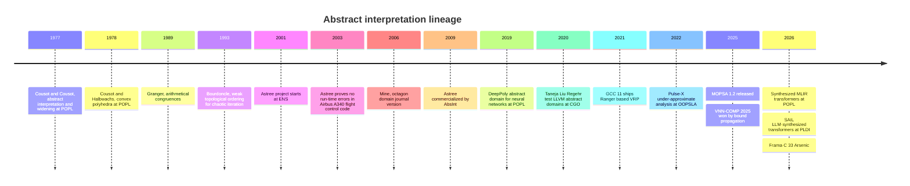
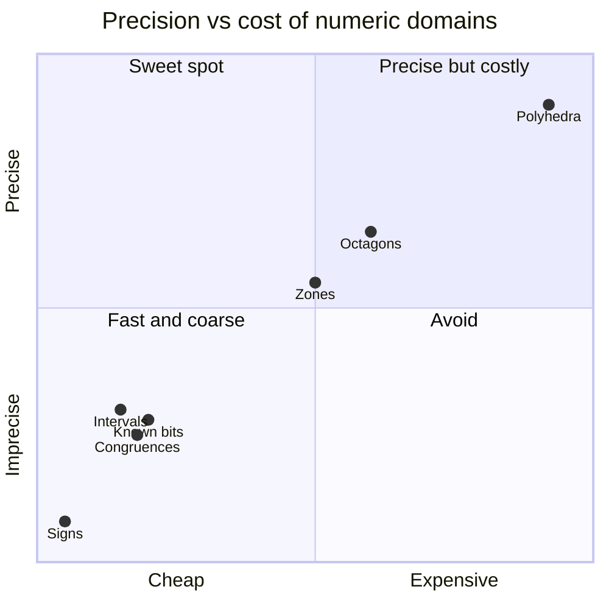
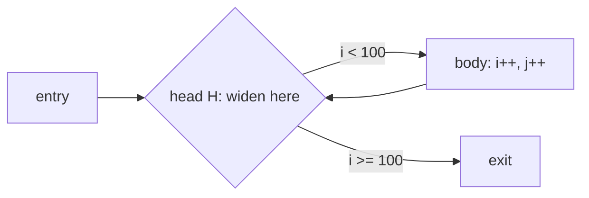

---
tags:
  - compilers
  - abstract-interpretation
  - static-analysis
  - program-analysis
  - galois-connections
  - abstract-domains
  - widening
  - formal-verification
status: complete
sources:
  - https://cs.nyu.edu/~pmc309/COUSOTpapers/POPL77.shtml
  - https://bibtex.github.io/POPL-1978-CousotH.html
  - https://scilit.com/publications/7c1ef499e9c3e59cd3d0cf6e7464ed42
  - https://arxiv.org/abs/cs/0703084
  - https://lara.epfl.ch/w/_media/sav09/article-mine-hosc06.pdf
  - https://users-cs.au.dk/amoeller/spa/5-widening-and-narrowing.pdf
  - https://cs.au.dk/~amoeller/spa/
  - https://www.di.ens.fr/~rival/semverif-2026/sem-08-ai.pdf
  - https://arxiv.org/pdf/2009.05865
  - https://www-old.cs.utah.edu/~regehr/cgo20.pdf
  - https://arxiv.org/pdf/2512.06442
  - https://sbaziotis.com/compilers/introduction-to-scalar-evolution.html
  - https://developers.redhat.com/blog/2021/04/28/value-range-propagation-in-gcc-with-project-ranger
  - https://developers.redhat.com/articles/2023/01/18/how-we-expanded-gcc-value-range-propagation-floats
  - https://www.astree.ens.fr/
  - https://www.di.ens.fr/~delmas/papers/sas07.pdf
  - https://frama-c.com/fc-plugins/eva.html
  - https://www.frama-c.com/download/frama-c-eva-manual.pdf
  - https://fbinfer.com/docs/checker-pulse
  - https://people.mpi-sws.org/%7Edreyer/papers/finding-real-bugs/paper.pdf
  - https://cdn.jsdelivr.net/gh/nasa-sw-vnv/ikos@master/README.md
  - https://mopsa.lip6.fr/
  - https://popl19.sigplan.org/details/POPL-2019-Research-Papers/58/An-Abstract-Domain-for-Certifying-Neural-Networks
  - https://arxiv.org/abs/2512.19007
  - https://arxiv.org/abs/2511.13663
  - https://arxiv.org/abs/2503.12686v1
  - https://conf.researchr.org/home/splash-issta-2026/sas-2026
  - https://mitpressbookstore.mit.edu/book/9780262044905
created: 2026-11-26
updated: 2026-11-26
---

## Table Of Contents

- [[#TL;DR|TL;DR]]
- [[#The Problem|The Problem]]
- [[#Foundations|Foundations]]
    - [[#Concrete and Abstract Semantics|Concrete and Abstract Semantics]]
    - [[#Galois Connections|Galois Connections]]
    - [[#Soundness and the Best Transformer|Soundness and the Best Transformer]]
    - [[#Widening and Narrowing|Widening and Narrowing]]
- [[#How We Got Here|How We Got Here]]
- [[#How It Works|How It Works]]
    - [[#Abstract Domains at a Glance|Abstract Domains at a Glance]]
    - [[#Non-Relational Domains|Non-Relational Domains]]
    - [[#Relational Domains|Relational Domains]]
    - [[#Combining Domains with Reduced Products|Combining Domains with Reduced Products]]
    - [[#Worked Example - Intervals vs Octagons on a Loop|Worked Example - Intervals vs Octagons on a Loop]]
    - [[#Fixpoint Iteration Strategies|Fixpoint Iteration Strategies]]
    - [[#Abstract Interpreters Hiding Inside Compilers|Abstract Interpreters Hiding Inside Compilers]]
    - [[#Industrial Static Analyzers|Industrial Static Analyzers]]
- [[#Where It Is Now|Where It Is Now]]
    - [[#Compilers and Tools|Compilers and Tools]]
    - [[#Synthesized and LLM-Built Transformers|Synthesized and LLM-Built Transformers]]
    - [[#Neural Network Verification|Neural Network Verification]]
- [[#Trade-offs & Open Problems|Trade-offs & Open Problems]]
- [[#Resources|Resources]]
- [[#Related Notes|Related Notes]]

## ***TL;DR***
---
*Abstract interpretation is the theory that says how to run a program on simplified "abstract" values (signs, intervals, linear relations) and still get answers that are guaranteed to cover every real execution. It is the math under every [[Dataflow Analysis]], the engine of sound industrial analyzers like Astrée, and, in miniature, what LLVM and GCC do every time they prove a value's range or known bits.*

- **One idea.** Replace the program's real semantics (sets of concrete states) with a cheaper *abstract domain*, connect the two with an abstraction map $\alpha$ and a concretization map $\gamma$ (a *Galois connection*), and prove each abstract operation over-approximates the concrete one. Soundness of the whole analysis then follows from soundness of the pieces ([Cousot and Cousot, POPL 1977](https://cs.nyu.edu/~pmc309/COUSOTpapers/POPL77.shtml); [Rival, ENS 2026](https://www.di.ens.fr/~rival/semverif-2026/sem-08-ai.pdf)).
- **Domains are the design space.** Non-relational domains (signs, intervals, congruences, known bits) track each variable alone; relational ones (octagons $\pm x \pm y \le c$, polyhedra) track relations between variables at a steep cost: octagons are $O(n^2)$ memory and $O(n^3)$ time, polyhedra exponential in practice ([Miné](https://lara.epfl.ch/w/_media/sav09/article-mine-hosc06.pdf)).
- **Widening makes infinite domains terminate.** Intervals have infinite ascending chains, so analyzers jump unstable bounds to $\pm\infty$ (or to the next program constant) and then *narrow* back down; iteration order (Bourdoncle's weak topological ordering, widening at loop heads) matters for both speed and precision ([Møller and Schwartzbach](https://users-cs.au.dk/amoeller/spa/5-widening-and-narrowing.pdf); [Kim, Venet and Thakur](https://arxiv.org/pdf/2009.05865)).
- **Compilers do it quietly.** LLVM's KnownBits and ConstantRange are abstract domains whose transformers have had dozens of soundness bugs, and ScalarEvolution's closed forms act like a relational domain without widening; GCC's Ranger computes multi-range plus bitmask facts on demand ([Taneja, Liu and Regehr, CGO 2020](https://www-old.cs.utah.edu/~regehr/cgo20.pdf); [Red Hat](https://developers.redhat.com/blog/2021/04/28/value-range-propagation-in-gcc-with-project-ranger)).
- **As of November 2026.** The frontier is *building* abstract interpreters automatically: synthesized LLVM/MLIR transformers (POPL 2026), LLM-generated sound transformers for neural network verifiers (PLDI 2026), and "agentic interpretation" papers at SAS 2026; abstract-interpretation-style bound propagation still dominates [[Neural Network Verification|neural network verification]] (VNN-COMP 2025).

## ***The Problem***
---
*Proving a property of a program means reasoning about every execution, which is undecidable in general. Abstract interpretation turns that impossible question into a computable one by deliberately losing information, in a way that can only produce false alarms, never false proofs.*

Rice's theorem says any non-trivial question about what a program computes is undecidable. Yet compilers and verifiers must answer such questions constantly:

| Who asks | Question | Abstraction that answers it |
|---|---|---|
| Bounds-check elimination | Is `i` always in $[0, n)$ here? | Intervals, or $i$ relative to $n$ (octagons) |
| Overflow and RTE proofs (Astrée, Frama-C) | Can this `int` addition overflow on any input? | Intervals, octagons, filter domains |
| [[Vectorization]] | Is this pointer 16-byte aligned on every iteration? | Congruences ($p \equiv 0 \bmod 16$), known bits |
| InstCombine | Is bit 1 of `y` always zero? | Known bits |
| Loop optimizer | What is `j` when the loop exits? | Scalar evolution (closed forms) |
| Neural network certification | Does every input within $\epsilon$ of this image get the same label? | Zonotopes, DeepPoly polyhedra |

The [[Dataflow Analysis]] note already covers the computational core (lattices, monotone transfer functions, the worklist algorithm, MOP versus MFP). This note is about what that core *means* and how far it can be pushed: what it takes to prove an analysis sound, how to pick and combine abstract domains, what to do when the lattice has infinite height, and how the theory shows up in compilers and verification tools.

The key trade is stated in the original paper's own terms: abstract summaries are "easy to compute but imprecise", yet good enough to answer questions that do not need full knowledge of executions, such as partial correctness, type checking, and optimizations that are only applied when certainly safe ([Cousot and Cousot](https://cs.nyu.edu/~pmc309/COUSOTpapers/POPL77.shtml)).

## ***Foundations***
---
*Four ideas: a concrete semantics defined as a fixpoint, an abstraction linked to it by a Galois connection, local soundness conditions on abstract operations, and widening/narrowing to make infinite abstract domains terminate.*

### Concrete and Abstract Semantics

*The concrete semantics is the set of all reachable states, defined as a least fixpoint; the abstract semantics computes an over-approximation of it in a simpler lattice.*

Fix a program with states $\Sigma$, initial states $I$, and a one-step transition relation. The *collecting semantics* is the set of reachable states, the least fixpoint of a monotone function on the powerset lattice $(\mathcal{P}(\Sigma), \subseteq)$:

$$
\mathcal{R} = \mathrm{lfp}\, F, \qquad F(X) = I \cup \mathrm{post}(X)
$$

**In plain English:** start with the initial states, keep adding every state reachable in one more step, and stop when nothing new appears. That set is exactly what happens on all runs. It is perfectly precise and, for real programs, uncomputable (infinite sets, unbounded iteration).

The abstract semantics picks a lattice $(A, \sqsubseteq)$ whose elements *describe* sets of states, plus an abstract step $F^\sharp : A \to A$, and computes (an approximation of) $\mathrm{lfp}\, F^\sharp$. The Cousots' 1977 paper set this up for a flowchart language: abstract properties form a complete semilattice, each language construct is an order-preserving function, and the program's global properties are an extreme fixpoint of the resulting equations, computed as the limit of a Kleene sequence when finite and by approximation methods when not ([Cousot and Cousot](https://cs.nyu.edu/~pmc309/COUSOTpapers/POPL77.shtml)). Their running example is the rule of signs: evaluating $-1515 \times 17$ over $\{+, -, \pm\}$ proves the result negative without computing it.

### Galois Connections

*A Galois connection is the formal contract between the concrete and abstract worlds: $\alpha$ finds the best description of a set, $\gamma$ says what a description means, and the two agree.*

Given a concrete lattice $(C, \subseteq)$ (sets of states) and an abstract lattice $(A, \sqsubseteq)$, the pair $(\alpha, \gamma)$ is a Galois connection when ([Rival, ENS 2026](https://www.di.ens.fr/~rival/semverif-2026/sem-08-ai.pdf)):

$$
\forall c \in C,\ \forall a \in A:\quad \alpha(c) \sqsubseteq a \iff c \subseteq \gamma(a)
$$

**In plain English:** "the best abstraction of $c$ is at most $a$" says exactly the same thing as "$a$ covers every concrete element of $c$". So asking whether a description is safe and asking whether it is at least as weak as the best one are the same question.

Consequences, all from the same slides: $\alpha$ and $\gamma$ are monotone; $\gamma \circ \alpha$ is *extensive* ($c \subseteq \gamma(\alpha(c))$, abstracting then concretizing can only add states); $\alpha \circ \gamma$ is *contractive* ($\alpha(\gamma(a)) \sqsubseteq a$); given $\gamma$, there is at most one $\alpha$, namely $\alpha(c) = \bigsqcap\{a \mid c \subseteq \gamma(a)\}$.

**Signs as a worked Galois connection.** Take $A = \{\bot, -, 0, +, \top\}$ for one integer variable, with $\gamma(-) = \{n < 0\}$, $\gamma(0) = \{0\}$, $\gamma(+) = \{n > 0\}$, $\gamma(\top) = \mathbb{Z}$, $\gamma(\bot) = \emptyset$. Then $\alpha(\{3, 7\}) = +$, $\alpha(\{-2, 5\}) = \top$, $\alpha(\emptyset) = \bot$. The adjunction holds: $\alpha(\{3,7\}) = + \sqsubseteq \top$ and indeed $\{3,7\} \subseteq \mathbb{Z}$.

**When there is no $\alpha$.** Some useful domains have only $\gamma$. Convex polyhedra in $\mathbb{R}^2$ are the standard example: a disc has no smallest enclosing polyhedron, because the greatest lower bound $\bigsqcap$ is not defined on all families ([Rival](https://www.di.ens.fr/~rival/semverif-2026/sem-08-ai.pdf)). Analyzers then work in the weaker "$\gamma$-only" framework: every abstract operation must still be sound with respect to $\gamma$, but there is no canonical "best" abstraction to compare against. LLVM's wrapped integer ranges have a similar issue: a set like $\{0, 255\}$ in 8 bits can be covered by the regular range $[0, 255]$ or the wrapped range $[255, 0]$ of size 2, so the abstraction is a choice and ranges do not form a lattice ([Taneja et al.](https://www-old.cs.utah.edu/~regehr/cgo20.pdf)).

### Soundness and the Best Transformer

*An analysis is sound when every abstract operation over-approximates its concrete counterpart; the best you can do for any operation is "concretize, run, abstract".*

For a concrete operation $f$ and an abstract one $f^\sharp$ ([Rival](https://www.di.ens.fr/~rival/semverif-2026/sem-08-ai.pdf)):

$$
\text{sound: } f \circ \gamma \subseteq \gamma \circ f^\sharp \quad\Longleftrightarrow\quad \alpha \circ f \circ \gamma \sqsubseteq f^\sharp
$$

$$
\text{best (most precise sound) transformer: } f^\sharp_{\text{best}} = \alpha \circ f \circ \gamma
$$

**In plain English:** run the real operation on everything the abstract input could mean, then take the tightest description of the results. Any sound transformer must give an answer at least that weak. Hand-written transformers are usually weaker than the best one for speed, and the gap is called *imprecision*; a transformer that returns something *smaller* than the best one is a *soundness bug*.

The payoff is that local soundness composes. If $F^\sharp$ soundly approximates $F$, its fixpoint describes a superset of the reachable states, so any property proven of $\gamma(\mathrm{lfp}\,F^\sharp)$ holds of the real program. This is the "consistency" result of the 1977 paper and the reason analyzers like Astrée and Frama-C Eva can say that an operation with no alarm cannot fail ([Cousot and Cousot](https://cs.nyu.edu/~pmc309/COUSOTpapers/POPL77.shtml); [Frama-C Eva](https://frama-c.com/fc-plugins/eva.html)).

Example on intervals: $f(x) = x \times x$ on $x \in [-2, 3]$. The best transformer gives $[0, 9]$ (squares of $\{-2,\dots,3\}$). The textbook interval multiplication $[a,b]\times[c,d] = [\min(ac,ad,bc,bd), \max(\dots)]$ applied to $[-2,3]\times[-2,3]$ gives $[-6, 9]$: sound but imprecise, because it forgets that both operands are the same variable.

### Widening and Narrowing

*When the abstract lattice has infinite ascending chains, plain iteration may never stop; widening forces termination by extrapolating, and narrowing claws back some of the lost precision.*

Intervals over $\mathbb{Z} \cup \{\pm\infty\}$ have infinite height: $[0,0] \sqsubseteq [0,1] \sqsubseteq [0,2] \sqsubseteq \cdots$ ([Møller and Schwartzbach](https://users-cs.au.dk/amoeller/spa/5-widening-and-narrowing.pdf)). A widening operator $\nabla$ must (1) over-approximate the join, $x \sqcup y \sqsubseteq x \nabla y$, and (2) guarantee that the sequence $x_0 = \bot,\ x_{i+1} = x_i \nabla F^\sharp(x_i)$ stabilizes in finitely many steps. At that point $x_{k+1} = x_k$ and $\mathrm{lfp}\,F^\sharp \sqsubseteq x_k$.

The interval widening from the Aarhus lecture notes, parameterized by a finite set of *thresholds* $B$ that contains $-\infty$ and $+\infty$ and is typically seeded with the program's integer constants ([Møller and Schwartzbach](https://users-cs.au.dk/amoeller/spa/5-widening-and-narrowing.pdf)):

$$
[a_1,b_1] \,\nabla\, [a_2,b_2] = \Big[\ a_1 \le a_2 \ ?\ a_1 : \max\{t \in B \mid t \le a_2\},\quad b_2 \le b_1 \ ?\ b_1 : \min\{t \in B \mid b_2 \le t\}\ \Big]
$$

**In plain English:** a bound that did not move stays put; a bound that moved jumps outward to the next threshold. With $B = \{-\infty, +\infty\}$ this is the classic Cousot widening (any growing bound goes straight to infinity). With program constants in $B$, the analysis often lands on the loop bound itself.

Widening overshoots. *Narrowing* fixes that: once $x^\nabla$ is a post-fixpoint ($F^\sharp(x^\nabla) \sqsubseteq x^\nabla$), applying $F^\sharp$ again yields a decreasing sequence that stays above the true fixpoint ([Møller and Schwartzbach](https://users-cs.au.dk/amoeller/spa/5-widening-and-narrowing.pdf)):

$$
\mathrm{lfp}\,F^\sharp \sqsubseteq \cdots \sqsubseteq F^{\sharp\,2}(x^\nabla) \sqsubseteq F^\sharp(x^\nabla) \sqsubseteq x^\nabla
$$

**In plain English:** every step down is still a safe answer, so you can stop after any number of steps. In practice, one or two decreasing iterations recover the loop-exit bound that widening threw away. The [[Dataflow Analysis]] note shows the one-variable `while (i < 100)` case; the [[#Worked Example - Intervals vs Octagons on a Loop|worked example]] below adds a second variable to show where non-relational domains break.

## ***How We Got Here***
---
*The theory arrived fully formed in 1977 and the classic numerical domains followed within a few years; the 2000s proved it could verify real avionics code with zero false alarms; the 2010s and 2020s spread it into open-source analyzers, compiler range analyses, and neural network verification.*



| Year | Milestone | Why it matters |
|---|---|---|
| 1977 | Cousot and Cousot, *Abstract interpretation: a unified lattice model...*, POPL, pp. 238-252 ([NYU](https://cs.nyu.edu/~pmc309/COUSOTpapers/POPL77.shtml)) | Unified Kildall-style and Wegbreit-style analyses as fixpoints in abstract lattices; introduced fixpoint approximation for infinite Kleene sequences |
| 1978 | Cousot and Halbwachs, *Automatic Discovery of Linear Restraints Among Variables of a Program*, POPL, pp. 84-96 ([bibtex](https://bibtex.github.io/POPL-1978-CousotH.html)) | Convex polyhedra, the most expressive classic linear domain |
| 1989 | Granger, *Static analysis of arithmetical congruences*, Int. J. Computer Math. 30(3-4) ([Scilit](https://scilit.com/publications/7c1ef499e9c3e59cd3d0cf6e7464ed42)) | $x \equiv c \pmod m$ with $c$ and $m$ inferred; explicitly motivated by automatic vectorization |
| 1993 | Bourdoncle's recursive iteration strategy over a weak topological ordering ([as described by Kim et al.](https://arxiv.org/pdf/2009.05865)) | Still the default iteration order in IKOS, Crab, SPARTA and Infer |
| 2001-2003 | Astrée built at ENS from November 2001; in November 2003 it proved absence of run-time errors in the A340 primary flight control software, 132,000 lines of C, in about 1h20 ([Astrée](https://www.astree.ens.fr/)) | First sound analyzer with zero false alarms on real industrial code |
| 2004-2009 | Airbus uses Astrée operationally from end of 2004, before the A380's April 2005 first flight; AbsInt sells it from December 2009 ([Astrée](https://www.astree.ens.fr/)) | Industrial adoption |
| 2006 | Miné's octagon domain, journal version ([Miné](https://lara.epfl.ch/w/_media/sav09/article-mine-hosc06.pdf); [arXiv](https://arxiv.org/abs/cs/0703084)) | Relational precision at cubic cost |
| 2019 | DeepPoly: floating-point polyhedra plus intervals for ReLU, sigmoid, tanh, maxpool ([POPL 2019](https://popl19.sigplan.org/details/POPL-2019-Research-Papers/58/An-Abstract-Domain-for-Certifying-Neural-Networks)) | Abstract interpretation becomes a neural network verification technique |
| 2020-2023 | GCC Ranger: range-ops in GCC 10, Ranger VRP in GCC 11, floating-point `frange` in GCC 13 ([Red Hat 2021](https://developers.redhat.com/blog/2021/04/28/value-range-propagation-in-gcc-with-project-ranger); [Red Hat 2023](https://developers.redhat.com/articles/2023/01/18/how-we-expanded-gcc-value-range-propagation-floats)) | A production compiler rebuilds its range analysis around a richer domain |
| 2026 | NiceToMeetYou synthesizes KnownBits/ConstantRange transformers (POPL); SAIL uses LLMs to synthesize sound transformers (PLDI) ([POPL](https://arxiv.org/pdf/2512.06442); [PLDI](https://arxiv.org/abs/2511.13663)) | Building the analyzer becomes the research problem |

## ***How It Works***
---
*An abstract interpreter is three choices: the domain (what facts it can express), the transformers (how each operation moves facts), and the iteration strategy (in what order, and where to widen). Compilers and verifiers make these choices very differently.*

### Abstract Domains at a Glance

*Domains differ in what constraints they can express and what that costs; relational domains see links between variables but cost polynomially or exponentially more.*

| Domain | One element looks like | Relational? | Cost per operation ($n$ variables) | Typical user |
|---|---|---|---|---|
| Signs | $x \in \{-,0,+,\top\}$ | No | $O(n)$ | Teaching, the 1977 example |
| Constants | $x = 5$ or $\top$ | No | $O(n)$ | SCCP (see [[Dataflow Analysis]]) |
| Intervals | $x \in [a, b]$ | No | $O(n)$ | Everything |
| Congruences | $x \in m\mathbb{Z} + c$ | No | $O(n)$ | Alignment, strides |
| Known bits | each bit is 0, 1 or unknown | No | $O(n \cdot w)$ | LLVM InstCombine |
| Zones (DBM) | $x - y \le c$ | Weakly | closure $O(n^3)$ | Timing, loop bounds |
| Octagons | $\pm x \pm y \le c$ | Weakly | $O(n^2)$ memory, $O(n^3)$ time | Astrée, Frama-C, IKOS |
| Polyhedra | $\sum_i a_i x_i \le b$ | Fully | exponential in practice | Precise invariants, research |

Complexities for zones, octagons and polyhedra are from [Miné](https://lara.epfl.ch/w/_media/sav09/article-mine-hosc06.pdf), which places octagons between intervals and polyhedra in both cost and precision.



*(Placement is a qualitative sketch based on the complexity table above, not measured data.)*

### Non-Relational Domains

*Non-relational domains store one fact per variable; they are cheap, compose easily, and are what compilers mostly use.*

A non-relational domain lifts a value abstraction $V^\sharp$ pointwise: an abstract state is a map $\mathit{Var} \to V^\sharp$, joined variable by variable.

**Intervals.** $\gamma([a,b]) = \{n \mid a \le n \le b\}$. Transformers are interval arithmetic plus *condition refinement*: on the true edge of `if (x < 10)`, intersect $x$ with $[-\infty, 9]$. Refinement on branch conditions is where most of the precision comes from.

**Congruences.** Granger's domain tracks $x \equiv c \pmod m$ with $c$ and $m$ inferred automatically, and combines with bounds analysis ([Granger](https://scilit.com/publications/7c1ef499e9c3e59cd3d0cf6e7464ed42)). A loop `for (p = base; ...; p += 16)` with `base` 16-aligned gives $p \in 16\mathbb{Z}$, exactly what a vectorizer needs to emit aligned loads. Join is a gcd: $(4\mathbb{Z}) \sqcup (4\mathbb{Z}+2) = 2\mathbb{Z}$.

**Known bits.** For a $w$-bit value, keep two masks: bits known to be 0 and bits known to be 1. Taneja, Liu and Regehr note it forms a join semilattice and is *separable*, so the best transformer can be computed bit by bit ([CGO 2020](https://www-old.cs.utah.edu/~regehr/cgo20.pdf)). Real LLVM 18.1.3 output for this function:

```c
unsigned f(unsigned x) {
  unsigned y = (x << 2) | 1;
  return y & 2;
}
```

```llvm
; after mem2reg (opt 18.1.3)
define dso_local i32 @f(i32 noundef %0) {
  %2 = shl i32 %0, 2        ; known bits: ...??????00
  %3 = or i32 %2, 1         ; known bits: ...??????01
  %4 = and i32 %3, 2        ; bit 1 known 0, so result is 0
  ret i32 %4
}

; after opt -passes=instcombine
define dso_local i32 @f(i32 noundef %0) {
  ret i32 0
}
```

The comments on the first listing are hand annotations; the IR is real output. The shift fixes the two low bits to 0, the `or` sets bit 0, so bit 1 of `y` is provably 0 and the `and` folds.

### Relational Domains

*Relational domains remember how variables move together; that is the only way to prove facts like "j is always i plus 10".*

**Octagons** represent conjunctions of $\pm x \pm y \le c$, extending difference-bound matrices ($x - y \le c$). Each octagon is stored as a $2n \times 2n$ matrix (one row and column for $+x$ and $-x$), giving $O(n^2)$ memory; a shortest-path style *closure* derives implied constraints in $O(n^3)$; the paper also gives a normal form for equality testing and a dedicated widening ([arXiv abstract](https://arxiv.org/abs/cs/0703084)). Miné's motivating loop:

```c
X := 10; Y := 0;
while (X >= 0) { X := X - 1; if (random()) Y := Y + 1; }
// want: Y <= 11
```

Intervals cannot prove $Y \le 11$; it needs the loop invariant $X + Y \le 10$, which combined with exit condition $X = -1$ gives $Y \le 11$. Polyhedra can prove it, and the octagon domain is "precise enough to treat this example" ([Miné](https://lara.epfl.ch/w/_media/sav09/article-mine-hosc06.pdf)).

**Polyhedra** (Cousot and Halbwachs 1978) represent arbitrary conjunctions of linear inequalities $\sum_i a_i x_i \le b$ ([bibtex](https://bibtex.github.io/POPL-1978-CousotH.html)). Join is the convex hull, which can blow up the number of constraints; Miné describes polyhedra cost as theoretically unbounded and exponential in practice ([Miné](https://lara.epfl.ch/w/_media/sav09/article-mine-hosc06.pdf)). And as noted above, polyhedra have no abstraction function in general ([Rival](https://www.di.ens.fr/~rival/semverif-2026/sem-08-ai.pdf)).

**Relational vs non-relational in one line.** A non-relational state is a product of per-variable facts; a relational state is a single shape in $n$-dimensional space. The shape can be thin and diagonal ($j - i = 10$); the product of intervals is always an axis-aligned box.

### Combining Domains with Reduced Products

*Real analyzers run several domains side by side and let them sharpen each other.*

The *product* of two domains runs both and keeps both answers; $\gamma(a_1, a_2) = \gamma_1(a_1) \cap \gamma_2(a_2)$. The *reduced* product adds a reduction step that pushes information across: interval $[1, 9]$ plus congruence $4\mathbb{Z}+1$ reduces to $[1, 9]$ and also tells you $x \in \{1, 5, 9\}$, so a later interval test `x != 1` can tighten to $[5, 9]$.

Real GCC 13.3 output shows a reduced product of intervals and known bits. For

```c
int g(int x) {
  if (x > 10 && x < 20) {
    if (x * 2 > 50) return 1;
  }
  return 0;
}
```

`gcc -O2 -fdump-tree-evrp` prints:

```text
Global Exported: _6 = [irange] int [22, 38] NONZERO 0x3e
  ...
  x.0_1 = (unsigned int) x_5(D);
  _2 = x.0_1 + 4294967285;
  if (_2 <= 8)
  ...
  <bb 3> :
  _6 = x_5(D) * 2;

  <bb 4> :
  return 0;
```

Reading it: $x \in [11, 19]$ on the inner path, so $2x \in [22, 38]$, and the `NONZERO 0x3e` mask says only bits 1 through 5 can be set (bit 0 is always zero since the value is even). With $2x \le 38$, the test `x * 2 > 50` is false and the whole function returns 0 (the final assembly is `xorl %eax, %eax; ret`). Note also the wrapped-range trick: `10 < x && x < 20` became the single unsigned test $(x - 11) \le_u 8$.

Astrée's experience shows reduction matters in practice: one alarm in Airbus code was removed only after improving the reduction between the interval and octagon domains ([Delmas and Souyris](https://www.di.ens.fr/~delmas/papers/sas07.pdf)). MOPSA builds every analysis as small domains combined through reduced products ([MOPSA](https://mopsa.lip6.fr/)).

### Worked Example - Intervals vs Octagons on a Loop

*One loop, three analyses: plain Kleene iteration never terminates, intervals with widening and narrowing prove the bound on `i` but lose `j`, octagons keep `j - i = 10` and prove both. Hand-worked sketch, except the LLVM output at the end.*

```c
int two(void) {
  int i = 0, j = 10;
  while (i < 100) {   // H: loop head
    i = i + 1;
    j = j + 1;
  }
  return j;           // want: j == 110
}
```

Equations at the loop head $H$ (abstract state = intervals for $i, j$):

$$
H = \underbrace{\{i \mapsto [0,0],\ j \mapsto [10,10]\}}_{\text{entry}} \ \sqcup\ \mathrm{inc}\big(H \sqcap \{i \le 99\}\big)
$$

**In plain English:** the head sees either the entry state or the state after one more trip around the body, and the body only runs when $i \le 99$.

**1. Plain Kleene iteration (no widening).** Write $H_k$ for the $k$-th iterate.

| $k$ | $i$ at $H$ | $j$ at $H$ |
|---|---|---|
| 1 | $[0,0]$ | $[10,10]$ |
| 2 | $[0,1]$ | $[10,11]$ |
| 3 | $[0,2]$ | $[10,12]$ |
| ... | ... | ... |
| 101 | $[0,100]$ | $[10,110]$ |
| 102 | $[0,100]$ | $[10,111]$ |
| ... | stable | grows forever |

$i$ stabilizes because the guard $i \le 99$ caps it. $j$ never does: the guard says nothing about $j$, and intervals forget that $j$ and $i$ move in lockstep. The ascending chain is infinite, so the analysis does not terminate.

**2. Intervals with classic widening ($B = \{-\infty, +\infty\}$) at $H$, then narrowing.**

| Step | $i$ | $j$ | Note |
|---|---|---|---|
| $H_1$ | $[0,0]$ | $[10,10]$ | entry |
| $F^\sharp(H_1)$ | $[0,1]$ | $[10,11]$ | one more trip |
| $H_2 = H_1 \nabla F^\sharp(H_1)$ | $[0,+\infty]$ | $[10,+\infty]$ | both upper bounds moved, so jump |
| $F^\sharp(H_2)$ | $[0,100]$ | $[10,+\infty]$ | body sees $i \in [0,99]$, outputs $[1,100]$; $\sqsubseteq H_2$, so post-fixpoint |
| narrow once: $H_3 = F^\sharp(H_2)$ | $[0,100]$ | $[10,+\infty]$ | guard recovers $i$; nothing recovers $j$ |
| exit: $H_3 \sqcap \{i \ge 100\}$ | $[100,100]$ | $[10,+\infty]$ | $j$ unknown above |

Widening with thresholds taken from program constants, $B = \{-\infty, 0, 10, 99, 100, +\infty\}$, gets $i \in [0,100]$ without narrowing ($i$'s upper bound steps $10 \to 99 \to 100$ and stabilizes), but $j$ still escapes: its bound steps $99 \to 100 \to +\infty$. This is the threshold widening of [Møller and Schwartzbach](https://users-cs.au.dk/amoeller/spa/5-widening-and-narrowing.pdf), worked by hand.

**3. Octagons.** The entry state is $i = 0,\ j = 10$, which the octagon stores as constraints including $j - i \le 10$ and $i - j \le -10$. The body adds 1 to both, which leaves $j - i$ unchanged, so the difference constraints are stable from the first iterate. Only the bounds on $i$ and $j$ individually grow; widening sends them to $+\infty$, and narrowing through the guard restores $i \le 100$. At exit, $i = 100$ and closure combines it with $j - i = 10$ to derive $j = 110$. The relational fact did the work that no amount of interval widening could.

**What LLVM does instead.** Compilers rarely run a widening-based interval analysis on loops; ScalarEvolution computes closed forms over the iteration count. Real `opt -passes='mem2reg,print<scalar-evolution>'` output (LLVM 18.1.3) on the same function:

```text
  %.01 = phi i32 [ 10, %0 ], [ %5, %3 ]
  -->  {10,+,1}<nuw><nsw><%1> U: [10,111) S: [10,111)  Exits: 110
  %.0 = phi i32 [ 0, %0 ], [ %4, %3 ]
  -->  {0,+,1}<nuw><nsw><%1> U: [0,101) S: [0,101)  Exits: 100
Loop %1: backedge-taken count is 100
```

`{10,+,1}` is an *add recurrence*: start at 10, add 1 per iteration ([Baziotis](https://sbaziotis.com/compilers/introduction-to-scalar-evolution.html)). Because both $i$ and $j$ are expressed as functions of the same iteration counter, the link between them is kept, exactly like the octagon's $j - i = 10$, and SCEV reports exit value 110 and ranges `[0,101)` and `[10,111)` (half-open). At `-O2` the function compiles to `ret i32 110`.

### Fixpoint Iteration Strategies

*The order in which equations are evaluated, and where widening is applied, changes termination, precision and memory, often more than the choice of domain.*

- **Round-robin and worklist.** The [[Dataflow Analysis]] worklist algorithm works unchanged for finite-height domains. With widening, you must also decide *which* points widen: widening everywhere loses precision; widening nowhere may not terminate. Widening at a set of points that cuts every cycle of the CFG is enough.
- **Bourdoncle's weak topological ordering (WTO).** Nest the strongly connected components of the dependency graph into a hierarchical, parenthesized order; each component has a *head*. The recursive strategy iterates each component until its head stabilizes, widening only at heads. Kim, Venet and Thakur note this is the strategy used in IKOS, Crab, SPARTA, CodeHawk and Infer ([Kim et al.](https://arxiv.org/pdf/2009.05865)).
- **Delayed widening and thresholds.** Run a few plain joins before widening, so short loops converge exactly; and widen to program constants rather than infinity. In Astrée's Airbus case study, a single option `--fewer-widening-steps-in-intervals 2` cut alarms on a 200,000-line control program from 467 to 327 ([Delmas and Souyris](https://www.di.ens.fr/~delmas/papers/sas07.pdf)). Frama-C bundles such knobs into a single `-eva-precision` level from 0 to 11 ([Eva manual, 33.0 Arsenic](https://www.frama-c.com/download/frama-c-eva-manual.pdf)).
- **Memory, not just time.** Relational states are large and there is one per program point. Kim et al. keep Bourdoncle's order (so results are identical) but free abstract values as early as safely possible and check assertions during iteration. In their MIKOS extension of IKOS, peak memory on 784 SV-COMP 2019 benchmarks fell to 4.07% of IKOS's on average (24.57x), with one benchmark going from 46 GB to 56 MB, and a geometric-mean speedup of 1.29x ([Kim et al.](https://arxiv.org/pdf/2009.05865)).
- **Disjunction and partitioning.** Joins at merge points are where precision dies. Astrée uses partitioning directives to analyze separate cases separately before merging; in the Airbus case, partitioning one function took the alarm count from 327 to 11 ([Delmas and Souyris](https://www.di.ens.fr/~delmas/papers/sas07.pdf)).



*WTO for the worked example: `entry (H body) exit`. The parenthesized component has head H, the only widening point.*

### Abstract Interpreters Hiding Inside Compilers

*Optimizing compilers implement many small, fast, non-relational abstract interpreters; they rarely call them that, and they trade precision for speed and on-demand evaluation.*

| Analysis | Domain | Notes |
|---|---|---|
| LLVM `computeKnownBits` | Known bits | Forward; feeds InstCombine and many folds |
| LLVM `DemandedBits` | Bit sets (backward) | Which bits of a value are ever used |
| LLVM `ConstantRange` / LazyValueInfo | Wrapped integer ranges | Ranges are not a lattice because of wrapping choices ([Taneja et al.](https://www-old.cs.utah.edu/~regehr/cgo20.pdf)) |
| LLVM ScalarEvolution | Add recurrences $\{a,+,b\}$ plus derived ranges | Closed forms instead of widening; computes trip counts and exit values ([Baziotis](https://sbaziotis.com/compilers/introduction-to-scalar-evolution.html)) |
| GCC Ranger / VRP | Multi-ranges plus nonzero-bit masks; floats in GCC 13 | Relation tracking (after `a = b + 2`, fold `a < b`); `frange` tracks endpoints, NaN and signed zeros ([Red Hat 2021](https://developers.redhat.com/blog/2021/04/28/value-range-propagation-in-gcc-with-project-ranger); [Red Hat 2023](https://developers.redhat.com/articles/2023/01/18/how-we-expanded-gcc-value-range-propagation-floats)) |
| MLIR integer range and divisibility analyses | Intervals, congruences | Composable in one `DataFlowSolver`; see [[Dataflow Analysis]] and [[MLIR]] |

**Soundness is a real problem here.** A wrong "known" bit or range is a miscompile, not a false alarm. Taneja, Liu and Regehr counted 55 forward bit-level soundness bugs, 3 demanded-bits bugs and 23 integer-range bugs fixed in LLVM since 2010. They built a Souper-based oracle (see [[Superoptimization]]) that computes the best transformer with an SMT solver and compared it with LLVM 8 on 269,113 expressions from SPEC CPU 2017: known bits matched the oracle on 84.6% and the oracle was more precise on 6.6%; integer ranges matched on 48.7%, with 42.9% exhausting the solver's resources. Feeding the more precise facts into the optimizer gave up to 21.94% speedup on bzip2 on one machine, while other benchmarks barely moved ([CGO 2020](https://www-old.cs.utah.edu/~regehr/cgo20.pdf)). This is [[Compiler Testing and Fuzzing]] aimed at the abstract domain itself.

**Why compilers avoid relational domains.** Compile-time budgets are per function and per pass, and the facts needed (non-null, bit known, value fits in 8 bits, trip count) are mostly per-value. SCEV and GCC's relation oracle get the most useful relational facts (induction variables, "a > b") without paying for octagons everywhere. GCC's Ranger, as its Red Hat authors describe, introduced relation processing and equality-chain folding on top of ranges ([Red Hat 2021](https://developers.redhat.com/blog/2021/04/28/value-range-propagation-in-gcc-with-project-ranger)). The [[Dataflow Analysis]] note also records GCC 16's `-fanalyzer` reusing `value_range` to cut false positives: ranges computed for optimization being recycled for diagnostics.

### Industrial Static Analyzers

*Sound analyzers aim to prove absence of whole classes of errors with few false alarms; bug finders like Infer's Pulse deliberately under-approximate to report only real bugs. Both use abstract-interpretation machinery.*

| Tool | Target | Approach | Key facts |
|---|---|---|---|
| **Astrée** (ENS, AbsInt) | Embedded C | Sound over-approximation: intervals, octagons, digital filter domains, trace partitioning, widening/narrowing | A340 flight control: 132,000 lines, no alarms, 1h20 (2003); A380 operational use from end of 2004; ATV docking software (2008); commercial via AbsInt since December 2009 ([Astrée](https://www.astree.ens.fr/)) |
| **Frama-C Eva** | C | Sound value analysis; alarms emitted as ACSL assertions | "If no alarm is emitted for an operation, it is guaranteed not to cause a run-time error"; no recursion, sequential code only ([Eva](https://frama-c.com/fc-plugins/eva.html)); domains include symbolic equalities, gauges, octagons, multidim, bitwise, APRON binding, taint ([manual 33.0](https://www.frama-c.com/download/frama-c-eva-manual.pdf)) |
| **IKOS** (NASA) | C/C++ or LLVM bitcode | Sound abstract interpretation, also a C++ library for building analyzers | Classifies each check, e.g. safe or definite unsafe; NOSA 1.3 license; release v3.5 ([IKOS README](https://cdn.jsdelivr.net/gh/nasa-sw-vnv/ikos@master/README.md)) |
| **MOPSA** (Sorbonne/LIP6) | C, Python 3, mixed C/Python | Research platform in OCaml; small domains combined by reduced products, relational and disjunctive | v1.2 July 24, 2025; LGPL 3; "performs well" in SV-COMP 2024; ERC grant to Antoine Miné ([MOPSA](https://mopsa.lip6.fr/)) |
| **Infer Pulse** (Meta) | C/C++/ObjC, Java, Hack; Erlang and Rust experimental | Interprocedural memory and value analysis; reports only *manifest* errors (true regardless of input), keeps *latent* ones until a caller triggers them | Replaces Infer's biabduction analysis; enabled with `--pulse` ([Infer docs](https://fbinfer.com/docs/checker-pulse)) |

A real IKOS session, from the project README: `ikos loop.c` on a small program with an out-of-bounds write reports 7 checks, 5 safe and 2 definite unsafe, concluding "The program is definitely UNSAFE" ([IKOS README](https://cdn.jsdelivr.net/gh/nasa-sw-vnv/ikos@master/README.md)).

**Over- vs under-approximation.** Abstract interpretation as Cousot defined it over-approximates: no missed bugs, possible false alarms. Pulse-X (OOPSLA 2022) flips the direction using *incorrectness separation logic*: a triple $[p]\ f\ [\epsilon : q]$ says every state in $q$ is reachable from some state in $p$, so reported bugs are real under the model's assumptions. It found 15 new bugs in OpenSSL that maintainers fixed, and a relaxed version of its "manifest" criterion went into Pulse, enabling null-pointer checks on multi-million-line codebases with a fix rate above 80% ([Le et al.](https://people.mpi-sws.org/%7Edreyer/papers/finding-real-bugs/paper.pdf)). The authors note real-world false positives still occur outside the model's assumptions, such as unknown library code.

**What zero false alarms costs.** The Astrée-at-Airbus paper is a good corrective to the A340 headline: on a 200,000-line control program with over 10,000 globals, the first run raised 467 alarms; widening tuning took it to 327, partitioning to 11, and a non-expert industrial user to zero, with each full analysis taking about 6 hours ([Delmas and Souyris](https://www.di.ens.fr/~delmas/papers/sas07.pdf)). "Zero false alarms" comes from tailoring domains and parameters to a code family, not from a universal analyzer.

## ***Where It Is Now***
---
*As of November 2026, the classic tools keep shipping (Frama-C 33 in July 2026, MOPSA 1.2 in 2025), while research has shifted to generating abstract interpreters automatically, with SMT-guided search, LLMs and agents, and to verifying neural networks, where abstract-interpretation-style bound propagation dominates.*

### Compilers and Tools

*Production use is stable and incremental; the interesting changes are in tooling and in reusing compiler range facts elsewhere.*

- **Frama-C Eva.** The current manual is for Frama-C 33.0 "Arsenic", released July 24, 2026, with `-eva-precision` from 0 to 11 as the main precision knob ([Eva manual](https://www.frama-c.com/download/frama-c-eva-manual.pdf)).
- **MOPSA.** Latest release 1.2 (July 24, 2025); the project site shows no 2026 news as of this note and still describes MOPSA as a research platform that "may not be ready for production" ([MOPSA](https://mopsa.lip6.fr/)).
- **Astrée.** Still sold by AbsInt; Astrée's own project page lists industrial results through the 2008 ATV analysis ([Astrée](https://www.astree.ens.fr/)). Recent AbsInt release notes were not checked for this note.
- **Infer Pulse.** Documented as Infer's general-purpose memory and value analysis replacing biabduction, with Erlang and Rust support marked experimental ([Infer docs](https://fbinfer.com/docs/checker-pulse)).
- **Compilers.** LLVM and GCC keep growing their domains rather than switching paradigm: GCC's Ranger went from integers to a generic `vrange` with floating-point `frange` ([Red Hat 2023](https://developers.redhat.com/articles/2023/01/18/how-we-expanded-gcc-value-range-propagation-floats)); see [[Dataflow Analysis]] for GCC 16's analyzer reuse of value ranges and MLIR's range and divisibility analyses.

### Synthesized and LLM-Built Transformers

*Writing sound, precise transformers by hand is error-prone; 2025-2026 work generates them, verifying soundness with SMT solvers.*

- **NiceToMeetYou (POPL 2026).** Peng, Kennedy, Fan, Greenman, Regehr and D'Antoni synthesize transformers for KnownBits and signed/unsigned ConstantRange from formal MLIR semantics (xdsl-smt), with no user sketches. Each transformer is the *meet* of several simpler sound transformers, each found by STOKE-style MCMC search to cover precision gaps the earlier ones left, with candidates tested in C++ through LLVM's JIT and soundness verified with Z3. They covered 40 of 47 operators per domain. LLVM was already optimal for 28 of 40 KnownBits operators and 17 of 30 ConstantRange operators; synthesized transformers beat LLVM on 3 and 9 of the remaining cases respectively, and with a hand-written reduced product exceeded LLVM's precision on 22 of 47 operators. End to end on SPEC CPU 2017, compile time rose by about 0.1% to 10%. No LLMs are used ([Peng et al.](https://arxiv.org/pdf/2512.06442)).
- **SAIL (PLDI 2026).** Gu, Singh and Singh use LLMs to synthesize sound abstract transformers for neural network verification across several domains, framing synthesis as constrained optimization with a cost function that measures unsoundness, and a loop of generation, validation and cost-based refinement. They report matching hand-designed transformers and producing sound, high-precision transformers for complex non-linear operators that did not exist in the literature ([arXiv](https://arxiv.org/abs/2511.13663)).
- **LLMs as abstract interpreters.** Mitchell, Kim, Zhou and Wang (arXiv, March 2025) prompt LLMs to reason in abstract-interpretation style for invariant generation on 22 SV-COMP programs and catalog where the generated invariants are unsound ([arXiv](https://arxiv.org/abs/2503.12686v1)). The lesson so far: LLMs propose, solvers or fixpoint checkers verify.
- **SAS 2026** (Oakland, October 6-8, 2026, co-located with SPLASH/ISSTA) shows the spread: titles include "Generator-Dense Galois Connections", "A Lattice of Union-Finds", "Synthesizing Adaptive and Scalable Abstract Interpreters", "Agentic Interpretation: Lattice-Structured Evidence for LLM-Based Program Analysis", and "A Static Analysis Portfolio to Guide LLM-Based Code Repair" ([SAS 2026](https://conf.researchr.org/home/splash-issta-2026/sas-2026)). Only titles were checked for this note.

### Neural Network Verification

*A ReLU network is a straight-line program over reals, which makes it a natural target for numerical abstract domains.*

DeepPoly (POPL 2019) combined floating-point polyhedra with interval bounds and gave custom transformers for affine layers, ReLU, sigmoid, tanh and maxpool, certifying robustness to perturbations such as rotations ([POPL 2019](https://popl19.sigplan.org/details/POPL-2019-Research-Papers/58/An-Abstract-Domain-for-Certifying-Neural-Networks)). The question asked is the same as for programs: is $\gamma(f^\sharp(\text{input box}))$ contained in "correct label wins"?

VNN-COMP 2025 (8 teams, 16 regular and 9 extended benchmarks, reported December 2025) ranked α,β-CROWN first (GPU linear bound propagation plus branch and bound, cutting planes and MIP for small networks), NeuralSAT second (CDCL with a DNN abstraction-based theory solver), and PyRAT third, an abstract interpretation tool that "relies on multiple zonotopic domains" with branch and bound on inputs or ReLU neurons ([VNN-COMP 2025](https://arxiv.org/abs/2512.19007)). Linear bound propagation is itself a relational abstract domain (each neuron bounded by linear functions of the inputs), so all three top tools sit inside the abstract interpretation family, with a complete search (branch and bound) layered on top to remove false alarms.

## ***Trade-offs & Open Problems***
---
*Every abstract interpreter trades precision, cost and generality; the persistent hard problems are joins and widening that lose too much, relational domains that cost too much, and transformers that are hard to get both sound and precise.*

| Choice | You get | You pay |
|---|---|---|
| Non-relational domains | Linear cost, easy composition, fit in a compiler | Cannot prove $j = i + 10$; precision lost at every join |
| Octagons / zones | Two-variable relations, polynomial | $O(n^3)$ per op; needs variable packing to scale |
| Polyhedra | Arbitrary linear invariants | Exponential in practice; no Galois connection |
| Widening to $\pm\infty$ | Guaranteed termination | Loses loop bounds unless narrowing or thresholds recover them |
| Thresholds / delayed widening | Recovers constants like loop bounds | More iterations; thresholds are heuristics |
| Disjunctive / partitioned analysis | Avoids join imprecision | State explosion; needs heuristics or directives |
| Sound over-approximation (Astrée, Eva, IKOS) | Proof of absence of errors | False alarms; per-codebase tuning (467 to 0 took expert passes) |
| Under-approximation (Pulse) | Reported bugs are real, high fix rates | Misses bugs; no proof of absence |
| Closed forms (SCEV) instead of widening | Exact for affine induction variables, cheap | Only covers recurrences it can recognize |

**Open problems.**

- **Transformer correctness at scale.** LLVM fixed dozens of domain soundness bugs over a decade ([Taneja et al.](https://www-old.cs.utah.edu/~regehr/cgo20.pdf)). Synthesis plus SMT verification ([Peng et al.](https://arxiv.org/pdf/2512.06442)) is promising but does not yet cover overflow-checking operators and costs compile time.
- **Trusting LLM-produced analysis.** LLMs can propose transformers and invariants, but soundness must come from a checker; SAIL verifies soundness, and work on LLM invariant reasoning documents frequent unsound outputs ([SAIL](https://arxiv.org/abs/2511.13663); [Mitchell et al.](https://arxiv.org/abs/2503.12686v1)).
- **Scaling relational analysis.** Memory, not just time, is a bottleneck for relational domains on large programs ([Kim et al.](https://arxiv.org/pdf/2009.05865)).
- **Precision tuning is expert work.** Astrée's zero-alarm results required domain specialization and partitioning directives ([Delmas and Souyris](https://www.di.ens.fr/~delmas/papers/sas07.pdf)); Frama-C exposes a 12-level precision knob. Making precision adaptive is an active topic (one SAS 2026 title is literally "Synthesizing Adaptive and Scalable Abstract Interpreters").
- **Languages and features.** Eva does not support recursion or concurrency ([Eva](https://frama-c.com/fc-plugins/eva.html)); MOPSA handles mixed C/Python but calls itself research-grade ([MOPSA](https://mopsa.lip6.fr/)). Heap and pointer abstractions are their own field (see [[Pointer and Alias Analysis]]).
- **Neural networks beyond ReLU.** Non-linear operators (attention, GELU, softmax) need new transformers, which is exactly where SAIL reports new results.

## ***Resources***
---
*Read the Møller and Schwartzbach notes for a gentle path from lattices to widening, Rival's ENS slides for Galois connections done properly, then Miné's octagon paper and the Astrée-at-Airbus paper to see what it takes in practice. For compilers, start with Taneja, Liu and Regehr.*

**Primary papers**
- [Abstract interpretation: a unified lattice model for static analysis of programs by construction or approximation of fixpoints](https://cs.nyu.edu/~pmc309/COUSOTpapers/POPL77.shtml): Patrick and Radhia Cousot, POPL 1977. The founding paper.
- [Automatic Discovery of Linear Restraints Among Variables of a Program](https://bibtex.github.io/POPL-1978-CousotH.html): Cousot and Halbwachs, POPL 1978. Polyhedra.
- [Static analysis of arithmetical congruences](https://scilit.com/publications/7c1ef499e9c3e59cd3d0cf6e7464ed42): Granger, Int. J. Computer Mathematics, 1989.
- [The Octagon Abstract Domain](https://lara.epfl.ch/w/_media/sav09/article-mine-hosc06.pdf): Miné, journal version 2006 ([arXiv](https://arxiv.org/abs/cs/0703084)). Domain comparison and the $X + Y \le 10$ example.
- [Memory-Efficient Fixpoint Computation](https://arxiv.org/pdf/2009.05865): Kim, Venet and Thakur, 2020. Clear description of Bourdoncle's WTO strategy plus MIKOS.
- [An Abstract Domain for Certifying Neural Networks](https://popl19.sigplan.org/details/POPL-2019-Research-Papers/58/An-Abstract-Domain-for-Certifying-Neural-Networks): Singh, Gehr, Püschel and Vechev, POPL 2019 (DeepPoly).
- [Finding Real Bugs in Big Programs with Incorrectness Logic](https://people.mpi-sws.org/%7Edreyer/papers/finding-real-bugs/paper.pdf): Le, Raad, Villard, Berdine, Dreyer and O'Hearn, OOPSLA 2022 (Pulse-X).

**Compilers**
- [Testing Static Analyses for Precision and Soundness](https://www-old.cs.utah.edu/~regehr/cgo20.pdf): Taneja, Liu and Regehr, CGO 2020. LLVM's domains as abstract interpretation, with numbers.
- [Nice to Meet You: Synthesizing Practical MLIR Abstract Transformers](https://arxiv.org/pdf/2512.06442): Peng et al., POPL 2026.
- [Introduction to Scalar Evolution](https://sbaziotis.com/compilers/introduction-to-scalar-evolution.html): Stefanos Baziotis. Add recurrences explained.
- [Value range propagation in GCC with Project Ranger](https://developers.redhat.com/blog/2021/04/28/value-range-propagation-in-gcc-with-project-ranger): Red Hat, 2021; [floating-point VRP](https://developers.redhat.com/articles/2023/01/18/how-we-expanded-gcc-value-range-propagation-floats): Red Hat, 2023.

**Tools**
- [Astrée project page](https://www.astree.ens.fr/): ENS; history, Airbus and ATV results. [Astrée: from Research to Industry](https://www.di.ens.fr/~delmas/papers/sas07.pdf): Delmas and Souyris (Airbus).
- [Frama-C Eva](https://frama-c.com/fc-plugins/eva.html) and the [Eva user manual](https://www.frama-c.com/download/frama-c-eva-manual.pdf): Frama-C 33.0 Arsenic, 2026.
- [IKOS](https://cdn.jsdelivr.net/gh/nasa-sw-vnv/ikos@master/README.md): NASA.
- [MOPSA](https://mopsa.lip6.fr/): Sorbonne Université / LIP6.
- [Infer Pulse](https://fbinfer.com/docs/checker-pulse): Meta.

**Recent research**
- [SAIL: Sound Abstract Interpreters with LLMs](https://arxiv.org/abs/2511.13663): Gu, Singh and Singh, PLDI 2026.
- [Understanding Formal Reasoning Failures in LLMs as Abstract Interpreters](https://arxiv.org/abs/2503.12686v1): Mitchell, Kim, Zhou and Wang, arXiv 2025.
- [VNN-COMP 2025: Summary and Results](https://arxiv.org/abs/2512.19007): Kaulen et al., December 2025.
- [SAS 2026 program](https://conf.researchr.org/home/splash-issta-2026/sas-2026): 33rd Static Analysis Symposium, Oakland, October 2026.

**Courses and books**
- [Static Program Analysis, Part 5: widening and narrowing](https://users-cs.au.dk/amoeller/spa/5-widening-and-narrowing.pdf): Møller and Schwartzbach, Aarhus; [full lecture notes](https://cs.au.dk/~amoeller/spa/).
- [Abstract Interpretation: Semantics and applications to verification](https://www.di.ens.fr/~rival/semverif-2026/sem-08-ai.pdf): Xavier Rival, ENS, April 2026. Galois connections and soundness.
- [Principles of Abstract Interpretation](https://mitpressbookstore.mit.edu/book/9780262044905): Patrick Cousot, MIT Press. The book-length treatment by the field's founder.

## Related Notes

- [[Dataflow Analysis]] — The lattices, monotone frameworks and worklist solver this note builds on; every dataflow analysis is a finite-height abstract interpretation.
- [[SSA Form]] — Sparse, per-value facts make non-relational domains cheap in compilers.
- [[Classic Optimizations]] — Constant folding, dead branch removal and InstCombine consume range and known-bits facts.
- [[Loop Optimizations]] — Scalar evolution, trip counts and induction-variable facts.
- [[Vectorization]] — Congruence and alignment facts enable aligned loads; ranges prove no overflow.
- [[LLVM]] — KnownBits, ConstantRange, LazyValueInfo and ScalarEvolution live here.
- [[MLIR]] — Integer range and divisibility analyses in the composable dataflow solver.
- [[Superoptimization]] — Souper doubles as a best-transformer oracle for testing LLVM's domains.
- [[Compiler Testing and Fuzzing]] — Finding soundness bugs in abstract transformers before they miscompile.
- [[Verified Compilers]] — Proving the analyses themselves sound.
- [[Formal Methods in Practice]] — Where Astrée, Frama-C and IKOS sit among verification tools.
- [[Pointer and Alias Analysis]] — Heap and pointer abstractions, the other half of a real analyzer.
- [[Type Systems and Inference]] — Type checking as an abstract interpretation, as the 1977 paper suggests.
- [[Dependent and Refinement Types]] — Refinement types state the same kind of numeric invariants as types.
- [[ML Compilers]] — Range and stride facts over tensor IRs; neural network verification reuses the same domains.
- [[Neural Network Verification]] — Abstract interpretation and SMT applied to neural networks.
