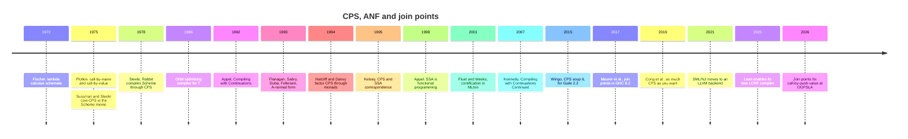
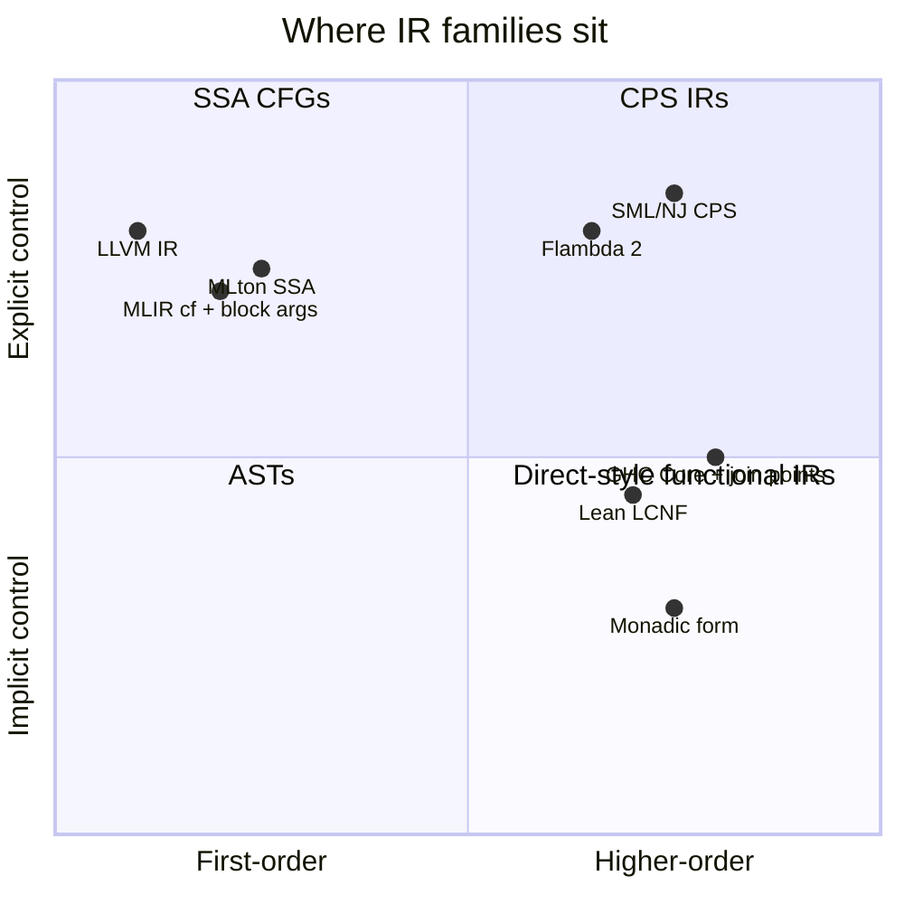

---
tags:
  - compilers
  - cps
  - anf
  - intermediate-representation
  - functional-programming
  - join-points
  - compiler-foundations
status: complete
sources:
  - https://research.scheme.org/lambda-papers/lambda-papers-rabbit.html
  - https://people.csail.mit.edu/riastradh/t/adams86orbit.pdf
  - https://www.cs.yale.edu/homes/fischer/pubs/lambda.pdf
  - https://homepages.inf.ed.ac.uk/gdp/publications/cbn_cbv_lambda.pdf
  - https://www.cs.princeton.edu/~appel/papers/cwc.html
  - https://core.ac.uk/download/233662971.pdf
  - https://www.cs.tufts.edu/~nr/cs257/archive/cormac-flanagan/anormal.pdf
  - https://legacy.cs.indiana.edu/~sabry/papers/essence-retro.pdf
  - https://static.aminer.org/pdf/20170130/pdfs/popl/uwnyuczme8z4kohos9j5x1l2cjd7yglk.pdf
  - https://bernsteinbear.com/assets/img/kelsey-ssa-cps.pdf
  - https://www.cs.princeton.edu/~appel/papers/ssafun.pdf
  - https://www.cs.cornell.edu/people/fluet/research/contification/index.html
  - https://dcreager.net/pdf/Kennedy2007.pdf
  - https://www.cs.tufts.edu/~nr/cs257/archive/simon-peyton-jones/join-points-cwoc.pdf
  - https://pauldownen.com/publications/anf-continued.pdf
  - https://mail.haskell.org/pipermail/ghc-tickets/2017-February/048264.html
  - https://downloads.haskell.org/ghc/8.2.1/docs/html/users_guide/8.2.1-notes.html
  - https://www.cs.uoregon.edu/Reports/PHD-201803-Maurer.pdf
  - https://www.cs.purdue.edu/~rompf/papers/cong-icfp19.pdf
  - https://williamjbowman.com/resources/wjb2024-anf-is-dead.pdf
  - https://2026.splashcon.org/details/oopsla-2026/11/Commuting-Conversions-and-Join-Points-for-Call-By-Push-Value
  - https://arxiv.org/pdf/2604.09961
  - https://arxiv.org/pdf/2411.07443
  - https://arxiv.org/abs/2201.07272
  - https://smlnj.org/dist/working/2021.1/2021.1-README.html
  - https://ar5iv.labs.arxiv.org/html/1805.08842
  - https://ocamlpro.com/blog/2024_03_19_the_flambda2_snippets_1
  - https://blog.janestreet.com/introducing-oxcaml/
  - https://arxiv.org/pdf/2104.00250
  - https://mlton.sourceforge.io/CompilerOverview
  - https://mlton.sourceforge.io/SSA
  - https://www.gnu.org/software/guile/manual/html_node/CPS-Soup.html
  - https://wingolog.org/archives/2015/07/27/cps-soup
  - https://www.cs.princeton.edu/techreports/2020/006.pdf
  - https://legacy.cs.indiana.edu/%7Edyb/pubs/hocs.pdf
  - https://lean-lang.org/doc/api/Lean/Compiler/LCNF/JoinPoints.html
  - https://www.cs.rochester.edu/~yzhu104/lean-gccjit/Lean/Compiler/LCNF/ToLCNF.html
  - https://leanprover-community.github.io/archive/stream/270676-lean4/topic/New.20compiler.20has.20been.20enabled.html
  - https://lean-lang.org/doc/reference/latest/releases/v4.30.0/
  - https://kotlinlang.org/spec/asynchronous-programming-with-coroutines.html
  - https://llvm.org/docs/Coroutines.html
  - https://homepages.inf.ed.ac.uk/slindley/papers/handlers-cps.pdf
  - https://www.microsoft.com/en-us/research/uploads/prod/2021/08/genev-icfp21.pdf
  - https://ocaml.org/p/js_of_ocaml/6.4.1/doc/effects.html
  - https://en.wikipedia.org/wiki/Continuation-passing_style
  - https://matt.might.net/articles/cps-conversion
  - https://bernsteinbear.com/blog/cps/
  - https://mlir.llvm.org/docs/Rationale/Rationale/
created: 2026-11-26
updated: 2026-11-26
---

## Table Of Contents

- [[#TL;DR|TL;DR]]
- [[#The Problem|The Problem]]
- [[#Foundations|Foundations]]
    - [[#Continuations|Continuations]]
    - [[#Continuation-Passing Style|Continuation-Passing Style]]
    - [[#A-Normal Form|A-Normal Form]]
    - [[#Monadic Normal Form|Monadic Normal Form]]
    - [[#Second-Class Continuations Are Basic Blocks|Second-Class Continuations Are Basic Blocks]]
- [[#How We Got Here|How We Got Here]]
- [[#How It Works|How It Works]]
    - [[#The Naive CPS Transform|The Naive CPS Transform]]
    - [[#One-Pass Transforms|One-Pass Transforms]]
    - [[#The Same Program in ANF|The Same Program in ANF]]
    - [[#From CPS to SSA|From CPS to SSA]]
    - [[#Join Points in GHC|Join Points in GHC]]
    - [[#Contification|Contification]]
    - [[#Async, Coroutines and Effect Handlers|Async, Coroutines and Effect Handlers]]
- [[#Where It Is Now|Where It Is Now]]
    - [[#Who Uses What|Who Uses What]]
    - [[#Recent Research|Recent Research]]
- [[#Trade-offs & Open Problems|Trade-offs & Open Problems]]
- [[#Resources|Resources]]
- [[#Related Notes|Related Notes]]

## ***TL;DR***
---
*CPS and ANF are two normal forms of the lambda calculus that make evaluation order, intermediate values and return points explicit, so a functional compiler can optimize them. They are the functional cousins of [[SSA Form]]: a continuation that never escapes is a basic block, and its parameters are φ nodes.*

- **CPS makes "the rest of the computation" a value.** Every function takes an extra *continuation* argument and never returns; it calls the continuation instead. Procedures "do not 'return,' but rather 'continue into'" the continuation's code ([Orbit, 1986](https://people.csail.mit.edu/riastradh/t/adams86orbit.pdf)). Steele's Rabbit (1978), Orbit and Appel's SML/NJ were built this way.
- **ANF keeps direct style.** A-normal form names every intermediate result with `let` and passes only variables or constants as arguments, but functions still return. Flanagan, Sabry, Duba and Felleisen (PLDI 1993) showed that a CPS compiler's three phases add up to a source-to-source transformation, so "fully developed CPS compilers do not need to employ the CPS transformation" ([Flanagan et al.](https://www.cs.tufts.edu/~nr/cs257/archive/cormac-flanagan/anormal.pdf)).
- **SSA is CPS with second-class continuations.** Kelsey (1995) gave syntactic translations between CPS and SSA; Appel (1998) put it as "SSA form is a kind of functional programming", with φ results as function parameters ([Kelsey](https://bernsteinbear.com/assets/img/kelsey-ssa-cps.pdf); [Appel](https://www.cs.princeton.edu/~appel/papers/ssafun.pdf)). Block arguments in [[MLIR]] and Cranelift are this idea.
- **Join points are the middle road.** Kennedy (ICFP 2007) argued for CPS with second-class local continuations; Maurer, Downen, Ariola and Peyton Jones (PLDI 2017) instead added *join points* to GHC's direct-style Core, merged for GHC 8.2.1 ([Kennedy](https://dcreager.net/pdf/Kennedy2007.pdf); [Maurer et al.](https://www.cs.tufts.edu/~nr/cs257/archive/simon-peyton-jones/join-points-cwoc.pdf); [GHC #12988](https://mail.haskell.org/pipermail/ghc-tickets/2017-February/048264.html)).
- **All three forms ship today.** SML/NJ, OCaml's Flambda 2 and Guile use CPS IRs; GHC Core and Lean 4's LCNF use direct style with join points; MLton uses SSA; CertiCoq offers both CPS and ANF. Kotlin `suspend` functions, js_of_ocaml effects and LLVM coroutines use CPS-like lowerings for code that can suspend.
- **The debate ended in "use as much CPS as you need".** Cong et al. (ICFP 2019) changed the question "from 'CPS yes or no' to 'as much or as little CPS as you want, when you want it'" ([Cong et al.](https://www.cs.purdue.edu/~rompf/papers/cong-icfp19.pdf)).

## ***The Problem***
---
*Before a compiler for a higher-order language can optimize anything, it must decide the order things run in, give names to intermediate values, and know where control goes when a call finishes. Source syntax hides all three.*

Take the expression `f (g x) + (if c then h y else 1)`. As a syntax tree it does not say:

- **Order.** Whether `g x` runs before or after `h y`, or where the call to `f` happens relative to the `if`.
- **Names.** The results of `g x`, `f (g x)` and the `if` are anonymous. An optimizer that wants to record "this value is used twice" or "this value is dead" needs a name to attach the fact to.
- **Return points.** After `g x` finishes, control goes back into the call to `f`; after either branch of the `if`, control goes to the `+`. These are exactly the places where a stack frame is pushed and popped, and the tree does not show them.
- **Merges.** Both arms of the `if` flow into the same `+`. A transformation that copies "the rest of the computation" into each arm can blow up code size; one that does not copy needs a name for the merge point.

Imperative compilers answer these questions with a control-flow graph in [[SSA Form]] (see [[Intermediate Representations]]). Functional compilers want something that still *is* lambda calculus, so that beta reduction, inlining and substitution remain valid rewrites. Orbit's authors chose CPS as "a convenient intermediate form that makes control-flow explicit" ([Kranz et al., 1986](https://people.csail.mit.edu/riastradh/t/adams86orbit.pdf)). ANF, monadic form and join points are later answers to the same question, each trying to keep CPS's benefits while dropping some of its costs.

## ***Foundations***
---
*Five ideas: what a continuation is, what CPS does with it, what ANF keeps of CPS, how monadic form relaxes ANF, and why a continuation that cannot escape is just a basic block.*

### Continuations

*A continuation is "the rest of the computation" from some point, packaged as a function of the value computed so far.*

In `f (g x) + 1`, while `g x` is running, the rest of the program is: take the result `v`, compute `f v + 1`, and hand that to whoever called us. As a function: `fun v -> k (f v + 1)`, where `k` is our own caller's continuation. Every expression has one. Direct-style code keeps it implicit in the call stack; Scheme exposes it with `call/cc`. Reynolds' 1993 paper "The Discoveries of Continuations" traces the many independent inventions; the phrase "continuation-passing style" comes from Sussman and Steele's 1975 AI Memo 349, the first Scheme report ([Wikipedia: CPS](https://en.wikipedia.org/wiki/Continuation-passing_style)).

### Continuation-Passing Style

*In CPS every call is a tail call, every function takes its continuation as an extra argument, and every intermediate result is a named parameter.*

```ocaml
(* direct style *)
let rec fact n = if n = 0 then 1 else n * fact (n - 1)

(* CPS: k is "what to do with the answer"; primitives like * stay direct *)
let rec fact_k n k =
  if n = 0 then k 1
  else fact_k (n - 1) (fun r -> k (n * r))

let () = fact_k 5 (fun r -> print_int r)   (* top-level continuation *)
```

Max Bernstein summarizes CPS as "two rules: first, that function/operator arguments must always be *trivial*; second, that function calls do not return" ([Bernstein, 2024](https://bernsteinbear.com/blog/cps/)). What follows:

- **Order is fixed by the syntax.** CPS fixes an evaluation order, which Maurer et al. list as one of its costs for a lazy language like Haskell ([Maurer et al.](https://www.cs.tufts.edu/~nr/cs257/archive/simon-peyton-jones/join-points-cwoc.pdf)). Plotkin's 1975 paper used the continuation technique to simulate call-by-value in call-by-name and back ([Plotkin](https://homepages.inf.ed.ac.uk/gdp/publications/cbn_cbv_lambda.pdf)).
- **No implicit stack.** Since nothing returns, "all calls become tail calls, so in effect, there is no stack" ([Might](https://matt.might.net/articles/cps-conversion)). A naive implementation heap-allocates every continuation closure; SML/NJ uses this heap-allocated continuation model, which gives constant-time `callcc` ([Farvardin and Reppy](https://ar5iv.labs.arxiv.org/html/1805.08842)).
- **One control construct.** Calls, returns, loops, exceptions and `call/cc` all become "jump to a lambda with arguments". Flambda 2 even uses *double-barrelled* CPS, where each function gets a normal-return and an exception continuation ([OCamlPro, 2024](https://ocamlpro.com/blog/2024_03_19_the_flambda2_snippets_1)).
- **Inlining is substitution.** In CPS, inlining is "a simple substitution of variables for variables", with no re-arranging of `let`s ([Kennedy, 2007](https://dcreager.net/pdf/Kennedy2007.pdf)).

### A-Normal Form

*ANF takes from CPS the naming of every intermediate value and the fixed order, but leaves the continuation implicit as "the body of the let".*

An expression is in ANF when every argument of a call or primitive is *atomic* (a variable, a constant or a lambda) and every non-trivial computation is bound by `let`. A simplified grammar in the style of Flanagan et al. (their Figure 6 defines the full language; this is a hand sketch):

```text
atom  a ::= x | c | (fun x -> e)
expr  e ::= a
          | let x = a a1 ... an in e     (* non-tail call, result named *)
          | let x = op a1 ... an in e    (* primitive *)
          | if a then e else e
          | a a1 ... an                  (* tail call *)
```

**In plain English:** you may not nest one computation inside another's arguments; name it first. The body of each `let` is the rest of the program, which is exactly the continuation that CPS would have written as a lambda.

Flanagan et al. observed that a CPS compiler does three things: CPS-convert, simplify away the administrative lambdas, then generate code that treats continuations specially ("realistic CPS compilers 'mark' the continuation closure as a special closure"). Composed, these are a source-level transformation whose reductions, the *A-reductions*, "name all intermediate results and ... merge code blocks across declarations and conditionals" ([Flanagan et al., 1993](https://www.cs.tufts.edu/~nr/cs257/archive/cormac-flanagan/anormal.pdf)). The terms were named by Sabry and Felleisen, who "called this set of terms A-normal forms (ANF)" ([Sabry, 2003 retrospective](https://legacy.cs.indiana.edu/~sabry/papers/essence-retro.pdf)).

### Monadic Normal Form

*Monadic form names intermediate results like ANF but does not flatten nested lets and conditionals, which avoids ANF's hardest step.*

Hatcliff and Danvy (POPL 1994) showed that CPS transformations "factor ... through Moggi's computational meta-language": first a translation into monadic form, then a generic *continuation introduction* step based on the continuation monad ([Hatcliff and Danvy](https://static.aminer.org/pdf/20170130/pdfs/popl/uwnyuczme8z4kohos9j5x1l2cjd7yglk.pdf)). In monadic form, `let x = (let y = e1 in e2) in e3` and `let x = (if a then e1 else e2) in e3` are legal; ANF would flatten both. That flattening (a *commuting conversion*) is what forces ANF to duplicate code or invent join points. Kennedy's MLj and SML.NET compilers used a monadic direct-style IL before he rebuilt SML.NET on CPS ([Kennedy](https://dcreager.net/pdf/Kennedy2007.pdf)), and Bowman's 2024 paper argues monadic form should be the working IR, with A-normalization saved for a late, low-level imperative IR ([Bowman, OOPSLA 2024](https://williamjbowman.com/resources/wjb2024-anf-is-dead.pdf)).

### Second-Class Continuations Are Basic Blocks

*A continuation that is only ever jumped to, never stored or passed to unknown code, needs no closure: it compiles to a label, and its parameters to φ nodes.*

This is the fact that ties all the forms together. Kennedy's IR separates `letcont` (local continuations, "second-class (they're not general lambdas)", which "can always be compiled as inline code") from functions, which become closures or known functions. A `letcont` "corresponds to a labelled block in traditional lower-level representations" ([Kennedy](https://dcreager.net/pdf/Kennedy2007.pdf)). Kelsey annotated every lambda as `proc`, `cont` or `jump`, where "jump indicates that the continuation is called within the current procedure instead of being passed to another one" ([Kelsey, 1995](https://bernsteinbear.com/assets/img/kelsey-ssa-cps.pdf)). GHC's join points enforce the same rule with a type system. The return continuation of a non-tail call to an unknown function is the one continuation that stays first class: it becomes a return address and a stack frame.

## ***How We Got Here***
---
*CPS came out of Scheme in the 1970s, became the standard functional IR through Orbit and SML/NJ, was challenged by ANF in 1993, was shown to be SSA in disguise in 1995 to 1998, and was refined into second-class continuations and join points from 2007 to 2017.*



| Year | Event | Why it mattered |
|---|---|---|
| 1972 | Fischer's "Lambda calculus schemata" | "rediscovered the notion of continuation and invented a transformation for converting an arbitrary expression into continuation-passing style" ([Fischer, revised 1993](https://www.cs.yale.edu/homes/fischer/pubs/lambda.pdf)) |
| 1975 | Plotkin, "Call-by-Name, Call-by-Value and the λ-Calculus" (TCS) | Continuation-based simulations between the two strategies ([Plotkin](https://homepages.inf.ed.ac.uk/gdp/publications/cbn_cbv_lambda.pdf)) |
| 1978 | Steele, RABBIT, MIT master's thesis ("LAMBDA as RENAME plus GOTO") | First compiler built on "converting the source program to continuation-passing style" ([Lambda Papers](https://research.scheme.org/lambda-papers/lambda-papers-rabbit.html)) |
| 1986 | Kranz, Kelsey, Rees, Hudak, Philbin, Adams: Orbit, for the T dialect of Scheme | Optimizing CPS compiler; "similar to the Rabbit compiler" ([Orbit](https://people.csail.mit.edu/riastradh/t/adams86orbit.pdf)) |
| 1992 | Appel, *Compiling with Continuations* (Cambridge University Press) | The book for CPS-based ML compilation ([Appel](https://www.cs.princeton.edu/~appel/papers/cwc.html); [Wikipedia](https://en.wikipedia.org/wiki/Continuation-passing_style)) |
| 1993 | Flanagan, Sabry, Duba, Felleisen, PLDI | ANF; made "compiler writers reconsider their decisions about intermediate representations" ([Sabry, 2003](https://legacy.cs.indiana.edu/~sabry/papers/essence-retro.pdf)) |
| 1995 | Kelsey, IR '95 workshop | Syntactic CPS to SSA translation and back ([Kelsey](https://bernsteinbear.com/assets/img/kelsey-ssa-cps.pdf)) |
| 1998 | Appel, SIGPLAN Notices | "SSA is Functional Programming" ([Appel](https://www.cs.princeton.edu/~appel/papers/ssafun.pdf)) |
| 2001 | Fluet and Weeks, ICFP | Optimal dominator-based contification in MLton ([Fluet and Weeks](https://www.cs.cornell.edu/people/fluet/research/contification/index.html)) |
| 2007 | Kennedy, ICFP | CPS with second-class continuations beats ANF and monadic IRs in SML.NET ([Kennedy](https://dcreager.net/pdf/Kennedy2007.pdf)) |
| 2017 | Maurer, Downen, Ariola, Peyton Jones, PLDI | Join points in GHC Core, merged February 2017 for 8.2.1 ([paper](https://www.cs.tufts.edu/~nr/cs257/archive/simon-peyton-jones/join-points-cwoc.pdf); [ticket](https://mail.haskell.org/pipermail/ghc-tickets/2017-February/048264.html)) |
| 2019 | Cong, Osvald, Essertel, Rompf, ICFP | Selective CPS inside a direct-style IR ([Cong et al.](https://www.cs.purdue.edu/~rompf/papers/cong-icfp19.pdf)) |

Two side notes on the history. The 2003 retrospective says the paper's effect was real: SML/NJ "was redesigned with a new intermediate form close to ANF", and Moby and MLton were described then as using "a mixture of ANF, SSA, and CPS" ([Sabry](https://legacy.cs.indiana.edu/~sabry/papers/essence-retro.pdf)). And Maurer's group first pitched join points in 2016 as "Administrative normal form, continued", showing "how CPS itself can guide us in adding a control effect to ANF" ([Maurer et al., 2016 talk proposal](https://pauldownen.com/publications/anf-continued.pdf)).

## ***How It Works***
---
*One running example, `f (g x) + (if c then h y else 1)`, taken through the naive CPS transform, a one-pass transform, ANF, SSA and GHC-style join points. All code below is a hand sketch, not tool output.*

### The Naive CPS Transform

*Plotkin-style call-by-value CPS is three equations, but its output is full of trivial lambdas that the transform itself introduced.*

For the pure lambda calculus:

$$
\begin{aligned}
\llbracket x \rrbracket &= \lambda k.\; k\,x \\
\llbracket \lambda x.\,M \rrbracket &= \lambda k.\; k\,(\lambda x.\,\llbracket M \rrbracket) \\
\llbracket M\,N \rrbracket &= \lambda k.\; \llbracket M \rrbracket\,\bigl(\lambda m.\; \llbracket N \rrbracket\,(\lambda n.\; m\,n\,k)\bigr)
\end{aligned}
$$

**In plain English:** a variable hands itself to the continuation; a lambda hands over a function whose body is in CPS; an application evaluates the function to `m`, then the argument to `n`, then calls `m` with `n` and the current continuation `k`.

Apply it to `f (g x)`:

```text
[[f (g x)]]
= λk. [[f]] (λm. [[g x]] (λn. m n k))
= λk. (λk1. k1 f)
        (λm. (λk2. (λk3. k3 g) (λm2. (λk4. k4 x) (λn2. m2 n2 k2)))
               (λn. m n k))
```

Every `(λki. ...) (λ ...)` here is an **administrative redex**: a beta-redex created by the transform, not by the programmer. Reduce all four and you get what a person would write:

```text
λk. g x (λn. f n k)
```

"Call `g` on `x`; when it returns `n`, tail-call `f` on `n` with my continuation." Flanagan et al. call these the "administrative lambdas" that a realistic CPS compiler removes in a simplification phase ([Flanagan et al.](https://www.cs.tufts.edu/~nr/cs257/archive/cormac-flanagan/anormal.pdf)). Left in, each would become a heap-allocated closure.

### One-Pass Transforms

*Make the continuation a function in the compiler's own language whenever it is known at compile time, and the administrative redexes are reduced while translating.*

One-pass transformations "reduce administrative redexes at transformation time and thus operate in one pass"; the higher-order version was found independently by Appel, by Danvy and Filinski, and by Wand ([Danvy, Millikin and Nielsen, 2007](https://core.ac.uk/download/233662971.pdf)). The trick is to distinguish a *static* continuation (an OCaml closure in the compiler) from a *dynamic* one (an object-level variable like `k`). Might's "hybrid" transform splits the work across three functions (`T-c`, `T-k` and `M`); here is a compact two-function OCaml rendering of the same idea (`fresh` makes a new variable name):

```ocaml
type exp   = Var of string | Lam of string * exp | App of exp * exp
type value = CVar of string | CLam of string list * cexp
and  cexp  = CApp of value * value list        (* f a1 ... an: a jump *)

(* t e k: k is a compile-time continuation (an OCaml function) *)
let rec t (e : exp) (k : value -> cexp) : cexp =
  match e with
  | Var x -> k (CVar x)
  | Lam (x, body) ->
      let c = fresh "k" in
      k (CLam ([x; c], tc body (CVar c)))
  | App (f, a) ->
      t f (fun fv -> t a (fun av ->
        let r = fresh "r" in
        CApp (fv, [av; CLam ([r], k (CVar r))])))

(* tc e c: the continuation is an object-level variable c *)
and tc (e : exp) (c : value) : cexp =
  match e with
  | App (f, a) -> t f (fun fv -> t a (fun av -> CApp (fv, [av; c])))
  | _ -> t e (fun v -> CApp (c, [v]))
```

`tc (f (g x)) k` yields `g x (λr. f r k)` with no administrative redexes. The second function exists because a purely higher-order transform "eliminated the redundant bindings, but introduced an η-expansion around the continuation" (`λr. k r` in tail position); the hybrid avoids it ([Might](https://matt.might.net/articles/cps-conversion)). The same trick is used for effect-handler CPS translations, which are made higher-order so that administrative redexes disappear at translation time ([Hillerström et al., FSCD 2017](https://homepages.inf.ed.ac.uk/slindley/papers/handlers-cps.pdf)).

### The Same Program in ANF

*ANF names the same intermediate values but leaves the continuation as "the body of the let"; the hard case is a conditional in the middle of an expression.*

```ocaml
(* source *)
f (g x) + (if c then h y else 1)

(* ANF by the A-reduction for conditionals: the context "b + _" is copied *)
let a = g x in
let b = f a in
if c then (let d = h y in b + d)
     else b + 1

(* ANF with a join point: the context is named once *)
let a = g x in
let b = f a in
let j t = b + t in        (* only ever tail-called: a continuation *)
if c then (let d = h y in j d)
     else j 1
```

Flanagan et al.'s A-reduction for `if` moves the surrounding evaluation context into both branches, duplicating it; their linear-time algorithm "avoids duplicating the evaluation context enclosing a conditional expression" because nested conditionals would otherwise grow exponentially ([Flanagan et al.](https://www.cs.tufts.edu/~nr/cs257/archive/cormac-flanagan/anormal.pdf)). The second version is how compilers avoid it: name the context as a local function `j`. That `j` *is* a continuation, so ANF has quietly reinvented CPS's let-bound continuation. Kennedy's point: inlining in ANF "involves a re-normalization step that rearranges let expressions" and can introduce such join points, whereas in CPS "join points such as f are just continuations" ([Kennedy](https://dcreager.net/pdf/Kennedy2007.pdf)).

The same program in CPS, with the `if`'s continuation bound once:

```text
λk. g x (λa.
      f a (λb.
        letcont j t = k (b + t) in
        if c then h y j else j 1))
```

### From CPS to SSA

*Make each let-bound continuation a basic block and each continuation parameter a block argument, and the CPS term above is an SSA control-flow graph.*

```text
fn(x, y, c):
entry:
    a = call g(x)
    b = call f(a)
    br c, then, else
then:
    d = call h(y)
    jump join(d)
else:
    jump join(1)
join(t):                 ; t = φ(d from then, 1 from else)
    r = add b, t
    ret r                ; return = invoke the function's continuation k
```

| CPS / functional form | SSA form |
|---|---|
| let-bound continuation, only jumped to | basic block |
| continuation parameter | φ result, or block argument |
| `jump j v` | branch to `j`, passing `v` on this edge |
| variable in lexical scope | definition dominates use |
| `letrec` of continuations | loop |
| return continuation `k` | `ret` |
| non-tail call with continuation `λb. ...` | call instruction; `...` is the code after it |

Kelsey's translation turns `jump` lambdas into labelled blocks and the arguments of a φ ("C-function") into the parameters of the matching `λjump`. Going from SSA back to CPS, each block must be placed under its immediate dominator so every variable is in scope; "the restriction on variable references in CPS is lexical, while in SSA it is dynamic" ([Kelsey](https://bernsteinbear.com/assets/img/kelsey-ssa-cps.pdf)). Appel: "Wherever there is a formal parameter of a function (in the functional form), there is a φ (in the SSA form)", and "Wherever the functional form refers to a non-local variable, the SSA form has avoided the need for a φ" ([Appel](https://www.cs.princeton.edu/~appel/papers/ssafun.pdf)). Not every CPS program has an SSA image: non-local control like `call/cc` cannot be translated ([Kelsey](https://bernsteinbear.com/assets/img/kelsey-ssa-cps.pdf)).

Modern SSA IRs adopted the functional spelling directly. [[MLIR]] uses block arguments instead of φ ([MLIR Rationale](https://mlir.llvm.org/docs/Rationale/Rationale/)), and so do Cranelift and Swift SIL (details in [[SSA Form]]). Manticore's CFG IR, lowered from CPS, has blocks that "pass values through parameters rather than φ-nodes" ([Farvardin and Reppy](https://ar5iv.labs.arxiv.org/html/1805.08842)). Wingo describes Guile's CPS soup as making "every variable a phi variable, in the sense of SSA", and sums up: "CPS is SSA is CPS is SSA, it seems" ([Wingo, 2015](https://wingolog.org/archives/2015/07/27/cps-soup)).

### Join Points in GHC

*GHC keeps direct-style Core but adds a binding form that is syntactically a function and is guaranteed to compile to a jump.*

```haskell
-- GHC Core with a join point (hand sketch, types elided)
join j t = b + t in
case c of
  True  -> jump j (h y)
  False -> jump j 1
```

A let-bound function is a join point when it is never captured in a closure and is only tail-called with all its arguments; a call to it then compiles to a jump (plus a stack adjustment), allocating nothing. The typing rules keep jumps out of "any subterm whose evaluation will take place in some unknown context", such as a lambda body ([Maurer et al., PLDI 2017](https://www.cs.tufts.edu/~nr/cs257/archive/simon-peyton-jones/join-points-cwoc.pdf)).

Why it matters: *case-of-case* moves an outer `case` into each branch of an inner one. Without join points that either duplicates the outer alternatives or wraps them in ordinary functions that later passes may turn into closures. With join points, the outer alternatives become join points and each inner branch jumps to them, and the property survives later inlining. Measured on NoFib, heap allocation changed by a geometric mean of -0.4% (spectral) and -0.2% (real), with outliers of -85.9% (k-nucleotide) and -100% (n-body) in the shootout set, which the authors call "highly atypical"; the paper also reports a significant improvement to list fusion ([Maurer et al.](https://www.cs.tufts.edu/~nr/cs257/archive/simon-peyton-jones/join-points-cwoc.pdf)). Their slogan for ANF users was "Think in CPS; work in direct style." The work was merged in February 2017 with milestone 8.2.1 ([GHC #12988](https://mail.haskell.org/pipermail/ghc-tickets/2017-February/048264.html)), and the 8.2.1 notes list "Improved code generation of join points" ([GHC 8.2.1 notes](https://downloads.haskell.org/ghc/8.2.1/docs/html/users_guide/8.2.1-notes.html)). Maurer's thesis formalizes the calculus as System FJ ([Maurer, 2018](https://www.cs.uoregon.edu/Reports/PHD-201803-Maurer.pdf)).

### Contification

*Contification turns a function into a continuation when every call to it returns to the same place, so it can become a block instead of a closure.*

Contification is "a compiler optimization that turns a function that always returns to the same place into a continuation"; Fluet and Weeks gave an optimal algorithm "based on the dominator tree of a program's call graph" in MLton ([Fluet and Weeks, ICFP 2001](https://www.cs.cornell.edu/people/fluet/research/contification/index.html)). Kennedy does it with local rewrite rules ("Functions can be contified when they always return to the same place") ([Kennedy](https://dcreager.net/pdf/Kennedy2007.pdf)). In GHC's vocabulary it is join-point inference, and Lean's LCNF has the same pass: a `fun` becomes a `jp` when it is "always fully applied" and "always called in tail position", and its calls become `jmp`s ([Lean LCNF JoinPoints](https://lean-lang.org/doc/api/Lean/Compiler/LCNF/JoinPoints.html)). This is what turns a tail-recursive local function into a real loop in the CFG ([[Loop Optimizations]]).

### Async, Coroutines and Effect Handlers

*The same transform lowers `suspend` functions, coroutines and effect handlers in mainstream languages, usually as a selective CPS that touches only code that can suspend, with the continuation turned into a state number.*

- **Kotlin.** "Each suspendable function goes through a transformation from normally invoked function to continuation passing style (CPS)": it gains a `Continuation<T>` parameter and may return the marker `COROUTINE_SUSPENDED`. Each suspendable lambda becomes a class "with fields representing its local variables, and an integer field for current state", with $N + M$ states for $N$ suspension points and $M$ ordinary returns ([Kotlin spec](https://kotlinlang.org/spec/asynchronous-programming-with-coroutines.html)). That is CPS with the continuation *defunctionalized*: instead of a closure per resume point, one object plus a `label` switch.
- **LLVM coroutines.** The *switched-resume* lowering stores "the index of the active suspend" in the coroutine object; the *async* lowering "will split an async coroutine into a ramp function and one resume function per suspend point", which is a continuation per suspend point, made literal ([LLVM Coroutines](https://llvm.org/docs/Coroutines.html)).
- **Effect handlers by CPS.** Hillerström, Lindley, Atkey and Sivaramakrishnan give CPS translations for effect handlers as "a practical implementation technique that does not require special support in the target language's runtime", implemented as the JavaScript backend of Links ([FSCD 2017](https://homepages.inf.ed.ac.uk/slindley/papers/handlers-cps.pdf)). js_of_ocaml compiles OCaml 5 effects with `--effects=cps`, "partially transforming the program to continuation-passing style" where an analysis cannot rule effects out, or with `--effects=double-translation`, which keeps both versions and picks at run time ([js_of_ocaml manual](https://ocaml.org/p/js_of_ocaml/6.4.1/doc/effects.html)).
- **Effect handlers without CPS.** Native OCaml deliberately does not CPS: "OCaml does not use a CPS IR", because heap-allocated continuation closures would slow existing code and break stack-inspecting tools; it uses runtime fibers instead ([Sivaramakrishnan et al., PLDI 2021](https://arxiv.org/pdf/2104.00250)). Koka compiles handlers to C with evidence passing and a multi-prompt monadic translation in which yields "bubble" up to their prompt ([Xie and Leijen, ICFP 2021](https://www.microsoft.com/en-us/research/uploads/prod/2021/08/genev-icfp21.pdf)), the monadic cousin of CPS. The full comparison of strategies is in [[Effect Handlers and Delimited Continuations]].

## ***Where It Is Now***
---
*As of November 2026, no single form has won. CPS lives on in compilers that want first-class or cheap control (SML/NJ, Flambda 2, Guile, CertiCoq's default), direct style plus join points in GHC and Lean, and SSA with block arguments everywhere else; selective CPS is the standard way to lower suspendable code.*

### Who Uses What

*Checked against each project's own docs or papers; where a page did not say, the table says so.*

| Compiler | Form | Evidence |
|---|---|---|
| SML/NJ | First-order CPS IR after optimization and closure conversion, then a CFG IR to LLVM (2021.1, replacing MLRISC) | [SML/NJ 2021.1 README](https://smlnj.org/dist/working/2021.1/2021.1-README.html) |
| OCaml Flambda 2 (OxCaml) | Second-class CPS: `let_cont` declares a block; double-barrelled for exceptions; chosen following Kennedy | [OCamlPro, 2024](https://ocamlpro.com/blog/2024_03_19_the_flambda2_snippets_1); OxCaml "builds on our Flambda2 middle-end" ([Jane Street, June 2025](https://blog.janestreet.com/introducing-oxcaml/)) |
| Upstream OCaml native | No CPS IR; effects via fibers | [Sivaramakrishnan et al.](https://arxiv.org/pdf/2104.00250) |
| GHC | Direct-style Core with join points since 8.2.1 | [GHC #12988](https://mail.haskell.org/pipermail/ghc-tickets/2017-February/048264.html) |
| Lean 4 | LCNF: `toLCNF` will "Put computationally relevant expressions in A-normal form", with `jp`/`jmp` join points | [ToLCNF docs](https://www.cs.rochester.edu/~yzhu104/lean-gccjit/Lean/Compiler/LCNF/ToLCNF.html), [JoinPoints docs](https://lean-lang.org/doc/api/Lean/Compiler/LCNF/JoinPoints.html) |
| MLton | SSA ILs (SSA, SSA2, RSSA): "Each function consists of a collection of basic blocks"; contification | [MLton SSA](https://mlton.sourceforge.io/SSA), [CompilerOverview](https://mlton.sourceforge.io/CompilerOverview) |
| GNU Guile (2.2 on) | "CPS soup": a program is "a map from continuation labels to continuation values" | [Guile manual](https://www.gnu.org/software/guile/manual/html_node/CPS-Soup.html) |
| CertiCoq | λANF IR; "By default, the compiler will use the CPS translation", `-direct` for ANF; λANF is "syntactically a superset of CPS" | [Paraskevopoulou, 2020](https://www.cs.princeton.edu/techreports/2020/006.pdf) |
| Chicken Scheme | CPS to C | [Wikipedia: CPS](https://en.wikipedia.org/wiki/Continuation-passing_style) |
| Chez Scheme | Not CPS as far as sources say: continuations via segmented stacks; Bowman notes it uses an approach like late A-normalization of monadic form | [Dybvig, ICFP 2006](https://legacy.cs.indiana.edu/%7Edyb/pubs/hocs.pdf); [Bowman](https://williamjbowman.com/resources/wjb2024-anf-is-dead.pdf) |
| Thorin / MimIR | Thorin is CPS for all functions; MimIR "supports both direct style and CPS" | [MimIR](https://arxiv.org/pdf/2411.07443) |
| Koka | Evidence passing and monadic translation, not CPS | [Xie and Leijen](https://www.microsoft.com/en-us/research/uploads/prod/2021/08/genev-icfp21.pdf) |
| Kotlin, js_of_ocaml | Selective CPS for suspend functions / effects | [Kotlin spec](https://kotlinlang.org/spec/asynchronous-programming-with-coroutines.html), [jsoo](https://ocaml.org/p/js_of_ocaml/6.4.1/doc/effects.html) |
| MLIR, Cranelift, Swift SIL | SSA with block arguments (CPS's legacy) | [[SSA Form]], [MLIR Rationale](https://mlir.llvm.org/docs/Rationale/Rationale/) |

### Recent Research

*2024 to 2026 work is about making the forms precise and composable: where A-normalization belongs, join points for other calculi, and replacing dominance with scoping in higher-order IRs.*

- **Lean's compiler moves to LCNF (2025 to 2026).** Lean's new compiler was enabled on `master` on 20 June 2025 ([Lean Zulip](https://leanprover-community.github.io/archive/stream/270676-lean4/topic/New.20compiler.20has.20been.20enabled.html)). Lean 4.30.0 (26 May 2026) brought "completion of the new LCNF compiler backend", porting C emission from the old IR to LCNF and removing void arguments from join points ([Lean 4.30.0 release notes](https://lean-lang.org/doc/reference/latest/releases/v4.30.0/)). An earlier experiment had compiled Lean's λrc through an "SSA+regions" backend in MLIR ([Bhat and Grosser, 2022](https://arxiv.org/abs/2201.07272)).
- **Join points for call-by-push-value (OOPSLA 2026).** Chan, Gudin, Levy and Weirich define a *commuting conversion normal form* for CBPV, a single-pass translation into it, and adapt Maurer et al.'s explicit join points to avoid duplication; mechanized in Lean 4, a Distinguished Paper ([SPLASH 2026](https://2026.splashcon.org/details/oopsla-2026/11/Commuting-Conversions-and-Join-Points-for-Call-By-Push-Value)).
- **"A Low-Level Look at A-Normal Form" (OOPSLA 2024).** Bowman argues "normalization of commuting conversions is hard", that monadic form should generally be the working IR, and that "A-normalization should only be done in a low-level imperative intermediate form", where it is local and needs no join points ([Bowman](https://williamjbowman.com/resources/wjb2024-anf-is-dead.pdf)).
- **SSA without dominance for higher-order programs (2026).** Leißa and Griebler note that "Dominance is well-defined only for first-order control-flow graphs" and propose "an alternative foundation based on free variables": a nesting relation that implies dominance, implemented in MimIR. Their benchmarks scale log-linearly, though LLVM's dominance analysis is several times faster ([Leißa and Griebler](https://arxiv.org/pdf/2604.09961)).
- **MimIR (2024).** Successor of the CPS graph IR Thorin, with direct style, [[Dependent and Refinement Types|dependent type]]s and plugins, where "In CPS the φ-function becomes the parameter phi of continuation N" ([Leißa et al.](https://arxiv.org/pdf/2411.07443)).
- **Background still being built on.** Cong et al.'s λ½⊥ with a control operator `C` that exposes chosen continuations as second-class values, erased by a selective CPS translation ([ICFP 2019](https://www.cs.purdue.edu/~rompf/papers/cong-icfp19.pdf)); Flambda 2's design series from OCamlPro ([2024](https://ocamlpro.com/blog/2024_03_19_the_flambda2_snippets_1)).

## ***Trade-offs & Open Problems***
---
*Every choice moves the same cost around: CPS pays in IR size and evaluation-order rigidity, ANF pays in re-normalization and join points, SSA pays in losing higher-order structure.*

| | CPS (second-class conts) | ANF / monadic + join points | SSA with block arguments |
|---|---|---|---|
| Inlining | Substitution only ([Kennedy](https://dcreager.net/pdf/Kennedy2007.pdf)) | Needs re-normalization; may create join points | Function inlining is a CFG splice |
| Merge points | Continuations, free | Join points, typed (GHC) or inferred (Lean) | Blocks |
| Evaluation order | Fixed by syntax; awkward for laziness ([Maurer et al.](https://www.cs.tufts.edu/~nr/cs257/archive/simon-peyton-jones/join-points-cwoc.pdf)) | Direct; readable Core dumps | Fixed, first-order |
| Higher-order functions | Native | Native | Must be closure-converted first |
| Classic dataflow | Needs a CFG view; Flambda 2 chose an IR equivalent to a control-flow graph so it can reuse imperative static analyses ([OCamlPro](https://ocamlpro.com/blog/2024_03_19_the_flambda2_snippets_1)) | Same | Native ([[Dataflow Analysis]]) |
| Runtime stack | Heap continuations unless second-class | Normal stack | Normal stack |



*The quadrant placement is a hand judgement for orientation, not a measurement.*

Open problems:

- **No consensus form.** Cong et al. reject a universal answer: the choice depends on the compiler's goals and the optimization at hand, and their own system exists because, in their view, join points give the optimizer too little control over evaluation contexts, causing redundant rewrites ([Cong et al.](https://www.cs.purdue.edu/~rompf/papers/cong-icfp19.pdf)).
- **Commuting conversions.** ANF's flattening is where code blow-up and join points come from; Bowman's monadic-first view and the OOPSLA 2026 CBPV work both attack it, from different ends ([Bowman](https://williamjbowman.com/resources/wjb2024-anf-is-dead.pdf); [Chan et al.](https://2026.splashcon.org/details/oopsla-2026/11/Commuting-Conversions-and-Join-Points-for-Call-By-Push-Value)).
- **Dominance in higher-order IRs.** CPS/SSA correspondence breaks when continuations escape; Leißa and Griebler's free-variable nesting is one answer, but it is slower than LLVM's dominator computation ([Leißa and Griebler](https://arxiv.org/pdf/2604.09961)).
- **CPS to SSA is fiddlier than the papers suggest.** Bernstein on implementing it: "it is not as simple as it looks" ([Bernstein](https://bernsteinbear.com/blog/cps/)). Manticore had to add a new LLVM calling convention (Jump-With-Arguments) and mark every call `musttail` to compile CPS through LLVM ([Farvardin and Reppy](https://ar5iv.labs.arxiv.org/html/1805.08842)).
- **Cost of selective CPS.** js_of_ocaml does not make its CPS mode the default because "the generated code can be slower, larger, and less readable", and its effect analysis is "less effective when higher-order functions are heavily used" ([jsoo](https://ocaml.org/p/js_of_ocaml/6.4.1/doc/effects.html)). Kotlin's explicit `suspend` marking ("function colouring") exists because the compiler must know which functions to turn into state machines ([Kotlin spec](https://kotlinlang.org/spec/asynchronous-programming-with-coroutines.html)).
- **Verification.** CertiCoq verifies an ANF/CPS middle end down to Clight and CompCert ([Paraskevopoulou](https://www.cs.princeton.edu/techreports/2020/006.pdf)); see [[Verified Compilers]]. Proving join-point and commuting-conversion passes correct is now done in proof assistants (the OOPSLA 2026 paper is mechanized in Lean 4).

## ***Resources***
---
*Start with Flanagan et al. and Kennedy as a pair, then Maurer et al. and Cong et al.; read Kelsey and Appel for the SSA link. Might's and Bernstein's posts are the fastest hands-on introductions.*

**Primary papers**
- [RABBIT: A Compiler for SCHEME](https://research.scheme.org/lambda-papers/lambda-papers-rabbit.html): Steele, MIT master's thesis, 1978. The first CPS compiler.
- [ORBIT: An Optimizing Compiler for Scheme](https://people.csail.mit.edu/riastradh/t/adams86orbit.pdf): Kranz, Kelsey, Rees, Hudak, Philbin, Adams, 1986.
- [Lambda-Calculus Schemata](https://www.cs.yale.edu/homes/fischer/pubs/lambda.pdf): Fischer, 1972 (revised in LISP and Symbolic Computation, 1993).
- [Call-by-Name, Call-by-Value and the λ-Calculus](https://homepages.inf.ed.ac.uk/gdp/publications/cbn_cbv_lambda.pdf): Plotkin, Theoretical Computer Science, 1975.
- [The Essence of Compiling with Continuations](https://www.cs.tufts.edu/~nr/cs257/archive/cormac-flanagan/anormal.pdf): Flanagan, Sabry, Duba, Felleisen, PLDI 1993, with the [2003 retrospective](https://legacy.cs.indiana.edu/~sabry/papers/essence-retro.pdf).
- [A Generic Account of Continuation-Passing Styles](https://static.aminer.org/pdf/20170130/pdfs/popl/uwnyuczme8z4kohos9j5x1l2cjd7yglk.pdf): Hatcliff and Danvy, POPL 1994. CPS via monadic form.
- [A Correspondence between CPS and SSA Form](https://bernsteinbear.com/assets/img/kelsey-ssa-cps.pdf): Kelsey, IR '95.
- [SSA is Functional Programming](https://www.cs.princeton.edu/~appel/papers/ssafun.pdf): Appel, SIGPLAN Notices, 1998.
- [Contification Using Dominators](https://www.cs.cornell.edu/people/fluet/research/contification/index.html): Fluet and Weeks, ICFP 2001.
- [On One-Pass CPS Transformations](https://core.ac.uk/download/233662971.pdf): Danvy, Millikin, Nielsen, JFP 2007 (BRICS RS-07-6).
- [Compiling with Continuations, Continued](https://dcreager.net/pdf/Kennedy2007.pdf): Kennedy, ICFP 2007.
- [Compiling without Continuations](https://www.cs.tufts.edu/~nr/cs257/archive/simon-peyton-jones/join-points-cwoc.pdf): Maurer, Downen, Ariola, Peyton Jones, PLDI 2017; [Maurer's thesis](https://www.cs.uoregon.edu/Reports/PHD-201803-Maurer.pdf), 2018.
- [Compiling with Continuations, or without? Whatever.](https://www.cs.purdue.edu/~rompf/papers/cong-icfp19.pdf): Cong, Osvald, Essertel, Rompf, ICFP 2019.
- [Continuation Passing Style for Effect Handlers](https://homepages.inf.ed.ac.uk/slindley/papers/handlers-cps.pdf): Hillerström, Lindley, Atkey, Sivaramakrishnan, FSCD 2017.
- [Retrofitting Effect Handlers onto OCaml](https://arxiv.org/pdf/2104.00250): Sivaramakrishnan et al., PLDI 2021. Why native OCaml avoids CPS.
- [Generalized Evidence Passing for Effect Handlers](https://www.microsoft.com/en-us/research/uploads/prod/2021/08/genev-icfp21.pdf): Xie and Leijen, ICFP 2021. Koka's monadic route.
- [A Low-Level Look at A-Normal Form](https://williamjbowman.com/resources/wjb2024-anf-is-dead.pdf): Bowman, OOPSLA 2024.
- [Commuting Conversions and Join Points for Call-by-Push-Value](https://2026.splashcon.org/details/oopsla-2026/11/Commuting-Conversions-and-Join-Points-for-Call-By-Push-Value): Chan, Gudin, Levy, Weirich, OOPSLA 2026.
- [SSA without Dominance for Higher-Order Programs](https://arxiv.org/pdf/2604.09961): Leißa and Griebler, 2026; [MimIR](https://arxiv.org/pdf/2411.07443): Leißa, Ullrich, Meyer, Hack, 2024.

**Books and theses**
- [Compiling with Continuations](https://www.cs.princeton.edu/~appel/papers/cwc.html): Appel, Cambridge University Press, 1992.
- [Verified Optimizations for Functional Languages](https://www.cs.princeton.edu/techreports/2020/006.pdf): Paraskevopoulou, Princeton PhD, 2020. CertiCoq's ANF/CPS middle end.

**Compiler docs and engineering posts**
- [SML/NJ 2021.1 README](https://smlnj.org/dist/working/2021.1/2021.1-README.html) and [Compiling with Continuations and LLVM](https://ar5iv.labs.arxiv.org/html/1805.08842): Farvardin and Reppy, 2018.
- [Flambda2 Ep. 1: Foundational Design Decisions](https://ocamlpro.com/blog/2024_03_19_the_flambda2_snippets_1): OCamlPro, 2024; [Introducing OxCaml](https://blog.janestreet.com/introducing-oxcaml/): Jane Street, 2025.
- [Guile manual: CPS Soup](https://www.gnu.org/software/guile/manual/html_node/CPS-Soup.html) and [Wingo, "cps soup"](https://wingolog.org/archives/2015/07/27/cps-soup), 2015.
- [MLton compiler overview](https://mlton.sourceforge.io/CompilerOverview) and [SSA IL](https://mlton.sourceforge.io/SSA).
- [Lean LCNF JoinPoints](https://lean-lang.org/doc/api/Lean/Compiler/LCNF/JoinPoints.html), [ToLCNF](https://www.cs.rochester.edu/~yzhu104/lean-gccjit/Lean/Compiler/LCNF/ToLCNF.html), [Lean 4.30.0 release notes](https://lean-lang.org/doc/reference/latest/releases/v4.30.0/).
- [GHC ticket #12988: Join points](https://mail.haskell.org/pipermail/ghc-tickets/2017-February/048264.html) and [GHC 8.2.1 release notes](https://downloads.haskell.org/ghc/8.2.1/docs/html/users_guide/8.2.1-notes.html).
- [Kotlin spec: coroutines](https://kotlinlang.org/spec/asynchronous-programming-with-coroutines.html), [LLVM Coroutines](https://llvm.org/docs/Coroutines.html), [js_of_ocaml effects](https://ocaml.org/p/js_of_ocaml/6.4.1/doc/effects.html).
- [The Development of Chez Scheme](https://legacy.cs.indiana.edu/%7Edyb/pubs/hocs.pdf): Dybvig, ICFP 2006.

**Practitioners and explainers**
- [How to compile with continuations](https://matt.might.net/articles/cps-conversion): Matt Might. Naive, higher-order and hybrid transforms in Racket.
- [Into CPS, never to return](https://bernsteinbear.com/blog/cps/): Max Bernstein, 2024.
- [Wikipedia: Continuation-passing style](https://en.wikipedia.org/wiki/Continuation-passing_style).

## Related Notes

- [[SSA Form]] — The imperative twin: φ nodes are continuation parameters, and block arguments are the modern spelling.
- [[Intermediate Representations]] — Where CPS and ANF sit among ASTs, CFGs and graph IRs.
- [[Type Systems and Inference]] — Join points are enforced by a typing rule in GHC Core.
- [[Classic Optimizations]] — Inlining, beta reduction and dead-code elimination are the main CPS/ANF simplifications.
- [[Loop Optimizations]] — Contification turns recursive functions into loops these passes can see.
- [[Dataflow Analysis]] — Flambda 2 chose a CFG-equivalent CPS to reuse imperative analyses.
- [[Register Allocation]] — Second-class continuations become blocks whose parameters are allocated like φs.
- [[MLIR]] — Block arguments and regions; an SSA+regions backend for Lean was built on it.
- [[LLVM]] — Target of SML/NJ's and Manticore's CPS pipelines; its coroutine passes split code at suspend points.
- [[Verified Compilers]] — CertiCoq's verified ANF/CPS middle end.
- [[Garbage Collection]] — Heap-allocated continuation closures are the main runtime cost of naive CPS, and why native OCaml avoids it.
- [[Compiler Pipeline]] — Where CPS or ANF conversion happens between the front end and closure conversion.
- [[Sea of Nodes]] — Planned: Thorin and MimIR are higher-order CPS IRs in sea-of-nodes form.
- [[Dependent and Refinement Types]] — Types that depend on values, and SMT-checked refinements.
- [[Effect Handlers and Delimited Continuations]] — CPS is one of four ways to implement handlers; fibers, evidence passing and stack copying are the others.
