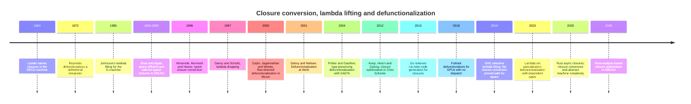
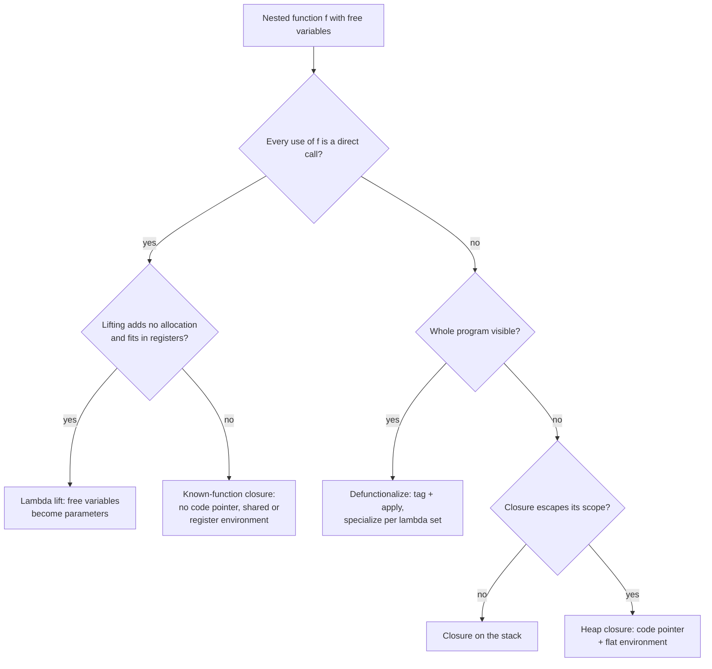

---
tags:
  - compilers
  - closure-conversion
  - defunctionalization
  - lambda-lifting
  - functional-programming
  - compiler-foundations
status: complete
sources:
  - https://jhc.sjtu.edu.cn/~yutingwang/files/fp/landin-1964.pdf
  - https://www.cs.tufts.edu/~nr/cs257/archive/john-reynolds/defintho.pdf
  - https://www.cs.tufts.edu/~nr/cs257/archive/olivier-danvy/defunc.pdf
  - https://core.ac.uk/download/233661632.pdf
  - https://brics.dk/RS/97/6
  - https://flint.cs.yale.edu/flint/publications/escc.html
  - https://www.cs.princeton.edu/~appel/papers/safe-closure.pdf
  - https://www.cs.cmu.edu/%7Erwh/papers/closures/popl96.pdf
  - http://pauillac.inria.fr/~fpottier/publis/fpottier-gauthier-popl04.pdf
  - https://scispace.com/pdf/flow-directed-closure-conversion-for-typed-languages-ywnlqyc9vg.pdf
  - https://mlton.sourceforge.io/ClosureConvert
  - https://engineering.purdue.edu/~qobi/papers/fdlcc.pdf
  - https://www.schemeworkshop.org/2012/papers/keep-hearn-dybvig-paper-sfp12.pdf
  - https://arxiv.org/pdf/1910.11717
  - https://hackage.haskell.org/package/ghc-9.8.1/docs/src/GHC.Stg.Lift.html
  - https://hackage-origin.haskell.org/package/ghc-8.8.1/docs/StgLiftLams.html
  - https://www.futhark-lang.org/publications/tfp18.pdf
  - https://cs.princeton.edu/~mpmilano/publication/lss/
  - https://www.rwx.com/blog/how-roc-compiles-closures
  - https://gist.github.com/rtfeldman/77fb430ee57b42f5f2ca973a3992532f
  - https://www.cl.cam.ac.uk/~jdy22/papers/defunctionalization-with-dependent-types.pdf
  - https://2023.splashcon.org/details/ppdp-2023/13/Closure-Conversion-in-Little-Pieces
  - https://arxiv.org/abs/2507.15843
  - https://pldi26.sigplan.org/details/pldi-2026-papers/19/Flow-Analysis-Based-Closure-Optimization
  - https://doc.rust-lang.org/reference/types/closure.html
  - https://www.infoworld.com/article/3835168/rust-1-85-arrives-with-long-awaited-async-closures.html
  - https://ece.uvic.ca/~frodo/cppbook/cppdraft/n4861/expr.prim.lambda.closure
  - https://cr.openjdk.org/~briangoetz/lambda/lambda-translation.html
  - https://kotlinlang.org/docs/inline-functions.html
  - https://docs.google.com/document/d/1bMwCey-gmqZVTpRax-ESeVuZGmjwbocYs1iHplK-cjo/pub
  - https://golang.google.cn/src/cmd/compile/internal/escape/escape.go?m=text
  - https://chromium.googlesource.com/v8/v8.git/+/main/docs/runtime/function-architecture.md
  - https://mrale.ph/blog/2012/09/23/grokking-v8-closures-for-fun.html
  - https://lean-lang.org/doc/reference/latest/releases/v4.23.0/
created: 2026-11-26
updated: 2026-11-26
---

## Table Of Contents

- [[#TL;DR|TL;DR]]
- [[#The Problem|The Problem]]
- [[#Foundations|Foundations]]
    - [[#Free Variables and Environments|Free Variables and Environments]]
    - [[#Closures|Closures]]
    - [[#Closure Conversion|Closure Conversion]]
    - [[#Lambda Lifting|Lambda Lifting]]
    - [[#Defunctionalization|Defunctionalization]]
    - [[#Three Answers Side by Side|Three Answers Side by Side]]
- [[#How We Got Here|How We Got Here]]
- [[#How It Works|How It Works]]
    - [[#A Worked Closure Conversion|A Worked Closure Conversion]]
    - [[#Flat, Linked and Shared Environments|Flat, Linked and Shared Environments]]
    - [[#Known Functions and Closure Optimization|Known Functions and Closure Optimization]]
    - [[#Selective Lambda Lifting in GHC|Selective Lambda Lifting in GHC]]
    - [[#A Worked Defunctionalization|A Worked Defunctionalization]]
    - [[#Flow-Directed Defunctionalization in MLton|Flow-Directed Defunctionalization in MLton]]
    - [[#Lambda Sets and Specializing Defunctionalization|Lambda Sets and Specializing Defunctionalization]]
    - [[#Keeping Types Through the Transformation|Keeping Types Through the Transformation]]
    - [[#Choosing a Strategy|Choosing a Strategy]]
- [[#Where It Is Now|Where It Is Now]]
    - [[#How Mainstream Languages Compile Closures|How Mainstream Languages Compile Closures]]
    - [[#Recent Research|Recent Research]]
- [[#Trade-offs & Open Problems|Trade-offs & Open Problems]]
- [[#Resources|Resources]]
- [[#Related Notes|Related Notes]]

## ***TL;DR***
---
*A function that mentions variables from an enclosing scope cannot be compiled to a bare code pointer. Compilers fix this in one of three ways: pair the code with a record of its free variables (closure conversion), pass those variables as extra arguments (lambda lifting), or replace every function value with a tag and a central dispatcher (defunctionalization).*

- **A closure is code plus environment.** Landin (1964) represented a function value as "a bundle of information called a 'closure,' comprising the λ-expression and the environment relative to which it was evaluated" ([Landin](https://jhc.sjtu.edu.cn/~yutingwang/files/fp/landin-1964.pdf)). Closure conversion makes that bundle explicit, so every function becomes closed, top-level code that receives its environment as a parameter.
- **Lambda lifting removes the environment instead.** Each free variable becomes an extra parameter and the function moves to the top level, which works when every call site is known. Johnsson (1985) formalized it for the G-machine; Danvy and Schultz (1997) defined the inverse, lambda dropping ([Danvy and Schultz](https://brics.dk/RS/97/6)).
- **Defunctionalization removes function values altogether.** Reynolds (1972) replaced the functions in an interpreter with records and a single `apply` that dispatches on which record it gets ([Reynolds](https://www.cs.tufts.edu/~nr/cs257/archive/john-reynolds/defintho.pdf)). It is a whole-program transformation, and MLton has used it as its closure-conversion strategy since its ESOP 2000 design ([Cejtin, Jagannathan and Weeks](https://scispace.com/pdf/flow-directed-closure-conversion-for-typed-languages-ywnlqyc9vg.pdf)).
- **Representation is where the performance lives.** Flat environments copy, linked ones chase pointers and can leak space; Shao and Appel's safe-for-space converter cut heap allocation by 36% in SML/NJ ([Shao and Appel, TOPLAS 2000](https://flint.cs.yale.edu/flint/publications/escc.html)), and Chez Scheme's closure optimizations remove about 58% of dynamic closure allocation ([Keep, Hearn and Dybvig, 2012](https://www.schemeworkshop.org/2012/papers/keep-hearn-dybvig-paper-sfp12.pdf)).
- **Mainstream languages mix all three.** Rust and C++ give every closure its own struct type, so monomorphized calls are static, while `dyn Fn` and `std::function` fall back to code pointer plus environment. Java desugars lambda bodies into methods whose captured values come first in the argument list. GHC runs selective lambda lifting late in its pipeline.
- **It is still active research.** Lambda set specialization (PLDI 2023) reports up to 6.85x under MLton and 3.45x under OCaml ([Brandon et al.](https://cs.princeton.edu/~mpmilano/publication/lss/)), and Reppy, Shivers and Zhong's PLDI 2026 paper revisits Shao and Appel's converter with a higher-order flow analysis in SML/NJ ([PLDI 2026](https://pldi26.sigplan.org/details/pldi-2026-papers/19/Flow-Analysis-Based-Closure-Optimization)).

## ***The Problem***
---
*Machine code has global code addresses and data, nothing else. A nested function that reads a variable from the scope that created it needs that variable to still exist, and to be findable, whenever and wherever the function is eventually called.*

Consider this OCaml:

```ocaml
let make_adder n =
  fun x -> x + n        (* n is free in the inner function *)

let add5  = make_adder 5
let add10 = make_adder 10
let r = add5 1 + add10 1   (* 6 + 11 *)
```

The inner `fun x -> x + n` is one piece of source, so it compiles to one piece of machine code. Yet `add5` and `add10` must behave differently, and by the time either is called, `make_adder`'s stack frame (where `n` lived) is gone. Three things go wrong if a compiler naively emits "a pointer to the code":

- **Where is `n`?** The code needs a way to reach the `n` that belonged to *this* function value. A plain code pointer carries no data.
- **How long does `n` live?** A function returned upward out of its defining scope (the "upward funarg") outlives the frame. Its captured variables must move to storage that lives as long as the function value, usually the heap, which brings in the [[Garbage Collection|garbage collector]].
- **What does a call do?** At `f x` where `f` is any function value, the caller does not know which code it is calling or what environment that code expects. Every unknown call needs one uniform calling convention.

Every compiler for a language with first-class nested functions must answer these, and the answer shapes the IR after this point: the output of this phase is first-order code that a conventional back end ([[Register Allocation]], [[Instruction Selection]]) can handle. In the [[Compiler Pipeline|pipeline]] it typically sits after [[CPS and ANF|CPS or ANF conversion]] and the main functional optimizations, and before lowering to a CFG in [[SSA Form]].

## ***Foundations***
---
*Six ideas: free variables, closures, closure conversion, lambda lifting, defunctionalization, and how the three transformations compare.*

### Free Variables and Environments

*A variable is free in a function if the function uses it but does not bind it. Free variables are exactly what an environment must supply.*

The free variables of a lambda term are defined by structural recursion:

$$
\mathrm{FV}(x) = \{x\} \qquad
\mathrm{FV}(\lambda x.\,e) = \mathrm{FV}(e) \setminus \{x\} \qquad
\mathrm{FV}(e_1\,e_2) = \mathrm{FV}(e_1) \cup \mathrm{FV}(e_2)
$$

In plain English: a variable is free if it appears somewhere in the body and no enclosing λ *inside this term* binds it. For `fun x -> x + n`, $\mathrm{FV} = \{n\}$ (treating `+` as a primitive). A term with no free variables is *closed*, and closed code can be compiled to a global function with no environment at all. Computing free variables is the first step of every technique below.

### Closures

*A closure is a runtime pair: a pointer to the function's code and an environment holding the values of its free variables.*

Landin introduced the term for the SECD machine: "we represent the value of a λ-expression by a bundle of information called a 'closure,' comprising the λ-expression and the environment relative to which it was evaluated" ([Landin, 1964](https://jhc.sjtu.edu.cn/~yutingwang/files/fp/landin-1964.pdf)). In an interpreter the environment is the interpreter's own variable map. In a compiler it must become an ordinary data structure: a heap record, a struct, a slice of registers.

For `make_adder`, the two runtime values look like this:

| Value | Code pointer | Environment |
|---|---|---|
| `add5` | `adder_code` | `{ n = 5 }` |
| `add10` | `adder_code` | `{ n = 10 }` |

Same code, different data. That is the whole idea; everything else is about how to lay out the environment and how to avoid building it.

### Closure Conversion

*Closure conversion rewrites every function so it takes its environment as an explicit parameter and has no free variables left, then rewrites every call to pass that environment along.*

The transformation has two halves:

1. **At each λ:** compute its free variables, emit a closed top-level function that takes an extra `env` parameter and reads each free variable from `env`, and replace the λ itself with code that allocates the pair `(code, env)`.
2. **At each call `f a`:** since `f` is now a pair, rewrite it to `f.code(f.env, a)`.

After closure conversion the program is first-order: functions are global, and "function values" are just records whose first field happens to be a code pointer. Everything about the result's speed depends on how big those records are, how they are shared, and how many of them a smarter compiler can avoid creating; see [[#Flat, Linked and Shared Environments|Flat, Linked and Shared Environments]].

### Lambda Lifting

*Lambda lifting turns each free variable into an extra parameter and moves the function to the top level. It needs no environment record, but it only works where every caller can supply those extra arguments.*

```ocaml
(* before *)
let sum_to n =
  let rec go i acc = if i > n then acc else go (i + 1) (acc + i) in
  go 0 0

(* after lambda lifting: n becomes a parameter of go *)
let rec go n i acc = if i > n then acc else go n (i + 1) (acc + i)
let sum_to n = go n 0 0
```

`go` never escapes, so every call can pass `n`. Lambda lifting fails when the function is used as a value, because whoever eventually calls it does not have `n`; turning `go` into a partial application `go n` would rebuild a closure anyway. Johnsson's 1985 algorithm, "Lambda lifting: Transforming programs to recursive equations", targeted the G-machine; the extra parameters must be computed as a fixed point over mutually recursive functions, which gives it a time complexity of $O(n^3 + m \log m)$ ($n$ the largest number of functions in one `letrec` block, $m$ the program size) ([Danvy and Schultz, RS-97-6](https://core.ac.uk/download/233661632.pdf)). Danvy and Schultz defined the inverse, *lambda dropping*, which sinks lifted functions back into block structure and removes parameters that only pass values along, in $O(n^2 + m \log m)$ ([BRICS RS-97-6](https://brics.dk/RS/97/6)).

### Defunctionalization

*Defunctionalization replaces every function value with a data constructor that records which λ it came from and its free variables, and replaces every call with a call to one `apply` function that switches on the constructor.*

Reynolds introduced it in 1972 to turn a higher-order definitional interpreter into a first-order one: the functions became "records that represent functions", and since records are not callable, he introduced a function `apply` that interprets them, rewriting every application site to call it ([Reynolds, 1972/1998](https://www.cs.tufts.edu/~nr/cs257/archive/john-reynolds/defintho.pdf)). Danvy and Nielsen later described it as "a whole-program transformation where function types are replaced by an enumeration of the function abstractions" in the program ([Danvy and Nielsen, PPDP 2001](https://www.cs.tufts.edu/~nr/cs257/archive/olivier-danvy/defunc.pdf)).

Two things follow from that definition:

- **It needs the whole program.** You can only enumerate the λs you can see. A separately compiled library that accepts callbacks cannot be defunctionalized against callers it has never seen.
- **Calls become branches, not indirect jumps.** `apply` is a `match`, so a call through a function value becomes a switch on an integer tag followed by a direct, inlinable call. That is why it suits [[Classic Optimizations|optimizers]] and GPUs.

Danvy and Nielsen also showed it has an inverse, *refunctionalization*, and used the pair to move between continuation-passing and first-order machines; it "yields an actual inverse to defunctionalization" in their Church-encoding setting ([Danvy and Nielsen](https://www.cs.tufts.edu/~nr/cs257/archive/olivier-danvy/defunc.pdf)). This is the bridge between [[CPS and ANF|CPS interpreters]] and abstract machines.

### Three Answers Side by Side

*All three remove free variables from function bodies; they differ in where the free variables go and what the compiler must know.*

| | Closure conversion | Lambda lifting | Defunctionalization |
|---|---|---|---|
| Free variables go to | A heap/stack environment record | Extra parameters | Constructor fields |
| A call `f a` becomes | `f.code(f.env, a)`, an indirect call | `f_lifted(fv1, …, a)`, a direct call | `apply(f, a)`, a switch then a direct call |
| Needs to know | Nothing beyond the λ | Every call site of `f` | Every λ in the program |
| Works with separate compilation | Yes | Locally | No (needs the whole program) |
| Main cost | Allocation and indirect calls | More arguments, possible re-allocation | Code size of `apply`, analysis time |
| Used by | SML/NJ, Chez, GHC, OCaml, V8, Go, Java | GHC (selectively), many functional compilers | MLton, Futhark, Roc, Reynolds-style interpreters |

## ***How We Got Here***
---
*The three techniques were all described by 1985. The next four decades were about choosing environment layouts that are fast and safe for space, keeping types through the transformation, and using flow analysis to specialize.*



- **The idea (1964–1985).** Landin's closures were the interpreter's view. Reynolds's 1972 paper, written to define languages by interpreters, contains defunctionalization as a by-product; Danvy and Nielsen note that it "has been used very little" afterwards ([Danvy and Nielsen](https://www.cs.tufts.edu/~nr/cs257/archive/olivier-danvy/defunc.pdf)). Johnsson's lambda lifting came from the lazy-graph-reduction world, where supercombinators (closed top-level functions) are what the machine executes.
- **Representation wars (1990s).** SML/NJ compiled through [[CPS and ANF|CPS]] with heap-allocated closures, which made closure layout a main performance knob. Shao and Appel's converter used "compile-time control and data flow information to optimize function calls", with "extensive closure sharing" and allocating "as many closures in registers as possible", and was safe for space ([Shao and Appel, TOPLAS 2000](https://flint.cs.yale.edu/flint/publications/escc.html)). Siskind's Stalin Scheme compiler went further with whole-program flow analysis that removed code pointers, parent slots and variable slots ([Siskind](https://engineering.purdue.edu/~qobi/papers/fdlcc.pdf)).
- **Types (1996–2004).** Typed compilers wanted closure conversion to keep the program well typed. Minamide, Morrisett and Harper hid the environment type behind an existential ([POPL 1996](https://www.cs.cmu.edu/%7Erwh/papers/closures/popl96.pdf)); Pottier and Gauthier showed that defunctionalization needs guarded algebraic data types (GADTs) to stay typed under polymorphism ([POPL 2004](http://pauillac.inria.fr/~fpottier/publis/fpottier-gauthier-popl04.pdf)).
- **Whole-program compilers (2000).** MLton made defunctionalization practical by monomorphizing first and using a 0CFA flow analysis so each call site dispatches over only the λs that can reach it ([Cejtin et al.](https://scispace.com/pdf/flow-directed-closure-conversion-for-typed-languages-ywnlqyc9vg.pdf)).
- **Closures go mainstream (2010s).** C++11, Java 8, Rust and Go all added closures, each with an implementation shaped by its runtime: C++ and Rust as compiler-generated structs, Java as desugared methods plus `invokedynamic`, Go as a "pointer to a variable-sized block of data memory, in which the first word holds a code pointer" ([Go 1.1 function calls](https://docs.google.com/document/d/1bMwCey-gmqZVTpRax-ESeVuZGmjwbocYs1iHplK-cjo/pub)).
- **Specialization and proofs (2019–2026).** Selective lambda lifting landed in GHC ([Graf and Peyton Jones](https://arxiv.org/pdf/1910.11717)); Paraskevopoulou and Appel mechanized in Coq that flat closure conversion is safe for time and space ([ICFP 2019](https://www.cs.princeton.edu/~appel/papers/safe-closure.pdf)); type-based lambda sets brought specializing defunctionalization to Roc and to PLDI ([Brandon et al., 2023](https://cs.princeton.edu/~mpmilano/publication/lss/)).

## ***How It Works***
---
*The core transformation is small; the engineering is in layouts, in avoiding closures for functions whose callers are all known, and in using flow information to specialize.*

### A Worked Closure Conversion

*Convert `make_adder` and its uses by hand: every λ becomes a closed global function, every function value becomes a record, every call goes through the record.*

Source:

```ocaml
let make_adder n = fun x -> x + n
let twice f y = f (f y)
let r = twice (make_adder 5) 1      (* 11 *)
```

After closure conversion (C-like pseudocode; `clo` is a heap record whose field 0 is a code pointer):

```c
// fun x -> x + n   becomes closed code with an explicit env
int adder_code(clo* env, int x) { return x + (int)env->fv[0]; }   // n = env->fv[0]

// make_adder allocates the closure: code pointer + free variables
clo* make_adder(clo* self, int n) {
    clo* c = alloc_closure(/*code*/ adder_code, /*nfv*/ 1);
    c->fv[0] = n;
    return c;
}

// twice has no free variables, but f is an unknown function value
int twice_code(clo* self, clo* f, int y) {
    int t = f->code(f, y);          // indirect call: pass the closure itself as env
    return f->code(f, t);
}

int r = twice_code(&twice_static, make_adder(&make_adder_static, 5), 1);
```

Three things to notice:

- **The closure is its own environment.** Passing `f` as the first argument lets the callee read its free variables from the same record that held its code pointer. This is the usual "flat closure" layout: one allocation per closure.
- **Closed functions get static closures.** `twice` and `make_adder` have no free variables, so their closures (`twice_static`, `make_adder_static`) can be allocated once at compile time.
- **Unknown calls are indirect.** Inside `twice`, the compiler does not know what `f` is, so it must load `f->code` and jump through it. [[Classic Optimizations|Inlining]] `twice` at its one call site would expose that `f` is `adder_code` and turn both calls into direct calls, one reason functional compilers inline before closure conversion.

### Flat, Linked and Shared Environments

*An environment can copy every free variable (flat), point to the parent's environment (linked), or be shared among several closures. Each choice trades allocation and copying against access time and memory retention.*

| Layout | What a closure holds | Access to a free variable | Risk |
|---|---|---|---|
| Flat | A copy of each free variable | One load | Copying cost when nested closures share many variables |
| Linked | Its own variables plus a pointer to the enclosing environment | A chain of loads, one per nesting level | Keeps the whole parent environment alive |
| Shared | One record used by several closures created together | One load | Keeps variables alive that only one closure needed |

Linked environments are what an interpreter naturally builds, and they are compact, but Paraskevopoulou and Appel point out that "linked closures are not safe for space": a closure that needs one small variable keeps the whole chain of enclosing environments, and everything they point to, reachable ([ICFP 2019](https://www.cs.princeton.edu/~appel/papers/safe-closure.pdf)). *Safe for space* means the transformation never increases the memory a garbage-collected program needs by more than a constant factor; they proved flat closure conversion for CPS λ-calculus safe in both time (the target costs at most seven times the source) and space, in 1,855 lines of Coq.

The same leak appears in JavaScript engines. V8 represents a closure as a `JSFunction` pointing at a `SharedFunctionInfo` (code, one per function literal) and a `Context`, the "heap-allocated lexical environment holding variables" captured from enclosing scopes, linked to its parent by `previous()` ([V8 function architecture](https://chromium.googlesource.com/v8/v8.git/+/main/docs/runtime/function-architecture.md)). A context "will be shared by all closures created in the scope" ([Egorov, 2012](https://mrale.ph/blog/2012/09/23/grokking-v8-closures-for-fun.html)), so:

```js
function outer() {
  const big = new Array(1e6).fill(0);   // captured by `useBig`
  const small = 1;
  const useBig = () => big.length;
  return () => small;                   // never mentions `big`...
}
const keep = outer();                    // ...but shares the context that holds it,
                                         // so `big` stays alive as long as `keep` does
```

Go chooses per variable rather than per scope. Its escape analysis decides after seeing every function body whether a captured variable is copied into the closure or captured by reference: "Capture by value for variables <= 128 bytes that are never reassigned", and the code also requires that the variable's address is never taken ([Go escape.go](https://golang.google.cn/src/cmd/compile/internal/escape/escape.go?m=text)). A captured variable that is reassigned must be shared between the closure and its frame, so it is moved to the heap, which is how closures show up in [[Escape Analysis]] reports.

Shao and Appel's converter, and its 2026 successor, aim to get the speed of shared layouts without their space leaks: share heap-allocated variable tuples where that stays safe for space, and keep as many closures and variables as possible in registers ([Shao and Appel](https://flint.cs.yale.edu/flint/publications/escc.html); [Reppy, Shivers and Zhong, PLDI 2026](https://pldi26.sigplan.org/details/pldi-2026-papers/19/Flow-Analysis-Based-Closure-Optimization)).

### Known Functions and Closure Optimization

*Most functions are only ever called directly. For those, a compiler can drop the code pointer, shrink or share the environment, or remove the closure altogether.*

Keep, Hearn and Dybvig's Chez Scheme pass ("Optimizing closures in O(0) time") starts from *well-known* procedures, ones whose value is only used at call sites where they are known, so the code pointer is unnecessary because calls can jump straight to the entry point ([Scheme Workshop 2012](https://www.schemeworkshop.org/2012/papers/keep-hearn-dybvig-paper-sfp12.pdf)). From there:

- **No free variables, well known:** the closure "is entirely useless and can be eliminated".
- **Representation by size:** a well-known procedure with one free variable is represented by that variable, with two by a pair, with three or more by a vector.
- **Free-variable elimination:** drop variables that are unreferenced, global, bound to constants, aliases of other variables, or self-references.
- **Sharing:** strongly connected procedures with the same lifetime share one closure.

Measured across their benchmarks, the pass removed 56.94% of closures and 44.89% of free variables statically, 58.25% of closure allocation and 58.58% of closure memory references dynamically, with run time down 3.6% on average (up to 20%) and compile time unchanged within 1%. The gap between "58% fewer allocations" and "3.6% faster" is typical: closure overhead is real but rarely the whole program.

### Selective Lambda Lifting in GHC

*Lambda lifting is always correct, so the question is when it pays. GHC lifts late, on STG, and only when a cost model says it does not increase allocation.*

GHC closure-converts by default and runs a selective lambda lifter "late in the optimisation pipeline" ([GHC.Stg.Lift](https://hackage.haskell.org/package/ghc-9.8.1/docs/src/GHC.Stg.Lift.html); the pass exists from GHC 8.8 as [StgLiftLams](https://hackage-origin.haskell.org/package/ghc-8.8.1/docs/StgLiftLams.html)). Lifting a local `let`-bound function saves allocating its closure, but adds arguments at its call sites and can make *other* closures bigger, since any closure that mentioned the lifted function now has to capture its free variables instead. Graf and Peyton Jones's heuristics reject a lift when ([ICFP 2019](https://arxiv.org/pdf/1910.11717)):

| Rule | Don't lift if… | Why |
|---|---|---|
| C1 | the binder is used as an argument | It would need a partial application, i.e. a closure again |
| C2 | closure growth analysis says allocation increases | Other closures must now capture the lifted function's free variables |
| C3 | the new arity exceeds the argument registers (5 on AMD64) | Extra arguments spill to the stack |
| C4 | known calls would become unknown calls | Loses direct-call speed |
| C5 | the binding is updatable (a thunk) or a constructor | Lifting would destroy sharing |

On nofib the pass never increased heap allocation, cut it by 0.9% overall (n-body by 20.2%), and cut run time by 0.7% on average, from −13.5% to +3.8% per benchmark. Turning off the closure-growth check (C2) raised allocation by 31.4% on wheel-sieve1, which is why the check stays.

### A Worked Defunctionalization

*Defunctionalize the same `make_adder` program: one constructor per λ, one `apply` with a case per constructor.*

Source, with two λs that can flow into `twice`:

```ocaml
let make_adder n = fun x -> x + n          (* λ1, free: n *)
let double       = fun x -> 2 * x          (* λ2, free: none *)
let twice f y = f (f y)
let r = twice (make_adder 5) 1 + twice double 3
```

After defunctionalization:

```ocaml
type fn = Adder of int        (* λ1 carries its free variable n *)
        | Double              (* λ2 carries nothing *)

let apply (f : fn) (x : int) : int =
  match f with
  | Adder n -> x + n
  | Double  -> 2 * x

let make_adder n = Adder n
let twice f y = apply f (apply f y)
let r = twice (make_adder 5) 1 + twice Double 3
```

The program is now first order: `fn` is an ordinary algebraic data type, `Adder 5` is just a tagged record, and there are no code pointers. A later optimizer can inline `apply`, and wherever the tag is known (as in `twice Double 3` after inlining `twice`), the `match` folds away. Futhark relies on exactly that. Its type system forbids conditionals that return functions, arrays of functions, function-typed loop results and parallel maps over functions, so every application site has a statically known target and defunctionalization adds no dispatch at all. That matters on GPUs, where threads in a warp run in lockstep and a branch idles the threads that do not take it. Rewriting over thirty benchmarks to use higher-order functions had "no impact on run-time performance", at up to twice the compile time ([Hovgaard, Henriksen and Elsman, TFP 2018](https://www.futhark-lang.org/publications/tfp18.pdf)); see [[GPU Kernel Compilers]].

### Flow-Directed Defunctionalization in MLton

*A single global `apply` is slow when the program has thousands of λs. MLton uses flow analysis so each call site switches only over the λs that can actually reach it.*

MLton's `ClosureConvert` pass translates its monomorphic SXML IR to its first-order [[SSA Form|SSA]] IR, and "Defunctionalization is the technique used to eliminate Closures" ([MLton docs](https://mlton.sourceforge.io/ClosureConvert)). The design, from Cejtin, Jagannathan and Weeks ([ESOP 2000](https://scispace.com/pdf/flow-directed-closure-conversion-for-typed-languages-ywnlqyc9vg.pdf)):

1. **Monomorphize** the whole program so it is simply typed.
2. **Run a monovariant (0CFA-style) flow analysis** that computes, for each function-typed value, the set of λs it may hold. See [[Abstract Interpretation]] and [[Pointer and Alias Analysis]] for the analysis family.
3. **Make one datatype per set**, with one constructor per λ carrying that λ's free variables; "the datatypes in the target language express all procedures that may be called at the same call-site".
4. **Insert coercions** where a value flows from a smaller set into a larger one. A coercion only changes the constructor, so representations can be chosen to make it free at run time.

The result has no arrow types and no existentials, so ordinary first-order optimizations see the flow information directly. In their measurements, dynamic dispatches were under 5% of calls, most benchmarks needed no coercions, and MLton ran faster than SML/NJ on most benchmarks, by up to 7.78x (tensor). The cost is the whole-program requirement: MLton has no separate compilation.

### Lambda Sets and Specializing Defunctionalization

*Instead of a flow analysis, put the set of possible λs into the type of every function value. Then specializing a higher-order function on its function arguments becomes ordinary monomorphization.*

Roc records, in each function type, the set of closures a value might be. In Hafiz's example the result type is `I64 -[[#clos1 I64, #clos2 I64]]-> I64`: a function from `I64` to `I64` that is one of two named closures, each capturing an `I64`. The lambda set compiles to a tag union whose payloads are the captures, and calls become "switch statements on integers" instead of function-pointer loads; captured environments usually live on the stack, with heap allocation only for recursive lambda sets ([RWX, 2022](https://www.rwx.com/blog/how-roc-compiles-closures)).

Brandon, Driscoll, Dai, Berkow and Milano formalized the idea as *lambda set specialization* (LSS), "the first specializing defunctionalization technique which imposes no restrictions on how function values may be used" ([PLDI 2023](https://cs.princeton.edu/~mpmilano/publication/lss/)). A polymorphic type system tracks how function values flow, specializing a higher-order function on its arguments becomes type monomorphization, and soundness and completeness of inference are proved in Isabelle/HOL. As a source-to-source preprocessing step it gave speedups of up to 6.85x under MLton, 3.45x under OCaml and 78.93x for the Morphic language.

The difference from MLton is *specialization*: MLton has one `twice` that dispatches over every λ passed to any `twice`; LSS makes a `twice` per lambda set, so the dispatch often disappears entirely, at the cost of more code.

### Keeping Types Through the Transformation

*A closure's environment type differs from closure to closure, so naive closure conversion breaks typing. Existential types fix closure conversion; GADTs fix defunctionalization.*

After naive conversion, `if c then make_adder 5 else double` has one arm of type `{n:int} → int → int` and another of type `{} → int → int`, which do not unify. Minamide, Morrisett and Harper's fix is to note that "the representation of the environment may be hidden using existential types": every closure of source type `int → int` becomes a package of type $\exists t.\,(t \to \mathrm{int} \to \mathrm{int}) \times t$ ([POPL 1996](https://www.cs.cmu.edu/%7Erwh/papers/closures/popl96.pdf)). In plain English: "some code and some environment of a type only that code knows". Keeping types this far down lets later phases use them for tag-free GC, unboxed representations and type-checking compiler output, which the authors used to find compiler bugs. See [[Type Systems and Inference]].

Defunctionalization has the dual problem: under polymorphism, a single `apply : fn<α,β> → α → β` would need every λ to work at every type. Pottier and Gauthier show that "extending System F with guarded algebraic data types allows recovering type preservation": each constructor gets an exact type such as `Arrow int int`, and each branch of `apply` is checked under that equation ([POPL 2004](http://pauillac.inria.fr/~fpottier/publis/fpottier-gauthier-popl04.pdf)). Huang and Yallop extended this to dependent types, which naive defunctionalization breaks by violating Agda's positivity and termination checks ([PLDI 2023](https://www.cl.cam.ac.uk/~jdy22/papers/defunctionalization-with-dependent-types.pdf)); see [[Dependent and Refinement Types]].

### Choosing a Strategy

*Real compilers decide per function, using what they know about its call sites and about the rest of the program.*



The first test is the "well-known" question from Chez and the C1/C4 rules from GHC. The second is MLton's and Roc's bet. The third is [[Escape Analysis]], which Swift and Go use to keep non-escaping closure contexts off the heap.

## ***Where It Is Now***
---
*As of November 2026, every major language with closures uses one of these strategies or a mix, and research has moved to flow-guided representation choice, type-based specialization and machine-checked proofs.*

### How Mainstream Languages Compile Closures

*Checked against each language's own reference or design documents.*

| Language | What a closure is | How calls dispatch | Source |
|---|---|---|---|
| Rust | A unique, unnamed type "approximately equivalent to a struct which contains the captured values"; capture mode inferred per path (`ImmBorrow` < `UniqueImmBorrow` < `MutBorrow` < `ByValue`); implements `Fn`, `FnMut` or `FnOnce` by what the body does | Static after monomorphization for generic `F: Fn`; code pointer + environment for `dyn Fn`; non-capturing closures coerce to `fn` pointers | [Rust Reference](https://doc.rust-lang.org/reference/types/closure.html) |
| C++ | A "unique, unnamed non-union class type, called the closure type" | Static through templates; `std::function` type-erases; captureless lambdas convert to function pointers | [C++20 draft, expr.prim.lambda.closure](https://ece.uvic.ca/~frodo/cppbook/cppdraft/n4861/expr.prim.lambda.closure) |
| Java | Lambda body desugared to a private method with captured values as "extra arguments prepended at the front of the argument list"; only effectively final locals captured | `invokedynamic` capture site bootstrapped by `LambdaMetafactory`, linked once per site, returning a functional-interface object | [Goetz, lambda translation](https://cr.openjdk.org/~briangoetz/lambda/lambda-translation.html) |
| Kotlin | "Each function is an object, and it captures a closure" | `inline` functions inline both the function and the lambdas passed to it, so no object is allocated; `noinline` opts a parameter out | [Kotlin inline functions](https://kotlinlang.org/docs/inline-functions.html) |
| Go | Pointer to a block whose first word is a code pointer, followed by captured variables; replaced Go 1.0's run-time code generation | Indirect call with the block's address in a context register | [Go 1.1 function calls](https://docs.google.com/document/d/1bMwCey-gmqZVTpRax-ESeVuZGmjwbocYs1iHplK-cjo/pub), [escape.go](https://golang.google.cn/src/cmd/compile/internal/escape/escape.go?m=text) |
| JavaScript (V8) | `JSFunction` = shared `SharedFunctionInfo` + per-scope `Context` chain + feedback cell | Indirect; the JIT specializes on feedback, see [[JIT Compilation]] | [V8 function architecture](https://chromium.googlesource.com/v8/v8.git/+/main/docs/runtime/function-architecture.md) |
| Standard ML (MLton) | Constructor of a per-flow-set datatype | `case` on the constructor | [MLton ClosureConvert](https://mlton.sourceforge.io/ClosureConvert) |
| Haskell (GHC) | Heap closure on STG; selective late lambda lifting first | Known calls direct, unknown calls through the closure | [GHC.Stg.Lift](https://hackage.haskell.org/package/ghc-9.8.1/docs/src/GHC.Stg.Lift.html) |

Rust and C++ are worth singling out. Giving every closure its own type and then monomorphizing every generic function that takes one is defunctionalization done per call site at compile time: inside a monomorphic `fn twice<F: Fn(i32) -> i32>(f: F, …)`, the call `f(x)` is a direct, inlinable call on a struct. Only when the program asks for type erasure (`Box<dyn Fn>`, `std::function`) does it pay for classic closure conversion. Rust 1.85 (February 2025) added async closures, which return futures when called and fix the earlier problem that closures "could not return futures that borrowed from the closure captures" ([InfoWorld](https://www.infoworld.com/article/3835168/rust-1-85-arrives-with-long-awaited-async-closures.html)).

Elsewhere:

- **Lean 4.** The 4.23.0 release (September 15, 2025) removed the old C++ compiler, so the LCNF-based compiler is the one in use, and tightened IR typing so closure applications must return an `.object` ([Lean 4.23.0 notes](https://lean-lang.org/doc/reference/latest/releases/v4.23.0/)).
- **Roc.** The compiler is being rewritten from Rust to Zig; Feldman's plan removes lambda set inference from type inference, says "Monomorphization needs a rewrite to fix lambda sets", and drops the Morphic solver for now. In September 2025 the Zig compiler was not yet ready for general use ([Feldman, rewrite plan](https://gist.github.com/rtfeldman/77fb430ee57b42f5f2ca973a3992532f)).

### Recent Research

*The newest work revisits the 1990s representation questions with stronger analyses, and keeps proving that the transformations preserve meaning and cost.*

- **Flow-Analysis-Based Closure Optimization** (Reppy, Shivers and Zhong, PLDI 2026, presented June 17, 2026). A new safe-for-space closure converter for SML/NJ that replaces the weak first-order analysis in Shao and Appel's converter with a higher-order flow analysis, improving sharing of heap-allocated variable tuples and spreading variables into argument registers; on average it produces better code than Shao and Appel's, with large speedups on some benchmarks ([PLDI 2026](https://pldi26.sigplan.org/details/pldi-2026-papers/19/Flow-Analysis-Based-Closure-Optimization)).
- **Closure Conversion, Flat Environments, and the Complexity of Abstract Machines** (Accattoli, Ghica, Guerrieri, Belo Lourenço and Sacerdoti Coen, arXiv, July 2025). A simpler correctness proof for flat closure conversion, and a time-complexity analysis showing it lowers dynamic costs while growing initial code, with overall complexity "the same" ([arXiv 2507.15843](https://arxiv.org/abs/2507.15843)).
- **Closure Conversion in Little Pieces** (Sullivan, Downen and Ariola, PPDP 2023). An IR with closures and unclosed higher-order code side by side, where closure conversion and its optimizations are small β and η steps that are correct by construction, built on call-by-push-value so it covers strict and lazy languages ([SPLASH 2023](https://2023.splashcon.org/details/ppdp-2023/13/Closure-Conversion-in-Little-Pieces)).
- **Lambda set specialization** (PLDI 2023) and **defunctionalization with dependent types** (PLDI 2023), described above ([Brandon et al.](https://cs.princeton.edu/~mpmilano/publication/lss/); [Huang and Yallop](https://www.cl.cam.ac.uk/~jdy22/papers/defunctionalization-with-dependent-types.pdf)).
- **Verified closure conversion.** Paraskevopoulou and Appel's transformation and its Coq proof "are parts of the CertiCoq compiler pipeline" ([ICFP 2019](https://www.cs.princeton.edu/~appel/papers/safe-closure.pdf)); see [[Verified Compilers]].

## ***Trade-offs & Open Problems***
---
*Every strategy buys speed in one place by paying in another: allocation, code size, analysis time, separate compilation or memory retention.*

| Choice | Gains | Pays |
|---|---|---|
| Flat closures | One load per variable; safe for space | Copies variables into each nested closure |
| Linked or shared closures | Less copying, smaller closures | Pointer chasing; retains dead variables (the V8 context leak) |
| Lambda lifting | No closure allocation for local functions | More arguments, register pressure; can grow other closures |
| Defunctionalization | Calls become switches and direct calls; optimizer sees through function values | Whole-program compilation; `apply` grows with the program |
| Specialization (LSS, Rust/C++ monomorphization) | Dispatch disappears entirely | Code size and compile time grow with the number of lambda sets or instantiations |
| Typed conversion | Types survive for GC, representation choice and checking | Needs existentials or GADTs in the IR |

Open problems:

- **Separate compilation vs defunctionalization.** MLton, Futhark and Roc's design all need the whole program. How to defunctionalize across module or library boundaries, for example by defunctionalizing within a compilation unit and closure-converting at its edges, has no standard answer. This is the same tension [[Linking and LTO|link-time optimization]] faces.
- **Code growth from specialization.** Roc's own rewrite plan names lambda sets as a part of monomorphization that needs fixing ([Feldman](https://gist.github.com/rtfeldman/77fb430ee57b42f5f2ca973a3992532f)); Hafiz notes that monomorphization time grows with the number of lambda sets and that whether a switch beats a pointer load depends on hardware ([RWX](https://www.rwx.com/blog/how-roc-compiles-closures)).
- **Space safety in practice.** Proofs cover flat closures in idealized calculi. Production JavaScript engines still share contexts per scope, which is fast to create but retains memory the programmer cannot see.
- **When lifting pays.** GHC's average gains are under 1% even with a careful cost model ([Graf and Peyton Jones](https://arxiv.org/pdf/1910.11717)), so most of the benefit is in avoiding pathological cases, not in the average.
- **Analysis precision vs cost.** MLton uses a monovariant 0CFA; Reppy, Shivers and Zhong use a higher-order flow analysis for representation decisions. How much more precision is worth paying for, and how to keep it scalable, connects to [[Abstract Interpretation]] and [[Pointer and Alias Analysis]].
- **Effects and continuations.** CPS compilers closure-convert continuations too, and [[Effect Handlers and Delimited Continuations|effect handler]] implementations either heap-allocate continuation closures or defunctionalize them into state machines. Choosing between them per handler is still mostly done by hand.

## ***Resources***
---
*Primary papers first, then design documents, then explainers.*

**Origins**
- [The Mechanical Evaluation of Expressions](https://jhc.sjtu.edu.cn/~yutingwang/files/fp/landin-1964.pdf): Landin, 1964. Closures in the SECD machine.
- [Definitional Interpreters for Higher-Order Programming Languages](https://www.cs.tufts.edu/~nr/cs257/archive/john-reynolds/defintho.pdf): Reynolds, ACM National Conference 1972; reprinted in HOSC 11, 1998. Section 6 is defunctionalization.
- [Defunctionalization at Work](https://www.cs.tufts.edu/~nr/cs257/archive/olivier-danvy/defunc.pdf): Danvy and Nielsen, PPDP 2001. Defunctionalization and refunctionalization as tools.
- [Lambda-Dropping](https://brics.dk/RS/97/6): Danvy and Schultz, BRICS RS-97-6, 1997 ([full report](https://core.ac.uk/download/233661632.pdf)). Lambda lifting, its inverse, and complexities.

**Closure representation**
- [Efficient and Safe-for-Space Closure Conversion](https://flint.cs.yale.edu/flint/publications/escc.html): Shao and Appel, TOPLAS 22(1), 2000.
- [Closure Conversion Is Safe for Space](https://www.cs.princeton.edu/~appel/papers/safe-closure.pdf): Paraskevopoulou and Appel, ICFP 2019.
- [Optimizing Closures in O(0) Time](https://www.schemeworkshop.org/2012/papers/keep-hearn-dybvig-paper-sfp12.pdf): Keep, Hearn and Dybvig, Scheme Workshop 2012.
- [Flow-Directed Lightweight Closure Conversion](https://engineering.purdue.edu/~qobi/papers/fdlcc.pdf): Siskind. Stalin's whole-program closure elimination.
- [Selective Lambda Lifting](https://arxiv.org/pdf/1910.11717): Graf and Peyton Jones, 2019.
- [Flow-Analysis-Based Closure Optimization](https://pldi26.sigplan.org/details/pldi-2026-papers/19/Flow-Analysis-Based-Closure-Optimization): Reppy, Shivers and Zhong, PLDI 2026.

**Defunctionalization in compilers**
- [Flow-Directed Closure Conversion for Typed Languages](https://scispace.com/pdf/flow-directed-closure-conversion-for-typed-languages-ywnlqyc9vg.pdf): Cejtin, Jagannathan and Weeks, ESOP 2000. MLton's design.
- [High-Performance Defunctionalisation in Futhark](https://www.futhark-lang.org/publications/tfp18.pdf): Hovgaard, Henriksen and Elsman, TFP 2018.
- [Better Defunctionalization through Lambda Set Specialization](https://cs.princeton.edu/~mpmilano/publication/lss/): Brandon et al., PLDI 2023.

**Types and proofs**
- [Typed Closure Conversion](https://www.cs.cmu.edu/%7Erwh/papers/closures/popl96.pdf): Minamide, Morrisett and Harper, POPL 1996.
- [Polymorphic Typed Defunctionalization](http://pauillac.inria.fr/~fpottier/publis/fpottier-gauthier-popl04.pdf): Pottier and Gauthier, POPL 2004.
- [Defunctionalization with Dependent Types](https://www.cl.cam.ac.uk/~jdy22/papers/defunctionalization-with-dependent-types.pdf): Huang and Yallop, PLDI 2023.
- [Closure Conversion in Little Pieces](https://2023.splashcon.org/details/ppdp-2023/13/Closure-Conversion-in-Little-Pieces): Sullivan, Downen and Ariola, PPDP 2023.
- [Closure Conversion, Flat Environments, and the Complexity of Abstract Machines](https://arxiv.org/abs/2507.15843): Accattoli et al., 2025.

**Language implementations**
- [Rust Reference: closure types](https://doc.rust-lang.org/reference/types/closure.html); [C++ closure types](https://ece.uvic.ca/~frodo/cppbook/cppdraft/n4861/expr.prim.lambda.closure); [Translation of Lambda Expressions](https://cr.openjdk.org/~briangoetz/lambda/lambda-translation.html) (Goetz); [Kotlin inline functions](https://kotlinlang.org/docs/inline-functions.html); [Go 1.1 Function Calls](https://docs.google.com/document/d/1bMwCey-gmqZVTpRax-ESeVuZGmjwbocYs1iHplK-cjo/pub); [V8 Function Architecture](https://chromium.googlesource.com/v8/v8.git/+/main/docs/runtime/function-architecture.md); [MLton ClosureConvert](https://mlton.sourceforge.io/ClosureConvert).

**Explainers**
- [How Roc Compiles Closures](https://www.rwx.com/blog/how-roc-compiles-closures): Ayaz Hafiz, 2022. Lambda sets with worked types.
- [Grokking V8 Closures for Fun (and Profit?)](https://mrale.ph/blog/2012/09/23/grokking-v8-closures-for-fun.html): Vyacheslav Egorov, 2012. Shared contexts and the leaks they cause.

## ***Related Notes***
---
*Where closures come from, what consumes them, and the analyses that decide their shape.*

- [[CPS and ANF]] — The normal forms that usually come right before closure conversion; CPS continuations are closures too.
- [[Escape Analysis]] — Whether a closure's environment escapes decides heap versus stack closures, and when Go captures by reference.
- [[Garbage Collection]] — Heap closures are GC objects, and linked environments decide what stays reachable.
- [[Classic Optimizations]] — Inlining before closure conversion turns unknown calls into known ones.
- [[Abstract Interpretation]] — 0CFA and higher-order flow analyses that drive MLton and the PLDI 2026 converter.
- [[Pointer and Alias Analysis]] — Control-flow analysis for higher-order programs is points-to analysis for function values.
- [[Type Systems and Inference]] — Existentials for typed closure conversion, lambda sets as types.
- [[Dependent and Refinement Types]] — Why defunctionalization needs new target calculi under dependent types.
- [[Verified Compilers]] — CertiCoq's verified, safe-for-space closure conversion.
- [[Effect Handlers and Delimited Continuations]] — Continuations become heap closures or defunctionalized state machines.
- [[GPU Kernel Compilers]] — Why GPU languages such as Futhark defunctionalize to avoid dispatch.
- [[JIT Compilation]] — How engines like V8 specialize closure calls with feedback.
- [[Linking and LTO]] — The whole-program view that defunctionalization needs.
- [[SSA Form]] — The first-order IR that closure-converted code is lowered into.
- [[Compiler Pipeline]] — Where closure conversion sits between the functional middle end and the back end.
- [[Reference Counting and Reuse]] — Planned: Perceus-style RC for closure environments in Lean and Koka.
- [[Partial Evaluation and Self-Specializing Interpreters]] — Planned: lambda dropping was built for partial-evaluator output.
