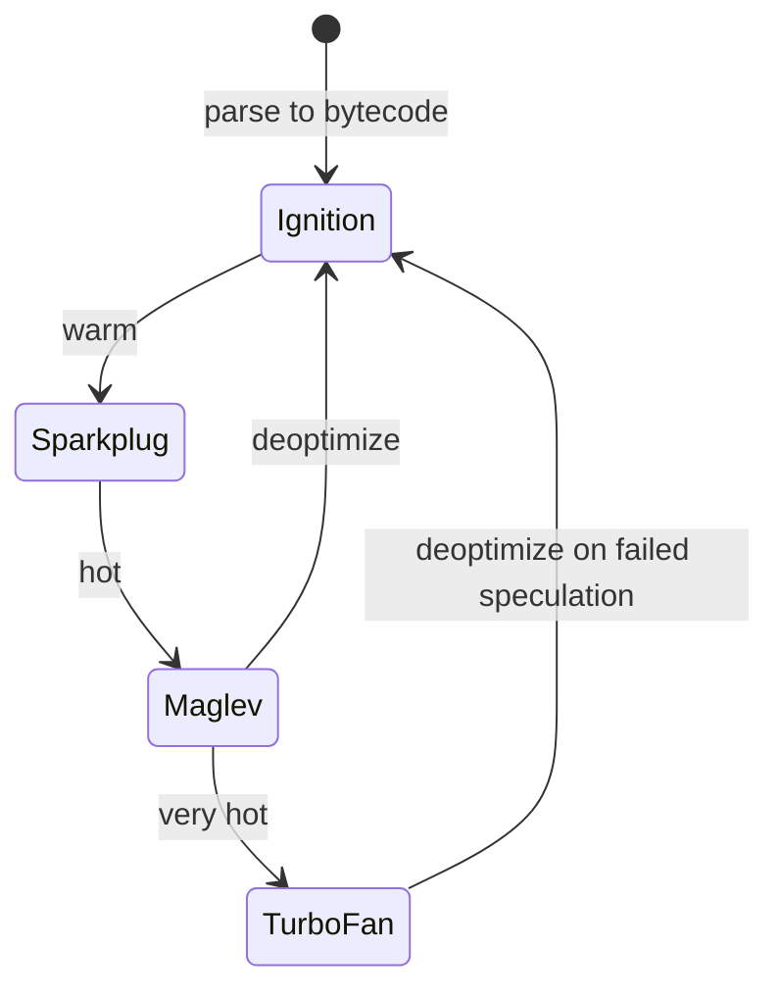
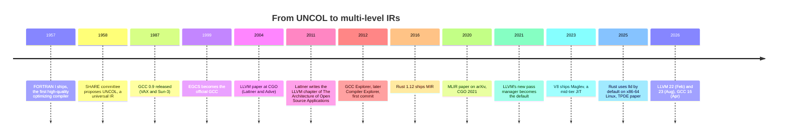
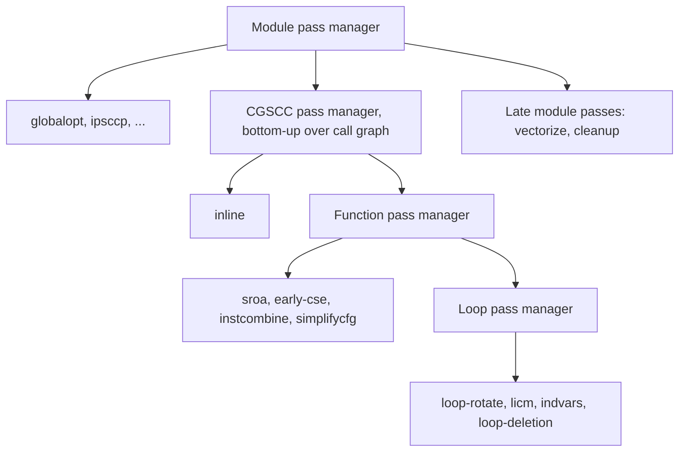
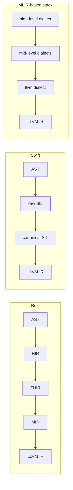

---
tags:
  - compilers
  - compiler-pipeline
  - intermediate-representation
  - code-generation
  - llvm
  - gcc
  - toolchain
status: complete
sources:
  - https://aosabook.org/en/v1/llvm.html
  - https://llvm.org/pubs/2004-01-30-CGO-LLVM.pdf
  - https://en.wikipedia.org/wiki/UNCOL
  - https://softwarepreservation.computerhistory.org/FORTRAN/
  - https://www.linux.com/news/compiler-changed-world-turns-25/
  - https://gnu.googlesource.com/gcc.git/+/refs/heads/trunk/gcc/doc/passes.texi
  - https://www.llvm.org/docs/CodeGenerator.html
  - https://blog.llvm.org/posts/2021-03-26-the-new-pass-manager
  - https://arxiv.org/abs/1801.04405v5
  - https://arxiv.org/pdf/2002.11054
  - https://mlir.llvm.org/users/
  - https://rustc-dev-guide.rust-lang.org/overview.html
  - https://rust-lang.github.io/rfcs/1211-mir.html
  - https://www.infoq.com/news/2016/10/Rust-112-MIR
  - https://swift.org/documentation/swift-compiler/
  - https://learn.microsoft.com/dotnet/csharp/roslyn-sdk/compiler-api-model
  - https://v8.dev/blog/maglev
  - https://bytecodealliance.org/articles/cranelift-progress-2022
  - https://xania.org/202206/happy-birthday-ce
  - https://discourse.llvm.org/t/llvm-22-1-0-released/89950
  - https://releases.llvm.org/23.1.0/docs/ReleaseNotes.html
  - https://developer.arm.com/community/arm-community-blogs/b/tools-software-ides-blog/posts/what-is-new-in-llvm-23
  - https://gcc.gnu.org/gcc-16/
  - https://gcc.gnu.org/pipermail/gcc-announce/2026/000190.html
  - https://discourse.llvm.org/t/clangir-upstream-progress-report-april-2026/90562
  - https://goals.rust-lang.org/2026/roadmap-fast-builds.html
  - https://blog.rust-lang.org/2025/09/01/rust-lld-on-1.90.0-stable
  - https://arxiv.org/abs/2505.22610
  - https://discourse.llvm.org/t/if-llvm-is-so-slow-is-anything-being-done-about-it/75389
  - https://lists.llvm.org/pipermail/llvm-commits/Week-of-Mon-20260105/1814751.html
  - https://cs.cornell.edu/courses/cs6120/2025fa/self-guided
created: 2026-11-26
updated: 2026-11-26
---

## Table Of Contents

- [[#TL;DR|TL;DR]]
- [[#The Problem|The Problem]]
- [[#Foundations|Foundations]]
    - [[#Three Phases and the IR Contract|Three Phases and the IR Contract]]
    - [[#What Each Stage Consumes and Produces|What Each Stage Consumes and Produces]]
    - [[#Passes, Analyses and the Pass Manager|Passes, Analyses and the Pass Manager]]
    - [[#AOT, JIT and Interpreters|AOT, JIT and Interpreters]]
- [[#How We Got Here|How We Got Here]]
- [[#How It Works|How It Works]]
    - [[#One Function, Start to Finish|One Function, Start to Finish]]
    - [[#Front End - Tokens and AST|Front End - Tokens and AST]]
    - [[#Middle End - From Naive IR to SSA to O2|Middle End - From Naive IR to SSA to O2]]
    - [[#Back End - From IR to x86-64|Back End - From IR to x86-64]]
    - [[#Assembler and Linker|Assembler and Linker]]
    - [[#Pass Managers and Phase Ordering|Pass Managers and Phase Ordering]]
    - [[#GCC and LLVM Side by Side|GCC and LLVM Side by Side]]
    - [[#Multi-Level IRs|Multi-Level IRs]]
    - [[#Query-Based and Incremental Compilers|Query-Based and Incremental Compilers]]
- [[#Where It Is Now|Where It Is Now]]
    - [[#Release Status|Release Status]]
    - [[#MLIR Everywhere, ClangIR Arriving|MLIR Everywhere, ClangIR Arriving]]
    - [[#Compile Time Becomes a Product Goal|Compile Time Becomes a Product Goal]]
- [[#Trade-offs & Open Problems|Trade-offs & Open Problems]]
- [[#Resources|Resources]]
- [[#Related Notes|Related Notes]]

## ***TL;DR***
---
*A compiler is a chain of translations, each from one representation to a slightly lower one, with a shared intermediate representation (IR) in the middle so that many languages and many machines can share one optimizer. This note is the map for the Compilers area: every other compiler note zooms into one box of the pipeline drawn here.*

- **Three parts.** The *front end* turns source text into a checked program (lexing, parsing, semantic analysis) and lowers it to IR. The *middle end* analyzes and rewrites the IR (optimization passes). The *back end* turns IR into machine code (instruction selection, register allocation, scheduling, emission). An assembler and linker then produce the executable, as in the owner's note [[Compiler, Assembler, Linker, and Loader]].
- **Why the split.** Without a shared IR, $M$ languages on $N$ targets need $M \times N$ compilers; with one, $M + N$ components. Lattner calls LLVM IR "both well specified and the *only* interface to the optimizer" ([Lattner, AOSA 2011](https://aosabook.org/en/v1/llvm.html)).
- **Passes.** The middle end is a sequence of small passes run by a *pass manager*. Which passes run, and in what order, changes the result: the *phase-ordering problem* ([Ashouri et al., 2018](https://arxiv.org/abs/1801.04405v5)).
- **More than one IR.** Modern compilers keep several IRs at different levels: Rust goes AST → HIR → THIR → MIR → LLVM IR ([rustc dev guide](https://rustc-dev-guide.rust-lang.org/overview.html)), Swift goes AST → SIL → LLVM IR ([swift.org](https://swift.org/documentation/swift-compiler/)), and [[MLIR]] makes "progressive lowering" across many levels a framework ([Lattner et al., 2020](https://arxiv.org/pdf/2002.11054)).
- **When it runs.** Ahead-of-time (AOT) compilers run before the program ships; [[JIT Compilation|JITs]] compile during execution and trade code quality for compile speed, often in tiers ([V8, 2023](https://v8.dev/blog/maglev)).
- **As of November 2026:** LLVM 23.1 (August 2026) and GCC 16 (16.1 in April, 16.2 in August 2026) are current; compile time has become a funded goal (Rust's 2026 "Fast Builds" roadmap, TPDE, Cranelift), and Clang's own MLIR-based IR (ClangIR) is upstream but not yet self-hosting.

## ***The Problem***
---
*Source code and machine code are far apart: one is a tree of human-friendly abstractions, the other a flat list of instructions for one specific chip. Doing the whole translation in one step is possible but leaves you with a compiler that is hard to optimize, hard to retarget and hard to reuse.*

A single-step translator from C to x86-64 has to solve every problem at once: understand the language, decide what to optimize, and know every detail of the target chip. Four pressures push compilers into a pipeline instead:

- **Many languages, many machines.** Each new language should not need its own back end for every CPU, and each new CPU should not need changes in every language. The 1958 UNCOL proposal stated this as reducing an "N×M problem to N+M" ([Wikipedia, UNCOL](https://en.wikipedia.org/wiki/UNCOL)).
- **Optimization needs a convenient shape.** Removing redundant work or hoisting code out of loops is easy on a control-flow graph in [[SSA Form]], and awkward on a syntax tree or on final assembly.
- **Correctness checks need source structure.** Type errors, borrow checks and good error messages need the program as the programmer wrote it, before desugaring erases that structure.
- **Compile time is a budget.** Each extra pass costs time; a JIT may have milliseconds. The pipeline must be configurable, from "almost nothing" at `-O0` to "everything" at `-O3` with [[Linking and LTO|link-time optimization]].

The pipeline answers all four by splitting the work into stages joined by well-defined representations, and by making the middle stage, the IR, the shared contract.

## ***Foundations***
---
*Four ideas carry the rest of the Compilers area: the three-phase design around an IR, the representation each stage hands to the next, passes managed by a pass manager, and the choice of when compilation happens.*

### Three Phases and the IR Contract

*Front ends produce IR, optimizers transform IR into IR, back ends consume IR; nothing else crosses the boundaries.*

Lattner describes the classic "three phase design whose major components are the front end, the optimizer and the back end" and notes that without a shared representation "supporting `N` targets and `M` source languages would need N*M compilers" ([Lattner, AOSA 2011](https://aosabook.org/en/v1/llvm.html)).

$$
\text{cost}_{\text{direct}} = M \times N
\qquad
\text{cost}_{\text{via IR}} = M + N + 1
$$

**In plain English:** with 5 languages and 6 targets, writing a direct compiler for each pair means 30 compilers. With a shared IR you write 5 front ends, 6 back ends and one optimizer (12 components), and every optimizer improvement helps all 30 combinations.

The catch is that the IR must be well specified and self-contained. Lattner's critique of older GCC is exactly that its layers leaked: "the back end walks front-end ASTs to generate debug info" and its GIMPLE mid-level form was "not a self-contained representation" ([Lattner, AOSA 2011](https://aosabook.org/en/v1/llvm.html)). The design of IRs is the subject of [[Intermediate Representations]].

### What Each Stage Consumes and Produces

*Each stage lowers the program one level: text, tokens, trees, typed trees, IR, machine IR, assembly, object file, executable.*

| Stage | Input | Output | Main job | Vault note |
|---|---|---|---|---|
| Preprocessing (C/C++) | Source text | Expanded text | `#include`, macros, `#if` | [[Compiler, Assembler, Linker, and Loader]] |
| Lexing | Characters | Tokens | Group characters into words | [[Lexing and Parsing]] |
| Parsing | Tokens | Abstract syntax tree (AST) | Check grammar, build tree | [[Lexing and Parsing]] |
| Semantic analysis | AST | Typed, resolved AST | Name resolution, types, diagnostics | [[Type Systems and Inference]] |
| IR generation | Typed AST | IR (often SSA) | Lower language features to simple ops | [[Intermediate Representations]], [[SSA Form]] |
| Middle end | IR | Better IR | Analyses and optimization passes | [[Dataflow Analysis]], [[Classic Optimizations]], [[Loop Optimizations]], [[Vectorization]] |
| Instruction selection | IR | Machine IR, virtual registers | Pick target instructions | [[Instruction Selection]] |
| Scheduling | Machine IR | Reordered machine IR | Hide latency, use pipelines | [[Instruction Selection]] |
| Register allocation | Virtual registers | Physical registers + spills | Fit values into a finite register file | [[Register Allocation]] |
| Emission | Machine IR | Assembly or object bytes | Encode instructions, emit relocations | [[Compiler, Assembler, Linker, and Loader]] |
| Assembling | Assembly text | Object file (ELF, COFF, Mach-O) | Encode, record symbols and relocations | [[Compiler, Assembler, Linker, and Loader]] |
| Linking | Object files, libraries | Executable or shared library | Resolve symbols, apply relocations | [[Linking and LTO]] |

Modern compilers usually skip the textual assembly step: LLVM's back end can emit object bytes directly, and the integrated assembler only parses text when you give it a `.s` file.

### Passes, Analyses and the Pass Manager

*A pass is one self-contained transformation or analysis over the IR; a pass manager decides the order, caches analysis results and throws them away when a pass changes the code.*

- **Transformation passes** rewrite IR: inlining, constant propagation, dead-code elimination, loop-invariant code motion ([[Classic Optimizations]], [[Loop Optimizations]]).
- **Analysis passes** compute facts without changing IR: dominator trees, loop nests, alias information, scalar evolution ([[Dataflow Analysis]]).
- **The pass manager** runs the passes over the right unit (module, call-graph SCC, function, loop), computes analyses lazily, caches them, and invalidates them when a pass reports it did not preserve them ([LLVM Blog, 2021](https://blog.llvm.org/posts/2021-03-26-the-new-pass-manager)).

In LLVM each pass is a C++ class, and passes are packaged as libraries so a client links only what it uses; the `opt` tool is "a simple wrapper around the LLVM pass manager" ([Lattner, AOSA 2011](https://aosabook.org/en/v1/llvm.html)). GCC lists its pipeline in `passes.def`, and its pass manager "validates constraints but does not regenerate data structures or lower IR for the next pass" ([GCC internals, passes.texi](https://gnu.googlesource.com/gcc.git/+/refs/heads/trunk/gcc/doc/passes.texi)).

### AOT, JIT and Interpreters

*The same pipeline can run before shipping, during execution, or not at all; the difference is how much compile time you can afford and how much you know about the running program.*

| Mode | When code is translated | Strength | Weakness | Examples |
|---|---|---|---|---|
| Interpreter | Never to machine code; executes a tree or bytecode | Starts instantly, portable, simple | Slow steady state | CPython (default build), V8's Ignition |
| AOT compiler | Before the program runs | Full optimization, no runtime compiler | No knowledge of actual inputs or hot paths (unless profile-guided) | Clang, GCC, rustc, swiftc |
| JIT compiler | While the program runs, on hot code | Specializes on observed types and values | Compile time competes with run time | V8's TurboFan and Maglev, HotSpot, Wasmtime with Cranelift |

A JIT runs the same three phases, just with a tighter budget. That is why JIT back ends such as Cranelift aim for "predictable" compile speed ([Bytecode Alliance, 2022](https://bytecodealliance.org/articles/cranelift-progress-2022)) and why TPDE merges several back-end stages into one pass ([Schwarz et al., 2025](https://arxiv.org/abs/2505.22610)). Production JITs stack several pipelines of increasing depth. V8 runs the Ignition interpreter, the Sparkplug baseline compiler (2021), the Maglev mid-tier optimizer (Chrome M117, 2023) and TurboFan; Maglev compiles about 10× slower than Sparkplug and about 10× faster than TurboFan ([V8, 2023](https://v8.dev/blog/maglev)). Deoptimization, dropping back a tier when a speculative assumption fails, has no AOT equivalent. See [[JIT Compilation]], [[WebAssembly]] and [[Garbage Collection]].



## ***How We Got Here***
---
*The front/middle/back split was argued for in 1958, but the universal IR only became practical with LLVM in the 2000s. Since then the trend has been more IRs, not fewer: language-specific mid-level IRs, then frameworks like MLIR for building them.*



- **FORTRAN I (April 1957).** IBM's compiler is called "the first high-quality optimizing compiler," and per Fran Allen it "set a standard for object program efficiency that has rarely been equalled" ([Computer History Museum](https://softwarepreservation.computerhistory.org/FORTRAN/)). Optimization was the point from day one, because programmers would not give up hand-written assembly otherwise.
- **UNCOL (1958).** A SHARE committee proposed a Universal Computer Oriented Language to turn N×M into N+M. It was "never fully specified or implemented"; Stavros Macrakis later argued language and compiler technology were not yet mature. Its descendants include UCSD p-code, Java bytecode and ANDF ([Wikipedia, UNCOL](https://en.wikipedia.org/wiki/UNCOL)).
- **GCC (1987).** GCC 0.9 came out on 22 March 1987 for the VAX and Sun-3. The EGCS fork (August 1997) became the official GCC in April 1999 and renamed it the GNU Compiler Collection ([Linux.com, 2012](https://www.linux.com/news/compiler-changed-world-turns-25/)). GCC grew a real multi-language, multi-target design, but with the tangled layering Lattner later criticized.
- **LLVM (CGO 2004).** Lattner and Adve proposed a typed, SSA-based, language-independent IR kept alive across "compile-time, link-time, install-time, run-time, and idle-time" for "lifelong" optimization. They were careful to say LLVM is "not intended to be a universal compiler IR" ([Lattner and Adve, 2004](https://llvm.org/pubs/2004-01-30-CGO-LLVM.pdf)). In practice its library design made it the closest thing to UNCOL the industry has. See [[LLVM]].
- **The AOSA chapter (2011).** Lattner's chapter set out the argument this note builds on: a shared IR, passes as libraries, and target descriptions in TableGen `.td` files that drive instruction selection, register allocation, encoding and assembly parsing from one source ([Lattner, AOSA 2011](https://aosabook.org/en/v1/llvm.html)).
- **Compiler Explorer (2012).** Matt Godbolt's tool, first committed on 22 May 2012 as GCC Explorer, made pipeline output visible to everyone; by 2022 it handled about 3 million compilations a week ([Godbolt, 2022](https://xania.org/202206/happy-birthday-ce)).
- **Language-level IRs (2015 onward).** Rust's MIR RFC (July 2015) argued that compiling from one AST "all the way to the final generation of bitcode" forced every pass to handle the whole language ([RFC 1211](https://rust-lang.github.io/rfcs/1211-mir.html)); MIR shipped with Rust 1.12 in September 2016 ([InfoQ, 2016](https://www.infoq.com/news/2016/10/Rust-112-MIR)). Swift built SIL for the same reasons ([swift.org](https://swift.org/documentation/swift-compiler/)).
- **MLIR (2020).** Instead of every project building its own IR from scratch, MLIR offers a framework for defining IRs ("dialects") and lowering between them ([Lattner et al., 2020](https://arxiv.org/pdf/2002.11054)).

## ***How It Works***
---
*This section follows one small C function through every stage using real compiler output, then steps back to how passes are organized, how GCC and LLVM differ, why languages add their own IRs, and how incremental compilers reshape the pipeline.*

### One Function, Start to Finish

*A loop that sums 0 to n−1 is small enough to read at every stage and interesting enough that the optimizer deletes the loop.*

```c
int sum_to(int n) {
    int s = 0;
    for (int i = 0; i < n; i++)
        s += i;
    return s;
}
```

All output below was produced locally with Clang 18.1.3 and GCC 13.3 on x86-64 Linux (the versions available for this note; current releases print slightly different IR but the same stages). Compiler Explorer shows the same views in a browser.


### Front End - Tokens and AST

*The lexer produces a flat token stream; the parser and semantic analysis turn it into a tree with types and resolved names.*

`clang -Xclang -dump-tokens` shows the lexer's output for the first lines:

```text
int 'int'                 Loc=<sum.c:1:1>
identifier 'sum_to'       Loc=<sum.c:1:5>
l_paren '('               Loc=<sum.c:1:11>
int 'int'                 Loc=<sum.c:1:12>
identifier 'n'            Loc=<sum.c:1:16>
r_paren ')'               Loc=<sum.c:1:17>
...
```

`clang -Xclang -ast-dump` shows the AST after semantic analysis (trimmed). Note what Sema added: every name points to its declaration, and every read of a variable is wrapped in an implicit `LValueToRValue` cast, making "load this variable" explicit.

```text
FunctionDecl sum_to 'int (int)'
|-ParmVarDecl used n 'int'
`-CompoundStmt
  |-DeclStmt
  | `-VarDecl used s 'int' cinit
  |   `-IntegerLiteral 'int' 0
  |-ForStmt
  | |-DeclStmt  (VarDecl i = 0)
  | |-BinaryOperator 'int' '<'
  | | |-ImplicitCastExpr <LValueToRValue> (DeclRefExpr 'i')
  | | `-ImplicitCastExpr <LValueToRValue> (DeclRefExpr ParmVar 'n')
  | |-UnaryOperator postfix '++' (DeclRefExpr 'i')
  | `-CompoundAssignOperator '+=' (s, i)
  `-ReturnStmt (ImplicitCastExpr <LValueToRValue> (DeclRefExpr 's'))
```

rustc and swiftc both use hand-written recursive-descent parsers ([rustc dev guide](https://rustc-dev-guide.rust-lang.org/overview.html); [swift.org](https://swift.org/documentation/swift-compiler/)). Grammars, parser generators and error recovery are covered in [[Lexing and Parsing]]; type checking and inference in [[Type Systems and Inference]].

### Middle End - From Naive IR to SSA to O2

*Clang's code generator emits deliberately naive IR that keeps every variable in a stack slot; the optimizer's first job is to promote those slots to SSA values, and later passes do the clever work.*

**The -O0 shape.** Every local lives in an `alloca` (a stack slot) and every use is a `load` or `store`. This is easy to generate correctly from an AST because it mirrors C's "variables are memory" model. (Produced with `-O0 -Xclang -disable-O0-optnone`, so the next step can run; plain `-O0` marks the function `optnone`.)

```llvm
define dso_local i32 @sum_to(i32 noundef %n) {
entry:
  %n.addr = alloca i32, align 4
  %s = alloca i32, align 4
  %i = alloca i32, align 4
  store i32 %n, ptr %n.addr, align 4
  store i32 0, ptr %s, align 4
  store i32 0, ptr %i, align 4
  br label %for.cond

for.cond:                               ; preds = %for.inc, %entry
  %0 = load i32, ptr %i, align 4
  %1 = load i32, ptr %n.addr, align 4
  %cmp = icmp slt i32 %0, %1
  br i1 %cmp, label %for.body, label %for.end

for.body:
  %2 = load i32, ptr %i, align 4
  %3 = load i32, ptr %s, align 4
  %add = add nsw i32 %3, %2
  store i32 %add, ptr %s, align 4
  br label %for.inc
  ; for.inc does the same load/add/store for i; for.end loads s and returns it
}
```

**After `mem2reg`.** One pass (`opt -passes=mem2reg`) removes every stack slot. Values that differ depending on which edge the loop came from become `phi` nodes, which is the defining feature of [[SSA Form]]:

```llvm
for.cond:                               ; preds = %for.inc, %entry
  %s.0 = phi i32 [ 0, %entry ], [ %add, %for.inc ]
  %i.0 = phi i32 [ 0, %entry ], [ %inc, %for.inc ]
  %cmp = icmp slt i32 %i.0, %n
  br i1 %cmp, label %for.body, label %for.end

for.body:
  %add = add nsw i32 %s.0, %i.0
  br label %for.inc
for.inc:
  %inc = add nsw i32 %i.0, 1
  br label %for.cond
for.end:
  ret i32 %s.0
```

**After the full -O2 pipeline.** The loop is gone:

```llvm
define dso_local i32 @sum_to(i32 noundef %n) local_unnamed_addr {
entry:
  %cmp4 = icmp sgt i32 %n, 0
  br i1 %cmp4, label %for.body.preheader, label %for.cond.cleanup

for.body.preheader:
  %0 = add nsw i32 %n, -1
  %1 = zext nneg i32 %0 to i33
  %2 = add nsw i32 %n, -2
  %3 = zext i32 %2 to i33
  %4 = mul i33 %1, %3
  %5 = lshr i33 %4, 1
  %6 = trunc i33 %5 to i32
  %7 = add i32 %6, %n
  %8 = add i32 %7, -1
  br label %for.cond.cleanup

for.cond.cleanup:
  %s.0.lcssa = phi i32 [ 0, %entry ], [ %8, %for.body.preheader ]
  ret i32 %s.0.lcssa
}
```

Running with `-print-changed` shows who did it. Early passes (SimplifyCFG, SROA, InstCombine) clean up; LoopRotate and LCSSA put the loop in canonical form; then **IndVarSimplify**, using the *scalar evolution* analysis, recognized `s` as a polynomial in the trip count and replaced the loop's exit value with a closed form. With nothing left using the loop, later passes deleted it.

$$
s(n) = \sum_{i=0}^{n-1} i = \frac{n(n-1)}{2}
\;=\; \frac{(n-1)(n-2)}{2} + (n-1)
$$

**In plain English:** the compiler proved the loop computes the triangular number and wrote down the formula instead. It computes it as $(n-1)(n-2)/2 + n - 1$ in a 33-bit integer (`i33`) so the multiplication cannot overflow before the halving; the two forms are equal. This is the flavor of work covered in [[Loop Optimizations]] and [[Dataflow Analysis]].

The O2 pipeline is long: `opt -passes='default<O2>' -print-pipeline-passes` lists about 100 pass entries, many of them repeats of cleanup passes like InstCombine and SimplifyCFG.

### Back End - From IR to x86-64

*The back end picks instructions, assigns registers, orders instructions and encodes them; LLVM's code generator documentation lists seven stages.*

LLVM's target-independent code generator runs these stages ([LLVM docs, Code Generator](https://www.llvm.org/docs/CodeGenerator.html)):

| # | Stage | What it does |
|---|---|---|
| 1 | Instruction selection | "determines an efficient way to express the input LLVM code in the target instruction set" |
| 2 | Scheduling and formation | "determines an ordering of the instructions" |
| 3 | SSA-based machine optimizations | Optional cleanups (machine CSE, LICM, sinking, peephole) on machine IR still in SSA |
| 4 | Register allocation | Maps an "infinite virtual register file in SSA form" to real registers, inserting spills |
| 5 | Prolog/epilog insertion | Builds the stack frame once spill slots are known |
| 6 | Late machine optimizations | Branch folding, block placement, final peepholes |
| 7 | Code emission | Prints assembly or writes object bytes via the MC layer |

Running `llc -O2 -debug-pass=Structure` on this function lists the real pass names in order, including "X86 DAG->DAG Instruction Selection", "Eliminate PHI nodes for register allocation", "Two-Address instruction pass", "Machine Instruction Scheduler", "Greedy Register Allocator", "Prologue/Epilogue Insertion & Frame Finalization", "Post RA top-down list latency scheduler" and "X86 Assembly Printer". Instruction selection on x86 uses *SelectionDAG*: build a DAG per basic block, legalize types and operations the target lacks, combine, match patterns, then linearize. GlobalISel is the newer alternative that works on whole functions ([LLVM docs, Code Generator](https://www.llvm.org/docs/CodeGenerator.html)). Details in [[Instruction Selection]] and [[Register Allocation]].

The results, side by side (Intel syntax):

```asm
; clang -O0: every variable lives on the stack, as in the -O0 IR
sum_to:
    push  rbp
    mov   rbp, rsp
    mov   dword ptr [rbp - 4], edi     ; n
    mov   dword ptr [rbp - 8], 0       ; s
    mov   dword ptr [rbp - 12], 0      ; i
.LBB0_1:
    mov   eax, dword ptr [rbp - 12]
    cmp   eax, dword ptr [rbp - 4]
    jge   .LBB0_4
    mov   eax, dword ptr [rbp - 12]    ; s += i, via memory
    add   eax, dword ptr [rbp - 8]
    mov   dword ptr [rbp - 8], eax
    ; ... i += 1 the same way, then jmp .LBB0_1
.LBB0_4:
    mov   eax, dword ptr [rbp - 8]
    pop   rbp
    ret
```

```asm
; clang -O2: closed form, no loop, everything in registers
sum_to:
    test  edi, edi            ; n <= 0 ?
    jle   .LBB0_1
    lea   eax, [rdi - 1]      ; n-1
    lea   ecx, [rdi - 2]      ; n-2
    imul  rcx, rax            ; 64-bit multiply plays the role of i33
    shr   rcx                 ; /2
    lea   eax, [rdi + rcx]    ; + n
    dec   eax                 ; - 1
    ret
.LBB0_1:
    xor   eax, eax
    ret
```

Note how instruction selection mapped IR ops to x86 idioms: `add` with a constant became `lea`, the `i33` arithmetic became a 64-bit `imul`, and `lshr 1` became `shr`. GCC 13 at `-O2` takes a different path on the same source: it keeps the loop but unrolls it by two (`lea edx, 1[rdx+rax*2]` adds `i` and `i+1` in one step). Same language, same target, different middle end, different code.

### Assembler and Linker

*The object file still has holes where addresses of other functions go; the linker fills them in.*

Compile a caller separately and inspect it with `objdump -dr`:

```c
int sum_to(int n);
int main(void) { return sum_to(10); }
```

```asm
; main.o, before linking
0:  bf 0a 00 00 00     mov  edi, 0xa
5:  e9 00 00 00 00     jmp  a <main+0xa>       ; tail call, target unknown
        6: R_X86_64_PLT32  sum_to-0x4           ; relocation: patch bytes 6..9

; after linking main.o + sum.o
1130: bf 0a 00 00 00   mov  edi, 0xa
1135: e9 06 00 00 00   jmp  1140 <sum_to>       ; displacement filled in
```

The compiler emitted a placeholder `00 00 00 00` plus a relocation record; the linker placed `sum_to` at `0x1140` and wrote the displacement `6`. The program exits with 45, which is `sum_to(10)`. The owner's note [[Compiler, Assembler, Linker, and Loader]] covers object formats and sections; [[Linking and LTO]] covers symbol resolution and why link time is a second chance to optimize; [[The Boot Process]] covers what loads the result.

### Pass Managers and Phase Ordering

*Passes are nested by the unit they work on, and their order matters because each pass creates or destroys opportunities for the others.*

LLVM's new pass manager (default since 2021) nests passes as module → (optional call-graph SCC) → function → loop, and keeps analyses in a separate analysis manager that computes them lazily, caches them for any function and invalidates whatever a pass does not declare preserved ([LLVM Blog, 2021](https://blog.llvm.org/posts/2021-03-26-the-new-pass-manager)). The CGSCC level exists so the inliner can walk the call graph bottom-up and see already-optimized callees. Switching gave Chrome a 3 to 4% Speedometer gain and an 8 to 9 MB size drop.



**Phase ordering.** Ashouri et al. separate two problems: *optimization selection* ("choosing which optimizations to apply") and *phase ordering* ("choosing the order of applying optimizations") ([Ashouri et al., 2018](https://arxiv.org/abs/1801.04405v5)). In the example above, IndVarSimplify could only find the closed form after `mem2reg`/SROA had turned memory into SSA values and LoopRotate had canonicalized the loop; run it first and it sees loads and stores it cannot reason about. Inlining is the classic amplifier: it exposes constants to propagation, which exposes dead branches, which shrinks functions so more get inlined. That is why production pipelines repeat cheap cleanup passes many times and why searching for better orders is an active research area ([[ML-Guided Optimization]], [[E-Graphs and Equality Saturation]], which sidesteps ordering by applying rewrites non-destructively).

### GCC and LLVM Side by Side

*Both are three-phase compilers with several IRs; they differ mainly in how cleanly the layers are separated and exposed as libraries.*

| Level | GCC | LLVM / Clang |
|---|---|---|
| Front-end tree | Language-specific trees, GENERIC | Clang AST (C/C++/ObjC); other languages bring their own |
| Mid-level IR | GIMPLE, in SSA for most passes | LLVM IR (SSA), with textual, in-memory and bitcode forms |
| Interprocedural | IPA passes; LTO via WHOPR (LGEN, WPA, LTRANS stages) | CGSCC passes; full LTO and ThinLTO |
| Low-level IR | RTL, produced by "expand" | SelectionDAG or GlobalISel generic MIR, then target MachineInstrs |
| Register allocation | IRA plus reload/LRA | Greedy allocator (also Fast and Basic) |
| Target description | Machine description `.md` files | TableGen `.td` files |
| Pass list | `passes.def` | Pipelines built in `PassBuilder`, printable with `-print-pipeline-passes` |

GCC's own documentation describes the GIMPLE passes as "Optimizations on a high-level representation" and the RTL passes as "Optimizations on a low-level representation", and describes IPA passes that "use call graph information to perform transformations across function boundaries" ([GCC internals, passes.texi](https://gnu.googlesource.com/gcc.git/+/refs/heads/trunk/gcc/doc/passes.texi)). LLVM's IR exists in "three isomorphic forms" (text `.ll`, in-memory, bitcode `.bc`), which is what lets tools like `opt` and `llc` run any stage in isolation ([Lattner, AOSA 2011](https://aosabook.org/en/v1/llvm.html)). That is also why this note could show the IR between every pass. See [[LLVM]].

### Multi-Level IRs

*One IR cannot be good at everything: source-level checks need high-level structure, optimizers want SSA, back ends want machine detail. So compilers lower through several IRs, each erasing a little structure.*



- **Rust.** The AST is desugared into HIR, where type inference, trait solving and type checking run; THIR is a "fully typed, more desugared" form used for pattern exhaustiveness checks; MIR is a control-flow graph used for borrow checking, dataflow checks, optimizations and constant evaluation; codegen turns MIR into LLVM IR, where monomorphized code is generated ([rustc dev guide](https://rustc-dev-guide.rust-lang.org/overview.html)). MIR's RFC lists the payoff: passes work on a "radically simpler" subset, drops and unwinding become explicit, analyses see the same control flow codegen uses, and Rust semantics no longer live inside the LLVM translation ([RFC 1211](https://rust-lang.github.io/rfcs/1211-mir.html)).
- **Swift.** The type-checked AST is lowered to "raw" SIL; mandatory "guaranteed transformations" run correctness dataflow checks such as uninitialized-variable detection and produce canonical SIL; SIL optimizations do Swift-specific work like reference-counting optimization, devirtualization and generic specialization; then SIL is lowered to LLVM IR ([swift.org](https://swift.org/documentation/swift-compiler/)).
- **MLIR.** The MLIR paper argues that LLVM's "one size fits all" abstraction suits C-family code but makes some analyses hard, and that projects keep building their own high-level IRs at great cost. MLIR offers *dialects* (namespaced sets of operations, types and attributes) that can be mixed in one program, regions for nesting, and *progressive lowering* in small steps ([Lattner et al., 2020](https://arxiv.org/pdf/2002.11054)). See [[MLIR]] and [[Intermediate Representations]].

### Query-Based and Incremental Compilers

*Instead of running passes over the whole program in order, a query-based compiler computes each fact on demand and caches it, so a small edit recomputes only what depends on it.*

rustc says plainly that it is not "a series of passes over the code which execute sequentially." Its major steps are queries on a `TyCtxt` that call each other; results are cached in memory and on disk, and on the next build only queries whose inputs changed are rerun (the red-green algorithm, covered in [[Incremental Computation]]). Lexing, parsing, name resolution and macro expansion were still outside the query system according to the guide's note dated November 2022 ([rustc dev guide](https://rustc-dev-guide.rust-lang.org/overview.html)).

Roslyn (C#, Visual Basic) took the same shift from the IDE side: its pipeline is Parse, Declaration, Bind and Emit, and each phase is exposed as an API (syntax tree, symbol table, semantic model, emit) that Visual Studio uses for formatting, navigation, refactoring and Edit-and-Continue ([Microsoft Learn](https://learn.microsoft.com/dotnet/csharp/roslyn-sdk/compiler-api-model)). The compiler becomes a database about the program that both the build and the editor query.

## ***Where It Is Now***
---
*As of November 2026: the big AOT compilers ship on steady six-month (LLVM) and yearly (GCC) cycles, MLIR has become the default way to build new domain compilers, and the loudest engineering push is on compile time rather than code quality.*

### Release Status

| Project | Current (Nov 2026) | Notes |
|---|---|---|
| LLVM / Clang | 23.1, released 25 August 2026 ([llvm.org](https://llvm.org/); [Arm, Oct 2026](https://developer.arm.com/community/arm-community-blogs/b/tools-software-ides-blog/posts/what-is-new-in-llvm-23)) | 22.1.0 came out 24 February 2026, with 20,541 commits from 1,719 contributors since 21.1.0 ([LLVM Discourse](https://discourse.llvm.org/t/llvm-22-1-0-released/89950)). |
| GCC | 16.2, released 7 August 2026 ([GCC](https://gcc.gnu.org/gcc-16/)) | 16.1 (30 April 2026) made GNU C++20 the default dialect, added an experimental Algol 68 front end, experimental C++26 reflection and contracts, vectorization of uncounted loops and better early-exit handling ([GCC announce](https://gcc.gnu.org/pipermail/gcc-announce/2026/000190.html)). |

LLVM 23's IR-level changes are a reminder that the IR contract keeps evolving: new floating-point literal syntax, a `noipa` attribute that blocks interprocedural analysis without blocking inlining, `dereferenceable` applying only at its definition point, and removal of `bugpoint` in favor of `llvm-reduce` ([LLVM 23.1.0 release notes](https://releases.llvm.org/23.1.0/docs/ReleaseNotes.html)). In the back end, Arm reports that GlobalISel improved compile times in LLVM 23 ([Arm, Oct 2026](https://developer.arm.com/community/arm-community-blogs/b/tools-software-ides-blog/posts/what-is-new-in-llvm-23)), and a January 2026 patch series routes AArch64 `optnone` functions through GlobalISel instead of the default selector ([llvm-commits, Jan 2026](https://lists.llvm.org/pipermail/llvm-commits/Week-of-Mon-20260105/1814751.html)); whether that landed was not confirmed for this note.

### MLIR Everywhere, ClangIR Arriving

The MLIR users page now lists Flang (LLVM's Fortran front end), CIRCT (hardware design), IREE, Triton, Mojo, TensorFlow, OpenXLA (XLA, StableHLO, Shardy), ONNX-MLIR, Torch-MLIR, Enzyme (automatic differentiation), Polygeist and PennyLane's Catalyst ([MLIR users](https://mlir.llvm.org/users/)). Most of the [[ML Compilers]] and [[GPU Kernel Compilers]] notes describe pipelines built this way, and LLVM 23 extended MLIR's TOSA and SPIR-V dialects for ML workloads ([Arm, Oct 2026](https://developer.arm.com/community/arm-community-blogs/b/tools-software-ides-blog/posts/what-is-new-in-llvm-23)).

The notable holdout was Clang itself, which lowers its AST straight to LLVM IR. ClangIR (CIR) adds an MLIR dialect in between, so C and C++ get a high-level IR like Rust's MIR or Swift's SIL. As of the April 2026 upstream progress report, CIR passed 92.1% of LLVM's SingleSource tests and 77.6% of MultiSource, compiled and passed 4 of 10 SPEC CPU 2017 integer and 3 of 8 floating-point benchmarks, and was "Not yet ready for self-hosting" (111 of 312 stage-2 targets built). It is opt-in via `-fclangir`, and the old incubator repository has been archived ([LLVM Discourse, Apr 2026](https://discourse.llvm.org/t/clangir-upstream-progress-report-april-2026/90562)).

### Compile Time Becomes a Product Goal

- **Rust.** lld became the default linker on x86-64 Linux in Rust 1.90 (September 2025); on an incremental ripgrep debug rebuild, linking got about 7× faster and end-to-end build time fell about 40% ([Rust Blog, 2025](https://blog.rust-lang.org/2025/09/01/rust-lld-on-1.90.0-stable)). The 2026 "Fast Builds" roadmap funds Cranelift backend performance ($65,000), and lists a TPDE experimental backend, "Relink Don't Rebuild", promotion of the parallel front end, an incremental-system redesign that extends caching to earlier phases such as name resolution, and the Wild linker ([Rust Project Goals 2026](https://goals.rust-lang.org/2026/roadmap-fast-builds.html)). rustc still processes each crate single-threaded by default.
- **Fast back ends.** TPDE fuses instruction selection, register allocation and encoding into one pass after one analysis pass; on SPECint 2017 it compiles LLVM IR 8 to 24× faster than LLVM `-O0` with comparable code ([Schwarz, Kamm and Engelke, 2025](https://arxiv.org/abs/2505.22610); CGO 2026). Cranelift, built for Wasmtime, uses an ISLE pattern DSL for lowering, regalloc2 and an e-graph mid-end ([Bytecode Alliance, 2022](https://bytecodealliance.org/articles/cranelift-progress-2022)).
- **LLVM itself.** Over the roughly three years to December 2023, optimized builds without debug info got about 20% faster, while unoptimized builds got about 3% slower, which Nikita Popov partly attributed to growing standard-library headers; he also noted compile time "isn't a priority for most contributors" ([LLVM Discourse, 2023](https://discourse.llvm.org/t/if-llvm-is-so-slow-is-anything-being-done-about-it/75389)). No newer aggregate figure was found.

## ***Trade-offs & Open Problems***
---
*Every boundary in the pipeline buys reuse at the cost of information: what one stage forgets, the next cannot use. Most open problems are about where to put boundaries and how to order work across them.*

| Tension | What you gain | What you pay |
|---|---|---|
| One shared IR (LLVM IR) | Reuse across languages and targets | Language semantics are lost early; high-level optimizations must happen before lowering or be rediscovered |
| Many IRs (HIR, MIR, SIL, MLIR dialects) | Right abstraction for each job | More lowering code, more places for bugs, harder end-to-end reasoning |
| Long pass pipelines | Better code from repeated cleanup | Compile time, phase-ordering sensitivity, hard-to-predict results |
| Separate stages (isel, regalloc, scheduling) | Each problem is tractable | Decisions interact: scheduling raises register pressure, allocation constrains scheduling |
| Fused back ends (TPDE, baseline JITs) | Order-of-magnitude faster compiles | Less room for global optimization |
| Per-file compilation | Parallel, incremental builds | No cross-file inlining without LTO |
| Query-based design | Fast incremental and IDE responses | Cache invalidation correctness, cache size on disk |

Open problems:

- **Phase ordering** has no general solution; production pipelines are hand-tuned. Learned orderings and equality saturation are the main research directions ([[ML-Guided Optimization]], [[E-Graphs and Equality Saturation]], [[Superoptimization]]).
- **Unoptimized-build speed.** The most common build is the debug build, where LLVM pays framework overhead without benefit; fast back ends like TPDE and Cranelift attack this directly.
- **Correctness across many stages.** Each lowering is a chance to miscompile. Verified compilers prove the whole chain ([[Verified Compilers]]); everyone else relies on testing and fuzzing ([[Compiler Testing and Fuzzing]]).
- **Parallelism inside the compiler.** [[Build Systems]] already run one compiler per file, so threading inside a compiler can hurt as much as help, as Mehdi Amini noted in the 2023 LLVM thread ([LLVM Discourse, 2023](https://discourse.llvm.org/t/if-llvm-is-so-slow-is-anything-being-done-about-it/75389)).
- **C and C++ lack a high-level IR.** ClangIR may change this, but it is not yet complete enough to compile LLVM itself.

## ***Resources***
---
*Start with Lattner's AOSA chapter for the architecture, then use Compiler Explorer on your own code. The rustc and Swift guides show modern multi-IR pipelines; CS 6120 is the best free course for the middle end.*

**Foundational**
- [The Architecture of Open Source Applications: LLVM](https://aosabook.org/en/v1/llvm.html) (Lattner, 2011): three-phase design, LLVM IR, passes as libraries, TableGen. Read first.
- [LLVM: A Compilation Framework for Lifelong Program Analysis & Transformation](https://llvm.org/pubs/2004-01-30-CGO-LLVM.pdf) (Lattner and Adve, CGO 2004) and [MLIR: A Compiler Infrastructure for the End of Moore's Law](https://arxiv.org/pdf/2002.11054) (Lattner et al., 2020; CGO 2021).
- History: [UNCOL](https://en.wikipedia.org/wiki/UNCOL) (Wikipedia, with 1958 references), [FORTRAN archive](https://softwarepreservation.computerhistory.org/FORTRAN/) (Computer History Museum), [GCC turns 25](https://www.linux.com/news/compiler-changed-world-turns-25/) (Linux.com, 2012), [Rust 1.12 ships MIR](https://www.infoq.com/news/2016/10/Rust-112-MIR) (InfoQ, 2016).

**Docs and guides**
- LLVM: [Target-Independent Code Generator](https://www.llvm.org/docs/CodeGenerator.html) (back-end stages, SelectionDAG) and [The New Pass Manager](https://blog.llvm.org/posts/2021-03-26-the-new-pass-manager) (LLVM Blog, 2021).
- GCC: [Passes and Files of the Compiler](https://gnu.googlesource.com/gcc.git/+/refs/heads/trunk/gcc/doc/passes.texi).
- Rust: [rustc dev guide overview](https://rustc-dev-guide.rust-lang.org/overview.html) and [RFC 1211: MIR](https://rust-lang.github.io/rfcs/1211-mir.html). Swift: [Swift Compiler](https://swift.org/documentation/swift-compiler/). C#: [Roslyn compiler API model](https://learn.microsoft.com/dotnet/csharp/roslyn-sdk/compiler-api-model). MLIR: [users list](https://mlir.llvm.org/users/).
- JITs: [Maglev](https://v8.dev/blog/maglev) (V8, 2023) and [Cranelift progress in 2022](https://bytecodealliance.org/articles/cranelift-progress-2022) (Bytecode Alliance).
- Phase ordering: [A Survey on Compiler Autotuning using Machine Learning](https://arxiv.org/abs/1801.04405v5) (Ashouri et al., 2018).

**Courses and tools**
- [CS 6120: Advanced Compilers, self-guided](https://cs.cornell.edu/courses/cs6120/2025fa/self-guided) (Adrian Sampson, Cornell): Bril IR plus LLVM; the best free middle-end course.
- [Happy birthday, Compiler Explorer](https://xania.org/202206/happy-birthday-ce) (Matt Godbolt, 2022).

**Current state (2025 to 2026)**
- Releases: [LLVM 23.1.0 release notes](https://releases.llvm.org/23.1.0/docs/ReleaseNotes.html), [What is new in LLVM 23](https://developer.arm.com/community/arm-community-blogs/b/tools-software-ides-blog/posts/what-is-new-in-llvm-23) (Arm, Oct 2026), [LLVM 22.1.0 released](https://discourse.llvm.org/t/llvm-22-1-0-released/89950) (Feb 2026), [GCC 16.1 announcement](https://gcc.gnu.org/pipermail/gcc-announce/2026/000190.html), [GCC 16 series](https://gcc.gnu.org/gcc-16/).
- [ClangIR upstream progress report, April 2026](https://discourse.llvm.org/t/clangir-upstream-progress-report-april-2026/90562) and the [AArch64 GlobalISel-for-optnone patch](https://lists.llvm.org/pipermail/llvm-commits/Week-of-Mon-20260105/1814751.html) (Jan 2026).
- Compile time: [Rust Project Goals 2026: Fast Builds](https://goals.rust-lang.org/2026/roadmap-fast-builds.html), [lld on 1.90.0 stable](https://blog.rust-lang.org/2025/09/01/rust-lld-on-1.90.0-stable), [TPDE](https://arxiv.org/abs/2505.22610) (Schwarz, Kamm and Engelke, 2025), [If LLVM is so slow, is anything being done about it?](https://discourse.llvm.org/t/if-llvm-is-so-slow-is-anything-being-done-about-it/75389) (LLVM Discourse, Dec 2023).

## Related Notes

- [[Compiler, Assembler, Linker, and Loader]] — The owner's note on the C build stages, object files and ELF sections that this pipeline ends in.
- [[Lexing and Parsing]] — The first two front-end stages in depth.
- [[Type Systems and Inference]] — Semantic analysis: type checking and inference.
- [[Intermediate Representations]] — Design choices for the IRs every stage hands off.
- [[SSA Form]] — The form `mem2reg` produced in the walkthrough, and why optimizers want it.
- [[Dataflow Analysis]] — The analyses passes depend on.
- [[Incremental Computation]] — Red-green, salsa and early cutoff: how query-based compilers reuse work across edits.
- [[Classic Optimizations]] — Constant propagation, CSE, DCE, inlining: the bulk of the middle end.
- [[Closure Conversion and Defunctionalization]] — How functional compilers turn nested first-class functions into first-order code.
- [[Loop Optimizations]] — Induction variables, LICM and loop deletion, as in the closed-form example.
- [[Vectorization]] — Loop and SLP vectorizers late in the middle end.
- [[Instruction Selection]] — SelectionDAG, GlobalISel and pattern matching.
- [[Register Allocation]] — Mapping virtual to physical registers and spilling.
- [[Linking and LTO]] — The final stage and link-time optimization.
- [[LLVM]] — The reference three-phase implementation.
- [[MLIR]] — Multi-level IRs as a framework.
- [[JIT Compilation]] — Running the pipeline at run time, tiers and deoptimization.
- [[Garbage Collection]] — Runtime support that compiled code must cooperate with.
- [[WebAssembly]] — A portable IR in the UNCOL tradition, compiled by Cranelift and others.
- [[ML Compilers]] — MLIR-based pipelines from model graphs to kernels.
- [[GPU Kernel Compilers]] — Triton and friends, another multi-level lowering.
- [[E-Graphs and Equality Saturation]] — Sidestepping phase ordering, as in Cranelift's mid-end.
- [[ML-Guided Optimization]] — Learned pass ordering and heuristics.
- [[Verified Compilers]] — Proving each stage preserves meaning.
- [[Superoptimization]] — Searching for the best instruction sequence.
- [[Compiler Testing and Fuzzing]] — Catching miscompiles across many stages.
- [[AI Accelerators]] — Targets that drive the newest back ends.
- [[The Boot Process]] — What loads and runs the linked executable.
- [[Profile-Guided Optimization]] — Using run-time profiles to guide inlining, layout and splitting.
