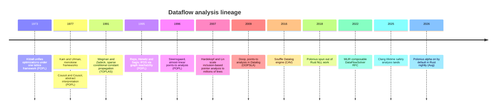
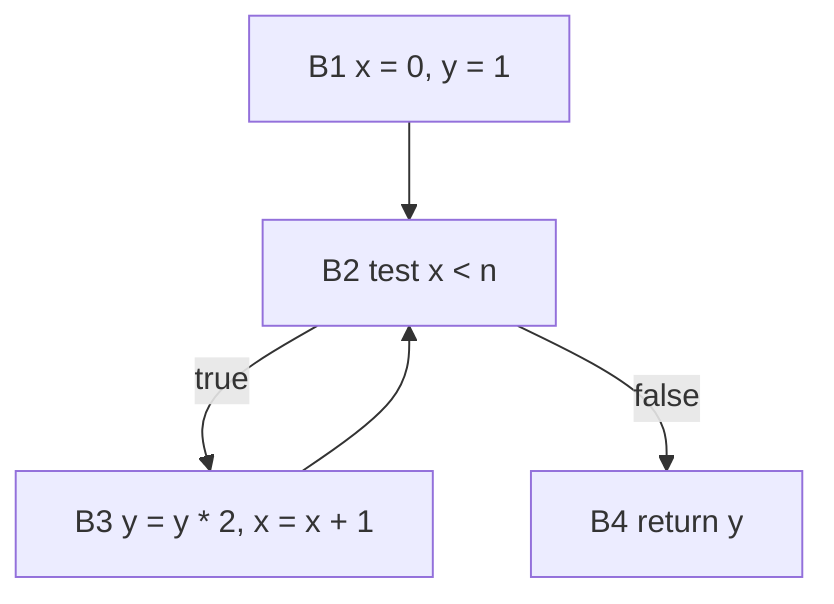

---
tags:
  - compilers
  - dataflow-analysis
  - static-analysis
  - program-analysis
  - lattices
  - abstract-interpretation
  - optimization
status: complete
sources:
  - https://users.cs.utah.edu/~blg/resources/notes/kildall/kildall.pdf
  - https://bibtex.github.io/POPL-1973-Kildall.html
  - https://pages.cs.wisc.edu/~horwitz/CS704-NOTES/DATAFLOW-AUX/lattice.html
  - https://www.cs.cornell.edu/courses/cs6120/2025fa/lesson/4/
  - https://www.cs.cornell.edu/courses/cs6120/2019fa/blog/sccp
  - https://cs.brown.edu/research/pubs/techreports/reports/CS-91-22.html
  - https://go.dev/src/cmd/compile/internal/ssa/sccp.go
  - https://cs.nyu.edu/~pmc309/COUSOTpapers/POPL77.shtml
  - https://research.cs.wisc.edu/wpis/abstracts/popl95.abs.html
  - https://core.ac.uk/display/102714518
  - https://www.cs.cornell.edu/courses/cs711/2005fa/papers/steensgaard-popl96.pdf
  - https://cs.utexas.edu/~lin/papers/pldi07.pdf
  - https://inst.eecs.berkeley.edu/~cs294-260/sp24/papers/doop.pdf
  - https://souffle-lang.github.io/cav-paper
  - https://pldi21.sigplan.org/details/pldi-2021-papers/1/Incremental-Whole-Program-Analysis-in-Datalog-with-Lattices
  - https://yanniss.github.io/choice-oopsla25.pdf
  - https://arxiv.org/html/2511.00865v3
  - https://releases.llvm.org/13.0.0/docs/NewPassManager.html
  - https://clang.llvm.org/doxygen/DataflowAnalysis_8h_source.html
  - https://clang.llvm.org/doxygen/UncheckedOptionalAccessModel_8h_source.html
  - https://clang.llvm.org/docs/LifetimeSafety.html
  - https://llvm.org/devmtg/2025-10/slides/technical_talks/saxena.pdf
  - https://releases.llvm.org/23.1.0/tools/clang/docs/ReleaseNotes.html
  - https://discourse.llvm.org/t/llvm-22-1-0-released/89950
  - https://discourse.llvm.org/t/rfc-a-dataflow-analysis-framework/63340
  - https://LLVM.org/devmtg/2023-05/slides/TechnicalTalks-May10/07-TomEccles-JeffNiu-MLIRDataflowAnalysis.pdf
  - https://mlir.llvm.org/doxygen/namespacemlir_1_1dataflow.html
  - https://rustc-dev-guide.rust-lang.org/mir/dataflow.html
  - https://blog.rust-lang.org/2026/08/04/enabling-polonius-alpha-on-nightly
  - https://goals.rust-lang.org/2026/polonius.html
  - https://www.infoworld.com/article/4240528/four-major-changes-coming-to-rust.html
  - https://gcc.gnu.org/gcc-16/changes.html
  - https://gcc.gnu.org/pipermail/gcc-announce/2026/000190.html
created: 2026-11-26
updated: 2026-11-26
---

## Table Of Contents

- [[#TL;DR|TL;DR]]
- [[#The Problem|The Problem]]
- [[#Foundations|Foundations]]
    - [[#Facts at Program Points|Facts at Program Points]]
    - [[#Lattices, Meet and Join|Lattices, Meet and Join]]
    - [[#Monotone Transfer Functions|Monotone Transfer Functions]]
    - [[#Fixed Points, MOP and MFP|Fixed Points, MOP and MFP]]
    - [[#Direction and Confluence|Direction and Confluence]]
- [[#How We Got Here|How We Got Here]]
- [[#How It Works|How It Works]]
    - [[#The Worklist Algorithm|The Worklist Algorithm]]
    - [[#Four Classic Analyses|Four Classic Analyses]]
    - [[#Worked Example - Liveness to a Fixed Point|Worked Example - Liveness to a Fixed Point]]
    - [[#Constant Propagation and SCCP|Constant Propagation and SCCP]]
    - [[#Sparse Analysis on SSA|Sparse Analysis on SSA]]
    - [[#Abstract Interpretation and Widening|Abstract Interpretation and Widening]]
    - [[#Interprocedural Analysis|Interprocedural Analysis]]
    - [[#Points-To and Alias Analysis|Points-To and Alias Analysis]]
    - [[#Analyses Written in Datalog|Analyses Written in Datalog]]
- [[#Where It Is Now|Where It Is Now]]
    - [[#LLVM and Clang|LLVM and Clang]]
    - [[#MLIR|MLIR]]
    - [[#Rust and Polonius|Rust and Polonius]]
    - [[#GCC|GCC]]
    - [[#Research Directions|Research Directions]]
- [[#Trade-offs & Open Problems|Trade-offs & Open Problems]]
- [[#Resources|Resources]]
- [[#Related Notes|Related Notes]]

## ***TL;DR***
---
*Dataflow analysis computes, for every point in a program, a conservative summary of what can be true there on any run: which variables may still be read, which definitions may reach, which values are constants. Almost every optimization in [[Classic Optimizations]] and many bug-finding checks depend on it.*

- **What it computes.** A *fact* (a set of variables, a map from variables to constants, an interval) at each program point. Facts are combined at control-flow joins and pushed through each statement by a *transfer function*.
- **The framework.** Facts live in a *lattice*; joins use the lattice's meet or join; transfer functions must be *monotone*. Under those rules a simple iterative algorithm reaches a *fixed point*, and if the lattice has finite height it always terminates ([Kildall notes, Utah](https://users.cs.utah.edu/~blg/resources/notes/kildall/kildall.pdf); [Cornell CS 6120](https://www.cs.cornell.edu/courses/cs6120/2025fa/lesson/4/)).
- **Two axes.** *Forward* (facts flow from entry, e.g. reaching definitions) vs *backward* (from exit, e.g. liveness); *may* (true on some path, combine with union) vs *must* (true on all paths, combine with intersection).
- **Precision ceiling.** The ideal answer is the *meet over all paths* (MOP). Iteration computes the *maximal fixed point* (MFP), which equals MOP only when transfer functions are distributive; constant propagation is monotone but not distributive, so it loses some constants ([Horwitz, Wisconsin](https://pages.cs.wisc.edu/~horwitz/CS704-NOTES/DATAFLOW-AUX/lattice.html)).
- **Beyond the textbook.** SSA makes analyses *sparse* (facts on values, not points), abstract interpretation generalizes the theory and adds *widening* for infinite lattices, IFDS turns interprocedural problems into graph reachability, and Datalog engines like Soufflé run whole-program points-to analysis on large Java code in under a minute.
- **As of November 2026.** Clang 23 ships `-Wlifetime-safety`, a Polonius-inspired dataflow check for dangling pointers; Rust turned on the "Polonius alpha" borrow checker by default on nightly in August 2026 and aims to stabilize it; MLIR's composable `DataFlowSolver` now hosts integer-range, divisibility and liveness analyses.

## ***The Problem***
---
*An optimizer may only rewrite code if the rewrite is safe on every possible execution, but it cannot run the program on every input. Dataflow analysis answers "what is always (or possibly) true here?" from the code alone, cheaply enough to run inside a compiler.*

Consider what common passes need to know:

| Optimization | Question it must answer | Analysis |
|---|---|---|
| Dead store elimination | Is this variable read again before being overwritten? | Live variables |
| [[Register Allocation]] | Which values are alive at the same time (and so interfere)? | Live variables |
| Constant folding across blocks | Does `x` hold the same constant on every path here? | Constant propagation |
| Common subexpression elimination | Has `a + b` already been computed on every path, with `a` and `b` unchanged? | Available expressions |
| Code hoisting | Will `a + b` be evaluated on every path from here before `a` or `b` changes? | Very busy expressions |
| Use-before-init warnings | Can a use see no definition at all? | Reaching definitions |
| Load/store reordering | Can these two pointers name the same memory? | Alias analysis |

The obstacles are loops and branches. A loop means a fact at the loop head depends on facts computed later in the loop body, so you can't evaluate the program top to bottom once. A branch means two different histories meet at a join and you must summarize both. And the exact question ("is `x` constant on every *feasible* path?") is undecidable in general, so every analysis approximates. The discipline of dataflow analysis is making that approximation **sound** (never claims something false that an optimization would rely on) while staying precise and fast. The Cornell CS 6120 course frames it as four steps: decide what you want to know at each block's entry and exit, write a local equation per block, add equalities for CFG edges, and hand the system to a general solver ([Cornell CS 6120](https://www.cs.cornell.edu/courses/cs6120/2025fa/lesson/4/)).

## ***Foundations***
---
*Five ideas carry the whole subject: facts attached to program points, a lattice that orders facts by how much they claim, monotone transfer functions, fixed points as the meaning of "the answer", and the choice of direction and confluence operator.*

### Facts at Program Points

*Analyses run on a control-flow graph (CFG) of basic blocks; each block has an IN fact and an OUT fact.*

A basic block is a straight-line run of instructions with one entry and one exit. The CFG's edges are possible jumps. For each block $B$ the analysis stores $\mathrm{IN}[B]$ (the fact just before $B$) and $\mathrm{OUT}[B]$ (just after). Facts inside a block are recovered by walking its instructions. The CFG itself comes from the IR (see [[Intermediate Representations]] and [[Compiler Pipeline]]).

### Lattices, Meet and Join

*A lattice orders facts by information content, and the meet operator says how to merge facts at a join point.*

A (semi)lattice is a set $L$ with a partial order $\sqsubseteq$ and a binary operator that returns the greatest lower bound (meet, $\sqcap$) or least upper bound (join, $\sqcup$) of any two elements. In the "meet" convention of the Dragon Book and Cornell's course, $\top$ is the optimistic starting value and $\sqcap$ merges at joins; the initial value is top and transfer functions must be monotone ([Cornell CS 6120](https://www.cs.cornell.edu/courses/cs6120/2025fa/lesson/4/)). Modern frameworks often flip the picture: rustc's MIR dataflow uses a *join*-semilattice where every block entry starts at bottom and `join` only moves up ([rustc dev guide](https://rustc-dev-guide.rust-lang.org/mir/dataflow.html)), and Clang's framework asks for a "bounded join-semilattice" whose `join` "computes their least upper bound" ([Clang doxygen](https://clang.llvm.org/doxygen/DataflowAnalysis_8h_source.html)). Same math, mirrored.

$$
x \sqsubseteq y \iff x \sqcap y = x, \qquad \text{height}(L) = \text{length of the longest chain } \top \sqsupset x_1 \sqsupset \dots \sqsupset \bot
$$

**In plain English:** going down the order means claiming less (being more conservative). Merging two facts gives the strongest fact both agree on. The *height* is how many times a value can be weakened before it bottoms out, and it is what bounds the running time.

For bit-vector problems the lattice is the powerset of a finite set (variables, definitions, expressions), the order is $\subseteq$ or $\supseteq$, and the height is the size of that set.

### Monotone Transfer Functions

*A transfer function maps a block's input fact to its output fact; monotonicity is what makes iteration converge.*

$$
\text{monotone: } x \sqsubseteq y \Rightarrow f(x) \sqsubseteq f(y) \qquad \text{distributive: } f(x \sqcap y) = f(x) \sqcap f(y)
$$

**In plain English:** monotone means "less information in, never more information out", so values only move one way during iteration. Distributive is stronger: merging before or after the transfer gives the same answer, so nothing is lost by merging early.

Gen/kill problems have transfer functions of the form $f(x) = \mathit{gen} \cup (x \setminus \mathit{kill})$, which are distributive. That is why the classic bit-vector analyses are exact with respect to all paths.

### Fixed Points, MOP and MFP

*The ideal answer merges over every path; the computable answer is a fixed point of the equations; they coincide only for distributive problems.*

$$
\mathrm{MOP}[n] = \bigsqcap_{p \,\in\, \text{paths}(\text{entry},\, n)} f_p(\iota) \qquad\qquad \mathrm{MFP}:\ \ \mathrm{IN}[n] = \bigsqcap_{m \in \mathrm{pred}(n)} f_m(\mathrm{IN}[m])
$$

**In plain English:** MOP applies the composed transfer function $f_p$ of each path to the entry fact $\iota$ and merges all results; with loops there are infinitely many paths, so you can't compute it directly. MFP is the greatest solution of the per-block equations, which iteration finds. MFP is always at or below MOP (sound but possibly less precise).

The results, as summarized in Susan Horwitz's notes: under Kildall's conditions (a lattice with no infinite descending chains, meet as the combining operator, distributive functions) "the iterative algorithm always terminates" and "the computed solution is the MOP solution"; Kam and Ullman (1977) showed that with merely *monotone* functions the iterative algorithm computes "the greatest solution" of the equations, which "may not be the same as the MOP solution" ([Horwitz](https://pages.cs.wisc.edu/~horwitz/CS704-NOTES/DATAFLOW-AUX/lattice.html)). Kildall also proved the result is independent of the order in which the worklist is processed; order affects only speed ([Kildall notes](https://users.cs.utah.edu/~blg/resources/notes/kildall/kildall.pdf)).

### Direction and Confluence

*Two binary choices classify the classic analyses.*

| | **May** (some path, merge with $\cup$, start from $\emptyset$) | **Must** (all paths, merge with $\cap$, start from the universal set) |
|---|---|---|
| **Forward** (IN from predecessors' OUT) | Reaching definitions | Available expressions |
| **Backward** (OUT from successors' IN) | Live variables | Very busy expressions |

For a backward analysis you swap predecessors with successors and IN with OUT; the solver is otherwise identical ([Cornell CS 6120](https://www.cs.cornell.edu/courses/cs6120/2025fa/lesson/4/)). rustc encodes the same choice as a `Direction` on its `Analysis` trait ([rustc dev guide](https://rustc-dev-guide.rust-lang.org/mir/dataflow.html)).

## ***How We Got Here***
---
*The theory was settled in the 1970s (Kildall, Kam and Ullman, the Cousots); the 1990s made it sparse, interprocedural and pointer-aware; the 2000s and 2010s moved whole-program analysis into Datalog; and the 2020s brought composable frameworks into MLIR, Clang and rustc.*



- **Kildall (1973).** One iterative algorithm over a meet-semilattice that handles constant propagation, common subexpression elimination and register optimization on arbitrary CFGs; it runs in $O(|V| \cdot \|P\|)$, where $\|P\|$ is the lattice height ([Kildall notes](https://users.cs.utah.edu/~blg/resources/notes/kildall/kildall.pdf); [bibliographic entry](https://bibtex.github.io/POPL-1973-Kildall.html)). The same notes observe CompCert still uses the algorithm in 8 of its passes (see [[Verified Compilers]]).
- **Kam and Ullman (1977).** Relaxed distributivity to monotonicity and characterized what iteration computes ([Horwitz](https://pages.cs.wisc.edu/~horwitz/CS704-NOTES/DATAFLOW-AUX/lattice.html)).
- **Cousot and Cousot (1977).** Recast analysis as computing extreme fixpoints of order-preserving functions in an abstract domain that is provably consistent with the concrete semantics, with approximation methods for when Kleene iteration would not terminate ([NYU summary](https://cs.nyu.edu/~pmc309/COUSOTpapers/POPL77.shtml)).
- **Wegman and Zadeck (1991).** Combined constant propagation with unreachable-code detection on SSA ([Brown TR CS-91-22](https://cs.brown.edu/research/pubs/techreports/reports/CS-91-22.html)).
- **Reps, Horwitz and Sagiv (1995).** Solved a large class of interprocedural problems precisely in polynomial time ([Wisconsin abstract](https://research.cs.wisc.edu/wpis/abstracts/popl95.abs.html)).

## ***How It Works***
---
*The engine is always the same fixed-point loop; what changes is the lattice, the transfer functions, where facts are stored (every point or every SSA value), and how calls and pointers are modeled.*

### The Worklist Algorithm

*Keep a queue of blocks whose inputs changed; recompute them; enqueue successors when an output changes; stop when the queue is empty.*

Cornell's forward version, lightly formatted ([Cornell CS 6120](https://www.cs.cornell.edu/courses/cs6120/2025fa/lesson/4/)):

```python
def solve_forward(cfg, init, merge, transfer):
    in_, out = {}, {b: init for b in cfg.blocks}
    in_[cfg.entry] = init
    worklist = list(cfg.blocks)            # "worklist = all blocks"
    while worklist:
        b = worklist.pop(0)
        if b is not cfg.entry:
            in_[b] = merge(out[p] for p in cfg.preds[b])
        new_out = transfer(b, in_[b])
        if new_out != out[b]:              # "if out[b] changed:"
            out[b] = new_out
            worklist.extend(s for s in cfg.succs[b] if s not in worklist)
    return in_, out
```

**Why it terminates.** Each time `out[b]` changes it moves strictly in one direction in a lattice of height $h$, so each block changes at most $h$ times, and each change enqueues only its successors:

$$
\#\text{transfer evaluations} \;\le\; |B| + h \cdot \sum_{b} |\mathrm{succ}(b)| \;=\; O(h \cdot |E|)
$$

**In plain English:** the work is bounded by the lattice height times the number of edges. For liveness over 64 variables, $h = 64$; with bit vectors each transfer is a few word-wide AND/OR operations. Processing blocks in reverse postorder (forward problems) or reverse postorder of the reversed CFG (backward problems) usually converges in a couple of passes, but the bound holds for any order.

### Four Classic Analyses

*Each is a gen/kill problem; only the direction, the merge, and what is generated or killed differ.*

**Reaching definitions** (forward, may). A definition $d$: `x = ...` reaches point $p$ if some path from $d$ to $p$ doesn't redefine `x`. Merge is union, initial value empty, transfer is $\mathrm{out} = \mathit{def}(b) \cup (\mathrm{in} - \mathit{kills}(b))$ ([Cornell CS 6120](https://www.cs.cornell.edu/courses/cs6120/2025fa/lesson/4/)).

$$
\mathrm{OUT}[B] = \mathit{gen}_B \cup (\mathrm{IN}[B] \setminus \mathit{kill}_B) \qquad \mathrm{IN}[B] = \bigcup_{P \in \mathrm{pred}(B)} \mathrm{OUT}[P]
$$

**In plain English:** what leaves a block is what it defines plus what came in and wasn't overwritten; what enters a block is anything that left any predecessor.

**Live variables** (backward, may). `x` is live at $p$ if some path from $p$ reads `x` before writing it.

$$
\mathrm{IN}[B] = \mathit{use}_B \cup (\mathrm{OUT}[B] \setminus \mathit{def}_B) \qquad \mathrm{OUT}[B] = \bigcup_{S \in \mathrm{succ}(B)} \mathrm{IN}[S]
$$

**In plain English:** a variable is live entering a block if the block reads it before writing it, or if it is live leaving the block and the block doesn't overwrite it. It is live leaving if any successor needs it.

**Available expressions** (forward, must). `a + b` is available at $p$ if every path to $p$ computes it and then doesn't change `a` or `b`.

$$
\mathrm{OUT}[B] = \mathit{egen}_B \cup (\mathrm{IN}[B] \setminus \mathit{ekill}_B) \qquad \mathrm{IN}[B] = \bigcap_{P \in \mathrm{pred}(B)} \mathrm{OUT}[P], \quad \mathrm{IN}[\text{entry}] = \emptyset
$$

**In plain English:** an expression is available only if *all* predecessors provide it, so merge is intersection, and every non-entry block starts at "all expressions" (the optimistic top) so loops don't wrongly kill everything on the first pass.

**Very busy (anticipated) expressions** (backward, must). `a + b` is very busy at $p$ if every path from $p$ evaluates it before `a` or `b` changes, so it is safe to hoist it to $p$.

$$
\mathrm{IN}[B] = \mathit{euse}_B \cup (\mathrm{OUT}[B] \setminus \mathit{ekill}_B) \qquad \mathrm{OUT}[B] = \bigcap_{S \in \mathrm{succ}(B)} \mathrm{IN}[S], \quad \mathrm{OUT}[\text{exit}] = \emptyset
$$

**In plain English:** the mirror image of availability: look ahead instead of behind, and require every future path to use the expression. Partial redundancy elimination combines availability and anticipation (see [[Classic Optimizations]] and [[Loop Optimizations]]).

### Worked Example - Liveness to a Fixed Point

*A three-variable loop shows liveness converging in two passes, with the loop bound `n` discovered live inside the loop only on the second pass.*

```c
int f(int n) {
    int x = 0, y = 1;          // B1
    while (x < n) {            // B2
        y = y * 2;             // B3
        x = x + 1;
    }
    return y;                  // B4
}
```



Local sets ($\mathit{use}$ = read before written in the block):

| Block | use | def | succ |
|---|---|---|---|
| B1 | ∅ | {x, y} | B2 |
| B2 | {x, n} | ∅ | B3, B4 |
| B3 | {x, y} | {x, y} | B2 |
| B4 | {y} | ∅ | exit |

All sets start empty. Each pass visits blocks in backward order B4, B3, B2, B1, computing OUT from successors' current IN, then IN.

**Pass 1**

| Block | OUT | IN = use ∪ (OUT − def) |
|---|---|---|
| B4 | ∅ | {y} |
| B3 | IN[B2] = ∅ (not yet computed) | {x, y} |
| B2 | IN[B3] ∪ IN[B4] = {x, y} | {x, y, n} |
| B1 | IN[B2] = {x, y, n} | **{n}** |

**Pass 2**

| Block | OUT | IN | Changed? |
|---|---|---|---|
| B4 | ∅ | {y} | no |
| B3 | IN[B2] = {x, y, n} | {x, y} ∪ {n} = {x, y, n} | **yes**: `n` now live around the loop |
| B2 | {x, y, n} ∪ {y} = {x, y, n} | {x, y, n} | no |
| B1 | {x, y, n} | {n} | no |

**Pass 3** recomputes every block and nothing changes: the fixed point. Reading it off: only `n` is live on entry (so `x` and `y` need no incoming values), all three are live throughout the loop (a register allocator must keep three registers busy there), and only `y` survives the loop. A dead store elimination pass would delete `x = x + 1` only if `x` were not live after it, and it is, via the loop back edge. In a real compiler these sets are bit vectors (x = bit 0, y = bit 1, n = bit 2), so each IN computation is `use | (out & ~def)`.

### Constant Propagation and SCCP

*Constant propagation uses a three-level lattice per variable; Wegman and Zadeck's SCCP runs it on SSA together with reachability, which finds strictly more constants.*

$$
c \sqcap \top = c, \qquad c \sqcap c = c, \qquad c_1 \sqcap c_2 = \bot \ (c_1 \ne c_2), \qquad x \sqcap \bot = \bot
$$

**In plain English:** merging "unknown yet" with 5 gives 5; merging 5 with 5 gives 5; merging 5 with 3 gives "not a constant". The per-variable lattice has height 2, so a whole map over $V$ variables has height $2|V|$. The Go compiler's SCCP describes exactly this: "three level lattice", each value "lowered most twice (Top to Constant, Constant to Bottom)" ([Go source](https://go.dev/src/cmd/compile/internal/ssa/sccp.go)).

**Not distributive.** Transfer through `d = a + b`:

```c
if (c) { a = 2; b = 3; } else { a = 3; b = 2; }
d = a + b;   // every path gives 5
```

MOP evaluates each path: $2+3 = 5$ and $3+2 = 5$, so $d = 5$. The iterative algorithm merges first: $a = 2 \sqcap 3 = \bot$, $b = \bot$, so $d = \bot$. This is the MFP-below-MOP gap Kam and Ullman characterized, and the reason the Horwitz notes give constant propagation as the standard monotone-but-not-distributive example ([Horwitz](https://pages.cs.wisc.edu/~horwitz/CS704-NOTES/DATAFLOW-AUX/lattice.html)).

**SCCP adds reachability.** Plain constant propagation "does not make any conclusions about control flow", so it can't use a constant branch condition to ignore a dead edge, and running it separately from dead-code elimination misses cases where each would unlock the other ([CS 6120 blog](https://www.cs.cornell.edu/courses/cs6120/2019fa/blog/sccp)). SCCP starts every SSA value at $\top$ and every CFG edge as not executable, and uses two worklists, one of newly executable edges and one of SSA values whose lattice value dropped ([Go source](https://go.dev/src/cmd/compile/internal/ssa/sccp.go)). A φ merges only operands arriving on executable edges.

```llvm
; before: does x ever become 2?
define i32 @f() {
entry:
  br label %header
header:
  %x = phi i32 [ 1, %entry ], [ %x2, %latch ]
  %more = call i1 @more()
  br i1 %more, label %body, label %exit
body:
  %ne = icmp ne i32 %x, 1
  br i1 %ne, label %set, label %latch
set:
  br label %latch
latch:
  %x2 = phi i32 [ %x, %body ], [ 2, %set ]
  br label %header
exit:
  ret i32 %x
}
```

SCCP's reasoning: `%x = φ(1, ⊤) = 1`; so `%ne = false`; so edge `body → set` is never marked executable; so `%x2 = φ(%x = 1 [executable], 2 [not executable]) = 1`; the back edge feeds 1 into `%x`, which stays 1. A pessimistic analysis that treated every edge as live would see `%x2 = 1 ⊓ 2 = ⊥` and give up. After SCCP and CFG cleanup the function reduces to roughly:

```llvm
define i32 @f() {
entry:
  br label %header
header:
  %more = call i1 @more()
  br i1 %more, label %header, label %exit
exit:
  ret i32 1
}
```

Optimism is the key: starting from $\top$ lets the loop "prove itself" constant, which is why SCCP finds a superset of what separate passes find. Wegman and Zadeck's report describes its algorithms as conservative (may miss constants, never invents one) and among "the simplest, fastest, and most powerful" known ([Brown TR](https://cs.brown.edu/research/pubs/techreports/reports/CS-91-22.html)).

### Sparse Analysis on SSA

*In SSA every variable has one definition, so a fact can live on the value instead of on every program point, and work propagates only along def-use edges.*

A *dense* analysis stores a full lattice element at every program point and copies it through statements that don't touch the variable. A *sparse* analysis stores one element per SSA value and revisits a value only when one of its operands changes. MLIR draws exactly this line: dense analyses attach a lattice to each program point ("before" each block and "after" each operation), sparse analyses attach state to `mlir::Value`s ([Eccles and Niu, EuroLLVM 2023](https://LLVM.org/devmtg/2023-05/slides/TechnicalTalks-May10/07-TomEccles-JeffNiu-MLIRDataflowAnalysis.pdf)). The CS 6120 SCCP write-up notes that because the program is in SSA, "one value per variable is enough" ([CS 6120 blog](https://www.cs.cornell.edu/courses/cs6120/2019fa/blog/sccp)).

| | Dense (per point) | Sparse (per SSA value) |
|---|---|---|
| Storage | $O(\text{points} \times \text{facts})$ | $O(\text{values})$ |
| Propagation | Along CFG edges | Along def-use edges, plus executable CFG edges for φ |
| Good for | Memory state, liveness, anything about locations | Constants, ranges, known bits, any fact about a value |
| Examples | MLIR `DenseForwardDataFlowAnalysis`, Clang's framework | SCCP, MLIR `SparseConstantPropagation`, `IntegerRangeAnalysis` |

Liveness is the classic analysis that stays dense even in SSA compilers, because it is about where a value is *needed*, not what it *is*. See [[SSA Form]] for how φ placement and dominance make sparse analyses correct.

### Abstract Interpretation and Widening

*Abstract interpretation is the general theory: run the program over abstract values, prove the abstraction sound, and use widening when the abstract lattice has infinite chains.*

The Cousots' 1977 paper treats abstract properties as a complete semilattice, interprets each construct as an order-preserving function, and identifies a program's global properties with an extreme fixpoint of the resulting equations; Kildall-style algorithms compute it as the limit of a finite Kleene sequence, and when that sequence would be infinite, fixpoint *approximation* keeps the result sound ([NYU summary](https://cs.nyu.edu/~pmc309/COUSOTpapers/POPL77.shtml)). Its running example is the rule of signs: $-1515 \times 17$ is provably negative, but $-1515 + 17$ has unknown sign. Every dataflow analysis in this note is an abstract interpretation with a finite-height domain.

The approximation operator is *widening* ($\nabla$). Intervals show why it's needed:

```c
int i = 0;
while (i < 100) i = i + 1;
```

| Iteration | Plain join at loop head | With widening |
|---|---|---|
| 1 | $[0,0]$ | $[0,0]$ |
| 2 | $[0,1]$ | $[0,0] \nabla [0,1] = [0,+\infty]$ |
| 3 | $[0,2]$ | stable |
| ... | never stabilizes | |

Widening jumps an unstable bound straight to infinity, guaranteeing termination at the cost of precision; a later *narrowing* pass can use the exit test `i < 100` to recover $[0,100]$. Clang's dataflow framework exposes this directly: a lattice may provide `widen`, which "replaces the lattice element with an approximation that can reach a fixed point more quickly", and the framework falls back to equality checking when it is absent ([Clang doxygen](https://clang.llvm.org/doxygen/DataflowAnalysis_8h_source.html)). The planned [[Abstract Interpretation]] note goes deeper on Galois connections and relational domains.

### Interprocedural Analysis

*Calls break the intraprocedural picture: an analysis must decide how a callee's effect depends on its caller, and must avoid mixing return paths.*

Three standard approaches:

- **Inline or treat calls as unknown.** Simplest; within one function, assume the worst about the callee. Clang's lifetime analysis does this optimistically without annotations, which can miss bugs ([Clang docs](https://clang.llvm.org/docs/LifetimeSafety.html)).
- **Context strings.** Analyze a callee separately for each of its last $k$ call sites (call-string sensitivity) or receiver objects (object sensitivity). Doop's benchmarks are exactly these variants: 1-call-site, 1-object, 2-call+1H and so on ([Bravenboer and Smaragdakis, OOPSLA 2009](https://inst.eecs.berkeley.edu/~cs294-260/sp24/papers/doop.pdf)).
- **IFDS and IDE.** For problems whose fact set $D$ is finite and whose transfer functions distribute over union or intersection, Reps, Horwitz and Sagiv turn analysis into reachability on an *exploded supergraph*: one node per (program point, fact) pair, with call and return edges matched like parentheses so only *realizable* paths count. It covers reaching definitions, available expressions, live variables, and non-separable problems like possibly-uninitialized variables, "precisely in polynomial time" ([Wisconsin abstract](https://research.cs.wisc.edu/wpis/abstracts/popl95.abs.html)). Its successor IDE carries *environment transformers* on the edges, which handles problems like linear constant propagation ([Sagiv, Reps and Horwitz](https://core.ac.uk/display/102714518)).

A path that enters `g` from one call site and leaves to another is not realizable; IFDS's matched-parenthesis reachability excludes it, which is where its precision over "merge all callers" comes from.

### Points-To and Alias Analysis

*Before you can say what a store through `*p` kills, you must know what `p` may point to; the two classic flow-insensitive answers trade precision against near-linear time.*

| | Andersen (inclusion / subset) | Steensgaard (unification / equality) |
|---|---|---|
| Constraint for `p = q` | $\mathrm{pts}(q) \subseteq \mathrm{pts}(p)$ | $\mathrm{pts}(p) = \mathrm{pts}(q)$, merged |
| Worst-case time | $O(n^3)$ ([Hardekopf and Lin, PLDI 2007](https://cs.utexas.edu/~lin/papers/pldi07.pdf)) | "almost linear" ([Steensgaard, POPL 1996](https://www.cs.cornell.edu/courses/cs711/2005fa/papers/steensgaard-popl96.pdf)) |
| Precision | Higher: an abstract location can be in non-identical sets | Lower: anything assigned together collapses into one class |
| Scale reported | 169K to 2.17M lines of C, with cycle detection (Hardekopf and Lin) | 75,000-line C program in about 27 s; FElt (273K lines) in about 82 s on a SparcStation 10 (Steensgaard) |

```c
int a, b, *p, *q, *r;
p = &a;  q = &b;
r = p;   r = q;
// Andersen:    pts(p)={a}  pts(q)={b}  pts(r)={a,b}
// Steensgaard: p, q, r unified  ->  pts(p)=pts(q)=pts(r)={a,b}
```

Steensgaard notes Andersen's analysis "allows an abstract location to be a member of non-identical sets", while his own types each variable with a single set, giving almost-linear time but results "often not as accurate" as flow-sensitive analyses ([Steensgaard](https://www.cs.cornell.edu/courses/cs711/2005fa/papers/steensgaard-popl96.pdf)). Hardekopf and Lin's point was that inclusion-based analysis scales once you shrink the constraint graph by collapsing cycles (lazy and hybrid cycle detection), reaching over a million lines ([Hardekopf and Lin](https://cs.utexas.edu/~lin/papers/pldi07.pdf)). LLVM-style compilers consume this as an alias-analysis query interface that other analyses depend on, which is why invalidating alias results ripples (see [[#LLVM and Clang|LLVM and Clang]]). The planned [[Pointer and Alias Analysis]] note covers field sensitivity, flow-sensitive variants and memory SSA.

### Analyses Written in Datalog

*Points-to and many dataflow analyses are recursive set equations, which is what Datalog computes; writing them as rules lets an engine handle indexing, join order and parallelism.*

Doop expressed Java points-to analysis as Datalog rules on a LogicBlox engine ([Bravenboer and Smaragdakis](https://inst.eecs.berkeley.edu/~cs294-260/sp24/papers/doop.pdf)):

```prolog
VarPointsTo(?var, ?heap) <-
    AssignHeapAllocation(?var, ?heap).
VarPointsTo(?to, ?heap) <-
    Assign(?from, ?to), VarPointsTo(?from, ?heap).
VarPointsTo(?to, ?heap) <-
    LoadInstanceField(?base, ?signature, ?to),
    VarPointsTo(?base, ?baseheap),
    InstanceFieldPointsTo(?baseheap, ?signature, ?heap).
InstanceFieldPointsTo(?baseheap, ?signature, ?heap) <-
    StoreInstanceField(?from, ?base, ?signature),
    VarPointsTo(?base, ?baseheap),
    VarPointsTo(?from, ?heap).
```

These four rules are Andersen's analysis with field sensitivity. Bottom-up Datalog evaluation *is* a worklist fixed-point iteration (semi-naive evaluation only re-derives from new facts), and the relations only grow, a finite powerset lattice. Doop reported being more than 15x faster than the Paddle framework for 1-call-site-sensitive analysis of DaCapo, and could run deeper contexts Paddle could not.

Soufflé (CAV 2016) compiles Datalog to parallel C++; its authors report points-to analysis of OpenJDK 7 (about 1.4M variables, 350K objects, 160K methods) in under a minute, and Oracle Labs used it for Java security analyses ([Soufflé](https://souffle-lang.github.io/cav-paper)). Plain Datalog lacks lattices beyond sets, so constant propagation and intervals need extensions; LADDDER (PLDI 2021) is an incremental Datalog solver with lattice aggregation that kept points-to, constant and interval facts current "in milliseconds" on real Java code ([PLDI 2021](https://pldi21.sigplan.org/details/pldi-2021-papers/1/Incremental-Whole-Program-Analysis-in-Datalog-with-Lattices)).

## ***Where It Is Now***
---
*As of November 2026: dataflow analysis is infrastructure inside every major compiler, and the active work is on reusable frameworks (MLIR, Clang, rustc), on safety checking rather than optimization (Clang lifetime safety, Polonius), and on making Datalog-based whole-program analysis scale.*

### LLVM and Clang

*LLVM's pass manager treats analyses as cached, invalidatable results; Clang has a separate source-level dataflow framework and, since 2025, a lifetime analysis built on it.*

**Analyses as cached results.** In LLVM's new pass manager, passes ask an analysis manager for results; it computes on demand, caches, and serves later requests from the cache. Each transform pass returns a `PreservedAnalyses` set, from `all()` (nothing changed) through specific analyses like the dominator tree to `none()`, and the manager invalidates whatever wasn't preserved. Analyses can only be requested at their own IR level; outer-level results reached through proxies "must be immutable", and invalidating an outer analysis such as alias analysis forces dependent inner results to be invalidated too ([LLVM docs](https://releases.llvm.org/13.0.0/docs/NewPassManager.html)). The design point: recomputing dataflow facts is the cost, so the pass pipeline is organized around keeping them valid.

**Clang's dataflow framework** (`clang/Analysis/FlowSensitive`) runs on Clang's source-level CFG. An analysis subclasses `DataflowAnalysis<Derived, LatticeT>` and supplies `initialElement()`, `transfer()`, and optionally `transferBranch()` for edges out of conditionals; the lattice must provide `join` and `==` and may provide `widen`. State is an `Environment` modeling store and heap, path conditions are checked with a SAT solver, and runs are capped at 20,000 block visits by default ([Clang doxygen](https://clang.llvm.org/doxygen/DataflowAnalysis_8h_source.html)). One in-tree client is the unchecked `std::optional` access model ([Clang doxygen](https://clang.llvm.org/doxygen/UncheckedOptionalAccessModel_8h_source.html)). This is distinct from the path-sensitive Clang Static Analyzer, whose Clang 23 release added an experimental `alpha.cplusplus.UseAfterLifetimeEnd` checker and core speedups of "up to 5.2x" in edge cases ([Clang 23 notes](https://releases.llvm.org/23.1.0/tools/clang/docs/ReleaseNotes.html)).

**Lifetime safety.** Google's Utkarsh Saxena presented a Polonius-style intraprocedural analysis at the October 2025 LLVM Developers' Meeting: *loans* (borrows of a location), *origins* (pointer-like values holding sets of loans, linked by subset constraints), and *liveness* of origins; a violation is a live origin holding an expired loan. It measured no regressions on many codebases, 2-3% on LLVM/Clang, and a worst case near 200% on generated code ([Saxena, LLVM Dev Mtg 2025](https://llvm.org/devmtg/2025-10/slides/technical_talks/saxena.pdf)). Clang 23 added `-Wlifetime-safety`, "a CFG-based intra-procedural analysis that detects use-after-free and related temporal safety bugs", with suggestion and dangling-field variants ([Clang 23 notes](https://releases.llvm.org/23.1.0/tools/clang/docs/ReleaseNotes.html)). The current docs describe it as "inspired by Polonius" but without Rust's exclusivity rule, recommend `-Wlifetime-safety-permissive` for initial adoption, and mark invalidation checks "highly experimental" ([Clang docs](https://clang.llvm.org/docs/LifetimeSafety.html)).

Release context: LLVM 22.1.0 shipped February 24, 2026 ([LLVM Discourse](https://discourse.llvm.org/t/llvm-22-1-0-released/89950)); LLVM 23.1.0 followed on August 25, 2026 ([llvm.org](https://llvm.org/)).

### MLIR

*MLIR's framework makes analyses composable: several run in one solver and read each other's state.*

Proposed in June 2022 to be "extensible, debuggable, and composable", MLIR's `DataFlowSolver` runs fixed-point iteration over a runtime dependency graph rather than templates; analyses register states and transfer functions, and "multiple dataflow analyses can run at the same time (and interact with each other) in the same solver instance" ([RFC](https://discourse.llvm.org/t/rfc-a-dataflow-analysis-framework/63340)). SCCP is literally `DeadCodeAnalysis` (which edges and blocks are executable) plus `SparseConstantPropagation` (which uses each op's `fold` hook); loading `IntegerRangeAnalysis` alongside proves values the constant lattice can't, without changing the other two. Flang used the dense framework to decide whether heap allocations can move to the stack. Known pain points: subclassing is hard, controlling iteration order is difficult, and performance depends on how dependencies are generated ([Eccles and Niu](https://LLVM.org/devmtg/2023-05/slides/TechnicalTalks-May10/07-TomEccles-JeffNiu-MLIRDataflowAnalysis.pdf)).

As of the current MLIR documentation (24.0.0git), the in-tree analyses include `DeadCodeAnalysis`, `SparseConstantPropagation`, `IntegerRangeAnalysis`, `IntegerDivisibilityAnalysis`, `StridedMetadataRangeAnalysis` and `LivenessAnalysis`, on dense and sparse, forward and backward base classes ([MLIR doxygen](https://mlir.llvm.org/doxygen/namespacemlir_1_1dataflow.html)). These matter for [[ML Compilers]] and [[GPU Kernel Compilers]], where proving index ranges and strides enables [[Bounds Check Elimination|bounds-check removal]] and [[Vectorization]]. See [[MLIR]].

### Rust and Polonius

*Rust's borrow checker is a dataflow analysis over MIR, and its successor is finally shipping on nightly.*

rustc has a generic MIR dataflow framework: an `Analysis` trait defines the domain (a join-semilattice), the entry state, a direction, and per-statement and per-terminator "effects"; `iterate_to_fixpoint` produces per-block results that cursors or visitors read ([rustc dev guide](https://rustc-dev-guide.rust-lang.org/mir/dataflow.html)). The borrow checker builds on it.

Polonius history, from the Rust blog: it spun out of the NLL effort in 2018; the original formulation accepted sound code NLL rejected but was too slow; a new formulation fitting the NLL implementation was proposed in 2023. On August 4, 2026 the "Polonius alpha" became the default on nightly (opt out with `-Zpolonius=off`). It adds flow-sensitive checking of lifetime outlives relationships and accepts the classic conditional-return-from-`HashMap` example NLL rejects. Among the top 10,000 crates there were few significant compile-time regressions; the worst seen elsewhere was 2-3x on borrow-heavy crates. The stated target was stabilization before the end of 2026 ([Rust blog](https://blog.rust-lang.org/2026/08/04/enabling-polonius-alpha-on-nightly)). The 2026 project goal explains the design: the original Datalog-based Polonius "did not scale and had no path to stabilization", while the alpha is location-sensitive and uses reachability in a combined subset-and-control-flow graph to decide loan liveness; one opaque-type soundness issue remained open, and the project accepts a 10-20% compile-time cost ([Rust project goals](https://goals.rust-lang.org/2026/polonius.html)). As of an InfoWorld report on November 18, 2026, it was still nightly-only and described as "far from production-ready" ([InfoWorld](https://www.infoworld.com/article/4240528/four-major-changes-coming-to-rust.html)). No stabilization announcement was found as of this note.

### GCC

*GCC's analyzer is path-based rather than a classic dataflow solver, but it now borrows GCC's range analysis.*

GCC 16.1 was released April 30, 2026 ([GCC announce](https://gcc.gnu.org/pipermail/gcc-announce/2026/000190.html)). Its `-fanalyzer` gained partial C++ support (not yet usable on production C++ "due to scaling issues"), a reworked program representation and memory model, and uses GCC's `value_range` machinery to remove some false positives ([GCC 16 changes](https://gcc.gnu.org/gcc-16/changes.html)), a sign that range facts computed for optimization are being reused for diagnostics.

### Research Directions

*Recent work targets scale and incrementality of declarative analyses.*

- **Bounded Datalog analysis.** Antoniadis, Tsatiris, Grech and Smaragdakis (OOPSLA 2025) cap how many facts a relation can hold per key using Soufflé's choice construct. On Doop with a 2objH analysis they report a 23.29x average speedup; three benchmarks that didn't finish in 24 hours finished in under an hour, while reachable application methods fell only from 62.99% to 59.96% ([Antoniadis et al.](https://yanniss.github.io/choice-oopsla25.pdf)).
- **Datalog on differential dataflow.** FlowLog (arXiv, 2025) compiles Datalog through a relational IR onto Differential Dataflow; on its authors' 64-core machine it ran Andersen's analysis about 11.7x faster than Soufflé at 4 threads and Doop benchmarks several times faster, though Soufflé won some cases at low thread counts ([FlowLog](https://arxiv.org/html/2511.00865v3)).
- **Safety analyses in mainstream compilers.** Clang lifetime safety and Polonius are both loan/origin dataflow analyses aimed at temporal memory safety, an application the field mostly left to separate tools before.

## ***Trade-offs & Open Problems***
---
*Every analysis picks a point on a precision-cost curve; the hard problems are where the classical framework's assumptions (finite lattices, distributive functions, whole programs, stable code) stop holding.*

| Choice | You get | You pay |
|---|---|---|
| Distributive gen/kill problems | MFP = MOP, bit-vector speed | Can't express values, ranges, relations |
| Richer lattices (constants, intervals, polyhedra) | Many more facts | Non-distributive (merge loses precision); may need widening |
| Optimistic start ($\top$, SCCP) | Proves loop-carried facts | Must reach the full fixed point before using any result |
| Sparse (SSA) | Work proportional to def-use edges | Needs SSA; awkward for memory and liveness |
| Context sensitivity (call strings, objects) | Separates callers | Contexts can grow exponentially |
| IFDS/IDE | Precise interprocedural, polynomial | Needs finite, distributive facts |
| Steensgaard vs Andersen | Near-linear time vs precision | Lost precision vs cubic worst case |
| Datalog | Concise rules, engine-level optimization | Set lattices by default; tuning join order matters |

**Open problems.**

- **Non-distributive precision.** Path sensitivity recovers the `a + b = 5` case but at exponential cost; Clang's framework bounds it with SAT queries and iteration caps ([Clang doxygen](https://clang.llvm.org/doxygen/DataflowAnalysis_8h_source.html)).
- **Composition.** MLIR's RFC itself called composing optimistic analyses "almost" composable and unresolved ([RFC](https://discourse.llvm.org/t/rfc-a-dataflow-analysis-framework/63340)).
- **Incrementality.** Re-analyzing a whole program per edit is too slow for IDEs ([[Incremental Computation]]); LADDDER-style incremental solvers point the way, but mainstream compilers still recompute per function.
- **Scaling vs soundness.** Bounded Datalog trades completeness and determinism for termination ([Antoniadis et al.](https://yanniss.github.io/choice-oopsla25.pdf)); acceptable for bug finding, not for optimization.
- **Compile-time budgets.** Polonius alpha's worst case of 2-3x and Clang lifetime safety's worst case near 200% on generated code show the cost of moving richer analyses into the default build.
- **Trusting the analysis.** A wrong "always true" fact silently miscompiles; verifying analyses ([[Verified Compilers]]) and differential testing ([[Compiler Testing and Fuzzing]]) are the defenses, and [[Formal Methods in Practice]] covers the proof side.

## ***Resources***
---
*Start with Cornell CS 6120 Lesson 4 for the framework and the worklist algorithm, then the Horwitz notes for MOP versus MFP. Read Wegman and Zadeck for SCCP, Reps-Horwitz-Sagiv for interprocedural analysis, and the MLIR and rustc docs for how production frameworks package the same ideas.*

**Foundations and courses**
- [Cornell CS 6120, Lesson 4: Data Flow](https://www.cs.cornell.edu/courses/cs6120/2025fa/lesson/4/): Adrian Sampson's framework, worklist pseudocode, lattice conditions.
- [Kildall's Lattice Framework for Dataflow Analysis](https://pages.cs.wisc.edu/~horwitz/CS704-NOTES/DATAFLOW-AUX/lattice.html): Susan Horwitz, Wisconsin; Kildall vs Kam and Ullman.
- [Notes on Kildall's algorithm](https://users.cs.utah.edu/~blg/resources/notes/kildall/kildall.pdf): Utah; the original algorithm, complexity and the optimizations it unified.
- [SCCP on the CS 6120 blog](https://www.cs.cornell.edu/courses/cs6120/2019fa/blog/sccp): a worked SCCP implementation.

**Primary papers**
- [A Unified Approach to Global Program Optimization](https://bibtex.github.io/POPL-1973-Kildall.html): Kildall, POPL 1973.
- [Abstract Interpretation: A Unified Lattice Model](https://cs.nyu.edu/~pmc309/COUSOTpapers/POPL77.shtml): Cousot and Cousot, POPL 1977.
- [Constant Propagation with Conditional Branches](https://cs.brown.edu/research/pubs/techreports/reports/CS-91-22.html): Wegman and Zadeck, 1991.
- [Precise Interprocedural Dataflow Analysis via Graph Reachability](https://research.cs.wisc.edu/wpis/abstracts/popl95.abs.html): Reps, Horwitz and Sagiv, POPL 1995.
- [Precise interprocedural dataflow analysis with applications to constant propagation](https://core.ac.uk/display/102714518): Sagiv, Reps and Horwitz (IDE).
- [Points-to Analysis in Almost Linear Time](https://www.cs.cornell.edu/courses/cs711/2005fa/papers/steensgaard-popl96.pdf): Steensgaard, POPL 1996.
- [The Ant and the Grasshopper](https://cs.utexas.edu/~lin/papers/pldi07.pdf): Hardekopf and Lin, PLDI 2007.
- [Strictly Declarative Specification of Sophisticated Points-to Analyses](https://inst.eecs.berkeley.edu/~cs294-260/sp24/papers/doop.pdf): Bravenboer and Smaragdakis, OOPSLA 2009 (Doop).
- [Soufflé: On Synthesis of Program Analyzers](https://souffle-lang.github.io/cav-paper): CAV 2016.
- [Incremental Whole-Program Analysis in Datalog with Lattices](https://pldi21.sigplan.org/details/pldi-2021-papers/1/Incremental-Whole-Program-Analysis-in-Datalog-with-Lattices): Szabó, Erdweg and Bergmann, PLDI 2021.
- [Universal Scalability in Declarative Program Analysis](https://yanniss.github.io/choice-oopsla25.pdf): Antoniadis et al., OOPSLA 2025.
- [FlowLog](https://arxiv.org/html/2511.00865v3): Zhao et al., arXiv 2025.

**Production docs and talks**
- [Using the New Pass Manager](https://releases.llvm.org/13.0.0/docs/NewPassManager.html): LLVM analysis caching and invalidation.
- [Clang `DataflowAnalysis.h`](https://clang.llvm.org/doxygen/DataflowAnalysis_8h_source.html) and [Lifetime Safety Analysis](https://clang.llvm.org/docs/LifetimeSafety.html).
- [Lifetime Safety in Clang](https://llvm.org/devmtg/2025-10/slides/technical_talks/saxena.pdf): Saxena, LLVM Dev Mtg 2025.
- [MLIR Dataflow Analysis](https://LLVM.org/devmtg/2023-05/slides/TechnicalTalks-May10/07-TomEccles-JeffNiu-MLIRDataflowAnalysis.pdf): Eccles and Niu, EuroLLVM 2023; [the 2022 RFC](https://discourse.llvm.org/t/rfc-a-dataflow-analysis-framework/63340); [mlir::dataflow reference](https://mlir.llvm.org/doxygen/namespacemlir_1_1dataflow.html).
- [rustc dev guide: Dataflow Analysis](https://rustc-dev-guide.rust-lang.org/mir/dataflow.html).
- [Go compiler SCCP](https://go.dev/src/cmd/compile/internal/ssa/sccp.go): a compact, readable production SCCP.
- [Enabling the next iteration of the borrow checker on nightly](https://blog.rust-lang.org/2026/08/04/enabling-polonius-alpha-on-nightly): Rust blog, Aug 2026; [2026 Polonius goal](https://goals.rust-lang.org/2026/polonius.html).
- [GCC 16 changes](https://gcc.gnu.org/gcc-16/changes.html); [Clang 23 release notes](https://releases.llvm.org/23.1.0/tools/clang/docs/ReleaseNotes.html).

## Related Notes

- [[SSA Form]] — Why one definition per variable makes sparse analyses like SCCP possible.
- [[Classic Optimizations]] — DCE, CSE, constant folding and PRE, the main consumers of these facts.
- [[Register Allocation]] — Built on liveness and interference.
- [[Loop Optimizations]] — Invariant code motion and induction variables rely on reaching definitions and anticipation.
- [[Intermediate Representations]] — The CFGs and IRs analyses run on.
- [[Compiler Pipeline]] — Where analyses sit between frontend and backend.
- [[LLVM]] — The new pass manager's analysis caching.
- [[MLIR]] — The composable `DataFlowSolver`.
- [[Type Systems and Inference]] — Another fixed-point constraint problem; borrow checking sits between the two.
- [[Vectorization]] — Needs alias and range facts to prove independence.
- [[ML Compilers]] — Range and stride analyses over tensor IRs.
- [[GPU Kernel Compilers]] — Index-range proofs for bounds and coalescing.
- [[JIT Compilation]] — Running analyses under tight time budgets.
- [[E-Graphs and Equality Saturation]] — Another fixed-point approach; e-class analyses are lattice-based.
- [[Verified Compilers]] — CompCert's use of Kildall's algorithm and proofs of analysis soundness.
- [[Compiler Testing and Fuzzing]] — Catching unsound analyses before they miscompile.
- [[Formal Methods in Practice]] — Abstract interpretation as a verification tool.
- [[Abstract Interpretation]] — Planned: Galois connections, relational domains, widening strategies.
- [[Pointer and Alias Analysis]] — Planned: field and flow sensitivity, cycle detection, memory SSA.
