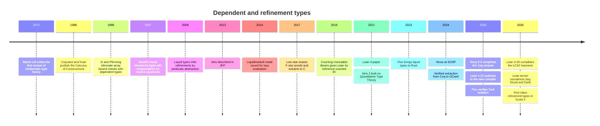
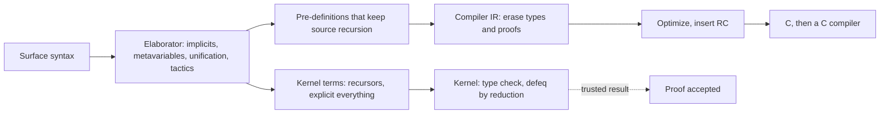
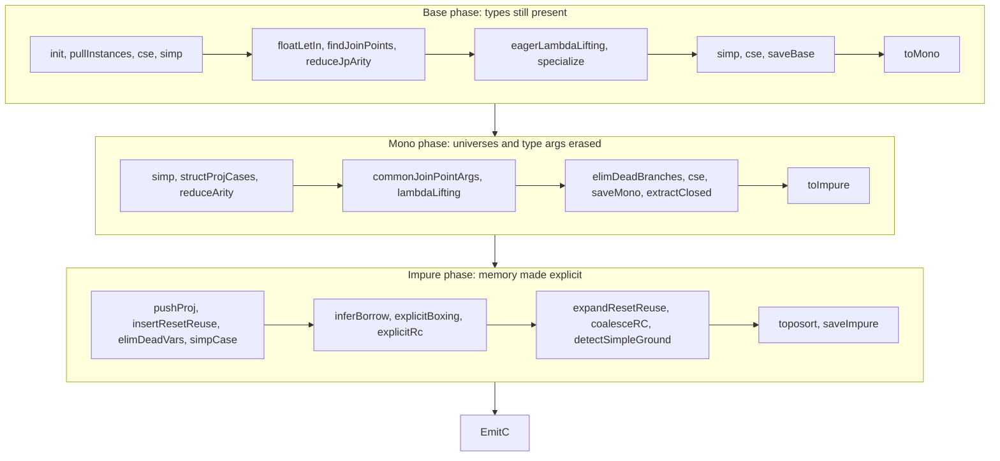

---
tags:
  - compilers
  - dependent-types
  - refinement-types
  - type-theory
  - lean
  - liquid-haskell
  - erasure
  - compiler-foundations
status: complete
sources:
  - https://plato.stanford.edu/entries/type-theory-intuitionistic/
  - https://cacm.acm.org/magazines/2015/12/194626-propositions-as-types/abstract
  - https://rocq-prover.org/papers/the-calculus-of-constructions
  - https://bibtex.github.io/PLDI-1998-XiP.html
  - https://www.cse.chalmers.se/~ulfn/papers/thesis.html
  - https://goto.ucsd.edu/~rjhala/papers/liquid_types.html
  - https://api.crossref.org/works/10.1017%2FS095679681300018X
  - https://goto.ucsd.edu/~rjhala/papers/refinement_types_for_haskell.html
  - https://arxiv.org/abs/1703.00053
  - https://arxiv.org/pdf/1908.05647
  - https://lean-lang.org/papers/lean4.pdf
  - https://arxiv.org/pdf/2104.00480
  - https://lean-lang.org/doc/reference/4.36.0/The-Type-System/
  - https://ammkrn.github.io/type_checking_in_lean4/type_checking/definitional_equality.html
  - https://lean-lang.org/doc/reference/latest/Source-Files/Recursive-Definitions
  - https://leanprover-community.github.io/lean4-metaprogramming-book/main/04_metam.html
  - https://github.com/AndrasKovacs/elaboration-zoo/
  - https://github.com/AndrasKovacs/elaboration-zoo/tree/master/03-holes
  - https://github.com/leanprover/lean4/blob/master/doc/dev/bootstrap.md
  - https://github.com/leanprover/lean4/blob/master/src/Lean/Compiler/LCNF/Passes.lean
  - https://lean-lang.org/doc/api/Lean/Compiler/LCNF/Types.html
  - https://lean-lang.org/doc/api/Lean/Compiler/LCNF/ToLCNF.html
  - https://lean-lang.org/doc/api/Lean/Compiler/LCNF/ToMono.html
  - https://github.com/leanprover/lean4/blob/master/src/Lean/Compiler/LCNF/Basic.lean
  - https://leanprover-community.github.io/archive/stream/341532-lean4-dev/topic/Type.20and.20universe.20information.20kept.20during.20compilation.html
  - https://leanprover-community.github.io/archive/stream/270676-lean4/topic/New.20compiler.20has.20been.20enabled.html
  - https://lean-lang.org/doc/reference/latest/releases/v4.22.0/
  - https://lean-lang.org/doc/reference/stable/releases/v4.23.0/
  - https://lean-lang.org/doc/reference/latest/releases/v4.30.0/
  - https://lean-lang.org/doc/reference/stable/releases/v4.32.2/
  - https://lean-lang.org/doc/reference/4.36.0-rc2/releases/v4.35.0/
  - https://lean-lang.org/doc/reference/4.36.0/releases/v4.36.0/
  - https://lean-lang.org/doc/reference/4.36.0/Run-Time-Code/Reference-Counting/
  - https://lean-lang.org/functional_programming_in_lean/Programming___-Proving___-and-Performance/Special-Types/
  - https://lean-lang.org/doc/api/Init/Data/Vector/Basic.html
  - https://lean-lang.org/fro/roadmap/y4-1
  - https://lean-lang.org/presentations/20260604_DFMD/
  - https://mathlib.org/mathlib_stats.html
  - https://openwall.com/lists/oss-security/2026/08/02/1
  - https://idris2.readthedocs.io/en/latest/backends/index.html
  - https://agda.readthedocs.io/en/latest/language/runtime-irrelevance.html
  - https://agda.readthedocs.io/en/stable/tools/compilers.html
  - https://rocq-prover.org/doc/v8.9/refman/addendum/extraction.html
  - https://kodu.ut.ee/~kalmera/sf/lf/Extraction.html
  - https://rocq-prover.org/releases/9.0.0
  - https://rocq-prover.org/papers/verified-extraction-from-coq-to-ocaml
  - https://hustmphrrr.github.io/asset/papers/icfp25-mctt.pdf
  - https://arxiv.org/pdf/2605.00655
  - https://ucsd-progsys.github.io/liquidhaskell-tutorial/Tutorial_03_Basic.html
  - https://hackage-content.haskell.org/package/liquidhaskell
  - https://ucsd-progsys.github.io/liquidhaskell/install
  - https://fstar-lang.org/tutorial/book/intro.html
  - https://arxiv.org/abs/2207.04034v2
  - https://nilehmann.github.io/papers/pldi23-flux.pdf
  - https://flux-rs.github.io/flux
  - https://css.csail.mit.edu/6.858/2026/readings/ticktock.pdf
  - https://arxiv.org/abs/2303.05491v2
  - https://www.microsoft.com/en-us/research/publication/verus-a-practical-foundation-for-systems-verification/
  - https://raw.githubusercontent.com/dafny-lang/dafny/master/README.md
  - https://arxiv.org/pdf/2605.08369
  - https://microsoft.github.io/TypeScript-New-Handbook/chapters/narrowing
  - https://research.google/pubs/olympiad-level-formal-mathematical-reasoning-with-reinforcement-learning/
  - https://arxiv.org/pdf/2507.23726v1
  - https://arxiv.org/abs/2510.01346
created: 2026-11-26
updated: 2026-11-26
---

## Table Of Contents

- [[#TL;DR|TL;DR]]
- [[#The Problem|The Problem]]
- [[#Foundations|Foundations]]
    - [[#Pi and Sigma Types|Pi and Sigma Types]]
    - [[#Propositions as Types|Propositions as Types]]
    - [[#Definitional Equality, or Why the Checker Must Evaluate|Definitional Equality, or Why the Checker Must Evaluate]]
    - [[#Refinement Types as Subsets Checked by a Solver|Refinement Types as Subsets Checked by a Solver]]
- [[#How We Got Here|How We Got Here]]
- [[#How It Works|How It Works]]
    - [[#Worked Example, a Length-Indexed Vector|Worked Example, a Length-Indexed Vector]]
    - [[#Elaboration, Metavariables and Unification|Elaboration, Metavariables and Unification]]
    - [[#The Kernel and the Trusted Base|The Kernel and the Trusted Base]]
    - [[#Lean 4's Compiler, from Kernel Terms to C|Lean 4's Compiler, from Kernel Terms to C]]
    - [[#Erasure and Proof Irrelevance|Erasure and Proof Irrelevance]]
    - [[#Extraction in Rocq, F* and Agda|Extraction in Rocq, F* and Agda]]
    - [[#Worked Example, LiquidHaskell and the SMT Solver|Worked Example, LiquidHaskell and the SMT Solver]]
    - [[#Refinement Types for Rust and Related Tools|Refinement Types for Rust and Related Tools]]
- [[#Where It Is Now|Where It Is Now]]
    - [[#Lean's Toolchain in 2026|Lean's Toolchain in 2026]]
    - [[#Kernels Under Attack|Kernels Under Attack]]
    - [[#Scale and AI Provers|Scale and AI Provers]]
    - [[#Refinement Types Move Into Mainstream Compilers|Refinement Types Move Into Mainstream Compilers]]
- [[#Trade-offs & Open Problems|Trade-offs & Open Problems]]
- [[#Resources|Resources]]
- [[#Related Notes|Related Notes]]

## ***TL;DR***
---
*Dependent types let a type mention a value ("a vector of length n"); refinement types attach a logical predicate to an ordinary type ("an Int greater than 0"). Both move correctness proofs into the type checker, and both force the compiler to answer a question ordinary compilers never face: which parts of a well-typed program are proof and can be thrown away before code generation.*

- **Types that depend on values.** A Pi type $\Pi_{(x:A)}B(x)$ is a function whose *result type* depends on the argument; a Sigma type $\Sigma_{(x:A)}B(x)$ is a pair whose second component's type depends on the first. Read as logic, Pi is "for all" and Sigma is "there exists", so a program of a type is a proof of a proposition ([SEP, Intuitionistic Type Theory](https://plato.stanford.edu/entries/type-theory-intuitionistic/)).
- **Checking needs evaluation.** If `Vec α (n + 0)` and `Vec α n` are to be the same type, the checker has to run `+`. Definitional equality is decided by reducing terms, which is why total, terminating languages (Lean, Agda, Rocq, Idris) restrict recursion and why the elaborator is the hardest part of these compilers.
- **Lean 4 is the production case study.** It is written in Lean, elaborates surface syntax into small kernel terms, and since Lean 4.22 (August 2025) compiles through a new pipeline: kernel-style terms become LCNF (an A-normal form with types erased to `◾`), then a mono phase, then an impure phase with explicit reference counting, then C. Lean 4.30 (May 2026) completed the move of the last back-end passes onto LCNF ([release notes](https://lean-lang.org/doc/reference/latest/releases/v4.30.0/)).
- **Erasure is the compiler's job.** Lean erases by kind (types and proofs), Idris 2 by usage annotation (quantity 0), Agda by `@0`, Rocq by extracting only the non-`Prop` parts to OCaml, Haskell or Scheme. The design decides whether a length index costs a machine word at run time.
- **Refinement checkers call an SMT solver.** LiquidHaskell (a GHC plugin), Flux (a rustc plugin over MIR), F* and Verus turn code into logical verification conditions and hand them to Z3 or similar; liquid inference cuts annotations to near zero for common properties ([Rondon et al., PLDI 2008](https://goto.ucsd.edu/~rjhala/papers/liquid_types.html)).
- **As of November 2026:** Lean is at 4.36 and bundles external kernel checkers after a kernel soundness bug surfaced in July; Mathlib passes 296,000 theorems; Lean is the target language for AlphaProof, Seed-Prover and Aristotle; Flux verified process isolation in the Tock OS (SOSP 2025); and Scala 3 grew first-class refinement types checked inside the ordinary type checker (OOPSLA 2026).

## ***The Problem***
---
*An ordinary type system knows that `xs` is a list of ints but not how long it is, so `head xs` and `a[i]` stay runtime checks or runtime crashes. Letting types talk about values closes that gap, but then the checker must reason about arbitrary program values, and the compiler must strip the reasoning back out.*

Three tensions shape every design in this space:

- **Expressiveness vs decidability.** As soon as types contain program terms, checking two types equal means checking two programs equal, which is undecidable in general. Dependent type theories recover decidability by insisting that every term normalizes, so equality can be decided by comparing normal forms ([SEP](https://plato.stanford.edu/entries/type-theory-intuitionistic/)). Refinement systems recover it by restricting predicates to logics an SMT solver decides, such as linear arithmetic ([Flux, PLDI 2023](https://nilehmann.github.io/papers/pldi23-flux.pdf)).
- **Annotation burden vs automation.** Full Hindley-Milner inference (see [[Type Systems and Inference]]) does not survive dependent types; the programmer writes signatures and the elaborator guesses the rest by unification. Refinement systems instead infer invariants with predicate abstraction and Horn-clause solving.
- **Proof vs run time.** A proof that `i < length xs` is a real value in the type theory, but nobody wants it in the binary. Deciding what to erase, and proving the erasure safe, is a compiler problem with no counterpart in C or Java.

| | Dependent types (Lean, Agda, Idris, Rocq) | Refinement types (LiquidHaskell, Flux, F*) |
|---|---|---|
| What a type can say | Anything a program can compute | A predicate in a decidable logic over a base type |
| How a claim is checked | Type checker reduces terms; user or tactic supplies proof terms | Verification conditions sent to an SMT solver |
| Who writes the proof | Programmer, tactics, or (now) AI agents | Mostly the solver; programmer adds hints |
| Typical failure mode | "Type mismatch" between two terms that are equal but not definitionally | "Liquid Type Mismatch" when the solver can't prove an implication |
| Trusted base | Small kernel | Solver plus VC generator |

## ***Foundations***
---
*Four ideas carry the rest of the note: dependent function and pair types, reading types as propositions, equality decided by evaluation, and refinement as "subset plus solver".*

### Pi and Sigma Types

*Pi generalizes the function arrow so the result type can mention the argument; Sigma generalizes the pair so the second type can mention the first.*

$$
\frac{\Gamma \vdash A : \mathcal{U} \qquad \Gamma,\, x{:}A \vdash B(x) : \mathcal{U}}{\Gamma \vdash \Pi_{(x:A)}\,B(x) : \mathcal{U}}
\qquad\qquad
\frac{\Gamma \vdash f : \Pi_{(x:A)}\,B(x) \qquad \Gamma \vdash a : A}{\Gamma \vdash f\,a : B(a)}
$$

**In plain English:** if `B(x)` is a type for every `x : A`, then "functions that take an `x` and return a `B(x)`" form a type. Applying such a function to a specific `a` gives a result whose type has `a` *substituted in*. `replicate : Π (n : Nat), α → Vec α n` applied to `3` returns a `Vec α 3`. When `B` doesn't mention `x`, Pi is just the ordinary arrow `A → B`.

$$
\frac{\Gamma \vdash a : A \qquad \Gamma \vdash b : B(a)}{\Gamma \vdash (a, b) : \Sigma_{(x:A)}\,B(x)}
$$

**In plain English:** a dependent pair packs a value `a` with a second value whose type depends on `a`. `filter` on a vector cannot know the output length statically, so it returns `Σ (m : Nat), Vec α m`: "some length, and a vector of that length". When `B` doesn't mention `x`, Sigma is the ordinary product `A × B`.

Martin-Löf's type theory is built from these plus inductive types, identity types and a hierarchy of universes ($\mathcal{U}_0 : \mathcal{U}_1 : \dots$). The hierarchy exists because an early 1971 version with a "type of all types" was shown inconsistent by Girard ([SEP](https://plato.stanford.edu/entries/type-theory-intuitionistic/)).

### Propositions as Types

*Under the Curry-Howard correspondence a proposition is a type, a proof is a program of that type, and checking a proof is type checking.*

| Logic | Type | Example |
|---|---|---|
| $P \Rightarrow Q$ | Function type `P → Q` | A function turning any proof of P into one of Q |
| $P \wedge Q$ | Product `P × Q` | A pair of proofs |
| $\forall x{:}A.\, P(x)$ | Pi type | A function from any `x` to a proof about `x` |
| $\exists x{:}A.\, P(x)$ | Sigma type | A witness `x` plus a proof about it |
| False | Empty type | No closed values |

The table follows the SEP entry, which notes that $\forall$ corresponds to Pi and $\exists$ to Sigma, while conjunction is the plain product ([SEP](https://plato.stanford.edu/entries/type-theory-intuitionistic/)). Wadler's survey calls this "a notion with many names and many origins" that "links logic to computation" ([Wadler, CACM 2015](https://cacm.acm.org/magazines/2015/12/194626-propositions-as-types/abstract)). Coquand and Huet's Calculus of Constructions (1988), ancestor of Rocq and Lean's core, was explicitly designed so that erasing the types from a proof leaves "a pure lambda term that represents the corresponding algorithm" ([Rocq papers page](https://rocq-prover.org/papers/the-calculus-of-constructions)). That sentence is the seed of every extraction and erasure pass in this note.

### Definitional Equality, or Why the Checker Must Evaluate

*Dependent type checkers have a conversion rule: if two types are equal by computation, a term of one has the other. Deciding that equality means running code at compile time.*

$$
\frac{\Gamma \vdash e : A \qquad \Gamma \vdash A \equiv B}{\Gamma \vdash e : B}\;\text{(Conv)}
$$

**In plain English:** if `e` has type `A`, and `A` and `B` reduce to the same thing, then `e` also has type `B`. The `≡` is *definitional* (or judgmental) equality, which the checker decides itself by reduction, as opposed to *propositional* equality `a = b`, which is a type whose values are proofs the user writes ([SEP](https://plato.stanford.edu/entries/type-theory-intuitionistic/)).

Lean's reference lists the reductions behind `≡`: β (apply a lambda), δ (unfold a definition), ι (compute a recursor on a constructor), ζ ("replacement of let-bound variables by their defined values") and quotient reduction ([Lean reference, The Type System](https://lean-lang.org/doc/reference/4.36.0/The-Type-System/)). On top of these, Lean adds η for functions and structures, proof irrelevance ("any two proofs of the same proposition are definitionally equal") and special handling of `Nat` literals ([Type Checking in Lean 4](https://ammkrn.github.io/type_checking_in_lean4/type_checking/definitional_equality.html)). Two consequences matter for implementers:

- **Termination is a soundness requirement.** Decidable checking rests on strong normalization ([SEP](https://plato.stanford.edu/entries/type-theory-intuitionistic/)). A `partial` function in Lean is therefore "treated as opaque" by the kernel and never unfolded, though it "may still be used in compiled code as usual" ([Lean reference, Recursive Definitions](https://lean-lang.org/doc/reference/latest/Source-Files/Recursive-Definitions)).
- **Equality is not a clean equivalence in practice.** Lean's reference states that its definitional equality is "reflexive and symmetric, but not transitive" ([Lean reference](https://lean-lang.org/doc/reference/4.36.0/The-Type-System/)): `a ≡ b` and `b ≡ c` do not guarantee `a ≡ c`. Real checkers also never compute full normal forms: `isDefEq` matches terms "using as few reductions as possible", controlled by transparency levels `none < reducible < instances < implicit < default < all` ([Metaprogramming in Lean 4](https://leanprover-community.github.io/lean4-metaprogramming-book/main/04_metam.html)).

### Refinement Types as Subsets Checked by a Solver

*A refinement type is a base type plus a predicate on a value variable; subtyping between refinements is logical implication, and an SMT solver decides it.*

$$
\frac{\forall v.\;\; \Gamma \wedge p(v) \Rightarrow q(v) \;\text{ is valid}}{\Gamma \vdash \{v{:}B \mid p\} <: \{v{:}B \mid q\}}
$$

**In plain English:** `{v:Int | v == 0}` is a subtype of `{v:Int | 0 <= v}` because $v = 0 \Rightarrow 0 \le v$ holds for every `v`, given whatever facts $\Gamma$ (path conditions, other variables' refinements) are in scope. The LiquidHaskell tutorial makes exactly this point: the set of values described by `Zero` is a subset of those described by `Nat`, so the implication is valid ([LH tutorial, ch. 3](https://ucsd-progsys.github.io/liquidhaskell-tutorial/Tutorial_03_Basic.html)).

Refinements are a restricted form of dependent type: the predicate may mention program variables, but the base type and the program are ordinary, and proofs are never terms the user writes. *Liquid* types add inference: given a set of candidate predicates ("qualifiers"), combine HM inference with predicate abstraction to find the strongest refinements, which in the original experiments cut manual annotation "from 31% of program text to under 1%" ([Rondon, Kawaguchi & Jhala, PLDI 2008](https://goto.ucsd.edu/~rjhala/papers/liquid_types.html)). For how predicate abstraction relates to abstract domains, see [[Abstract Interpretation]].

## ***How We Got Here***
---
*Dependent types began as a foundation for constructive mathematics, became proof assistants, and only in the last decade became something you compile and ship; refinement types took the opposite path, from "eliminate the bounds check" to full verification.*



| Year | Milestone | Why it mattered for compilers |
|---|---|---|
| 1972 to 1986 | Martin-Löf type theory, versions of 1972, 1979, 1984 and the 1986 logical-framework form ([SEP](https://plato.stanford.edu/entries/type-theory-intuitionistic/)) | Pi, Sigma, identity types, decidable checking by normalization |
| 1988 | Calculus of Constructions, with a strong normalization theorem ([Coquand & Huet](https://rocq-prover.org/papers/the-calculus-of-constructions)) | Core of Coq/Rocq; erasing types yields the algorithm |
| 1998 | *Eliminating Array Bound Checking Through Dependent Types*, PLDI ([Xi & Pfenning](https://bibtex.github.io/PLDI-1998-XiP.html)) | First "dependent types as an optimization" result, in ML |
| 2007 | Norell's thesis: Agda; omitted terms become metavariables solved by unification, and checking is sound "whether or not the metavariables are solved" ([Norell](https://www.cse.chalmers.se/~ulfn/papers/thesis.html)) | The modern elaborator design |
| 2008 | Liquid types ([PLDI 2008](https://goto.ucsd.edu/~rjhala/papers/liquid_types.html)) | Refinement inference becomes practical |
| 2013 | Idris, "a general-purpose dependently typed programming language", JFP 23(5) ([Brady](https://api.crossref.org/works/10.1017%2FS095679681300018X)) | Dependent types aimed at programs, not only proofs |
| 2014 | LiquidHaskell shows "the classical translation of refinement types to verification conditions is unsound under lazy evaluation" and fixes it; 10,000+ lines of libraries checked ([ICFP 2014](https://goto.ucsd.edu/~rjhala/papers/refinement_types_for_haskell.html)) | Refinements meet a real compiler's evaluation order |
| 2017 | Low*: "At extraction time, specifications and proofs are erased", leaving predictable C ([Protzenko et al.](https://arxiv.org/abs/1703.00053)) | Verified code competitive with unverified C crypto |
| 2019 | *Counting Immutable Beans*: λpure to λRC, reuse and borrow inference, C backend ([Ullrich & de Moura, IFL 2019](https://arxiv.org/pdf/1908.05647)) | The runtime model Lean 4 still uses |
| 2021 | Lean 4, "a reimplementation ... in Lean itself" ([de Moura & Ullrich](https://lean-lang.org/papers/lean4.pdf)); Idris 2 on QTT ([Brady, ECOOP 2021](https://arxiv.org/pdf/2104.00480)) | Self-hosted dependently typed compilers |
| 2023 | Flux, liquid types for Rust ([PLDI 2023](https://nilehmann.github.io/papers/pldi23-flux.pdf)) | Refinements over ownership types |
| 2025 | Rocq 9.0 (12 March) is "the first release of The Rocq Prover" ([Rocq](https://rocq-prover.org/releases/9.0.0)); Lean's new compiler on `master` 20 June, shipped in 4.22 (14 August) ([Zulip](https://leanprover-community.github.io/archive/stream/270676-lean4/topic/New.20compiler.20has.20been.20enabled.html), [4.22 notes](https://lean-lang.org/doc/reference/latest/releases/v4.22.0/)) | Lean's codegen rewritten in Lean |

The arc: theory gave decidable checking by normalization; Agda and Coq showed you could program in it; Idris and Lean set out to make the result *run fast*; and the refinement line kept the host language and moved proof work to SMT solvers.

## ***How It Works***
---
*A dependently typed compiler has two back ends: one produces small, fully explicit kernel terms for checking, the other produces fast code with every proof removed. The front end (elaborator) feeds both.*



Lean makes the split explicit: for structural recursion "the elaborator translates the recursion into uses of the argument's recursor" for the kernel, but "the compiler generates code from these provisional definitions" that keep the recursion, and course-of-values recursion is `noncomputable` because it is "intended for reasoning rather than efficient code" ([Lean reference](https://lean-lang.org/doc/reference/latest/Source-Files/Recursive-Definitions)). In other words, what the kernel checks and what the compiler compiles are different terms, related only by the elaborator's construction.

### Worked Example, a Length-Indexed Vector

*The classic example shows indexed types, impossible cases, and definitional equality doing real work.*

The following is a **hand-written Lean 4 sketch** (not run through Lean here); it uses its own `N` so the reduction behaviour is visible:

```lean
inductive N where
  | z
  | s (n : N)

def N.plus : N → N → N          -- recurses on the FIRST argument
  | .z,   m => m
  | .s k, m => .s (N.plus k m)

inductive Vec (α : Type) : N → Type where
  | nil  : Vec α .z
  | cons : α → Vec α n → Vec α (.s n)

def Vec.head : Vec α (.s n) → α      -- no nil case needed
  | .cons x _ => x

def Vec.append : Vec α n → Vec α m → Vec α (N.plus n m)
  | .nil,       ys => ys                         -- (1)
  | .cons x xs, ys => .cons x (Vec.append xs ys) -- (2)
```

What the checker has to do:

| Spot | Expected type | Actual type | Why it is accepted |
|---|---|---|---|
| `head`, missing `nil` | `Vec α (.s n)` | `nil : Vec α .z` | Unifying index `.z` with `.s n` fails (different constructors), so the case is impossible |
| (1) | `Vec α (N.plus .z m)` | `Vec α m` | One ι/δ step: `N.plus .z m` reduces to `m` |
| (2) | `Vec α (N.plus (.s k) m)` | `Vec α (.s (N.plus k m))` | One step: the second equation of `N.plus` |

Now flip `N.plus` to recurse on its *second* argument. Case (1) would need `N.plus .z m ≡ m` with `m` a variable: the term is stuck, reduction cannot proceed, and the definition is rejected even though the equation is *propositionally* true. The programmer must then prove `N.plus .z m = m` by induction and cast along it. This is the everyday face of the definitional versus propositional distinction ([SEP](https://plato.stanford.edu/entries/type-theory-intuitionistic/)), and it is why library authors choose recursion argument order to suit the types they want to write. A Sigma type covers what types can't predict:

```lean
def Vec.filter (p : α → Bool) : Vec α n → (m : N) × Vec α m   -- sketch
```

The same `Vec` in Idris 2 uses a quantity to say whether the length exists at run time. The Idris 2 paper's example ([Brady, ECOOP 2021](https://arxiv.org/pdf/2104.00480)):

```idris
-- Version A
length : {n : Nat} -> Vect n a -> Nat   -- n bound with unrestricted quantity
length xs = n                           -- O(1), but n is stored at run time

-- Version B (alternative)
length : Vect n a -> Nat                -- n implicitly quantity 0: erased
length []        = Z
length (x :: xs) = S (length xs)        -- must recompute
```

### Elaboration, Metavariables and Unification

*Users write `append xs ys`; the kernel needs `@Vec.append α n m xs ys`. The elaborator invents the missing arguments as metavariables and solves them by unification against expected types.*

Norell's Agda thesis laid out the approach: omitted terms are replaced by metavariables "solved by unification during type checking", with checking proved sound whether or not they get solved ([Norell 2007](https://www.cse.chalmers.se/~ulfn/papers/thesis.html)). In Lean the same machinery is exposed to metaprograms: a metavariable is "a hole in an expression", and `isDefEq` "may assign these metavariables" to make two terms equal, e.g. `List ?m =?= List Nat` assigns `?m := Nat`, and `Nat.succ ?m =?= n + 1` assigns `?m := n` by unfolding `+` ([Metaprogramming in Lean 4](https://leanprover-community.github.io/lean4-metaprogramming-book/main/04_metam.html)). Note the second example: unification itself evaluates.

Higher-order unification (solving `?F x =?= t` for a function `?F`) is the hard part. Kovács's elaboration-zoo, the standard small reference implementation, creates for each hole "a fresh meta" applied to the local bound variables, then solves meta-headed equations only when the *pattern condition* holds ([elaboration-zoo, 03-holes](https://github.com/AndrasKovacs/elaboration-zoo/tree/master/03-holes)):

1. **Spine check:** the meta is applied to distinct bound variables $x_1, \dots, x_n$.
2. **Scope check:** every free variable of the right-hand side is among those $x_i$.
3. **Occurs check:** the meta does not appear in the right-hand side.

$$
\alpha\;x_1 \dots x_n \;\stackrel{?}{=}\; u \quad\Longrightarrow\quad \alpha := \lambda x_1 \dots x_n.\; u
$$

**In plain English:** if a hole was applied to plain distinct variables, the only sensible solution is to abstract the right-hand side over those variables, and it is unique up to βη. Anything outside this fragment is postponed in the hope that later constraints make it a pattern, and reported as an unsolved metavariable if not. The zoo's stages (holes, implicit args, pruning, first-class polymorphism) are a good reading order ([elaboration-zoo](https://github.com/AndrasKovacs/elaboration-zoo/)). Compared with HM in [[Type Systems and Inference]], the differences are that unification works up to *reduction* rather than syntax, that order matters (postponed constraints), and that type classes and coercions are solved in the same loop.

### The Kernel and the Trusted Base

*Elaborators are huge and buggy; kernels are small. The de Bruijn criterion says only the kernel must be right, because it re-checks every term the elaborator produces.*

Lean has "a relatively small trusted kernel", with an export API so others can write independent checkers ([de Moura & Ullrich](https://lean-lang.org/papers/lean4.pdf)). By 2026 there are several: the reference C++ kernel, nanoda (Rust), lean4lean (Lean), nanobruijn (Rust) and others, with the argument that disagreement between kernels exposes bugs that neither would catch alone ([Ullrich, DFMD 2026](https://lean-lang.org/presentations/20260604_DFMD/)). Two places where the *compiler* leaks into the trusted base:

- **`native_decide`.** Proving a decidable proposition by compiling and running the decision procedure trusts the compiler. Lean 4.35 (October 2026) removed `Lean.reduceBool`, `Lean.reduceNat` and the `Lean.trustCompiler` axiom "along with the kernel's support for reducing applications of the first two by running the compiler"; `native_decide` and `bv_decide` instead assert native results as axioms through `Lean.Meta.nativeEqTrue`, so axiom audits show exactly what was trusted ([4.35 notes](https://lean-lang.org/doc/reference/4.36.0-rc2/releases/v4.35.0/)).
- **Verified kernels.** McTT (ICFP 2025) mechanizes a Martin-Löf type theory with Pi, naturals and a cumulative universe hierarchy in Rocq, proves an NbE-based checker correct, and extracts it to OCaml; "the extracted code does not contain any proof witnesses" and every step is verified "except for the lexer and pretty-printer" ([Jang et al.](https://hustmphrrr.github.io/asset/papers/icfp25-mctt.pdf)). See [[Verified Compilers]].

### Lean 4's Compiler, from Kernel Terms to C

*Lean compiles itself: the compiler is a Lean program, bootstrapped from checked-in C, and since 2025 its middle end is the LCNF pipeline.*

**Bootstrapping.** Lean is "a reimplementation of the Lean interactive theorem prover (ITP) in Lean itself" ([de Moura & Ullrich](https://lean-lang.org/papers/lean4.pdf)). The build starts from stage 0, archived generated C sources in `stage0/src` that are a black box which "does not depend on any local changes"; stage 1 is the current library compiled by that binary; `update-stage0` refreshes the archive when the library needs new language features ([bootstrap.md](https://github.com/leanprover/lean4/blob/master/doc/dev/bootstrap.md)).

**From kernel term to LCNF.** `toLCNF` replaces nested proofs with `lcProof`, eta-expands some applications, and puts "computationally relevant expressions in A-normal form" ([ToLCNF API](https://lean-lang.org/doc/api/Lean/Compiler/LCNF/ToLCNF.html)); ANF and join points are covered in [[CPS and ANF]]. Types are translated by `toLCNFType`, where "all type definitions are expanded" and if "reduction gets stuck, it is replaced with `◾`". The module docs admit ANF "creates a few issues in a dependently typed programming language" and "many casts are needed"; for example, "since `(Fin n)` has dependency on `n`, we erase the `n` to get the type `(Fin ◾)`" ([LCNF Types API](https://lean-lang.org/doc/api/Lean/Compiler/LCNF/Types.html)). An erased let value is "an erased value that is irrelevant for computation" ([Basic.lean](https://github.com/leanprover/lean4/blob/master/src/Lean/Compiler/LCNF/Basic.lean)), and at run time `◾` is `box(0)`.

**Three phases.** The pass list in `Passes.lean` on `master` as of November 2026 ([source](https://github.com/leanprover/lean4/blob/master/src/Lean/Compiler/LCNF/Passes.lean)), condensed:



What each phase is for, according to the compiler author's own explanation ([Zulip, April 2025](https://leanprover-community.github.io/archive/stream/341532-lean4-dev/topic/Type.20and.20universe.20information.20kept.20during.20compilation.html)):

- **Base.** LCNF types "drop dependency" but keep most other information. Type information is kept mainly because "the compiler uses type information to specialize and inline type classes": `specialize` is where `Monad m` dictionaries disappear (compare dictionary passing in [[Type Systems and Inference]]). Zwarich notes that "optimizations can produce partially ill-typed code", because keeping LCNF well typed before `toMono` proved impractical with dependent types.
- **Mono.** Universe levels are erased; `toMono` translates types, erases arguments, and turns `cases` on built-in types (`Nat`, `Int`, `Array`, `String`, `Float`, `Thunk`, `Task`) and trivial structures into primitive operations ([ToMono API](https://lean-lang.org/doc/api/Lean/Compiler/LCNF/ToMono.html)).
- **Impure.** The *Counting Immutable Beans* steps, now on LCNF: insert `reset`/`reuse` so a cell dying just before a same-shaped allocation is reused, infer borrowed parameters, box scalars, insert explicit `inc`/`dec` ([Ullrich & de Moura](https://arxiv.org/pdf/1908.05647)). Then C is emitted.

**Timeline of the switch.** The new code generator was enabled on `master` on 20 June 2025; Cameron Zwarich reported that Mathlib clean builds were "basically identical" and "we honestly weren't expecting huge speedups on the core of Lean just from this switch", with larger wins on newer code such as Lake ([Zulip](https://leanprover-community.github.io/archive/stream/270676-lean4/topic/New.20compiler.20has.20been.20enabled.html)). Lean 4.22.0 (14 August 2025): "The old compiler has been replaced by the new compiler" ([notes](https://lean-lang.org/doc/reference/latest/releases/v4.22.0/)). Lean 4.23.0 (15 September 2025) "removes the old compiler written in C++" ([notes](https://lean-lang.org/doc/reference/stable/releases/v4.23.0/)). Lean 4.30.0 (26 May 2026) completed "the new LCNF compiler backend with user-controllable borrow annotations": C emission was ported "from IR to LCNF, marking the final step of the IR/LCNF conversion", and porting the reset/reuse expansion gave "a ~15% decrease in binary size" ([notes](https://lean-lang.org/doc/reference/latest/releases/v4.30.0/)).

**Seeing the result.** The option `trace.compiler.ir.result` prints the final IR, where `isShared` tests a reference count, `ctor_n` allocates, `proj_n` reads a field and `set x[n]` mutates; in the reference manual's example, a list traversal checks `isShared` and reuses the cell in place when it is unique ([Lean reference, Reference Counting](https://lean-lang.org/doc/reference/4.36.0/Run-Time-Code/Reference-Counting/)). This is how a pure `Array.set` becomes an in-place store, and why memory management here is reference counting rather than tracing (see [[Garbage Collection]]).

### Erasure and Proof Irrelevance

*Every dependently typed compiler must decide which arguments exist at run time. The three main answers are by kind (Lean, Rocq), by declared usage (Idris 2, Agda), and by mode (F*, Verus, Dafny ghost code).*

**By kind.** Lean: "Both types themselves and proofs of propositions are completely erased from compiled code"; a structure with one relevant field compiles to that field, so "a subtype is represented identically to its underlying type" and `Fin` is just `Nat` in memory ([FPIL, Special Types](https://lean-lang.org/functional_programming_in_lean/Programming___-Proving___-and-Performance/Special-Types/)). The flip side is that a `Nat` index is neither a type nor a proof, so a `Vec` defined as in the worked example carries its index as data. Lean's core `Vector α n` sidesteps this: it is a structure of `toArray : Array α` and a proof `size_toArray : self.toArray.size = n` ([Vector API](https://lean-lang.org/doc/api/Init/Data/Vector/Basic.html)), so by the one-relevant-field rule it is an `Array` at run time and the length lives only in a proof. (Both the index-as-data point and the `Vector`-is-an-`Array` point are my reading of the cited pages, not statements they make.)

**By declared usage.** Idris 2's Quantitative Type Theory annotates every binder with a multiplicity ([Brady, ECOOP 2021](https://arxiv.org/pdf/2104.00480)):

| Quantity | Meaning |
|---|---|
| `0` | "the variable is not used at run time" |
| `1` | "the variable is used exactly once at run time" |
| `ω` | "no restrictions on the variable's usage at run time" |

Idris 1 used "a whole program analysis" to discover erasable arguments, so "it is not possible to tell from a definition's type alone which arguments are required at run time"; QTT puts it in the type, and the checker rejects run-time use of a `0` variable. Agda's `@0` does the same: in `data Vec (A : Set a) : @0 Nat → Set a`, the GHC backend compiles cons with two fields, and the checker forbids pattern matching on erased arguments unless at most one case is possible ([Agda docs, Run-time Irrelevance](https://agda.readthedocs.io/en/latest/language/runtime-irrelevance.html)). Agda's compilers also erase single-constructor types whose fields are all erasable, such as equality and the accessibility predicate ([Agda 2.9 compilers](https://agda.readthedocs.io/en/stable/tools/compilers.html)).

$$
\frac{\Gamma \vdash A \qquad \Gamma,\; x \overset{0}{:} A \vdash b : B}{\Gamma \vdash \lambda x.\, b : (0\; x : A) \to B} \quad\text{(sketch: } x \text{ may appear only in types and other 0-positions of } b\text{)}
$$

**In plain English:** a quantity-0 parameter can be used to state things (in types, in proofs) but not to compute things, so the code generator can drop it without checking anything further. This is a static, local guarantee, unlike a whole-program erasure analysis that can silently change when code elsewhere changes.

**Why proof irrelevance matters to the optimizer.** If any two proofs of a proposition are equal (Lean's `Prop`), the compiler may replace every proof with `◾` without changing meaning. A 2026 preprint by Theocharis and Brady gives erasure a structural account as a "phase distinction", proves it conservative over Martin-Löf type theory in both phases, extracts untyped lambda terms with a correctness proof, and notes a planned "ghost sorts" mechanism for Rocq ([Type Theory With Erasure](https://arxiv.org/pdf/2605.00655)).

### Extraction in Rocq, F* and Agda

*Systems that don't compile natively instead extract to a host language, which puts the host compiler, and the extraction itself, in the trusted base.*

- **Rocq.** "The functional languages available as output are currently OCaml, Haskell and Scheme" ([Rocq manual, extraction](https://rocq-prover.org/doc/v8.9/refman/addendum/extraction.html)). Users can map Rocq types and constants to efficient host ones, e.g. `Extract Inductive nat => "int" [...]` and `Extract Constant plus => "( + )"`; Software Foundations warns "it is entirely your responsibility to make sure that the translations you're proving make sense" and flags mapping `minus` to OCaml's `-` as a source of "serious confusion" (Rocq's natural subtraction stops at zero, OCaml's does not) ([SF, Extraction](https://kodu.ut.ee/~kalmera/sf/lf/Extraction.html)).
- **Verified extraction.** Forster, Sozeau and Tabareau (PLDI 2024) built an extraction pipeline "implemented and verified in Coq itself", targeting OCaml's intermediate language via Malfunction; first-order programs are proved correct, but for higher-order interop "already simple interoperations can lead to incorrect behaviour and even outright segfaults" ([Rocq papers](https://rocq-prover.org/papers/verified-extraction-from-coq-to-ocaml)). CertiCoq/CertiRocq, which compiles Gallina to C or Wasm, is covered in [[Verified Compilers]].
- **F*.** A "dependently typed programming language" with "dependent refinement types and subtyping" and an integrated Z3 solver; it "translates F* programs to OCaml or F#, and even C or Wasm", the C path through the KaRaMeL compiler, and its output has been "deployed in settings like the Windows and Linux kernels" ([F* book](https://fstar-lang.org/tutorial/book/intro.html)). The Low* subset is what makes C output predictable: "specifications and proofs are erased, and the remaining code enjoys a predictable translation to C", with a proof that translation preserves semantics and side-channel resistance ([Protzenko et al.](https://arxiv.org/abs/1703.00053)).
- **Agda** has GHC (MAlonzo) and JavaScript backends ([Agda compilers](https://agda.readthedocs.io/en/stable/tools/compilers.html)); **Idris 2** compiles via Chez Scheme by default, with Racket, Gambit, JavaScript/Node and reference-counted C backends ([Idris 2 docs](https://idris2.readthedocs.io/en/latest/backends/index.html)); the Idris 2 paper reports it is self-hosting and "builds itself in around 90 seconds" ([Brady](https://arxiv.org/pdf/2104.00480)).

### Worked Example, LiquidHaskell and the SMT Solver

*LiquidHaskell runs inside GHC, reads refinement signatures from special comments, generates implications, and asks Z3 whether they are valid.*

It is a GHC plugin enabled with `{-# OPTIONS_GHC -fplugin=LiquidHaskell #-}`, so errors appear during ordinary compilation; it needs Z3, CVC4 or MathSat on the `PATH` ("When in doubt, install Z3") ([LH install](https://ucsd-progsys.github.io/liquidhaskell/install)). Each LH release supports exactly one GHC version; 0.9.14.1.1 (June 2026) targets GHC 9.14.1 ([Hackage](https://hackage-content.haskell.org/package/liquidhaskell)). From the official tutorial ([LH tutorial, ch. 3](https://ucsd-progsys.github.io/liquidhaskell-tutorial/Tutorial_03_Basic.html)):

```haskell
{-@ type Nat     = {v:Int | 0 <= v} @-}
{-@ type NonZero = {v:Int | v /= 0} @-}

{-@ abs :: Int -> Nat @-}
abs n
  | 0 < n     = n
  | otherwise = 0 - n

{-@ divide :: Int -> NonZero -> Int @-}
divide _ 0 = die "divide by zero"
divide n d = n `div` d
```

**Hand sketch of the verification conditions** for `abs` (LH's internal form differs; this is the logical content). Each branch adds its guard to the environment, and the result must satisfy `Nat`:

$$
(0 < n) \wedge (v = n) \;\Rightarrow\; 0 \le v
\qquad\qquad
\neg(0 < n) \wedge (v = 0 - n) \;\Rightarrow\; 0 \le v
$$

**In plain English:** in the first branch the result is a positive `n`; in the second, `n` is at most 0 so `0 - n` is at least 0. Both implications are valid in linear integer arithmetic, so Z3 proves them and `abs` checks. For `divide`, the tutorial types `die` as `{-@ die :: {v:String | false} -> a @-}`, so the first equation checks only if the solver proves that branch dead: the literal pattern gives `d` the refinement `v == 0`, which contradicts `NonZero`, and LH concludes `die` is never called. Every call site must then prove its divisor non-zero, and the runtime check is redundant. When the solver fails, the error shows the inferred and required refinements:

```
Error: Liquid Type Mismatch
  Inferred type
    VV : {VV : Int | VV == (1 : int)}
  not a subtype of Required type
    VV : {VV : Int | VV == 0}
```

(Real output from the tutorial, for the deliberately wrong `one' = 1 :: Int` typed as `Zero`.)

### Refinement Types for Rust and Related Tools

*Rust's ownership rules remove aliasing, which is the main obstacle to cheap refinement checking; three tools take three positions.*

- **Flux** writes refinements as indices and predicates in signatures, e.g. `#[flux::sig(fn(i32[@n]) -> bool[0<n])]` ("takes as input an integer equal to n and returns a boolean equal to n > 0"). It runs as a rustc plugin on MIR, generates Horn constraints with unknowns for loop invariants, and solves them with the liquid fixpoint solver; on vector benchmarks it cut verification time by about an order of magnitude against Prusti and removed the annotations Prusti needed (up to 24% of code size, 9% on average) ([Lehmann et al., PLDI 2023](https://nilehmann.github.io/papers/pldi23-flux.pdf), [arXiv](https://arxiv.org/abs/2207.04034v2)). Its docs describe it as "a refinement type checker plugin for Rust" checked "during compilation" ([Flux docs](https://flux-rs.github.io/flux)).
- **Verus** is an "SMT-based tool for formally verifying Rust programs" whose mode system separates specifications (not checked for linearity) from executable code and proofs, letting proofs manipulate "linearly typed permissions" for memory and concurrency ([Lattuada et al.](https://arxiv.org/abs/2303.05491v2)). The SOSP 2024 paper reports verification "3–61x faster and with less effort than the state of the art" across case studies totalling 6.1K lines of code and 31K lines of proof ([MSR](https://www.microsoft.com/en-us/research/publication/verus-a-practical-foundation-for-systems-verification/)).
- **Dafny** is "a verification-ready programming language" that compiles to "C#, Go, Python, Java, or JavaScript" ([README](https://raw.githubusercontent.com/dafny-lang/dafny/master/README.md)); like Verus and F*, it separates ghost code from compiled code rather than using dependent types.
- **TypeScript** narrowing is "the process of refining types to more specific types than declared" ([TS handbook](https://microsoft.github.io/TypeScript-New-Handbook/chapters/narrowing)), but only among types the checker already has (unions, literal types). It has no arithmetic predicates, so it is flow-sensitive typing rather than refinement typing; see [[Type Systems and Inference]].

## ***Where It Is Now***
---
*As of November 2026, Lean dominates the dependent-type world in users and investment, its new compiler is complete and its kernel is under unusual scrutiny because AI systems now produce most of the proofs; refinement types are moving from research plugins into systems code and mainstream compilers.*

### Lean's Toolchain in 2026

*Roughly monthly releases, a finished code generator, and a roadmap that puts compiler redesign in 2027.*

- **Releases.** Lean 4.36.0 shipped 16 November 2026; among other changes the compiler "now refuses to compile a use of `withPtrEq` unless it can check" it cannot miscompile ([4.36 notes](https://lean-lang.org/doc/reference/4.36.0/releases/v4.36.0/)). 4.35.0 (12 October 2026) removed compiler-backed kernel reduction, made more `Array`/`Vector` operations kernel-reducible across module boundaries, moved object allocation into a new `mimalloc.cpp`, and bundled external checkers (`lean4lean`, `nanoda`, `con-leche`, `con-ron`, `leanchecker-paranoid`) ([4.35 notes](https://lean-lang.org/doc/reference/4.36.0-rc2/releases/v4.35.0/)).
- **FRO roadmap, September 2026 to February 2027.** Compiler work lists "better performance, stack-allocated objects, recursive join points, uniqueness annotations, and better support for array-manipulating programs", with this period spent on design and implementation starting in early 2027; "We will not invest in debugger infrastructure at this time." Other items: `lake check` with alternative kernels and a `--paranoid` mode, typeclass-inference caching that "already shows significant gains on all of Mathlib", and better errors for AI agents because "AI-generated proofs are becoming a major source of `grind` and `bv_decide` usage" ([Lean FRO Year 4 roadmap](https://lean-lang.org/fro/roadmap/y4-1)).
- **Adoption.** As of June 2026 the FRO reported 250,000+ unique editor-extension installations, 9,000+ GitHub repositories depending on Lean, 20 engineers at the FRO, and named AWS, Google, Microsoft and Mistral among industry users ([Ullrich, DFMD 2026](https://lean-lang.org/presentations/20260604_DFMD/)). The same talk notes that SampCert's deployed code goes through a custom extractor, not the Lean compiler, so the extractor is in its trusted base.

### Kernels Under Attack

*A July 2026 soundness bug showed that the trusted kernel is now an adversarial target; Lean's lead developer expects automated provers to keep finding such holes.*

On 25 July 2026 a repository claimed a Lean disproof of the Collatz conjecture that both the Lean kernel and nanoda accepted. On 28 July the exploit was traced to a kernel bug (issue #14576), and Leo de Moura submitted the fix the same day ([oss-security, 2 Aug 2026](https://openwall.com/lists/oss-security/2026/08/02/1)). Lean 4.32.2 (28 July) explains it: the kernel's handling of nested inductive types with phantom type parameters "was incomplete and bypassed the type checker", letting a malicious metaprogram prove `False`; nanoda was not affected by this bug, but a proof could combine it with a separate nanoda bug ([4.32.2 notes](https://lean-lang.org/doc/reference/stable/releases/v4.32.2/)). The advisory quotes de Moura: "This is going to keep happening. AIs are really good at exploiting soundness bugs in the kernels." The response is the multi-kernel checking above, which is [[Compiler Testing and Fuzzing|differential testing]] applied to proof checkers.

### Scale and AI Provers

*Mathlib is the largest body of machine-checked mathematics, and the leading AI theorem provers all emit Lean.*

- **Mathlib.** June 2026: "2.2M+ Lines of Formalized Mathematics", "270,000+ formalized theorems by 750+ contributors" ([DFMD 2026](https://lean-lang.org/presentations/20260604_DFMD/)). The live statistics page, read 26 November 2026, shows 142,131 definitions, 296,355 theorems and 772 contributors ([mathlib stats](https://mathlib.org/mathlib_stats.html)). At this size, elaboration speed (typeclass search, `isDefEq`) is a compiler-performance problem in its own right.
- **AlphaProof** (Nature, 2025) learns to find Lean proofs by reinforcement learning on millions of auto-formalized problems, and solved "three out of the five non-geometry problems" at IMO 2024 ([Google Research](https://research.google/pubs/olympiad-level-formal-mathematical-reasoning-with-reinforcement-learning/)).
- **Seed-Prover** (ByteDance, July 2025) proves 78.1% of formalized past IMO problems and reports 5 of 6 IMO 2025 problems (4 during the contest), 99.6% on MiniF2F test and 331/657 on PutnamBench ([arXiv 2507.23726](https://arxiv.org/pdf/2507.23726v1)).
- **Aristotle** (Harmonic, October 2025) combines a Lean proof search with informal reasoning and reports "gold-medal-equivalent performance" on IMO 2025 ([arXiv 2510.01346](https://arxiv.org/abs/2510.01346)).

The compiler-relevant lesson: the kernel, not the model, is what makes these results trustworthy, which is why kernel bugs and `native_decide` now get so much attention. For the RL side see [[RL for Reasoning]] and [[Reasoning Models]]; for AI-written compiler proofs see [[Verified Compilers]].

### Refinement Types Move Into Mainstream Compilers

*Refinement checking is now used to verify production systems code and is being built into an industrial language's own type checker.*

- **TickTock (SOSP 2025).** Flux was used to verify process isolation in the Tock embedded OS for all ARMv7-M platforms Tock supports and three RISC-V platforms, finding bugs including an MPU configuration overlap that let a process reach kernel memory and a context switch that could enter process code still privileged. About 3.6K lines of Flux specifications cover 22K lines of Rust; the redesigned kernel verifies in under three minutes, with context switches about 0.3% slower ([Rindisbacher et al.](https://css.csail.mit.edu/6.858/2026/readings/ticktock.pdf)). See [[Microkernels and seL4]] for the comparison with full-OS proofs.
- **Scala 3 (OOPSLA 2026).** Bovel, Kunčak and Odersky make refinement types "ordinary Scala types", checked during normal type checking rather than in a separate pass, using an e-graph entailment solver instead of SMT (so no arithmetic decision procedures), with dynamic checks via pattern matching or `.runtimeChecked` when the solver can't prove a predicate. The Dotty prototype is about 2,200 lines with 0 to 12% compile-time overhead on their benchmarks, and soundness is mechanized in Rocq ([arXiv 2605.08369](https://arxiv.org/pdf/2605.08369)). See [[E-Graphs and Equality Saturation]].
- **LiquidHaskell** keeps pace with GHC releases (0.9.14.1.1 for GHC 9.14.1, June 2026) ([Hackage](https://hackage-content.haskell.org/package/liquidhaskell)).

## ***Trade-offs & Open Problems***
---
*Each design spends complexity in a different place: the user's proofs, the solver's predictability, the elaborator's heuristics, or the compiler's erasure pass.*

| Choice | Gains | Costs |
|---|---|---|
| Full dependent types (Lean, Agda, Idris, Rocq) | Any property expressible; small trusted kernel | Termination required; definitional vs propositional equality friction; slow elaboration |
| Refinement types + SMT (LH, Flux, F*) | Near-zero proof effort for arithmetic and bounds; host language unchanged | Restricted logic; solver timeouts and instability; solver and VC generator trusted |
| Erasure by kind (Lean) | No annotations; proofs always free | Indices of data type stay at run time unless moved into proofs |
| Erasure by quantity (Idris 2, Agda `@0`) | Precise, checked, visible in types | Annotation burden; quantities interact with every other feature |
| Native compiler (Lean, Idris 2) | Fast code, no host language in TCB for execution | Compiler is large, unverified code; `native_decide` trusts it |
| Extraction (Rocq, F*) | Reuse mature OCaml/C compilers | Extraction plus host compiler trusted; realized axioms unchecked |

Open problems:

- **Equality ergonomics.** The `N.plus` argument-order problem has no general fix in intensional type theory; it is a daily cost, and casts along propositional equalities complicate both proofs and code.
- **Compiling dependently typed code well.** Lean's compiler author notes that keeping IR well typed through optimization was impractical, so LCNF tolerates "partially ill-typed code" ([Zulip](https://leanprover-community.github.io/archive/stream/341532-lean4-dev/topic/Type.20and.20universe.20information.20kept.20during.20compilation.html)). That makes typed-IR linting of the kind GHC's Core Lint does hard. Stack allocation and uniqueness annotations are still design items on the 2027 roadmap.
- **Kernel trust under adversarial search.** AI provers search for any accepted term, including ones that exploit kernel bugs; multiple independent kernels, verified kernels like McTT, and axiom audits are the current answers.
- **Solver predictability.** Refinement checkers depend on SMT behaviour that can change between solver versions; Scala's choice of a small e-graph solver trades power for predictability and IDE speed.
- **Erasure theory.** Erasure has been ad hoc in each system; structural accounts like the 2026 phase-distinction work ([Theocharis & Brady](https://arxiv.org/pdf/2605.00655)) aim to make it a principled type-theoretic feature that implementations can follow.

## ***Resources***
---
*Start with the SEP entry and the Idris 2 paper for concepts, the elaboration-zoo for implementation, Lean's LCNF sources for a production compiler, and the LiquidHaskell tutorial for refinements.*

**Theory**
- [Intuitionistic Type Theory](https://plato.stanford.edu/entries/type-theory-intuitionistic/): Stanford Encyclopedia of Philosophy. Pi, Sigma, judgmental equality, normalization.
- [Propositions as Types](https://cacm.acm.org/magazines/2015/12/194626-propositions-as-types/abstract): Wadler, CACM, December 2015.
- [The Calculus of Constructions](https://rocq-prover.org/papers/the-calculus-of-constructions): Coquand and Huet, Information and Computation, 1988.
- [Type Theory With Erasure](https://arxiv.org/pdf/2605.00655): Theocharis and Brady, preprint, 2026.

**Primary papers**
- [Eliminating Array Bound Checking Through Dependent Types](https://bibtex.github.io/PLDI-1998-XiP.html): Xi and Pfenning, PLDI 1998.
- [Towards a practical programming language based on dependent type theory](https://www.cse.chalmers.se/~ulfn/papers/thesis.html): Norell, PhD thesis, 2007. Agda's elaborator.
- [Idris, design and implementation](https://api.crossref.org/works/10.1017%2FS095679681300018X): Brady, JFP 23(5), 2013.
- [Idris 2: Quantitative Type Theory in Practice](https://arxiv.org/pdf/2104.00480): Brady, ECOOP 2021.
- [The Lean 4 Theorem Prover and Programming Language](https://lean-lang.org/papers/lean4.pdf): de Moura and Ullrich, CADE 2021.
- [Counting Immutable Beans](https://arxiv.org/pdf/1908.05647): Ullrich and de Moura, IFL 2019. Lean's RC and reuse.
- [McTT: A Verified Kernel for a Proof Assistant](https://hustmphrrr.github.io/asset/papers/icfp25-mctt.pdf): Jang, Gaulin, Hu and Pientka, ICFP 2025.
- [Verified Extraction from Coq to OCaml](https://rocq-prover.org/papers/verified-extraction-from-coq-to-ocaml): Forster, Sozeau and Tabareau, PLDI 2024.

**Refinement types**
- [Liquid Types](https://goto.ucsd.edu/~rjhala/papers/liquid_types.html): Rondon, Kawaguchi and Jhala, PLDI 2008.
- [Refinement Types for Haskell](https://goto.ucsd.edu/~rjhala/papers/refinement_types_for_haskell.html): Vazou et al., ICFP 2014.
- [LiquidHaskell tutorial, ch. 3](https://ucsd-progsys.github.io/liquidhaskell-tutorial/Tutorial_03_Basic.html), [install guide](https://ucsd-progsys.github.io/liquidhaskell/install), [Hackage](https://hackage-content.haskell.org/package/liquidhaskell).
- [Flux: Liquid Types for Rust](https://nilehmann.github.io/papers/pldi23-flux.pdf): Lehmann, Geller, Vazou and Jhala, PLDI 2023; [Flux docs](https://flux-rs.github.io/flux).
- [TickTock: Verified Isolation in a Production Embedded OS](https://css.csail.mit.edu/6.858/2026/readings/ticktock.pdf): Rindisbacher et al., SOSP 2025.
- [Verus: Verifying Rust Programs using Linear Ghost Types](https://arxiv.org/abs/2303.05491v2) and [Verus: A Practical Foundation for Systems Verification](https://www.microsoft.com/en-us/research/publication/verus-a-practical-foundation-for-systems-verification/): SOSP 2024.
- [Verified Low-Level Programming Embedded in F*](https://arxiv.org/abs/1703.00053): Protzenko et al., 2017; [Proof-oriented Programming in F*](https://fstar-lang.org/tutorial/book/intro.html).
- [First-Class Refinement Types for Scala](https://arxiv.org/pdf/2605.08369): Bovel, Kunčak and Odersky, OOPSLA 2026.

**Implementation and docs**
- [elaboration-zoo](https://github.com/AndrasKovacs/elaboration-zoo/): Kovács. Small elaborators with holes, implicits and pattern unification.
- [Metaprogramming in Lean 4, MetaM chapter](https://leanprover-community.github.io/lean4-metaprogramming-book/main/04_metam.html): metavariables and `isDefEq`.
- [Type Checking in Lean 4, Definitional Equality](https://ammkrn.github.io/type_checking_in_lean4/type_checking/definitional_equality.html).
- Lean reference: [The Type System](https://lean-lang.org/doc/reference/4.36.0/The-Type-System/), [Recursive Definitions](https://lean-lang.org/doc/reference/latest/Source-Files/Recursive-Definitions), [Reference Counting](https://lean-lang.org/doc/reference/4.36.0/Run-Time-Code/Reference-Counting/); [FPIL, Special Types](https://lean-lang.org/functional_programming_in_lean/Programming___-Proving___-and-Performance/Special-Types/).
- Lean compiler source and API: [Passes.lean](https://github.com/leanprover/lean4/blob/master/src/Lean/Compiler/LCNF/Passes.lean), [Basic.lean](https://github.com/leanprover/lean4/blob/master/src/Lean/Compiler/LCNF/Basic.lean), [LCNF Types](https://lean-lang.org/doc/api/Lean/Compiler/LCNF/Types.html), [ToLCNF](https://lean-lang.org/doc/api/Lean/Compiler/LCNF/ToLCNF.html), [ToMono](https://lean-lang.org/doc/api/Lean/Compiler/LCNF/ToMono.html), [bootstrap.md](https://github.com/leanprover/lean4/blob/master/doc/dev/bootstrap.md).
- [Agda run-time irrelevance](https://agda.readthedocs.io/en/latest/language/runtime-irrelevance.html), [Agda compilers](https://agda.readthedocs.io/en/stable/tools/compilers.html), [Idris 2 backends](https://idris2.readthedocs.io/en/latest/backends/index.html), [Rocq extraction](https://rocq-prover.org/doc/v8.9/refman/addendum/extraction.html), [Software Foundations, Extraction](https://kodu.ut.ee/~kalmera/sf/lf/Extraction.html).

**Where it is now (2025 to 2026)**
- Lean releases: [4.22](https://lean-lang.org/doc/reference/latest/releases/v4.22.0/), [4.23](https://lean-lang.org/doc/reference/stable/releases/v4.23.0/), [4.30](https://lean-lang.org/doc/reference/latest/releases/v4.30.0/), [4.32.2](https://lean-lang.org/doc/reference/stable/releases/v4.32.2/), [4.35](https://lean-lang.org/doc/reference/4.36.0-rc2/releases/v4.35.0/), [4.36](https://lean-lang.org/doc/reference/4.36.0/releases/v4.36.0/).
- Lean compiler discussions: [new compiler enabled](https://leanprover-community.github.io/archive/stream/270676-lean4/topic/New.20compiler.20has.20been.20enabled.html), [type and universe information in LCNF](https://leanprover-community.github.io/archive/stream/341532-lean4-dev/topic/Type.20and.20universe.20information.20kept.20during.20compilation.html).
- [Lean FRO Year 4 Part 1 roadmap](https://lean-lang.org/fro/roadmap/y4-1); [Theorem Proving in Industry with Lean](https://lean-lang.org/presentations/20260604_DFMD/): Ullrich, June 2026; [Mathlib statistics](https://mathlib.org/mathlib_stats.html).
- [Lean kernel soundness advisory](https://openwall.com/lists/oss-security/2026/08/02/1): oss-security, August 2026.
- AI provers: [AlphaProof](https://research.google/pubs/olympiad-level-formal-mathematical-reasoning-with-reinforcement-learning/) (Nature 2025), [Seed-Prover](https://arxiv.org/pdf/2507.23726v1) (2025), [Aristotle](https://arxiv.org/abs/2510.01346) (2025).
- [Rocq 9.0 release](https://rocq-prover.org/releases/9.0.0); [Dafny README](https://raw.githubusercontent.com/dafny-lang/dafny/master/README.md); [TypeScript narrowing](https://microsoft.github.io/TypeScript-New-Handbook/chapters/narrowing).

## Related Notes

- [[Type Systems and Inference]] — The foundation: HM, bidirectional checking, unification and a first look at refinements.
- [[Verified Compilers]] — CompCert, CertiCoq and Lean as a compiler-verification platform; the main consumer of these type theories.
- [[Formal Methods in Practice]] — SMT-backed verification and proof assistants in industry.
- [[CPS and ANF]] — LCNF is an A-normal form with join points.
- [[Intermediate Representations]] — Why LCNF gives up being fully typed while GHC Core stays typed.
- [[Garbage Collection]] — Lean's reference counting with reuse as the alternative to tracing.
- [[Abstract Interpretation]] — Predicate abstraction behind liquid inference.
- [[E-Graphs and Equality Saturation]] — The entailment solver in Scala's refinement types.
- [[Compiler Testing and Fuzzing]] — Multiple independent kernels as differential testing for proof checkers.
- [[Microkernels and seL4]] — Full-OS proofs, compared with TickTock's Flux verification of Tock.
- [[Classic Optimizations]] — Specialization, CSE and dead-code passes that LCNF runs.
- [[Translation Validation]] — Planned: checking compiler output per run, the other road to trusting `native_decide`-style computation.
- [[RL for Reasoning]] — How AlphaProof-style provers are trained against the Lean checker.
