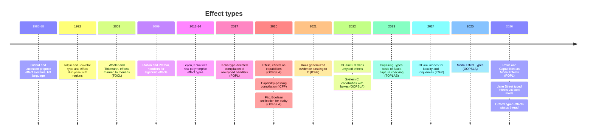
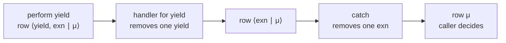
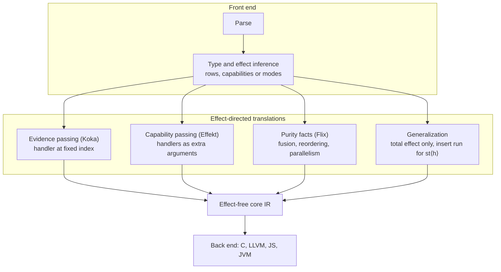

---
tags:
  - compilers
  - foundations
  - type-systems
  - effect-types
  - effect-systems
  - effect-handlers
  - koka
  - effekt
  - ocaml
  - oxcaml
  - scala
  - flix
  - modal-types
status: complete
sources:
  - https://arxiv.org/pdf/1406.2061
  - https://koka-lang.github.io/koka/doc/book.html
  - https://github.com/koka-lang/koka
  - https://www.microsoft.com/en-us/research/?p=337556
  - https://www.microsoft.com/en-us/research/uploads/prod/2021/08/genev-icfp21.pdf
  - https://ps.informatik.uni-tuebingen.de/publications/brachthaeuser20effects/
  - https://se.informatik.uni-tuebingen.de/publications/brachthaeuser22effects
  - https://se.informatik.uni-tuebingen.de/publications/schuster20capability
  - https://effekt-lang.org/tour/effects
  - https://effekt-lang.org/evolution
  - https://arxiv.org/pdf/2407.11816
  - https://arxiv.org/pdf/2507.10301
  - https://popl26.sigplan.org/details/POPL-2026-popl-research-papers/34/Rows-and-Capabilities-as-Modal-Effects
  - https://github.com/janestreet/handled_effect
  - https://blog.janestreet.com/fun-with-algebraic-effects-hardcaml/
  - https://icfp24.sigplan.org/details/icfp-2024-papers/19/Oxidizing-OCaml-with-Modal-Memory-Management
  - https://discuss.ocaml.org/t/whats-the-status-of-typed-effects/18439
  - https://ocaml.org/manual/effects.html
  - https://scala-lang.org/api/3.x/docs/experimental/capture-checking/overview.html
  - https://plg.uwaterloo.ca/~olhotak/pubs/toplas23.pdf
  - https://users-cs.au.dk/magnusm/papers/oopsla20/paper_b.pdf
  - https://www.cs.tufts.edu/~nr/cs257/archive/phil-wadler/effectstocl.pdf
  - https://www.lfcs.inf.ed.ac.uk/events/lics/1992/TalpinJouvelot-Thetypeandeffectdis.html
  - https://en.wikipedia.org/wiki/Effect_system
created: 2026-11-28
updated: 2026-11-28
---

## Table Of Contents

- [[#TL;DR|TL;DR]]
- [[#The Problem|The Problem]]
- [[#Foundations|Foundations]]
    - [[#The Type-and-Effect Judgment|The Type-and-Effect Judgment]]
    - [[#Effect Polymorphism|Effect Polymorphism]]
    - [[#Five Ways to Represent an Effect|Five Ways to Represent an Effect]]
    - [[#Effect Safety Is Not Purity|Effect Safety Is Not Purity]]
- [[#How We Got Here|How We Got Here]]
- [[#How It Works|How It Works]]
    - [[#Worked Example - Koka Infers a Row|Worked Example - Koka Infers a Row]]
    - [[#Row Unification and Duplicate Labels|Row Unification and Duplicate Labels]]
    - [[#One Function, Five Signatures|One Function, Five Signatures]]
    - [[#What the Compiler Does With Effect Types|What the Compiler Does With Effect Types]]
    - [[#Why OCaml's Effects Stay Untyped|Why OCaml's Effects Stay Untyped]]
- [[#Where It Is Now|Where It Is Now]]
- [[#Trade-offs & Open Problems|Trade-offs & Open Problems]]
- [[#Resources|Resources]]
- [[#Related Notes|Related Notes]]

## ***TL;DR***
---
*An effect type extends a function's type with what else it does besides return a value: throw, diverge, touch the heap, print, or perform an operation some handler must answer. The type checker then guarantees every effect is handled, and the compiler gets facts (this call is pure, this operation resumes immediately, this handler is at index 2) it can turn into faster code.*

- **The judgment grows a third part.** Ordinary typing says $e : \tau$. An effect system says $e : \tau \mid \epsilon$, "evaluating $e$ produces a $\tau$ and may perform the effects in $\epsilon$". The idea dates to Gifford and Lucassen's FX in the mid-1980s ([Wadler and Thiemann](https://www.cs.tufts.edu/~nr/cs257/archive/phil-wadler/effectstocl.pdf); [Wikipedia](https://en.wikipedia.org/wiki/Effect_system)). Java's checked exceptions are a narrow, one-effect instance.
- **The hard part is higher-order functions.** `map` has whatever effects its argument has. Every serious design is mostly an answer to "how do you write `map`'s type without drowning in annotations?"
- **Four live answers.** *Rows* with effect variables (Koka: `⟨exn, div | μ⟩`) ([Leijen 2014](https://arxiv.org/pdf/1406.2061)); *capabilities*, where an effect is a value in scope that you must hold to perform it (Effekt, Scala 3 capture checking, OxCaml's `handled_effect`) ([Brachthäuser et al., OOPSLA 2020](https://ps.informatik.uni-tuebingen.de/publications/brachthaeuser20effects/)); *Boolean formulas* over purity (Flix) ([Madsen and van de Pol, OOPSLA 2020](https://users-cs.au.dk/magnusm/papers/oopsla20/paper_b.pdf)); and *modal effect types*, which move effects off the arrows into modalities so `map` needs no effect variable at all ([Tang et al., OOPSLA 2025](https://arxiv.org/pdf/2407.11816)). POPL 2026 showed rows and capabilities can both be encoded into the modal framework ([Tang and Lindley](https://arxiv.org/pdf/2507.10301)).
- **Compilers use effect types, then erase them.** Koka's evidence passing puts a handler at a fixed vector index when the row is known ([Xie and Leijen, ICFP 2021](https://www.microsoft.com/en-us/research/uploads/prod/2021/08/genev-icfp21.pdf)); Effekt passes handlers as ordinary arguments and, for a restricted fragment, stages them away completely ([Schuster et al., ICFP 2020](https://se.informatik.uni-tuebingen.de/publications/schuster20capability)); Flix uses purity to justify map fusion and parallel evaluation.
- **As of November 2026:** OCaml 5's effects are still untyped and no project is retrofitting a type system onto them except Jane Street's mode-based `handled_effect` for OxCaml ([OCaml Discuss, Sep 2026](https://discuss.ocaml.org/t/whats-the-status-of-typed-effects/18439)); Koka is at v3.2.9 (17 September 2026) ([GitHub](https://github.com/koka-lang/koka)); Scala 3.10's docs call capture checking "quite mature" and "expect it to be stabilized soon" ([Scala docs](https://scala-lang.org/api/3.x/docs/experimental/capture-checking/overview.html)).

## ***The Problem***
---
*A type like `int -> int` is a lie by omission: the function may throw, loop forever, write a file or suspend to a scheduler. Without that information in the type, programmers cannot see it and compilers cannot use it; with it, every higher-order function must say how its callbacks' effects flow through.*

Consider what three functions with the same ML type actually do:

| Function | Type in OCaml | What it really does | What a caller needs to know |
|---|---|---|---|
| `square x = x * x` | `int -> int` | nothing else | can be reordered, duplicated, removed if unused |
| `parse s = int_of_string s` | `string -> int` | may raise `Failure` | needs a handler, or the program dies |
| `fetch url = ... perform (Await fd) ...` | `string -> string` | suspends to a scheduler | must run under a matching [[Effect Handlers and Delimited Continuations\|effect handler]] |

The third row is the sharpest. In OCaml 5, if `fetch` is called with no handler for `Await` on the stack, the program raises `Effect.Unhandled` at run time; the type checker cannot help, and Jane Street's `handled_effect` README opens on exactly that: "the compiler provides no guarantee that every performed effectful operation will be handled" ([handled_effect](https://github.com/janestreet/handled_effect); [OCaml manual](https://ocaml.org/manual/effects.html)).

Compilers want the same information for different reasons:

- **Safety.** An effect that escapes every handler is a crash; an exception nobody catches is the same bug in an older form.
- **Optimization.** A call proven *pure* (no effects at all) can be hoisted, merged by common-subexpression elimination, or deleted; two pure `map`s can be fused; a pure predicate can be evaluated in parallel or in any order ([Flix, OOPSLA 2020](https://users-cs.au.dk/magnusm/papers/oopsla20/paper_b.pdf)). A handler whose position is known statically can be called directly instead of searched for ([Xie and Leijen](https://www.microsoft.com/en-us/research/uploads/prod/2021/08/genev-icfp21.pdf)).
- **Soundness of other features.** ML's `ref` plus let-polymorphism is unsound without a restriction; an effect system can supply it by refusing to generalize effectful expressions ([Leijen 2014](https://arxiv.org/pdf/1406.2061)).

The cost is annotation. If effects ride on every arrow, a higher-order function needs an effect variable on each arrow it touches, and an existing library has to be rewritten to admit effectful callbacks at all. The modal-effects paper uses `map` as its running example of this tax ([Tang et al.](https://arxiv.org/pdf/2407.11816)), and Java's checked exceptions, which "apply only to methods" and cannot be abstracted over cleanly, are the industrial cautionary tale ([Wikipedia](https://en.wikipedia.org/wiki/Effect_system)). The same tension shows up as "function colouring" in async languages, discussed in [[Green Threads and Virtual Threads]].

## ***Foundations***
---
*Four ideas: an effect system adds an effect annotation to the typing judgment and to function arrows; effect polymorphism lets a function's effect depend on its arguments; there are several ways to represent "a collection of effects", each with a different inference story; and "every effect is handled" is a weaker promise than "this code is pure".*

### The Type-and-Effect Judgment

*Every expression gets a type and an effect; every function type carries a latent effect, the one that happens when it is called.*

A function's effect is not performed when the function is *defined*, only when it is *called*, so arrows carry a **latent effect**: $\tau_1 \xrightarrow{\epsilon} \tau_2$. The application rule in a set-based system (FX style) is:

$$
\frac{\Gamma \vdash e_1 : \tau_1 \xrightarrow{\epsilon} \tau_2 \mid \epsilon_1 \qquad \Gamma \vdash e_2 : \tau_1 \mid \epsilon_2}{\Gamma \vdash e_1\,e_2 : \tau_2 \mid \epsilon_1 \cup \epsilon_2 \cup \epsilon}
$$

**In plain English:** evaluating `f x` does whatever evaluating `f` does, whatever evaluating `x` does, and then whatever `f`'s body does when it runs.

Koka does not take unions with subeffecting; it makes the three effects *the same row* and relies on open rows and unification to make them line up, which the 2014 paper prefers because subtyping constraints plus polymorphism can make inference undecidable ([Leijen 2014](https://arxiv.org/pdf/1406.2061)):

$$
\frac{\Gamma \vdash e_1 : \tau_1 \xrightarrow{\epsilon} \tau_2 \mid \epsilon \qquad \Gamma \vdash e_2 : \tau_1 \mid \epsilon}{\Gamma \vdash e_1\,e_2 : \tau_2 \mid \epsilon}
$$

**In plain English:** pick one row big enough for everything; an open row ending in a variable can always be extended to fit.

Handlers are the elimination form. Handling label $\ell$ removes it from the row:

$$
\frac{\Gamma \vdash e : \tau \mid \langle \ell \mid \epsilon \rangle \qquad H \text{ handles every operation of } \ell \text{ using only } \epsilon}{\Gamma \vdash \textbf{handle}\; e \;\textbf{with}\; H : \tau' \mid \epsilon}
$$

**In plain English:** the body may perform $\ell$; outside the handler, $\ell$ is gone. A program whose `main` has no leftover labels (other than built-ins like `io`) cannot hit an unhandled effect. Koka's soundness theorems state the corresponding guarantees: no `exn` in the type means no exception escapes, no `div` means evaluation terminates, no `st⟨h⟩` means no heap leaks out ([Leijen 2014](https://arxiv.org/pdf/1406.2061)).

### Effect Polymorphism

*A higher-order function's effect is "whatever its argument does", so it needs a way to name an unknown effect.*

The textbook answer is an effect variable, quantified like a type variable. In the modal-effects paper's notation, an effect-polymorphic `map` is ([Tang et al.](https://arxiv.org/pdf/2407.11816)):

```text
map' : ∀ a b e . (a →e b) →e List a →e List b
```

`e` appears on every arrow because each partial application might be the one that runs `f`. That is correct and precise, and it is the annotation burden every newer design tries to remove. Flix writes the same idea as `def map(f: a -> b & e, xs: List[a]): List[b] & e`, where `e` is a Boolean formula over purity ([Madsen and van de Pol](https://users-cs.au.dk/magnusm/papers/oopsla20/paper_b.pdf)).

### Five Ways to Represent an Effect

*The choice of what an effect annotation is (a set, a row, a Boolean formula, a capability in scope, a modality) decides how inference works and how much the programmer writes.*

| Representation | An effect annotation is | Polymorphism by | Inference | Languages |
|---|---|---|---|---|
| **Sets with regions** | a set of operations on memory regions | effect variables | Hindley-Milner extended with effect constraints ([Talpin and Jouvelot, LICS 1992](https://www.lfcs.inf.ed.ac.uk/events/lics/1992/TalpinJouvelot-Thetypeandeffectdis.html)) | FX, ML Kit-style region systems |
| **Rows** | an ordered list of labels, possibly ending in a variable: `⟨exn, ndet \| μ⟩` | row variables | HM plus row unification, principal types ([Leijen 2014](https://arxiv.org/pdf/1406.2061)) | Koka, Links, Frank |
| **Boolean formulas** | a formula over "pure" (true) and "impure" (false) | effect variables in formulas | HM plus Boolean unification; inference 1.4x slower on average ([Flix](https://users-cs.au.dk/magnusm/papers/oopsla20/paper_b.pdf)) | Flix |
| **Capabilities** | the set of capabilities (handler values) a computation uses from its context | lexical scope: a block may use any capability visible where it runs | ordinary scoping, plus capture sets once functions become first-class ([OOPSLA 2020](https://ps.informatik.uni-tuebingen.de/publications/brachthaeuser20effects/); [OOPSLA 2022](https://se.informatik.uni-tuebingen.de/publications/brachthaeuser22effects)) | Effekt, Scala 3 capture checking, OxCaml `handled_effect` |
| **Modalities** | a modality `[E]` (replace the ambient effect context) or `⟨D⟩` (add to it) applied to a type | the ambient effect context, without variables in common cases | bidirectional, in the surface language Metl ([Tang et al.](https://arxiv.org/pdf/2407.11816)) | research (Met) |

### Effect Safety Is Not Purity

*Capability systems guarantee every effect is handled, but give up some of the "this function does nothing" reasoning that row systems provide; that difference matters to an optimizer.*

A row system describes what a computation *does*: `total` means no effects. Effekt's authors deliberately reinterpret effect types as "which *capabilities* a computation requires from its context" ([Brachthäuser et al., OOPSLA 2020](https://ps.informatik.uni-tuebingen.de/publications/brachthaeuser20effects/)). That buys simple effect polymorphism and the guarantee that no operation runs without a handler (*effect safety*), and the paper acknowledges it makes purity reasoning harder. A closure that captured a `console` capability can have type `() -> Unit` in Effekt's System C while the checker still records the capture in a separate *capture set* ([OOPSLA 2022](https://se.informatik.uni-tuebingen.de/publications/brachthaeuser22effects)); Scala 3 makes the same split, writing a pure function `A -> B` and one that may capture capability `c` as `A ->{c} B` ([Scala docs](https://scala-lang.org/api/3.x/docs/experimental/capture-checking/overview.html)). For an optimizer, the useful fact is "empty capture set" or "total row", not merely "type-checks".

## ***How We Got Here***
---
*Effect systems began as a way to find parallelism and control polymorphism in impure languages, were shown equivalent to monads, sat mostly idle until algebraic effect handlers gave them something user-defined to track, and then split into rows, capabilities and modalities.*



Sources: [Wadler and Thiemann](https://www.cs.tufts.edu/~nr/cs257/archive/phil-wadler/effectstocl.pdf), [Talpin and Jouvelot](https://www.lfcs.inf.ed.ac.uk/events/lics/1992/TalpinJouvelot-Thetypeandeffectdis.html), [Leijen 2014](https://arxiv.org/pdf/1406.2061), [Leijen POPL 2017](https://www.microsoft.com/en-us/research/?p=337556), [Effekt OOPSLA 2020](https://ps.informatik.uni-tuebingen.de/publications/brachthaeuser20effects/), [ICFP 2020](https://se.informatik.uni-tuebingen.de/publications/schuster20capability), [Flix](https://users-cs.au.dk/magnusm/papers/oopsla20/paper_b.pdf), [Xie and Leijen](https://www.microsoft.com/en-us/research/uploads/prod/2021/08/genev-icfp21.pdf), [System C](https://se.informatik.uni-tuebingen.de/publications/brachthaeuser22effects), [Capturing Types](https://plg.uwaterloo.ca/~olhotak/pubs/toplas23.pdf), [Oxidizing OCaml](https://icfp24.sigplan.org/details/icfp-2024-papers/19/Oxidizing-OCaml-with-Modal-Memory-Management), [Modal Effect Types](https://arxiv.org/pdf/2407.11816), [POPL 2026](https://popl26.sigplan.org/details/POPL-2026-popl-research-papers/34/Rows-and-Capabilities-as-Modal-Effects), [Jane Street blog](https://blog.janestreet.com/fun-with-algebraic-effects-hardcaml/), [OCaml Discuss](https://discuss.ocaml.org/t/whats-the-status-of-typed-effects/18439).

**Effects for impure languages (1986 to 1994).** Gifford and Lucassen proposed effect typing for FX, a Lisp variant; Lucassen and Gifford's "Polymorphic effect systems" (POPL 1988) is the usual citation ([Wadler and Thiemann](https://www.cs.tufts.edu/~nr/cs257/archive/phil-wadler/effectstocl.pdf); [Wikipedia](https://en.wikipedia.org/wiki/Effect_system)). Talpin and Jouvelot made effects over *regions* (abstract sets of possibly aliased locations) inferable, and used them to decide when a type may be generalized: effects on local data that does not escape can be discarded ([LICS 1992](https://www.lfcs.inf.ed.ac.uk/events/lics/1992/TalpinJouvelot-Thetypeandeffectdis.html)). That "mask what cannot be observed" idea is the ancestor of Haskell's `runST` and of Koka's automatic `run` insertion.

**Effects equal monads (1998 to 2003).** Wadler and Thiemann translated Talpin and Jouvelot's system into a monad indexed by effects, $T_\sigma\,\tau$, with the empty effect on `unit` and union on `bind`, and proved the translation preserves types and semantics ([TOCL 2003](https://www.cs.tufts.edu/~nr/cs257/archive/phil-wadler/effectstocl.pdf)). Effects became "monads you do not have to write by hand".

**Something to track (2009 onward).** Handlers for algebraic effects made effects *user-definable*: a library declares `yield` or `ask`, and the type system must track a label nobody built into the compiler. Koka put this on rows with duplicate labels and inferred divergence and heap effects too ([Leijen 2014](https://arxiv.org/pdf/1406.2061)), then compiled handlers by type-directed translation ([POPL 2017](https://www.microsoft.com/en-us/research/?p=337556)) and later straight to C via evidence passing ([ICFP 2021](https://www.microsoft.com/en-us/research/uploads/prod/2021/08/genev-icfp21.pdf)). Details of handler implementation live in [[Effect Handlers and Delimited Continuations]].

**Capabilities and second-class functions (2020 to 2023).** Effekt asked whether row variables were the problem. If functions are *second-class* (they can be passed down but not stored or returned), a block can only run while the capabilities it uses are still in scope, so effect polymorphism needs no variables ([OOPSLA 2020](https://ps.informatik.uni-tuebingen.de/publications/brachthaeuser20effects/)). System C then let functions be first-class again by *boxing* them and recording what they capture ([OOPSLA 2022](https://se.informatik.uni-tuebingen.de/publications/brachthaeuser22effects)), the same idea that became Scala's capture checking ([Capturing Types, TOPLAS 2023](https://plg.uwaterloo.ca/~olhotak/pubs/toplas23.pdf)).

**Modalities and modes (2024 to 2026).** Jane Street added *modes* to OCaml, a second axis next to types that tracks how a value may be used (locality, uniqueness, affinity), fully backward compatible and inferable ([ICFP 2024](https://icfp24.sigplan.org/details/icfp-2024-papers/19/Oxidizing-OCaml-with-Modal-Memory-Management)). Modal effect types, by Tang, White, Dolan, Hillerström, Lindley and Lorenzen, a mix of Edinburgh and Jane Street authors, apply the same multimodal type theory to effects ([OOPSLA 2025](https://arxiv.org/pdf/2407.11816)), and Tang and Lindley showed both Koka-style rows and Effekt-style capabilities translate into it, preserving types and semantics ([POPL 2026](https://popl26.sigplan.org/details/POPL-2026-popl-research-papers/34/Rows-and-Capabilities-as-Modal-Effects)).

## ***How It Works***
---
*Concretely: Koka infers rows and removes labels at handlers; rows unify with a twist that keeps types principal; the same `map` gets five quite different signatures across designs; and after checking, the compiler turns effect information into evidence vectors, extra arguments, purity facts and generalization decisions, then erases it.*

### Worked Example - Koka Infers a Row

*Koka infers the effect of every function body, including divergence and exceptions, and a handler visibly swaps one effect for another in the inferred type.*

The Koka book's first examples ([Koka book](https://koka-lang.github.io/koka/doc/book.html)):

```koka
fun square1(x : int) : total int   { x*x }
fun square2(x : int) : console int { println("a not so secret side-effect"); x*x }
fun square3(x : int) : div int     { x * square3(x) }            // never terminates
fun square4(x : int) : exn int     { throw("oops"); x*x }
```

The annotations are what the compiler infers; you may omit them. `square3` gets `div` because a termination checker found no decreasing argument ([Leijen 2014](https://arxiv.org/pdf/1406.2061)). A user-defined effect works the same way:

```koka
effect yield
  ctl yield(i : int) : bool

fun traverse(xs : list<int>) : yield ()
  match xs
    Cons(x,xx) -> if yield(x) then traverse(xx) else ()
    Nil        -> ()

fun print-elems() : console ()
  with ctl yield(i)
    println("yielded " ++ i.show)
    resume(i<=2)
  traverse([1,2,3,4])
```

`traverse` has `yield` in its type because it calls `yield`. In `print-elems`, the `with ctl yield` handler discharges `yield` and the `println` inside it introduces `console`, so the result type is `console ()`. Running it prints 1, 2 and 3, then stops because `resume(False)` ends the traversal ([Koka book](https://koka-lang.github.io/koka/doc/book.html)).

Heap effects are masked when they cannot escape. A `fib` that uses local mutable references is first inferred as `∀h. int → st⟨h⟩ int`; since `h` appears nowhere else, Koka inserts `run` (its `runST`) at generalization and the final type is `int → total int` ([Leijen 2014](https://arxiv.org/pdf/1406.2061)).

### Row Unification and Duplicate Labels

*Koka lets a row mention the same label twice, which looks strange but is exactly what keeps unification principal.*

If rows were sets, unifying an open row with a closed one would have two answers:

$$
\langle \textit{exn} \mid \mu \rangle \sim \langle \textit{exn} \rangle \quad\Longrightarrow\quad \mu = \langle\rangle \;\text{ or }\; \mu = \langle \textit{exn} \rangle
$$

**In plain English:** with sets, `⟨exn, exn⟩` equals `⟨exn⟩`, so either choice of `μ` works, and type inference has no single best answer. Koka treats `⟨exn, exn⟩` as different from `⟨exn⟩`, which leaves `μ = ⟨⟩` as the only solution ([Leijen 2014](https://arxiv.org/pdf/1406.2061)).

Duplicates also type handlers precisely. `catch` has type `∀αμ. (() → ⟨exn | μ⟩ α, exception → μ α) → μ α`: it removes exactly one `exn`. If the handler itself throws, `μ` contains another `exn`, and the result type says so. The same mechanism lets an inner handler of an effect be skipped deliberately (Koka calls this *masking*) without the types collapsing.



### One Function, Five Signatures

*Comparing `map` across designs shows what each one is optimizing for: precision, brevity, or backward compatibility.*

| Design | Signature of an effect-polymorphic `map` | What the programmer pays |
|---|---|---|
| Rows (Koka style) | `∀ a b e . (a →e b) →e List a →e List b` | an effect variable on every arrow ([Tang et al.](https://arxiv.org/pdf/2407.11816)) |
| Boolean (Flix) | `def map(f: a -> b & e, xs: List[a]): List[b] & e` | one variable; can also say "at most one argument impure" with `not e1 or e2` ([Flix](https://users-cs.au.dk/magnusm/papers/oopsla20/paper_b.pdf)) |
| Capabilities (Effekt) | `f` is a *block* parameter; the call site's capabilities are in scope when it runs | functions are second-class unless boxed ([OOPSLA 2020](https://ps.informatik.uni-tuebingen.de/publications/brachthaeuser20effects/); [System C](https://se.informatik.uni-tuebingen.de/publications/brachthaeuser22effects)) |
| Modes (OxCaml `handled_effect`) | `val map : 'a list -> f:('a -> 'b) @ local -> 'b list` | mark callbacks `local` so a handler they capture cannot escape ([handled_effect](https://github.com/janestreet/handled_effect)) |
| Modal (Met) | `map : ∀ a b . (a → b) → List a → List b` | nothing for this case: the plain ML type already accepts effectful `f` under the ambient effect context ([Tang et al.](https://arxiv.org/pdf/2407.11816)) |

In OxCaml, an effect is performed through a handler value passed as a local argument:

```ocaml
val divide : ExnHandler.t @ local -> int -> int -> int
val catch  : f:(ExnHandler.t @ local -> 'a) @ local -> 'a option

let divide_by_list m ns = catch ~f:(fun h -> map ns ~f:(fun n -> divide h m n))
```

Calling `divide` without a handler in scope does not type-check, and storing `h` somewhere global is a mode error, "This value is local but is expected to be global" ([handled_effect](https://github.com/janestreet/handled_effect); [Jane Street blog, Jan 2026](https://blog.janestreet.com/fun-with-algebraic-effects-hardcaml/)). That is a capability system built from an existing mode rather than new effect syntax.

Met takes the opposite tack to Koka. Instead of annotating arrows, effects live in the *context*: an absolute modality `[E]` says "this runs under exactly `E`" (so a pure `iter` is under `[]`), and a relative modality `⟨D⟩` says "the ambient effects plus `D`", the usual shape for a handler's argument. The authors note Frank also hides `map`'s effect variable but only as sugar for `map'`, so variables reappear in error messages; Met has none to show ([Tang et al.](https://arxiv.org/pdf/2407.11816)).

### What the Compiler Does With Effect Types

*Effect information is mostly consumed by translations right after type checking: it chooses calling conventions for handlers, proves purity, and controls generalization, and then it is erased.*



1. **Finding the handler.** Koka passes the current handlers as an evidence vector. Because rows are kept in canonical order, when a function's row is fully known, the handler for an operation sits at a fixed index, so `perform` is an array load plus a call; operations declared `fun` (tail-resumptive) run in place without capturing a continuation ([Xie and Leijen, ICFP 2021](https://www.microsoft.com/en-us/research/uploads/prod/2021/08/genev-icfp21.pdf); [[Effect Handlers and Delimited Continuations#Evidence Passing - Koka Compiles Handlers to C|evidence passing]]). A simplified sketch:

    ```text
    // source:  fun ask-twice() : reader int   { ask() + ask() }
    // after evidence translation (row ⟨reader⟩ is closed, so reader is slot 0):
    fun ask_twice(ev) = ev[0].ask(ev, ()) + ev[0].ask(ev, ())
    ```

2. **Capability passing.** Effekt's semantics is a translation into System Xi, a calculus in explicit capability-passing style ([OOPSLA 2020](https://ps.informatik.uni-tuebingen.de/publications/brachthaeuser20effects/)). `def div(a: Double, b: Double): Double / { Exception }` becomes a function with one more parameter, the `Exception` handler, and `throw` becomes a call on it. Because the handler is a lexically known value, the ICFP 2020 work could, for a restricted fragment, use staging to prove that "no abstractions or applications related to effect handlers occur in the translated program" ([Schuster et al.](https://se.informatik.uni-tuebingen.de/publications/schuster20capability)).
3. **Purity-based rewrites.** Flix shows the rewrites an effect system licenses: `mapCompose` fusion requires `not e1 or e2` (at most one impure function), `Set.exists` may evaluate a pure predicate in any order or in parallel, `spawn` rejects pure expressions, and discarding the result of a pure call is a compile error. Its effect inference cost 1.4x in type inference time and about 1.1x end to end ([Madsen and van de Pol](https://users-cs.au.dk/magnusm/papers/oopsla20/paper_b.pdf)).
4. **Generalization without a value restriction.** Koka generalizes only expressions with a total effect, which blocks the classic `ref` unsoundness without ML's syntactic value restriction ([Leijen 2014](https://arxiv.org/pdf/1406.2061)); see [[Type Systems and Inference]].
5. **Erasure.** None of this survives into machine code as types. What survives is the shape the translation chose: an extra evidence or capability parameter, a direct call instead of a handler search, or a fused loop. That is why effect typing is a *front-end* feature with *back-end* consequences, like other type-directed compilation in [[Compiler Pipeline]].

### Why OCaml's Effects Stay Untyped

*OCaml shipped effects without types on purpose, intending to add them later; four years on, nobody has found a retrofit the community agrees on, and the one active effort uses modes instead of an effect system.*

The September 2026 OCaml Discuss thread collects the history ([OCaml Discuss](https://discuss.ocaml.org/t/whats-the-status-of-typed-effects/18439)):

- **The original plan.** A 2022 quote from gasche: leave room "to give a chance to a type system for effect handlers". OCaml 5.0 shipped without effect *syntax* specifically to discourage libraries from exposing untyped effects in APIs; syntax arrived in 5.3 ([OCaml manual](https://ocaml.org/manual/effects.html)).
- **What happened.** On 1 September 2026 gasche wrote that they had tried to gather people to build typed effects and failed, knew of no active project apart from OxCaml's mode work, and that no one believes retrofitting would be easy. They personally think typed effects would be more usable, but that view is not a consensus; some argue untyped effects' pervasiveness surfaces bugs earlier in testing.
- **Why it is hard.** The retrofitting problem is the `map` problem at ecosystem scale: in a row system every higher-order function in every existing library needs an effect variable before it accepts an effectful callback, which the Met authors name as the obstacle to retrofitting ([Tang et al.](https://arxiv.org/pdf/2407.11816)). Commenters also raised the checked-exceptions comparison ("and everybody hates those") and called effect-row polymorphism for OCaml an open research problem.
- **What exists instead.** Jane Street's `handled_effect` gives "Typed effects API for OxCaml", in Colin Melendez's words "not fully typed effects": handlers are `local` values, so an operation needs a handler in scope; continuations are `unique` and `once`, though the library defers the single-use check to run time via `Unique.Once` ([OCaml Discuss](https://discuss.ocaml.org/t/whats-the-status-of-typed-effects/18439); [Jane Street blog](https://blog.janestreet.com/fun-with-algebraic-effects-hardcaml/)).

The consequence for the compiler is spelled out in the effect-handler note: without types OCaml must search for handlers dynamically, fiber by fiber, and cannot prove an operation tail-resumptive ([[Effect Handlers and Delimited Continuations#Trade-offs & Open Problems|Effect Handlers, trade-offs]]).

## ***Where It Is Now***
---
*As of late November 2026, typed effects are standard in research languages, capability-flavoured tracking is approaching stability in Scala, OCaml remains untyped with a mode-based alternative at Jane Street, and theory has converged on modalities as a common frame.*

| System | State (November 2026) | Source |
|---|---|---|
| **Koka** | v3.2.9, 17 September 2026; row-typed effects, evidence passing and Perceus compile to C with no GC or runtime system; named-handler typing recently redesigned to match the formal system | [GitHub](https://github.com/koka-lang/koka); [Koka book](https://koka-lang.github.io/koka/doc/book.html) |
| **Effekt** | capability-based, lexical handlers; LLVM backend with constant-time one-shot capture | [Effekt history](https://effekt-lang.org/evolution); [[Effect Handlers and Delimited Continuations]] |
| **Scala 3** | capture checking (`import language.experimental.captureChecking`) and separation checking documented for 3.10.1; capture checking "quite mature and we expect it to be stabilized soon", separation checking "still a bit more fluid" | [Scala docs](https://scala-lang.org/api/3.x/docs/experimental/capture-checking/overview.html) |
| **OCaml 5** | effects untyped; no active retrofit project known to maintainers (Sep 2026) | [OCaml Discuss](https://discuss.ocaml.org/t/whats-the-status-of-typed-effects/18439) |
| **OxCaml** | `handled_effect` library tracks handlers with the `local` mode; used for an effect-based Hardcaml simulation API (Jan 2026), while Jane Street's Async stays monadic | [handled_effect](https://github.com/janestreet/handled_effect); [Jane Street blog](https://blog.janestreet.com/fun-with-algebraic-effects-hardcaml/) |
| **Theory** | Modal Effect Types (OOPSLA 2025, PACMPL 9 OOPSLA1); Rows and Capabilities as Modal Effects (POPL 2026, Rennes, January) | [Tang et al.](https://arxiv.org/pdf/2407.11816); [POPL 2026](https://popl26.sigplan.org/details/POPL-2026-popl-research-papers/34/Rows-and-Capabilities-as-Modal-Effects) |
| **Others** | Unison builds abilities (its handlers) into the type system; Flix tracks purity with Boolean effects; Java's checked exceptions remain the only mainstream effect system, with one effect and no resumption | [Wikipedia](https://en.wikipedia.org/wiki/Effect_system); [Flix](https://users-cs.au.dk/magnusm/papers/oopsla20/paper_b.pdf) |

The interesting convergence is personnel as much as ideas: the modal-effects authors include the Jane Street engineers behind OxCaml's modes, and the POPL 2026 paper gives a common target into which both Koka's rows and Effekt's System C translate. Whether that turns into a typed-effects design OCaml adopts is not announced anywhere as of this note.

## ***Trade-offs & Open Problems***
---
*Every design trades annotation burden against what it can prove, and the open problems are mostly about getting precision without the burden, in languages that already exist.*

| Concern | Rows (Koka) | Capabilities (Effekt, Scala CC, OxCaml) | Boolean (Flix) | Modal (Met) |
|---|---|---|---|---|
| Annotation burden on higher-order code | high: variable per arrow | low for second-class blocks; capture sets when boxed | one variable per function | lowest for common cases |
| Proves purity | yes (`total`) | indirectly, via empty capture sets | yes | yes |
| Principal types | yes, thanks to duplicate labels | n/a (scoping) | yes, modulo Boolean equivalence | bidirectional inference in Metl |
| Handler lookup compiled as | fixed evidence index when row known | direct call on a passed value | n/a | not yet implemented in a production compiler |
| Retrofit onto an existing language | hard: every library signature changes | feasible: OxCaml did it with an existing mode | moderate | designed with retrofitting in mind |

- **Purity versus effect safety.** Capability systems guarantee handled effects but make purity reasoning harder, as Effekt's authors concede ([OOPSLA 2020](https://ps.informatik.uni-tuebingen.de/publications/brachthaeuser20effects/)); an optimizer that wants "no effects here" needs capture-set emptiness or a separate purity analysis.
- **First-class functions.** Second-class blocks make capability polymorphism free; storing a function in a data structure brings back tracking (boxes, capture sets) and its annotation cost ([System C](https://se.informatik.uni-tuebingen.de/publications/brachthaeuser22effects)).
- **Error messages.** Hidden effect variables (Frank's sugar, inferred rows) surface in error messages the programmer never wrote; Met's claim to avoid them is one of its selling points ([Tang et al.](https://arxiv.org/pdf/2407.11816)).
- **Divergence and heap reasoning are partial.** Koka's divergence inference via heap reads (Landin's knot) was not fully implemented in the 2014 paper, and unresolved cases conservatively get `div` ([Leijen 2014](https://arxiv.org/pdf/1406.2061)).
- **Runtime checks remain.** OxCaml's one-shot continuations check single use at run time through `Unique.Once`, a trade-off its author calls out ([Jane Street blog](https://blog.janestreet.com/fun-with-algebraic-effects-hardcaml/)).
- **Social acceptance.** The checked-exceptions backlash and the OCaml thread show the hardest question is not soundness but whether programmers will tolerate the types ([OCaml Discuss](https://discuss.ocaml.org/t/whats-the-status-of-typed-effects/18439)).
- **Compiling modal effects.** Rows and capabilities each have known compilation schemes (evidence passing, capability passing); a production compiler for modal effect types, and how its modalities map onto handler calling conventions, is still to come.

## ***Resources***
---
*Start with the Koka book for intuition, Leijen 2014 for rows, the Effekt papers for capabilities, and the two modal-effects papers for where the theory is heading.*

- [Koka: Programming with Row Polymorphic Effect Types](https://arxiv.org/pdf/1406.2061): Leijen, 2014 (MSR-TR-2013-79). Rows, duplicate labels, divergence and heap effects.
- [The Koka Programming Language (book)](https://koka-lang.github.io/koka/doc/book.html): the inferred-effect examples used above.
- [Type Directed Compilation of Row-Typed Algebraic Effects](https://www.microsoft.com/en-us/research/?p=337556): Leijen, POPL 2017.
- [Generalized Evidence Passing for Effect Handlers](https://www.microsoft.com/en-us/research/uploads/prod/2021/08/genev-icfp21.pdf): Xie and Leijen, ICFP 2021.
- [Effects as Capabilities](https://ps.informatik.uni-tuebingen.de/publications/brachthaeuser20effects/): Brachthäuser, Schuster, Ostermann, OOPSLA 2020.
- [Effects, Capabilities, and Boxes](https://se.informatik.uni-tuebingen.de/publications/brachthaeuser22effects): Brachthäuser, Schuster, Lee, Boruch-Gruszecki, OOPSLA 2022. System C.
- [Compiling Effect Handlers in Capability-Passing Style](https://se.informatik.uni-tuebingen.de/publications/schuster20capability): Schuster, Brachthäuser, Ostermann, ICFP 2020.
- [Effekt language tour](https://effekt-lang.org/tour/effects) and [A Brief History of Effekt](https://effekt-lang.org/evolution).
- [Modal Effect Types](https://arxiv.org/pdf/2407.11816): Tang, White, Dolan, Hillerström, Lindley, Lorenzen, OOPSLA 2025.
- [Rows and Capabilities as Modal Effects](https://arxiv.org/pdf/2507.10301): Tang and Lindley, POPL 2026.
- [Polymorphic Types and Effects with Boolean Unification](https://users-cs.au.dk/magnusm/papers/oopsla20/paper_b.pdf): Madsen and van de Pol, OOPSLA 2020. Flix.
- [Capturing Types](https://plg.uwaterloo.ca/~olhotak/pubs/toplas23.pdf): TOPLAS 2023, the theory behind Scala capture checking; [Scala 3 capture checking docs](https://scala-lang.org/api/3.x/docs/experimental/capture-checking/overview.html).
- [Oxidizing OCaml with Modal Memory Management](https://icfp24.sigplan.org/details/icfp-2024-papers/19/Oxidizing-OCaml-with-Modal-Memory-Management): Lorenzen, White, Dolan, Eisenberg, Lindley, ICFP 2024. The modes OxCaml reuses for effects.
- [handled_effect](https://github.com/janestreet/handled_effect) and [Fun with Algebraic Effects](https://blog.janestreet.com/fun-with-algebraic-effects-hardcaml/): Jane Street, 2026.
- [What's the status of typed effects?](https://discuss.ocaml.org/t/whats-the-status-of-typed-effects/18439): OCaml Discuss, August to September 2026.
- [The Marriage of Effects and Monads](https://www.cs.tufts.edu/~nr/cs257/archive/phil-wadler/effectstocl.pdf): Wadler and Thiemann, TOCL 2003. History and the monad correspondence.
- [The Type and Effect Discipline](https://www.lfcs.inf.ed.ac.uk/events/lics/1992/TalpinJouvelot-Thetypeandeffectdis.html): Talpin and Jouvelot, LICS 1992.

## ***Related Notes***
---
*Effect types are the type-system half of effect handlers, and they touch inference, escape reasoning and compilation strategy.*

- [[Effect Handlers and Delimited Continuations]] — The runtime half: how handlers capture continuations, and how typing decides which strategy a compiler can use.
- [[Type Systems and Inference]] — Hindley-Milner, the value restriction, and the inference machinery rows and Boolean effects extend.
- [[Dependent and Refinement Types]] — Another way to put more facts into types for the checker and compiler to use.
- [[Green Threads and Virtual Threads]] — Function colouring, the async-language version of "effects in the signature".
- [[Escape Analysis]] — OxCaml's `local` mode and Effekt's second-class blocks are type-level escape guarantees.
- [[CPS and ANF]] — The translations that handler compilation targets after effect typing.
- [[Reference Counting and Reuse]] — Perceus, which Koka pairs with evidence passing to compile to C.
- [[Closure Conversion and Defunctionalization]] — Capability passing adds parameters that closures must capture.
- [[Compiler Pipeline]] — Where type-and-effect inference and its translations run.
- [[Classic Optimizations]] — CSE, hoisting and dead-code elimination that purity facts license.
- [[Incremental Computation]] — Systems that depend on purity but cannot enforce it.
- [[Partial Evaluation and Self-Specializing Interpreters]] — Staging, the technique that erases capability-passing handlers.
- [[Linear and Uniqueness Types]] — Planned: the uniqueness and affinity modes OxCaml reuses for one-shot continuations.
- [[Region-Based Memory Management]] — Planned: Talpin and Jouvelot's regions, the ML Kit, and stack allocation via locality.
